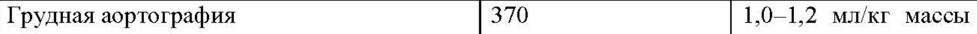
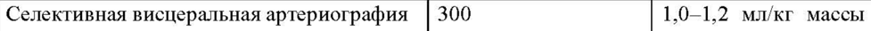
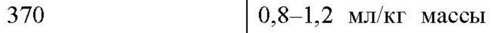
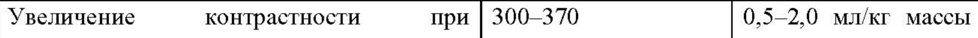

# Йопамидол — парентерально

- Препарат: Йопамискан® (раствор для инъекций)
- АТХ: V08AB04
- Источник: ГРЛС, инструкция по медицинскому применению, РУ ЛП-№002808-(РГ-RU), файл от 2023-08-15 (https://grls.rosminzdrav.ru/Grls_View_v2.aspx?routingGuid=2e79a6f7-76d1-4ade-8d6b-0c81910a3d9d)
- Распознано автоматически (OCR): 10 из 10 стр.
- Сомнительных строк после OCR: 4 (см. раздел «Проверка распознавания»)

## Общие сведения

от 17.07.2023 № 13413 ИНСТВУКПИЯПОСЛЕДОВАТЕЛЬНОСТЬ 0002)
ПО МЕДИЦИНСКОМУ ПРИМЕНЕНИЮ ЛЕКАРСТВЕННОГО ПРЕПАРАТА
Йопамискан® Регистрационный номер:
Торговое наименование: Йопамискан® Международное непатентованное или группировочное наименование: йопамидол

## 3. Лекарственная форма

раствор для инъекций
раствор для инъекций

## 2. Состав

В 1 мл препарата содержится Действующее вещество:
В 1 мл препарата содержится Действующее вещество:
Йопамидол 408,00 мг 612,00 мг 755,00 мг в пересчете на йод 200,00 мг 300,00 mr 370,00 mr
Вспомогательные вещества:
Трометамол 1,00 мг 1,00 mr 1,00 мг Натрия кальция эдетат 0,26 мг 0,39 мг 0,48 мг
Хлористоводородной кислоты до значения до значения до значения раствор 1 М РН 6,5 — 7,5 РН 6,5 — 7,5 РН 6,5 — 7,5
Вода для инъекций до1 мл до 1 мл до1 мл Описание
Прозрачный бесцветный или светло-желтый раствор.
Фармакотерапевтическая группа: контрастные средства; рентгеноконтрастные средства, содержащие йод; водорастворимые нефротропные низкоосмолярные рентгеноконтрастные средства.
Код ATX: VO8AB04 Фармакологические свойства

## 5.1. Фармакодинамика

Йопамидол представляет собой неионный йЙодсодержащий низкомолекулярный рентгеноконтрастный водорастворимый препарат. Раствор обладает низким осмотическим давлением, что способствует хорошей местной и системной переносимости.
Йопамидол представляет собой неионный йЙодсодержащий низкомолекулярный рентгеноконтрастный водорастворимый препарат. Раствор обладает низким осмотическим давлением, что способствует хорошей местной и системной переносимости.

## 5.2. Фармакокинетика

Йопамидол не метаболизируется, не кумулирует в печени и выводится в химически неизмененном виде путем гломерулярной фильтрации. Период полувыведения у пациентов с нормальной функцией почек составляет около 2 часов. Через 24 часа йопамидол практически полностью выводится из организма с мочой.
Йопамидол не метаболизируется, не кумулирует в печени и выводится в химически неизмененном виде путем гломерулярной фильтрации. Период полувыведения у пациентов с нормальной функцией почек составляет около 2 часов. Через 24 часа йопамидол практически полностью выводится из организма с мочой.
СООТВЕТСТВУЕТ ЭКСПЕРТНОМУ ОТЧЕТУ от 17.07.2023 № 13413

Йопамидол не проникает через гематоэнцеф ическйй 6a ЕР ела нарный барьер
— в чрезвычайно малой степени. У пациентов с нарушенной функцией почек период полувыведения удлиняется в зависимости от степени поражения почек. Йопамидол не связывается с белками сыворотки или плазмы.

## 4.1. Показания к применению

Рентгеноконтрастное средство для проведения миелорадикулографии; цистернографии;
Рентгеноконтрастное средство для проведения миелорадикулографии; цистернографии;
вентрикулографии; церебральной и коронарной ангиографии; грудной аортографии;
аортографии брюшной полости; ангиокардиографии; селективной висцеральной и периферической артериографии; венографии; цифровой ангиографии церебральных, периферических и абдоминальных артерий; внутривенной урографии; контрастного усиления в компьютерной томографии; артрографии; фистулографии.

## 4.3. Противопоказания

Повышенная чувствительность к йопамидолу, другим йодсодержащим рентгеноконтрастным средствам и вспомогательным компонентам препарата;
Повышенная чувствительность к йопамидолу, другим йодсодержащим рентгеноконтрастным средствам и вспомогательным компонентам препарата;
макроглобулинемия Вальденстрема; множественная миелома; тяжелая печеночная и/или почечная недостаточность; тиреотоксикоз; эпилепсия; декомпенсированная сердечная недостаточность.

## 4.3. С осторожностью

Почечная, печеночная и сердечно-сосудистая недостаточность; эмфизема легких; тяжелое общее состояние; выраженный атеросклероз; сахарный диабет, требующий коррекции;
Почечная, печеночная и сердечно-сосудистая недостаточность; эмфизема легких; тяжелое общее состояние; выраженный атеросклероз; сахарный диабет, требующий коррекции;
субклинический гипертериоз; узловой зоб легкой и средней степени тяжести; пациенты с наличием в анамнезе аллергии, бронхоспазма или других нежелательных реакций при применении Йодсодержащих рентгеноконтрастных средств; пациенты с заболеваниями сердечно-сосудистой системы и легочной гипертензией; с бронхиальной астмой;
поллинозом; серповидно-клеточной анемией; рассеянным склерозом, феохромоцитомой;
острым тромбофлебитом; острой церебральной патологией; опухолями головного мозга;
полиурией; олигурией; подагрой; с алкоголизмом, наркоманией, миастенией.

## 4.6. Применение при беременности и в период грудного вскармливания

Препарат не следует применять у беременных женщин, за исключением тех случаев, когда предполагаемая польза для матери от его применения превышает потенциальный риск для плода, и подобное исследование назначается врачом в силу его необходимости.
Во время беременности запрещается проводить гистеросальпингографию.
Рентгеноконтрастные средства в незначительной степени экскретируются в грудное молоко, поэтому при необходимости введения йопамидола следует прекратить грудное

СООТВЕТСТВУЕТ ЭКСПЕРТНОМУ ОТЧЕТУ от 17.07.2023 № 13413

вскармливание и не возобновлять как Миним M Gia! leprae 2 Gaede Adore исследования.

## 4.2. Способ применения и дозы

Препарат ИЙопамискан® (200, 300, 370 мг йода/мл) вводится внутривенно, внутриартериально, интратекально и в полость сустава.
Препарат ИЙопамискан® (200, 300, 370 мг йода/мл) вводится внутривенно, внутриартериально, интратекально и в полость сустава.
Подготовка пациента Перед использованием контрастного средства необходимо получить точную информацию о пациенте, включая лабораторные данные (в том числе содержание креатинина в сыворотке крови, электрокардиограмма (ЭКГ), аллергия в анамнезе, наличие беременности).
Перед использованием у пациента следует устранить нарушения водно-электролитного баланса и обеспечить достаточное поступление жидкости и электролитов. Это особенно касается пациентов с сахарным диабетом, полиурией, олигурией или подагрой, а также новорожденных, грудных детей и детей раннего возраста, пожилых пациентов.
За 2 часа до процедуры следует воздержаться от приема пищи. При введении препарата пациент должен находиться в горизонтальном положении.
В течение 30 минут после окончания процедуры осуществляют врачебный контроль за пациентом, так как большинство побочных реакций возникает именно в этот период.
Пациент должен быть предупрежден о возможности появления реакций замедленного типа
(в период до 7 дней).
Не рекомендуется проводить предварительное тестирование индивидуальной чувствительности, как при использовании других йодсодержащих контрастных средств.
Пациентам, испытывающим страх перед процедурой, желательно введение седативных средств.
Правила использования препарата Перед введением препарат необходимо нагреть до температуры тела.
Йопамидол набирают в шприц или флакон для капельного введения непосредственно перед началом процедуры. Раствор контрастного средства предназначен исключительно для одноразового использования, резиновую пробку флакона прокалывают лишь один раз, остаток контрастного средства уничтожают. Для введения контрастного средства необходимо использовать отдельные шприц и иглу, не следует смешивать его с другими лекарственными средствами.
Виды диагностики и режим дозирования При применении препарата Йопамискан® (200, 300, 370 мг йода/мл) рекомендуется использовать следующие дозы:

от 17.07.2023 № 13413 (ПОСЛЕДОВАТЕЛЬНОСТЬ 0002)
Вид исследования Концентрация йода | Рекомендуемая доза es НЫ
Грудная аортография 370 1,0-1,2 мл/кг массы
И НЕНИЯ Абдоминальная аортография 370 1,0-1,2 мл/кг массы
—s ee Ангиокардиография 370 1,0-1,2 мл/кг массы
О НИЯ Селективная висцеральная артериография |300 1,0-1,2 мл/кг массы
Cee 370 0,8—1,2 мл/кг массы ПЕНЫ Цифровая субтракционная ангиография
И лис Увеличение контрастности при | 300-370 0,5—2,0 мл/кг массы п
Артрография 300 в зависимости от И ПИ Фистулография 300 в зависимости от
ПН ВЫ *Для увеличения контрастности в сканерах при проведении компьютерной томографии препарат может вводиться как болюсно, так и путем капельной инфузии; а также в комбинации этих двух методов.
Внутривенная урография Препарат вводят внутривенно.
СООТВЕТСТВУЕТ ЭКСПЕРТНОМУ ОТЧЕТУ от 17.07.2023 № 13413
(ПОСЛЕДОВАТЕЛЬНОСТЬ 0002)
О зееньиы Дети 1-2,5 мл/кг пропорционально дозе для взрослых в зависимости от массы тела и возраста
Взрослые 40-80 мл, при острой почечной недостаточности ДОЛЖНЫ применяться обычные способы дозирования (до 1,5 мл/кг массы тела)
Для обследования пациентов с нарушенной функцией почек наиболее приемлемым является препарат Йопамискан® 370 мг/мл, который характеризуется наименее выраженным осмотическим диурезом.

## 4.8. Побочное действие

Нарушения со стороны иммунной системы: острый ринит, отек гортани, кожные реакции
Нарушения со стороны иммунной системы: острый ринит, отек гортани, кожные реакции
(сыпь, крапивница, зуд), анафилактический шок.
Эндокринные нарушения: гипертиреоз (у пациентов, ранее проходивших лечение по поводу болезни Грейвса).
Нарушения со стороны нервной системы: головная боль, головокружение, сонливость, возбуждение, тонические/клонические судороги, афазия, обморок, временное сужение полей зрения, гемипарез, кома (развивалась у пациентов, страдающих заболеваниями центральной нервной системы), временная спутанность сознания, преходящее нарушение ориентации в пространстве или кортикальная слепота, извращение вкуса, менингизм, изменения на ЭЭГ.
Нарушения со стороны органа зрения: зуд в глазах, слезотечение, конъюнктивит, светобоязнь.
Нарушения со стороны органа слуха и лабиринта: временная потеря слуха.
Нарушения со стороны сердца: тахикардия, одышка, цианоз и потеря сознания (могут требовать срочного лечения), преходящая брадикардия, ишемия миокарда, желудочковая аритмия, нарушение сердечного ритма, снижение сократительной функции миокарда, сердечная недостаточность, изменения на ЭКГ (в т.ч. депрессия сегмента ST).
Нарушения со стороны сосудов: периферическая вазодилатация, выраженная артериальная гипотензия, артериальная гипертензия, артериальный тромбоз, постфлебографический тромбофлебит или тромбоз.
от 17.07.2023 № 13413

Нарушения со стороны дыхательной систёмы, ор ВБ ЗН were Ч “cheddchehus:
кашель, чихание, бронхоспазм, отек легких.
Желудочно-кишечные нарушения: тошнота, рвота, боль в животе.
Нарушения со стороны кожи и подкожных тканей: синдром Стивенса-Джонсона.
Нарушения со стороны мышечной, скелетной и соединительной ткани: ригидность мышц шеи, боль в пояснице, в отдельных случаях у пациентов с повышенной судорожной готовностью или использующих психотропные ЛС при введении Йопамидола могут возникать спазмы скелетной мускулатуры или генерализованные судороги.
Нарушения со стороны почек и мочевыводящих путей: острая почечная недостаточность, анурия, олигурия, гематурия.
Общие нарушения и реакции в месте введения: боль в месте инъекции, генерализованное ощущение жара, повышенное потоотделение, астения, бледность кожных покровов, лихорадка, тремор, озноб, боль в груди.
Лабораторные и инструментальные данные: тромбоцитопения, анемия.
Травмы, интоксикации и осложнения процедур: йодизм.

## 4.9. Передозировка

Передозировка маловероятна у пациентов с нормальной функцией почек. В случае использования высоких Доз препарат может вызвать тяжелые осложнения со стороны сердечно-сосудистой, дыхательной систем и функции почек. Специфического антидота не существует, лечение симптоматическое; возможно проведение гемодиализа.
Передозировка маловероятна у пациентов с нормальной функцией почек. В случае использования высоких Доз препарат может вызвать тяжелые осложнения со стороны сердечно-сосудистой, дыхательной систем и функции почек. Специфического антидота не существует, лечение симптоматическое; возможно проведение гемодиализа.

## 4.5. Взаимодействие с другими лекарственными средствами

При использовании одновременно с психотропными лекарственными средствами, анальгетиками и антидепрессантами Ййопамидол может снижать судорожный порог, увеличивая риск побочных реакций.
Использование йопамидола у пациентов с диабетической нефропатией, принимающих бигуаниды (метформин), может приводить к преходящему нарушению функции почек и развитию молочнокислого ацидоза. В качестве меры предосторожности необходимо прекратить прием бигуанидов за 48 часов до исследования и возобновить после полной стабилизации функции почек.
У пациентов, принимающих бета-адреноблокаторы, проявления анафилаксии при применении йопамидола могут быть атипичными и ошибочно приниматься за вагусные реакции.
Пациенты, принимавшие менее чем за 2 недели до исследования интерлейкин-2, склонны к повышенной частоте отсроченных побочных реакций (гриппоподобные состояния, сыпь).

## 4.4. Особые указания

СООТВЕТСТВУЕТ ЭКСПЕРТНОМУ ОТЧЕТУ от 17.07.2023 № 13413

Помещения, В которых осуществляются ( ПОД у РАТЕЛЬНА иль ЗоКинием рентгеноконтрастных препаратов, должны быть обеспечены оборудованием и лекарственными средствами, которые необходимы в чрезвычайных ситуациях
(кислородные баллоны, антигистаминные и сосудосуживающие средства, глюкокортикостероиды).
Перед каждым применением рентгеноконтрастного средства необходимо получить точную информацию о пациенте, включая важные лабораторные данные (в том числе содержание креатинина в сыворотке крови, ЭКГ, аллергия в анамнезе и наличие беременности).
Перед исследованием у пациента следует устранить нарушение водно-электролитного баланса и обеспечить достаточное поступление жидкости и электролитов.
Запрещается смешивать рентгеноконтрастный препарат с другими лекарственными средствами.
Для оказания неотложной помощи при возникновении острых нежелательных реакций следует обеспечить безопасный доступ к сосуду (постоянная канюля).
Гиперчувствительность Риск серьезных аллергических реакций при использовании йопамидола низок. Тем не менее возможно развитие анафилактоидных или других аллергических реакций, что требует наличия соответствующих медикаментов и оборудования для проведения реанимационных мероприятий. Желательно использовать постоянную канюлю или катетер для быстрого доступа к сосуду во время всего исследования. Рекомендуется премедикация глюкокортикостероидами или антигистаминными лекарственными препаратами.
Регидратация При исследовании пациентов с сахарным диабетом, нарушением функции почек, новорожденных, детей до года и пожилых пациентов необходимо проведение адекватной регидратации до и после введения рентгеноконтрастного средства. Грудные дети и особенно новорожденные чувствительны к нарушению водно-электролитного баланса и изменениям гемодинамики.
При нейрорентгенологических исследованиях
В случае наступления цереброспинальной блокады при введении йопамидола следует удалить столько введенного контрастного раствора, сколько возможно.
В случаях присутствия крови в цереброспинальной жидкости врач должен внимательно оценить необходимую потребность в диагностической процедуре с учетом риска для пациента.
При ангиографических исследованиях

Я от 17.07.2023 № 13413

При выполнении ангиографических исследований БЕД тет Обиытельно Cobia) их методику и часто промывать катетеры (например, 0,9 % раствором натрия хлорида с добавлением гепарина) для минимизации риска тромбозов и эмболий, связанных с вмешательством.
У пациентов, подвергающихся ангиокардиографическим процедурам, особое внимание следует уделять состоянию правых отделов сердца и легочной циркуляции. Введение органического йодсодержащего раствора при недостаточности правых отделов сердца и легочной гипертензии может вызвать брадикардию и артериальную гипотензию.
Повышенную осторожность следует соблюдать при введении контрастного средства в правые полости сердца новорожденным с легочной гипертензией и ослабленной сердечной функцией.
При контрастировании дуги аорты в ряде случаев возможно развитие артериальной гипотензии, брадикардии.
При периферической артериографии с йопамидолом в дозировке 370 мг/мл иногда может возникать боль в обследуемой конечности. Обычно этого не наблюдается при использовании менее концентрированного раствора — 300 мг/мл.
При назначении Йопамидола пациентам, которым предстоит исследование функции щитовидной железы, следует иметь в виду, что поглощение йода тканями щитовидной железы снижается на период до 2-х недель, что может повлиять на результаты исследования.
Высокие концентрации рентгеноконтрастного средства в плазме крови и моче могут влиять на результаты биохимических тестов по определению концентрации билирубина, белков или неорганических веществ (например, железа, меди, кальция и фосфатов). Поэтому подобные анализы не следует выполнять в день исследования.
Необходимо прекратить прием бигуанидов за 48 часов до исследования и возобновить после полной стабилизации функции почек. Повторные рентгеноконтрастные исследования должны выполняться не ранее того момента, когда функция почек восстановится до исходного уровня.
Следует соблюдать осторожность у пациентов с тяжелыми сочетанными нарушениями функции печени и почек, так как у них значительно снижен клиренс рентгеноконтрастных средств.
Выполнение рентгеноконтрастных исследований у пациентов, находящихся на гемодиализе, возможно при условии, что диализ будет проведен сразу после исследования.
При острых воспалительных заболеваниях органов малого таза противопоказана гистеросальпингография.

от 17.07.2023 № 13413

При остром панкреатите противо оказана( ОбНДоБИчеекая ОС ЬтрОВаЯная холангиопанкреатография.
Дети Следует проводить мониторинг функции щитовидной железы у новорожденных и детей в возрасте до 3 лет в течение 3 недель после введения йодсодержащих контрастных средств с диагностической целью.

## 4.7. Влияние на способность управлять транспортными средствами, механизмами

Исследований о влиянии на способность управлять транспортными средствами, механизмами не проводилось.
Не рекомендуется управлять транспортными средствами и заниматься другими потенциально опасными видами деятельности, требующими повышенной концентрации внимания и быстроты психомоторных реакций, в течение 24 часов после проведения исследования.

## 6.5. Форма выпуска

Раствор для инъекций 200, 300 и 370 мг йода/мл.
Раствор для инъекций 200, 300 и 370 мг йода/мл.
Первичная упаковка лекарственного препарата
По 20, 30, 50, 100, 200 или 500 мл в стеклянные флаконы типа | гидролитического класса, герметично укупоренные бромбутиловыми пробками и закрытые алюминиевыми колпачками типа «flip-off».
На каждый флакон наклеивают этикетку из бумаги этикеточной или писчей, или из полимерных материалов, самоклеящуюся.
Вторичная упаковка лекарственного препарата
По 1 флакону с препаратом вместе с инструкцией по применению помещают в пачку из картона. На пачку может наклеиваться самоклеящаяся этикетка с маркировкой. Пачки помещают в групповую упаковку.
По 1, 10, 20 или 28 флаконов с препаратом и с равным количеством инструкций по применению помещают в коробку из картона с перегородкой (или без нее) (для стационаров). На коробку из картона наклеивают этикетку из бумаги этикеточной или писчей, или из полимерных материалов, самоклеящуюся. Коробки из картона помещают в групповую упаковку.

## 6.4. Условия хранения

В защищенном от света и вторичных рентгеновских лучей месте при температуре не выше ao °C.
В защищенном от света и вторичных рентгеновских лучей месте при температуре не выше ao °C.
Хранить в недоступном для детей месте.

## 6.3. Срок годности

от 17.07.2023 № 13413 4 года. (ПОСЛЕДОВАТЕЛЬНОСТЬ 0002)
Не применять по истечении срока годности.
Условия отпуска Отпускают по рецепту.
Владелец регистрационного удостоверения/ Организация, принимающая претензии потребителей
Российская Федерация ООО «Фармасинтез-Тюмень»
Адрес: 625059, г. Тюмень, 7-ой км Велижанского тракта, д. 2
'Тел.: 8-800-100-15-50 Адрес электронной почты: info-pst(@pharmasyntez.com
Производитель Российская Федерация ООО «Фармасинтез-Тюмень»
Адрес производственной площадки: г. Тюмень, 7-ой км Велижанского тракта, д. 2
Тел.: +7 (3452) 69-45-10
## Проверка распознавания

Страницы-сканы распознаны автоматически. В 4 строках с дозировками цифры могли распознаться с ошибкой — сверьте с вырезкой из оригинала:

- стр. 4: «Грудная аортография 370 1,0-1,2 мл/кг массы» — низкая уверенность: «1,0-1,2» (77)  
  
- стр. 4: «Селективная висцеральная артериография |300 1,0-1,2 мл/кг массы» — низкая уверенность: «1,0-1,2» (70)  
  
- стр. 4: «370 0,8—1,2 мл/кг массы» — низкая уверенность: «0,8—1,2» (80)  
  
- стр. 4: «Увеличение контрастности при | 300-370 0,5—2,0 мл/кг массы» — низкая уверенность: «300-370» (70)  
  
