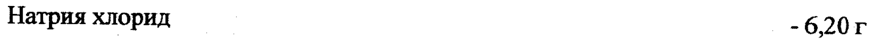
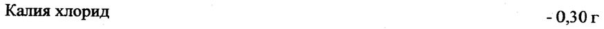
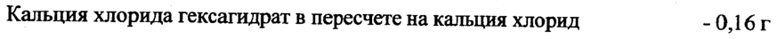
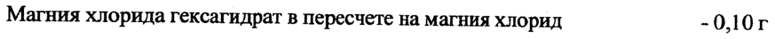
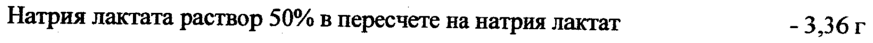
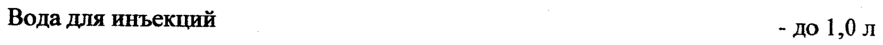

# Калия хлорид + Кальция хлорид + Магния хлорид + Натрия лактат + Натрия хлорид — парентерально

- Препарат: Рингера-лактат с магнием (раствор для инфузий;)
- АТХ: B05BB01
- Источник: ГРЛС, инструкция по медицинскому применению, РУ Р N000077/01, файл от 2023-03-03 (https://grls.rosminzdrav.ru/Grls_View_v2.aspx?routingGuid=dc4e4fe7-997b-4e67-9291-27d8385b39a4)
- Распознано автоматически (OCR): 4 из 4 стр.
- Инструкция к другому РУ того же препарата: Р N000077/01 (национальное РУ, переоформленное по правилам ЕАЭС, решение от 07.02.2023). Текст может быть старше действующего
- Сомнительных строк после OCR: 6 (см. раздел «Проверка распознавания»)

## Общие сведения

| Р №000077/01-270112 МИНИСТЕРСТВО ЗДРАВООХРАНЕНИЯ И СОЦИАЛЬНОГО РАЗВИТИЯ
РОССИЙСКОЙ ФЕДЕРАЦИИ ИНСТРУКЦИЯ по применению лекарственного препарата для медицинского применения
«Рингера-лактат с магнием»
Регистрационный номер:
Торговое название. Рингера-лактат с магнием.
МНН или Группировочное название Калия хлорид+Кальция хлорид+Магния хлорид+Натрия лактат+Натрия хлорид&.
ww Лекарственная форма: раствор для инфузий.

## 2. Состав

Активные вещества:
Активные вещества:
Натрия хлорид - 6,20 г Калия хлорид - 0,30 г
Кальция хлорида гексагидрат в пересчете на кальция хлорид - 0,16г
Магния хлорида гексагидрат в пересчете на магния хлорид - 0,10 г
Натрия лактата раствор 50% в пересчете на натрия лактат -3,36г
Вспомогательные вещества:
Вода для инъекций - до 1,0 л Теоретическая осмолярность 283 мОсмолы/Л.
SE Ионный состав на 1000 мл препарата:
Натрий-иона - 125 - 150 ммоль Калий-иона - 3,5 - 4,5 ммоль
Кальций-иона - 1,2 - 1,6 ммоль Магний-иона - 0,85 - 1,3 ммоль
Лактат-иона - 25 - 35 ммоль Хлорид-иона - 100- 130 ммоль
Теоретическая осмолярность _ 283 мОсмолы/л
Описание: прозрачная бесцветная жидкость.
Фармакотерапевтическая группа: электролитов баланс восстанавливающее средство.
Код ATX: В05ВВО1 | | | Р №000077/01-270112
Фармакологические свойства Комбинированный препарат, устраняет нарушения водно-электролитный баланс (с коррекцией метаболического ацидоза путем изменения буферной емкости крови).
Улучшает реологические свойства крови и периферическое кровообращение (в результате гемодилюции и снижения вязкости крови). Оказывает плазмозамещающее, дезинтоксикационное и диуретическое действие. Расслабляет гладкую мускулатуру, снижает артериальное давление (преимущественно повышенное), усиливает диурез.
Показания для применения Шок; термическая травма; острая кровопотеря; дегидратация; кишечный свищ; острые кишечные инфекции; лечебный плазмаферез; коррекция водного и солевого баланса при остром разлитом перитоните и кишечной непроходимости.
„= oe Противопоказания для применения Гиперчувствительность, тяжелые поражения печени, респираторный алкалоз, закрытые травмы черепа, протекающих с внутрицеребральной гипертензией, декомпенсированная сердечная недостаточность, отек легких, гипернатриемия, гиперхлоремия и другие состояния, когда введение в организм больших количеств жидкости не показано.

## 4.3. С осторожностью

Почечная недостаточность, ожоги дыхательных путей, а также у больных пожилого и старческого возраста, беременность и период лактации.
Почечная недостаточность, ожоги дыхательных путей, а также у больных пожилого и старческого возраста, беременность и период лактации.

## 4.2. Способ применения и дозы

, способ введения Внутривенно. Перед применением подогреть до температуры тела.
, способ введения Внутривенно. Перед применением подогреть до температуры тела.
Lo Шок: в I стадии внутривенно струйно вводят 2-3 л раствора, при улучшении
| гемодинамических показателей — капельно (60 кап/мин). При тяжелом шоке применяют в сочетании с кровью, полиглюкином, плазмой, протеином только после выведения больного из состояния гемодинамического криза. Доза устанавливается индивидуально, в зависимости от состояния больного, не менее 1-2 л.
Термическая травма: в 1 периоде применение допустимо при ожогах не более 10-15% поверхности тела в дозе до 3 л. при обширных термических травмах, при дефиците объема плазмы и гипотензии применяют в сочетании с полиглюкином, плазмой, альбумином. Доза при комбинированном лечении в первые сутки — не менее 1-2 л, во вторые сутки — % объема, введенного в первые 24 ч. Во П-Ш периодах ожоговой болезни доза зависит от тяжести проявления нарушений и колеблется от 400 до 1000 мл.
При острой кровопотери — до 2-4 л в сутки, в течение 3-4 дней, в комбинации с
Неогемодезом, кровью, плазмой, декстраном. | | | | |
Р №000077/01-270112 При коррекции водного и солевого баланса, кишечной непроходимости, дегидратации, кишечном свище, плазмаферезе, острых кишечных инфекциях — 1-3 л/сут.
Средняя суточная доза детям — 20-30 мл/кг.
Меры предосторожности Необходимо проводить контроль содержания электролитов в плазме крови и моче.

## 4.9. Передозировка

В случае передозировки может произойти нарушение баланса воды, электролитов и кислотно-щелочного равновесия. При необходимости проводят гемодиализ и перитонеальный диализ. В большинстве случаев достаточно прервать введение раствора.
В случае передозировки может произойти нарушение баланса воды, электролитов и кислотно-щелочного равновесия. При необходимости проводят гемодиализ и перитонеальный диализ. В большинстве случаев достаточно прервать введение раствора.
Возможные побочные действия при применении лекарственного препарата
Редко: озноб, повышение температуры. Нарушения кислотно-основного состояния.
9“ Взаимодействие с другими лекарственными препаратами
Усиливает действие осмотических диуретиков.
Указание возможности и особенностей медицинского применения лекарственного препарата беременным женщинам, женщинам в период грудного вскармливания, детьми, взрослыми, имеющими хронические заболевания
Во время беременности применяют в случае, если польза для матери превышает возможный риск для плода. Во время применения препарата грудное вскармливание необходимо прекратить.

## 6.5. Форма выпуска

Раствор для инфузий по 100, 250, 500, 1000 мл в контейнеры полимерные для инфузионм > oo ных растворов однократного применения КПИР из поливинилхлоридной или полиолефи-
Раствор для инфузий по 100, 250, 500, 1000 мл в контейнеры полимерные для инфузионм > oo ных растворов однократного применения КПИР из поливинилхлоридной или полиолефи-
| новой пленок. Каждый контейнер упаковывают во вторичный пакет с нанесенной на него инструкцией по применению. Допускается инструкцию по применению вкладывать в ящик с контейнерами в количестве равном количеству контейнеров. Контейнеры во вторичной упаковке помещают в транспортную тару (ящики из гофрированного картона).
Сведения © возможном влиянии лекарственного препарата для медицинского применения на способность управлять транспортными средствами, механизмами
Нет данных.

## 6.3. Срок годности

2 года. Не использовать по окончании срока годности, указанного на упаковке.
2 года. Не использовать по окончании срока годности, указанного на упаковке.
_ Условия хранения | P №000077/01-270112
Хранить в сухом месте, при температуре от 5 до 30 °С. Хранить в недоступном для детей месте. Допускается замораживание препарата при транспортировании.
Условия отпуска из аптек По рецепту.
Наименование, адрес производителя лекарственного препарата
ОАО «Фирма Медполимер», Россия, 195279, г. Санкт-Петербург, ш. Революции, д. 69
Тел. (812) 520-64-05, Факс (812) 520-64-08.
Адрес места производства: Россия, 195279, г. Санкт-Петербург, пр. Индустриальный, д.86.
| rN oe общест, с | a я . | Генеральный директор of © С > \\
ОАО «Фирма Медполимерй $ А у О.В. Свинцова
2 Е
RN onus s Verepsyot .
А
## Проверка распознавания

Страницы-сканы распознаны автоматически. В 6 строках с дозировками цифры могли распознаться с ошибкой — сверьте с вырезкой из оригинала:

- стр. 1: «Натрия хлорид - 6,20 г» — низкая уверенность: «6,20» (48)  
  
- стр. 1: «Калия хлорид - 0,30 г» — низкая уверенность: «0,30» (17)  
  
- стр. 1: «Кальция хлорида гексагидрат в пересчете на кальция хлорид - 0,16г» — низкая уверенность: «0,16г» (77)  
  
- стр. 1: «Магния хлорида гексагидрат в пересчете на магния хлорид - 0,10 г» — низкая уверенность: «0,10» (0)  
  
- стр. 1: «Натрия лактата раствор 50% в пересчете на натрия лактат -3,36г» — низкая уверенность: «-3,36г» (77)  
  
- стр. 1: «Вода для инъекций - до 1,0 л» — низкая уверенность: «1,0» (45)  
  
