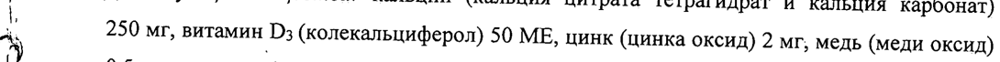
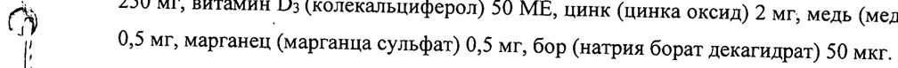
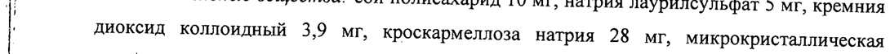
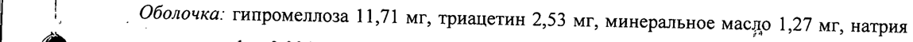
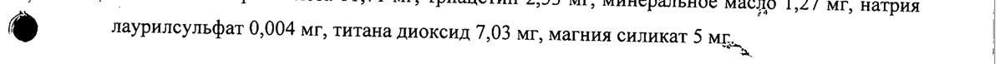
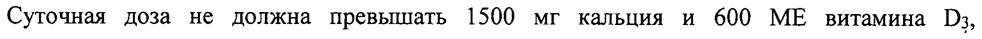
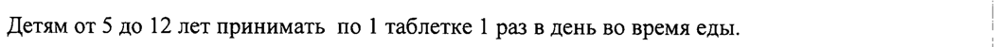

# Кальцемин® — внутрь

- Препарат: Кальцемин® (таблетки, покрытые пленочной оболочкой;)
- АТХ: A12AX
- Источник: ГРЛС, инструкция по медицинскому применению, РУ П N015890/01, файл от 2025-04-30 (https://grls.rosminzdrav.ru/Grls_View_v2.aspx?routingGuid=87c8ab0d-4825-4d19-9eb2-cade8325c4ea)
- Распознано автоматически (OCR): 5 из 5 стр.
- Инструкция к другому РУ того же препарата: П N015890/01 (национальное РУ, переоформленное по правилам ЕАЭС, решение от 22.04.2025). Текст может быть старше действующего
- Сомнительных строк после OCR: 7 (см. раздел «Проверка распознавания»)

## Общие сведения

| | ; МИНИСТЕРСТВО ЗДРАВООХРАНЕНИЯ РОССИЙСКОЙ ФЕДЕРАЦИИ |
| ИНСТРУКЦИЯ | по применению лекарственного препарата для медицинского применения
КАЛЬЦЕМИН® — МИНЗДРАВ РОССИИ | ` Регистрационный номер: Я мовлас/- 161274
Торговое название , COTMACOBA HO Кальцемин® |

## 3. Лекарственная форма

| @ Таблетки, покрытые пленочной оболочкой.
| @ Таблетки, покрытые пленочной оболочкой.
, | | Состав | . 1 таблетка содержит | Действующие вещества: кальций (кальция цитрата тетрагидрат и кальция карбонат)
i" 250 мг, витамин D3 (колекальциферол) 50 МЕ, цинк (цинка оксид) 2 мг, медь (меди оксид)
cy 0,5 мг, марганец (марганца сульфат) 0,5 мг, бор (натрия борат декагидрат) 50 мкг.
Вспомогательные вещества: сои полисахарид 10 мг, натрия лаурилсульфат 5 мг, кремния
| | диоксид коллоидный 3,9 мг, кроскармеллоза натрия 28 мг, микрокристаллическая целлюлоза 199,45 мг, стеариновая кислота 35 мг, магния стеарат 10 мг.
| 7 _ Оболочка: гипромеллоза 11,71 мг, триацетин 2,53 мг, минеральное масло 1,27 мг, натрия
Г) лаурилсульфат 0,004 мг, титана диоксид 7,03 мг, магния силикат 5 Minn, |
| Описание | Таблетки двояковыпуклые овальной формы, покрытые пленочной оболочкой белого цвета с риской на одной стороне. 7 |
Фармакотерапевтическая группа Кальциево-фосфорного обмена регулятор. |
:
Код ATX: А12АХ | Г.
| | | | Фармакологические свойства | Комбинированный препарат, содержащий кальций, витамин D3, остеотропные минералы, регулирующие обмен кальция.
Фармакологическое действие препарата определяется свойствами входящих в его состав
| ингредиентов.
| | Кальций участвует в формировании костной ткани, снижает резорбцию (рассасывание) и увеличивает плотность костной ткани, предупреждает заболевания опорно-двигательного
| аппарата, способствует укреплению костной системы и суставов.
Кальций цитрат обеспечивает усвоение кальция вне зависимости от функционального состояния ЖКТ, что применимо для лечения пациентов со сниженной секреторной функцией ЖКТ, а также на фоне лечения препаратами для снижения секреции; снижает
\ ..
| @ уровень маркеров резорбции костной ткани, что свидетельствует о замедлении процессов
“f разрушения костной ткани; регулирует уровень паратгормона, что приводит к улучшению
| | регуляции кальциевого гомеостаза; не увеличивает содержание оксалатов и кальция в
| моче, следовательно не вызывает риска образования камней в почках; не блокирует усвоение железа, что снижает риск развития железодефицитной анемии
| NN ) Колекальциферол (витамин D3) регулирует обмен кальция и фосфора в организме,
: участвует в формировании костного скелета, способствует сохранению структуры костей,
| усиливает всасывание кальция в кишечнике и реабсорбцию фосфора в почечных
| канальцах.
Цинк способствует синтезу половых гормонов, что препятствует разрушению костной
| и @ ткани. | О an | Марганец участвует в образовании протеогликанов, что улучшает качество костной ткани и формирует протеиновый матрикс костной ткани.
Медь участвует в синтезе коллагена и эластина, входящего в состав костной и соединительной ткани, что оказывает влияние на процессы образования костной массы.
Бор снижает избыточную активность паратгормона, улучшает абсорбцию кальция, уменьшает риск развития дефицита холекальциферола, способствует предотвращению остеопороза.

## 4.1. Показания к применению

Профилактика и комплексное лечение остеопороза различного генеза.
Профилактика и комплексное лечение остеопороза различного генеза.
| | | | Для восполнения дефицита кальция и микроэлементов у детей, подростков и у женщин в | период беременности и грудного вскармливания.
| Противопоказания | Повышенная индивидуальная чувствительность к какому-либо из компонентов препарата, | гиперкальциемия и гиперкальциурия, нефролитиаз, гипервитаминоз витамина D3, тяжелая | q | почечная недостаточность, активная форма туберкулеза, декальцинирующие опухоли |
(миелома, костные метастазы, саркоидоз), детский возраст до 5 лет. |
| С осторожностью | Доброкачественный гранулематоз, прием сердечных гликозидов и тиазидных диуретиков, беременность, период лактации.
| ) | | | | Применение в период беременности и грудного вскармливания |
В период беременности и грудного вскармливания прием препарата следует согласовать с |
| | | врачом. | Суточная доза не должна превышать 1500 мг кальция и 600 МЕ витамина D3,
® гиперкальциемия, развивающаяся Ha фоне передозировки в период беременности может
| | вызвать дефекты умственного и физического развития у плода. |
| | У кормящих женщин следует учитывать, что колекальциферол и его метаболиты | проникают в грудное молоко, поэтому необходимо учитывать поступление кальция и !
витамина D3. .
7 ® Способ применения и дозы aN, | | Внутрь. :
Детям от 5 до 12 лет принимать по 1 таблетке | раз в день во время еды. | 3 |
| Взрослым и детям старше 12 лет - по 1 таблетке 2 раза в день во время еды. |
В период беременности и грудного вскармливания: с 20-й недели беременности и весь период грудного вскармливания - по | таблетке 2 раза в день. |
| | Минимальный курс приема препарата для лечения остеопороза в составе комплексной
| | терапии для взрослых составляет 3 месяца, более продолжительный курс — после консультации с врачом. | 3
| Минимальный курс приема препарата для профилактики остеопороза для взрослых составляет 1 месяц, более продолжительный курс — после консультации с врачом. |
| | i | | | | : | | | . Минимальный курс приема препарата для детей и взрослых при дефиците кальция и
| микроэлементов составляет 2-3 месяца, более продолжительный курс — после
| | консультации с врачом.
Повторный курс приема препарата возможен через 1 месяц после окончания лечения.
| Побочное действие Тошнота, рвота, метеоризм, диарея, запор, гиперкальциемия и гиперкальциурия,
| аллергические реакции (зуд, сыпь, крапивница). `
Ро | Передозировка | Гипервитаминоз витамина О, гиперкальциемия и гиперкальциурия. Симптомы: снижение
| | аппетита, жажда, полиурия, головокружение, обморочные состояния, запор, тошнота и
' @ рвота. При длительном применении избыточных доз кальциноз сосудов и тканей. При
| этом необходимо уменьшить дозу или прекратить применение препарата. При случайной передозировке следует вызвать рвоту, промыть желудок. Терапия симптоматическая.
| Взаимодействие с лекарственными средствами
| При одновременном применении препарата Кальцемин® с витамином А уменьшается
| } токсичность витамина D3. Фенитоин, барбитураты, глюкокортикоиды уменьшают эффективность витамина D3. Слабительные средства снижают абсорбцию витамина D3.
Глюкокортикоиды, гормональные противозачаточные средства для системного
| применения, левотироксин ухудшают всасывание ионов кальция. При одновременном
, применении тетрациклинов интервал между приемами должен быть не менее 3 часов,
| бисфосфонатов и натрия фторида (нарушается их всасывание) — не менее 2 часов. При совместном применении препарата Кальцемин® с сердечными гликоЗидами повышается
| их токсичность (необходим контроль ЭКГ и клинического состояния), с тиазидными диуретиками — увеличивается риск развития гиперкальциемии, с фуросемидом и другими
«петлевыми» диуретиками — увеличивается выведение кальция почками. Не следует применять Кальцемин® совместно с блокаторами кальциевых каналов. Не рекомендуется
| одновременный прием препарата с антацидами, которые содержат алюминий, из-за снижения их эффективности.
| | у | Особые указания - i | Доза He должна ‘превышать Ty, которая указана в инструкции, так как повышенное
| | потребление кальция может угнетать всасывание в кишечнике железа, цинка и других
| необходимых минералов.
| |+ Влияние на способность управлять автомобилем и движущими механизмами
Не влияет. - | Форма выпуска Таблетки, покрытые пленочной оболочкой.
По 30, 60 и 120 таблеток во флаконе из полиэтилена высокой плотности с
| завинчивающейся крышкой из полиэтилена высокой плотности, опечатанной полимерной
| пленкой. Горлышко флакона опечатано защитной упаковкой из фольги. Флакон вместе с
| инструкцией по медицинскому применению препарата помещают в картонную пачку.
| | Условия хранения р | При температуре не выше 25 °С.
| |
6 Хранить в недоступном для детей месте.
| Срок годности | 3 года. Не использовать по истечении срока годности.
| | Условия отпуска 4 @ Без рецепта. .
м“ Производитель | ЗАО «Байер», Россия Произведено: Контракт Фармакал Корпорейшн, 135 Адамс Авеню, Хоппог, Нью-Йорк 11788,
США Дополнительную информацию можно получить по адресу:
107113, г. Москва, 3-я Рыбинская ул., д. 18, стр. 2
. Ten.: +7 (495) 231-12-00, факс: +7 (495) 231-12-02 C= LSS
| с 75 р </ “BAKER” \- щ . iv | Менеджер по регистрации левее °\ А/О "BAYER" Е Олейник Е.Ф.
B 5 i ~ | © < * a 5 | Moc. ek
## Проверка распознавания

Страницы-сканы распознаны автоматически. В 7 строках с дозировками цифры могли распознаться с ошибкой — сверьте с вырезкой из оригинала:

- стр. 1: «i" 250 мг, витамин D3 (колекальциферол) 50 МЕ, цинк (цинка оксид) 2 мг, медь (меди оксид)» — повторное чтение: «+ 90 мг, витамин Ds  <олекальциферол) 50 МЕ, инк (цинка оксид) 2 ur mene (мели окон»  
  
- стр. 1: «cy 0,5 мг, марганец (марганца сульфат) 0,5 мг, бор (натрия борат декагидрат) 50 мкг.» — повторное чтение: «GV snr, mapas (pra yn) 0,5 ur, бо ата бо»  
  
- стр. 1: «| | диоксид коллоидный 3,9 мг, кроскармеллоза натрия 28 мг, микрокристаллическая» — повторное чтение: «| диоксид коллондный 39 wr, “xpockapwennosa ария 28 мп wupoxpuerasanaeones»  
  
- стр. 1: «| 7 _ Оболочка: гипромеллоза 11,71 мг, триацетин 2,53 мг, минеральное масло 1,27 мг, натрия» — низкая уверенность: «7» (47)  
  
- стр. 1: «Г) лаурилсульфат 0,004 мг, титана диоксид 7,03 мг, магния силикат 5 Minn, |» — повторное чтение: «e | naypuneymsdar 0,004 Mr, титана диоксид 7,03 vr mars силикаты. oo»  
  
- стр. 3: «Суточная доза не должна превышать 1500 мг кальция и 600 МЕ витамина D3,» — низкая уверенность: «D3,» (55)  
  
- стр. 3: «Детям от 5 до 12 лет принимать по 1 таблетке | раз в день во время еды. |» — повторное чтение: «Детям от 5 до 12 лет принимать по | таблетке | раз в день во время еды.»  
  
