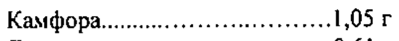
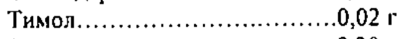

# Камфора + Левоментол + Скипидарное масло + Эвкалиптовое масло — наружно

- Препарат: ДОКТОР МОМ® ФИТО (мазь для наружного применения;)
- АТХ: R05X
- Источник: ГРЛС, инструкция по медицинскому применению, РУ П N016277/01, файл от 2024-01-15 (https://grls.rosminzdrav.ru/Grls_View_v2.aspx?routingGuid=6400a916-0464-4591-9e4b-ddf0fb7d2506)
- Распознано автоматически (OCR): 2 из 2 стр.
- Инструкция к другому РУ того же препарата: П N016277/01 (национальное РУ, переоформленное по правилам ЕАЭС, решение от 14.12.2023). Текст может быть старше действующего
- Сомнительных строк после OCR: 2 (см. раздел «Проверка распознавания»)

## Общие сведения

.. | | П №016277/01-260110 | . ИНСТРУКЦИЯ
$ ` по медицинскому применению препарата
ДОКТОР МОМ? КОЛД РАБ | | Регистрационный номер:
Торговое название: ДОКТОР МОМ® КОЛД РАБ Лекарственная форма. |
Мазь для наружного применения | Состав на 20 г мази
Активные компоненты:
Камфора....... ил анннннннньи 1,09 Г Левоментол...... 00... cece eeee ee OO Г oy Ореха мускатного масло.......0,1 мл
Скипидарное масло............... МЛ ТИМОЛ..... cece ccc аниннитнннание ни. 0,02 Г
Эвкалиптовое масло............. 0,30 мл Вспомогательное вещество:
Белый мягкий парафин...........ск. треб. до 20,0 г
Описание Полупрозрачная мазь белого или почти белого цвета с запахом левоментола H камфоры.
Фармакотерапевтическая группа Местнораздражающее средство природного происхождения
Код ATX : ROSX Фармакологические свойства
Оказывает местнораздражающее, отвлекающес, противовоспалительное и
© антисептическое действие.
‚ Показания к применению | Симптоматическая терапня острых респираторных заболеваний, сопровождающихся
| насморком, чувством заложенности носа, а также при мышечных болях, болях в спине;
| головных болях | Противопоказания _ Повышенная чувствительность к компонентам препарата ,
| Повреждения’ кожных покровов, наличие кожных. заболеваний на участках предполагаемого применения препарата.
| Детский возраст до 2-х лет.

## 4.6. Применение при беременности и в период грудного вскармливания

_ препарата данной групие He рекомендуется.
56635 | П NO16277/01-260110 :
| | Способ применения ‘a Только для наружного применения!
- прин насморке или заложенности носа нанесите мазь на кожу крыльев носа;
1 - При болях в мышцах, спине нанесите мазь на болезненную область. Для достижения лучшего результата прнкройте болезненную область теплой повязкой;
- при головной боли нанссите мазь на кожу височной области

## 4.8. Побочное действие

Аллергические реакции Взаимодействие с другими лекарственными средствами
Аллергические реакции Взаимодействие с другими лекарственными средствами
Сведений о взаимодействии с другими лекарственными средствами нет

## 4.4. Особые указания

| | | , Следует избегать попадания мази в глаза, на слизистые оболочки носа и полости рта, а также на поврежденные участки кожн
| | | , Следует избегать попадания мази в глаза, на слизистые оболочки носа и полости рта, а также на поврежденные участки кожн
Влнянние на способность управлять автомобилем и рабочими механизмами
QO Препарат не влияет на способность управления автомобилем и движущейся техникой

## 6.5. Форма выпуска

Мазь для наружного применения.
Мазь для наружного применения.
По 20 гв банку из полипропилена, укупоренную алюминиевой фольгой, ламинированной полиэтиленом с навинчиваемой крышкой.
Одна банка вместе с инструкцией по применению помещается в картонную пачку.

## 6.4. Условия хранения

При температуре от 15 °С до 25 °С
При температуре от 15 °С до 25 °С
Хранить в местах, недоступных для детей Срок годности 3 года. , ,
Не использовать после истечения срока годности, указанного на упаковке.
Ornyck из аптек о Без рецепта , Производитель | ,
«Юник Фармасьютикал Лабораториз»
(Отделенне фирмы «Дж.Б.Кемикалс энд Фармасьютикалс Лтд.»),
Ворли, Мумбай , 400 030, Индия oo. Представительство в России (для принятия претензий потребителей): о.
г. Москва 121059, ул. Брянская, д.5 | Ten: (495) 662-18-11, Факс: (495) 662-18-12 a eaet eae)
> eth Cay, ¢ Глава Представительства Фирмы в Россни & МВА О. В. Некрасова
RR (*) Pte at)
а: УЕ о = Р Py REACT Teng Я ОТЧЕТ, х | PCy Я ДАН fe) Hoyfu
SOB мента ‘08 | 56635 |
## Проверка распознавания

Страницы-сканы распознаны автоматически. В 2 строках с дозировками цифры могли распознаться с ошибкой — сверьте с вырезкой из оригинала:

- стр. 1: «Камфора....... ил анннннннньи 1,09 Г» — низкая уверенность: «1,09» (0); повторное чтение: «Камфора.............-еенинньнни и 1505 г»  
  
- стр. 1: «ТИМОЛ..... cece ccc аниннитнннание ни. 0,02 Г» — низкая уверенность: «0,02» (15); повторное чтение: «ТИМО... ине. .602 r»  
  
