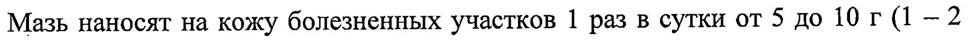

# Камфора + Метилсалицилат + Эвкалипта листьев масло + Яд кобры — наружно

- Препарат: Наятокс® (мазь для наружного применения;)
- АТХ: M02AC
- Источник: ГРЛС, инструкция по медицинскому применению, РУ П N014346/01, файл от 2023-06-09 (https://grls.rosminzdrav.ru/Grls_View_v2.aspx?routingGuid=1958a4ee-1022-418f-ac1b-429fafd02daa)
- Распознано автоматически (OCR): 9 из 9 стр.
- Инструкция к другому РУ того же препарата: П N014346/01 (национальное РУ, переоформленное по правилам ЕАЭС, решение от 30.05.2023). Текст может быть старше действующего
- Сомнительных строк после OCR: 1 (см. раздел «Проверка распознавания»)

## Общие сведения

_ oT 26.05.2023 № 9958 - (Входящий МЗ №4224297
МИНИСТЕРСТВО ЗДРАВООХРАНЕНИЯ РОССИЙСКОЙ ФЕДЕРАЦИИ
ИНСТРУКЦИЯ ПО МЕДИЦИНСКОМУ ПРИМЕНЕНИЮ ЛЕКАРСТВЕННОГО ПРЕПАРАТА
HAATOKC® Регистрационный номер: IT N014346/01
Торговое название: HAATOKC® ® Лекарственная форма: мазь для наружного применения

## 2. Состав

(на 100 г мази):
(на 100 г мази):
Активные компоненты: — яд кобры моноклевой сухой 12 МЕД (0,048 мг);
метилсалицилат 4,0 г;
| камфора рацемическая 3,0 г; | эвкалипта листьев масло 2,0 г (эквивалент 1,8-цинеола 1,4 г).
Вспомогательные вещества: вазелин, воск пчелиный, ланолин, лимонной кис-
, лоты моногидрат, натрия цитрата дигидрат, вода очищенная.
Описание ® От белого до белого с желтоватым оттенком цвета однородная мазь с характерным запахом метилсалицилата, камфоры и эвкалиптового масла.
Фармакотерапевтическая группа Местнораздражающее средство.
Код ATX: М02АС Фармакологические свойства

## 5.1. Фармакодинамика

Комбинированный препарат природного происхождения. |
Комбинированный препарат природного происхождения. |
Яд кобры моноклевой содержит сложный комплекс ферментов (главным образом, гидролаз), токсических полипептидов, белков со специфическими биоло-
| оо | СООТВЕТСТВУЕТ ЭКСПЕРТНОМУ ОТЧЕТУ от 26.05.2023 № 9858
(Входящий МЗ №4224297 гическими свойствами и неорганических компонентов. Фармакологические свойства определяются специфическим действием токсических полипептидов и ферментов. Различные токсины (9-кобратоксин, кардиотоксин, цитотоксин, нейротоксин, \ТХ-токсин и др.) имеют 3 основных механизма действия: блокировка н-холинорецепторов, воздействие на пресинаптические нервные окончания с нарушением высвобождения медиаторов и воздействие на мембраны клеток с эффектом деполяризации. За счёт токсинов яд кобры моноклевой 06ладает противосудорожной активностью, нарушает нервно-мышечную передачу импульсов, имеет ганглиоблокирующий эффект, угнетает рефлексы.
® Ферменты (гиалуронидаза, фосфолипаза A, 5'-нуклеотидаза, фосфодиэстераза, дезоксирибонуклеаза, рибонуклеаза, аденозинтрифосфатаза, нуклеотидпирофосфатаза, оксидаза-1-аминокислот, экзопептидаза, ацетилхолинэстераза, щелочная и кислая фосфатаза) обеспечивают нейротропное действие и проявляют антикоагулятивную активность (путём воздействия на факторы свертывания крови).
Таким образом, высокоактивные вещества яда кобры моноклевой, проникая через кожу, способствуют расширению сосудов, оказывая выраженное анальгезирующее (отвлекающее) и противовоспалительное действие.
‚ Метилсалицилат обладает противовоспалительным, антисептическим, обезбо-
® ливающим, раздражающим и отвлекающим эффектами, в основе которых лежит влияние на повышенную проницаемость капилляров, процессы микроцир- — куляции, торможение активности медиаторов воспаления, в том числе применении способствует развитию обезболивающего эффекта. |
Камфора рацемическая оказывает антисептическое, местнораздражающее, местное анальгезирующее и противовоспалительное действие. Возбуждая чув-
| ствительные нервные окончания кожи, расширяет кровеносные сосуды и улучшает трофику тканей.
Эвкалипта листьев масло оказывает антисептическое, противовоспалительное и болеутоляющее действие.
от 26.05.2023 № 9858 Входящий МЗ №4224297
Таким образом, лекарственный препарат НАЯТОКС®, мазь для наружного применения обладает местнораздражающим и обезболивающим (отвлекающим) действием. Раздражение чувствительных рецепторов кожи и всасывание высокоактивных веществ (гистамин, ферменты, органические кислоты и т.д.)
| способствуют расширению сосудов, улучшению трофики подлежащих тканей и определяют болеутоляющее действие препарата. Дополнительное раздражение вызывает активацию антиноцицептивной системы в соответствующем сегменте спинного мозга, что препятствует первичным болевым импульсам достигнуть коры головного мозга и препятствует восприятию боли.
* Фармакокинетика Препарат оказывает местное действие, его компоненты практически не всасываются через кожу и не оказывают системного действия. В связи с этим, проведение фармакокинетических исследований не представляется возможным.

## 4.1. Показания к применению

Мазь применяют наружно при артритах различной этиологии, остеохондрозе, невралгии, миалгии, ишиасе, радикулите, повреждениях связочного аппарата
Мазь применяют наружно при артритах различной этиологии, остеохондрозе, невралгии, миалгии, ишиасе, радикулите, повреждениях связочного аппарата
(растяжения, ушибы без повреждения целостности кожного покрова) и других заболеваниях опорно-двигательного аппарата, сопровождающихся болевым синдромом.
® Противопоказания Повышенная индивидуальная чувствительность к компонентам препарата, Повреждения кожных покровов, наличие кожных заболеваний на участках предполагаемого применения препарата (пиодермия, дерматит, экзема, фурункулез, гнойники, лишай, кожная сыпь и т.д.), повышенная кровоточивость, воспаление вен, тромбофлебит, активный туберкулез легких, эпилепсия, склонность к су- | дорогам, спазмофилия, бронхиальная астма, коклюш, лихорадочные состояния, общее истощение, выраженные нарушения функции печени и почек, нарушение мозгового и/или коронарного кровообращения, ангиоспазм (в т.ч. в анамнезе), беременность и период грудного вскармливания, детский возраст до 6 лет.
On 1 . = СООТВЕТСТВУЕТ ЭКСПЕРТНОМУ ОТЧЕТУ от 26.05.2023 № 9858
(Входящий МЗ №4224297 Применение при беременности и в период грудного вскармливания
В связи с отсутствием специальных исследований, применение препарата при беременности и в период грудного вскармливания противопоказано. В случае необходимости применения препарата в период лактации, грудное вскармлива- | ние следует прекратить на период применения препарата.

## 4.2. Способ применения и дозы

НАРУЖНО! | | | Мазь наносят на кожу болезненных участков 1 раз в сутки от 5 до 10 г (1-2 чайные ложки мази) по частям и втирают в кожу, при сильных болевых ощу-
НАРУЖНО! | | | Мазь наносят на кожу болезненных участков 1 раз в сутки от 5 до 10 г (1-2 чайные ложки мази) по частям и втирают в кожу, при сильных болевых ощу-
® щениях — 2 раза в сутки до исчезновения болевого синдрома. Не следует наносить мазь на большие участки кожи. Продолжительность курса лечения зависит от характера и степени тяжести заболевания. Курс лечения не должен превышать 10 дней без консультации с врачом. После применения мази необходимо тщательно вымыть руки, чтобы избежать попадания мази в глаза и на другие слизистые оболочки.

## 4.8. Побочное действие

Представленная ниже информация основана на данных, полученных из клинических исследований и данных широкого пострегистрационного опыта приме-
Представленная ниже информация основана на данных, полученных из клинических исследований и данных широкого пострегистрационного опыта приме-
| нения лекарственного препарата НАЯТОКС®, мазь для наружного применения.
® По данным Всемирной организации здравоохранения (ВОЗ) нежелательные эффекты классифицированы в соответствии с частотой их развития следующим образом:
очень часто (>1/10), часто (>1/100 до <1/10), нечасто (>1/1000 до <1/100), редко |
(21/10000 до <1/1000), очень редко (<1/10000), частота неизвестна (частоту возникновения явлений нельзя определить на основании имеющихся данных).
Со стороны иммунной системы, включая гиперчувствительность очень редко: ангионевротический отек.
частота неизвестна: Синдром Стивенса-Джонсона.
Со стороны органа зрения р СООТВЕТСТВУЕТ ЭКСПЕРТНОМУ ОТЧЕТУ от 26.05.2023 № 9858
(Входящий МЗ №4224297 нечасто: слезотечение.
Со стороны нервной системы нечасто: головная боль, головокружение.
Со стороны кожи и подкожных тканей 1 часто: покраснение и раздражение кожи в области нанесения препарата. , нечасто: кожный зуд, крапивница, сыпь.
редко: шелушение кожи, изменение цвета кожи, аллергический дерматит.
очень редко: ожог.
Со стороны дыхательной системы ® Редко: бронхоспастические реакции. |
При возникновении следующих признаков аллергической реакции: затрудненное дыхание, отек лица, губ, языка или горла — необходима экстренная меди-
° цинская помощь. | Возможны реакции гиперчувствительности, при появлении первых признаков
_ которых (отдельные элементы сыпи, першения в горле, зуда) применение пре-

парата следует прекратить и обратиться к врачу. При появлении побочных эф-

фектов, включая не ‘описанные в данной инструкции, следует прекратить использование препарата и сообщить об этом лечащему врачу и/или в организацию, ответственную за фармаконадзор, контакты которой приведены в конце

® инструкции. ‘

В целях получения новых сведений по безопасности лекарственного препарата медицинским работникам рекомендуется сообщать о каждом случае нежелательной реакции, возникшей на фоне применения лекарственного препарата
НАЯТОКС®, мазь для наружного применения. Это позволяет постоянно KOHтролировать соотношение польза/риск лекарственного препарата.

## 4.9. Передозировка

До настоящего времени случаев передозировки отмечено не было. Развитие передозировки возможно при нанесении мази на обширные участки тела, на поврежденную кожу или случайном проглатывании препарата.
До настоящего времени случаев передозировки отмечено не было. Развитие передозировки возможно при нанесении мази на обширные участки тела, на поврежденную кожу или случайном проглатывании препарата.
СООТВЕТСТВУЕТ ЭКСПЕРТНОМУ ОТЧЕТУ oT 26.05.2023 № 9858
(Входящий МЗ №4224297 При местном применении мази возможно усиление симптомов побочного действия, атаксия, сонливость, бронхоспастические реакции.
При случайном приеме препарата внутрь симптомы передозировки включают возбуждение, увеличение глубины дыхания, гиперпирексия, желудочнокишечные (тошнота, рвота, диарея, боли в животе) и неврологические расстройства (головная боль, головокружение, ощущение жара/«приливы», судороги, угнетение дыхания и кома).
Лечение симптоматическое. Не следует вызывать рвоту из-за риска, связанного с последующей ингаляцией камфоры и развитием ларингоспазма у детей млад-
® шего возраста, который может привести к летальному исходу. В случае случайного проглатывания препарата НАЯТОКС® необходимо немедленно обратиться к врачу.
| Взаимодействие с другими лекарственными средствами
Препарат НАЯТОКС® вызывает гиперемию кожи и рефлекторно усиливает
: циркуляцию крови в подкожной ткани, таким образом, совместное применение с другими препаратами локального действия может приводить к усилению их всасывания. Использование больших количеств может повышать токсичность метотрексата и снижать терапевтический эффект гипогликемических средств.
Мазь не следует использовать вместе с пероральными антикоагулянтами.
Ф В связи с отсутствием данных препарат не рекомендуется применять одновременно с другими мазями и кремами. .

## 4.4. Особые указания

ПРЕПАРАТ ПРЕДНАЗНАЧЕН ТОЛЬКО ДЛЯ НАРУЖНОГО ПРИМЕНЕНИЯ!
ПРЕПАРАТ ПРЕДНАЗНАЧЕН ТОЛЬКО ДЛЯ НАРУЖНОГО ПРИМЕНЕНИЯ!
Во избежание побочных реакций перед применением препарата НАЯТОКС® рекомендуется предварительно нанести небольшое количество мази на кожу |
| запястья для определения чувствительности к препарату. При нанесении на кожу препарат НАЯТОКС® вызывает ощущение тепла или прохлады, не должновозникать боли или повреждения кожи в месте нанесения мази.
СООТВЕТСТВУЕТ ЭКСПЕРТНОМУ ОТЧЕТУ от 26.05.2023 № 9858
| (Входящий МЗ №4224297 В случае возникновения боли, отека, зуда, высыпаний на коже или затруднения дыхания, отека лица, губ, языка, горла применение препарата следует немедленно прекратить, остатки мази удалить при помощи влажных салфеток, промыть водой и немедленно обратиться к врачу.
После применения мази не следует применять повязку, плотно прилегающую к коже и местное тепло (грелки, лампы, обогревательные приборы) в связи с увеличением риска возникновения кожных реакций.
Не допускать нанесения мази на раны, участки кожи с нарушением целостности | кожного покрова, при повышенной кровоточивости, кожных заболеваниях (эк-
® зема, фурункулез, гнойники, лишай, кожная сыпь и т. д.), при воспалении вен, синяках и тромбозе. Нельзя массировать родимые пятна и опухоли.
Из-за риска фотосенсибилизации после нанесения препарата НАЯТОКС® следует избегать пребывания на солнце.
| Следует избегать попадания мази в глаза, на слизистые оболочки носа, полости рта и половые органы.
В случае попадания мази на слизистые оболочки следует удалить препарат при помощи влажных салфеток и промыть обильным количеством воды.
После каждого применения мази необходимо тщательно мыть руки с мылом.
Не рекомендуется применять препарат в детском возрасте без консультации с
Ф врачом-педиатром.
При сохранении симптомов заболевания или ухудшения состояния на фоне .
применения препарата в течение 10 дней следует сообщить об этом лечащему врачу.

## 4.7. Влияние на способность управлять транспортными средствами, механизмами

Применение препарата НАЯТОКС® не оказывает влияния на способность к вы- | полнению потенциально опасных видов деятельности, требующих повышенной концентрации внимания и быстроты психомоторных реакций (управление
ОТ 26.02.23 Ne Jodo (Входящий МЗ №4224297 ,

транспортными средствами, работа с движущимися механизмами, работа диспетчера и оператора). |

## 6.5. Форма выпуска

Мазь для наружного применения.
Мазь для наружного применения.
По 20; 30 или 40 г мази помещают в тубу алюминиевую. Одну тубу вместе с инструкцией по медицинскому применению помещают в картонную пачку.

## 6.4. Условия хранения

При температуре не выше 25°С в оригинальной упаковке (туба в пачке).
При температуре не выше 25°С в оригинальной упаковке (туба в пачке).
Хранить в недоступном для детей месте! | |

® Срок годности 5 лет. Срок годности после первого вскрытия тубы - 30 дней.
Не применять по истечении срока годности.
Условия отпуска | Отпускают без рецепта.
Владелец регистрационного удостоверения АО «Доминанта-Сервис», Россия 142100, Московская область, г. Подольск, ул. Комсомольская, д. 1, строение 49, помещение 1, комната 223.
Производитель ® ВЕТПРОМ АД,

Болгария, 2400, г. Радомир, ул. «Отец Паисий» № 26.
Организации, принимающие претензии от потребителей: |
1. По вопросам качества продукции
АО «ДОМИНАНТА-СЕРВИС», Россия | 142100, Московская область, г. Подольск, ул. Комсомольская, д. 1, строение 49, помещение 1, комната 223.
Тел./факс: +7 (495) 580 30 60, e-mail: sekretar@dn-serv.ru.
ме жыиыо_ СООТВЕТСТВУЕТ ЭКСПЕРТНОМУ ОТЧЕТУ от 26.05.2023 № 9858
(Входящий МЗ №4224297)
2. Организация, ответственная за фармаконадзор (для приема сообщений/вопросов от потребителей по нежелательным явлениям/отсутствию терапевтического действия, по медицинской информации и другим вопросам, связанным с обращением препарата на рынке):
АНО «Национальный научный центр Фармаконадзора», ,
Россия, 127051, г. Москва, Малая Сухаревская пл., д. 2., стр. 2, тел.: 8 800 777 86 04, WhatsApp, Viber, Telegram на номер: +7 903 799 21 86;
e-mail: info@drugsafety.ru a Генеральный директора se bea _AO «JlomuHaHta-CepBy ИВАН ее Бабков П.А.
4 EL ППА СЫ] о тремя и ee
| ое
## Проверка распознавания

Страницы-сканы распознаны автоматически. В 1 строках с дозировками цифры могли распознаться с ошибкой — сверьте с вырезкой из оригинала:

- стр. 4: «Мазь наносят на кожу болезненных участков 1 раз в сутки от 5 до 10 г (1-2» — низкая уверенность: «10» (21), «(1-2» (38)  
  
