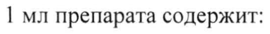
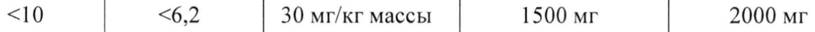
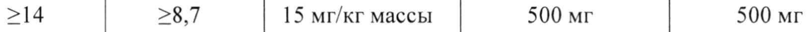
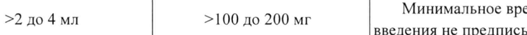
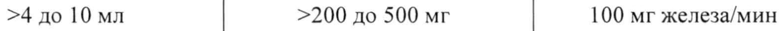
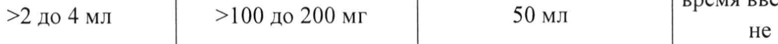
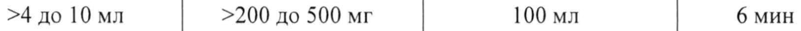
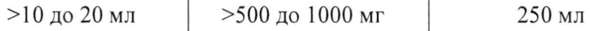
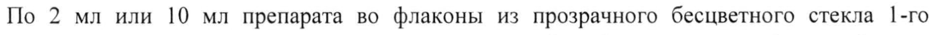

# Карбоксим® — парентерально

- Препарат: Железа карбоксимальтозат-Бинергия (раствор для внутривенного введения;)
- АТХ: V03AB
- Источник: ГРЛС, инструкция по медицинскому применению, РУ ЛП-008880, файл от 2025-10-28 (https://grls.rosminzdrav.ru/Grls_View_v2.aspx?routingGuid=63e636dc-99eb-4910-b0cd-e8971b7e24a5)
- Распознано автоматически (OCR): 15 из 15 стр.
- Инструкция к другому РУ того же препарата: ЛП-008880 (национальное РУ, переоформленное по правилам ЕАЭС, решение от 23.10.2025). Текст может быть старше действующего
- Сомнительных строк после OCR: 9 (см. раздел «Проверка распознавания»)

## Общие сведения

МИНЗДРАВРОССИИ | | |

il - 0088 80-231925 ;
СОТЛАСОВАНО | ae ^^. = - eT | МИНИСТЕРСТВО ЗДРАВООХРАНЕНИЯ РОССИЙСКОЙ ФЕДЕРАЦИИ
ИНСТРУКЦИЯ ПО МЕДИЦИНСКОМУ ПРИМЕНЕНИЮ ЛЕКАРСТВЕННОГО ПРЕПАРАТА
Железа карбоксимальтозат - Бинергия | Регистрационный номер:
| | Торговое наименование: Железа карбоксимальтозат - Бинергия
Группировочное (химическое) наименование: железа карбоксимальтозат

## 3. Лекарственная форма

раствор для внутривенного введения 50 мг/мл
раствор для внутривенного введения 50 мг/мл

## 2. Состав

1 мл препарата содержит:
1 мл препарата содержит:
действующее вещество:
железа карбоксимальтозат 156-208 мг, эквивалентно содержанию железа 50 мг;
вспомогательные вещества: натрия гидроксид / хлористоводородная кислота до рН 5,07,0: вода для инъекций до 1 мл.
Описание Непрозрачный раствор темно-коричневого цвета.
| Фармакотерапевтическая группа | Антианемические препараты; препараты железа; парентеральные препараты железа.
Код ATX: ВОЗАС Фармакологические свойства

## 5.1. Фармакодинамика

Железа карбоксимальтозат - Бинергия, раствор для внутривенного введения, содержит трёхвалентное железо в стабильной форме в виде комплекса железа, состоящего из многоядерного железа- гидроксидного ядра с углеводным лигандом. Из-за высокой стабильности комплекса существует только очень небольшое количество слабо связанного железа (также называемого лабильным или свободным железом). Комплекс создан, чтобы обеспечить контролируемый источник утилизируемого железа для транспортирующих железо и депонирующих железо белков организма (трансферрин и ферритин, соответственно). Клинические исследования показали, что гематологический ответ и заполнение депо железа происходит быстрее после внутривенного введения железа карбоксимальтозата по сравнению с принимаемыми внутрь аналогами.
Железа карбоксимальтозат - Бинергия, раствор для внутривенного введения, содержит трёхвалентное железо в стабильной форме в виде комплекса железа, состоящего из многоядерного железа- гидроксидного ядра с углеводным лигандом. Из-за высокой стабильности комплекса существует только очень небольшое количество слабо связанного железа (также называемого лабильным или свободным железом). Комплекс создан, чтобы обеспечить контролируемый источник утилизируемого железа для транспортирующих железо и депонирующих железо белков организма (трансферрин и ферритин, соответственно). Клинические исследования показали, что гематологический ответ и заполнение депо железа происходит быстрее после внутривенного введения железа карбоксимальтозата по сравнению с принимаемыми внутрь аналогами.
Утилизация эритроцитами °Ее и °?Ее из радиоактивно меченой железа карбоксимальтозы
| быстро увеличивалась в течение первых 6-9 дней после введения и варьировалась от 61 % до 99%. После 24 дней у пациентов с дефицитом железа отмечалась утилизация радиоактивно меченого железа от 91 % до 99 %, и у пациентов с анемией почечного генеза утилизация радиоактивно меченого железа составляла от 61 % до 84 %.
Клиническая эффективность и безопасность
Эффективность и безопасность железа карбоксимальтозы изучались в разных терапевтических областях, требующих внутривенного введения препарата для устранения дефицита железа. Результаты показали, что железа карбоксимальтозат быстро повышает уровень гемоглобина (НЬ) и быстро пополняет истощенные запасы железа в различных
| популяциях пациентов с железодефицитной анемией.

## 5.2. Фармакокинетика

Было показано, что °’Fe и °?Ее из железа карбоксимальтозы быстро выводились из крови и перемещались в костный мозг, а также депонировались в печени и селезёнке.
Было показано, что °’Fe и °?Ее из железа карбоксимальтозы быстро выводились из крови и перемещались в костный мозг, а также депонировались в печени и селезёнке.
После однократного введения препарата в дозе от 100 до 1000 мг железа у пациентов с дефицитом железа максимальная концентрация сывороточного железа от 37 мкг/мл до 333 мкг/мл достигалась спустя 15 минут - 1,21 часа после инъекции, соответственно. Объём распределения центральной камеры соответствует объёму плазмы (около 3 JI).
Железо после инъекции или инфузии быстро выводилось из плазмы крови, период полувыведения варьировал от 7 до 12 часов, среднее. время нахождения препарата составляло от 11 до 18 часов. Выведение железа почками незначительно.

## 4.1. Показания к применению

Лечение дефицита железа (включая железодефицитную анемию) в том случае, когда пероральные препараты железа неэффективны или не могут быть использованы. Диагноз должен быть подтверждён лабораторными исследованиями.
Лечение дефицита железа (включая железодефицитную анемию) в том случае, когда пероральные препараты железа неэффективны или не могут быть использованы. Диагноз должен быть подтверждён лабораторными исследованиями.
° Лечение дефицита железа при необходимости быстрого восполнения уровня железа.

## 4.3. Противопоказания

Применение препарата Железа карбоксимальтозат - Бинергия противопоказано в следующих случаях:
Применение препарата Железа карбоксимальтозат - Бинергия противопоказано в следующих случаях:
e Гиперчувствительность к комплексу железа карбоксимальтозы, раствору железа карбоксимальтозы или к любому из компонентов препарата.
e Анемия, не связанная с дефицитом железа, например, другая микроцитарная анемия.
e Признаки перегрузки железом или нарушение утилизации железа.
e Беременность (I триместр).
e Препарат не рекомендуется применять у детей в возрасте от | до 13 лет с хроническим заболеванием почек, требующих проведения гемодиализа.
e Детский возраст до 1 года.

## 4.3. С осторожностью

Препарат Железа карбоксимальтозат - Бинергия следует применять с осторожностью у пациентов с печёночной и почечной недостаточностью, острой или хронической инфекцией, астмой, экземой или атопическими аллергиями (см. раздел «Особые указания»).
Препарат Железа карбоксимальтозат - Бинергия следует применять с осторожностью у пациентов с печёночной и почечной недостаточностью, острой или хронической инфекцией, астмой, экземой или атопическими аллергиями (см. раздел «Особые указания»).
Рекомендуется контролировать применение препарата Железа карбоксимальтозат -

|

| Бинергия у беременных женщин (П-Ш триместр) (см. раздел «Применение при беременности и в период грудного вскармливания»).

## 4.6. Применение при беременности и в период грудного вскармливания

Беременность Имеются ограниченные данные по применению железа карбоксимальтозы у беременных женщин. Лечение препаратом следует ограничить П и Ш триместром беременности и проводить только в тех случаях, когда потенциальная польза для матери превышает риск для плода. Дефицит железа в I триместре беременности в большинстве случаев можно лечить пероральными препаратами железа. Препарат противопоказан к применению в | триместре беременности.
Исследования на животных показали, что железо, вводимое парентерально, может проникать через плацентарный барьер и влиять на развитие скелета плода.
Парентеральное введение железа может вызывать брадикардию плода, которая может возникать вследствие реакции гиперчувствительности у матери. Во время внутривенного введения парентерального железа беременным женщинам следует тщательно наблюдать за реакцией плода.
Период грудного вскармливания Имеется ограниченный опыт клинического применения препарата в период лактации.
Клинические исследования показали, что поступление железа из железа карбоксимальтозы в грудное молоко незначительно (менее | %). На основании ограниченных данных по кормящим грудью женщинам маловероятно, что препарат несёт опасность для детей, находящихся на грудном вскармливании.
Фертильность Данные отсутствуют. Исследования на животных не выявили влияния железа карбоксимальтозы на фертильность.

| Способ применения и дозы Расчёт дозы препарата Железа карбоксимальтозат - Бинергия осуществляется на основе следующего пошагового подхода: определение индивидуальной потребности в железе, расчёт и назначение дозы (доз) железа, оценка насыщенности организма пациента железом после введения.

| Шаг 1: Определение индивидуальной потребности в железе

| Индивидуальная потребность в железе для восполнения посредством препарата Железа карбоксимальтозат - Бинергия определяется на основании массы тела и уровня гемоглобина
(Hb) пациента. Для определения общей потребности в железе следует использовать приведенную ниже таблицу. Для восстановления общей потребности в железе может потребоваться 2 дозы (см. Шаг 2 по расчёту и назначению максимальной индивидуальной дозы (доз) железа).
Дефицит железа должен быть подтверждён лабораторными анализами.

| Определение общей потребности в железе ммоль/л меньше 35 кг от 35 до <70 кг от 70 кги выше
<10 <6,2 30 мг/кг массы 1500 мг 2000 мг тела
| 15 мг/кг массы от 10 до <14 | or 6,2 до <8,7 1000 мг 1500 мг тела
>14 >8,7 15 мг/кг массы 500 мг 500 мг тела
Шаг 2: Расчёт и назначение максимальной индивидуальной дозы (003) железа
На основании определенной общей потребности в железе необходимо ввести соответствующую дозу (дозы) препарата Железа карбоксимальтозат - Бинергия с учётом следующих условий:
Взрослые и подростки в возрасте 14 лет и старше
При разовом введении препарата Железа карбоксимальтозат - Бинергия не должны превышаться следующие уровни:
. 15 мг железа/кг массы тела (при внутривенной струйной инъекции) или 20 мг железа/кг массы тела (при внутривенной инфузии);
. 1000 мг железа (20 мл препарата Железа карбоксимальтозат - Бинергия).
Максимальная рекомендуемая суммарная доза препарата Железа карбоксимальтозат -
Бинергия составляет 1000 мг железа (20 мл препарата Железа карбоксимальтозат -
Бинергия) в неделю. Если общая потребность в железе выше, то введение дополнительной дозы следует проводить как минимум через 7 дней после введения первой дозы.
Дети и подростки в возрасте от I до 13 лет
При разовом введении препарата Железа карбоксимальтозат - Бинергия не должны превышаться следующие уровни:
. 15 мг железа/кг массы тела;
. 750 мг железа (15 мл препарата Железа карбоксимальтозат - Бинергия).
Максимальная рекомендуемая суммарная доза препарата Железа карбоксимальтозат -
Бинергия составляет 750 мг железа (15 мл препарата Железа карбоксимальтозат - Бинергия)
| в неделю. Если общая потребность в железе выше, TO введение дополнительной дозы следует проводить как минимум через 7 дней после введения первой дозы.
Шаг 3: Оценка насыщенности организма пациента железом после введения
| > Повторную оценку уровня железа должен проводить клинический специалист на основании индивидуального состояния пациента. Оценку уровня гемоглобина необходимо проводить не ранее, чем через 4 недели после последнего применения препарата Железа

карбоксимальтозат - Бинергия, чтобы дать достаточное время для эритропоэза и усвоения

железа. Если пациенту необходимо дальнейшее восполнение запасов железа в организме,

то потребность в железе необходимо рассчитать повторно (см. Шаг 1).

Дети до 1 года

Эффективность и безопасность препарата Железа карбоксимальтозат - Бинергия у детей в
|

возрасте до 1 года не исследовалась, поэтому препарат Железа карбоксимальтозат -

Бинергия не рекомендуется для детей этой возрастной группы.

Применение препарата при хроническом заболевании почек, требующем проведения

гемодиализа

Взрослые и подростки в возрасте 14 лет и старше: однократная максимальная суточная доза

у пациентов на гемодиализе с хронической болезнью почек не должна превышать 200 мг

железа.

Дети в возрасте от 1 до 13 лет: у пациентов с хроническим заболеванием почек, требующих

гемодиализа, эффективность и безопасность препарата Железа карбоксимальтозат -

Бинергия не изучались. В связи с этим препарат Железа карбоксимальтозат - Бинергия не

рекомендуется применять у детей в возрасте от 1 до 13 лет с хроническим заболеванием

почек, требующих проведения гемодиализа.

Способ применения

Препарат Железа карбоксимальтозат - Бинергия необходимо применять только

внутривенно следующим образом:

. в виде инъекции, или

. в виде инфузии, или

. во время сеанса гемодиализа в неразведённом виде непосредственно в венозный

участок диализной системы.

Препарат Железа карбоксимальтозат - Бинергия нельзя применять подкожно или

внутримышечно.

Перед применением следует осмотреть флаконы на наличие возможного осадка и

повреждений. Можно использовать только однородный раствор без осадка.

Необходимо внимательно следить за появлением симптомов и признаков реакций

гиперчувствительности во время и после каждого введения препарата Железа

карбоксимальтозат - Бинергия.

Препарат Железа карбоксимальтозат - Бинергия следует применять в отделениях, имеющих

необходимое оснащение для оказания неотложной медицинской помощи в случае развития анафилактических реакций. Каждого пациента следует наблюдать на предмет развития

признаков или симптомов реакций гиперчувствительности в течение как минимум 30

минут после каждого введения раствора железа карбоксимальтозы (см. раздел «Особые

указания»).

Внутривенная струйная инъекция

Препарат Железа карбоксимальтозат - Бинергия может вводиться внутривенно в неразведённом виде.
Взрослые и подростки в возрасте 14 лет и старше: максимальная однократная доза составляет 15 мг железа/кг массы тела, но не должна превышать 1000 мг железа.
Дети в возрасте от 1 до 13 лет: максимальная однократная доза составляет 15 мг железа/кг массы тела, но не должна превышать 750 мг железа.
Скорость введения внутривенной инъекции препарата Железа карбоксимальтозат -
Бинергия Железа Скорость введения / Эквивалентная доза карбоксимальтозат - минимальное время железа
Бинергия введения Минимальное время >2 до 4 мл >100 до 200 мг ы введения не предписывается
>4 до 10 мл >200 до 500 мг 100 мг железа/мин
Внутривенная инфузия Препарат Железа карбоксимальтозат - Бинергия может вводиться внутривенно капельно
(инфузионно). В этом случае препарат необходимо развести.
Взрослые и подростки в возрасте 14 лет и старше: максимальная однократная доза составляет 20 мг железа/кг массы тела, но не должна превышать 1000 мг железа.
Дети в возрасте от | до 13 лет: максимальная однократная доза составляет 15 мг железа/кг массы тела, но не должна превышать 750 мг железа.
Непосредственно перед инфузионным введением препарат Железа карбоксимальтозат -
Бинергия необходимо развести стерильным 0,9 % раствором натрия хлорида для инъекций в соотношениях, указанных в таблице:
Руководство по разведению препарата Железа карбоксимальтозат - Бинергия для инфузии
Количество Железа стерильного 0,9 % Минимальное карбоксимальтозат Железо раствора натрия время введения
- Бинергия хлорида для инъекций!
Минимальное время введения >2 до 4 мл >100 до 200 мг 50 мл He предписывается
Количество Железа стерильного 0,9 % Минимальное карбоксимальтозат Железо раствора натрия время введения
- Бинергия хлорида для инъекций!
| >4 до 10 мл >200 до 500 мг 100 мл 6 мин
>10 до 20 мл >500 до 1000 мг 250 мл Примечание:
Для сохранения стабильности препарата не разрешается разведение до концентраций менее 2 мг железа/мл (объём раствора препарата Железа карбоксимальтозат
- Бинергия не учитывается).

## 4.8. Побочное действие

Нежелательные реакции, представленные ниже, перечислены в соответствии с поражением органов и систем органов и частотой встречаемости. Частота встречаемости определяется следующим образом: очень часто (>1/10), часто (>1/100, Ho <1/10), нечасто (>1/1000, но
Нежелательные реакции, представленные ниже, перечислены в соответствии с поражением органов и систем органов и частотой встречаемости. Частота встречаемости определяется следующим образом: очень часто (>1/10), часто (>1/100, Ho <1/10), нечасто (>1/1000, но
<1/100), редко (>1/10000, но <1/1000), очень редко (<1/10000, включая отдельные случаи), частота неизвестна.
Сообщалось о следующих нежелательных реакциях, выявленных в ходе проведения клинических исследований, в рамках которых железа карбоксимальтозу принимали более чем 9 000 пациентов (включая более чем 100 детей и подростков в возрасте от | до 17 лет), а также реакциях, сообщения о которых были получены в постмаркетинговый период:
Система или Часто Частота орган (21/100, но |Нечасто (>1/1000, | Редко (>1/10000, | неизвестна!
<1/10) Ho <1/100) Ho <1/1000)
Нарушения co стороны Гиперчувстви- |Анафилактические иммунной тельность реакции системы
Нарушения со стороны обмена | Гипофосфавеществ и темия питания
Нарушения со | Головная стороны боль, Искажение вкуса, Потеря нервной головокруже- парестезия сознания!
системы ние Система или Часто Частота орган (>1/100, но |Нечасто (21/1000, | Редко (>1/10000, | неизвестна!
<1/10) Ho <1/100) Ho <1/1000)
Нарушения ру Тревога?
психики Нарушения со Синдром PY Тахикардия P | стороны сердца Коуниса
Нарушения со | «Приливы»
PY P Предобморочное стороны сосудов |крови к лицу, | Артериальная 2 состояние”, артериальная гипотензия
Prep обморок?, флебит гипертензия Нарушения со стороны дыхательной системы, Одышка Бронхоспазм?
органов грудной клетки и средостения Нарушения со стороны Боль в животе, желудочно- Тошнота рвота, запор, Вздутие живота кишечного диарея, диспепсия тракта
Нарушения со Кожная сьшьз, Ангионевроти- Отёк лица!
стороны кожи и кожный зуд, ческий OTEK’, подкожных крапивница, отсроченное тканей изменение цвета кожи?, бледность?
Нарушения со PY Боль в суставах, стороны р миалгия, боль в Гипофосфаскелетно-
.. конечностях, боль темическая мышечной и i
. в спине, судороги остеомаляция соединительной
МЫШЦ ткани Система или Часто Частота орган (21/100, но |Нечасто (21/1000, | Редко (>1/10000, неизвестна!
<1/10) но <1/100) но <1/1000)
Общие Гриппоподобное расстройства и ихОрАДИЯ, состояние (может нарушения B возникнуть через
Реакции в слабость, озноб, месте введения промежуток области периферические
. времени, инъекции/ отёки, боль в и инфузии py, варьирующийся OT нескольких часов недомогание до нескольких дней)?
Лабораторные и Повышение инструментальн активности ые данные аланинаминотрансферазы
(АЛТ) в крови, повышение активности аспартатаминотрансферазы
(АСТ) в крови, повышение активности гаммаглутамилтрансферазы в крови, повышение активности щелочной фосфатазы в крови, повышение активности лактатдегидрогеназы в крови
Примечание:
Нежелательные реакции, которые отмечались исключительно в постмаркетинговый период: частота встречаемости оценивается как редкая.
2 Нежелательные реакции, которые отмечались как в постмаркетинговый период, так и в клинических исследованиях.
2 Включая нежелательные реакции, обозначаемые следующими предпочтительными терминами: кожная сыпь (индивидуальная частота этой нежелательной реакции оценивается как нечастая) и эритематозная сыпь, генерализованная, макулезная,

макулопапулезная, зудящая (индивидуальная частота всех нежелательных реакций

оценивается как редкая).

‘ Включая, но не ограничиваясь нежелательными реакциями, обозначаемыми

следующими предпочтительными терминами: боль в месте введения, гематома, изменение

цвета кожи, экстравазация, раздражение, реакция в месте введения (индивидуальная

частота всех нежелательных реакций оценивается как нечастая) и парестезия

(индивидуальная частота нежелательной реакции оценивается как редкая).

Наиболее частой нежелательной реакцией является тошнота, встречающаяся у 3,2 %

пациентов, за которой следуют реакции в месте инъекции/инфузии, гипофосфатемия,

головная боль, «приливы» крови к лицу, головокружение и артериальная гипертензия.

Реакции в месте инъекции/инфузии включают несколько нежелательных реакций, которые

по отдельности являются нечастыми или редкими.

Для участников клинических исследований, которые показали снижение уровня фосфора в
| сыворотке, минимальные значения были получены примерно через 2 недели, а в
| большинстве случаев возвращались к исходным значениям через 12 недель после лечения железа карбоксимальтозой. Наиболее серьёзными нежелательными реакциями являются
| анафилактические реакции, частота встречаемости которых оценивается как редкая (см.

раздел «Особые указания»).

Дети

Профиль безопасности у детей и подростков в возрасте от 1 до 17 лет сравним с профилем

безопасности для взрослых. 110 детей получали железа карбоксимальтозу в рамках 7
| клинических исследований. О серьёзных нежелательных реакциях не сообщалось.
| Сообщалось о таких несерьёзных нежелательных реакциях, как гипофосфатемия (5
| | случаев), крапивница (5 случаев), реакции в месте инъекции/инфузии (4 случая), боль в
| животе (2 случая), «приливы» крови к лицу (2 случая), головная боль (2 случая), лихорадка

(2 случая), повышение активности печёночных ферментов (2 случая) и сыпь (2 случая).
Запор, гастрит, гипертония, зуд и жажда были отмечены только по одному разу.

## 4.9. Передозировка

Железа карбоксимальтозат в препарате Железа карбоксимальтозат - Бинергия обладает

низкой токсичностью. Препарат хорошо переносится, риск случайной передозировки

минимален.

Симитомы

Введение препарата Железа карбоксимальтозат - Бинергия в количестве, превышающем

потребности организма, может привести к накоплению железа в местах его хранения (депо),

что, в конечном итоге, приводит к гемосидерозу. Мониторинг таких показателей обмена

железа, как сывороточный ферритин и процент насыщения трансферрина, может помочь в

диагностике чрезмерного накопления железа в организме.

Лечение

В случае накопления железа необходимо проводить лечение в соответствии со стандартами медицинской практики, например, рассмотреть возможность использования хелатирующего средства для связывания железа.

## 4.5. Взаимодействие с другими лекарственными средствами

Так же, как и любые другие парентеральные препараты железа, препарат Железа карбоксимальтозат - Бинергия уменьшает всасывание железа из желудочно-кишечного
| тракта при одновременном применении с пероральными препаратами железа.
В связи с этим, при необходимости, терапию пероральными препаратами железа следует начинать не ранее, чем через 5 дней после последней инъекции препарата Железа карбоксимальтозат - Бинергия.
Фармацевтическая совместимость: препарат Железа карбоксимальтозат - Бинергия совместим только с 0,9 % раствором натрия хлорида. Никакие другие внутривенные растворы и лекарственные вещества не следует вводить, поскольку существует потенциальный риск выпадения осадка и/или взаимодействия.

## 4.4. Особые указания

Препарат не должен применяться для внутримышечного или подкожного введения.
Препарат не должен применяться для внутримышечного или подкожного введения.
Каждый флакон препарата Железа карбоксимальтозат - Бинергия предназначен только для однократного применения.
Препарат должен назначаться только тем пациентам, у которых диагноз анемии подтверждён соответствующими лабораторными данными.
Реакции гиперчувствительности Вводимые парентерально препараты железа могут вызывать реакции гиперчувствительности, включая анафилактические реакции, которые могут иметь летальный исход, поэтому при введении препарата должны быть доступны соответствующие средства для проведения сердечно-лёгочной реанимации. Если во время применения препарата возникают реакции гиперчувствительности или признаки непереносимости, необходимо немедленно прекратить лечение препаратом.
Риск возникновения реакций гиперчувствительности на препарат Железа карбоксимальтозат - Бинергия повышается у пациентов с аллергическими реакциями, включая аллергические реакции на лекарственные препараты, а также у пациентов с тяжелой астмой в анамнезе, экземой или другой атопической аллергической реакцией.
Также существует повышенный риск реакций гиперчувствительности на парентеральные комплексы железа у пациентов с иммунными или воспалительными состояниями
(например, системная красная волчанка, ревматоидный артрит).
Сообщалось о реакциях гиперчувствительности после предшествующих неосложнённых введений любых комплексов парентерального железа, в том числе железа карбоксимальтозы. Каждого пациента следует наблюдать на предмет развития нежелательных реакций в течение как минимум 30 минут после каждого введения препарата Железа карбоксимальтозат - Бинергия. При появлении признаков гиперчувствительности или симптомов непереносимости препарата введение препарата
| необходимо немедленно прекратить. Должны быть доступны оборудование и средства для сердечно-лёгочной реанимации на случай острой анафилактической реакции, включая инъекционный раствор адреналина 1:1000. При необходимости следует дополнительно назначить антигистаминные препараты и/или кортикостероиды.

Гипофосфатемия

| Вводимые парентерально препараты железа могут вызывать гипофосфатемию, которая в большинстве случаев является кратковременной и протекает без клинических симптомов.
Были отмечены отдельные случаи гипофосфатемии, при которых требовалось медицинское вмешательство, главным образом у пациентов с наличием факторов риска и после продолжительного лечения железом, вводимым внутривенно в высоких дозах.
Гипофосфатемическая остеомаляция В постмаркетинговых исследованиях сообщалось о случаях гипофосфатемии, приводящей к гипофосфатемической остеомаляции и переломам, которые требовали клинического вмешательства, включая хирургическое.
Пациентам следует обратиться к врачу, если они испытывают артралгию или боли в костях.
Пациенты, получающие несколько высоких доз препарата для длительного лечения и имеющие сопутствующие факторы риска (такие как дефицит витамина О, мальабсорбция кальция и фосфата, вторичный гиперпаратиреоз, наследственная геморрагическая телеангиэктазия, воспалительное заболевание кишечника и остеопороз), должны находиться под наблюдением врача на предмет возникновения гипофосфатемической остеомаляции. В случае стойкой гипофосфатемии лечение железа карбоксимальтозой следует пересмотреть.
Печёночная и почечная недостаточности У пациентов с дисфункцией печени парентеральные препараты железа следует применять только после тщательной оценки пользы/риска. Следует избегать введения парентеральных препаратов железа у пациентов с дисфункцией печени, когда перегрузка железом является провоцирующим фактором возникновения поздней кожной порфирии (ПКП). Тщательный мониторинг статуса железа позволит избежать перегрузки железом.
Отсутствуют данные по безопасному применению препарата Железа карбоксимальтозат -
Бинергия у пациентов с хроническим заболеванием почек, находящихся на гемодиализе и получающих однократные дозы более 200 мг железа.
Инфекции Парентеральное железо необходимо применять с осторожностью в случае острой или хронической инфекции, астмы, экземы или атопических аллергий. Рекомендуется прекратить терапию препаратом Железа карбоксимальтозат - Бинергия у пациентов с продолжающейся бактериемией. У пациентов с хроническими инфекциями необходимо выполнить тщательную оценку пользы/риска с учётом возможности угнетения эритропоэза
(вследствие хронической инфекции).
Околовенозное проникновение препарата в прилегающие ткани

Необходимо соблюдать осторожность при внутривенном введении препарата Железа карбоксимальтозат - Бинергия, чтобы не допустить проникновения препарата в околовенозное пространство, так как это может вызвать раздражение кожи и возможное длительное окрашивание тканей в месте введения в коричневый цвет. При проникновении препарата в околовенозное пространство введение препарата Железа карбоксимальтозат -
Бинергия должно быть немедленно прекращено.
Вспомогательные вещества Один миллилитр неразведённого препарата Железа карбоксимальтозат - Бинергия содержит до 5,5 мг (0,24 ммоль) натрия на мл неразбавленного раствора, что эквивалентно
| 0,3 % рекомендуемой ВОЗ максимальной суточной дозы (2 г натрия) для взрослого
| человека. Это необходимо учитывать в отношении пациентов, находящихся на диете с контролируемым употреблением натрия.
| Взаимозаменяемость Комплексы железа клинически не взаимозаменяемы.
| | Железа карбоксимальтозат отличается от других комплексов железа, например, таких как
| железа полимальтозат, железа сахарозный комплекс, железа деризомальтозный комплекс,
| железа олигоизомальтозный комплекс и др. Если врачом принято решение о прекращении приёма препарата Железа карбоксимальтозат - Бинергия и начале лечения другими
| комплексами железа (или наоборот), необходимо тщательно рассмотреть различия между этими препаратами в показаниях, фармакокинетике, дозировке, способе введения и профиле безопасности.

## 4.7. Влияние на способность управлять транспортными средствами, механизмами

Отсутствуют данные о влиянии препарата на способность управлять транспортными средствами и механизмами. Однако некоторые побочные действия (такие как головокружение, обморок, предобморочное состояние и другие, см. раздел «Побочное действие») могут влиять на способность управлять транспортными средствами и механизмами. Пациентам, отмечающим у себя данные побочные действия, следует рекомендовать не управлять транспортными средствами и механизмами до полного исчезновения указанных симптомов.

## 6.5. Форма выпуска

Раствор для внутривенного введения.
Раствор для внутривенного введения.
По 2 мл или 10 мл препарата во флаконы из прозрачного бесцветного стекла 1-го гидролитического класса, герметично укупоренные бромбутиловыми пробками, обжатые алюминиевыми колпачками, или колпачками алюминиевыми комбинированными, или комбинированными колпачками с пластиковыми дисками.
По 2 мл препарата в ампулы из прозрачного бесцветного стекла 1-го гидролитического класса с точкой излома и насечкой или цветным кольцом излома.
На каждый флакон или ампулу наклеивают самоклеящуюся этикетку.
По 1 флакону по 2 мл или 10 мл вместе с инструкцией по применению помещают в пачку из картона.
По 2 флакона по 10 мл помещают в контурную пластиковую упаковку (поддон) из пленки поливинилхлоридной или из пленки полиэтилентерефталатной.
По | контурной пластиковой упаковке (поддону) с 2 флаконами по 10 мл вместе с инструкцией по применению помещают в пачку из картона.
По 1 ампуле помещают в контурную пластиковую упаковку (поддон) из пленки поливинилхлоридной или из пленки полиэтилентерефталатной.
По | контурной пластиковой упаковке (поддону) с 1 ампулой вместе с инструкцией по
| применению помещают в пачку из картона.
| По 5 флаконов по 2 мл или 10 мл или по 5 ампул помещают в контурную пластиковую упаковку (поддон) из пленки поливинилхлоридн0й или из — пленки полиэтилентерефталатной.
| По | контурной пластиковой упаковке (поддону) с 5 флаконами по 2 мл или 10 мл или с 5 ампулами вместе с инструкцией по применению помещают в пачку из картона

## 6.4. Условия хранения

Хранить в оригинальной упаковке (флакон в пачке) для защиты от света при температуре не выше 25 °С.
Хранить в оригинальной упаковке (флакон в пачке) для защиты от света при температуре не выше 25 °С.
Не замораживать.
Хранить в недоступном для детей месте.

## 6.3. Срок годности

2 года.
2 года.
Не применять по истечении срока годности, указанного на упаковке.
Условия отпуска Отпускают по рецепту.
Держатель регистрационного удостоверения
АО «Бинергия»
143930, Московская область, г.о. Балашиха, г. Балашиха, мкр. Салтыковка, ш. Разинское, д.
69, эт./помещ. 1/41, офис 106А Тел.: 8 (495) 580-55-02
Факс: 8 (495) 580-55-03 Электронная почта: info@binergia.ru
Производитель ЗАО «ВИФИТЕХ»
Адрес: Московская обл., г. Серпухов, п. Оболенск, тер. Квартал А, д. 14
Организация, принимающая претензии потребителей
АО «Бинергия»
| 143930, Московская область, г.о. Балашиха, г. Балашиха, мкр. Салтыковка, ш. Разинское, д.
69, эт./помещ. 1/41, офис 106A Тел.: 8 (495) 580-55-02
Факс: 8 (495) 580-55-03 Электронная почта: safety@binergia.ru
|
## Проверка распознавания

Страницы-сканы распознаны автоматически. В 9 строках с дозировками цифры могли распознаться с ошибкой — сверьте с вырезкой из оригинала:

- стр. 1: «1 мл препарата содержит:» — низкая уверенность: «1» (76)  
  
- стр. 4: «<10 <6,2 30 мг/кг массы 1500 мг 2000 мг» — повторное чтение: «<10 | <6,2 | 30 мг/кг массы | 1500 мг | 2000 мг»  
  
- стр. 4: «>14 >8,7 15 мг/кг массы 500 мг 500 мг» — повторное чтение: «>14 | 287 | 15 мг/kr массы | 500 мг | 500 мг»  
  
- стр. 6: «>2 до 4 мл >100 до 200 мг ы» — повторное чтение: «>204м |  210040200м | Минимальное вр»  
  
- стр. 6: «>4 до 10 мл >200 до 500 мг 100 мг железа/мин» — повторное чтение: «>4 до 10 мл | >200 до 500 мг | 100 мг железа/мин»  
  
- стр. 6: «>2 до 4 мл >100 до 200 мг 50 мл He» — повторное чтение: «2. до 4 мл | >100 до 200 мг | 50 мл | ый бою не»  
  
- стр. 7: «>4 до 10 мл >200 до 500 мг 100 мл 6 мин» — повторное чтение: «>4 до 10мл | >200 до 500мг | 100 мл |  бмин»  
  
- стр. 7: «>10 до 20 мл >500 до 1000 мг 250 мл» — повторное чтение: «>10 до20мл | >500 до 1000 мг | 250 мл»  
  
- стр. 13: «По 2 мл или 10 мл препарата во флаконы из прозрачного бесцветного стекла 1-го» — низкая уверенность: «1-го» (70)  
  
