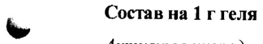
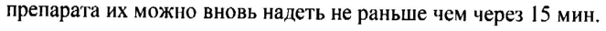

# Карбомер — глаза

- Препарат: Видисик (гель глазной;)
- АТХ: S01XA20
- Источник: ГРЛС, инструкция по медицинскому применению, РУ П N015826/01, файл от 2025-02-17 (https://grls.rosminzdrav.ru/Grls_View_v2.aspx?routingGuid=a3c8026b-6ce6-46c7-a450-dff2307e61e9)
- Распознано автоматически (OCR): 4 из 4 стр.
- Инструкция к другому РУ того же препарата: П N015826/01 (национальное РУ, переоформленное по правилам ЕАЭС, решение от 29.01.2025). Текст может быть старше действующего
- Сомнительных строк после OCR: 2 (см. раздел «Проверка распознавания»)

## Общие сведения

Om: П №015826/01-060912 МИНИСТЕРСТВО ЗДРАВООХРАНЕНИЯ РОССИЙСКОЙ ФЕДЕРАЦИИ
ИНСТРУКЦИЯ по медицинскому применению лекарственного препарата
ВИДИСИК®

Торговое название: Видисик®

Международное непатентованное название: карбомер

## 3. Лекарственная форма

гель глазной
гель глазной

| Состав на 1 г геля

Активные ингредиенты:

Карбомер 2,00 мг

Вспомогательные вещества:

Цетримид 0,10 мг, сорбитол 40,00 мг, натрия гидроксид 0,84 мг, вода для инъекций 957,06 мг.
Описание: прозрачная бесцветная вязкая жидкость

Фармакотерапевтическая группа: кератопротекторное средство

Код ATX: $01ХА20

Фармакологические свойства

~ Фармакодинамика Основным компонентом препарата Видисик® является карбомер — высокомолекулярное соединение на основе полиакриловой кислоты, который создает вязкую гидрофильную пленку на поверхности глаза, восполняя недостаток водной фазы слезной жидкости, имитируя муциновый слой и увлажняя конъюнктиву и роговицу, тем самым, препятствуя образованию повреждений эпителия и способствуя его регенерации.

## 5.2. Фармакокинетика

Из-за больших размеров молекулы карбомер не проникает в ткани глазного яблока, не подвергается системной абсорбции из слезных протоков и не попадает в энтерогепатическую систему, соответственно в кале и моче не определяется.
Из-за больших размеров молекулы карбомер не проникает в ткани глазного яблока, не подвергается системной абсорбции из слезных протоков и не попадает в энтерогепатическую систему, соответственно в кале и моче не определяется.
ря Tee РАВНА, IT №015826/01-060912

## 4.1. Показания к применению

Симптоматическое лечение сухого кератоконъюнктивита (синдрома «сухого глаза»).

## 4.3. Противопоказания

Индивидуальная повышенная чувствительность к любому из компонентов препарата.

## 4.3. С осторожностью

При беременности и в период грудного вскармливания (клинические данные отсутствуют).

## 4.6. Применение при беременности и в период грудного вскармливания

ь Исходя из природы действующего вещества препарата Видисик®, его состава и свойств,

трудно предположить какие-либо ограничения по применению препарата у беременных или кормящих грудью женщин. Однако во время беременности и/или в период грудного вскармливания препарат следует применять только после консультации с врачом.

## 4.2. Способ применения и дозы

В зависимости от тяжести и выраженности симптомов (жалоб со стороны пациента)
закапывают 3-5 раз в сутки или чаще, а также за 30 мин до сна по | капле в нижний конъюнктивальный мешок.

## 4.8. Побочное действие

Преходящее «затуманивание» зрения. В отдельных случаях возможна реакция

w непереносимости к компонентам препарата.
Консервант цетримид, входящий в состав препарата, при длительном или слишком частом применении может вызвать местное раздражение глаз, аллергические реакции (жжение, покраснение, ощущение «постороннего тела» в глазу) и повреждение эпителия роговицы.
Поэтому при длительном лечении следует избегать применения офтальмологических препаратов, содержащих консерванты,

## 4.9. Передозировка

Данные по передозировке препарата отсутствуют
Данные по передозировке препарата отсутствуют
IT №015826/01-060912 Взаимодействие с лекарственными препаратами
Данные о взаимодействии с другими лекарственными препаратами отсутствуют.
В тех случаях, когда проводится дополнительная местная терапия, интервал между введением препарата Видисик® и другими офтальмологическими препаратами должен составлять: глазными каплями - не менее 5 мин, глазными мазями — не менее 15 мин.
В силу своих физических свойств, препарат Видисик® может продлить время пребывания других офтальмологических препаратов в глазу и, тем самым, усилить их действие. Поэтому
Видисик® следует применять последним.

## 4.4. Особые указания

| При лечении сухого кератоконъюнктивита, вызванного недостаточной продукцией слезной
| При лечении сухого кератоконъюнктивита, вызванного недостаточной продукцией слезной
& жидкости, либо избыточным слезотечением, либо неблагоприятными внешними воздействиями, и проявляющегося зудом, жжением, ощущением инородного тела в глазу, обычно требующего непрерывной и долгой терапии, необходима консультация офтальмолога.
Перед применением препарата Видисик® следует снять контактные линзы. После введения препарата их можно вновь надеть не раньше чем через 15 мин.
Если улучшения состояния не отмечается, появляются признаки раздражения глаз, следует прекратить применение препарата и обратиться за консультацией к врачу.
Не следует прикасаться кончиком пипетки тубы к глазу.
Тубу необходимо закрывать после каждого использования.
ыы Влияние на способность управлять транспортными средствами и сложными механизмами
После закапывания препарата на роговице образуется тонкая пленка, которая может вызывать кратковременное «затуманивание» зрения, снижая тем самым скорость реакции.
Поэтому к управлению транспортными средствами и механизмами следует приступать, когда четкость зрения восстановится.

## 6.5. Форма выпуска

Гель глазной 0,2%.
По 10 г в тубы из многослойного ламината 405 “Polyfoil” (слой ПВП, алюминиевая фольга,
ПНП) с головкой с соплом и навинчивающимся колпачком из ПВП.
По 1 тубе с инструкцией по применению вкладывают в картонную пачку.
79043 У IT №015826/01-060912

## 6.3. Срок годности

3 года.

После вскрытия тубы хранить не более 6 недель.

Не использовать после истечения срока годности, указанного на упаковке.

## 6.4. Условия хранения

Хранить при температуре от 2 до 30°C

Хранить в недоступном для детей месте.

Условия отпуска из аптек:

Без рецепта.

& Производитель (полный цикл)

Др. Герхард Манн, Химико-фармацевтическое предприятие ГмбХ, Германия
Брунсбюттелер Дамм 165-173, 13581 Берлин
Dr.Gerhard Mann Chem.-Pharm. Fabrik GmbH, Germany
Brunsbuetteler Damm 165-173, 13581 Berlin, Germany

Получить дополнительную информацию о препарате, а также направить свои претензии и информацию о нежелательных явлениях можно по следующему адресу в
России:

ООО «Бауш энд Ломб»

Россия, 115191 Москва, ул. Большая Тульская, д. 11

тел: +7 495 969 2130 факс: +7 495 969 2129 и" а ay yt 99 Лонб" Vy a ee Ze eet СИ ИА 2 A
P3623
## Проверка распознавания

Страницы-сканы распознаны автоматически. В 2 строках с дозировками цифры могли распознаться с ошибкой — сверьте с вырезкой из оригинала:

- стр. 1: «| Состав на 1 г геля» — повторное чтение: «о Отв Treas»  
  
- стр. 3: «препарата их можно вновь надеть не раньше чем через 15 мин.» — низкая уверенность: «15» (71)  
  
