# Картофеля побегов сумма полисахаридов — парентерально

- Препарат: Панавир® (раствор для внутривенного введения;)
- АТХ: J05AX
- Источник: ГРЛС, инструкция по медицинскому применению, РУ Р N000299/02, файл от 2022-12-14 (https://grls.rosminzdrav.ru/Grls_View_v2.aspx?routingGuid=316b3cdd-62a3-45ca-9c70-8bbca0e17093)
- Распознано автоматически (OCR): 5 из 5 стр.
- Инструкция к другому РУ того же препарата: Р N000299/02 (национальное РУ, переоформленное по правилам ЕАЭС, решение от 13.05.2022). Текст может быть старше действующего
- Сомнительных строк после OCR: 15 (см. раздел «Проверка распознавания»)

## Общие сведения

mosh, foo " ‚ т в.” . ГР М№000299/02-071111 . oe
#1 м ы >* О + ‘ ‘ , ‘ . в ‘ fa ' (4 1 4 оны чо: io, 4 yo? 7 ' |
: | ` " \ - ТЕ , » ‘ | о 4, \. ”. МИНИСТЕРСТВО ЗДРАВООХРАНЕНИЯ И СОЦИАЛЬНОГО РАЗВИТИЯ: 7 | hoe, ; . , дз ; ‘ ' 1 { ‘ р Г у i 4 у ° ‘ 4 ‘ , |
, и . И РОССИЙСКОЙ ФЕДЕРАЦИИ, _; Ч : `.
+ yo woe _ ' | " ey р , sof my ОЕ и vee а , ах | t 4 7 an vy ' rt ft a a re aan ры Lr
. ‘of | (т с, ОА a И" ‘ ote | ots ‘he fo |
. м. . , ще , aT po г. ива, uy | 1 м * * р , eo , ' ит cit a \ у ы ve ” } - ы =. Mm, vO " , | 4 } "„ . a a ” a st 4 “ * и ‘ИНСТРУКЦИЯ , ВК ‘ Г. ‚7 ‘ и . : 7 Wo _ a . 3 ‘ \ 4 fe ¢ vd 1 ‘ ' ' } . ! , “ и ы al § , ‘ ’ . 4 ' + * , г ° |
О ‚’,.` ' по применению лекарственного препарата для медицинского MpHMeHeHHA = “.
Loe tor р р р tate Ка зи ma ho, 7 го , a В $2 bas t + к . - y : fe uy У t у i р ‘ ron aoe at . й . , + , |
‘ , . . ‘ ии ет of wor ran +t oboe oe ,з i é 4 4 in 7 a В 1 st L ! 4 A a ‘ , у й it t . arn 1
TS a ПАНАВИР® (PANAVIR®) в. А i , т 1 bas и ” ' | toy “oy ‚ `, a р у " | № № ‘a . ' ‘ р i 3 .’ у № '. 5 1 ” wa ; i net . 4 + a, , ‹, a Jo 5 af aoe 44 й a } Ги , ‘кал : | { 5 я P|
, м ‘ ; вт : > ‚ г a + , tay oe, ‚“ oy J й ге 2 rors he co poe, ', РЕГИСТРАЦИОННЫЙ НОМЕР: |; | | о И 5
' ‚ ‘ у : : a а we ‘ vos Е ' ` ; p ы ‘ } ° 4 а“ - whe ' у ‘ e ;
_' у,’ ТОРГОВОЕ НАЗВАНИЕ: ПАНАВИР®, .. ot ES И, и ан
| totes ., ; й . - .? . ’ a _ i 4 + 1, в + Ay rae “4 - oe, ‘ р .
"oy ’ ГРУППИРОВОЧНОЕ НАЗВАНИЕ: Картофеля побегов экстракт. и‘ ',, и 7 4 ra , A , . ас ›, ‘с ° 1 i it . ‘ , 4% ‘oat . “у, "4 у у 9 ’. ’ЛЕКАРСТВЕННАЯ ФОРМА: Раствор для внутривенного введения. *. ‘.’" fore Se 7 у р , 5 : . wat roy tay } . ' ., be ’ , , a
4 В eo, у ae ; “roy би га ea tes ‚ СОСТАВ (HA 1 АМПУЛУ/ФЛАКОН): °:,. ss rote og cE й * , t а | ; Jt Ра р t oy i! , № oto a . , * sy активное вещество — Панавир® (картофеля побегов экстракт) — 200 мкг; °: : р 4 fo , boty t why ps + : ’ , to В . , roy . , ‘ ‚’ й ..
‘3 ‚ вспомогательные вещества: натрия хлорид - 0,045 г, вода для инъекций - до 5 мл. ‘' ot t (д + . . “oF . В , о . ’ й a
; ‘ ; eos ., ру» 4 1 В га ue hr ‚ © ОПИСАНИЕ; оо, ото то
, a ‘ é | “ к > er) р й р . # , : ‘ 77 ‘ В é . . :
р Прозрачная или слегка опалесцирующая, бесцветная или со светло-коричневым оттенком. , *
, и . . ' o | 1 р boa . bof thoy ore Posy ‘ ‘ ‘ ” 4 1 oy ‘
Гог ли Жидкость без запаха. © po, ty wh we
, 7 a! 1 , ’ 1 : \ on t ‘, a > , 4 й , , ы № \ i.
`' ФАРМАКОТЕРАПЕВТИЧЕСКАЯ ГРУППА: . st pa,
` , . . tra * 4 .* ^ } ’ } у . . . ” 7; р ‚ 1 ay р , ` “4
Противовирусное и иммуномодулирующее средство. к ООО i 4 р + 7 ., ‘ ' , . . an ‘ и! й : 4 В if { ` a
..х, , , КОД АТХ: Л4АХ. 6% | +, и. м! К ВО г. ‘ р и ВВ i, . . я о Loe tal » ao, . : ' 197 wi * ° yy of у ,
. у ие ; . о yo 1 у; И ) a ь _ ы ! И у у ‘ ‘ |
@ ' , ‘ у i a А , a ! , « } , “ a i? aD bo | vi ae + ! |
’` ’_. ФАРМАКОЛОГИЧЕСКИЕ СВОЙСТВА. , и oe ВВ
, ? у . vs | БЫ * ry у в, м . | ns - ait a ao р
, * 4 ++ Фармакодинамика” “Ч, м и. И ое)
| tf , 5 , 4 , Би В , , oy , + a / a , ‘ ’
, a Панавир”. —, очищенный‘ экстракт побегов растения‘ Solanum, tuberosum; ’основное | . и ы , у , rot, | , te it 4 . ; we , + 7 ; . yy St . р , , й и" действующее ‚вещество —, гексозный` гликозид, состоящий, из глюкозы, рамнозы, ‹ | 5 “ ". . ? , ‘ > у yy ` ig . ' vy v4 * , у '
, ' о , , 1 fe . , . port a! ‚ + арабинозы, маннозы, ксилозы, галактозы, уроновых кислот. |. о м ee |
+ „+ ‘2? ro, . ' tors . ; ! tos tr. > , | ct oy р 2 ye у о на fa у , : А . . РО |
. Препарат’ Панавир® является противовирусным и иммуномодулирующим, средством. ' -
, — 4 > . > 2 y an и co! , ' . 4 | ‘ ' , t ie ora И ОИ ‘ . ре о Повышает неспецифическую резистентность ` организма к ‘различным инфекциям in |, |
‘ ? ts ‘ у ‘ " ` ‘ vee , Soy у . Ud у 1 | у ¢ of 4 f or r + fo. " и ы . o ; | о: ‚ . ‘способствует индукции интерферонов альфа и гамма лейкоцитами крови. А И.
, ` boat ‘, at rt + р { В rt га + 1? В . | ava nda on В терапевтических дозах препарат хорошо переносится. on aL п а
‘ м, 4 , » ; г - | „ ha ow В й , т со 577 4 t + ‘ ‘ ’ * , t я
‚ ', “. ; „Испытания показали `` отсутствие мутагенного, тератогенного, 'канцерогенного, oO 1 ' so ! at 7 + i , 4 - ? ‚‘ ‘ .’ й oo ‘ + x wt у
'’..„. аллергизирующего и эмбриотоксического действия. В доклинических. исследованиях на, phos 1s - / В . ‘ ' ‘Y ry * ы ‘ ы ' ‘ а * ,
.’ лабораторных животных негативного влияния на репродуктивную' функцию и развитие
+ ' } & р ‚ . ` ‚ р yi? й : re? id 1 “4 ‘ * ‘4 В ‘ ota у о и 8939 00299/02-071 LE
' -” плода не установлено. д“ tee в : - . cs = ve т, "Обладает противовоспалительными .. свойствами » на ‚ экспериментальных ‚ моделях | a ., - экссудативного ' отека, хронического пролиферативного , воспаления и. в. тесте‘, .
_ . _. пеевдоаллергической воспалительной реакции на конканавалин А.. ’ , В ‘ . ve те и: Показано анальгезирующее действие “На моделях нейрогенной Sonn и: ‚боли, - | р .` ‚ , a , ар ‘ я я wo , , а
Аи обусловленной воспалительным процессом и термическим раздражением. о. oe es ‚Обладает жаропонижающим действием. | но” Пн, " _ re п.
, `., и На модели паркинсонического синдрома, вызванного системным введением нейротоксина ., | о _ ‚1-метил-4-фенил-1,2,3,6-тетрагидропиридина, показаны нейропротективные свойства. i 7 и
‚ /’. Обладает способностью улучшать функции сетчатки и зрительного нерва: _. wo, im | i - ‹“ ’ "Обладает ранозаживляющими свойствами в условиях модели язвы желудка... ° ОВ
_`® о ‚Фармакокинетика 7 ae 7 re a , м АЕ : 'При’внутривенном введении ‘полисахариды обнаруживаются ‚в крови уже: через 5 мин о
. , , 4. п . й ' zoo f # roe ry .
| , oo - . после введения, захватываются ; клетками 'ретикуло-эндотелиальной системы печени Ho. | my os _ : селезенки. Выведение начинается быстро, через 20-30 мин полисахариды обнаруживаются и
‘at y , ' ‘ . oR у у . 4, т И в моче и выдыхаемом воздухе. о’. о _ И : Lt
|. ПОКАЗАНИЯ К ПРИМЕНЕНИЮ `. -. ‘. _ rer ney Герпесвирусные ‘инфекции. различной локализации (в том числе рецидивирующий | `)
pa генитальный герпес, герпес Зостер и офтальмогерпес).. ‘ | т oe т
- | 7 e Вторичные иммунодефицитные состояния на фоне инфекционных заболеваний. .- : oo
|, - `` Цитомегаловирусная инфекция, в том числе у пациенток с привычным невынашиванием >:
: В ; беременности. : Применяется’ у женщин” с ‘хронической ‘вирусной инфекцией и aos :
® | wo интерферонодефицитным состоянием на этапе подготовки к беременности. os y . й ao 7 oO ““e Папилломавирусная инфекция ‚(аногенитальные. бородавки) в `составе комплексной ‘....
|. . ’ терапии. “ee loys a. и и . . 2, se | LO о | и * Язвенная болезнь желудка и двенадцатиперстной кишки у пациентов с ‘длительно в re `рубцующимися язвами и симптоматическими язвами гастродуоденальной зоны в составе’ ^ |
_ ote `’комплексной Tepanun, Pon В ии ити" te cts an п Клещевой энцефалит с целью снижения вирусной нагрузки и снятия неврологической . , у т. of симптоматики р (анизорефлексии, снижения рефлексов, ` болезненности, точек выхода’ м te pao wat Зерепно-мозтовых нервов, нистадма) в составе комплексной терапий.. 8
= ve Ревматоидный °. ‚ артрит, . у сочетанный "с герпесвирусной инфекцией © , У. - |
- ool иммунокомпрометированных больных - (для усиления. анальгетического ’_и a
- противовоспалительного эффекта основной терапии), в составе комплексной терапии. р и:
| ® ОРВИ и грипп в составе комплексной терапии. | os |
ОО О К А , oe Р №000299/02-071111. .
“pe - п . ° See, . А » > т a3 6. @ Панавир® применяют в комплексной терапии хронического , бактериального простатита.” ~~.
. р у . sy - ‘ tat tro et 1% 1.
7 ". : ПРОТИВОПОКАЗАНИЯ °, И м" "о их . ' р ‚ 1 ` а wo :
`` т.’ с, ® Индивидуальная:непереносимость. Панавир® не следует применять больным`в случае ° | и наличия аллергии к составным! компонентам ‹ препарата: к глюкозе, `маннозе, рамнозе, г,
О. арабинозе, ксилозе. .” ит ae a rn .. в at И 7 a р -. * Период лактации. oes _ '. о a
И о . e Детский возраст до 12 ner. - a `” | С _ a a — an ,
. | | TIPHMEHEHHE ‚ ПРИ БЕРЕМЕННОСТИ ` И. В ПЕРИОД. ГРУДНОГО *,
` ‚1, . . peo, ” : . . ;
: _ '~ Применение ВО время беременности возможно только в том случае, когда предполагаемая о, и, польза для матери превышает потенциальный риск для плода. ao т. ve п’ 7
; ry При необходимости применения препарата в период лактации грудное вскармливание на о.
7...‘ период приема препарата следует прекратить. т. ae a a 7 7 51. .
``’. .` СПОСОБПРИМЕНЕНИЯ И дозы. ©. т, . т: „Панавир? следует ВВОДИТЬ внутривенно струйно медленно. _ Se tg ИИ ; 7 в № _Терапевтическая доза препарата составляет 200 мкг действующего вещества (содержимое . 7 }
CO ‚ ‚ одной ампулы или флакона). 4 ar . | .° О» о ar . р т. Для лечения герпесвирусных инфекций и клещевого энцефалита применяют двукратно с °
. wy . sy и.
-” ^_‚ Интервалом 48 или 24 ч. При‘ необходимости курс лечения можно повторить через’ 1. |
; t й ` Для лечения цитомегаловирусной и папилломавирусной инфекций применяют трехкратно . | oo. ` в течение ‘первой недели ‘с интервалом 48 Ч’ и двукратно в течение, второй недели ic ; -
| .® ; интервалом 72 ч. № a re — - т °, 7 oe 7 a
: ‘, Jia лечения язвенной болезни желудка и двенадцатиперстной кишки в фазе обострения и. р т
_ р № | симптоматических язв гастродуоденальной зоны применяют 5 внутривенных инъекций ' |
Пи: через день в течение 10 дней. °. wo И | ат, .’ Пл. и“
Ц. Для ‚лечения ревматоидного. артрита, ‘сочетанного с -герпесвирусной‘ инфекцией у |
`„ ., + иммунокомпрометированных больных, ‚ применяют. 5° внутривенных инъекций "cc. ^^‘ co интервалом 24-48 4, в случае необходимости курс повторить через 2 месяца.^. ^ *° Е о. Для лечения ОРВИ и гриппа применяют 2 внутривенные инъекции с интервалом 18-24 ч. : a
- в 7 Для ‚ лечения больных с. ‘хроническим бактериальным простатитом применяют 5. a
- ` внутривенных инъекций с интервалом 484 о: " ол, а
. , ‘ #: " 7 ` ы +e! 200 тих ', a ‚ Применение в педиатрии °. oe . = - О _ ot uo - Панавир® назначается детям с 12 лет в дозе 100 мкг внутривенно 1 раз в сутки. * .. ОИ
Для лечения герпесвирусных инфекций и клещевого энцефалита применяют двукратно с ие. а т 7 Woe .: *, PN000299/02-071111 . №

- t * ’ ty ‘ . , ` ‘ 4 roe ° a интервалом 48 или 24 ч. При необходимости через 1: месяц курс лечения можно | + |
(о повторить! ось. | а а, р А, о .
_ a Для лечения цитомегаловирусной и папилломавирусной инфекций применяют трехкратно oe so в течёние первой недели‘с интервалом 48 `ч’и двукратно в течение второй‘ недели с. ° a
| `, 7 ; :- интервалом 72 4. р — и в _ п м 7 a | os Oe et 0.) ПОБОЧНОЕ ДЕЙСТВИЕ | ИИ oS TIpenapar ’ переносится ` хорошо, возможные осложнения. могут быть ‘связаны с |
, й 7 | индивидуальной Непереносимостью и повышенной чувствительностью к составляющим: a 0 пеар Он о
| и a Вместе с тем, при появлении каких-либо нежелательных побочных эффектов необходимо . й
_ vrs ` прекратить введение препарата и проконсультироваться с врачом: - ro i a и о .
_ | — Ecau Bot заметили‘любые другие побочные эффекты, не ‘указанные 6 ‘инструкции, ae
| -_ ‚. : ‘сообщите об этом врачу. = '.` mo 7 В ft (ит о ot, г.
_ = . ПЕРЕДОЗИРОВКА . не , ы "at в / И .. : и Г 4, a
| , - ‚ , Случаи. передозировки не’ зарегистрированы." Результаты доклинических исследований _ | wo : | указывают на низкую токсичность препарата. ‘, 5 ии В a . СИА р п ВЗАИМОДЕЙСТВИЕ С ДРУГИМИ ЛЕКАРСТВЕННЫМИ ПРЕПАРАТАМИ „ —
‚. - ‚ He зарегистрировано. | т _ a, pee tS р И - ооо ОСОБЫЕ УКАЗАНИЯ И Пари у’ При использовании на этапе Подготовки К беременности способствует снижению частоты | и. репродуктивных потерь при цитомегаловирусной и герпесвирусной инфекциях: Г. ', 2
’ ‘ ; ол’, Lom my ОР , + sos При помутнении раствора препарат считается непригодным к применению. ИИ“ ce ae
@ сне: НА.’ СПОСОБНОСТЬ. УПРАВЛЯТЬ; , ТРАНСПОРТНЫМИ $;
-.. ^. СРЕДСТВАМИ, МЕХАНИЗМАМИ" Г, 7 cet „ (ты wt р Lo, 7 у , , ,
+)" Данные о возможности отрицательного влияния препарата на способность к управлению „ Г.
| . транспортными средствами и осуществлению потенциально опасных видов деятельности, Го
‚7 . ‚, требующих особого внимания и быстроты психомоторных реакций, отсутствуют. ``. ий он’. ФОРМАВЫШУСКА оО ан о ОИ
В Раствор для внутривенного введения 0,04 мг/мл. 1.1: . \ a в . в о И:
nr met ` t ‚ р ' ce eet ’ . ’.
‘ „ ~ По 5 мл раствора в ампулах или, флаконах нейтрального“ стекла вместимостью 5 мл, о:
a № укупоренных резиновыми пробками с обкаткой алюминиевыми колпачками. ин
7 Ho 2 или 5. ампул в контурной ячейковой упаковке, по Г контурной ячейковой упаковке NO” |
(о т 2 ИЛИ 5 ампул, по 2 контурных ячейковЫХ упаковки по 5 ампул вместе с инструкцией по В
`,:; применению и ножом ампульным или скарификатором в пачке из картона. о и
- При упаковке в ампулы с нанесением цветной точки и надреза или цветного кольца
. . у 4 4 . = ‘ . - - | ООО Р N000299/02-071111 ,

|

5 |

излома на ампуле, скарификатор или нож ампульный не вкладывается. |

По 2 или 5 флаконов в контурной ячейковой упаковке, по 1 контурной ячейковой |

упаковке по 2 или 5 флаконов, по 2 контурных ячейковых упаковки по 5 флаконов вместе |

с инструкцией по применению в пачке из картона. ,

## 6.4. Условия хранения

|
|

. В защищенном от света месте, при температуре от 2 до 25 °С.

Хранить в недоступном для детей месте. ° р
’ СРОК ГОДНОСТИ

3 года. . |

. Не использовать по истечении срока годности, указанного на упаковке. ‘`
УСЛОВИЯ ОТПУСКА , | 9 ‚Отпускают по рецепту. . |
ВЛАДЕЛЕЦ РЕГИСТРАЦИОННОГО УДОСТОВЕРЕНИЯ

7 > .

. ООО «Национальная Исследовательская Компания», Россия, 301414, Тульская обл., |

Суворовский р-н, г. Чекалин, ул. Набережная, д. 3, тел./факс: (495) 921 4991.

ПРОИЗВОДИТЕЛЬ i

ОАО «Мосхимфармпрепараты» им.Н.А. Семашко», Россия, 115172, г.Москва, |

ул. Б. Каменщики, д. 9. .

ООО Медицинский центр «Эллара», Россия, 601122, Владимирская обл., Петушинский
| р-н, г. Покров, ул. Франца Штольверка, д. 20. |
| t

>“ ф ия") «> | Генеральный директор о, .

OOO «Национальная Е Ск , Е Е | Исследовательская Компания» Во Resear yen in Арсеенков В.В.
| ey А ом]: | | а АРТ ия 7.

A Pons SSD |

: Zo Se Vou , , | ы

| Se - - оо а + . —-- - | |

|

|

|

|

|

|
## Проверка распознавания

Страницы-сканы распознаны автоматически. В 15 строках с дозировками цифры могли распознаться с ошибкой — сверьте с вырезкой из оригинала:

- стр. 1: «4 ra , A , . ас ›, ‘с ° 1 i it . ‘ , 4% ‘oat . “у, "4 у у» — низкая уверенность: «4» (31), «1» (68), «4%» (61), «"4» (12); повторное чтение: «Qe лекарственная форма рн р, лв»  
  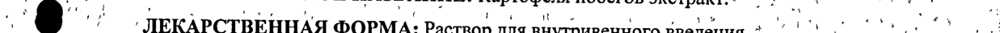
- стр. 1: «sy активное вещество — Панавир® (картофеля побегов экстракт) — 200 мкг; °: : р 4» — низкая уверенность: «4» (50)  
  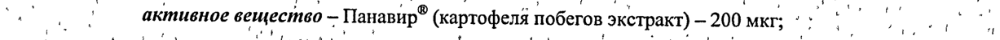
- стр. 1: «‘3 ‚ вспомогательные вещества: натрия хлорид - 0,045 г, вода для инъекций - до 5 мл. ‘' ot» — низкая уверенность: «‘3» (56); повторное чтение: «Го | > аспомогательные вещества: натрия хлорид ~ 0,045 т, вода Для инъекций - до 5 мл. a: 4, ;»  
  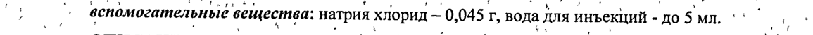
- стр. 1: «..х, , , КОД АТХ: Л4АХ. 6% | +, и. м! К ВО» — низкая уверенность: «Л4АХ.» (68), «6%» (34); повторное чтение: «‘ . ' би < oy JOSAX. 7 at oe . a `. 7 | . Г. aan . 0 a ; ye!»  
  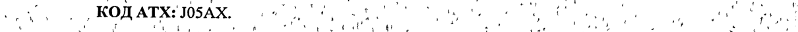
- стр. 2: «АЕ : 'При’внутривенном введении ‘полисахариды обнаруживаются ‚в крови уже: через 5 мин о» — повторное чтение: «7 й Е - 'При-внутривенном введении ‘полисахарйлы обнаруживаются «в крови уже" пере 5 a |»  
  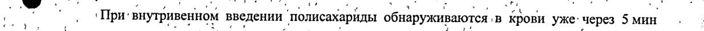
- стр. 2: «my os _ : селезенки. Выведение начинается быстро, через 20-30 мин полисахариды обнаруживаются и» — повторное чтение: «ae | . .. : елезенки. Выведение начинается быетрб, через 20-30 мии полисахариды обнаруживаются | 7 .»  
  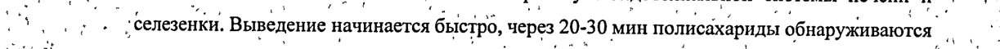
- стр. 3: «. р у . sy - ‘ tat tro et 1% 1.» — низкая уверенность: «1%» (8), «1.» (13); повторное чтение: «" ... . ene, Me =: о р” Hye»  
  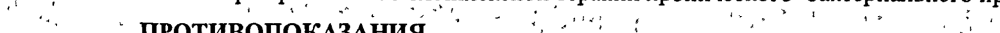
- стр. 3: «в № _Терапевтическая доза препарата составляет 200 мкг действующего вещества (содержимое . 7 }» — низкая уверенность: «7» (36)  
  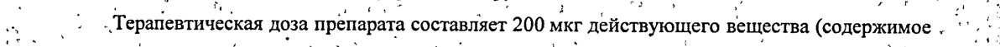
- стр. 3: «-” ^_‚ Интервалом 48 или 24 ч. При‘ необходимости курс лечения можно повторить через’ 1. |» — низкая уверенность: «1.» (65)  
  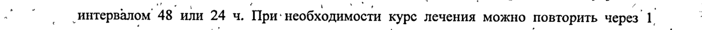
- стр. 3: «oo. ` в течение ‘первой недели ‘с интервалом 48 Ч’ и двукратно в течение, второй недели ic ; -» — повторное чтение: «| aa | im B течение первой недели ‘с интервалом 48 sa двукратно B течение ‘второй недели ‘с * | .»  
  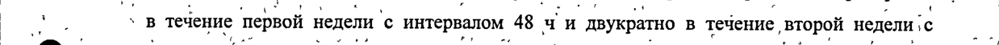
- стр. 3: «| .® ; интервалом 72 ч. № a re — - т °, 7 oe 7 a» — низкая уверенность: «7» (41), «7» (28)  
  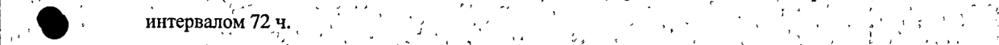
- стр. 3: «о. Для лечения ОРВИ и гриппа применяют 2 внутривенные инъекции с интервалом 18-24 ч. : a» — повторное чтение: «. ` | | Для лечения ОРВИ и гриппа применяют? внутривенные инъекций с интервалом 18-24 y, В | vs - :»  
  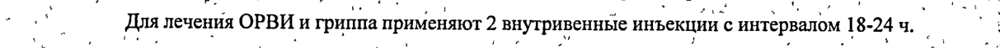
- стр. 4: «a интервалом 48 или 24 ч. При необходимости через 1: месяц курс лечения можно | + |» — низкая уверенность: «1:» (58)  
  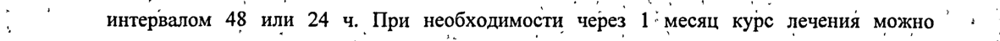
- стр. 4: «В Раствор для внутривенного введения 0,04 мг/мл. 1.1: . \ a в . в о И:» — низкая уверенность: «1.1:» (14); повторное чтение: «»  
  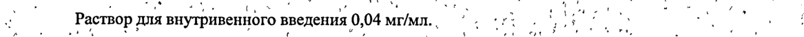
- стр. 4: «‘ „ ~ По 5 мл раствора в ампулах или, флаконах нейтрального“ стекла вместимостью 5 мл, о:» — низкая уверенность: «5» (41)  
  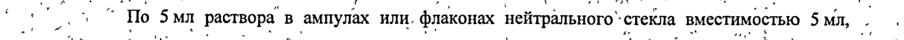
