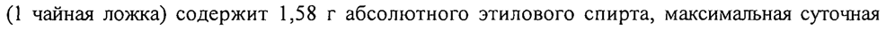

# Клевера травы экстракт — внутрь

- Препарат: Атероклефит® (экстракт для приема внутрь;)
- АТХ: C10AX
- Источник: ГРЛС, инструкция по медицинскому применению, РУ ЛП-001518, файл от 2024-08-23 (https://grls.rosminzdrav.ru/Grls_View_v2.aspx?routingGuid=17471c47-e93d-44a8-8238-3a27c49076d7)
- Распознано автоматически (OCR): 4 из 4 стр.
- Инструкция к другому РУ того же препарата: ЛП-001518 (национальное РУ, переоформленное по правилам ЕАЭС, решение от 19.08.2024). Текст может быть старше действующего
- Сомнительных строк после OCR: 1 (см. раздел «Проверка распознавания»)

## Общие сведения

МИНИСТЕРСТВО ЗДРАВООХРАНЕНИЯ РОССИЙСКОЙ ФЕДЕРАЦИИ
ИНСТРУКЦИЯ по применению лекарственного препарата для медицинского применения
Атероклефит® р МИНЗДРАВ РОССИИ Торговое наименование: Атероклефит® «АГ 001578 - 310 714
СОГЛАСОВАНО Лекарственная форма: экстракт для приема внутрь жидкий

## 2. Состав

® Для получения 1000 мл препарата используют:
® Для получения 1000 мл препарата используют:
Активный компонент:
Клевера трава — 500 г Вспомогательное вещество:
Этанол (спирт этиловый) 40 % - достаточное количество для получения 1000 мл
® препарата.
Описание Жидкость от светло- до темно-коричневого цвета со специфическим запахом. При хранении допускается появление осадка.
© Фармакотерапевтическая группа :
Гиполипидемическое средство растительного происхождения.
Код АТХ: С10АХ ‚ Фармакологические свойства

## 5.1. Фармакодинамика

Атероклефит® представляет собой жидкий экстракт из травы клевера красного, полученный путем двойной экстракции сырья 40 % этанолом. Согласно результатам проведенных доклинических исследований, жидкий экстракт травы клевера красного обладает умеренным гиполипидемическим действием: способствует снижению концентрации общего холестерина, концентрации липопротеидов низкой плотности
Атероклефит® представляет собой жидкий экстракт из травы клевера красного, полученный путем двойной экстракции сырья 40 % этанолом. Согласно результатам проведенных доклинических исследований, жидкий экстракт травы клевера красного обладает умеренным гиполипидемическим действием: способствует снижению концентрации общего холестерина, концентрации липопротеидов низкой плотности
(ЛИНП) и повышению концентрации липопротеидов высокой плотности (ЛИВП).
] Механизм действия жидкого экстракта травы клевера красного связан с перераспределением холестерина из ЛИНП в ЛПВИ, в составе которых холестерин быстрее метаболизируется и выводится из организма. Жидкий экстракт травы клевера красного также способствует снижению интенсивности перекисного окисления липидов, в результате чего уменьшается перекисная модификация липопротеидов и нормализуется проницаемость сосудистой стенки.

## 5.2. Фармакокинетика

Данные отсутствуют.
Показания для применения Гиперлипидемия Па типа по Фредериксону, слабовыраженная.

® Противопоказания для применения Повышенная чувствительность к компонентам препарата, возраст до 18 лет, черепномозговая травма, заболевания головного мозга, заболевания печени, выраженные | нарушения функции почек, алкоголизм. |

©® С осторожностью применять больным с нарушениями функции почек легкой и средней степени тяжести. |
Лицам, имеющим хронические заболевания, перед применением препарата обязательно проконсультироваться с врачом.

## 4.6. Применение при беременности и в период грудного вскармливания

@ Препарат противопоказан к применению при беременности и в период грудного вскармливания. При необходимости назначения препарата в период лактации грудное вскармливание следует прекратить. |

## 4.2. Способ применения и дозы

Внутрь: по 1 чайной ложке препарата, предварительно разведенного в 1/3 стакана воды, | 3 раза в день за 30 минут до приема пищи. Курс лечения 3-6 месяцев.
Внутрь: по 1 чайной ложке препарата, предварительно разведенного в 1/3 стакана воды, | 3 раза в день за 30 минут до приема пищи. Курс лечения 3-6 месяцев.
Проведение повторного курса лечения возможно по рекомендации врача.
Перед назначением препарата, пациент должен быть переведен на гипохолестеринемическую | диету, которую должен соблюдать в течение всего периода терапии.
Tn Td

## 4.8. Побочное действие

| Возможны аллергические реакции (кожный зуд, сыпь), а также тошнота, головная боль, ощущение горечи во рту.
| Возможны аллергические реакции (кожный зуд, сыпь), а также тошнота, головная боль, ощущение горечи во рту.
При появлении побочных эффектов, в том числе не указанных в Инструкции, следует прекратить применение препарата и обратиться к врачу.

## 4.9. Передозировка

При применении препарата в дозах, превышающих рекомендуемые, возможны усиление дозозависимых побочных эффектов, признаки алкогольной — интоксикации
При применении препарата в дозах, превышающих рекомендуемые, возможны усиление дозозависимых побочных эффектов, признаки алкогольной — интоксикации
(головокружение, тошнота, рвота). Лечение симптоматическое.

## 4.5. Взаимодействие с другими лекарственными средствами

® В настоящее время нет данных о взаимодействии препарата Атероклефит® при совместном применении его с другими лекарственными препаратами, в частности, с гиполипидемическими препаратами.

## 4.4. Особые указания

©® Перед тем, как начать применение препарата, следует проконсультироваться с лечащим врачом.
В период терапии препаратом Атероклефит® необходим контроль активности
«печеночных» трансаминаз, креатинфосфокиназы, контроль функции почек.
С этой целью, в период приема препарата Атероклефит® рекомендуется посещать врача не

_ реже 1 раза в месяц с целью коррекции терапии в случае необходимости. Кратность и

® сроки посещения определяются лечащим врачом.
Содержание этанола в препарате составляет не менее 35 %. Разовая доза препарата
(1 чайная ложка) содержит 1,58 г абсолютного этилового спирта, максимальная суточная доза (3 чайные ложки) содержит 4,74 г абсолютного этилового спирта.
Не следует превышать указанную суточную дозу.
Женщины детородного возраста при применении препарата должны использовать надежные методы контрацепции.

## 4.7. Влияние на способность управлять транспортными средствами, механизмами

В период лечения препаратом Атероклефит® необходимо воздержаться от управления транспортными средствами и занятия другими потенциально опасными видами деятельности, требующими повышенной концентрации внимания и быстроты

психомоторных реакций.

## 6.5. Форма выпуска

Экстракт для приема внутрь жидкий. По 30, 50 или 100 мл в бутылки из коричневого или оранжевого стекла для лекарственных средств, укупоренные крышками навинчиваемыми с уплотняющим элементом и контролем первого вскрытия.
Экстракт для приема внутрь жидкий. По 30, 50 или 100 мл в бутылки из коричневого или оранжевого стекла для лекарственных средств, укупоренные крышками навинчиваемыми с уплотняющим элементом и контролем первого вскрытия.
Каждую бутылку вместе с инструкцией по применению помещают в пачку из картона.

## 6.4. Условия хранения

При температуре не выше 25 °С.
При температуре не выше 25 °С.
Хранить в недоступном для детей месте.
® Срок годности 2 года.
Не применять по истечении срока годности.
Условия отпуска из аптек ® Отпускается без рецепта.
Владелец регистрационного удостоверения / Предприятие-изготовитель /
Организация, принимающая претензии от потребителей
ЗАО «Эвалар», Россия, 659332, Алтайский край, г. Бийск, ул. Социалистическая, 23/6, тел./факс (3854) 39-00-50.
an nnn Ao ото < % 3$ Л 2х Председатель Совета директоров [fg a” Bild &, oN o + 4 3
ЗАО «Эвалар» a Е FOS, EMC. Прокопьева 5 bisa а
® Е ° a YA 55 Sf “> 1922209 aS)
## Проверка распознавания

Страницы-сканы распознаны автоматически. В 1 строках с дозировками цифры могли распознаться с ошибкой — сверьте с вырезкой из оригинала:

- стр. 3: «(1 чайная ложка) содержит 1,58 г абсолютного этилового спирта, максимальная суточная» — низкая уверенность: «(1» (63)  
  
