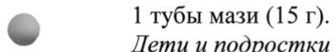

# Клиохинол + Флуметазон — наружно

- Препарат: Лоринден® С (мазь для наружного применения;)
- АТХ: D07BB01
- Источник: ГРЛС, инструкция по медицинскому применению, РУ П N014868/01, файл от 2025-03-10 (https://grls.rosminzdrav.ru/Grls_View_v2.aspx?routingGuid=36a38926-ed2e-4ed9-8295-574255c45a23)
- Распознано автоматически (OCR): 6 из 6 стр.
- Инструкция к другому РУ того же препарата: П N014868/01 (национальное РУ, переоформленное по правилам ЕАЭС, решение от 25.02.2025). Текст может быть старше действующего
- Сомнительных строк после OCR: 1 (см. раздел «Проверка распознавания»)

## Общие сведения

МИНИСТЕРСТВО ЗДРАВООХРАНЕНИЯ РОССИИСКОИ ФЕДЕРАЦИИ
ИНСТРУКЦИЯ ПО МЕДИЦИНСКОМУ ПРИМЕНЕНИЮ ЛЕКАРСТВЕННОГО ПРЕПАРАТА
ЛОРИНДЕН® С | | МИНЗДРАВ РОССИИ Регистрационный номер: IT №014868/01 | WO SEO ~ iy ne 19 | и ®*»® >
Торговое наименование: Лоринден® С СОГЛАСОВАНО
— же Международное непатентованное или группировочное наименование:
клиохинол+флуметазон & Лекарственная форма: мазь для наружного применения

## 2. Состав

1 гмази содержит:
Действующие вещества: флуметазона пивалат 0,20 мг, клиохинол 30,0 мг.
Вспомогательные вещества: воск пчелиный белый, вазелин.
Описание:
Белая со светло-желтым или серым оттенком жирная масса. Допускается наличие единичных мягких скоплений кристаллов.
Фармакотерапевтическая группа Глюкокортикостероид для местного применения+протимикробное средство
Код ATX: 207ВВО1 & Фармакологические свойства

## 5.1. Фармакодинамика

Лоринден® С - комбинированный препарат для наружного применения, действие которого обусловлено входящими действующими веществами глюкокортикостероида флуметазона и антибактериального средства клиохинола.
Лоринден® С - комбинированный препарат для наружного применения, действие которого обусловлено входящими действующими веществами глюкокортикостероида флуметазона и антибактериального средства клиохинола.
Флуметазон — синтетический глюкокортикостероид для местного применения с умеренной противовоспалительной активностью. Оказывает быстро наступающее противовоспалительное, противозудное и противоаллергическое действие. Вследствие местного сосудосуживающего действия уменьшает экссудативные реакции.
Клиохинол обладает антибактериальной активностью в отношении некоторых грамположительных и грамотрицательных микроорганизмов и слабым противогрибковым действием.

## 5.2. Фармакокинетика

Всасывание После аппликации флуметазон проникает в роговой слой кожи, в небольшой степени способен всасываться в кровь и оказывать системное действие. Всасывание флуметазона усиливается при применении на тонкой коже, в области складок, на лице, при применении окклюзионных повязок и нанесении на обширные участки кожи. Всасывание глюкокортикостероидов у детей сильнее, чем у взрослых.
Всасывание После аппликации флуметазон проникает в роговой слой кожи, в небольшой степени способен всасываться в кровь и оказывать системное действие. Всасывание флуметазона усиливается при применении на тонкой коже, в области складок, на лице, при применении окклюзионных повязок и нанесении на обширные участки кожи. Всасывание глюкокортикостероидов у детей сильнее, чем у взрослых.
Метаболизм Абсорбированный через кожу флуметазон метаболизируется в печени.
Выведение Выводится через почки и в меньшей степени с желчью, преимущественно в виде соединений с глюкуроновой кислотой, и незначительная часть в неизмененном виде.

## 4.1. Показания к применению

Препарат Лоринден® С применяется наружно при сухих воспалительных заболеваниях кожи, особенно аллергической этиологии, чувствительных к глюкокортикостероидам
Препарат Лоринден® С применяется наружно при сухих воспалительных заболеваниях кожи, особенно аллергической этиологии, чувствительных к глюкокортикостероидам
(осложненных вторичной бактериальной инфекцией), протекающих с избыточным ороговением и чрезмерным зудом:
e себорейный дерматит;
& ® атопический дерматит;
® контактный аллергический дерматит;
® многоформная экссудативная эритема;
e псориаз;
® красный плоский лишай.

## 4.3. Противопоказания

® Повышенная чувствительность к флуметазону (или любому глюкокортикостероиду), клиохинолу и к любому вспомогательному веществу препарата;
® Повышенная чувствительность к флуметазону (или любому глюкокортикостероиду), клиохинолу и к любому вспомогательному веществу препарата;
e Бактериальные, грибковые, и вирусные (в том числе, ветряная оспа, простой герпес)
инфекции кожи;
e Розовые угри и вульгарные угри;
e Периоральный дерматит;
® Перианальный зуд;
e Пеленочный дерматит;
® Туберкулезные или сифилитические поражения кожи;
- e Новообразования кожи, в том числе предраковые;
e Флебиты, трофические язвы голеней, связанные с варикозным расширением вен;
e Ожоги.
e Поствакциональный период;
® [триместр беременности;
e Период грудного вскармливания;
e Детский возраст до 2-х лет (отсутствуют данные по безопасности и эффективности).

## 4.3. С осторожностью

» Нанесение на большие участки кожи, раны, повреждённую кожу, применение больших доз, а также длительная терапия глюкокортикостероидом (особенно у детей старше 2-х лет).
» Нанесение на большие участки кожи, раны, повреждённую кожу, применение больших доз, а также длительная терапия глюкокортикостероидом (особенно у детей старше 2-х лет).
e Нанесение на кожу лица и интертригинозную кожу (складки кожи, подмышечные впадины, паховая область, сгибы рук и ног).
» Нанесение на кожу вокруг глаз или веки (риск развития глаукомы, катаракты), в том числе у пациентов с глаукомой или катарактой.
e Атрофические изменения подкожной клетчатки, особенно у лиц пожилого возраста.

## 4.6. Применение при беременности и в период грудного вскармливания

Беременность Применение препарата Лоринден® С противопоказано в I триместре беременности.
Возможно применение препарата Лоринден® С для терапии беременных женщин во Пи
Ш триместре по назначению лечащего врача в случае, если предполагаемая польза для матери превышает потенциальный риск для плода. В этих случаях терапия должна быть непродолжительна и ограничиваться небольшими участками кожи.
В исследованиях на животных было установлено, что глюкокортикостероиды оказывают тератогенный эффект при их применении внутрь даже в малых дозах. Также тератогенный эффект проявлялся у животных при нанесении сильнодействующих глюкокортикостероидов на кожу.
Контролируемые исследования, направленные на изучение тератогенного эффекта
& флуметазона при наружном применении у женщин в период беременности, не проводились.
Грудное вскармливание.
Нет данных о количестве всасываемого флуметазона в грудное молоко при наружном применении. При необходимости применения препарата Лоринден® С женщинам в период лактации — грудное вскармливание прекращают.

## 4.2. Способ применения и дозы

Наружно.
Наружно.
Мазь наносят тонким слоем на пораженные участки кожи массирующими движениями для улучшения проникновения. В случаях избыточной лихенизации или гиперкератоза, препарат необходимо применять под окклюзионными повязками, которые меняют каждые 24 часа.
Взрослые пациенты Применять не чаще 1-2 раз в сутки. Курс непрерывной терапии - не более 2 недель; в частности, на коже лица - не более 7 дней. В течение недели можно использовать не более
© 1 тубы мази (15 г).
Дети и подростки Препарат Лоринден® С противопоказан детям младше 2 лет.
У детей из-за более высокого отношения площади поверхности тела к массе тела, чем у взрослых, легче может развиться нарушение функции гипоталамо-гипофизарнонадпочечниковой системы и возникнуть нежелательные реакции, характерные для глюкокортикостероидов, в том числе задержка роста и развития.
У детей старше 2 лет препарат Лоринден® С следует применять с большой осторожностью, только | раз в сутки на небольших участках кожи под контролем врача, короткими курсами; не следует применять на коже лица.

## 4.8. Побочное действие

Частота возникновения побочных реакций классифицирована в соответствии с рекомендациями Всемирной Организацией Здравоохранения (ВОЗ), побочные эффекты классифицированы по частоте:
Частота возникновения побочных реакций классифицирована в соответствии с рекомендациями Всемирной Организацией Здравоохранения (ВОЗ), побочные эффекты классифицированы по частоте:
очень часто (> 1/10), часто (> 1/100 и < 1/10), нечасто (> 1/1000 и < 1/100), редко (> 1/10000 и < 1/1000), очень редко (< 1/10000), частота неизвестна (невозможно оценить по доступным данным).
Побочные эффекты развиваются редко и носят обратимый характер.
Со стороны кожи и подкожной клетчатки Частота неизвестна: могут возникнуть акнеподобные симптомы, постстероидная пурпура, атрофия эпидермиса и подкожной клетчатки, сухость кожи, гипертрихоз или алопеция, депигментация или гиперпигментация кожи, атрофия кожи и стрии, телеангиэктазии, периоральный дерматит, воспаление волосяных фолликулов, вторичные инфекции, раздражение кожи.
Иногда может возникнуть крапивница или пятнисто-папулёзная сыпь, возможно обострение текущих заболеваний кожи.
Со стороны органа зрения

& Частота неизвестна: снижение остроты зрения.
В случае применения лекарственного препарата на коже век иногда может развиться глаукома или катаракта, а в редких случаях - центральная серозная хориоретинопатия
(ЦСХ).
Системные нарушения Частота неизвестна: при длительном применении и/или нанесении на большие поверхности кожи, при использовании окклюзионных повязок и при терапии у детей возможно развитие симптомов гиперкортицизма (гипергликемия, глюкозурия, обратимое угнетение функции коры надпочечников, проявления синдрома Иценко-Кушинга, задержка роста и развития у детей, артериальная гипертензия, снижение иммунитета), как проявление резорбтивного действия флуметазона.
Клиохинол, входящий в состав препарата Лоринден® С может повышать риск нейротоксичности при длительном применении или использования окклюзивной повязки.

## 4.9. Передозировка

- Препарат Лоринден® С при наружном применении может абсорбироваться в количествах, достаточных для того, чтобы вызвать развитие системных эффектов глюкокортикостероидов. Развитие острой передозировки маловероятно. Однако, если.
флуметазон, как и другие глюкокортикостероиды, наносится на большие участки пораженной кожи с повышенной способностью к резорбции, в течение длительного времени, или с использованием окклюзионной повязки, или в случае длительного применения у детей, могут развиться симптомы гиперкортицизма (см. раздел «Побочное действие»). В случае появления симптомов передозировки следует прекратить применение препарата и немедленно обратиться к врачу.
Лечение. В случае передозировки препарат следует отменить, постепенно уменьшая частоту его нанесения или заменяя менее сильным глюкокортикостероидом, под наблюдением врача ввиду риска возникновения надпочечниковой недостаточности.

## 4.5. Взаимодействие с другими лекарственными средствами

Не проводить вакцинацию и иммунизацию, в связи с иммунодепрессивньм эффектом препарата.

Не назначать в комбинации с другими препаратами для наружного применения. В случае резорбции препарата в общий кровоток, глюкокортикостероид снижает действие инсулина, пероральных гипогликемических средств, гипотензивных препаратов, антикоагулянтов, уменьшает концентрацию празиквантела в сыворотке крови. При одновременном применении препарата с андрогенами, эстрогенами, пероральными контрацептивами, анаболическими стероидами, антипсихотическими средствами, карбутамидом, азатиоприном, холиноблокаторами, антигистаминными средствами, трициклическими антидепрессантами, нитратами, диуретиками и сердечными гликозидами повышается риск развития побочных эффектов глюкокортикостероидов.
Лекарственный препарат Лоринден® С за счет содержания флуметазона может усиливать действие иммуносупрессивных препаратов и ослаблять действие иммуностимулирующих.

## 4.4. Особые указания

Курс непрерывной терапии - не более 2 недель.

Следует избегать попадания мази Лоринден® С в глаза и на слизистые оболочки.

& Если при наружном применении мази Лоринден® С отмечаются признаки раздражения, повышенной сухости кожи или аллергии, а также усиление побочных эффектов или эффектов, не указанных в инструкции, следует прекратить лечение и обратиться к врачу.
При длительном применении и/или нанесении на большие поверхности кожи, раны, поврежденную кожу, применение больших доз, при использовании окклюзионных повязок и при терапии у детей мази Лоринден® С возможна системная абсорбция глюкокортикостероида; возможно подавление функции гипоталамо-гипофизарнонадпочечниковой системы и развитие симптомов гиперкортицизма.

Во время терапии препаратом необходим периодический контроль функции коры

надпочечников, с помощью определения концентрации кортизола в крови и моче после

стимуляции надпочечников адренокортикотропным гормоном (AKTT).

В случае развития вторичной бактериальной или грибковой инфекции необходимо

назначить наружное применение антибактериального или противогрибкового препарата.

Если симптомы инфекции сохраняются, следует прекратить применение лекарственного

препарата Лоринден® С до излечения инфекции.

С осторожностью препарат Лоринден® С наносят на кожу вокруг глаз или веки с связи с
! риском развития глаукомы или катаракты, а также у пациентов с этими заболеваниями в

~ анамнезе, у которых может наступить обострение течения этих заболеваний.

Если у пациента возникают такие симптомы, как нечёткость зрения, либо другие

зрительные нарушения, следует рассмотреть возможность направления пациента к

офтальмологу для выяснения возможных причин нарушений, к которым может

относиться катаракта, глаукома или редкие заболевания, такие как центральная серозная

хориоретинопатия.

С особой осторожностью следует применять препарат Лоринден® С на коже лица и

интертригинозной коже (складки кожи, подмышечные впадины, паховая область, сгибы

рук и ног), в связи с повышенным всасыванием глюкокортикостероидов через тонкую

кожу и возможностью появления побочных эффектов (телеангиэктазии, атрофия кожи,

периоральный дерматит) даже после кратковременного применения.

С осторожностью применяют препарат Лоринден® С под окклюзионной повязкой

вследствие усиления всасывание глюкокортикостероидов в кровь; поскольку могут

развиться атрофия эпидермиса, стрии и присоединение инфекции.

Следует с осторожностью применять препарат при атрофических изменениях подкожной

клетчатки, особенно у лиц пожилого возраста.

С особой осторожностью следует применять препарат Лоринден® С у пациентов с псориазом, вследствие возможного рецидива заболевания, вызванного развитием толерантности, риска генерализованного пустулёзного псориаза и общей токсичности изза пролежней.
Дети и подростки Следует применять с осторожностью мазь Лоринден® С, особенно в качестве длительной терапии, у детей старше 2-х лет, поскольку у данной группы пациентов из-за более высокого соотношения площади поверхности тела к массе тела, чем у взрослых, быстрее может развиться нарушение функции гипоталамо-гипофизарно-надпочечниковой системы и возникнуть нежелательные эффекты, характерные для глюкокортикостероидов, в TOM числе задержка роста и развития.
Клиохинол, входящий в состав препарата Лоринден® С может повышать риск нейротоксичности при длительном применении или использования окклюзивной повязки.

## 4.7. Влияние на способность управлять транспортными средствами, механизмами

w& Мазь Лоринден® С не оказывает влияния на способность управлять транспортными средствами и механизмами.

## 6.5. Форма выпуска

Мазь для наружного применения.
Мазь для наружного применения.
По 15 гв алюминиевые тубы с лакированной внутренней поверхностью. Тубу помещают в картонную пачку с инструкцией по применению.

## 6.4. Условия хранения

Хранить при температуре не выше 25°С.
Хранить при температуре не выше 25°С.
Хранить в недоступном для детей месте.

## 6.3. Срок годности

3 года.
3 года.
Не использовать по истечении срока годности.

& Условия отпуска Отпускают по рецепту.
Владелец регистрационного удостоверения:
ООО «ВАЛЕАНТ», 115162, Москва, ул. Шаболовка, д. 31, стр. 5, Россия
Производитель:
Фармзавод Ельфа A.O., 58-500 Еленя Гура, ул. В. Поля 21, Польша
Организация, принимающая претензии потребителя:
OOO «ВАЛЕАНТ», 115162, Москва, ул. Шаболовка, д..31, стр. 5, Россия.
Тел./факс: +7 (495) 510-28-79. тата, Директор по регистрации в России Вс Fats:
и странах СНГ ООО «BAJIEAHT» Ye L/S SH Козлова Т.В.

RSs MAE See | ааа 6
## Проверка распознавания

Страницы-сканы распознаны автоматически. В 1 строках с дозировками цифры могли распознаться с ошибкой — сверьте с вырезкой из оригинала:

- стр. 3: «© 1 тубы мази (15 г).» — повторное чтение: «@ owas (19 1).»  
  
