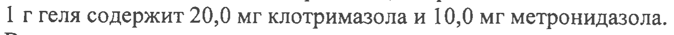
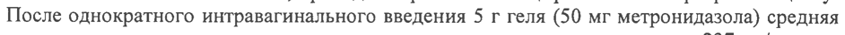

# Клотримазол + Метронидазол — вагинально

- Препарат: Метрогил® Плюс (гель вагинальный)
- АТХ: G01AF20
- Источник: ОХЛП, Единый реестр ЛС ЕАЭС, запись 6797718f30dcf89a73e6ea6b, документ от 2026-05-26
- Распознано автоматически (OCR): 6 из 6 стр.
- Сомнительных строк после OCR: 4 (см. раздел «Проверка распознавания»)

## Общие сведения

СООТВЕТСТВУЕТ ЭКСПЕРТНОМУ ОТЧЕТУ от 02.04.2026 № 6770
[ПОСЛЕДОВАТЕЛЬНОСТЬ 0008)
ОБЩАЯ ХАРАКТЕРИСТИКА ЛЕКАРСТВЕННОГО ПРЕПАРАТА

## 1. Наименование лекарственного препарата

Метрогил Плюс, 20 + 10 мг/г, гель вагинальный

## 2. Качественный и количественный состав

Действующие вещества: клотримазол, метронидазол.
I г геля содержит 20,0 мг клотримазола и 10,0 мг метронидазола.
Вспомогательные вещества, наличие которых надо учитывать в составе лекарственного препарата: метилпарагидроксибензоат, пропилпарагидроксибензоат, пропиленгликоль (см.
раздел 4.4).
Полный перечень вспомогательных веществ приведен в разделе 6.1.

## 3. Лекарственная форма

Гель вагинальный.
Однородный опалесцирующий гель белого или почти белого цвета.

## 4. Клинические данные

## 4.1. Показания к применению

Препарат показан к применению у взрослых для лечения бактериальных вагинозов различной этиологии, подтвержденных клиническими и микробиологическими данными;
кандидозных вульвитов и вульвовагинитов, урогенитального трихомониаза.

## 4.2. Режим дозирования и способ применения

Режим дозирования Рекомендуемая доза составляет 5 г (один полный аппликатор) 2 раза в день (утром и вечером).
Курс лечения - 5 дней. При необходимости курс лечения можно повторить через 2 недели.
Дети Безопасность и эффективность препарата Метрогил Плюс у детей в возрасте от 0 до 18 лет на данный момент не установлены. Данные отсутствуют.
Способ применения Интравагинально.

## 4.3. Противопоказания

Гиперчувствительность к метронидазолу, клотримазолу или к любому из вспомогательных веществ, перечисленных в разделе 6.1;

e Лейкопения (в т.ч. в анамнезе);
e Органические поражения центральной нервной системы (в т.ч. эпилепсия);
e Печеночная недостаточность;
® Тяжелые нарушения функции печени;
® Менструальный период;
e Девственность;
® Беременность I триместр;
® Период грудного вскармливания;

## 4.4. Особые указания и меры предосторожности при применении

При возникновении нежелательных реакций, указывающих на гиперчувствительность или раздражение слизистой оболочки влагалища, следует прекратить лечение. ве er Los.
ey, kX < > = 82. | | a og 1 р 578 /® — = Ne & 7 у,
Зи.“ “SS Hi 8“ СООТВЕТСТВУЕТ ЭКСПЕРТНОМУ ОТЧЕТУ от 02.04.2026 № 6770
[ПОСЛЕДОВАТЕЛЬНОСТЬ 0008)
В период лечения противопоказан прием алкоголя (возможно развитие дисульфирамоподобной реакции: спастические боли в животе, тошнота, рвота, головная боль, внезапный прилив крови к лицу).
Сообщалось о случаях тяжелой гепатотоксичности/острой печеночной недостаточности, в том числе, о случаях со смертельным исходом с очень быстрым развитием после начала лечения у пациентов с синдромом Коккейна препаратами, содержащими метронидазол для системного применения. Поэтому в этой популяции метронидазол следует применять после тщательной оценки риска-пользы и только при отсутствии альтернативного лечения.
Диагностика функции печени должна проводиться непосредственно перед началом терапии, во время и после окончания до тех пор, пока функция печени будет находиться в пределах нормальных значений или до достижения базовых значений. Если во время лечения тесты на функцию печени становятся значительно повышенными, препарат следует отменить. У пациентов с синдромом Коккейна при развитии любых симптомов нарушения функции печени следует немедленно прекратить прием метронидазола.
Рекомендуется одновременное лечение половых партнеров.
Во время курса лечения необходимо воздерживаться от половой жизни.
При вагините, вызванном Trichomonas vaginalis, целесообразно одновременное лечение полового партнера метронидазолом для приема внутрь. В случае применения препарата совместно с метронидазолом для приема внутрь, особенно при повторном курсе, необходим контроль картины периферической крови (опасность лейкопении).
Метронидазол может иммобилизовать трепонемы и приводить к ложноположительному тесту Нельсона.
Только для интравагинального применения!
Избегать попадания в глаза!
Препарат Метрогил Плюс содержит пропиленгликоль, который может вызывать раздражение кожи, метилпарагидроксибензоат и пропилпарагидроксибензоат, которые могут вызвать аллергические реакции (в том числе отсроченные).

## 4.5. Взаимодействие с другими лекарственными препаратами и другие виды взаимодействия

Аналогично дисульфираму вызывает непереносимость этанола.
Усиливает действие непрямых антикоагулянтов, не рекомендуется сочетать с недеполяризующими миорелаксантами (векурония бромид).
При одновременном приеме с препаратами лития может повышаться концентрация последнего в плазме крови.
Фенобарбитал ускоряет метаболизм метронидазола за счет индукции микросомальных ферментов печени, циметидин - снижает, что может привести к повышению его концентрации в плазме крови и увеличению риска развития побочных эффектов.
Амфотерицин В, нистатин, натамицин снижают эффективность клотримазола при одновременном применении.

## 4.6. Фертильность, беременность и лактация

Беременность Применение препарата во Пи Ш триместре беременности возможно только по жизненным показаниям, если потенциальная польза для матери превосходит риск для плода.
Лактация При назначении препарата необходимо прекратить грудное вскармливание.
ОЕ»
$ 2 wy PS wf #2 =! 3» ) \ $ ё 5 &} - We en aa я р i
“Daag vt 00 “tN .
СООТВЕТСТВУЕТ ЭКСПЕРТНОМУ ОТЧЕТУ от 02.04.2026 №6770
[ПОСЛЕДОВАТЕЛЬНОСТЬ 0008)
4.7. Влияние на способность управлять транспортными средствами и работать с механизмами
Препарат не влияет на способность управлять транспортными средствами и заниматься другими потенциально опасными видами деятельности, которые требуют повышенной концентрации внимания и быстроты психомоторных реакций.

## 4.8. Нежелательные реакции

Резюме профиля безопасности Местные реакции
Зуд, жжение и гиперемия слизистой оболочки наружных половых органов; у полового партнера - ощущение жжения или раздражение полового члена, учащенное мочеиспускание.
Возможно развитие системных эффектов: головокружение, головная боль, сухость во рту, изменение вкусовых ощущений, включая «металлический» привкус, тошнота, рвота, снижение аппетита, спастические боли в брюшной полости, запоры или диарея, окрашивание мочи в темный цвет, лейкопения или лейкоцитоз.
Аллергические реакции Кожная сыпь, крапивница.
Если у вас отмечаются побочные эффекты, указанные в инструкции по применению
(листке-вкладыше) или они усугубляются, или Вы заметили любые другие побочные эффекты, не указанные в инструкции по применению (листке-вкладыше), сообщите об этом врачу.
Сообщение о подозреваемых нежелательных реакциях
Важно сообщать о подозреваемых нежелательных реакциях после регистрации препарата с целью обеспечения непрерывного мониторинга соотношения «польза - риск»
лекарственного препарата. Медицинским работникам рекомендуется сообщать о любых подозреваемых нежелательных реакциях лекарственного препарата через национальные системы сообщения о нежелательных реакциях государств - членов Евразийского экономического союза:
Российская Федерация Федеральная служба по надзору в сфере здравоохранения (Росздравнадзор)
Адрес: 109074, г. Москва, Славянская площадь, д. 4, строение 1
'Тел.: +7 (495) 698-45-38, +7 (499) 578-02-30
Адрес электронной почты: pharm@roszdravnadzor.gov.ru (для держателей регистрационных удостоверений и производителей лекарственных препаратов), npr@roszdravnadzor.gov.ru
(для медицинских организаций).
Интернет-сайт: www.roszdravnadzor.ru Республика Казахстан
РГИ на ПХВ «Национальный центр экспертизы лекарственных средств и медицинских изделий Комитета контроля качества и безопасности товаров и услуг Министерства здравоохранения Республики Казахстан»
Адрес: 010017, г. Астана, пр. Мангилик Ел, д. 20
Телефон: 8 (7172)78-98-28 Электронная почта: pdic@dari.kz
Интернет-сайт: www.ndda.kz

## 4.9. Передозировка

Случаев передозировки при назначении препарата в рекомендуемых дозах не отмечено.
При применении препарата в соответствии с общей характеристикой енного препарата, передозировка маловероятна. Данные относительно О интравагинальном применении метронидазола отсутствуют. После вв ИЯ, В влаг i
= 828 \ 2 ея ;
\ so / P o,\ 2 и of С, СООТВЕТСТВУЕТ ЭКСПЕРТНОМУ ОТЧЕТУ от 02.04.2026 № 6770
[ПОСЛЕДОВАТЕЛЬНОСТЬ 0008)
метронидазол может всасываться в количествах, достаточных для того, чтобы вызывать системные эффекты.
Симптомы Симптомы передозировки метронидазолом: тошнота, рвота, боль в животе, диарея, генерализованный зуд, металлический привкус во рту, двигательные нарушения (атаксия), головокружение, парестезии, судороги, периферическая нейропатия (в т.ч. после продолжительного применения в высоких дозах), лейкопения, помутнение мочи.
Симптомы передозировки клотримазолом не выявлены.
Лечение При случайном приеме внутрь необходимо провести промывание желудка. Специального антидота не существует. Рекомендуется симптоматическая и поддерживающая терапия.

## 5. Фармакологические свойства

## 5.1. Фармакодинамические свойства

Фармакотерапевтическая группа: противомикробные средства и антисептики, применяемые в гинекологии; противомикробные средства и антисептики, кроме комбинаций с кортикостероидами; производные имидазола.
Код ATX: GOLAF20 Механизм действия Комбинированный препарат для интравагинального применения, эффективность которого обусловлена наличием в его составе двух активных компонентов: метронидазола и клотримазола.
Механизм действия метронидазола заключается в биохимическом восстановлении 5-нитрогруппы — внутриклеточными транспортными — протеинами — анаэробных микроорганизмов и простейших. Восстановленная 5-нитрогруппа метронидазола взаимодействует с ДНК клетки микроорганизмов, ингибируя синтез их нуклеиновых кислот, что ведет к гибели бактерий. Активен в отношении Trichomonas vaginalis,
Entamoeba histolytica, Gardnerella vaginalis, Giardia intestinalis, Lamblia spp., а также облигатных анаэробов Bacteroides spp. (в том числе Bacteroides fragilis, Bacteroides thetaiotaomicron, Bacteroides vulgatus), Fusobacterium spp., Veillonella spp., Prevotella
(Prevotella bivia, Prevotella buccae, Prevotella disiens) и некоторых грамположительных микроорганизмов (Eubacterium spp., Clostridium spp., Peptococcus spp., Peptostreptococcus 5рр.). Минимальная подавляющая концентрация (МПК) для этих штаммов составляет 0,125-6,25 мкг/мл. К метронидазолу нечувствительны аэробные микроорганизмы и факультативные анаэробы, но в присутствии смешанной флоры (аэробы и анаэробы)
метронидазол действует синергично с антибиотиками, эффективными против обычных аэробов.
Клотримазол является производным имидазола. Оказывает фунгицидное действие.
Снижает синтез эргостерола, являющегося составной частью клеточной мембраны микробной стенки, и приводит к изменению ее структуры и свойств. В малых концентрациях действует фунгистатически, а в больших (более 20 мкг/мл) - фунгицидно, причем не только на пролиферирующие клетки. В фунгицидных концентрациях взаимодействует с митохондриальными и пероксидазными ферментами, в результате чего происходит увеличение концентрации перекиси водорода до токсического уровня, что также способствует разрушению грибковых клеток. Обладает высокой активностью в отношении патогенных дерматофитов (Trichophyton mentagrophytes, Microsporum canis,
Epidermophyton floccosum), дрожжевых и плесневых грибов (рода Candida, Torulopsis glabrata, рода Rhodotorula, Pityrosporum orbiculare). “
WUC .. d %` NG

## 5.2. Фармакокинетические свойства

BD <

Абсорбция ри aco 7 я Абсорбция Sf not wo)
Метронидазол (> ( weer yah Bed et =} a о 9 Мл eC PL и f
< & 4 Mo mann СООТВЕТСТВУЕТ ЭКСПЕРТНОМУ ОТЧЕТУ от 02.04.2026 № 6770
[ПОСЛЕДОВАТЕЛЬНОСТЬ 0008)
После интравагинального введения метронидазол подвергается системной абсорбции
(около 56 %).
Клотримазол При применении клотримазола интравагинально абсорбируется не более 3 - 10 % от введенной дозы.
Распределение Метронидазол Относительная биодоступность вагинального геля в 2 раза выше биодоступности одноразовой дозы (500 мг) вагинальных таблеток метронидазола. Проникает в грудное молоко и большинство тканей, проходит через гематоэнцефалический барьер и плаценту.
После однократного интравагинального введения 5 г геля (50 мг метронидазола) средняя максимальная концентрация в сыворотке крови здоровых женщин равна 237 нг/мл, что составляет 2 % от средней максимальной концентрации метронидазола при приеме внутрь дозы 500 мг. Время достижения максимальной концентрации - 6 - 12 часов. Связь с белками плазмы составляет менее 20 %.
Клотримазол Высокие концентрации в вагинальном секрете и низкие концентрации в крови сохраняются в течение 48 - 72 часов.
Биотрансформация Метронидазол Метаболизируется в печени путем гидроксилирования, окисления и глюкуронирования.
Активность основного метаболита (2-оксиметронидазол) составляет 30 % от активности исходного соединения.
Клотримазол В печени клотримазол быстро метаболизируется до неактивных метаболитов.
Элиминация Метронидазол Выводится почками - 60 - 80 % дозы препарата системного действия (20 % этого количества в неизмененном виде), кишечником - 6 - 15 % дозы препарата системного действия.
6. ФАРМАЦЕВТИЧЕКИЕ СВОЙСТВА
6.1. Перечень вспомогательных веществ
Бензиловый спирт Динатрия эдетат Карбомер-940
Метилпарагидроксибензоат Натрия гидроксид
Пропилпарагидроксибензоат Пропиленгликоль
Вода

## 6.2. Несовместимость

Не применимо.

## 6.3. Срок годности (срок хранения)

3 года.
6.4. Особые меры предосторожности при хранении
Хранить при температуре не выше 25 °С. Не замораживать. АА
Фи © LEST oS f= ( wort YO (as ( овес = Breve. cal?
Аи om $!
Vig AC = СООТВЕТСТВУЕТ ЭКСПЕРТНОМУ ОТЧЕТУ от 02.04.2026 № 6770
[ПОСЛЕДОВАТЕЛЬНОСТЬ 0008)
6.5. Характер и содержание первичной упаковки
По 30 г в пластиковую ламинированную тубу (ПЭНП/Ал/толиэстер/ПЭНП), горлышко которой запечатано мембраной из алюминия и с навинчиваемой крышкой из полиэтилена с выступом для перфорации мембраны. Одна туба вместе с аппликатором и инструкцией по применению (листком-вкладышем) в картонную пачку.
По 50 г в пластиковую ламинированную тубу (ПЭНП/Ал/полиэстер/ПЭНП), горлышко которой запечатано алюминиевой фольгой, ламинированной полиэтиленом и с навинчиваемой крышкой из полипропилена с выступом (или без выступа) для перфорации фольги. Одна туба в картонную пачку вместе с аппликатором и инструкцией по применению (листком-вкладышем).
По 50 г в пластиковую ламинированную тубу (ПЭНГ/Ал/полиэстер/ТЭНП), горлышко которой запечатано алюминиевой фольгой, ламинированной полиэтиленом и с навинчиваемой крышкой из полипропилена с выступом (или без выступа) для перфорации фольги. Одна туба в картонную пачку вместе с аппликаторами в количестве 10 штук и инструкцией по применению (листком-вкладышем).
6.6. Особые меры предосторожности при уничтожении использованного лекарственного препарата или отходов, полученных после применения лекарственного препарата или другие манипуляции с препаратом
Особые требования отсутствуют.

## 7. Держатель регистрационного удостоверения

Индия «Юник Фармасьютикал Лабораториз» (Отделение фирмы «Дж. Б. Кемикалс энд
Фармасьютикалс Лтд.»)
Ворли, Мумбай - 400 030, Индия
7.1. Представитель держателя регистрационного удостоверения
Претензии потребителей направлять по адресу:
Российская Федерация Московское представительство фирмы «Дж. Б. Кемикалс энд Фармасьютикалс Лтд»
(Индия)
г. Москва 121059, ул. Брянская, д. 5 Ten.: (495) 662 18 11
Факс: (495) 662 18 12 Адрес электронной почты: pharmacovigilance@jbcplru

## 8. Номер регистрационного удостоверения

## 9. Дата первичной регистрации

(ПОДТВЕРЖДЕНИЯ РЕГИСТРАЦИИ,

ПЕРЕРЕГИСТРАЦИИ)
Дата первой регистрации:
10. ДАТА ПЕРЕСМОТРА ТЕКСТА
Общая характеристика лекарственного препарата Метрогил Плюс доступна на информационном портале Евразийского экономического союза в информационнокоммуникационной сети «Интернет» http://eec.eaeunion.org/. ARMA
Saban x7 B27 NZ LLCO C?
НГ scot VE |= мо ча \e (se ( pepresenten! )
А ome =)
ии я i ‘N г ИЯ /
## Проверка распознавания

Страницы-сканы распознаны автоматически. В 4 строках с дозировками цифры могли распознаться с ошибкой — сверьте с вырезкой из оригинала:

- стр. 1: «I г геля содержит 20,0 мг клотримазола и 10,0 мг метронидазола.» — повторное чтение: «1 г геля содержит 20,0 мг клотримазола и 10,0 мг метронидазола.»  
  
- стр. 4: «a о 9 Мл» — низкая уверенность: «9» (41); повторное чтение: «»  
  
- стр. 5: «После однократного интравагинального введения 5 г геля (50 мг метронидазола) средняя» — повторное чтение: «После однократного интравагинального введения 5 г геля (50 Mr метронидазола) средняя»  
  
- стр. 6: «По 30 г в пластиковую ламинированную тубу (ПЭНП/Ал/толиэстер/ПЭНП), горлышко» — повторное чтение: «По 30 r B пластиковую. ламинированную тубу (ПЭНП/Ал/птолиэстер/ПЭНП), горлышко»  
  
