# Ко-тримоксазол Сульфаметоксазол + Триметоприм — внутрь

- Препарат: Бисептол (таблетки)
- АТХ: 
- Источник: ОХЛП, Единый реестр ЛС ЕАЭС, запись 64644d44fb44f15399c4cb74, документ от 2025-10-15
- Распознано автоматически (OCR): 22 из 22 стр.
- Сомнительных строк после OCR: 17 (см. раздел «Проверка распознавания»)

## Общие сведения

| q ЛП-№=(007546)-(РГ-РИ) от 29.09.2025 СООТВЕТСТВУЕТ ЭКСП ЕРТНОМУ ОТЧЕТУ | iii В | от 23.09.2025 № 23306
[ПОСЛЕДОВАТЕЛЬНОСТЬ 0004)
| ДЭР.ИК ПРЕПАРАТТЫН ЖАЛПЫ СИПАТТАМАСЫ }
1. ДЭРГИК ПРЕПАРАТТЫН АТАУЫ
Бисептол, 120 мг, таблеткалар | Бисептол, 480 мг, таблеткалар
|
2. САПАЛЫК ЖЭНЕ САНДЫК КУРАМЫ |
Эсер erymi заттар: Сульфаметоксазол + триметоприм
Бисептол 120 мг, таблеткалар OpOip таблетканын курамында 100 мг сульфаметоксазол жэне 20 мг триметоприм бар) |
Бисептол 480 мг, таблеткалар Эрб1р таблетканын курамында 400 мг сульфаметоксазол жене 80 мг триметоприм бар |
Косымша заттардын толык Ti3iMi 6.1 белим1нде берйлген. |
3. ДЭРИИК TYPI
Таблеткалар. | Денгелек пишндь, exi беткей! Teric, актан саргыштау ренд! ак туске ден, б1р жагында | ойыгы мен «Bs» epxeri бар таблеткалар (120 мг дозасы yulin). |
Донгелек пишнду, exi беткей! teric, актан саргыштау ренд! ак туске дейнги, б1р жагында
"=" накыштамасы жэне сызыгынын уст!нде «Bs» ернег] бар таблеткалар (480 мг дозасы | ушин). °
4. КЛИНИКАЛЫК ДЕРЕКТЕР | |
4,1 Колданылуы | Бисептол препаратын дэртердн шк рнше, мундай CMHiH артыкшылыгы ыктимал | | кауштерден жогары болган жагдайларда гана тагайындау керек жэне ти!мд;} бактерияга | карсы Oip дэрйн! колдануга бола ма деген мэселен! Welly кажет. |
Бисептол 120 сресектерде, жасеспр1мдерде жэне 6 жастан аскан балаларда колдануга | арналкан. i
Бисептол 480 ересектерде, жасостр!мдерде жеэне 6 жастан аскан балаларда колдануга | арналган. |
Бисептол инфекцияларды емдеу немесе профилактикасы упйн пайдалану керек, тек i | олардын ко-тримоксазолга сезймтал бактериялар немесе баска микроорганизмдер i @ туындататыны расталган немесе долелд! растау болеан жагдайда гана. | |

— Е. coli, Klebsiella spp., Enterobacter зрр., Morganella morganii, Proteus mirabilis жоне |
Proteus vulgaris сез1мтал штаммдарынан туындаган несеп шыгару жолдарынын | аскынган инфекциялары |

Несеп шыгару жолдарынын аскынбаган инфекцияларын алдымен монокомпонентт |

бактерияга карсы препаратпен емдеу керек; несеп шыгару жолдарынын кайталанатын |

инфекцияларынын профилактикасы YH колданылмайды. i

~ TBIHBIC алу жолдарынын инфекциясы: Streptococcus pneumoniae немесе Н. Influenzae } сезмтал штаммдарынан туындаган созылмалы бронхитйн аскынуы; сез!мтал 1 штаммдардан туындаган ортангы отит |

Ортангы отит кезйнде профилактикалык немесе узак мерз!мд; колдану упин |

колданылмайды.

- сресектер мен жасестрмдерде Pneumocystis jirovecii туындаткан пневмонияны i емдеу жэне профилактика (бастапкы жэне салдарлы) микробиологиялык расталган, | эс1ресе иммунитетт!н ауыр бузылулары бар адамдарда (мысалы, ЖИТС,), ||

- бруцеллез, нокардиоз, токсоплазмоз ||

- Shigella бактериялары туындаткан асказан-йнек инфекциялары, Ни сузег! жэне | |

| i i

| | | | | СООТВЕТСТВУЕТ ЭКСПЕРТНОМУ ОТЧЕТУ

от 23.09.2025 № 23306 паратиф (ПОСЛЕДОВАТЕЛЬНОСТЬ 0004) |
- шек таякшаларынын патогендл штамдарынан туындаган ересектердег!
саяхатшылардын диареясы | Препаратпен емдеу туралы шепим кабылдаган кезде бактерияга карсы препараттарды |
THICT] пайдалану бойынша ресми усыныстарды жоне бактерияга карсы препараттарга тез1мдийктн жергкт! таралуын ескеру кажет.
|
4.2 Дозалау режим! жэне колдану Tacini Ы
Дозалау режим! | 6 жаска дешнг! балалар: аспирациянын даму каушне байланысты таблеткаларды пайдалану усынылмайды; 6 жаска дейнг! Kili жастагы балалар YH суспензия | тур!ндег! препараттар бар.
Жедел инфекцияларды емдеу кез1нде усынылатын стандартты дозалар |
Дозаны пациентин жасына жэне жагдайына байланысты емдеуш! дэргер | тагайындайды.
Жедел инфекциялар кез1нде Бисептол препаратын пациентин симптомдары 2 кун бойы | болмайынша тагайындау керек; кажетт! емдеу Mep3iMi кем!нде 5 кун. Егер emuin 5-7 |
KYHIHEH кейн клиникалык жаксару болмаса, емдеуд! ыктимал тузету упин пациентин
$ жагдайын кайта багалау керек.
Ересектер мен 12 бастан аскан балалар: :
Стандартты доза: эр 12 сагат сайын 2 таблетка (480 мг) немесе 8 таблетка (120 мг). |
Несеп шыгару жолдарынын инфекцияларында жэне жедел ортангы отитте препаратты anette 10 кун, ал шигеллезд! инфекцияда - 5 кун бойы колданады.
Теменг! несеп шыгару жолдарынын жедел аскынбаган инфекцияларында стандартты дозара балама рет1нде 1-ден 3 кунге дейнг! кыска мерз1мд! ем ти!мд!. | 6-дан 12 жаска дей1нг! балаларга арналган стандартты доза: тэулиЧне 2 pet 4 таблеткадан
(120 мг) немесе 1 таблеткадан (480 мг). Ересектерде пайдаланылатын дозадан артык 1 дозаны енг!збен!з. |
Hecen шыгару жолдарынын инфекциясы, Shigella таякшаларымен асказан-йиек жолдарыныц инфекциясы жане балалардагы жедел ортангы отит: |
Балаларга арналган стандартты доза шамамен 6 мг триметоприм мен 30 мг | сульфаметоксазол/кг дене салмагына баламалы. кун сайын эр 12 сагат сайын бол!нген 2 ' дозала. | 6-12 жас аралыгындагы балалар упин орташа доза эр 12 carat сайын 480 мг |
¢ ко-тримоксазолды курайды. i Зэр шыгару жолдарынын инфекцияларында жэне жедел отит медиасында препарат | эдетте 10 кун, ал Shigella бактериялары тудыратын асказан-ппек жолдарынын | инфекцияларында 5 кун бойы колданылады. i
Пациенттердн ерекше топтары | Егде жастагы пациенттер |
Буйрек функциясы бузылмаган егде жастагы пациенттерде дозаны тузету кажет емес |
(4.4-бел1мд! караныз). | Бауыр функциясынын бузылуы бар пациенттер .
Бауыр функциясынын бузылуы бар пациенттерде дозалау туралы деректер жок. |
Буйрек жеткийкс1з 2 бар пациенттер | Балалар (12-ден 18 жаска дешн) жене ересектер (>18 жас)
| | | | | , | i | i СООТВЕТСТВУЕТ ЭКСПЕРТНОМУ ОТЧЕТУ} от 23.09.2025 № 23906 |
Препаратты перитонеальд! диализдет пациенттерге коЗдану аж ямайвыость 0004) [
Буйрек xKeTKiikci3ziri бар 12 жэне одан кши жастагы балаларда колдану туралы акпарат |
«OK. Буйрек функциясы калышты балалардагы триметоприм — сульфаметоксазолдын ек! |
KOMIOHEHTIHIH де фармакокинетикасы туралы 5.2 бел1м!н караныз.
Кан плазмасындагы сульфаметоксазол концентрациясын эр 2-3 кун сайын бакылау | усынылады, сынамаларды алуды Бисептолды кабылдаганнан кей1н 12 сагаттан кейн | жург!зу керек. Егер сульфаметоксазолдын жиынтык концентрациясы 150 мкг/мл-ден | жогары болса, концентрация 120 мкг/мл-ден темен болганга дей!1н емдеуд! токтату , керек.
Пневмоцистии пневмония Емдеу - Ересектер мен 12 жастан аскан балалар:
Тэуличне дене салмагынын кг-на 20 мг триметоприм мен 100 мг сульфаметоксазолды курайтын едэур жогары доза усынылады, бул ToyiKTIK доза ек! апта бойы тэулк бойы ек1 немесе одан да коп бел!нген дозада кабылданады. :
Максаты плазмадагы немесе кан сарысуындагы триметопримнн 5 мкг/мл-ден асатын немесе оган тен болатын шект! денгейге жету болып табылады (4.8-бел!мд! караныз). |
Профилактика - Ересектер мен 12 жастан аскан балалар:
Keneci дозалау сызбаларын пайдалануга болады:
a - жет кун бойы кун сайын 160 мг триметоприм/800 mr сульфаметоксазол; |
- 160 мг триметоприм/800 мг сульфаметоксазол аптасына уш рет кун сайын; |
- 320 мг триметоприм/1 600 мг сульфаметоксазол: аптасына уш рет кун ара тэулине ек! | pet Oip таблеткадан. ;
Ересектер мен балаларда Pneumocystis jirovecii туындаткан пневмония: |
Расталган инфекциямен усынылатын доза 21 кун бойы эр 6 сагат сайын бел1нген дозада | кун!не 90-120 мг котримоксазол/кг дене салмагын курайды.
]-кесте. Pneumocystis jirovecii туындаган пневмониясы бар пациенттерд\н дене | салмагына байланысты Бисептолдыц ey жогары дозалары
| 16 480 24 720 | 32 960 40 1200 | 48 1440 i 64 1920 80 2400 |
| Pneumocystis Пгоуесй инфекцияларынын профилактикасы:
Ересектер мен жасестримдер: 960 мг котримоксазол (Бисептол 120 8 таблеткасы немесе i
Бисептол 480 2 таблеткасы немесе Бисептол 960 1 таблеткасы) 7 кун бойы KyHiHe | per.
Препараттын нашар жагымды болган жагдайда тэулкт!к дозаны 480 мг-ге дейн темендету мумюандин карастыруга болады.
Балалар: 900 мг котримоксазол/м2 дана. аптанын келес! 3 кун1нде op 12 carat сайын белнген кунделйкт! 2 тен дозада.
2-кесте. Бисеитолдын дозалары балаларга Pneumocystis jirovecii туындаган пневмонияныц профилактикасы уийн усынылады |
|
5 O-TDHMORCASO,) i
Ш 480 J | СООТВЕТСТВУЕТ ЭКСПЕРТНОМУ ОТЧ ЕТУ от 23.09.2025 № 23906
[ПОСЛЕДОВАТЕЛЬНОСТЬ 0004)
Ен жогары тэулкт!к доза 1920 мг (4 таблетка Бисептол 480 немесе 2 таблетка Бисептол
960) курайды. | 12 жастан аскан балаларга арналган стандартты доза тэулине дене салмагынын эр кг-ге шамамен 6 мг триметоприм мен 30 мг сульфаметоксазолга баламалы, бул TOyMIKTIK доза | тэул1к шинде ек! кабылдауда кабылданады. :
Емдеуге арналган тэулкт!к доза Toymirine шамамен 150 мг триметоприм/м? жэне i
Taymirine 750 мг сульфаметоксазол/м? курайды. i
Жалпы TAyUKTIK доза 320 мг триметоприм мен 1600 mr сульфаметоксазолдан (2 р таблетка) аспауы ти!с. i
Нокардиоз ‘ Едэур колайлы дозага катысты б1рынгай шк жок. Ересектер ушн кем дегенде 3 ай | бойы (Gip таблетканын курамында 800 мг сульфаметоксазол жэне 160 мг триметоприм р бар) тэуличне 3-ren 4 таблеткага дей!нг! дозалар колданылды.
Бруцеллез Емдеуд! стандартты дозалау сызбасы (тэулиЧне 12 carat сайын 1 таблеткадан) бойынша | кем дегенде терт апта бойы жалгастыру керек. Кайталанатын курстар тагайындалуы |
MYMKiH. Бисептолды бруцеллезд1 емдеу жен!ндем улттык нускауларга сэйкес баска
$ препараттармен б1рге тагайындау керек.
Токсоплазмоз | Бул жагдайды емдеу немесе профилактика упйн едэур колайлы дозалауга катысты | бтрынгай шюр жок. Шепим клиникалык тэж!рибеге непзделу! тис. Профилактика ymin , | уш ай шинде Taymirine ек! pet 480 mr немесе 960 мг триметоприм-сульфаметоксазол 1 дозалары, ал АИТВ бар пациенттерде токсоплазмозды емдеу упин орта есеппен 25 кун бойы тэуличне 40 мг/кг немесе тэулилне 120 мг/кг.
Лиек таякшаларыныц энтеропатогенОАк штамдарынан туындаган ересектердег? I саяхатшылардын диареясы: м
Усынылатын доза эр 12 сагат сайын 960 мг (8 таблетка Бисептол 120 немесе 2 таблетка
Бисептол 480 немесе 1 таблетка Бисептол 960) курайды.
Колдану Tacit | Пике кабылдау упин. Таблеткаларды белуге болмайды.
Препаратты тамактану кез1нде немесе тамактанудан кей1н б1рден кабылдайды. |
Препаратты кабылдау кез1нде пациент Ken суйыктык ппу! тис. |
| é 4.3 Колдануга болмайтын жагдайлар | — эсер етупи затка немесе косымша заттардын Ke3 келгенне aca жогары сез1мталдык
— кан плазмасындагы дэрийк заттын концентрациясын немесе креатинин клиренс!
< 15 мл/мин пациенттерге аныктау мумюан болмайтын ауыр буйрек жеткиикездит |
— бауыр функциясынын ауыр бузылулары — ауыр гематологиялык бузылулар (апластикалык анемия, агранулоцитоз, | лейкопения), онын ШИнде анамненде триметоприм жэне/немесе i сульфонамидтерд! колданумен байланысты дорик иммундык тромбоцитопениянын болуы
— фолий кышкылынын тапиылыгынан туындаган мегалобластты анемия
— жедел порфирия | — глюкоза-6-фосфатдегидрогеназа тапшылыгы (гемолиздн пайда болу | ыктималдыгы) |
— 6 жаска дейни балалар — дофетилидпен б1р мезилде кабылдау
— жукилк жене лактация кезен! (4.6-бел1мд! караныз) р | a к т й 1
СООТВЕТСТВУЕТ ЭКСПЕРТНОМУ ОТЧЕТ} от 23.09.2025 № 23906 |
[ПОСЛЕДОВАТЕЛЬНОСТЬ 0004) |
4.4 Айрыкша нускаулар жэне колдану кезндег! сактык шаралары '
Omipze каут mendipemin жагымсыз реакциялар
Ол!ммен аякталатын жагдайлар ete сирек болса да, Стивенс-Джонсон синдромы, уытты эпидермальды некролиз, бауырдын жылдам некрозы, агранулоцитоз, апластикалык i анемия, баска кан бузылулары жэне тыныс алу жолдарынын аса жогары сез1мталдыгын коса, ауыр реакцияларга байланысты болды.
Колдану кез1нде ем!р упин кауйтт! тер! реакциялары, Стивенс-Джонсон синдромы (5.75), | уытты эпидермальды некролиз (TEN) жэоне эозинофилиямен жэне жуйелк Le симптомдармен (DRESS) дэр1лк реакциялар туралы хабарланды.
| Пациенттерге Genrinep мен симптомдар туралы хабарлау керек жэне тер! реакцияларын | мукият бакылау керек. SJS немесе TEN пайда болуынын ен жогары кауш емдеудн | алгашкы eki аптасында, DRESS ymin пайда болу Kayni препаратты кабылдаганнан | кейнг! алгашкы eki-ceri3 аптада болады.
Егер 51$, ТЕМ (мысалы, удемел! тер! Geprneci, жи! кулдреуктермен немесе шырышты
} кабыктын закымдануымен) немесе DRESS (мысалы, кызба, эозинофилия, бертпе, лимфаденопатия, кан/бауыр функциясы керсеткиитерн калыптан ауыткуы | жоне/немесе пик! агзалардын закымдануы) симптомдары немесе белглер! болса, | емдеуд! токтату керек (4.8-бел1мд! караныз). i
. | SJS, ТЕМ немесе DRESS емдеудег! ен жаксы нэтижелерге кез келген кудкт! препаратты | | ерте диагностикалау жэне дереу токтату аркылы кол жеткз!лед!. Ерте токтату жаксы | | болжаммен байланысты. |
Егер пациентте Бисептолды пайдаланган кезде SJS, TEN немесе DRESS дамыса, бул | пациентте болашакта осы дэрийк затпен емдеуд! кайта бастауга болмайды. т
; | Пустулалармен байланысты жайылган фебрильд! эритеманын пайда болуы жедел жайылган экзантематозды пустулезге (ЖЖЭП) кудк тудыруы тию (4.8-белмд! | караныз). | |
| a Бул емдеуд! токтатуды талап етед1 жоне ко-тримоксазолды жалгыз немесе баска | 7 препараттармен Oipre кез келген жана енмзу упин карсы керсетимди. |
Гемофагоцитарлык лимфогистиоцитоз (HLH, Hemophagocytic lymphohistiocytosis) | |
HLH жагдайлары туралы ко-тримоксазол кабылдаган пациенттерде eTe сирек хабарланган. i
HLH emip ymin каушт! шамадан тыс жуйелк кабынудын клиникалык белилер! мен симптомдарымен сипатталатын иммунитетин патологиялык белсенушн синдромы | болып табылады (мысалы, кызба, гепатоспленомегалия, гипертриглицеридемия, | гипофибриногенемия, сарысудагы ферритинн!н жогары денгей, цитопения жэне | гемофагоцитоз).
Иммунитетин патологиялык белсенушн ерте Kopinictepi дамыган пациенттерд! дереу тексеру керек. |
: | Егер HLH диагнозы койылса, ко-тримоксазолмен емдеуд! токтату керек. м
Респираторлык уыттылык | т р СООТВЕТСТВУЕТ ЭКСПЕРТНОМУ ОТЧЕТ от 23.09.2025 № 23906 |
Ко-тримоксазолмен емдеу кезнде, кейде жедел pecnipaltoplnik ire Tpddbdiiapombiitel | дейн удейтн (агыл. ARDS) респираторлык уыттылыктын OTE сирек ауыр жагдаилары т!ркелди.
Жотел, кызба жэне ентшу сиякты оекпе белилершйн пайда болуы окпе } инфильтраттарынын рентгенологиялык белмлермен жэне окпе функциясынын , нашарлауымен Gipre ARDS алдын-ала белилер! болуы мумкн. Мундай жагдайларда | ко-тримоксазолды кабылдауды токтатып, THICTi емдеуд! тагайындау керек.
Е E2de жастагы пациенттер Ерекше сактык егде жастагы пациенттерд! емдеу кез!нде эркашан усынылады, ойткен! i олар топ peTinge жагымсыз реакцияларга eneyip бейм жэне жогары ыктималдыкпен курдел! салдар зардап шегу! мумюн, эс!ресе аскындыратын жагдайлар болган кезде, | мысалы: буйрек жоне/немесе бауыр функциясынын бузылуы жоне/немесе баска препараттарды Sip мезилде кабылдау.
| Жагымсыз реакциялардын жили егде жастагы пациенттерде жогарылайды. ;
Kayin дозага байланысты жене емдеу Ke3eHinin узактыгына байланысты артады. |
) Егде жастагы пациенттерд! жэне фолий кышкылынын тапшылыгына беймдлит бар | пациенттерд! емдеу кезёнде апта сайынгы аралыкпен кан керсеткиптер!н едэур жи! | бакылау усынылады.
Фолий кышкылын кабылдауды сульфаметоксазол + триметопримын жогары дозаларымен узак уакыт емдеу кезйнде де карастырган жен
Буйрек жеткииксз 01 bap пациенттер Белл: буйрек xerxinixcisniri бар пациенттер ymin арнайы шаралар кабылдау керек |
(4.2-болимд! караныз).
Дниурез | Талапка сай диурез yHemi демелу! тис. In vivo кристаллурия белилер! сирек, дегенмен | сульфаниламид кристалдары емделген пациенттерде салкындатылган несепте байкалды. | a
Гипоальбуминемиядан зардап шегет!н пациенттерде Kayill жогары болуы MYMKiH. | |
Тамактанудын жеткыйкоздиЧнен зардап шегетн пациенттерде кристаллурия кауш в.
артуы MyMKiH. Сульфаметоксазол метаболиттер!нен толык немесе шшнара туратын |
$ буйрек тастарынын пайда болуы туралы да хабарланды (4.8-бел!мд! караныз).
| Фолаттар | Бисептолды узак уакыт колданган кезде, сондай-ак фолий тапшылыгы бар пациенттерде | немесе егде жастагы адамдарда туракты ай сайынгы кан талдауы усынылады, ейткен! i | фолий тапшылыгына байланысты гематологиялык зертханалык керсеткиитерде i симптомсыз езгер!стер ыктималдыгы бар. Емдеу Ke3inge косымша фолий кышкылын кабылдауды карастыруга болады, б1рак оларды микробка карсы тиймдыйкке эсер ету! |
MYMKiH болгандыктан сактыкпен бастау керек (4.5-бел!мд! караныз). |
| Глюкоза-б-фосфатдегидрогеназа тапшылыгы бар пациенттер |
Глюкоза-6-фосфатдегидрогеназа (G-6-PD) тапшылыгы бар нациенттерде гемолиз пайда | болуы мумкин.
| Ауыр атопиясы немесе бронх demixneci бар пациенттер |
Бисептолды ауыр атопиясы немесе бронх демикпест бар пациенттерге сактыклен | тагайындау керек. |
| 1 | | | СООТВЕТСТВУЕТ ЭКСПЕРТНОМУ ОТЧЕТ от 23.09.2025 № 23906
А тобыныц бета-гемолизОак стрептококктан чет емдеу |
Бисептолды А тобындагы рВ-гемолиздк стрептококктан туындаган стрептококкты фарингитт! емдеуде колданбаган жен, бул микроорганизмдерд! ауыз-жуткыншактан эрадикациялау пенициллинд! колдануга караганда ти!мд!рек емес. |
| Фенилаланин метаболизм | Триметоприм фенилаланин метаболизм1н нашарлататыны атап от!лдь Gipak бул ти1ст!
диеталык шектеудег! фенилкетонуриясы бар пациенттерде мэн! жок. |
Порфириясы бар немесе оныц даму каут бар пациенттер
Порфириянын даму кауп! бар немесе кудк бар пациенттерге Бисептолды тагайындаудан | аулак болу керек.
Триметопримди де, сульфонамидтерд! де колдану (накты сульфаметоксазол болмаса да)
порфириянын клиникалык аскынуымен байланысты болды.
| Гиперкалиемиясы жане гипонатриемиясы бар пациенттер
| Кан сарысуындагы калий мен натрий денгейн мукият мониторинилеу гиперкалиемия | жене гипонатриемия кауш бар пациенттерде кажет.
Метаболизмо0 к ацидоз | Метаболизмдк ацидоздыц дамуы, баска ыктимал себептерд! жокка шыгарганнан кейн,
Бисептолды колданумен байланысты болды. Метаболизмдк ацидозга кущк болса, эрдайым мукият мониторинйлеу усынылады.
| Курдел: гематологиялык бузылулары бар пациенттер
Мукият бакылау жагдайларын коспаганда, Бисептолды курдел! гематологиялык | | бузылулары бар пациенттерге тагайындамаган жен (4.3 бол1м1н караныз). | в
Бисептол суйек кемИ1не немесе шеткер! канта косымша эсер! бар немесе онсыз цитоуытты ем кабылдайтын пациенттерге тагайындалды. |
Диареясы/жалган жаргакшалы колит! бар пациенттер
Clostridium difficile туындаткан диарея/жалган жаргакшалы колит пайда болады. |
} Диареяга/жалган жаргакшалы колитке кудйк болса, пациент"! мукият мониторинилеу эркашан усынылады. |
Сульфаметоксазол + триметопримд! коса, сульфаниламидтер, acipece журекке | байланысты icinyi бар пациенттерде диурездн жогарылауын тудыруы мумюн (4.8 | белимин караныз). |
4.5 Баска дэрлк препараттармен озара орекеттесу! жэне озара эрекеттесудйн баска турлер!
Триметоприм органикалык катион тасымалдаушысы 2 (OCT2), MATE1/2-K | тасымалдаушысынын Texerimi жэне CYP2C8 onci3 тежегши болып табылады. | a
Сульфаметоксазол CYP2C9 onci3 Texerimi болыш табылады. | |
OCT2, МАТЕ1 жэне MATE2-K аркылы Gepinetin препараттардын жуйелйк эсер! | сульфаметоксазол мен триметопримд! Oip мезилде колданганда кушею! MYMKiH.
| | Диуретиктер (тиазидтер).
Диуретиктермен, HerizineH тиазидтермен б1р мезилде ем кабылдайтын егде жастагы .
пациенттерде пурпуранын болуымен немесе болмауымен тромбоцитопениянын даму кауп! жогары. |
“ ‚ | | | \ | Г | СООТВЕТСТВУЕТ ЭКСПЕРТНОМУ ОТЧЕТ |
|| [ПОСЛЕДОВАТЕЛЬНОСТЬ 0004)
Пириметамин. | Пириметаминд! аптасына 25 мг-ден асатын дозада ем кабылдайтын пациенттерде ко-тримоксазолды катарлас тагайындаган кезде мегалобластикалык анемия дамуы ;
мумкн екенди хабарланды.
Зидовудин | Кейб!р жагдайларда зидовудин дэрк препаратымен катарлас емдеу ко-тримоксазолды | колдануга гематологиялык жагымсыз реакциялардын пайда болу каушн арттыруы |
MyMKin. Егер катарлас емдеу кажет болса, гематологиялык керсеткиптерге мониторинг | журизу мумюндиЧн карастыру кажет. р
| Ламивудин.
ТриметопримдИсульфаметоксазолды 160 мг/800 мг (ко-тримоксазол) кабылдау | триметоприм компонент болуына байланысты ламивудиннн эсерйн 40% арттырады. |
Ламивудин триметоприм немесе сульфаметоксазолдын фармакокинетикасына эсер i етпейд!. |
Hezizinen СУР2С9 метаболиздейти Oapinep | |
Негз1нен CYP2C9 метаболиздейтн препараттардын жуйелк эсер! ко-тримоксазолмен | |
Gipre колданганда артуы MYMKiH.
Мысалдарга кумариндер (варфарин, аценокумарол, фенпрокумон), фенитоин жэне I сульфонилмочевина туындылары *(глибенламид, гликлазид, глипизид, хлорпропамид жэне толбутамид) жатады.
| Kymapundep | Кумарин кабылдаган пациенттерде коагуляцияны бакылау керек. |
Варфарин. | a Ко-тримоксазол дорйлк затын колдану онын метаболизм!н стереоселективт! тежеу | аркылы варфаринн!н антикоагулянттык белсендлин кушейтетин! керсетлген. |
Сульфаметоксазол варфаринд: in vitro жагдайда кан плазмасынын альбуминмен байланысатын жерлернен ыгыстыруы мумюн. Ко-Тримоксазолмен емдеу кезнде | антикоагулянттык емд! мукият бакылау усынылады. |
| Фенитоин. | Ко-тримоксазолды колдану фенитоинн!н жартылай шыгарылу кезенн узартады жэне |
Gipre enrizinren жагдайда, фенитоинн!н шамадан тыс acepine экелу! мумкш. Пациентин | жагдайын жоне кан сарысуындагы фенитоин денгейне мукият мониторингт! 1ске асыру усынылады.
Гипогликемиялык дэрлермен сульфонилмочевина туындыларымен ©зара эрекеттесу | сирек кубылыс болып табылады, брак сонымен Gipre доршйк заттын эсеры | потенциалдануы туралы хабарламалар бар.
Ауыр гипогликемия сирек пайда болуы мумюн. Пациентт! ескертш, кандагы глюкоза денгейн enoyip жи! мониторинйлеуд! усыну керек. Препаратты пайдалану кез1нде жэне | одан кейн пероральд! диабетке карсы препараттардын дозасын озгерту кажет болуы |
MYMKiH.
Рифампицин. | Рифампицин мен ко-тримоксазолды катарлас колдану триметопримни кан плазмасынан | жартылай шыгарылу кезентийн шамамен б1р апта уакыт аралытында кыскаруына экеледу.
i I | | р СООТВЕТСТВУЕТ ЭКСПЕРТНОМУ ОТЧЕТУ от 23.09.2025 № 23906 |
| Клозапин Клозапинмен Gipixripimren емнен аулак болу керек, ейткен! клозапин агранулоцитозды | тудырады.
Циклоспорин Циклоспорин: буйрек трансплантациясынан кей!н триметоприм-сульфаметоксазол жэне | циклоспоринмен кабылдаган пациенттерде буйрек функциясынын кайтымды нашарлауы байкалды.
| Такролимус | Такролимуспен Gip мезилде емдеу нефроуытты жагымсыз реакциялар каушн | арттырады. Такролимуспен Gip мезилде Бисептолмен емкабылдаган пациенттерде | буйрек функциясынын мониторинг! болуы THC.
Триметоприм pH физиологиялык мон! кез1нде катиондар тузетн, сондай-ак, несептин | белсенд! секрециясы кезнде (мысалы, прокаинамид, амантадин) организмнен шшнара | шыгарылатын дорыйк заттармен бр мезилде exrisinetin жагдайларда, Oip немесе ек! р дориик препараттын кан плазмасындагы концентрациясынын жогарылауына экеп согуы |
MYMKiH осы процест!н бэсекелест!к тежелу мумюнди бар. |
Амантадин немесе мемантин кабылдаган пациенттерде Бисептол неврологиялык жагымсыз реакциялардын (делирий, миоклонус) каушн арттыруы MYMKIiH. :
Дигоксин. | Триметопримд! дигоксинмен Gipre колдану KeliOip егде жастагы пациенттерде кан | плазмасындагы дигоксин денгейн жогарылатады. Кан плазмасындагы дигоксин | концентрациясы Бисептолды тагайындау кез\нде мониторинилену! ти!с.
Гиперкалиемия | Гиперкалиемияны тудыруы мумюн кез келген баска дэршйк препараттарды ;
кабылдайтын пациенттерде, мысалы, AO тежегиитер!, ангиотензин рецепторларынын | блокаторлары жоне спиронолактон сиякты калий жинактаушы диуретиктерде сак болу | керек. Триметоприм + сульфаметоксазолды (ко-тримоксазол) б1рге колдану клиникалык елеул! гиперкалиемиянын дамуына экелу! MYMKiH.
| Азатиоприн жаэне меркаптопурин | Азатиопринмен немесе меркаптопуринмен жоне триметоприм+сульфаметоксазол .
OipikTipiiMiMeH емдеуд1 колдану, ecipece ко-тримоксазолмен Y3aK уакыт ем кабылдайтын немесе фолий кышкылынын тапшылыгы кауп: жогары пациенттерде гематологиялык жагымсыз реакциялар каушн арттыруы MYMKIH.
Сондыктан азатиопринмен немесе меркаптопуринмен ем кабылдайтын пациенттер упйн | ко-тримоксазолмен емдеуд! тагайындар алдында баска препараттармен баламалы емд1 карастырган жен. | |
Егер ко-тримоксазолмен емдеу азатиопринмен немесе меркаптопуринмен ем кабылдайтын пациенттерге тагайындалса, пациенттерде гематологиялык жагымсыз реакциялардын мониторинм болуы THic.
Ушцикло! антидепрессанттар Ко-тримоксазол жагымсыз реакциялар жагдайлары туралы хабарламаларга сэйкес | ушциклд! антидепрессанттардын эсер!н темендету! MYMKIH.
Метотрексат. | .
| | | + | СООТВЕТСТВУЕТ ЭКСПЕРТНОМУ ОТЧЕТ от 23.09.2025 № 23906 |
Ко-тримоксазолды колдану кан плазмасындагЫ 60с mérbapdkeat aerren bdr apREra В i | |
MYMKIH. Е Сульфаметоксазолды коса, сульфаниламидтер метотрексаттын акуыздармен ‚ байланысуын 2KoHe осылайша метотрексаттын эсерн кушейте отырып, онын буйрек аркылы тасымалын тежеу! мумюн. Триметоприм мен метотрексаттын Oipixtipinimin i колданган кезде панцитопениянын даму жагдайлары байкалды. Триметоприм адамнын | дигидрофолатредуктазасына жакындыгы темен, б1рак метотрексаттын уыттылыгын i арттыруы MYMKiHT, acipece егде жас, гипоальбуминемия, буйрек функциясынын бузылуы жоне суйек Kemirinin, корынын темендеу! сиякты баска кауш факторлары болган кезде, .
сондай-ак метотрексаттын жогары дозаларын кабылдайтын пациенттерде. |
Егер Ко-тримоксазол метотрексат сиякты антифолатты касиеттер! бар баска дэршик | препараттармен ем кабылдаган пациенттерде колайлы ем болып саналса, фолий кышкылын тамактану режим1не косуды карастырган жен (4.4-бел1мд! караныз). |
Репаглинид, розиглитазон немесе пиоглитазон |
Репаглинидпен, розиглитазонмен немесе пиоглитазонмен ем кабылдайтын пациенттер
Бисептолмен емдеуд! тагайындаган кезде гипогликемияны унем! мониторинйлеу керек, || ейткен! триметоприм гипогликемияга экелу! MYMKIH гипогликемиялык препараттардын денгейн жогарылатуы MYMKIH. | h
| Фолиний кышкылы, Фолиний кышкылын косу триметоприм+сульфаметоксазолдын микробка карсы
Tuimgimirine эсер ететйн! керсётлген. Бул kepinic пневмоцистт! пневмониянын |
(Pneumocystis jirovecii pneumonia) профилактикасы жене емдеу кез1нде байкалды. | a
Урыктануга карсы Oapliep 1пектег! стероидты конъюгаттардын бактериялык гидролизне жоне осылайша | конъюгацияланбаган стероидтердн реабсорбциясына кедерт келтрет!н | антибиотиктерд! кабылдауда оральд! контрацептивтердн тиймо!зд!к жагдайлары туралы f хабарланды. Осылайша, кан плазмасындагы белсенд! стероидтын денгей! темендейли.
Триметоприм-сульфаниламидт! колданудын Tepic нэтижелер! бар, б1рак бул ете аз | деректер.
Ко-тримоксазолды коса, антибиотиктерд: кабылдайтын ойелдер оральд контрацептивтерге косымша GereTTi oficTi уакытша пайдалануы немесе |
} контрацепциянын баска aici тандауы керек.
| Зертханалык тесттермен взара apekemmecyi |
Триметоприм кан сарысуындагы метотрексатты аныктауга эсер етед1, мунда талдау amici колданылады дигидрофолатредуктаза туралы Lactobacillus casei. |
Егер кан сарысуындагы метотрексатты елшеу радиоиммунды эдст! пайдалана отырып |
*KYpri3ince, онда ко-тримаксазол талдау нэтижелер!не эсер етпейди.
Триметоприм кан сарысуындагь/кан плазмасындагы креатинин денгейн аныктауга эсер i ету! Mymkin, Бул кан сарысуындагы/плазмадагы. креатинин денгейнн шамамен 10% жогарылауына экелу! MYMKIH. ;
Буйрек езекшелер!мен креатинин секрециясынын функционалды бэсендеу! креатинин | клиренсшн болжамды жылдамдыгыныхн жалган темендеуне экелу! MYMKIH. |
ОСТ2, MATE] жане/немесе MATE2-K тасымалдайтын npenapammap
OCT2, МАТЕ1 жэне MATE2-K аркылы берлемн препараттардын жуйелйк эсер! | сульфаметоксазол мен триметопримд: Oip мезилде колданганда кушею! MYMKIH. |
Мысалдарга дофетилид, амантадин, мемантин, метформин жэне ламивудин жатады. |
Р)
| | | i || | = СООТВЕТСТВУЕТ ЭКСПЕРТНОМУ ОТЧЕТ] от 23.09.2025 № 23906 |
Сульфаметоксазол + триметопримди дофетилидиен бе Ва PIAMErAL ACPI | |
(4.3-белмд1 караныз).
Триметоприм дофетилидин буйрек аркылы шыгарылуын тежейт!н! туралы деректер бар. |
Триметоприм 160 мг дозада сульфаметоксазолмен бтриктириймде 800 мг дозада кунше 2 pet дофетилидпен б1рге kyHine 2 pet 500 мкг дозада 4 кун бойы eHrisingi, бул | дофетилидин AUC 103% - га, ал Cmax 93% - Fa ест. |
| Дофетилид ОТ аралыгынын узаруымен байланысты ауыр карыншалык аритмияны,
COHBIH шинде кан плазмасындагы дофетилид концентрациясымен тикелей байланысты i
MUpy3TTiK аритмияны туындатуы MYMKiH.
Амантадин немесе мемантин кабылдайтын пациенттерде делирий жэне миоклонус | сиякты неврологиялык жагымсыз реакциялардын даму кауп! жогары болуы мумкин. |
Триметопримд: (KyHine 2 pet 200 мг-ден) жоне метформинд! Sip мезилде колданганда | | метфоминн AUC шамамен 30-40% ест!. Бул осудйн клиникалык Moni белг1с1з. i @
| Hezizinen CYP2C8 метаболиздейтии dapinep |
Herisinen CYP2C8 метаболиздейтн препараттардын жуйел!к эсер! ко-тримоксазолмен б1рге енгэйлгенде артуы мумюн. |
Мысалдарга паклитаксел, амиодарон, дапсон, репаглинид, розиглитазон жЖэне | @ пиоглитазон жатады, |
Паклитаксел мен амиодароннын тар емджк индекс! бар. Сондыктан оларды | ко-тримоксазолмен Oip мезиилде пайдалану усынылмайды. и
Дапсон | Дапсон да, ко-тримоксазол да метгемоглобинемияны тудыруы мумюн, бул фармакокинетикалык жоне фармакодинамикалык O3apa эрекеттесу мумандичне экеледу.
Дапсон жене ко-тримоксазол кабылдаган пациенттер метгемоглобинемиянын болуына |
Tekcepisyi тис. | Егер мумк!н болса, баламалы емдеу эдстерн карастырган жен. |
| | 4.6 Фертильдьк, жуктыйк жоне лактация |
Жуктьик i Триметоприм мен сульфаметоксазол плацента аркылы отед1 жоне олардын жуктуйк | кез1ндег! каушсздий адамдарда аныкталмаган. Триметоприм фолий кышкылынын антагонист! болып табылады жоне жануарларга журиз!лген зерттеулерде ек! препарат та | шарананын дамуында ауыткулар тудыратыны керсетлген (5.3-бел1мд! караныз).
Эмбриофетальд! уиттылык | Кейб!р эпидемиологиялык зерттеулер жуктийк кез1нде ко-тримаксозолдын эсер ету! туа |
GitkeH акаулардын, acipece жуйке тутийн акауларынын, журек-кантамыр акауларынын, несеп шыгару жолдарынын акауларынын, ауыздын жырыктары мен | маймактыктын пайда болу каушнн жогарылауымен байланысты болуы мумюн деп болжайды. Егер жуктыйк кезнде ко-тримаксозол пайдаланылса немесе пациент осы препаратты кабылдау кезёнде жукт! болып калса, пациентке шарана упин потенциалды | кауш туралы хабарлау керек. |
«Жагдай-бакылау» зерттеулер: фолий кышкылынын антагонистер!н!н эсер! мен
, | | i | | СООТВЕТСТВУЕТ ЭКСПЕРТНОМУ OTHETY от 23.09.2025 № 23906 Rep.
адамдардагы Tya OITKeH акаулар арасында Е]
Сондыктан жуктиик кез1нде, эсресе б1рнии триместрде Бисептолды колданудан аулак | болу керек, ана упйн пайда шарана YUH потенциалды кауштен жогары болатын жагдайларды коспаганда;
егер жуктойк кезйнде Бисептол пайдаланылса, фолий кышкылынын препараттарын | кабылдау мумюнди1н карастырган жен. |
Сульфаметоксазол плазма альбумин!мен байланысу ymin билирубинмен бэсекелесед. |
Жана туган норестеде анадан алынган препараттын елеул! денгей! б1рнеше кун бойы | сакталатындыктан, босанганга дейн ананын Бисептолды колданганда ядролык | саргаюдын THicTi теориялык кауШмен неонатальды гипербилирубинемияны коздыру | немесе аскындыру кауш болуы мумкин.
Бул теориялык кауш ocipece гипербилирубинемия кауги жогары норестелер, мысалы, | шала туган балалар мен глюкоза-6-фосфатдегидрогеназа тапшылыгы бар балалар упин acipece e3exTi.
Бала emi3y Триметоприм мен сульфаметоксазол емшек суймен Geninegi. Emmex cytingeri | сульфаметоксазол мен триметоприм денгей! 2 айдан аскан балаларга усынылатын | тэукик дозанын шамамен 2-5% курайды. Триметоприм-сульфаметоксазолды | жуктуйкин кеш кезенйнде жоне eMi3eTIH аналарда, erep анада немесе балада | гипербилирубинемиянын ерекше даму кауп! болса, колданудан аулак болу керек. |
" | Сонымен катар, босанганнан кей!нг! алгашкы ceri3 аптада ем1зу кезен!нде Бисептолды | колданудан аулак болу керек, ерте жастагы балалардын гипербилирубинемияга | беймдиине байланысты. |
Бисептолды емзен ойелдерге тагайындаганда, ocipece билирубиныйн ыгысуы мен | ядролык саргаюдын потенциалды каушне байланысты саргайган, ауру, CTpeccTiK немесе i шала туган балалар мен глюкоза-6-фосфатдегидрогеназа тапшылыгы Gap балаларды ем1зу кез1нде сак болу керек. | it
4.7 Колк куралдарын жэне Kayintisiri 30p механизмдерд! баскару каблетше эсер! |
Препарат ayerre психофизикалык жагдайдын, келк куралдарын баскару жэне
) машиналарга кызмет корсетудн нашарлауын туындатпайды. |
Алайда, бас ауруы, курысулар, ашушандык, шаршау сезм! сиякты жагымсыз | реакциялар пайда болган жагдайда, автомобильд: журмМзу немесе машиналарды | пайдалану кез1иде сак болу керек. |
4.8 Жагымсыз реакциялар |
Бисептол курамында триметоприм мен сульфаниламид болгандыктан, мундай | косылыстармен байланысты жагымсыз реакциялардын тур! мен жили оларды | колданудын кен тарихи тэж!рибесне сойкес келед! деп куплуде.
Жарияланган ipi клиникалык зерттеулердн деректер!: ете кен таралган жэне сирек | жагымсыз реакциялардын жилийн аныктау YUH пайдаланылды. Ore сирек жагымсыз | реакциялар немз!нен маркетингтен кейнг! тожрибе деректер! Herisinge аныкталды, сондыктан «шынайы» жилкке емес, хабарлама жилиЛне жатады. Сонымен катар, | | жагымсыз реакциялардын жи!ли\ керсетилимдерге байланысты езгеру! мумкин. |
Жи!лк санаты клиникалык зерттеулердн деректер! нечзнде т!ркелген жишйкке сэйкес | жагымсыз реакциянын apOip тур! упин аныкталады:
Ore жи! (=1/10), Жи! (>1/100 <1/10 дейн), Жи! емес (21/1000 <1/100 дейн), Сирек 1/10, |
. | | | I

СООТВЕТСТВУЕТ ЭКСПЕРТНОМУ ОТЧЕТУ]

от 23.09.2025 № 23906

000 жэне <1/1000, Ore сирек <1/10, 000, Белг|с1з - колди бар mebekirepHidbbtinita бавах ну)
MYMKIH емес | Инфекциялык жене паразиттик аурулар |
Жш - зендерд1н OTe жылдам есу1 Ome сирек |
- жалган жаргакшалы колит |
Кан тузу жене лимфа жуйес! тарапынан бузылулар
Ome сирек / - глюкоза-б-фосфатдегидрогеназа тапшылыты бар кейбр aca жогары сезймтал | пациенттерде лейкопения, тромбоцитопения, агранулоцитоз, анемия (апластикалык, | гемолиздк немесе мегалобластты), метгемоглобинемия, эозинофилия, нейтропения, пурпура, гемолиз.
Иммундык жуйешн бузылулары Ome сирек | - сарысу ауруы синдромы, анафилаксиялык реакциялар (сонын ишнде ауыр, ем!рге кауйт тендрети), аллергиялык миокардит, Шенлейн-Генох ауруын ecKe тусретн аллергиялык васкулит, туйндк периартериит, жуйел! кызыл жег. Пневмоцистт!
пневмониясымен (ПП)*, бертпемен, кызбамен, нейтропениямен, тромбоцитопениямен, | бауыр ферментин кушею!мен, гиперкалиемиямен, гипонатриемиямен, рабдомиолизбен | байланысты ауыр aca жогары сез1мталдык реакциялары. | 3am алмасудын жане тамактану acyueciniy бузылулары
Ome жш | - гиперкалиемия | Ome сирек .
- гипогликемия, гипонатриемия, тэбеттн болмауы, метаболизмдик ацидоз.
Психикалык бузылыстар | Ome сирек - депрессия, елестеулер.
Benzici3 | } - психикалык бузылыс. | |

Жуйке aeytieciniy бузылысы | Kui - бас ауруы |
Ome сирек | - асептикалык менингит*, курысулар, шеткер! нейропатия, атаксия, бас айналу.
|

|

Есту агзасы жене тепе-тенк тарапынан бузылулар
Ome сирек | Kenictiktix багдардан адасу (вертиго), кулактагы шуыл i
Керу myweci тарапынан бузылулар Ome сирек |
- увеит
Кеуде куысы мен кекрек ортасынын тыныс Aly функциясынын бузылулары |
Оте сирек | |

| | | СООТВЕТСТВУЕТ ЭКСПЕРТНОМУ ОТЧЕТУ |

от 23.09.2025 № 23906

- enTiry*, жетел*, екпедег! инфильтрация*. ет
Асказан-йиек бузылыстары Жш | - журек айнуы, диарея.
Жиш emec i - кусу | Оте сирек | - тлдн кабынуы (глоссит), стоматит, жалган жаргакшалы колит, панкреатит. |
|

Бауыр мен ет шыгару жолдары тарапынан бузылулар
Ome сирек |

- холестаздык саргаю, бауыр некрозы, трансаминазалар денгей!н!н жогарылауы, кандагы

билирубин денгейен жогарылауы, | Tepi жане mepi асты шел? тарапынан бузылулар |
Жш | - Tepi Geptneci :
| Ome сирек | - жарыкка сез!мталдык реакциясы (фотосенсибилизация), ангиоэдема, эксфолиативт! | дерматит, туракты дориик эритема, полиморфты эритема, Стивенс-Джонсон синдромы
(SJS)*, уытты эпидермальд! некролиз (TEN)*, Жедел жайылган экзантематозды пустулез OOK IT). °
Белаз - эозинофилиямен жэне жуйелк керстермен дэриик бертпе (DRESS)
- жедел фебрильд! нейтрофильд! дерматоз (Свит синдромы). |
Прек-кимыл аппараты мен дэнекер mininiy бузылулары i
Ome сирек | - артралгия, миалгия. | Буйрек жеане несеп шыгару жолдарынын функиясынын бузылулары
Ome сирек - буйрек функциясынын бузылуы (кейде буйрек xerkinixcisyiri petinze байкалатын),
) тубулоинтерстициальды нефрит жэне увеит синдромы, буйрекин езекшел; ацидозы.
Жалпы бузылыстар жене exeizy орнындагы реакциялар
Ome сирек - пирексия * жеке жагымсыз реакциялардын сипаттамасы караныз
Жеке жагымсыз реакциялардын сипаттамасы |
Асептикалык менингит Асептикалык менингит доршк препаратты кабылдауды токтатканнан кейн тез кайтымды жагымсыз реакция болды, брак сонымен б1рге кейбр жагдайларда ;
ко-тримоксазолды немесе тек триметопримд! кайта колданган кезде кайтадан пайда болды. |
:
Oxnenin aca жогары cesimmandoik реакциялары |
Koren, extiry жэне окпе инфильтрациясы респираторлык aca жогары сезлмталдыгынын
' | СООТВЕТСТВУЕТ ЭКСПЕРТНОМУ ОТЧЕТУ }

от 23.09.2025 № 23906 i

дамуынын ерте белилер! болуы MyMKiH, бул pte сирек боле НЕО рака ви ея 04 |
Tepiniy ауыр жагымсыз реакциясы (SCAR)
Стивенс-Джонсон синдромынын (515), уытты эпидермальды некролиздн (ТЕМ) жэне эозинофилиямен жэне жуйелмк симптомдармен (DRESS) дэрийк реакциянын ем!рге кауш тендретн реакциялары туралы хабарланды (4.4-белмд! караныз) |
Kes келген баска препарат сиякты, препараттын компоненттер!не сез1мталдыгы жогары | пациенттерде кышитын бертпе жоне есекжем сиякты аллергиялык реакциялар пайда болуы мумюн. Жедел жайылган экзантематозды пустулездын (АСЕР) etre сирек | жагдайлары байкалды (4.4-бел!мд! караныз). |
Бауыр мен em шыгару жолдары тарапынан бузылулар i
Холестаздык саргаю жэне бауыр некрозы ел1мге экелу! MYMKIH. i
Pneumocystis jirovecti (carinii) туындаткан пневмонияны емдеуге байланысты жагымсыз реакциялар i
PJP емдеу упин пайдаланылатын жогары дозаларды колдану кез!нде емд! токтатуды кажет етейн ауыр аса жогары сезймталдык реакциялары туралы хабарланды. |
Триметоприм-сульфаметоксазолды кайталап колданганда, кейде препаратты 61рнеше i кун кабылдаганнан кейн PJP бар пациенттерде aca жогары сез1мталдык реакциялары | туралы хабарланды. PIP профилактикасы немесе емдеу упин триметоприм-сульфаметоксазол кабылдаган АИТВ - он пациенттерде рабдомиолиз | жагдайлары туралы хабарланды. ©
AHTB жуктырган наукастарда жагымсыз реакциялар: |
АИТВ жуктырган пациенттерде баска пациенттер сиякты жагымсыз реакциялар спектр! | байкалады. Алайда, KeliOip жагымсыз реакциялар жи!рек дамиды жоне баска | клиникалык симптомдармен катар журеди. |
|

Кудкт! жагымсыз реакциялар туралы хабарлау
Дарийк препараттын «пайда-кайт» аракатынасына жуйей мониторинги :
камтамасыз ету максатында препаратты mipKeyden кейшн KYOIKMi жагымсыз :
реакциялар туралы хабарлау мацызды. Медицина Keizmemxepaepine Еуразиялык экономикалык одакка муше мемлекеттердщ жагымсыз реакциялар туралы улттык
) хабарлау жуйес! аркылы Oapinik препараттын кез келген KyOiKmi жагымсыз реакциялары туралы хабарлау усынылады.
Казакстан Республикасы .
Мекенжайы: 010000, Астана каласы, А. Иманов кеш, 13 (4-кабат)
Казакстан Республикасы Денсаулык сактау министрлий! Медициналык жоне фармацевтикалык бакылау комитет! «Дэрйк заттар мен медициналык буйымдарды сараптау улттык орталыгы» ШЖК РМК |
+77172 235135 | | pdlc@dari.kz | «Интернет» акпараттык-телекоммуникациялык желе !ндег! сайт http://www.ndda.kz |
Ресей Федерациясы Федералдык денсаулык сактау саласын кадагалау жонйндег! кызмет |
Мекенжайы: 109012, Мэскеу к., Славян аланы, 4 уй, 1 кур.
Телефон: +7 800 550 99 03 | Электронды пошта: pharm@roszdravnadzor.gov.ru |
«Интернет» акпараттык-телекоммуникациялык желиендег! сайт: | 4 ;

|

| Г СООТВЕТСТВУЕТ ЭКСПЕРТНОМУ ОТЧЕТУ |

от 23.03.2025 № 23906 |

https://www.roszdravnadzor.gov.ru (ПОСЛЕДОВАТЕЛЬНОСТЬ 0004)
Армения Республикасы i «Академик Э. Габриелян атындагы дэр!лерд! сараптау жэне медициналык технологиялар гылыми орталыгы» ЖТАК
Мекенжайы: 0051, Ереван, Комитас д-лы 49/4, «Жедел жел!» телефоны: (+374 10) i 20-05-05, (+374 96) 22-05-05 :
Электронды пошта: vigilance@pharm.am ь «Интернет» акпараттык-телекоммуникациялык жел!е1ндег! сайт:
http://www.pharm.am Кыргыз Республикасы 720044, Бишкек к., 3-пи линия к-с1, 25 |
Кыргыз Республикасы Денсаулык сактау министрли! дэриик заттар жэне медициналык буйымдар департамент!
Телефон: +996 312 21 92 78 Электронды пошта: dismi@pharm.kg р http://pharm.kg |
| | Сондай-ак, жагымсыз реакциялар туралы т!ркеу куэли1н устаушынын оклне хабарлауга болады (7.1-бел!мд! караныз)
4.9 Артык дозалануы . |
Симптомдары: журек айнуы, кусу, бас айналу жэоне сананын шатасуы артык дозаланудын ыктимал белилер/Исимптомдары болып табылады. Триметопримн!н жедел :
артык дозалануында суйек кемичн!н депрессиясы туралы хабарланды.
Emi; буйрек функциясынын жагдайына байланысты темен диурез кез1нде суйыктыкты ;
eHIi3y усынылады. | Триметоприм жэне белсенд! сульфаметоксазол гемодиализ кемеймен диализге орташа жауап беред1.
Перитонеальд1 диализ ти!мсйз. | Белил!, кумки немесе кездейсок артык дозалану жагдайында препаратпен емдеуд!
токтату керек.
Hecenti кышкылдандыру триметопримн!н шыгарылуын арттырады. Диурезд! |
) стимуляциялау жоне несепт! с1лтйлеу сульфаметоксазолдын шыкарылуын тездетеди. |
С1лилеу триметопримн!н шыгарылу жылдамдыгын темендетеди.
Кальций фолинаты (кунше 5-10 мг) триметопримн!н фолий тапшылыгынан туындаган суйек KeMirine кез келген эсерйн етейдр, егер бул орын алса. Жалпы демеупи ем | усынылады, | at

5. ФАРМАКОЛОГИЯЛЫК KACHETTEPI

## 5.1. Фармакодинамические свойства

Фармакодинамикалык касиеттер! i

Фармакотерапиялык тобы: | Жуйел! колдануга арналган бактерияга карсы препараттар. Сульфаниламидтер жоне | триметоприм. Сульфаниламидтер мен триметопримнин бцикириимь, туындыларды коса,
Сульфаметоксазол жене триметоприм.
ATX коды: JOLEEO!
Эсер ету механизм!
Сульфаметоксазол дигидроптероатсинтетаза ферментин босекелес тежегши болып табылады, сонымен катар бактериостазга экелет!н бактериялык жасуша дигидрофолат i синтез1нде парааминобензой кышкылынын пайдаланылуын бэсекеге KaOierti турде |
|

j | $ СООТВЕТСТВУЕТ ЭКСПЕРТНОМУ ОТЧЕТУ | от 23.09.2025 № 23906 тежейд!. Триметоприм бактериалды кайтымды тежёЙДСДИЕйрофолан Буздуктаз АННЫ ;
(DHFR), дигидрофолатты тетрагидрофолатка айналдыратын Ффолий метаболизм | жолында белсенд! фермент. Жагдайларга байланысты эсер бактерицидт! болуы мумюкин. |
Осылайша, триметоприм мен сульфаметоксазол пурин биосинтезн ек! дойект! :
сатысын бегейд!, сондыктан кептеген бактерияларга кажет нуклеин кышкылдарынын | блокадасымен катар журед!. Компоненттердан Oipixtipinimi in vitro белсендиктн айтарлыктай жогарылауын тудырады. |
Триметоприм DHFR плазмодийЙмен байланысады, б1рак бактериялык ферментке | караганда Gepik емес. Онын суткоректлерлн DHFR жакындыгы THicTi бактериялык фермент упин шамамен 50 000 есе аз. i
Pesucmenmminik механизмдер t In vitro зерттеулер сульфаметоксазол мен триметоприм OipiKTipinimMin колданганда й бактериялардын турактылыгы монотерапия турнде сульфаметоксазол немесе триметоприм колданумен салыстырганда баяу дамитынын керсетти. |
Сульфаметоксазолга тезмдиикин эртурл! механизмдер! болуы мумюн. Бактериялык мутациялар ПАБК концентрациясынын жогарылауын тудырады жэне осылайша оны | сульфаметоксазолмен бэсекелестктен шыгарады, бул дигидроптероат синтетаза ферментне ингибиторлык эсердн темендеуне экелед!. Плазмидтк турактылыктын тагы Oip механизм! дигидроптероатсинтетаза фермент езгерУнен туындайды, бул | озгертилген дигидроптероатсинтетаза ферментийн жабайы типтей ферментпен | салыстырганда сульфаметоксазолга жакындыгы темен. |
Триметопримге тез1мдалк жабайы типтег! ферментпен салыстырганда триметопримге жакындыгы темендеген езгертилген дигидрофолат редуктаза ферментийн ендфруене экелет1н плазмидик мутация нэтижес1нде пайда болады.
Сезмталдыкка mecmineyoiy бакылау HyKmenepi |
Триметоприм-сульфаметоксазолды тестйлеу ен темен тежеуйи концентрацияны (MIC) | багалау упин эдеттег! суйылтулар сериясын пайдалану аркылы жург!з!лд!. Турактылык i ymin МИК шект! мэндер! CLSI нускауларына сэйкес Kenegi (Клиникалык жоне | зертханалык стандарттар институты - бурын Улттык клиникалык зертханалык стандарттар комитет! (NCCLS) жэне EUCAST нускаулары.
Фармакодинамикалык эсерлер! | In vitro патогенд! бактериялардын кепиилий триметоприм мен сульфаметоксазолеа | усынылган дозаларды енизгеннен кейн канда, т1ндк суйыктыктарда жэне несепте кол жетк!з!лгеннен элдекайда темен концентрацияда сез!мтал. Баска микробка карсы
) препараттар сиякты, in vitro белсендлий MingeTTi турде клиникалык тимдшк | корсетлгенйн б1лд!рмейл:. Бул организмдерге темендег!лер жатады: i
Gram Negative Brucella spp.
Citrobacter spp.
Escherichia coli (including ampicillin-resistant strains) |
Haemophilus ducreyi i Haemophilus influenzae (including ampicillin-resistant strains) .
Klebsiella/Enterobacter spp.
Legionella pneumophila i Morganella morganii (previously Proteus morganii) q
Neisseria spp. | Proteus spp.
Providencia spp. (including previously Proteus rettgeri) |
Certain Pseudomonas spp. except aeruginosa
Salmonella spp. including $. typhi and paratyphi.
Serratia marcescens.
tt * | | i СООТВЕТСТВУЕТ ЭКСПЕРТНОМУ ОТЧЕТУ 1 от 23.03.2025 № 23906 ;
Shingella spp. ee | Vibrio cholerae Yersinia spp.
Gram positive Listeria monocytogenes.
Nocardia spp.
Staohylococcus aureus.
Staphylococcus epidermidis and saprophyticus
Enterococcus faecalis.
Streptococcus pneumoniae.
Streptococcus viridans.
Коптеген Bacteroides fragilis штамдары ко-тримоксазолга сезймтал. Campylobacter fetus I subsp. Chejuni жэне chlamydia кейб!р штаммдары синергизмнйн белилер!нс!з ce3iMTal.
Туберкулезд! емес микобактериялардын кейб!р турлер! сульфаметоксазолга сезймтал, брак триметопримге емес. Mycoplasmas, Ureaplasma urealyticum, Mycobacterium
Tuberculosis жэне Treponema pallidum cesimram емес.
Сез!мталдыкты канагаттанарлык TecTieyre курамында тежегип заттар, acipece тимидин | мен тимин жок усынылган орталарды пайдалану кез1нде гана кол жеткз!леду. i

## 5.2. Фармакокинетические свойства

Фармакокинетикалык касиеттер!

Абсорбциясы ике кабылдаганнан кейн триметоприм мен сульфаметоксазол асказан-йшек жолынан | тез жоне толыктай сйр!лед. “Тамактын болуы с1ниллун бэсендетпейтн сиякты.
Кандагы шект! денгейлер пике кабылдаганнан кейн б1р-терт сагаттан кей!н байкалады | жэне кол жетк!з1лген денгей дозага байланысты езгеред!. Емдк дозаны кабылдаганнан i кейн THiMMi денгейлер канда 24 сагатка дейн сакталады. Ересектерде препаратты кабылдаганнан кейн 2-3 кун шинде туракты денгейге жетед!. Препараттын ек! эсер | етушЕ заты да б1р бтунн кандагы концентрациясына елеул! эсер етпейд!. |
Таралуы i Плазмадагы триметопримн!н шамамен 50% кан акуыздарымен байланысады. Т1ндердег!
триметоприм денгей! эдетте плазмадагыдан жогары (acipece екпе мен буйректе жогары концентрация байкалады). |
От, суйыктык жэне куык асты безйн т1ндер!ндегь с1лекейдег, какырыктагы жэне кынаптык секреттег! триметоприм концентрациясы плазмалык концентрациядан асады. |
Кезшилк суйыктыктын, емшек CYTIHIH, жулын суйыктыгынын, ортангы кулак i
} суйыктыгынын, синовиальды суйыктыктын жэне ‘ндердн (интерстициальды) | суйыктыгынын денгейлер! бактерияга карсы белсендуйкке иеленген. |
Триметоприм каганак суйыктыгы мен шарана ‘тйндерне енед! (ананын кан сарысуындагы концентрацияга жакын концентрацияга жете отырып). |
Плазмадагы сульфаметоксазолдын шамамен 66% кан акуыздарымен байланысады.
Каганак суйыктыктыгындагы, козшилк суйыктыктагы, оттег!, жулын суйыктыгындагы, | ортангы кулак суйыктыгындагы, какырыктагы, синовиальды суйыктыктагы жоне :
т1ндердег! (интерстициальды) суйыктыктагы белсенд! сульфаметоксазол | концентрациясы плазмадагы концентрациянын шамамен 20-50% курайды. i
Биотрансформациясы i Интакил! сульфаметоксазолдын OyiipeKTik экскрециясы дозанын 15-30% курайды. Бул препарат ацетилдену, тотыгу немесе глюкуронидация аркылы триметопримге караганда каркынды метаболизденед!. 72 сагат шинде дозанын шамамен 85% несеппен езгермеген | препарат жэне Heri3ri (№4-ацетилденген) метаболит турйнде шыгарылады.
Элиминациясы Адамдарда триметопримн1н жартылай шыгарылу кезен! буйректн калыпты функциясы | болган кезде 8,6-дан 17 сагатка дейнд! курайды. Егде жастагы пациенттерде жас |
| | i СООТВЕТСТВУЕТ ЭКСПЕРТНОМУ ОТЧЕТУ | от 23.09.2025 № 23906 пациенттермен салыстырганда айтарлыктай айырма КЬЮ ве НЬНОСТЬ 0004) |
Триметопримен шыгарылуынын нег!зг! жолы — буйрек аркылы, дозанын шамамен 50% | несеппен 24 carat шинде езгермеген куйде шыгарылады. |
Несепте б1рнеше метаболиттер табылды. Несептег! триметоприм концентрациясы
KeHiHeH езгереди.
Адамдарда сульфаметоксазолдын жартылай шыгарылу Ke3eHi буйректн калыпты i функциясы болган кезде шамамен 9-11 сагатты курайды.
Буйрек функциясынын темендеу! кез!нде белсенд! сульфаметоксазолдын жартылай шыгарылу кезен! озгермейд!, Gipak креатинин клиренс! 25 мл/мин темен болган кезде | негзг! ацетилденген (белсенд!) метаболитт!н жартылай шыгарылу кезен! артады. f
Сульфаметоксазолдын шыгарылуынын Heri3ri жолы — буйрекик; несеппен шыгарылатын дозанын 15% - дан 30% - на дей!н белсенд! турде болады.
Пациенттердн ерекше топтары Буйрек acemxinixcizdizi
Егер креатинин клиренс! 30 мл/мин темен туссе, Бисептол дозасын азайту керек
(«Колдануга болмайтын жагдайлар»белим1н караныз).
Бауыр жеткежс 302 ‘ Бауырдын ауыр %XeTKUKci3qiri бар пациенттерд! емдеуде сак болу керек, eliTKeHi [ триметоприм мен сульфаметоксазолдын абсорбциясы мен биотрансформациясында озгерстер байкалуы мумкин.
Егде жастагы пациенттер * Егде жастагы пациенттерде сульфаметоксазолдын буйрек клиренсшн шамалы темендеу! байкалды, б1рак триметопримнин емес. |
Балалар кауымы | Буйрек функциясы калыпты балалардагы триметоприм-сульфаметоксазолдын Ki '
KOMMOHEHTIHIH де фармакокинетикасы жасына байланысты. |
Триметоприм-сульфаметоксазолдын шыгарылуы ем1рдн алгашкы ек! айында жана туган норестелерде томендейд!, содан кейн триметоприм де, сульфаметоксазол да | организмнен едэур жогары клиренспен жэоне едэур кыска жартылай шыгарылу | кезенмен жогары шыгарылуды керсетеди. |
) Айырмашылыктар жас балаларда (>1,7 айдан 24 айга дейн) байкалады жэне жас балалармен (1 жастан 3,6 жаска дейн), балалармен (7,5 жас жэне < 10 жас) жэне ересектермен (4.2-бел!мд! караныз) салыстырганда жасына карай азаяды.
5.3 Клиникага дейни! каушевдк деректер! |
Триметоприм мен сульфаметоксазол эдетте адамга усынылатын емд!к дозадан жогары 1 дозаларда фолий кышкылынын антагонистер!не тэн егеукуйрыктардагы тандайдын , жырыгы жэне шарананын баска даму ауыткулары сиякты даму акауларын тудыруы
MYMKiH екендит хабарланды, Триметопримнин acepin фолий кышкылын тамакпен Oipre кабылдау аркылы алдын алуга i болады. YH кояндарында урыктын ел!м! адам упйн емдк дозалардан асатын | триметоприм дозаларында байкалды. Е
6. ФАРМАЦЕВТИКАЛЫК КАСИЕТТЕР! |
6.1. Косымша заттар Tiz6eci |
Бисептол 120 от 23.09.2025 № 23906 [ПОСЛЕДОВАТЕЛЬНОСТЬ 0004)
Картоп крахмалы Тальк Магний стеараты Поливинил спирт!
Бисептол 480 Картоп крахмалы Тальк Магний стеараты
Поливинил спирт!
6.2 Уйлечмездит
Катысы жок.
6.3 Жарамдылык Mep3imi (сактау Mep3imi)
5 жыл
6.4 Сактау кезндег! ерекше сактык шаралары
25°С- ден аспайтын температурада сактау керек.
6.5 Бастапкы каптаманыцн сипаты мен мазмуны
Бисептол 120 20 таблеткадан поливинилхлоридт! улб!р мен алюминий фольгадан жасалган шийнд!
уяшыкты каптамага салынган (PVC/Al).
1 ишинд! каптаманы казак жэне орыс т1лдерндег! нускаулыкпен б1рге картон корапшага салады.
Бисептол 480 20 таблеткадан поливинилхлоридт! улб?р мен алюминий фольгадан жасалган шиинд} уяшыкты каптамага салынган (PVC/Al).
1 пшшнд! каптаманы казак жэне орыс т1лдернден! нускаулыкпен б!рге картон корапшага салады,
6.6 Пайдаланылган дэрлк препаратты немесе дэрёлк препаратты колданудан кейн немесе онымен жумыс {стеуден кейн алынган калдыктарды жою кезндег!
ерекше сактык шаралары.
) Ешкандай ерекше талаптар жок. Буюл пайдаланылмаган дэрийк препарат немесе онын калдыктары жерилкт! ережелерге сойкес утилизациялануы тигс.
6.7 Дэрханалардан босатылу шарттары
Дэргерд1н рецепт!с! аркылы.
7. TIPKEY КУЭЛИНИН УСТАУШЫСЫ
Adamed Pharma $.А., Пенькув, ул. М.Адамкевича 6A, 05-152 Чоснув, Польша тел., факс: +48 42 225 05 55—59, +48 42 215 53 96, электрондык пошта: office@adamed.com
71. TIPKEY КУЭЛИТН УСТАУШЫНЫН OKLII
«Адамед Фарма» АК KP oxingiri, 050009, Алматы к., Бегенбай батыр кешес, 150 уй,
«Кадам Инвест» бизнес орталыгы, 9 кабат. Тел.: +7(727) 2676054, e-mail:
| 8. TIPKEY КУЭЛИТНИН HOMIPI F СООТВЕТСТВУЕТ ЭКСПЕРТНОМУ ОТЧЕТУ |
| от 23.09.2025 № 23906 i [ПОСЛЕДОВАТЕЛЬНОСТЬ 0004) | 9, АЛГРАШКЫ TIPKEJIVEH КУН! (TIPKEJIVEHIH, КАЙТА ТТРКЕЛГЕНИН |
РАСТАУ) | | Алгашкы т!ркелген куни: | | 10. MOTIH КАЙТА KAPAJIFAH КУН |
Дориик препараттын жалпы сипаттамасы Бисептол Еуразиялык экономикалык одактын акпараттык порталында «Интернет» акпараттык-коммуникациялык жел!с1нде колжет!мд! http://eec.eaeunion.org/, |
| | | | i | | .
| | р Wy о | :
СООТВЕТСТВУЕТ ЭКСПЕРТНОМУ ОТЧЕТУ от 23.09.2025 № 23906
([ПОСЛЕДОВАТЕЛЬНОСТЬ 0004)
$ ва = Ее g OE : = 9 = ae Е Е g Bo ees See Е я ТЕТЕ
EY cy В | ‘; Е:
98 `5 ЕЕ =o: 5-Я к. 373 = Е. | Sg -_ $ `
## Проверка распознавания

Страницы-сканы распознаны автоматически. В 17 строках с дозировками цифры могли распознаться с ошибкой — сверьте с вырезкой из оригинала:

- стр. 1: «Бисептол, 120 мг, таблеткалар |» — повторное чтение: «ее А»  
  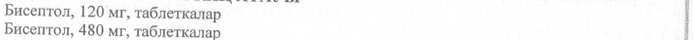
- стр. 1: «Бисептол, 480 мг, таблеткалар» — повторное чтение: «Бисептол, 480 Mr, таблеткалар»  
  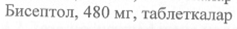
- стр. 1: «Эрб1р таблетканын курамында 400 мг сульфаметоксазол жене 80 мг триметоприм бар |» — низкая уверенность: «Эрб1р» (60)  
  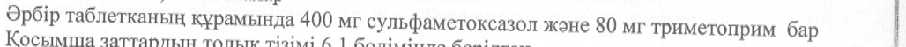
- стр. 1: «ойыгы мен «Bs» epxeri бар таблеткалар (120 мг дозасы yulin). |» — повторное чтение: «»  
  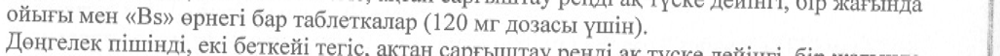
- стр. 1: «"=" накыштамасы жэне сызыгынын уст!нде «Bs» ернег] бар таблеткалар (480 мг дозасы |» — повторное чтение: «(о накыштамасы жене сызыгыным уотнде «Bs» орнег бар таблеткалар (480 мгдозсы = |»  
  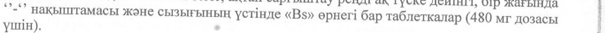
- стр. 2: «6-дан 12 жаска дей1нг! балаларга арналган стандартты доза: тэулиЧне 2 pet 4 таблеткадан» — низкая уверенность: «дей1нг!» (71)  
  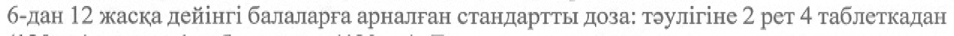
- стр. 2: «Балаларга арналган стандартты доза шамамен 6 мг триметоприм мен 30 мг |» — повторное чтение: «Балаларга арналган стандартты доза шамамен 6 мг триметопр им мен 30 Е. i»  
  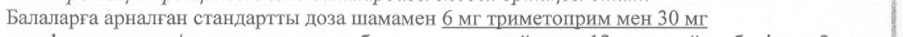
- стр. 3: «жогары болса, концентрация 120 мкг/мл-ден темен болганга дей!1н емдеуд! токтату ,» — низкая уверенность: «дей!1н» (42)  
  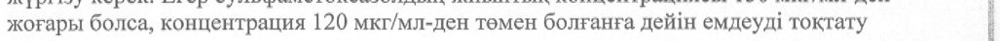
- стр. 3: «- 320 мг триметоприм/1 600 мг сульфаметоксазол: аптасына уш рет кун ара тэулине ек! |» — повторное чтение: «- 320 Mr триметоприм/ 1600 мг сульфаметоксазол: аптасына уш рет кун ара тэуличне ек!»  
  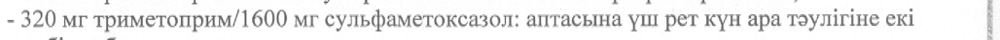
- стр. 3: «Балалар: 900 мг котримоксазол/м2 дана. аптанын келес! 3 кун1нде op 12 carat сайын» — низкая уверенность: «кун1нде» (31)  
  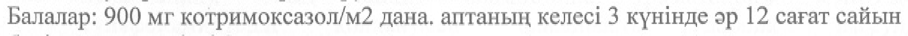
- стр. 4: «Жалпы TAyUKTIK доза 320 мг триметоприм мен 1600 mr сульфаметоксазолдан (2 р» — повторное чтение: «Жалпы тоулисик доза 320 мг триметоприм мен 1600 мг сульфаметоксазолдан (2»  
  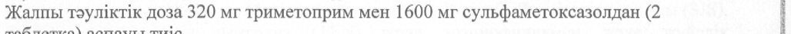
- стр. 4: «бар) тэуличне 3-ren 4 таблеткага дей!нг! дозалар колданылды.» — низкая уверенность: «3-ren» (79)  
  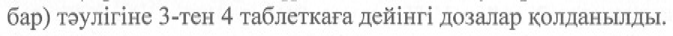
- стр. 4: «уш ай шинде Taymirine ек! pet 480 mr немесе 960 мг триметоприм-сульфаметоксазол |» — повторное чтение: «»  
  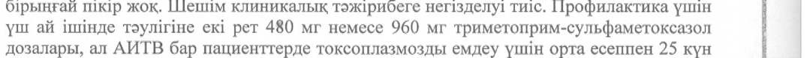
- стр. 4: «< 15 мл/мин пациенттерге аныктау мумюан болмайтын ауыр буйрек» — повторное чтение: «и мл/мин пациенттерге аныктау ‘мумюн болмайтын ауыр буйрек»  
  
- стр. 8: «ТриметопримдИсульфаметоксазолды 160 мг/800 мг (ко-тримоксазол) кабылдау |» — низкая уверенность: «мг/800» (78); повторное чтение: «ТриметопримдИсульфаметоксазолды _160 мг/800 мг (ко-тримоксазол) _ кабылдау»  
  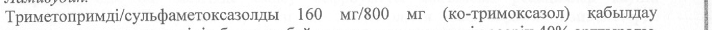
- стр. 11: «метфоминн AUC шамамен 30-40% ест!. Бул осудйн клиникалык Moni белг1с1з. i @» — низкая уверенность: «белг1с1з.» (0); повторное чтение: «метфоминн AUC шамамен 3 0-40% ecri. Бул ecy nin клиникалык MoHi Gemrici3.»  
  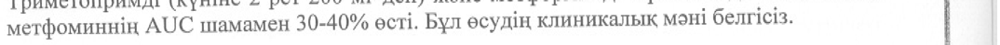
- стр. 18: «Плазмадагы триметопримн!н шамамен 50% кан акуыздарымен байланысады. Т1ндердег!» — низкая уверенность: «Т1ндердег!» (77)  
  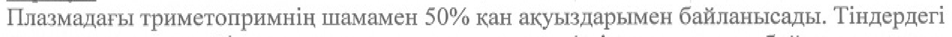
