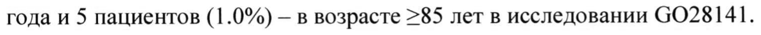
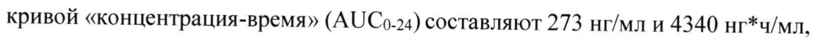
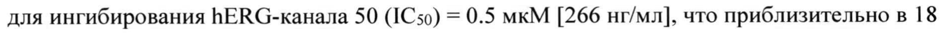

# Кобиметиниб — внутрь

- Препарат: Котеллик® (таблетки, покрытые пленочной оболочкой)
- АТХ: L01EE02
- Источник: ОХЛП, Единый реестр ЛС ЕАЭС, запись 67693dbc30dcf8c882a56182, документ от 2024-04-16
- Распознано автоматически (OCR): 34 из 34 стр.
- Сомнительных строк после OCR: 3 (см. раздел «Проверка распознавания»)

## Общие сведения

И ОН ЛП-#000141-ГП-ВУ $ Pecny лики азирусь иг :
ОБЩАЯ ХАРАКТЕРИСТИКА ЛЕКАРСТВЕННОГО ПРЕПАРАТА

## 1. Наименование лекарственного препарата

Котеллик, 20 мг, таблетки, покрытые пленочной оболочкой

## 2. Качественный и количественный состав

Действующее вещество: кобиметиниб.

Каждая таблетка, покрытая пленочной оболочкой, содержит 20 мг кобиметиниба (в виде

кобиметиниба гемифумарата 22.20 мг).

Вспомогательные вещества, наличие которых надо учитывать в составе лекарственного

препарата: лактозы моногидрат (см. раздел 4.4).

Каждая таблетка, покрытая пленочной оболочкой, содержит лактозы моногидрата 36.48

МГ.

Полный перечень вспомогательных веществ приведен в разделе 6.1.

## 3. Лекарственная форма

Таблетки, покрытые пленочной оболочкой.

Круглые, двояковыпуклые таблетки, покрытые пленочной оболочкой, белого цвета; на

одной стороне таблетки гравировка «СОВ».

## 4. Клинические данные

## 4.1. Показания к применению

Препарат Котеллик показан к применению у взрослых пациентов с неоперабельной или

метастатической меланомой с BRAF V600 мутацией в комбинации с вемурафенибом (см.

разделы 4.4 и 5.1).

## 4.2. Режим дозирования и способ применения

Лечение препаратом Котеллик в комбинации с вемурафенибом должен начинать и

контролировать только квалифицированный врач, имеющий опыт применения

противоопухолевых лекарственных препаратов.

Перед началом терапии необходимо убедиться в том, что у пациента имеется меланома с

положительным статусом BRAF V600 мутации, подтвержденным с помощью

валидированного теста (см. разделы 4.4 и 5.1).

Режим дозирования

Рекомендуемая доза препарата Котеллик составляет 60 мг (три таблетки по 20 мг) один

раз в сутки.

Препарат Котеллик принимают 28-дневными циклами. Каждая доза препарата Котеллик

состоит из трех таблеток по 20 мг (60 мг), и ее следует принимать один раз в сутки в

ЛП-#000141-ГП-ВУ

течение 21 дня подряд (период лечения с | по 21 день) с последующим 7-дневным перерывом (перерыв в лечении с 22 по 28 день). Каждый последующий цикл лечения препаратом Котеллик следует начинать после 7-дневного перерыва в лечении.
Информацию о дозировании препаратов, которые применяются в комбинации с препаратом Котеллик, см. в соответствующих общих характеристиках лекарственных препаратов (ОХЛП).

Продолжительность лечения

Лечение препаратом Котеллик следует продолжать до тех пор, пока сохраняется польза для пациента или до развития признаков неприемлемой токсичности (см. таблицу 1 ниже).
Пропущенные дозы

При пропуске запланированной дозы препарат Котеллик можно принять, если до приема следующей дозы осталось 12 и более часов, с целью сохранения схемы лечения с приемом один раз в сутки.

Рвота

В случае возникновения рвоты после приема препарата Котеллик не следует принимать дополнительную дозу препарата в тот же день, а следует продолжить лечение согласно назначенной схеме на следующий день.

Коррекция дозы

Снижение дозы препарата Котеллик и/или препаратов, которые применяются в комбинации с препаратом Котеллик, должно основываться на оценке безопасности и переносимости лечащим врачом у конкретного пациента. Изменение дозы препарата
Котеллик не зависит от изменения дозы препаратов, которые применяются в комбинации с препаратом Котеллик.

Если пропуск дозы связан с появлением токсичности, пропущенные дозы не следует восполнять. После снижения дозы препарата в дальнейшем не следует вновь повышать дозу. В таблице | ниже приведены общие рекомендации по изменению дозы препарата
Котеллик.
Таблица 1. Рекомендации по изменению дозы препарата Котеллик

Степень тяжести Рекомендованная доза препарата Котеллик нежелательных явлений*
Степень 1 или степень 2 Без снижения дозы. Продолжать лечение препаратом
Степень 2 (непереносимая)
| MMHMCTE г | . semua 2 | РЕСПУБЛИЕ: panama i
ЛП-№000141-ГП-ВУ

1 проявление Прерывание лечения до <1 степени тяжести нежелательных явлений, возобновление терапии в дозе 40 мг один раз в сутки (2 таблетки).

2 проявление Прерывание лечения до <1 степени тяжести нежелательных явлений, возобновление терапии в дозе 20 мг один раз в сутки (1 таблетка).

* Интенсивность клинических нежелательных явлений классифицируется в соответствии с Критериями общей терминологии нежелательных явлений, версия 4.0 (СТС-АЕ).
Изменение дозы при кровотечении

При возникновении кровотечений 4 степени тяжести или кровоизлияния в мозг следует

прервать лечение препаратом Котеллик. В случае, если возникновение кровотечения

связано с применением препарата Котеллик, терапия данным препаратом должна быть полностью прекращена.

При развитии кровотечений 3 степени тяжести следует прервать лечение препаратом

Котеллик на период оценки во избежание любого потенциального влияния терапии на

явление. Данные в отношении эффективности изменения дозы препарата Котеллик в

случае возникновения кровотечений отсутствуют. Решение о возобновлении терапии

должно быть принято лечащим врачом на основании оценки клинической картины.

Лечение препаратами, которые применяются в комбинации с препаратом Котеллик, может

быть продолжено при прерывании лечения препаратом Котеллик (при наличии

клинических показаний).

Изменение дозы при дисфункции левого желудочка

Следует рассмотреть необходимость полного прекращения терапии препаратом Котеллик,

если симптомы со стороны сердца связаны с применением данного препарата и в том

случае, если не произошло улучшения после временного прерывания лечения.

Таблица 2. Рекомендации по изменению дозы препарата Котеллик у пациентов со

снижением фракции выброса левого желудочка (ФВЛЖ) по сравнению с исходным

показателем Пациент Показатель | Рекомендованное Показатель Рекомендованная
ФВЛЖ изменение дозы ФВЛЖ после суточная доза препарата перерыва в препарата
Котеллик лечении Котеллик = АНО | МИНИСТЕРСТВОМ ЗДРАВООХРАНЕНИЯ | 3
РЕСПУБЛИКИ БЕЛАРУСЬ | Приказ Министерства здравоохранения |
Республики Беларусь } ЛП-#000141-ГП-ВУ Без >50% Продолжить НЛТ H/T симптомов | (HH 40-49% | лечение в текущей и снижение | дозе
<10% абсолютного показателя от исходного уровня)
<40% Прерывание Снижение (или 40-49% | лечения на2 <10% и снижение | недели абсолютного 3 появление:
>10% показателя от полная отмена абсолютного исходного показателя уровня от <40% Полная отмена исходного (или снижение уровня) 210% абсолютного показателя от исходного уровня)
С. H/T] Прерывание Без симптомов симптомами лечения на 4 и снижение недели <10% 3 появление:
абсолютного полная отмена показателя от исходного уровня
Без симптомов | Полная отмена и <40% (или снижение >10% абсолютного
| Приказ Министерства здравоохранени; | И ll
ЛП-№000141-ГП-ВУ показателя от С симптомами, | Полная отмена независимо от
ФВЛЖ НЛТ= не применимо При изменении схемы терапии препаратом Котеллик лечение препаратами, которые применяются в комбинации с препаратом Котеллик, может быть продолжено при наличии клинических показаний.
Изменение дозы при рабдомиолизе и повышении активности креатинфосфокиназы
(КФК)
Рабдомиолиз или симптоматическое повышение активности КФК
Лечение препаратом Котеллик следует прервать. В случае, если тяжесть рабдомиолиза или симптоматического повышения активности КФК не снизилась в течение 4 недель, лечение препаратом Котеллик следует полностью прекратить.
Если тяжесть уменьшилась, по меньшей мере, на одну степень в течение 4 недель, применение препарата Котеллик следует возобновить в дозе, сниженной на 20 мг, в соответствии с клиническими показаниями. Следует проводить тщательный мониторинг состояния пациента. Лечение препаратами, которые применяются в комбинации с препаратом Котеллик, может быть продолжено при изменении схемы терапии препаратом
Котеллик.
Бессимитомное повышение активности КФК При 4 степени тяжести лечение препаратом Котеллик следует прервать. В случае, если активность КФК не снизилась до <3 степени в течение 4 недель после прерывания терапии, лечение препаратом Котеллик следует полностью прекратить.
Если тяжесть явления уменьшилась до <3 степени в течение 4 недель, применение препарата Котеллик в соответствии с клиническими показаниями следует возобновить в дозе, сниженной на 20 мг, при условии тщательного наблюдения за пациентом. Лечение препаратами, которые применяются в комбинации с препаратом Котеллик, может быть продолжено при изменении схемы терапии препаратом Котеллик.
При <3 степени тяжести после исключения рабдомиолиза нет необходимости изменять дозу препарата Котеллик.
Рекомендации по изменению дозы препарата Котеллик, применяемого в комбинации с вемурафенибом
Г СоОГЛАСОВАНО | МИНИСТЕРСТВОМ ЗДРАВООХРАНЕНИЯ |
РЕСПУБЛИКИ БЕЛАРУСЬ ] 5 Приказ Министерства здравоохранения
ЛП-#000141-ГП-ВУ Отклонения лабораторных показателей функции печени
В случае отклонений лабораторных показателей функции печени | и 2 степени тяжести лечение препаратом Котеллик и вемурафенибом следует продолжить в назначенной дозе.
При 3 степени тяжести следует продолжить лечение препаратом Котеллик в назначенной дозе. Доза вемурафениба может быть снижена в соответствии с клиническими показаниями (см. ОХЛП вемурафениба).
При 4 степени тяжести лечение препаратом Котеллики вемурафенибом следует прервать.
Если отклонения лабораторных показателей функции печени уменьшились до <1 степени тяжести в течение 4 недель, применение препарата Котеллик следует возобновить в дозе, сниженной на 20 мг, применение вемурафениба следует возобновить в соответствии с клиническими показаниями согласно ОХЛП вемурафениба.
Лечение препаратом Котеллик и вемурафенибом следует прекратить, если отклонения лабораторных показателей функции печени не уменьшились до <| степени тяжести в течение 4 недель или отклонения лабораторных показателей функции печени 4 степени тяжести возобновляются после первоначального улучшения.
Фоточувствительность Ведение пациентов с фоточувствительностью <2 степени тяжести (переносимой) должно включать поддерживающую терапию.
В случае развития фоточувствительности 2 степени (непереносимой) или >3 степени:
лечение препаратом Котеллик и вемурафенибом необходимо прервать до уменьшения тяжести симптомов до <1 степени. Лечение может быть возобновлено без изменения дозы препарата Котеллик. Дозу вемурафениба необходимо снизить в соответствии с клиническими показаниями (см. ОХЛП вемурафениба).

Сыпь

Сыпь может возникать как на фоне лечения препаратом Котеллик, так и вемурафенибом.

При развитии сыпи лечение препаратом Котеллик и/или вемурафенибом может быть

временно прервано и/или возможно снижение дозы одного из препаратов или обоих

препаратов по клиническим показаниям.

Дополнительно, при развитии сыпи:

* <2 степени (переносимой) — ведение пациентов должно включать поддерживающую терапию, лечение препаратом Котеллик может быть продолжено без изменения дозы;

° акнеиформная сыпь 2 степени тяжести (непереносимая) или >3 степени тяжести — необходимо следовать общим рекомендациям по изменению дозы препарата Котеллик согласно таблице 1; лечение вемурафенибом может быть продолжено при изменении схемы терапии препаратом Котеллик (при наличии клинических показаний);

} Cor { НО | | Приказ Ми Here} тва зд cache ени: |
НЫ ЛП-№000141-ГП-ВУ * неакнеиформная или макуло-папулезная сыпь 2 степени тяжести (непереносимая) или
>3 степени тяжести — лечение препаратом Котеллик может быть продолжено без изменения дозы по клиническим показаниям; лечение вемурафенибом может быть временно прервано и/или его доза снижена (см. ОХЛП вемурафениба).
Окклюзия вен сетчатки В случае возникновения окклюзии вен сетчатки терапия препаратом Котеллик должна быть прекращена.
Удлинение интервала ОТ Если во время лечения длительность интервала ОТс превышает 500 мсек, следует обратиться к ОХЛП вемурафениба (раздел 4.2) относительно информации по изменению дозы последнего. При комбинированной терапии препаратом Котеллик и вемурафенибом изменения дозы препарата Котеллик не требуется.
Особые группы пациентов Пациенты пожилого возраста
Коррекции дозы препарата Котеллик у пациентов в возрасте >65 лет не требуется.
Пациенты с почечной недостаточностью Согласно данным популяционного фармакокинетического анализа (см. раздел 5.2) у пациентов с нарушением функции почек легкой или умеренной степени коррекции дозы не рекомендуется. Безопасность и эффективность препарата Котеллик у пациентов с тяжелым нарушением функции почек не установлены (см. раздел 5.2).
Пациенты с печеночной недостаточностью У пациентов с нарушением функции печени коррекция дозы не рекомендуется. У пациентов с тяжелым нарушением функции печени может повышаться концентрация несвязанного кобиметиниба в плазме по сравнению с пациентами с нормальной функцией печени (см. раздел 5.2). Препарат Котеллик стоит применять с осторожностью у пациентов с нарушением функции печени любой степени тяжести, поскольку на фоне лечения могут возникнуть отклонения лабораторных показателей функции печени (см.
раздел 4.4).
Пациенты, не принадлежащие к европеоидной расе
Безопасность и эффективность препарата Котеллик у пациентов, не принадлежащих к европеоидной расе, не установлены.
Дети Безопасность и эффективность препарата Котеллик изучались у детей и подростков в возрасте до 18 лет. Эффективность препарата Котеллик у данной группы пациентов не установлена. Профиль безопасности у пациентов детского возраста (п=55) соответствовал
| СОГЛАСОВАНО | 7 | МИНИСТЕРСТВОМ ЗДРАВООХРАНЕНИЯ
| РЕСПУБЛИКИ БЕЛАРУСЬ | Приказ Министерст ва здравоохранения |
L_____Peonyomaxs Bexapyes | ЛП-№000141-ГП-ВУ таковому у взрослых пациентов. Имеющиеся на сегодняшний день данные приведены в разделах 4.8, 5.1 и 5.2, однако невозможно дать рекомендации по режиму дозирования.
Способ применения Препарат Котеллик предназначен для приема внутрь. Таблетки следует проглатывать целиком, запивая водой. Препарат можно принимать независимо от приема пищи.

## 4.3. Противопоказания

Повышенная чувствительность к кобиметинибу или к любому из вспомогательных веществ, перечисленных в разделе 6.1.

## 4.4. Особые указания и меры предосторожности при применении

До начала приема препарата Котеллик в комбинации с вемурафенибом у пациентов необходимо подтвердить положительный статус опухоли по BRAF V600 мутации с помощью валидированного теста.
Препарат Котеллик в комбинации с вемурафенибом у пациентов с прогрессированием заболевания при применении ингибитора ВВАЕ
Данные по применению препарата Котеллик в комбинации с вемурафенибом у пациентов с прогрессированием заболевания, которые ранее применяли ингибитор ВКАЕ, ограничены. Согласно этим данным эффективность комбинации у таких пациентов будет ниже (см. раздел 5.1). Таким образом, следует рассмотреть альтернативные способы лечения перед применением комбинации в группе пациентов, которые ранее применяли ингибитор BRAF. Последовательность лечения после прогрессирования заболевания при применении ингибитора ВКАЕ не установлена.
Препарат Котеллик в комбинации с вемурафенибом у пациентов с метастазами в головной мозг
Оценка безопасности и эффективности лечения препаратом Котеллик в комбинации с вемурафенибом у пациентов с метастатической меланомой (при наличии ВКАЕ V600 мутации) с метастазами в головной мозг не проводилось. Интракраниальная активность кобиметиниба на данный момент неизвестна (см. разделы 5.1 и 5.2).
Кровотечение При применении препарата Котеллик могут отмечаться кровотечения, включая массивные
(см. раздел 4.8).
Следует соблюдать осторожность при лечении пациентов с дополнительными факторами риска кровотечений, такими как метастазы в головной мозг, и/или пациентов. которые одновременно применяют лекарственные средства, повышающие риск кровотечений
(включая антитромботические и антикоагулянтные средства). Рекомендации по ведению пациентов, у которых возникли кровотечения, представлены в разделе 4.2.
| МИНИСТЕРСТВОМ OOXPAM ния | 8 | Приказ Министерства здравоохранения | и Better |
ЛП-№000141-ГП-ВУ Серозная ретинопатия У пациентов, получавших ингибиторы МЕК, включая препарат Котеллик, наблюдались случаи серозной ретинопатии (скопление жидкости в слоях сетчатки) (см. раздел 4.8). В большинстве случаев наблюдались хориоретинопатия или отслойка сетчатки.
Медиана времени до первого появления серозной ретинопатии составляет | месяц
(диапазон 0-9 месяцев). Большинство явлений, наблюдавшихся в клинических исследованиях, разрешились, или их тяжесть уменьшилась до бессимптомного течения 1 степени после прерывания лечения или снижения дозы.
Необходимо проводить оценку новых симптомов или усиления расстройства зрения у пациентов при каждом визите. Пациентам, у которых впервые возникли или усилились нарушения зрения, рекомендовано пройти офтальмологическое обследование. В случае диагностики серозной ретинопатии следует приостановить лечение препаратом Котеллик до облегчения тяжести зрительных симптомов до <1 степени. Ведение пациентов с серозной ретинопатией включает прерывание лечения, снижение дозы или прекращение терапии (см. таблицу 1 в разделе 4.2).
Дисфункция левого желудочка У пациентов, получающих препарат Котеллик, отмечалось снижение фракции выброса левого желудочка (ФВЛЖ) относительно исходного показателя (см. раздел 4.8). Медиана времени до первого возникновения явлений составляет 4 месяца (1-13 месяцев).
ФВЛЖ необходимо оценивать перед началом лечения для определения исходных значений, затем через месяц лечения и, как минимум, каждые 3 месяца или по клиническим показаниям до прекращения лечения. Ведение пациентов со снижением
ФВЛЖ относительно исходного уровня включает прерывание лечения, снижение дозы или прекращение терапии (см. раздел 4.2).
У всех пациентов, которым было возобновлено лечение препаратом Котеллик в более низкой дозе, необходимо проводить измерение ФВЛЖ по возможности через 2 недели, 4 недели, 10 недель и 16 недель, далее по клиническим показаниям. Пациенты с исходным значением ФВЛЖ ниже нижней установленной границы нормы или ниже 50% не изучались.
Отклонения лабораторных показателей функции печени
При применении препарата Котеллик в комбинации с вемурафенибом, а также при монотерапии вемурафенибом (см. ОХЛП вемурафениба), могут отмечаться отклонения лабораторных показателей функции печени.
У пациентов, получавших препарат Котеллик в комбинации с вемурафенибом, отмечались отклонения лабораторных показателей функции печени, особенно, увеличение
| — бОГЛАбОВАНО | МИНИСТЕРСТВОМ деуводхрааения 9
РЕСПУБЛИКИ БЕЛАРУ Cb .
Приказ Министерства здравоохранения | Республики Беларусь __ |
ЛП-#000141-ГП-ВУ

показателей аланинаминотрансферазы (AJIT), аспартатаминотрансферазы (АСТ) и щелочной фосфатазы (ЩФ) (см. раздел 4.8).

Отклонения показателей функции печени необходимо оценивать по результатам лабораторных исследований перед началом комбинированного лечения, ежемесячно во время лечения или чаще (при наличии клинических показаний) (см. раздел 4.2).

Ведение пациентов с отклонениями лабораторных показателей функции печени 3 степени тяжести включает прерывание лечения или снижение дозы вемурафениба. Ведение пациентов с отклонениями лабораторных показателей функции печени 4 степени тяжести включает прерывание лечения, снижение дозы или прекращение терапии как препаратом
Котеллик, так и вемурафенибом (см. раздел 4.2).

Рабдомиолиз и повышение активности КФК

У пациентов, получавших препарат Котеллик, отмечались случаи рабдомиолиза (см.
раздел 4.8).

Если диагностирован рабдомиолиз, лечение препаратом Котеллик следует прервать и мониторировать активность КФК и другие симптомы до их разрешения. В зависимости от степени тяжести рабдомиолиза может потребоваться снижение дозы или прекращение лечения (см. раздел 4.2).

Повышение активности КФК 3 и 4 степени, включая бессимптомное повышение по сравнению с исходным уровнем, отмечалось у пациентов, получающих препарат
Котеллик в комбинации с вемурафенибом в клинических исследованиях (см. раздел 4.8).
Медиана времени до первого повышения активности КФК 3 или 4 степени составила 16 дней (в диапазоне 11 дней — 10 месяцев); медиана времени до полного разрешения составила 16 дней (в диапазоне 2 дня — 15 месяцев).

Показатели креатинина и КФК сыворотки крови необходимо измерять перед началом лечения для определения исходных значений, затем каждый месяц во время лечения или по клиническим показаниям. Если активность КФК сыворотки повышена по сравнению с исходным уровнем, следует провести оценку наличия признаков и симптомов рабдомиолиза или других причин, вызвавших повышение данного лабораторного показателя. В зависимости от тяжести симптомов или степени повышения КФК может потребоваться перерыв в лечении, снижение дозы или прекращение терапии (см. раздел 4.2).

Диарея У пациентов, получавших лечение препаратом Котеллик, были отмечены случаи серьезной диареи и диареи >3 степени тяжести. Ведение пациентов с диареей включает в себя применение противодиарейных средств и поддерживающую терапию. При диарее >3

| Приказ Тинисте ва здравосхранен: я ae el
ЛП-№000141-ГП-ВУ степени тяжести, возникшей, несмотря на применение поддерживающей терапии, следует приостановить лечение препаратом Котеллик и вемурафенибом до тех пор, пока не будет отмечено снижение тяжести явления до <1 степени. При возобновлении диареи >3 степени тяжести необходимо снизить дозу препарата Котеллик и вемурафениба (см.
раздел 4.2).

Взаимодействие с ингибиторами изофермента СУРЗА
Следует избегать одновременного применения препарата Котеллик с мощными ингибиторами изофермента СУРЗА. Следует соблюдать осторожность при применении кобиметиниба одновременно с умеренными ингибиторами изофермента СУРЗА. Если одновременного применения с мощным или умеренным ингибитором изофермента
CYP3A нельзя избежать, следует тщательно следить за безопасностью пациентов, а также при необходимости снижать дозу согласно рекомендациям (см. таблицу 1 в разделе 4.2).
Удлинение интервала ОТ Если во время лечения длительность интервала ОТс превышает 500 мсек, следует обратиться к ОХЛП вемурафениба (разделы 4.2 и 4.4).
Вспомогательные вещества Данный лекарственный препарат содержит лактозу. Пациентам с редко встречающейся наследственной непереносимостью галактозы, дефицитом лактазы лопарей или глюкозогалактозной мальабсорбцией не следует принимать этот препарат.
Данный лекарственный препарат содержит менее | ммоль натрия (23 мг) в | таблетке, то есть можно сказать «практически не содержит натрий».

## 4.5. Взаимодействие с другими лекарственными препаратами и другие виды взаимодействия

Влияние сопутствующих лекарственных препаратов на кобиметиниб
Ингибиторы изофермента СУРЗА Кобиметиниб метаболизируется с участием изофермента СУРЗА. У здоровых лиц в присутствии мощного ингибитора изофермента СУРЗА (итраконазола) AUC кобиметиниба увеличивается приблизительно в 7 раз. Существует вероятность, что магнитуда взаимодействия у пациентов будет ниже.
Мощные ингибиторы изофермента CYP3A (см. раздел 4.4): следует избегать одновременного применения мощных ингибиторов изофермента СУРЗА при лечении кобиметинибом. Примеры мощных ингибиторов изофермента СУРЗА включают ритонавир, кобицистат, телапревир, лопинавир, итраконазол, вориконазол, кларитромицин, телитромицин, позаконазол, нефазодон и грейпфрутовый сок, но не ограничиваются ими. Если одновременного применения с мощным ингибитором
~ СОГЛАСОВАНО | МИНИСТЕРСТВОМ ЗДРАВООХРАНЕНИЯ | 1
РЕСПУБЛИКИ БЕЛАРУСЬ Приказ Министерства здравоохранения |
Республики Беларусь j ЛП-#000141-ГП-ВУ | изофермента СУРЗА нельзя избежать, следует тщательно следить за безопасностью пациентов. В случае кратковременного (<7 дней) применения мощных ингибиторов изофермента СУРЗА следует рассмотреть возможность приостановки лечения кобиметинибом во время применения такого ингибитора.

Умеренные ингибиторы изофермента СУРЗА (см. раздел 4.4): следует соблюдать осторожность при применении кобиметиниба одновременно с умеренными ингибиторами изофермента СУРЗА. Примеры умеренных ингибиторов изофермента СУРЗА включают амиодарон, эритромицин, флуконазол, миконазол, дилтиазем, верапамил, делавирдин, ампренавир, фосампренавир, иматиниб, но не ограничиваются ими. При одновременном применении кобиметиниба с умеренным ингибитором изофермента СУРЗА следует тщательно следить за безопасностью пациентов.
Слабые ингибиторы изофермента СУРЗА: кобиметиниб можно применять одновременно со слабыми ингибиторами изофермента СУРЗА без коррекции дозы.
Индукторы изофермента СУРЗА Одновременное применение кобиметиниба с мощным индуктором изофермента СУРЗА не оценивалось в ходе клинического исследования, однако вероятно снижение экспозиции кобиметиниба. Таким образом, одновременного применения умеренных и мощных индукторов изофермента СУРЗА (например, карбамазепин, рифампицин, фенитоин и зверобой продырявленный) следует избегать. Необходимо рассмотреть возможность применения препаратов с отсутствующей или минимальной индукцией изофермента
СУРЗА в качестве альтернативы. Эффективность может быть снижена, поскольку существует вероятность значительного уменьшения концентрации кобиметиниба при одновременном применении с умеренными и мощными индукторами изофермента
СУРЗА.
Ингибиторы Р-гликопротеина Кобиметиниб является субстратом Р-гликопротеина (Р-гп). При одновременном применении с ингибиторами P-rn, такими как циклоспорин и верапамил, существует вероятность повышения концентрации кобиметиниба в плазме крови.
Влияние кобиметиниба на другие лекарственные препараты
Субстраты изоферментов СУРЗА и CYP2D6 Клиническое исследование лекарственных взаимодействий у пациентов с онкологическим заболеванием показало, что в присутствии кобиметиниба концентрации мидазолама
(чувствительного субстрата СУРЗА) и декстрометорфана (чувствительного субстрата
CYP2D6) в плазме крови не менялись.
Субстраты изофермента CYP1A2 Г COraacoLAaAno — i С \РУСЪ |
| Прика: ра "оанент р 12 ЛП-№000141-ГП-ВУ
Кобиметиниб является потенциальным индуктором изофермента СУР1А2 in vitro, таким образом, вероятно снижение экспозиции субстратов данного фермента, например, теофиллина. Клинических исследований лекарственных взаимодействий для оценки клинической значимости данного явления не проводилось.
Субстраты BCRP (breast cancer resistance protein - белок устойчивости рака молочной железы)
Кобиметиниб является умеренным ингибитором BCRP in vitro. Клинических исследований лекарственных взаимодействий для оценки данного явления не проводилось. Клиническая значимость ингибирования интестинального ВСКР не может быть исключена.
Другие противоопухолевые препараты Вемурафениб
У пациентов с неоперабельной или метастатической меланомой не отмечено каких-либо клинически значимых лекарственных взаимодействий между препаратом Котеллик и вемурафенибом, таким образом, коррекция дозы не рекомендуется.
Влияние кобиметиниба на транспортные системы лекарственных препаратов
В исследованиях in vitro показано, что кобиметиниб не является субстратом транспортных белков печени ОАТР1В1, ОАТР1ВЗ и OCT1, но тем не менее является их слабым ингибитором. Клиническая значимость этих данных не установлена.
Дети Исследования взаимодействия проведены только у взрослых.

## 4.6. Фертильность, беременность и лактация

Женщины с детородным потенциалом/контрацепция
Женщины с детородным потенциалом должны использовать два надежных метода контрацепции, например, презерватив или другой барьерный метод (со спермицидом, при наличии), во время лечения препаратом Котеллик и вплоть до 3 месяцев после завершения терапии.
Беременность Данные о применении препарата Котеллик у беременных женщин отсутствуют. В исследованиях на животных наблюдались гибель эмбрионов и пороки развития магистральных сосудов и черепа у плода (см. раздел 5.3). Препарат Котеллик не следует применять во время беременности, за исключением случаев крайней необходимости, после тщательного рассмотрения пользы лечения препаратом для матери и риска для плода.
Лактация —СОГлЛАСо В АН Г . val МИНИСТЕРСТВОМ 3/47 ABOO2? AMES
РЕСПУБЛИКИ БЕЛАРУСЬ = ое не Te ЛП-№00 01 41-ГП-ВУ
Сведения о проникновении кобиметиниба в грудное молоко отсутствуют. Не исключен риск для новорожденных/грудных детей. Необходимо принять решение либо о прекращении грудного вскармливания, либо об отмене терапии препаратом Котеллик, принимая во внимание пользу грудного вскармливания для ребенка и пользу терапии для женщины.
Фертильность Данные по кобиметинибу для человека отсутствуют. Исследований фертильности на животных не проводилось, однако наблюдались нежелательные эффекты в отношении репродуктивных органов (см. раздел 5.3). Клиническая значимость этих данных неизвестна.
4.7. Влияние на способность управлять транспортными средствами и работать с механизмами
Препарат Котеллик может оказывать слабое влияние на способность управлять транспортными средствами и работать с механизмами. Во время лечения препаратом
Котеллик могут отмечаться хориоретинопатия, нечеткое зрение или отслойка сетчатки
(см. раздел 4.4). Пациентам следует рекомендовать воздержаться от управления транспортными средствами и работы с механизмами, если у них наблюдаются нарушения зрения или любые другие нежелательные эффекты, которые могут повлиять на способность управления транспортными средствами или работу с механизмами.

## 4.8. Нежелательные реакции

Резюме профиля безопасности В рамках всей программы клинической разработки препарата Котеллик в общей сложности 376 пациентов с неоперабельной или метастатической меланомой с BRAF
\600 мутацией получали препарат Котеллик в комбинации с вемурафенибом.
Безопасность терапии препаратом Котеллик в комбинации с вемурафенибом оценивали в исследовании GO28141 у 247 пациентов с распространенной меланомой с ВКАЕ V600 мутацией. Медиана времени до появления первых нежелательных явлений >3 степени тяжести составила 0.6 месяца в группе комбинированной терапии препаратом Котеллик и вемурафенибом и 0.8 месяца в группе плацебо и вемурафениба.
Безопасность терапии препаратом Котеллик в комбинации с вемурафенибом также оценивали в исследовании NO25395 у 129 пациентов с распространенной меланомой с
BRAF У600 мутацией. Профиль безопасности в исследовании NO25395 соответствовал профилю безопасности в исследовании 9028141.
В исследовании GO28141 в группе комбинированной терапии препаратом Котеллик и вемурафенибом наиболее часто (>20%) и с более высокой частотой наблюдались такие
ЛП-№000141-ГП-ВУ нежелательные реакции как диарея, сыпь, тошнота, пирексия, реакции фоточувствительности, повышение активности AJIT, повышение активности ACT, повышение активности КФК в крови и рвота. В группе плацебо и вемурафениба наиболее часто (>20%) и с более высокой частотой отмечались артралгия, алопеция и гиперкератоз.
Частота развития повышенной утомляемости была сопоставимой в обеих группах.

Полное описание всех нежелательных реакций, связанных с терапией вемурафенибом, см.
в ОХЛП вемурафениба.
Табличное резюме нежелательных реакций Информация о нежелательных реакциях основана на результатах многоцентрового, рандомизированного, двойного слепого, плацебо-контролируемого исследования фазы Ш
(0028141), в котором оценивали безопасность и эффективность препарата Котеллик в комбинации с вемурафенибом в сравнении с монотерапией вемурафенибом у ранее нелеченых пациентов с неоперабельной местно-распространенной (стадия Шс) или метастатической (стадия IV) меланомой с BRAF V600 мутацией.
Данные о частоте нежелательных реакций основаны на анализе безопасности у пациентов, получавших комбинированную терапию кобиметинибом и вемурафенибом, с медианой периода последующего наблюдения 11.2 месяца (дата среза данных 19 сентября 2014 года).
Нежелательные реакции, зарегистрированные у пациентов с меланомой, представлены ниже в соответствии с системно-органной классификацией согласно словарю Мед ОКА, частотой и степенью тяжести. Для классификации частоты нежелательных реакций используются следующие категории:
очень часто (>1/10);
часто (>1/100, но < 1/10);
нечасто (>1/1 000, но <1/100);
редко (>1/10 000, но <1/1 000);
очень редко (<1/10 000).
В таблице 3 перечислены нежелательные реакции, которые были расценены как связанные с применением препарата Котеллик. В рамках каждой категории частоты нежелательные реакции представлены в порядке уменьшения тяжести и в соответствии с критериями NCI-CTCAE версии 4.0 (общие критерии токсичности), которые использовали для оценки токсичности в исследовании GO28141.
Таблица 3. Нежелательные реакции у пациентов, получавших препарат Котеллик в комбинации с вемурафенибом в исследовании 6028141”
| ——_ СОГЛАСОВАНО МИНИСТЕРСТВОМ 3 i р 301 ХР FE ния | 15
РЕСНУБЛИКИ БЕЛАРУСЬ } Приказ Министерства здравсохозиения |
ЛП-№000141-ГП-ВУ Системно-органный Очень часто Часто Нечасто

Доброкачественные, Базальноклеточная

злокачественные и карцинома,

неуточненные плоскоклеточная

новообразования карцинома кожи **,

(включая кисты и кератоакантома**

полипы)

Нарушения со стороны Анемия

крови и лимфатической

системы

Нарушения метаболизма Обезвоживание,

и питания гипофосфатемия, гипонатриемия, гипергликемия

Нарушения со стороны Серозная Нарушение зрения

органа зрения ретинопатия",

нечеткое зрение

Нарушения со стороны Гипертензия,

Нарушения со стороны Пневмонит

дыхательной системы,

органов грудной клетки

и средостения

Желудочно-кишечные Диарея, тошнота,

Ea oe

Нарушения со стороны Фоточувствительност

кожи и подкожных b?, сыпь, макуло-

тканей папулезная сыпь,

акнеиформный дерматит, гиперкератоз**, зуд, сухость кожи scien | 16
| ПП-№000141-ГП-ВУ Нарушения со стороны Рабдомиолиз*** мышечной, скелетной и соединительной ткани
Общие нарушения и Пирексия, озноб, реакции в месте периферический отек введения
Лабораторные и Повышение Уменьшение фракции инструментальные активности КФК в выброса, повышение данные крови, повышение уровня билирубина в активности АЛТ, крови
АСТ, гаммаглутамилтрансферазы (ITT), ЩФ в крови
^`Дата среза данных — 19 сентября 2014 года.
* См. подраздел «Кровотечение» в разделе «Описание отдельных нежелательных реакций».
** См. подраздел «Плоскоклеточная карцинома кожи, кератоакантома и гиперкератоз» в разделе «Описание отдельных нежелательных реакций».
*** См. подраздел «Рабдомиолиз» в разделе «Описание отдельных нежелательных реакций».
Включает и хориоретинопатию, и явления отслойки сетчатки, указывающие на серозную ретинопатию (см.
раздел 4.4).
> Комбинированный показатель включает сообщения о реакции фоточувствительности, солнечных ожогах, солнечном дерматите и актиническом эластозе.
Описание отдельных нежелательных реакций
Кровотечение В группе комбинированной терапии препаратом Котеллик и вемурафенибом явления кровотечения (всех типов и степеней тяжести) регистрировались чаще, чем в группе плацебо и вемурафениба (13% в сравнении с 7%). Медиана времени до первого возникновения явления составляла 6.1 месяца в группе комбинированной терапии препаратом Котеллик и вемурафенибом.
Большинство явлений относились к | или 2 степени тяжести и были несерьезными.
Большая часть явлений разрешилась без изменения дозы препарата Котеллик. Массивные кровотечения (включая внутричерепное кровоизлияние и желудочно-кишечное кровотечение) были зарегистрированы в ходе пострегистрационного применения. При одновременном применении антиагрегантов или антикоагулянтов риск возникновения
——“COTHACOBAHO | МИНИСТЕРСТВОМ ЗДРАВОС seat]
РЕСПУБЛИКИ БЕЛАРУСЬ = Министерства здравоохранения |
ПЕ... с. НИИ 17 ЛП-#000141-ГП-ВУ | кровотечения может быть повышен. В случае развития кровотечения лечение проводится по клиническим показаниям (см. разделы 4.2 и 4.4).

Рабдомиолиз При пострегистрационном применении были зарегистрированы случаи рабдомиолиза.
Признаки или симптомы рабдомиолиза служат основанием для проведения соответствующего клинического обследования и лечения по клиническим показаниям, а также для снижения дозы препарата Котеллик или прекращения терапии в зависимости от тяжести нежелательной реакции (см. разделы 4.2 и 4.4).
Фоточувствительность Реакции фоточувствительности отмечались с более высокой частотой в группе комбинированной терапии препаратом Котеллик и вемурафенибом по сравнению с группой плацебо и вемурафениба (47% в сравнении с 35%). Большинство явлений относилось к | или 2 степени тяжести; явления >3 степени тяжести отмечались у4% пациентов в группе комбинированной терапии препаратом Котеллик и вемурафенибом иу 0% пациентов группе плацебо и вемурафениба.
Не наблюдалось каких-либо явных закономерностей по времени возникновения явлений 23 степени. При возникновении явлений фоточувствительности >3 степени в группе комбинированной терапии препаратом Котеллик и вемурафенибом, проводилась преимущественно местная терапия в сочетании с прерыванием терапии обоими препаратами (см. раздел 4.2). При проведении монотерапии препаратом Котеллик признаков фототоксичности не наблюдалось.
Плоскоклеточная карцинома кожи, кератоакантома и гиперкератоз
Случаи плоскоклеточной карциномы кожи в группе комбинированной терапии препаратом Котеллик и вемурафенибом регистрировались с более низкой частотой, чем в группе плацебо и вемурафениба (все степени: 3% в сравнении с 13%). Случаи кератоакантомы в группе комбинированной терапии препаратом Котеллик и вемурафенибом регистрировались с более низкой частотой, чем в группе плацебо и вемурафениба (все степени: 2% в сравнении с 9%). Случаи гиперкератоза в группе комбинированной терапии препаратом Котеллик и вемурафенибом регистрировались с более низкой частотой, чем в группе плацебо и вемурафениба (все степени: 11% в сравнении с 30%).
Серозная ретинопатия У пациентов, получающих препарат Котеллик, отмечались случаи серозной ретинопатии
(см. раздел 4.4). Пациентам, у которых впервые возникло или усилилось расстройство зрения, рекомендовано пройти офтальмологическое обследование. Серозную

| а == ГВ АНЕНИЯ |

| PECI eM \РУСЬ | 18 ЛП-#000141-ГП-ВУ ретинопатию можно контролировать путем прерывания лечения, снижения дозы или прекращения терапии (см. таблицу 1 в разделе 4.2).

Дисфункция левого желудочка У пациентов, получающих препарат Котеллик, отмечалось снижение ФВЛЖ относительно исходного показателя (см. раздел 4.4). ФВЛЖ необходимо оценивать перед началом лечения для определения исходных значений, а затем после первого месяца лечения и, как минимум, каждые 3 месяца или по клиническим показаниям до прекращения лечения.
Снижение ФВЛЖ относительно исходного уровня можно контролировать путем прерывания лечения, снижения дозы или прекращения терапии (см. раздел 4.2).
Отклонения лабораторных показателей Отклонения лабораторных показателей функции печени
У пациентов, получавших препарат Котеллик в комбинации с вемурафенибом, отмечались отклонения лабораторных показателей функции печени, в частности, повышение активности AJIT, ACT и ЩФ (см. раздел 4.4). Лабораторные показатели функции печени необходимо оценивать перед началом комбинированного лечения, ежемесячно во время лечения или чаще (при наличии клинических показаний) (см. раздел 4.2).
Повышение активности КФК в крови В исследовании GO28141 бессимптомное повышение активности КФК в крови наблюдалось с более высокой частотой в группе комбинированной терапии препаратом
Котеллик и вемурафенибом, чем в группе плацебо и вемурафениба (см. разделы 4.2 и 4.4).
В данном исследовании было зарегистрировано по одному случаю рабдомиолиза с одновременным повышением активности КФК крови в каждой из групп терапии.
В таблице 4 приведена частота отклонений лабораторных показателей функции печени и случаев повышения активности КФК всех степеней тяжести и 3-4 степени тяжести.
Таблица 4. Функциональные пробы печени и другие лабораторные показатели, измеряемые в исследовании Ш фазы GO28141

Изменения Кобиметиниб + Плацебо + вемурафениб

регистрируемых вемурафениб п=246 (%)
лабораторных показателей п = 247 (%)
Все степени Зи4 Все степени | Зи 4 степени тяжести степени тяжести тяжести тяжести
ООО ОО ОБ ОИ [= SOBAO | НЕ. 1 ЗДРАВООХ РАНЕНИЯ | 19
РЕСПУБЛИКИ БЕЛАРУСЬ | Приказ Министерства здравоохранени: |
ЛП-№000141-ГП-ВУ Повышение активности 67 54 5
Повышение активности 71 7 43 2 Повышение уровня 33 2 43
Повышение активности 70 12 14 <1 ры

Дети Безопасность препарата Котеллик оценивали у 55 пациентов в возрасте от 2 до 17 лет.
Профиль безопасности соответствовал таковому у взрослых пациентов (см. разделы 5.1 и 5.2).
Прочие особые популяции Пациенты пожилого возраста
В исследовании фазы Ш по изучению применения препарата Котеллик в комбинации с вемурафенибом у пациентов с неоперабельной или метастатической меланомой (п=247)
183 пациента (74%) были в возрасте <65 лет, 44 пациента (18%) — в возрасте 65-74 лет, 16 пациентов (6%) — в возрасте 75-84 лет и 4 пациента (2%) — в возрасте >85 лет. Доли пациентов, у которых отмечались нежелательные явления, для пациентов <65 лет и >65 лет были сопоставимы. У пациентов >65 лет с большей вероятностью развивались серьезные нежелательные явления и нежелательные явления, которые приводили к отмене кобиметиниба, по сравнению с пациентами <65 лет.
Пациенты с почечной недостаточностью Фармакокинетических исследований с участием пациентов с нарушениями функции почек не проводилось. Согласно данным популяционного фармакокинетического анализа у пациентов с нарушением функции почек легкой или умеренной степени коррекции дозы не рекомендуется. Данные о применении препарата Котеллик у пациентов с тяжелым нарушением функции почек минимальны. У пациентов с тяжелым нарушением функции почек препарат Котеллик следует применять с осторожностью.
Пациенты с печеночной недостаточностью У пациентов с нарушением функции печени коррекция дозы не рекомендуется (см. раздел
52) [SORTA COTATS

‘Sliegeameeepres agpensiidtepSiia | 20

Республики Бел: В ___ | ЛП-№000141-ГП-ВУ
Сообщение о подозреваемых нежелательных реакциях
Важно сообщать о подозреваемых нежелательных реакциях после регистрации лекарственного препарата с целью обеспечения непрерывного мониторинга соотношения
«польза-риск» лекарственного препарата. Медицинским работникам рекомендуется сообщать о любых подозреваемых нежелательных реакциях лекарственного препарата через национальные системы сообщения о нежелательных реакциях государств — членов
Евразийского экономического союза.
Республика Беларусь Республиканское унитарное предприятие «Центр экспертиз и испытаний в здравоохранении»
220037, г. Минск, пер. Товарищеский, д. 2а тел. +375 (17) 299 55 14; факс +375 (17) 242 00 29 e-mail: repl@rceth.by www.rceth.by
Республика Казахстан Республиканское государственное предприятие на праве хозяйственного ведения
«Национальный центр экспертизы лекарственных средств и медицинских изделий»
Комитета медицинского и фармацевтического контроля Министерства здравоохранения
Республики Казахстан 010000, г. Астана, район Байконыр, ул. Амангелди Иманова, д. 13 тел. +7 (717) 278 98 28 e-mail: pdilc@dari.kz www.ndda.kz
Российская Федерация Федеральная служба по надзору в сфере здравоохранения (Росздравнадзор)
109012, г. Москва, Славянская площадь, д. 4, стр. 1 тел. +7 (499) 578 02 72, +7 (499) 578 02 20 (справочная), +7 (499) 578 06 70 (многоканальный)
e-mail: pharm@roszdravnadzor.gov.ru www.roszdravnadzor.gov.ru

## 4.9. Передозировка

В клинических исследованиях у человека не наблюдалось случаев передозировки.
Лечение В случае предполагаемой передозировки лечение препаратом Котеллик следует приостановить и начать проведение поддерживающей терапии. Специфического антидота,
МИНИСТЕРСТВОМ ЗАРА. ae а | 2] РЕСПУБЛИКИ BEVLTAPS tb |
ЛП-№000141-ГП-ВУ | который можно было бы использовать в случаях передозировки препарата Котеллик, не существует.

## 5. Фармакологические свойства

## 5.1. Фармакодинамические свойства

Фармакотерапевтическая группа: противоопухолевые средства; ингибиторы протеинкиназ;
ингибиторы митоген-активируемых протеинкиназ (МЕК).
Код ATX: LOIEE02 Механизм действия Кобиметиниб — это пероральный обратимый селективный аллостерический ингибитор, который блокирует сигнальный путь митоген-активируемой протеинкиназы МАРК
(mitogen-activated protein kinase) путем воздействия Ha митоген-активируемую внеклеточную сигнал-регулируемую киназу MEK (mitogen-activated extracellular signal-regulated kinase) | и MEK 2, что приводит к ингибированию фосфорилирования внеклеточной сигнал-регулируемой киназы ERK (extracellular signal-regulated kinase) 1 и
ERK 2. Таким образом, кобиметиниб блокирует клеточную пролиферацию, индуцируемую через сигнальный путь МАРК путем ингибирования сигнального узла
MEK1/2.
На доклинических моделях было показано, что комбинация кобиметиниба и вемурафениба одновременно воздействует на мутантные белки ВКАЕ \600 и МЕК в клетках меланомы; комбинированная терапия блокирует реактивацию сигнального пути
MAPK, путем воздействия Ha MEK 1/2, что приводит к более мощному ингибированию межклеточной передачи и уменьшает пролиферацию опухолевых клеток.
Клиническая эффективность и безопасность
Данные по безопасности и эффективности препарата Котеллик в комбинации с вемурафенибом у пациентов с метастазами в центральной нервной системе или у пациентов с злокачественной меланомой некожной локализации отсутствуют.
Исследование GO28141 (coBRIM)
Исследование GO28141 — это многоцентровое, рандомизированное, двойное слепое, плацебо-контролируемое исследование фазы Ш для оценки безопасности и эффективности препарата Котеллик в комбинации с вемурафенибом в сравнении с монотерапией вемурафенибом (вемурафениб + плацебо) у пациентов с неоперабельной местно-распространенной (стадия Шс) или метастатической (стадия IV) меланомой с
BRAF V600 мутацией, по поводу которой не проводилось предшествующего лечения.

Приказ Министерства здравоохранения |

see ee Вии | ЛП-№000141-ГП-ВУ В исследование GO28141 включали пациентов с показателем общего состояния по шкале
Восточной кооперированной онкологической группы (Eastern Cooperative Oncology Group,
ЕСОО) 0 или 1. Пациенты с показателем общего состояния по шкале ЕСОС 2 были исключены из исследования.
После подтверждения положительного статуса BRAF V600 мутации (с помощью теста для выявления мутаций соБаз® 4800 BRAF V600) 495 пациентов, ранее не получавших лечения по поводу неоперабельной местно-распространенной или метастатической меланомы, были рандомизированы для получения:
. плацебо один раз в сутки с | по 21 день каждого 28-дневного цикла лечения и 960 мг вемурафениба два раза в сутки с | по 28 день или
. 60 мг препарата Котеллик один раз в сутки с 1 по 21 день каждого 28-дневного цикла лечения и 960 мг вемурафениба два раза в сутки с 1 по 28 день.
Первичной конечной точкой была выживаемость без прогрессирования (ВБИ), которая оценивалась исследователем. Вторичными конечными точками эффективности являлись общая выживаемость (ОВ), частота объективного ответа, длительность ответа (ДО), оцениваемые исследователями, и ВБП, оцениваемая независимым наблюдательным органом (ННО).
Ключевые исходные характеристики приведены ниже: 58% пациентов были мужского пола, медиана возраста составляла 55 лет (диапазон от 23 до 88 лет), у 60% пациентов имелась метастатическая меланома на стадии М1с; доля пациентов с повышенной активностью лактатдегидрогеназы составляла 46.3% в группе комбинированной терапии кобиметинибом + вемурафенибом и 43.0% в группе плацебо + вемурафениб.
89 пациентов (18.1%) были в возрасте 65-74 года, 38 пациентов (7.7%) — в возрасте 75-84 года и 5 пациентов (1.0%) — в возрасте >85 лет в исследовании 9028141.
Результаты оценки эффективности представлены в таблице 5.
Таблица 5. Результаты оценки эффективности в исследовании GO28141 (coBRIM)
Препарат Котеллик + Плацебо + вемурафениб вемурафениб п=247 п=248
Медиана (месяцы) 12.3 7.2, УТ en nen ; 3 р BO РА ТЕ ния 23
РЕСПУБЛИКИ БЕЛАРУСЬ Приказ Министерства здравоохванени;
Республики Беларусь ] ПП-№000141-ГП-РУ Отношение рисков (ОР) 0.58
Медиана (месяцы) 22.3 17.4 Отношение рисков (ОР) 0.70
Частота объективного ответа 172 (69.6%) 124 (50.0%)
(00 НИИ Различие в YOO 19.6% Медиана (месяцы) 13 9.2
НПО = не поддается оценке * Оценено и подтверждено исследователем с использованием критериев RECIST версии 1.1.
› Анализ стратифицирован по географическому региону и классификации метастазов (стадии заболевания).
°С использованием метода по Clopper-Pearson.
4С использованием метода по Hauck-Anderson.
° Значение р для OB (0.0050) преодолело заранее установленную границу (значение р <0.0499).
' Дата среза данных для этого обновленного анализа ВБИ и вторичных конечных точек ЧОО, НОО и ДО — 16 января 2015 года. Медиана периода последующего наблюдения составляла 14.2 месяца.
* Дата среза данных для заключительного анализа OB — 28 августа 2015 года, а медиана периода последующего наблюдения составляла 18.5 месяца.
Первичный анализ данных исследования GO28141 был проведен с датой среза данных 9 мая 2014 года. У пациентов, распределенных в группу комбинированной терапии препаратом Котеллик + вемурафениб, наблюдалось значимое улучшение по показателю первичной конечной точки (оцениваемой исследователем ВБП) по сравнению с группой, получавшей плацебо + вемурафениб (ОР 0.51 (0.39-0.68); значение р <0.0001). Медиана
| ние - и ЗДРАВО( x к cerns =a ий ЛП-№000141-ГП-ВУ оцениваемой исследователем ВБИ составляла 9.9 месяца в группе, получавшей препарат
Котеллик + вемурафениб, и 6.2 месяца в группе, получавшей плацебо + вемурафениб.
Медиана независимо оцениваемой ВБИ составляла 11.3 месяца в группе комбинированной терапии препаратом Котеллик + вемурафениб и 6.0 месяцев в группе, получавшей плацебо + вемурафениб (ОР 0.60 (0.45-0.79); значениер = 0.0003). Частота объективного ответа (ЧОО) составляла 67.6% в группе комбинированной терапии препаратом Котеллик + вемурафениб и 44.8% в группе, получавшей плацебо + вемурафениб. Различие в ЧОО достигло 22.9% (значение р <0.0001).

Заключительный анализ ОВ в исследовании GO28141 был проведен с датой среза данных 28 августа 2015 года. У пациентов, распределенных в группу комбинированной терапии препаратом Котеллик + вемурафениб, наблюдалось значимое улучшение по показателю
ОВ по сравнению с группой, получавшей плацебо + вемурафениб (рисунок 1). Значения 1летней (75%) и 2-летней (48%) ОВ в группе комбинированной терапии препаратом
Котеллик + вемурафениб были выше таковых в группе, получавшей плацебо + вемурафениб (64% и 38%, соответственно).
Рисунок |. Кривые Kaplan-Meier по результатам заключительного анализа общей выживаемости - популяция пациентов, в отношении которых имелось намерение применить терапию (дата среза данных 28 августа 2015 года)
“Sen, = “s Е 80 “ah 3 “ks 5 в ч Е ee Е 60 ae
Е “rn < oh, = ++
8 TH нанивнЕ :
а "+ 5 20- В = oS емурафениб + кобиметиниб (М = 247)
5. -----`Вемурафениб + плацебо (М = 248)
х 5 ++ ~=Llen3ypuposanupie 0-— & 0 5 12 18 24 30
Месяцев Количество пациентов с риском Вемурафениб + кобиметиниб 247 232 210 192 169 152 139 107 48 14
Вемурафениб + плацебо 248 230 194 165 142 126 106 71 41 11
—COTHACOEANO МИНИСТЕРСТВОМ 82 PABOOXPAHEH iat
РЕСПУБЛИКИ БЕЛАРУС] | Приказ Министерства здравоохранения
Республики Беларусь. | ЛП-№000141-ГП-ВУ Рисунок 2. Форест-график отношения рисков по результатам заключительного анализа общей выживаемости в подгруппах - популяция пациентов, в отношении которых имелось намерение применить терапию (дата среза данных 28 августа 2015 года)
Плацебо + Кобиметиниб + вемурафениб вемурафениб п=248 п=247 Кобиметиниб + Плацебо +
> _ Медиана < Ми. Отношение 95% вемурафениб — вемурафениб
Исходные факторы риска М n Явления (месяцев) n Явления (месяцев) рисков ДИ Вальда лучше лучше
Все пациенты* 495 248 141 17,4 247 14 223. 0,70 (0,54-0,89) |
Стадия заболевания ШС 34 13 6 19,1 21 4 HO 0,29 (0,08-1,03) -
МА 80 40 9 HO 40 8 HO 0,85 (0,33-2,19) |
MIB 82 42 20 23,3) 40 22 19,4 1,13 (0,62-2,08)
MIC 299 153 106 14,8 146 80 18,9 0,65 (0,48-0,87) H
Стадия заболевания (Шс/МТа/МТЬ или М1с)
MIC 299 153 106 14,8 146 80 18,9 0,65 (0,48-0,87) i
Неоперабельная стадия ШС/М1 A/M1B 196 95 35 HO 101 34 HO 0,83 (0,52-1,33) ‘
Возрастная группа (годы) ‘ <65 362 179 99 18,3 183 85 22,1 0,75 (0,58-1,01) ;
>65 133 69 42 14,7 64 29 24,1 0,56 (0,35-0,91) Н
Раса i Европеоидная 462 235 135 17,4 227 104 22,8 0,68 (0,53-0,88)
Неевропеоидная 33 13 6 НО 20 10 22,3 1,00 (0,36-2,76) }
Пол :
Женский 209 108 54 22,7 107 40 HO 0,72 (0,48-1,08) =
Мужской 286 140 87 15,0 146 74 21,1 0,66 (0,48-0,90) '
Географический регион i Австралия/Новая Зеландия/Другой 78 38 16 23,0 40 13 НО 0,71 (0,34-1,48)
Европа 366 184 11 16,1 182 87 22,8 0,67 (0,51-0,89) }
Северная Америка 51 26 14 22,7 25 14 19,2 0,95 (0,45-2,00)
Состояние no шкале ECOG | Неизвестно 8 4 2 HO 4 3 15,7 4,34 (0,42-44,42)
0 348 164 83 19,8 184 83 23,8 0,80 (0,59-1,09) ‘ 1 138 80 56 11,7 58 28 21,8 0,53 (0,34-0,84)
2 1 1 0 HO HO (HO-HO) ‘ 1 1 10 Скрининг, сывороточный уровень ЛДГ
Неизвестно И 6 5 9,4 5 0 НО <0,01 (0,00-НО)
Повышение 216 104 70 11.2 112 73 14,8 0,77 (0,56-1,07)
В норме 268 138 66 23,3 130 41 НО 0,59 (0,40-0,87)
Предшествующее лечение метастазов в головной мозг
Да 3 2 1 HO 1 0 HO <0,01 (0,00-HO)
Her 492 246 140 17,4 246 114 22,3 0,70 (0,55-0,89)
Предшествующая адъювантная терапия Да 48 24 13 19,1 24 10 НО 0,76 (0,33-1,75)
Нет 447 224 128 17,4 223 104 22.3 0,69 (0,53-0,89)
Статус мутаций ВКАЕ"® V600E 344 174 101 17,5 170 82 21,9 0,73 (0,55-0,98)
V600K 56 32 17 16,7 24 И 24,1 0,79 (0,37-1,69)
Общее состояние здоровья/связанное co здоровьем качество жизни по сообщениям пациентов оценивалось с помощью Основного опросника качества жизни, содержащего 30 вопросов EORTC (QLQ-C30). Индексы всех функциональных доменов и большинства симптомов (потеря аппетита, запор, тошнота и рвота, одышка, боль, утомляемость)
показали, что средние изменения по отношению к исходному уровню были сопоставимы г — — = Sarre erred ames |
} & « © y › %. } 2, 54. &А у В "ИНИСТЕРСТВО? APA BOC х sm 26
| Приказ Министерства здравоохранения | | Республики Беларусь |
RYE SE зажима ESE SE иена pr a ничьи <Я ЛП-№000141-ГП-ВУ между группами лечения, т.е. показали отсутствие клинически значимых изменений (все изменения во всех индексах не превышали 10 баллов по отношению к исходному уровню).

Исследование NO25395 (BRIM7)
Эффективность препарата Котеллик оценивалась в рамках исследования NO25395 фазы
Ib, которое было разработано для оценки безопасности, переносимости, фармакокинетики и эффективности препарата Котеллик в сочетании с вемурафенибом у пациентов с неоперабельной или метастатической меланомой с BRAF V600 мутацией (по результатам теста на мутации cobas® 4800 BRAF V600).
В ходе этого исследования 129 пациентов получали препарат Котеллик и вемурафениб: 63 пациента ранее не получали ингибиторы BRAF (BRAFi), иу 66 пациентов наблюдалось прогрессирование заболевания на фоне предшествующей терапии вемурафенибом. Из 63 пациентов, ранее не получавших BRAFi, 20 пациентов получали предшествующую системную терапию — в большинстве случаев (80%) иммунотерапию — по поводу распространенной меланомы.
Результаты в популяции пациентов исследования NO25395, ранее не получавших BRAFi, в целом согласуются с результатами исследования GO28141. Среди пациентов, ранее не получавших BRAFi (n=63), была достигнута 87%-я частота объективного ответа, в TOM числе полный ответ был достигнут у 16% пациентов. Медиана длительности ответа составила 14.3 месяца. Медиана ВБП у пациентов, ранее не получавших BRAFi, составляла 13.8 месяца при медиане периода последующего наблюдения 20.6 месяца.
Среди пациентов, у которых наблюдалось прогрессирование заболевания на фоне терапии вемурафенибом (п=66), частота объективного ответа составила 15%. Медиана длительности ответа составила 6.8 месяца. Медиана ВБП у пациентов, у которых наблюдалось прогрессирование заболевания на фоне терапии вемурафенибом, составляла 2.8 месяца при медиане периода последующего наблюдения 8.1 месяца.
Медиана общей выживаемости у пациентов, ранее не получавших BRAFi, составляла 28.5 месяца (95%-й ДИ: 23.3-34.6). Медиана общей выживаемости у пациентов, у которых наблюдалось прогрессирование заболевания на фоне терапии вемурафенибом, составляла 8.4 месяца (95%-й ДИ: 6.7-11.1).
Дети Было проведено многоцентровое открытое клиническое исследование фазы ИП с повышением дозы у пациентов детского возраста (<18 лет, п=55) и молодых взрослых пациентов (18-30 лет, n=1) с солидными опухолями для оценки безопасности, эффективности и фармакокинетики кобиметиниба. Пациенты получали препарат
СО: VbDAHYU 27 МИНИСТЕРСТВОМ ЗДРАВООХРАНЕНИЯ |
, РЕСПУБЛИКИ БЕЛАРУС Приказ Министерства здравоохранения }
Республики Беларусь ЛП-№000141-ГП-ВУ Котеллик внутрь в дозе до 60 мг один раз в сутки с 1 по 21 день каждого 28-дневного цикла. Общая частота ответа была низкой - достигнуто только 3 частичных ответа (5.4%).
Данные ответы отмечались у пациентов с глиомой низкой степени злокачественности
(3/32; 9.4%), один из этих пациентов был молодым взрослым.

## 5.2. Фармакокинетические свойства

Абсорбция При пероральном приеме кобиметиниба в дозе 60 мг у пациентов с онкологическими заболеваниями отмечается умеренная скорость всасывания с медианой времени до достижения максимальной концентрации в плазме крови (Tmax) 2.4 часа. Средние показатели максимальной концентрации (Cmax) в равновесном состоянии и площади под кривой «концентрация-время» (АП Со.24) составляют 273 нг/мл и 4340 нг*ч/мл, соответственно. Среднее значение коэффициента накопления в равновесном состоянии составляет приблизительно 2.4.
Кобиметиниб обладает линейной фармакокинетикой в диапазоне доз от приблизительно 3.5 мг до 100 мг.
Абсолютная биодоступность кобиметиниба у здоровых добровольцев составляет 45.9%
(90%-й ДИ: 39.7%-53.1%). Был проведен анализ массового баланса у здоровых добровольцев, где было показано, что кобиметиниб интенсивно метаболизируется и выводится через кишечник. Степень всасывания составляет приблизительно 88%, что указывает на высокий уровень всасывания и пресистемный метаболизм.
Фармакокинетика кобиметиниба не изменяется при приеме препарата с пищей (в том числе и с высоким содержанием жиров) по сравнению с приемом натощак у здоровых добровольцев. Поскольку пища не влияет на фармакокинетику кобиметиниба, препарат можно принимать независимо от приема пищи.
Распределение Связывание кобиметиниба с белками плазмы in vitro составляет 94.8%. При этом не наблюдается преимущественного связывания с эритроцитами человека (соотношение кровь-плазма 0.93).
Объем распределения у здоровых добровольцев, получивших дозу 2 Mr внутривенно (в/в), составляет 1050 л. По данным популяционного фармакокинетического анализа кажущийся объем распределения у онкологических пациентов составляет 806 л.
Кобиметиниб является субстратом Р-гп в условиях In vitro. Неизвестно, проникает ли препарат через гематоэнцефалический барьер.
Биотрансформация „кость | _` РЕСПУВЛИКИ БЕЛАРУСЬ | 28
И осдыльино he ЛП-№000141-ГП-ВУ Основные пути метаболизма кобиметиниба — окисление с помощью изофермента СУРЗА и глюкуронирование с помощью изофермента UGT2B7. Кобиметиниб является основным веществом, выявляемым в плазме крови. Доля окисленных метаболитов в плазме крови составляет не более 10% от общего числа циркулирующей радиоактивности, при этом специфических для человека метаболитов не выявлено. Доля неизмененного препарата в кале и моче составляет 6.6% и 1.6% от введенной дозы соответственно, что указывает на то, что кобиметиниб преимущественно подвергается метаболизму и в незначительном количестве выводится почками. Данные in vitro показывают, что кобиметиниб не является ингибитором OAT1, ОАТЗ или ОСТ2.
Элиминация Соотношение кобиметиниба и его метаболитов было изучено в ходе анализа массового баланса у здоровых добровольцев.
В среднем, 94% дозы восстанавливается в течение 17 дней. Кобиметиниб интенсивно метаболизируется и выводится через кишечник.
После в/в введения кобиметиниба в дозе 2 мг средний клиренс в плазме составляет 10.7 л/ч. Средний кажущийся клиренс у онкологических пациентов после перорального приема кобиметиниба в дозе 60 мг составляет 13.8 л/ч.
Средний период полувыведения кобиметиниба после перорального приема составляет 43.6 часов (диапазон от 23.1 до 69.6 часов). Таким образом, период полного выведения кобиметиниба из системного кровотока может составить до 2 недель после прекращения лечения.
Особые группы пациентов По данным популяционного фармакокинетического анализа пол, раса, этническая принадлежность, исходная оценка по ECOG, а также легкое и умеренное нарушение функции почек не влияют на фармакокинетику кобиметиниба. Статистически значимыми ковариантами для клиренса и объема распределения кобиметиниба являются возраст и масса тела на исходном уровне соответственно. Однако согласно результатам анализа чувствительности ни одна из этих ковариант не оказывает клинически значимого влияния на экспозицию в равновесном состоянии.
Пол Согласно данным, которые были получены у 210 женщин и 277 мужчин, пол не оказывает влияния на экспозицию кобиметиниба.
Пациенты пожилого возраста Согласно данным, которые были получены у 133 пациента в возрасте 65 лет и старше, возраст не оказывает влияния на экспозицию кобиметиниба.
peace Со» 7 Ри = oO 7” : т 3 — Приказ Министерства здравоохранени:
Республики Беларусь | ЛП-№000141-ГП-ВУ Пациенты с почечной недостаточностью
По данным доклинических исследований и анализа массового баланса кобиметиниб преимущественно подвергается метаболизму с минимальным выведением почками.
Отдельные исследования фармакокинетики кобиметиниба у пациентов с нарушением функции почек не проводились.
Согласно результатам популяционного фармакокинетического анализа данных 151 пациента с легким нарушением функции почек (клиренс креатинина (КК) от 60 до <90 мл/мин), 48 пациентов с умеренным нарушением функции почек (КК от 30 до <60 мл/мин)
и 286 пациентов с нормальной функцией почек (КК >90 мл/мин) КК не оказывал значимого влияния на экспозицию кобиметиниба. По данным популяционного фармакокинетического анализа нарушение функции почек легкой и средней степени тяжести не влияет на экспозицию кобиметиниба. Данные о применении препарата
Котеллик у пациентов с тяжелым нарушением функции почек минимальны.
Пациенты с печеночной недостаточностью Фармакокинетику кобиметиниба оценивали у 6 пациентов с легким нарушением функции печени (класса А по Чайлд-Пью), 6 пациентов с умеренными нарушением функции печени (класса В по Чайлд-Пью), 6 пациентов с тяжелым нарушением функции печени
(класса С по Чайлд-Пью) иу 10 здоровых добровольцев. У пациентов с легким или умеренным нарушением функции печени по сравнению со здоровыми добровольцами общая системная экспозиция после применения однократной дозы кобиметиниба была сходной. У пациентов с тяжелым нарушением функции печени отмечались более низкие экспозиции кобиметиниба (среднее геометрическое соотношение AUCo.~ составляет 0.69 по сравнению со здоровыми добровольцами). Данное явление не считается клинически значимым. Показатели экспозиции несвязанного кобиметиниба у пациентов с легким или умеренным нарушением функции печени были сходны с таковыми у добровольцев с нормальной функцией печени, в то время как у пациентов с тяжелым нарушением функции печени экспозиция препарата была приблизительно в 2 раза выше (см. раздел 4.2).
Дети Фармакокинетику кобиметиниба оценивали в многоцентровом открытом клиническом исследовании фазы ИП с повышением дозы у пациентов детского возраста (<18 лет, п=55)
и молодых взрослых пациентов (18-30 лет, п=1). Пациенты получали препарат в лекарственной форме таблетки, покрытые пленочной оболочкой, 20 мг (коммерчески доступный) или препарат в лекарственной форме суспензия (изучаемая форма выпуска) на этапе повышения дозы. Все пациенты получали суспензию на этапе расширения лечения.
о ен | МИНИСТЕРСТВОМ ЗДРАВО ean 30 } РЕСПУБЛИКИ БЕЛАРУСЬ |
| Приказ Министер >: BA зд as ния | Республики Бе: русь |
ЛП-#000141-ГП-ВУ

Максимально переносимая доза у пациентов детского возраста со злокачественными новообразованиями составила 0.8 мг/кг/сутки для лекарственной формы таблетки и 1.0 мг/кг/сутки для лекарственной формы суспензия. Средние показатели экспозиции в равновесном состоянии у пациентов детского возраста при приеме препарата в дозе 1.0 мг/кг/сутки (лекарственная форма суспензия) были приблизительно на 50% ниже по сравнению с таковыми у взрослых пациентов, принимающих препарат в дозе 60 мг один раз сутки. Дозы выше 1.0 мг/кг в лекарственной форме суспензия не переносились у пациентов детского возраста, таким образом применение более высоких доз у пациентов детского возраста не представлялось возможным.
5.3. Данные доклинической безопасности
Исследования канцерогенности для установления канцерогенного потенциала кобиметиниба не проводились. Стандартные исследования генотоксичности кобиметиниба дали отрицательные результаты.
Специальные исследования по влиянию кобиметиниба на фертильность у животных не проводились. В токсикологических исследованиях наблюдались дегенеративные изменения в репродуктивных тканях, включая усиление апоптоза/некроза желтых тел и семенных пузырьков, эпителиальных клеток придатков яичек и влагалища у крыс, а также эпителиальных клеток придатков яичек у собак. Клиническая значимость этих данных неизвестна.
Введение кобиметиниба беременным крысам приводило к гибели эмбрионов и порокам развития магистральных сосудов и черепа у плода при значениях системной экспозиции, близких к таковым у человека при применении рекомендованных доз.
Безопасность кобиметиниба в сочетании с вемурафенибом в отношении сердечнососудистой системы в условиях in vivo не изучалась. В условиях in vitro кобиметиниб вызывал умеренное ингибирование ионных каналов ВЕКС (концентрация, необходимая для ингибирования ВЕК С-канала 50 (1С5о) = 0.5 мкМ [266 нг/мл], что приблизительно в 18 раз выше, чем максимальная концентрация препарата в плазме (Cmax) при применении 60 мг (запланированной коммерческой дозы)) (Стах для несвязанного соединения = 14 нг/мл
[0.03 мкм].
В исследованиях токсичности на крысах и собаках были выявлены в целом обратимые дегенеративные изменения в костном мозге, желудочно-кишечном тракте, коже, тимусе, надпочечниках, печени, селезенке, лимфатических узлах, почках, сердце, яичниках и влагалище при экспозиции в плазме ниже клинически эффективного уровня.
Дозолимитирующие токсические проявления включали изъязвление кожи, поверхностный

Приказ Министерства здравоох} ени: | ЛП-№000141-ГП-ВУ экссудат и акантоз у крыс и хроническое активное воспаление и дегенерацию пищевода, сопровождающуюся гастроэнтеропатией различной степени, у собак.

В исследовании токсичности на молодых крысах с использованием многократных доз показатели экспозиции кобиметиниба были в 2-11 раз выше на 10 день постнатального периода, чем на 38 день постнатального периода, когда показатели экспозиции препарата были близки к таковым у взрослых крыс. У молодых крыс введение кобиметиниба приводило к изменениям, аналогичным таковым, наблюдавшимся в базовых исследованиях токсичности у взрослых животных. Эти изменения включали обратимые дегенеративные изменения в тимусе и печени, уменьшение массы селезенки и щитовидной/паращитовидной железы, повышение уровней фосфора, билирубина и массы эритроцитов, а также снижение содержания триглицеридов. Гибель молодых животных наступала при введении дозы 3 мг/кг, которая не приводила к летальному исходу у взрослых животных.

## 6. Фармацевтические свойства

6.1. Перечень вспомогательных веществ
Ядро таблетки:
целлюлоза микрокристаллическая;
лактозы моногидрат;
кроскармеллоза натрия;
магния стеарат.
Пленочная оболочка:
поливиниловый спирт;
титана диоксид (Е 171);
макрогол;
тальк.

## 6.2. Несовместимость

Не применимо.

## 6.3. Срок годности (срок хранения)

5 лет.
6.4. — Особые меры предосторожности при хранении
Хранить при температуре не выше 30 °С.
6.5. Характер и содержание первичной упаковки
По 21 таблетке в блистер из дуплекса (ПВХЛЛВДХ) и фольги алюминиевой.
3 блистера вместе с листком-вкладышем помещают в картонную пачку.
ТЕ ЗС МИНИ р т om : а 32 i an nee, ee | Lenina |
ЛП-#000141-ГП-ВУ С целью контроля первого вскрытия на пачку наносится защитная голографическая наклейка.
Размер упаковки: 63 таблетки, покрытых пленочной оболочкой.
6.6. Особые меры предосторожности при уничтожении использованного лекарственного препарата или отходов, полученных после применения лекарственного препарата и другие манипуляции с препаратом
Весь оставшийся лекарственный препарат и отходы следует уничтожить в установленном порядке.
Я ДЕРЖАТЕЛЬ РЕГИСТРАЦИОННОГО УДОСТОВЕРЕНИЯ
Швейцария Ф. Хоффманн-Ля Рош Лтд.
Е. Hoffmann-La Roche Ltd, Grenzacherstrasse 124, 4070 Basel, Switzerland тел./факс: + 41 61 68 6880192 www.roche.com
7.1. Представитель держателя регистрационного удостоверения
Претензии потребителей направлять по адресу:
Республика Беларусь | ИООО «Рош Продактс Лимитед»
220030, г. Минск, ул. Свердлова, д. 2, | этаж, помещение 20 тел. +375 740 740 97 41 «горячая линия»; тел. +375 (17) 256 23 08 е-та!: Беагаз.заРегу(@госве.сот
Республика Казахстан ТОО «Рош Казахстан»
050051, г. Алматы, Медеуский район, пр. Достык, д. 210 тел. +7 (727) 321 24 24 e-mail: kz.safety@roche.com / kz.quality@roche.com
Российская Федерация АО «Рош-Москва»
107031, г. Москва, Трубная площадь, д. 2, помещение 1, этаж 1, комната 42 тел. +7 (495) 229 29 99 www.roche.ru

## 8. Номер регистрационного удостоверения

ЛП-№(000141)-(РГ-КО)
or: CORED — МИННОЕ ством BOOXP rer | 33 ЛП-№000141-ГП-ВУ

## 9. Дата первичной регистрации

(ПОДТВЕРЖДЕНИЯ РЕГИСТРАЦИИ,

ПЕРЕРЕГИСТРАЦИИ)
Дата первой регистрации: 19.02.2021 10. — ДАТА ПЕРЕСМОТРА ТЕКСТА

Общая характеристика лекарственного препарата Котеллик доступна на информационном портале Евразийского экономического союза в информационно-коммуникационной сети
«Интернет» http://eec.eaeunion.org/

И ИТУ и

| МИНИСТЕРСТВОМ ЗДРАВООХРАНЕНИЯ

i РЕСПУБЛИКИ BEJIAPYCb

| Приказ Ми! истерства здравоохранения 34

[ реоублики Беларусь _ —
## Проверка распознавания

Страницы-сканы распознаны автоматически. В 3 строках с дозировками цифры могли распознаться с ошибкой — сверьте с вырезкой из оригинала:

- стр. 23: «года и 5 пациентов (1.0%) — в возрасте >85 лет в исследовании 9028141.» — низкая уверенность: «9028141.» (45)  
  
- стр. 28: «кривой «концентрация-время» (АП Со.24) составляют 273 нг/мл и 4340 нг*ч/мл,» — низкая уверенность: «Со.24)» (0)  
  
- стр. 31: «для ингибирования ВЕК С-канала 50 (1С5о) = 0.5 мкМ [266 нг/мл], что приблизительно в 18» — низкая уверенность: «(1С5о)» (62)  
  
