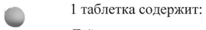
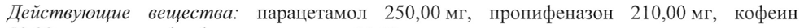
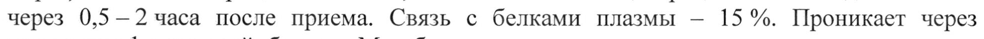
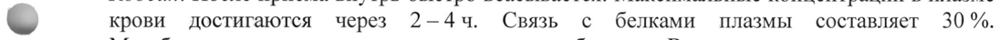
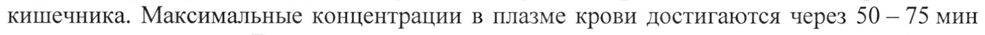
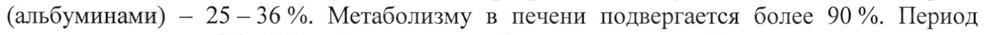
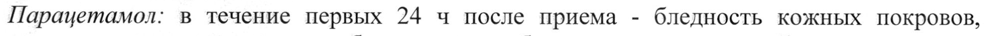

# Кодеин + Кофеин + Парацетамол + Пропифеназон — внутрь

- Препарат: Каффетин® (таблетки;)
- АТХ: N02BE51
- Источник: ГРЛС, инструкция по медицинскому применению, РУ П N015444/01, файл от 2022-05-05 (https://grls.rosminzdrav.ru/Grls_View_v2.aspx?routingGuid=d4ad2f06-8e36-470d-9c8d-00ac101c6726)
- Распознано автоматически (OCR): 6 из 6 стр.
- Инструкция к другому РУ того же препарата: П N015444/01 (национальное РУ, переоформленное по правилам ЕАЭС, решение от 12.04.2022). Текст может быть старше действующего
- Сомнительных строк после OCR: 7 (см. раздел «Проверка распознавания»)

## Общие сведения

——_—_ if МИНЗДРАВ РОССИ | v у т Л 7 7 & |
| РЯ ЕЕ | | МИНИСТЕРСТВО ЗДРАВООХРАНЕНИЯ ВОССИИСКОЙ ФЕДЕРАЦИИ |
СОГЛАСОВАНО | ИНСТРУКЦИЯ ПО МЕДИЦИНСКОМУ ПРИМЕНЕНИЮ ЛЕКАРСТВЕННОГО ПРЕПАРАТА
КАФФЕТИН® Регистрационный номер: П N015444/01
Торговое наименование: Каффетин® Группировочное наименование: Кодеин+Кофеин+Парацетамол+Пропифеназон&

## 3. Лекарственная форма

таблетки Состав:
таблетки Состав:
\ 1 таблетка содержит:
Действующие вещества: парацетамол 250,00 мг, пропифеназон 210,00 мг, кофеин 50,00 мг, кодеина фосфат сесквигидрат 10,00 мг.
Вспомогательные вещества: глицерил дибегенат, кальция гидрофосфат дигидрат, карбоксиметилкрахмал натрия, кремния диоксид коллоидный безводный, кроскармеллоза натрия, магния стеарат, натрия лаурилсульфат, повидон К25, целлюлоза микрокристаллическая.
| ® Описание: Круглые, плоские таблетки белого цвета с фаской, с гравировкой «©, на одной стороне и «CAFFETIN» на другой.
Фармакотерапевтическая группа: анальгезирующее средство комбинированное
(противокашлевое опиоидное средство + НПВП + анальгезирующее ненаркотическое средство + психостимулирующее средство).
Код ATX: NO2BE71 Фармакологические свойства

## 5.1. Фармакодинамика

Комбинированный препарат, действие которого определяется компонентами, входящими в его состав.
Комбинированный препарат, действие которого определяется компонентами, входящими в его состав.
Парацетамол оказывает жаропонижающее, анальгезирующее действие.
Кофеин стимулирует психомоторные центры головного мозга, оказывает аналептическое действие, усиливает эффект анальгетиков, уменьшает сонливость и чувство усталости, повышает умственную и физическую работоспособность, увеличивает частоту сердечных сокращений, повышает артериальное давление при артериальной гипотензии. Кофеин улучшает всасывание других активных ингредиентов — комбинированного анальгезирующего препарата.
Кодеин оказывает центральное противокашлевое действие (за счет подавления возбудимости кашлевого центра), а также анальгезирующее действие, обусловленное возбуждением опиатных рецепторов в различных отделах ЦНС и периферических тканях, приводящим к стимуляции антиноцицептивной системы и изменению эмоционального восприятия боли.
Пропифеназон оказывает анальгезирующее и жаропонижающее действие.
Обезболивающий эффект препарата достигается в течение 30-60 минут, a продолжительность обезболивания составляет 4 - 8 часов.

## 5.2. Фармакокинетика

Парацетамол. Абсорбция - высокая, максимальные концентрации в плазме достигаются через 0,5 -—2 часа после приема. Связь с белками плазмы — 15%. Проникает через гематоэнцефалический барьер. Метаболизируется в печени по трем основным путям:
Парацетамол. Абсорбция - высокая, максимальные концентрации в плазме достигаются через 0,5 -—2 часа после приема. Связь с белками плазмы — 15%. Проникает через гематоэнцефалический барьер. Метаболизируется в печени по трем основным путям:
конъюгация с глюкуронидами, конъюгация с сульфатами, окисление микросомальными ферментами печени. В последнем случае образуются токсичные промежуточные метаболиты, которые впоследствии конъюгируют с глутатионом. При дефиците глутатиона эти метаболиты могут вызывать повреждение и некроз гепатоцитов. Период полувыведения — 1—44. Выводится почками в виде метаболитов, преимущественно конъюгатов.
Пропифеназон. Быстро всасывается из желудочно-кишечного тракта. Максимальные концентрации в плазме достигаются примерно через 0,5 - 0,6 часа после приема.
Метаболизируется в печени и выводится с мочой и желчью в виде метаболитов. Период полувыведения составляет 2,1 - 2,4 часа.
Кодеин. После приема внутрь быстро всасывается. Максимальные концентрации в плазме
& крови достигаются через 2-—4ч. Связь с белками плазмы составляет 30%.
Метаболизируется в печени до активных метаболитов. Выводится почками и с желчью.
Период полувыведения — 2,5 - 4 ч.
Кофеин. При приеме внутрь абсорбция - хорошая, происходит на всем протяжении кишечника. Максимальные концентрации в плазме крови достигаются через 50 — 75 мин после приема внутрь. Быстро распределяется во всех органах и тканях организма; легко проникает через гематоэнцефалический барьер и плаценту. Связь с белками крови
(альбуминами) — 25-36%. Метаболизму в печени подвергается более 90%. Период
©, полувыведения — 3,9 - 5,3 4. Выведение кофеина и его метаболитов осуществляется почками.

## 4.1. Показания к применению

Болевой синдром умеренной выраженности различного генеза: головная и зубная боль, мигрень, невралгия, миалгия, посттравматические боли, артралгия, альгодисменорея.
Болевой синдром умеренной выраженности различного генеза: головная и зубная боль, мигрень, невралгия, миалгия, посттравматические боли, артралгия, альгодисменорея.

## 4.3. Противопоказания

& Если у Bac одно из перечисленных заболеваний, перед приемом препарата обязательно проконсультируйтесь с врачом.
& Если у Bac одно из перечисленных заболеваний, перед приемом препарата обязательно проконсультируйтесь с врачом.
Гиперчувствительность; тяжелая почечная и/или печеночная недостаточность;
лейкопения; нарушение кроветворения; тревожные расстройства (агорафобия, панические расстройства); органические заболевания сердечно-сосудистой системы (в т.ч. острый инфаркт миокарда, атеросклероз, стенокардия); аритмии; артериальная гипертензия;
дефицит глюкозо-6-фосфатдегидрогеназы; нарушения сна; острая перемежающаяся порфирия; беременность и период лактации; детский возраст до 18 лет; не рекомендуется пациентам с высокой активностью ферментов цитохрома P450 (CYP2D6).

## 4.3. С осторожностью

Если у Вас одно из перечисленных заболеваний, перед приемом препарата обязательно проконсультируйтесь с врачом.
Если у Вас одно из перечисленных заболеваний, перед приемом препарата обязательно проконсультируйтесь с врачом.
Острая боль в животе неясной этиологии, нарушение функции почек и/или печени, приступ бронхиальной астмы (в т.ч. в анамнезе), ХОБЛ, судороги, лекарственная зависимость (в тм. в анамнезе), алкоголизм, повышенная возбудимость, доброкачественные гипербилирубинемии (в т.ч. синдром Жильбера), вирусный гепатит, глаукома, пожилой возраст.

## 4.6. Применение при беременности и в период грудного вскармливания

Препарат противопоказан во время беременности и в период грудного вскармливания.

## 4.2. Способ применения и дозы

Внутрь, взрослым - по 1 таблетке 3 - 4 раза в сутки. При сильных болях рекомендуется прием 2-х таблеток сразу. Максимальная суточная доза - 6 таблеток.
Внутрь, взрослым - по 1 таблетке 3 - 4 раза в сутки. При сильных болях рекомендуется прием 2-х таблеток сразу. Максимальная суточная доза - 6 таблеток.
Продолжительность приема препарата не более 5 дней. Увеличение суточной дозы препарата или продолжительности лечения возможно только после консультации с врачом.

## 4.8. Побочное действие

Со стороны нервной системы и органов чувств: повышенная возбудимость, тремор, беспокойство, бессонница.
Со стороны нервной системы и органов чувств: повышенная возбудимость, тремор, беспокойство, бессонница.
Со стороны сердечно-сосудистой системы: сердцебиение, повышение АД, тахикардия.
Со стороны пищеварительной системы: обострение язвенной болезни, повышение активности «печеночных» трансаминаз, тошнота, рвота и другие расстройства р пищеварительного тракта.
wy Co стороны почек и мочевыводящих путей: почечные расстройства.
Со стороны печени и желчевыводящих путей: печёночная дисфункция
(гепатотоксичность обычно связана с передозировкой парацетамола).
Аллергические реакции: нечасто - кожная сыпь, крапивница, зуд, отек лица, бронхоспазм, отек гортани, ларингоспазм, ангионевротический отек.
Со стороны кожи и подкожных тканей: очень редко - серьезные кожные реакции при применении парацетамола (например, медикаментозно индуцированный синдром
Стивенса-Джонсона, токсический эпидермальный некролиз, и острый генерализованный
© экзантематозный пустулез).
Нарушения кроветворения: ‚редко - анемия, тромбоцитопения, метгемоглобинемия, лейкопения, нейтропения, панцитопения, агранулоцитоз (пропифеназон — производное пиразолона — является активным компонентом препарата Каффетин®, ответственным за выявление возможных случаев агранулоцитоза. Известно, что аминопирин — одно из первых производных пиразолона — связан с дискразиями крови, хотя такие реакции описаны и при применении парацетамола в качестве монотерапии).
Если любые из указанных в инструкции побочных эффектов усугубляются, или Вы
& заметили любые другие побочные эффекты не указанные в инструкции, сообщите об этом врачу.

## 4.9. Передозировка

Симптомы: в случае передозировки каждый активный компонент может послужить причиной специфической симптоматики.
Симптомы: в случае передозировки каждый активный компонент может послужить причиной специфической симптоматики.
Парацетамол: в течение первых 24 ч после приема - бледность кожных покровов, тошнота, рвота, анорексия, абдоминальная боль; нарушение метаболизма глюкозы, метаболический ацидоз. Иногда возможно проявление острого тубулярного некроза.
Симптомы нарушения функции печени могут появиться через 12-484 после передозировки. Гепатотоксический эффект у взрослых проявляется при приеме 10 ги более.
Кофеин: в дозах более 300 мг/сут (в т.ч. на фоне злоупотребления кофе - более 4 чашек натурального кофе по 150 мл) может вызывать состояние тревоги, тремор, головную боль, спутанность сознания, экстрасистолию.
Кодеин: симптомы острой и хронической передозировки - холодный липкий пот, спутанность сознания, головокружение, сонливость, снижение АД, нервозность, усталость, брадикардия, резкая слабость, медленное затрудненное дыхание, гипотермия,

тревожность, MHO3, судороги.

Лечение: промывание желудка, прием активированного угля, поддержание сердечной

деятельности и АД, поддерживающая терапия.

Внутривенное введение специфического антагониста опиоидных анальгетиков -

налоксона.

Введение донаторов ЭН-групп и предшественников синтеза глутатиона - метионина в

течение 8 — 9 ч после передозировки и ацетилцистеина - в течение 8 ч.

При подозрении на отравление необходимо немедленно обратиться за врачебной

помощью.

## 4.5. Взаимодействие с другими лекарственными средствами

Кофеин: при совместном применении кофеина и барбитуратов, противосудорожных

лекарственных средств (ЛС) возможно усиление метаболизма и увеличение клиренса

кофеина; циметидина, пероральных контрацептивных ЛС, — дисульфирама,

ципрофлоксацина, норфлоксацина - снижение метаболизма кофеина в печени.

Снижает эффект наркотических и снотворных ЛС.

Совместное применение кофеина с бета-адреноблокаторами может приводить к
Cw взаимному подавлению — терапевтических эффектов; С адренергическими

бронхорасширяющими ЛС - к дополнительной стимуляции ЦНС и другим аддитивным

токсическим эффектам.

Кофеин ускоряет всасывание эрготамина.

Не рекомендуется одновременное применение препарата с лекарственными средствами,

стимулирующими ЦНС, ингибиторами MAO (фуразолидон, прокарбазин, селегилин) -

большие дозы кофеина могут вызывать развитие опасных аритмий сердца или

выраженное повышение АД, а также с лекарственными средствами и напитками, ow содержащими кофеин.

Кофеин может снижать клиренс теофиллина и, возможно, других ксантинов, увеличивая

возможность аддитивных фармакодинамических и токсических эффектов.

Кодеин: при одновременном применении этанола, миорелаксантов, а также ЛС,

угнетающих ЦНС, возможно усиление седативного эффекта, подавление дыхательного

центра и угнетение ЦНС.

Одновременный прием опиоидов с седативными препаратами, такими как бензодиазепины или родственные препараты, повышает риск седации, угнетения дыхания, w комы и смерти из-за аддитивного угнетающего действия на ЦНС. Доза и

продолжительность одновременного применения должны быть ограничены (см. Раздел

«Особые указания»).

ЛС с антихолинергической активностью, противодиарейные ЛС (в т.ч. лоперамид)

повышают риск возникновения запора.

Снижает эффект метоклопрамида.

Существует риск развития серотонинового синдрома, как осложнения лекарственного

взаимодействия с антидепрессантами и противомигренозными лекарственными

средствами.

Парацетамол: индукторы микросомального окисления в печени (противосудорожные ЛС,

барбитураты, рифампицин, фенилбутазон, трициклические антидепрессанты), этанол и

гепатотоксические ЛС увеличивают продукцию гидроксилированных активных

метаболитов, что обусловливает возможность развития тяжелых интоксикаций даже при

небольшой передозировке.

Сопутствующее применение парацетамола в высоких дозах может усилить действие

непрямых антикоагулянтов (производных дикумарина, варфарина, аценокумарола), а

также одновременное применение с нестероидными противовоспалительными средствами

может привести к возникновению побочных реакций со стороны желудочно-кишечного тракта.
Снижает эффективность урикозурических ЛС.
Миелотоксичные ЛС усиливают проявления гематотоксичности препарата.
Под воздействием парацетамола Т% хлорамфеникола увеличивается в 5 раз.
Метоклопрамид ускоряет всасывание парацетамола.

## 4.4. Особые указания

При длительном (более 1 недели) применении необходим контроль картины периферической крови и функционального состояния печени.
При длительном (более 1 недели) применении необходим контроль картины периферической крови и функционального состояния печени.
Во время применения препарата следует отказаться от употребления этанола (повышение риска развития гепатотоксичности).
Искажает показатели лабораторных исследований при количественном определении глюкозы и мочевой кислоты в плазме.
Прием препарата может изменить результаты анализов допинг-контроля спортсменов, а также затруднить установление диагноза при остром абдоминальном болевом синдроме.
Меры предосторожности должны быть приняты в случае плохой переносимости анальгетиков, гиперчувствительности к другим анальгетикам (опасность спровоцировать
- приступ астмы), а также язв желудочно-кишечного тракта или кровотечений.
Следует соблюдать особую осторожность у пациентов с дискразией крови или супрессией костного мозга и рекомендуется тщательное наблюдение за гематологическими параметрами. Риск нейтропении и агранулоцитоза возможен в основном из-за присутствия пропифеназона. Если такая реакция происходит после приема препарата
Каффетин® (повышенная температура, боль в горле, язвы и абсцессы во рту, перианальные абсцессы, а также сокращение гранулоцитов крови), следует немедленно прекратить прием препарата. Описанные побочные эффекты обычно обратимы и исчезают
® в течение 1-2 недель.
Особое внимание также необходимо пациентам, которые чувствуют тревожность, нервозность, беспокойство, тремор, а также пациентам с артериальной гипертензией или бессонницей. При возникновении учащенного сердцебиения или тахикардии следует немедленно прекратить прием препарата.
Одновременный прием препарата Каффетин® и седативных препаратов, таких как бензодиазепины или родственные препараты, может привести к седации, угнетению дыхания, коме и смерти. Из-за этих рисков совместное назначение этих седативных
Ss препаратов должно быть сохранено у пациентов, для которых невозможны альтернативные варианты лечения. Если принято решение о назначении препарата
Каффетин® одновременно с седативными препаратами, следует использовать самую низкую эффективную дозу, а продолжительность лечения должна быть как можно короче.
Пациентам следует внимательно следить за признаками и симптомами угнетения дыхания и седации. В связи с этим настоятельно рекомендуется информировать пациентов и лиц, осуществляющих уход за ними, об этих симптомах (см. Раздел «Взаимодействие с другими лекарственными средствами»).
При длительном применении препарата существует риск развития надпочечниковой недостаточности и риск снижения уровня половых гормонов.

## 4.7. Влияние на способность управлять транспортными средствами, механизмами

Каффетин® в терапевтических дозах не оказывает влияния на способность управлять транспортными средствами и механизмами, однако необходимо соблюдать осторожность при применении максимальной суточной дозы (6 таблеток).

## 6.5. Форма выпуска

Таблетки.
Таблетки.
Первичная упаковка. 6 или 10 таблеток в перфорированный стрип из АЛЛТЭ фольги.
Вторичная упаковка. По 1 стрипу (10 таблеток) или 2 стрипа (по 6 таблеток) вместе с инструкцией по применению помещают в картонную пачку.

## 6.4. Условия хранения

Хранить при температуре не выше 25 °С.
Хранить при температуре не выше 25 °С.
Хранить в недоступном для детей месте!
Препарат относится к Списку Ш Перечня лекарственных средств для медицинского применения, подлежащих предметно - количественному учету.

## 6.3. Срок годности

3 года. Не применять по истечении срока годности.
3 года. Не применять по истечении срока годности.
Условия отпуска Отпускают по рецепту с ограничениями, предусмотренными для наркотических препаратов.
© Производитель:
АЛКАЛОИД АД Скопье Бульвар Александар Македонски 12, 1000 Скопье, Республика Северная Македония
Владелец регистрационного удостоверения:
АЛКАЛОИД АД Скопье Бульвар Александар Македонски 12, 1000 Скопье, Республика Северная Македония
Организация, принимающая претензии от потребителей:
© ООО «АЛКАЛОИД-РУС»
Российская Федерация, 119048, Москва, ул. Усачева, д. 33, стр. 2.
Тел./факс: (495) 502-92-97 E-mail: infoAlk@alkaloid.com.mk
= Представитель фирмы i (aa P A sf я М.Л. Знакомова
## Проверка распознавания

Страницы-сканы распознаны автоматически. В 7 строках с дозировками цифры могли распознаться с ошибкой — сверьте с вырезкой из оригинала:

- стр. 1: «\ 1 таблетка содержит:» — повторное чтение: «© 1 таблетка содержит:»  
  
- стр. 1: «Действующие вещества: парацетамол 250,00 мг, пропифеназон 210,00 мг, кофеин» — низкая уверенность: «250,00» (70); повторное чтение: «Действующие вещества: парацетамол 250,00 мг, пропифеназон 210,00 mr, кофеин»  
  
- стр. 2: «через 0,5 -—2 часа после приема. Связь с белками плазмы — 15%. Проникает через» — низкая уверенность: «0,5» (33), «-—2» (33)  
  
- стр. 2: «& крови достигаются через 2-—4ч. Связь с белками плазмы составляет 30%.» — низкая уверенность: «2-—4ч.» (58); повторное чтение: «© = kpown достигаются черз 2-4ч. Связь с белками плазмы составляет 30%.»  
  
- стр. 2: «кишечника. Максимальные концентрации в плазме крови достигаются через 50 — 75 мин» — низкая уверенность: «50» (74)  
  
- стр. 2: «(альбуминами) — 25-36%. Метаболизму в печени подвергается более 90%. Период» — низкая уверенность: «25-36%.» (34)  
  
- стр. 3: «Парацетамол: в течение первых 24 ч после приема - бледность кожных покровов,» — повторное чтение: «Парацетамол: в течение первых 24 4 после приема - бледность кожных покровов,»  
  
