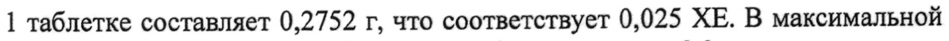

# Коризалия — внутрь

- Препарат: Коризалия® (таблетки покрытые оболочкой)
- АТХ: V30
- Источник: ГРЛС, инструкция по медицинскому применению, РУ ЛП-№000996-(РГ-RU), файл от 2022-10-27 (https://grls.rosminzdrav.ru/Grls_View_v2.aspx?routingGuid=cf33d9f0-5da2-4165-9f5a-55dc5a123e04)
- Распознано автоматически (OCR): 3 из 3 стр.
- Сомнительных строк после OCR: 1 (см. раздел «Проверка распознавания»)

## Общие сведения

ИНСТРУКЦИЯ ПО МЕДИЦИНСКОМУ ПРИМЕНЕНИЮ ЛЕКАРСТВЕННОГО ПРЕПАРАТА

ОЖ Регистрационный номер | — МИНЗДРАВ РОССИИ |

|

| ‘ = г | Торговое наименование | 0807 22 |
Коризалия® | СОГЛАСОВАНО | Лекарственная форма
Таблетки, покрытые оболочкой, гомеопатические

## 2. Состав

(на одну таблетку)
(на одну таблетку)
Активные компоненты:
Allium сера (аллиум wera) C3 0,333 мг Belladonna (белладонна) C3 0,333 мг
Sabadilla (сабадилла) C3 0,333 мг Kalium bichromicum (калиум бихромикум) C3 0,333 мг
Gelsemium (гельземиум) C3 0,333 мг Pulsatilla (пульсатилла) C3 0,333 мг
Вспомогательные компоненты:
сахароза, тальк, акации камедь, магния стеарат,
Вспомогательные компоненты оболочки:
акации камедь, желатин, сахароза, тальк, воск пчелиный белый, воск карнаубский - до 300 мг
Описание Таблетки двояковыпуклой формы, покрытые оболочкой белого цвета, без запаха
Фармакотерапевтическая группа Гомеопатическое средство
Фармакологические свойства Фармакодинамика
Многокомпонентный гомеопатический препарат, действие которого обусловлено компонентами, входящими в его состав.

## 5.2. Фармакокинетика

Не применимо
Не применимо

445102 Показания к применению Насморк (отек и/или раздражение слизистой носоглотки, сочетающиеся или нет с заложенностью носа, чиханием, ознобом)

## 4.3. Противопоказания

Повышенная индивидуальная чувствительность к отдельным компонентам препарата. Детский возраст до 1,5 лет (18 месяцев) (в связи с недостаточностью клинических данных). Непереносимость фруктозы, дефицит сахаразы-изомальтазы, глюкозо-галактозная мальабсорбция.
Повышенная индивидуальная чувствительность к отдельным компонентам препарата. Детский возраст до 1,5 лет (18 месяцев) (в связи с недостаточностью клинических данных). Непереносимость фруктозы, дефицит сахаразы-изомальтазы, глюкозо-галактозная мальабсорбция.

## 4.6. Применение при беременности и в период грудного вскармливания

Применение препарата при беременности и в период грудного вскармливания возможно только по рекомендации врача, если ожидаемая польза для матери превышает потенциальный риск для плода и ребенка.

## 4.2. Способ применения и дозы

По 1 таблетке каждый час в течение 1-го дня, но не более 12 таблеток в день, и каждые 2 часа в течение следующих 4-х дней. Таблетку держать во рту до полного растворения. Курс лечения — 5 дней. Детям от 1,5 лет (18 месяцев) до 6 лет перед приемом таблетку следует растворить в небольшом количестве
По 1 таблетке каждый час в течение 1-го дня, но не более 12 таблеток в день, и каждые 2 часа в течение следующих 4-х дней. Таблетку держать во рту до полного растворения. Курс лечения — 5 дней. Детям от 1,5 лет (18 месяцев) до 6 лет перед приемом таблетку следует растворить в небольшом количестве
ВОДЫ.

## 4.8. Побочное действие

Возможны аллергические реакции
Возможны аллергические реакции

## 4.9. Передозировка

Случаи передозировки до настоящего времени не были зарегистрированы
Случаи передозировки до настоящего времени не были зарегистрированы

## 4.5. Взаимодействие с другими лекарственными средствами

На настоящий момент данные о взаимодействии с другими лекарственными средствами отсутствуют. Назначение комплексных гомеопатических препаратов не исключает использование других лекарственных средств, применяемых при данном заболевании.

## 4.4. Особые указания

При приеме гомеопатических лекарственных средств могут временно обостриться имеющиеся симптомы (первичное ухудшение). В этом случае следует прекратить прием препарата и обратиться к врачу.
При приеме гомеопатических лекарственных средств могут временно обостриться имеющиеся симптомы (первичное ухудшение). В этом случае следует прекратить прием препарата и обратиться к врачу.
Если после 3-5 дней лечения улучшение не наступает или появляются побочные эффекты, следует проконсультироваться с врачом.
Информация для пациентов с сахарным диабетом: содержание углеводов в

1 таблетке составляет 0,2752. г, что соответствует 0,025 ХЕ. В максимальной суточной дозе препарата (12 таблеток) содержится 3,3 г углеводов, что соответствует 0,3 ХЕ.

## 4.7. Влияние на способность управлять транспортными средствами, механизмами

Применение препарата не оказывает влияния на способность к выполнению потенциально опасных видов деятельности, требующих повышенной концентрации внимания и быстроты психомоторных реакций (управление транспортными средствами, работа с движущимися механизмами, работа диспетчера, оператора).

## 6.5. Форма выпуска

Таблетки, покрытые оболочкой, гомеопатические. По 20 таблеток в блистер из пленки ПВХ и лакированной алюминиевой фольги. По 2 блистера (по 20 таблеток) вместе с инструкцией по применению помещают в картонную пачку с заклеивающимся по бокам «язычком».
Таблетки, покрытые оболочкой, гомеопатические. По 20 таблеток в блистер из пленки ПВХ и лакированной алюминиевой фольги. По 2 блистера (по 20 таблеток) вместе с инструкцией по применению помещают в картонную пачку с заклеивающимся по бокам «язычком».

## 6.4. Условия хранения

Хранить при температуре не выше 25°С.
Хранить при температуре не выше 25°С.
Хранить в недоступном для детей месте.

## 6.3. Срок годности

5 лет.
5 лет.
Не применять по истечении срока годности.
Условия отпуска Отпускают без рецепта Производитель
БУАРОН, 2, авеню де л`Уэст Лионнэ, 69510 Мессими, Франция
Место производства 2, авеню де л`Уэст Лионнэ, 69510
Мессими, Франция Представитель в России/ организация, принимающая претензии потребителей
ООО «Буарон», Москва, | МЗРФ i ул. Долгоруковская, д.7 ЭЕСПЕРТНЫЙ ОТЧЕТ Е
Тел. (495) 956 08 10, факс (495) 956 08 14 2 ВйствитвлЕН ДЛЯ ДАННОЙ © е = 5| версии ДОКУМЕНТА ae.
900000009 | 145102
## Проверка распознавания

Страницы-сканы распознаны автоматически. В 1 строках с дозировками цифры могли распознаться с ошибкой — сверьте с вырезкой из оригинала:

- стр. 3: «1 таблетке составляет 0,2752. г, что соответствует 0,025 ХЕ. В максимальной» — низкая уверенность: «0,2752.» (65); повторное чтение: «1 таблетке составляет 0,2752 г, что соответствует 0,025 ХЕ. В максимальной»  
  
