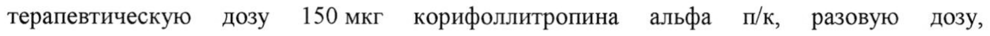
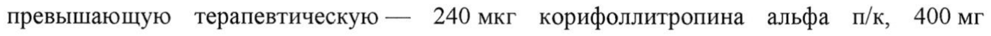
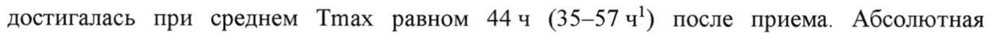
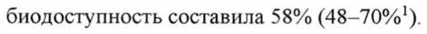
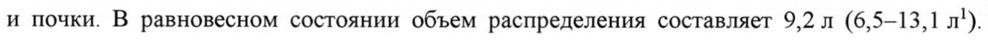
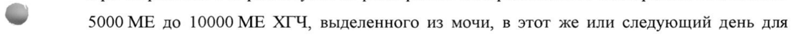
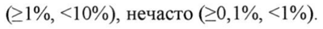
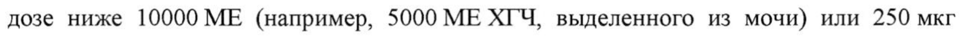
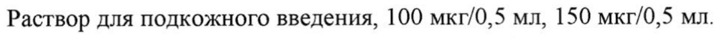

# Корифоллитропин альфа — парентерально

- Препарат: Элонва® (раствор для подкожного введения;)
- АТХ: G03GA09
- Источник: ГРЛС, инструкция по медицинскому применению, РУ ЛП-001212, файл от 2020-11-11 (https://grls.rosminzdrav.ru/Grls_View_v2.aspx?routingGuid=04e24ec5-5b1e-4ee1-8263-45a12b496794)
- Распознано автоматически (OCR): 15 из 15 стр.
- Инструкция к другому РУ того же препарата: ЛП-001212 (срок действия истёк, решение от 05.11.2020). Текст может быть старше действующего
- Сомнительных строк после OCR: 9 (см. раздел «Проверка распознавания»)

## Общие сведения

— — | ЛП 001212-250219 МИНИСТЕРСТВО ЗДРАВООХРАНЕНИЯ РОССИЙСКОЙ ФЕДЕРАЦИИ
ИНСТРУКЦИЯ ПО МЕДИЦИНСКОМУ ПРИМЕНЕНИЮ ЛЕКАРСТВЕННОГО ПРЕПАРАТА
ЭЛОНВА®

РЕГИСТРАЦИОННЫЙ НОМЕР: ЛП-001212

ТОРГОВОЕ НАИМЕНОВАНИЕ: Элонва®

МЕЖДУНАРОДНОЕ НЕПАТЕНТОВАННОЕ НАИМЕНОВАНИЕ: корифоллитропин

альфа

## 3. Лекарственная форма

раствор для подкожного введения
раствор для подкожного введения

## 2. Состав

- Каждый флакон содержит:

Активное вещество: корифоллитропин альфа 100 мкг или 150 мкг.

Вспомогательные вещества: натрия цитрата дигидрат 3,68 мг, сахароза 35,0 мг,

[-метионин 0,25 мг, полисорбат 20 0,10 мг, хлористоводородная кислота 0,1 М или натрия

гидроксид 0,1 М дорн 7,0, вода для инъекций (извлекаемый объем) до 0,50 мл.

ОПИСАНИЕ

Прозрачный раствор от бесцветного до светло-желтого цвета.

ФАРМАКОТЕРАПЕВТИЧЕСКАЯ ГРУППА: гонадотропины и другие стимуляторы

овуляции

КОД ATX: G03GA09

ФАРМАКОЛОГИЧЕСКИЕ СВОЙСТВА

ow Фармакодинамика

Корифоллитропин альфа — это гликопротеин, который продуцируется клетками яичников

китайских хомячков с помощью рекомбинантной ДНК технологии.

Корифоллитропин альфа является стимулятором роста фолликулов пролонгированного

действия, который по фармакодинамическим свойствам сопоставим с рекомбинантным

фолликулостимулирующим гормоном (рФСГ), но обладает значительно более

длительным действием. Препарат вызывает и поддерживает множественный рост

фолликулов в течение недели, поэтому одна подкожная (п/к) инъекция рекомендуемой

дозы препарата Элонва® может заменить первые7 ежедневных инъекций любых

препаратов рФСГ при проведении контролируемой стимуляции яичников. Увеличение

длительности фолликулостимулирующей активности было достигнуто за счет

присоединения карбокси-терминального пептида бета-субъединицы хорионического

113835 и ЛП 001212-250219 гонадотропина человека (ХГЧ) к бета-цепи человеческого ФСГ. Корифоллитропин альфа не обладает активностью ХГЧ и лютеинизирующего гормона (ЛГ).

Влияние на электрофизиологию сердца В рандомизированном двойном слепом плацебо-контролируемом и контролируемом с применением другого лекарственного средства клиническом исследовании с 4 периодами смены терапии, 70 здоровых женщин в постменопаузном периоде получили разовую терапевтическую дозу 150 мкг корифоллитропина альфа п/к, разовую дозу, превышающую терапевтическую — 240 мкг корифоллитропина альфа п/к, 400 мг моксифлоксацина внутрь и плацебо. При применении обеих доз корифоллитропина альфа продолжительность интервала ОТс не увеличивалась на протяжении 216 ч после введения препарата. При внесении поправки на исходное значение показателя и его значение при
© применении плацебо максимальное значение среднего изменения продолжительности интервала ОТс после введения 150 мкг корифоллитропина альфа составило 1,4 мсек
(односторонний 95% верхний доверительный интервал составил 3,4 мсек). После введения дозы корифоллитропина альфа, превышающей терапевтическую (240 мкг), максимальное значение среднего изменения продолжительности интервала ОТс составило 1,2 мсек (односторонний 95% верхний доверительный интервал 3,6 мсек).

## 5.2. Фармакокинетика

Показатели фармакокинетики корифоллитропина альфа оценивались после п/к введения у женщин, которым проводились циклы контролируемой стимуляции яичников.
Показатели фармакокинетики корифоллитропина альфа оценивались после п/к введения у женщин, которым проводились циклы контролируемой стимуляции яичников.
Распределение, метаболизм и выведение корифоллитропина альфа сходны с таковыми других гонадотропинов, таких как ФСГ, ХГЧ и ЛГ.
Всасывание © После однократного п/к введения препарата Элонва® средняя максимальная концентрация корифоллитропина альфа в плазме (Cmax) составила 4,24 нг/мл (2,49-7,21 нг/мл!) и достигалась при среднем Tmax равном 444 (35—57 ч!) после приема. Абсолютная биодоступность составила 58% (48-70%!).
Экспозиция корифоллитропина альфа зависит от массы тела. Среднее значение AUC
(площадь под кривой “концентрация-время”) корифоллитропина альфа после однократного п/к введения составляет 665 чх нг/мл (426-1037 чх нг/мл') и является сходным после введения корифоллитропина альфа в дозах 100 мкг женщинам с массой тела <60 кг и 150 мкг женщинам с массой тела >60 кг.
Распределение После всасывания в кровь корифоллитропин альфа распределяется в основном в яичники и почки. В равновесном состоянии объем распределения составляет 9,2 1 (6,5—-13,1 л').
113855 ЛП 001212-250219 Экспозиция корифоллитропина альфа возрастает пропорционально дозе в диапазоне от 60 мкг до 240 мкг.
Метаболизм В метаболизме корифоллитропина альфа в основном участвуют почки. В результате метаболизма образуются фармакологически неактивные альфа- и бета- субъединицы
(включая карбокси-терминальный пептид), которые преимущественно выводятся почками.
Выведение Среднее значение периода полувыведения (ТУ?) корифоллитропина альфа составляет 70 4
(59-82 ч'), клиренс составляет 0,13 л/ч (0,10-0,18 л/ч").
Корифоллитропин альфа выводится преимущественно почками. Скорость выведения
© может быть снижена у пациенток с почечной недостаточностью (см. разделы «Способ применения и дозы» и «Особые указания»). Печеночный метаболизм в незначительной степени влияет на выведение корифоллитропина альфа.
Фармакокинетика в особых клинических группах пациенток
У пациенток с нарушением функции печени Хотя данные о применении препарата у пациенток с печеночной недостаточностью отсутствуют, влияние печеночной недостаточности на фармакокинетический профиль корифоллитропина альфа маловероятно.
Прогнозируемый диапазон у 90% пациенток.

## 4.1. Показания к применению

Контролируемая стимуляция яичников в комбинации с антагонистами гонадотропин рилизинг-гормона (ГнРГ) с целью образования множественных фолликулов у женщин,
Контролируемая стимуляция яичников в комбинации с антагонистами гонадотропин рилизинг-гормона (ГнРГ) с целью образования множественных фолликулов у женщин,
- участвующих в программе вспомогательных репродуктивных технологий (BPT).
ПРОТИВОПОКАЗАНИЯ e Гиперчувствительность к корифоллитропину альфа или какому-либо вспомогательному веществу препарата.
® Опухоли яичников, молочной железы, матки, гипофиза или гипоталамуса.
e Кровотечения и кровянистые выделения из половых путей (не связанные с менструацией) неустановленной этиологии.
® Первичная недостаточность яичников.
® Кисты яичников или увеличение яичников.
® Синдром гиперстимуляции яичников (СГЯ) в анамнезе.
113835 | | ЛИ 001212-250219

e В случае, если предыдущий цикл контролируемой стимуляции яичников привел к росту более чем 30 фолликулов до размера не менее 11мм, выявленных при ультразвуковом исследовании.

e Количество базальных антральных фолликулов более 20.

e Фибромиома матки, несовместимая с беременностью.

» Аномалии развития половых органов, несовместимые с нормальным развитием беременности.

e Беременность и период грудного вскармливания.

® Синдром поликистозных яичников (СПКЯ).

® Почечная недостаточность.

## 4.6. Применение при беременности и в период грудного вскармливания

© ВСКАРМЛИВАНИЯ

Беременность

Применение препарата Элонва® во время беременности противопоказано.

В случае непреднамеренного введения препарата Элонва® во время беременности

клинические данные не позволяют исключить неблагоприятного исхода беременности. В

исследованиях на животных наблюдалась репродуктивная токсичность.

Период грудного вскармливания

Применение препарата Элонва® в период грудного вскармливания противопоказано.

## 4.2. Способ применения и дозы

Применение препарата Элонва® должно проводиться под контролем врача, имеющего

опыт лечения бесплодия.

© Препарат можно применять, только если раствор в шприце прозрачный.

Доза препарата Элонва* зависит от массы тела и возраста женщины.

Однократное введение препарата в дозе 100 мкг рекомендуется у женщин с массой тела

<60 кг в возрасте <36 лет.

Однократное введение препарата в дозе 150 мкг рекомендуется у женщин:

- с массой тела >60 кг независимо от возраста;

- с массой тела >50 кг и старше 36 лет.

Сведения о применении препарата у женщин старше 36 лет и с массой тела менее 50 кг

отсутствуют.

113855 —— | 7 7 | ЛП 001212-250219 ое рвы вн
Рекомендуемые дозы были установлены только при применении в комбинации с

антагонистом ГнРГ, применяемом с 5-го или 6-го дня стимуляции.
В 1-й день стимуляции препарат Элонва® вводят однократно п/к (предпочтительно под кожу живота) в раннюю фолликулярную фазу менструального цикла.
На 5-й или 6-й день стимуляции, в зависимости от количества и размера растущих фолликулов, следует начинать введение антагониста ГнРГ. Также необходимо параллельное определение концентрации эстрадиола в плазме крови. Антагонист ГнРГ применяется для предотвращения преждевременного повышения концентрации ЛГ.
~ На 8-й день стимуляции (через 7 дней после инъекции препарата Элонва®) лечение может быть продолжено ежедневным введением рФСГ до тех пор, пока не будет достигнут критерий индукции финального созревания ооцита (3 фолликула >17 мм). Суточная доза
РФСГ зависит от ответа яичников, который регулярно мониторируется при ультразвуковом исследовании, начиная с 5-го или 6-го дня стимуляции. Если ответ нормальный, то рекомендуемая суточная доза составляет 150 МЕ рФСГ.
В случае чрезмерного ответа яичников инъекция рФСГ в день введения ХГЧ может быть пропущена, следует использовать рекомендации по уменьшению риска развития СГЯ
(см. раздел «Особые указания»). Обычно достаточное созревание фолликулов достигается на 9-й день лечения (диапазон длительности лечения составляет от 6 до 18 дней).
При созревании 3-х фолликулов до размера >17 мм производится однократное введение от
- 5000 МЕ до 10000 МЕ ХГЧ, выделенного из мочи, в этот же или следующий день для индукции финального созревания ооцитов.
Применение в особых клинических группах пациенток
Почечная недостаточность Клинических исследований препарата у пациенток с почечной недостаточностью не проводилось. Так как скорость выведения корифоллитропина альфа у таких пациенток может быть снижена, применение препарата Элонва® у женщин с почечной недостаточностью противопоказано.
Печеночная недостаточность Хотя данные по применению препарата у пациенток с печеночной недостаточностью отсутствуют, влияние печеночной недостаточности на выведение корифоллитропина альфа маловероятно.
113835 И И | ЛП 001212-250219 Дети Применение препарата Элонва® у детей не соотносится с показанием.
Способ введения Подкожная инъекция препарата Элонва® может выполняться самой женщиной или ее партнером, при условии получения инструкций врача по проведению инъекции.
Самостоятельное введение препарата может выполняться женщинами, которые хорошо мотивированы, имеют достаточную подготовку и имеют доступ к консультациям экспертов.
Рекомендации для пациентов по подготовке и выполнению п/к инъекции
Компоненты шприца с иглой 1 2 3 4 5 6 и.
© Е | we в
1. Поршень
2. Шприц
3. Раствор
4. Колпачок шприца
5. Колпачок иглы
6. Игла
& 7. Футляр иглы
8. Перфорация
Подготовка к инъекции 1.
- Обработайте кожу в месте предполагаемой инъекции дезинфицирующим средством.
№4 | 113835 и ЛИ 001212-259219 2.
р - Сломайте колпачок иглы по линии перфорации,
- | извлеките футляр, содержащий иглу.
pel =| Е SS - НЕ снимайте футляр с иглы.
iS ав ~ - Положите футляр, содержащий иглу, На сухую чистую поверхность.
и 3.
- Держите шприц колпачком вверх (вертикально).
© i \\ - Осторожно постучите пальцем по шприцу, чтобы
| f пузырьки воздуха поднялись вверх.
pi ши.
{AL у = №. - Держите шприц вертикально.
АД | - Открутите колпачок шприца против часовой
Г\\ стрелки.
= ® tf = М \a/ 5.
- Держите шприц вертикально.
\ В (1 - Прикрутите к нему футляр иглы, содержащий is о иглу, по часовой стрелке.
м if AY ps es 113835 — SS BS ЛИ 001212-250219 1 °
G - Держите шприц вертикально.
(| № - Снимите футляр с иглы и выбросьте его.
Е Г \ Е БУДЬТЕ ОСТОРОЖНЫ с иглой!
а ыы Выполнение инъекции TW = 7.
© чи - Зажмите шприц между указательным и средним
= пальцами и держите его вертикально.
| - Поместите большой палец На поршень.
=. - ОСТОРОЖНО нажмите на поршень, чтобы на a SS
Ta кончике иглы появилась капелька раствора.
| eas вх 8.
= - Большим и указательным пальцами сделайте
Be. кожную складку.
- ро = - Полностью введите иглу под углом 90° в складку
© a! as, кожи.
| - ОСТОРОЖНО надавливайте на поршень до he упора, после чего ДОСЧИТАЙТЕ ДО ПЯТИ,
@ чтобы ввести весь раствор.
9.
— = - Уберите большой палец с поршня.
ia - Игла автоматически уберется в шприц и будет
~ блокирована.
{a < = Car oY & a ee 115855 О ЛП 001212-250219

## 4.8. Побочное действие

Основными нежелательными реакциями в клинических исследованиях (N=2397) при лечении препаратом Элонва® были дискомфорт в области малого таза (6,0%), СГЯ (4,3%), головная боль (4,0%), боль в области малого таза (2,9%), тошнота (2,3%), утомляемость
Основными нежелательными реакциями в клинических исследованиях (N=2397) при лечении препаратом Элонва® были дискомфорт в области малого таза (6,0%), СГЯ (4,3%), головная боль (4,0%), боль в области малого таза (2,9%), тошнота (2,3%), утомляемость
(1,5%) и болезненность молочных желез (1,3%).
В таблице приведены основные нежелательные реакции (по системам органов и частоте), которые наблюдались при применении препарата в клинических исследованиях (часто
(21%, <10%), нечасто (>0,1%, <1%).
Класс система/орган | Частота Нежелательные эффекты
Нарушения со Нечасто Перепады настроения стороны психики
Нарушения со Часто Головная боль стороны нервной
- системы Нечасто Головокружение
Нарушения со Нечасто «Приливы»
стороны сосудов Нарушения со Часто Тошнота стороны желудочнокишечного тракта Нечасто Вздутие живота, рвота, диарея, запор
Нарушения со Нечасто Боль в спине стороны скелетномышечной и соединительной ткани
Беременность, Нечасто Спонтанный выкидыш послеродовые и перинатальные
© состояния Нарушения со Часто СГЯ, боль в области малого таза, стороны половых дискомфорт в области малого таза, органов и молочной болезненность молочных желез ны Нечасто Перекрут яичника, болезненность в области придатков матки, преждевременная овуляция, боль в руди
Общие расстройства | Часто Утомляемость и нарушения в месте введения Нечасто Гематома, боль в месте инъекции, болезненность при введении препарата, раздражительность
Лабораторные и Нечасто Повышение содержания АЛТ инструментальные (аланинаминотрансферазы), АСТ данные (аспартатаминотрансферазы)
и — | ЛП 001212-259219 При пострегистрационном применении препарата были получены сообщения о реакциях гиперчувствительности, как локальных так и генерализованных, включая сыпь.

Кроме того, описаны эктопическая беременность и многоплодная беременность, которые рассматриваются как осложнения ВРТ.
В редких случаях при применении препарата Элонва®, как и при применении других гонадотропинов, наблюдались тромбоэмболические осложнения.

## 4.9. Передозировка

Введение более одной рекомендованной дозы препарата Элонва® во время одного цикла контролируемой стимуляции яичников и/или применение рФСГ в слишком высоких дозах может привести к увеличению риска развития СГЯ. После введения препарата Элонва® вплоть до 8-го дня стимуляции не следует дополнительно применять препараты,
Введение более одной рекомендованной дозы препарата Элонва® во время одного цикла контролируемой стимуляции яичников и/или применение рФСГ в слишком высоких дозах может привести к увеличению риска развития СГЯ. После введения препарата Элонва® вплоть до 8-го дня стимуляции не следует дополнительно применять препараты,
© содержащие ФСГ, поскольку это также может повысить риск развития СГЯ. Меры по уменьшению риска развития и лечение СГЯ описаны в разделе «Особые указания».

## 4.5. Взаимодействие с другими лекарственными средствами

Взаимодействие с другими препаратами не изучалось. Корифоллитропин альфа не является субстратом для изоферментов цитохрома Р450, поэтому не ожидается взаимодействия с другими препаратами.
Препарат Элонва® может быть причиной ложноположительных тестов для определения беременности на основании оценки ХГЧ, если такие тесты проводятся во время стимуляции яичников в цикле ВРТ. Это может быть связано с перекрестной реактивностью некоторых тестов на ХГЧ с карбокси-терминальным пептидом бетасубъединицы препарата Элонва®.
: ОСОБЫЕ УКАЗАНИЯ ~ Диагностика бесплодия до начала лечения e Перед началом лечения пара должна быть обследована должным образом, в частности, следует обследовать пациентку на наличие гипотиреоза, надпочечниковой недостаточности, гиперпролактинемии и опухолей гипофиза или гипоталамуса. В случае их выявления следует назначить соответствующее лечение. До начала лечения препаратом Элонва® следует также учесть заболевания, являющиеся противопоказаниями к беременности.
Режим дозирования во время цикла стимуляции
» Препарат Элонва® предназначен только для однократного п/к введения. Во время этого цикла не следует назначать дополнительные инъекции препарата Элонва®
(см. раздел «Способ применения и дозы»).
1135855 и | | | ЛП 001212-250219

e После введения препарата Элонва® не следует дополнительно вводить препараты, содержащие ФСГ, вплоть до 8-го дня стимуляции (см. раздел «Способ применения и дозы»).

Почечная недостаточность

» У пациенток с почечной недостаточностью скорость выведения корифоллитропина альфа может быть снижена. Применение препарата у таких пациенток противопоказано.

Применение с агонистом ГнРГ не рекомендовано

e Опыт применения препарата Элонва® в комбинации с агонистом ГнРГ ограничен. В связи с этим применять препарат Элонва® в сочетании с агонистом ГнРГ не рекомендуется.

© Синдром гиперстимуляции яичников (СГЯ)

e CIA представляет собой состояние, отличающееся от неосложненного увеличения яичников. К клиническим проявлениям СГЯ легкой или средней степени тяжести относятся боли в животе, тошнота, диарея, небольшое или умеренное увеличение яичников и кисты яичников. При тяжелом течении СГЯ возможна угроза жизни. К клиническим проявлениям тяжелого течения СГЯ относятся большие кисты яичников, острая боль в животе, асцит, плевральный выпот, гидроторакс, одышка, олигурия, изменения со стороны крови и увеличение массы тела. В редких случаях могут развиться венозные или артериальные тромбоэмболии. У пациенток с СГЯ наблюдались также случаи транзиторного изменения показателей функции печени, свидетельствующие о ее нарушении, которые не сопровождались или сопровождались

© морфологическими изменениями, выявленными при биопсии печени.

Развитие СГЯ может быть следствием применения ХГЧ или беременности
(эндогенный ХГЧ). Ранний СГЯ обычно развивается в течение 10 дней после введения
ХГЧ и может быть связан с избыточным ответом яичников на стимуляцию гонадотропином. Поздний СГЯ развивается спустя более 10 дней после введения ХГЧ вследствие гормональных изменений при беременности. Учитывая риск развития СГЯ, пациенток следует наблюдать в течение по крайней мере 2 недель после введения ХГЧ.
Женщины с известными факторами риска повышенного ответа яичников особенно склонны к развитию СГЯ во время либо после применения гонадотропинов, в том числе препарата Элонва®. Во время первого цикла стимуляции яичников, когда факторы риска известны лишь частично, требуется тщательный мониторинг ранней симптоматики СГЯ.

113855 о | | ЛП 001212-250219 Чтобы уменьшить риск развития CIA, до лечения и регулярно во время лечения необходимо проводить ультразвуковой мониторинг растущих фолликулов. Также необходимо параллельное определение концентрации эстрадиола в плазме крови. В программах ВРТ риск развития СГЯ повышен при наличии 18 и более фолликулов диаметром >11 мм. Если общее число фолликулов составляет 30 и более, вводить ХГЧ не следует.

Меры по уменьшению риска развития СГЯ в зависимости от выраженности ответа

яичников

— Воздержаться от дальнейшей стимуляции гонадотропином с максимальным сроком до 3 дней.

— Отмена ХГЧ и прекращение терапевтического цикла.

© — Для индукции финального созревания ооцита применять ХГЧ, выделенный из мочи, в дозе ниже 10000 МЕ (например, 5000 МЕ ХГЧ, выделенного из мочи) или 250 мкг рекомбинантного хориогонадотропина альфа, что эквивалентно примерно 6500 МЕ ХГЧ, выделенного из мочи.

— Отмена переноса эмбриона с последующей его криоконсервацией.

— Отмена ХГЧ для поддержки лютеиновой фазы.

Чтобы уменьшить риск развития СГЯ, необходимо использовать рекомендуемые дозы и схемы применения препарата Элонва® и тщательно контролировать ответ яичников. При развитии СГЯ следует придерживаться стандартных подходов и назначить надлежащее лечение.

Перекрут яичника

© e После лечения с применением гонадотропинов, в том числе препарата Элонва®, наблюдались случаи перекрута яичника. Перекрут яичника может быть связан с другими состояниями, такими как СГЯ, беременность, перенесенные оперативные вмешательства на органах брюшной полости, перекрут яичника в прошлом и кисты яичников в настоящее время или в анамнезе. Ранняя диагностика и незамедлительное устранение перекрута могут снизить повреждение яичника, связанное со снижением его кровоснабжения.

Многоплодная беременность e При применении всех препаратов гонадотропинов, включая препарат Элонва®, наблюдались случаи наступления многоплодной беременности и рождения близнецов.
Перед началом лечения следует информировать женщину и ее партнера о возможном риске для матери (осложнения беременности и родов) и новорожденных (низкая масса 113835
~ | ли 001212-259215 тела). При лечении с применением методов ВРТ риск многоплодной беременности в основном зависит от числа перенесенных эмбрионов.

Эктопическая беременность e У женщин с бесплодием, которым проводится лечение методами BPT, повышен риск эктопической беременности. В связи с этим, на ранних сроках беременности следует провести ультразвуковое исследование, чтобы подтвердить наличие маточной беременности и исключить внематочную беременность.
Врожденные пороки развития e Частота врожденных пороков развития после применения ВРТ несколько выше, чем после естественного оплодотворения. Это связывают с индивидуальными особенностями родителей (например, возраст женщины, характеристики спермы) и
© повышенной частотой многоплодной беременности.
Опухоли яичников и других органов репродуктивной системы e У женщин, получавших различные схемы лечения по поводу бесплодия, описаны случаи развития как доброкачественных, так и злокачественных опухолей яичников и других органов репродуктивной системы. Не установлено, может ли лечение гонадотропинами привести к увеличению риска развития этих опухолей у женщин с бесплодием.
Сосудистые осложнения ® Тромбоэмболические осложнения, связанные или не связанные с СГЯ, наблюдались при лечении гонадотропинами, включая препарат Элонва®. Внутрисосудистый тромбоз, который может развиться в венах или артериях, может привести к снижению
© кровоснабжения конечностей или жизненно важных органов. У женщин с факторами риска тромбоэмболических осложнений (тромбоэмболия в анамнезе, отягощенный семейный анамнез, ожирение или тромбофилия) лечение гонадотропинами может способствовать дальнейшему увеличению этого риска. В таких случаях необходимо оценить риск и пользу применения гонадотропинов. Следует отметить, что сама беременность повышает риск развития тромбоза.

## 4.7. Влияние на способность управлять транспортными средствами, механизмами

Не проводилось исследований для оценки влияния на способность управлять транспортными средствами и работать с механизмами.
Препарат Элонва® может вызвать головокружение. Пациенток следует предупредить, что при головокружении не следует управлять транспортными средствами и работать с механизмами.
113835 | о | | ЛП 001212-250219 ФОРМА ВЫПУСКА
Раствор для подкожного введения, 100 мкг/О,5 мл, 150 мкг/О,5 мл.
По 100 или 150 мкг активного вещества в растворе для подкожного введения по 0,5 мл, в одноразовом шприце объемом 1мл из бесцветного стекла типаТ (Евр. Фарм.) с автоматической системой блокировки иглы.
Одноразовый шприц с одной стороны закупорен навинчивающимся пластиковым колпачком с резиновой прокладкой (Евр. Фарм.), а с другой стороны пластиковым поршнем с накрученной на нем резиновой поршневой пробкой (Евр. Фарм.).
1 одноразовый стерильный предварительно заполненный шприц с автоматической системой блокировки иглы в комплекте с 1 стерильной иглой в индивидуальной упаковке помещают в прозрачный пластиковый контейнер.
1 прозрачный пластиковый контейнер и инструкцию по применению помещают в

© картонную пачку, на пачке имеется контроль вскрытия упаковки.

## 6.4. Условия хранения

При температуре от 2 до 8 °С, в защищенном от света месте. Не замораживать.
При температуре от 2 до 8 °С, в защищенном от света месте. Не замораживать.
Хранить в недоступном для детей месте.

## 6.3. Срок годности

3 года. Не применять по истечении срока годности.
3 года. Не применять по истечении срока годности.
УСЛОВИЯ ОТПУСКА Отпускают по рецепту.
ЮРИДИЧЕСКОЕ ЛИЦО, НА ИМЯ КОТОРОГО ВЫДАНО РЕГИСТРАЦИОННОЕ
УДОСТОВЕРЕНИЕ Н.В. Органон, Нидерланды

© ПРОИЗВОДИТЕЛЬ Произведено:
Веттер Фарма-Фертигунг ГмбХ и Ко. КГ, Германия
Vetter Pharma-Fertigung GmbH & Co. KG, Germany
Schutzenstrasse 87 and 99-101, 88212 Ravensburg, Germany
Выпускающий контроль качества:
Н.В. Органон, Нидерланды М.У. Organon, the Netherlands
Kloosterstraat 6, 5349 AB Oss, the Netherlands
ПРЕТЕНЗИИ ПОТРЕБИТЕЛЕЙ НАПРАВЛЯТЬ ПО АДРЕСУ:
ООО «МСД Фармасьютикалс»
ул. Павловская, д. 7, стр. 1

11383 5 Я ~~ ЛП 001212-250219 г. Москва, Россия, 115093 тел.: (495) 916-71-00 факс: (495) 916-70-94
Ведущий специалист отдела по работе Е О с регуляторными органами у. | oN g “MC ok
ООО «МСД Фармасьютикалс» Efi uf: А.Г. Самолюк
[POS | | ЭКСПЕРТНЫЙ ОТЧЕТ В | . АСТВИТЕЛЕН ДЛЯ ДАННОЙ 5
‚ый ВЕРСИИ ДОКУМЕНТА | 5)
|_бобофоооо и 113855 15
## Проверка распознавания

Страницы-сканы распознаны автоматически. В 9 строках с дозировками цифры могли распознаться с ошибкой — сверьте с вырезкой из оригинала:

- стр. 2: «терапевтическую дозу 150 мкг корифоллитропина альфа п/к, разовую дозу,» — низкая уверенность: «150» (10)  
  
- стр. 2: «превышающую терапевтическую — 240 мкг корифоллитропина альфа п/к, 400 мг» — низкая уверенность: «240» (58)  
  
- стр. 2: «достигалась при среднем Tmax равном 444 (35—57 ч!) после приема. Абсолютная» — низкая уверенность: «(35—57» (27)  
  
- стр. 2: «биодоступность составила 58% (48-70%!).» — низкая уверенность: «(48-70%!).» (59)  
  
- стр. 2: «и почки. В равновесном состоянии объем распределения составляет 9,2 1 (6,5—-13,1 л').» — низкая уверенность: «1» (77), «(6,5—-13,1» (60); повторное чтение: «и почки. В равновесном состоянии объем распределения составляет 9,2 л (6,5-13,1 л').»  
  
- стр. 5: «- 5000 МЕ до 10000 МЕ ХГЧ, выделенного из мочи, в этот же или следующий день для» — повторное чтение: «~ 5000 ME до 10000 ME xu, Sears из а этот же или неволи день для»  
  
- стр. 9: «(21%, <10%), нечасто (>0,1%, <1%).» — низкая уверенность: «(21%,» (70)  
  
- стр. 12: «дозе ниже 10000 МЕ (например, 5000 МЕ ХГЧ, выделенного из мочи) или 250 мкг» — повторное чтение: «дозе ниже 10000 ME (например, 5000 МЕ ХГЧ, выделенного из мочи) или 250 мкг»  
  
- стр. 14: «Раствор для подкожного введения, 100 мкг/О,5 мл, 150 мкг/О,5 мл.» — низкая уверенность: «мкг/О,5» (59), «мкг/О,5» (63)  
  
