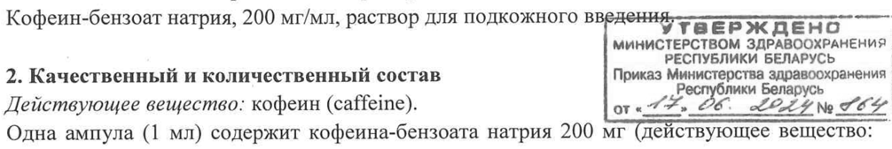

# Кофеин-бензоат натрия — парентерально

- Препарат: Кофеин-бензоат натрия (раствор для подкожного введения)
- АТХ: N06BC01
- Источник: ОХЛП, Единый реестр ЛС ЕАЭС, запись 61a9ada5fb44f130afbeb80b, документ от 2026-09-14
- Распознано автоматически (OCR): 7 из 7 стр.
- Сомнительных строк после OCR: 1 (см. раздел «Проверка распознавания»)

## Общие сведения

, i a от 26.03.2026 № 16848 ОБЩАЯ ХАРАКТЕРИСТИКА ЛЕКАР ТВЕНН or ant РЕН AP ATA 0012)

## 1. Наименование лекарственного препарата

Кофеин-бензоат натрия, 200 мг/мл, раствор для подкожного eS =
МИНИСТЕРСТВОМ ЗДРАВООХРАНЕНИЯ , РЕСПУБЛИКИ БЕЛАРУСЬ

## 2. Качественный и количественный состав

Приказ Министерства здравоохранения | хе р Р лики Беларусь

Действующее вещество: кофеин (caffeine). ore AED LOLLY № SOF!
Одна ампула (1 мл) содержит кофеина-бензоата натрия 200 мг (действующее вещество: | кофеин 80 мг, вспомогательное вещество: натрия бензоат 120 мг).
Полный список вспомогательных веществ приведен в разделе 6.1.

## 3. Лекарственная форма

Раствор для подкожного введения.
Прозрачная бесцветная или слегка желтоватого цвета жидкость.

## 4. Клинические данные

## 4.1. Показания к применению

Вспомогательное средство при угнетении дыхания (в Т.ч. при легких отравлениях наркотическими анальгетиками и снотворными лекарственными препаратами, оксидом углерода) и восстановлении легочной вентиляции после использования общей анестезии.
Препарат применяется у взрослых и подростков (12-18 лет).
Для лечения и профилактики апноэ у новорожденных и у детей грудного возраста в послеоперационном периоде применяется кофеин или кофеина цитрат, но не кофеинбензоат натрия (см. раздел 4.4).

## 4.2. Режим дозирования и способ применения

Режим дозирования Взрослые Подкожно по 0.5-1 мл раствора (100-200 мг).
Максимальная однократная доза — 400 мг, максимальная суточная доза — 1000 мг.
Особые группы пациентов Пациенты пожилого возраста
Нет данных о необходимости коррекции дозы у пациентов пожилого возраста. У пациентов пожилого возраста препарат следует применять с осторожностью (см. раздел 4.4).
Пациенты с почечной недостаточностью У пациентов с почечной недостаточностью рекомендуется снижение дозы препарата.
Пациенты с печеночной недостаточностью У пациентов с печеночной недостаточностью рекомендуется снижение дозы препарата.
Дети Подкожно детям с 12 лет (в зависимости от возраста) по 0.25-1 мл раствора (25-100 мг).
Безопасность и эффективность у детей до 12 лет не установлены.
| | СООТВЕТСТВУЕТ ЭКСВЕРТНОМУ СТУЕТУ (ПОСЛЕДНИИ оборотня
Способ применения Республики Беларусь

Подкожно.

Препарат применяется только под наблюдением врача.

Оптимальная длительность лечения не установлена.

Нет данных о наличии либо отсутствии синдрома отмены и/или привыкания при

применении кофеина-бензоата натрия.

## 4.3. Противопоказания

Препарат противопоказан в следующих случаях:

. гиперчувствительность к действующему веществу или любому из вспомогательных веществ, перечисленных в разделе 6.1;

. . гиперчувствительность к другим ксантинам;

. тревожные расстройства (агорафобия, панические расстройства);

. органические заболевания сердечно-сосудистой системы (в т.ч. острый инфаркт миокарда), пароксизмальная тахикардия, частая желудочковая экстрасистолия, артериальная гипертензия;

. нарушения сна;

беременность, период лактации;

* старческий возраст.

## 4.4. Особые указания и меры предосторожности при применении

Влияние на центральную нервную систему зависит от типа нервной системы и может

проявляться как возбуждением, так и торможением высшей нервной деятельности.

В связи с тем, что действие кофеина на артериальное давление складывается из

сосудистого и кардиального компонентов, в результате может развиваться как эффект

стимуляции сердца, так и угнетение (слабое) его деятельности.

Для лечения и профилактики апноэ у новорожденных и у детей грудного возраста в

послеоперационном периоде применяется кофеин или кофеина цитрат, но не кофеин-

бензоат натрия (см. раздел 4.2).

С осторожностью следует применять Кофеин-бензоат натрия у пациентов с

’ глаукомой; повышенной возбудимостью; пожилого возраста; эпилепсией и склонностью к

судорожным припадкам; язвенной болезнью желудка и двенадцатиперстной кишки в

анамнезе (в связи с повышенным риском обострения язвенной болезни).

Препарат содержит натрий

Данный лекарственный препарат содержит менее | ммоль натрия (23 мг) на ампулу, то

есть практически не содержит натрия.

## 4.5. Взаимодействие с другими лекарственными препаратами и другие виды взаимодействия

взаимодействия |

Кофеин является антагонистом аденозина.

При совместном применении кофеина и барбитуратов, примидона, противосудорожных

препаратов (производные гидантоина, особенно фенитоин) возможно усиление

метаболизма и увеличение клиренса кофеина.

При совместном применении кофеина и циметидина, пероральных контрацептивных

препаратов, дисульфирама, ципрофлоксацина, норфлоксацина отмечается снижение

СООТВЕТСТВУЕТ ДЕР р PFBRTY _ От 26.08.2026 № 16848 - метаболизма кофеина в печени (замедление его BBIBE Нении ‘увеличение Outer bantu B ic
Мексилетин снижает выведение кофеина до 50%. МИНИСТЕРСТВОМ ЗДРАВООХРАНЕНИЯ
РЕСПУБЛИКИ БЕЛАРУСЬ

Никотин увеличивает скорость выведения кофеина. Приказ Министерства здравоохранения
При совместном применении больших доз кофеина| с_ ийРибии БВЯРУСЬМА.О фуразолидоном, прокарбазином и селегилином могут наблюдаться опасные аритмии или выраженное повышение артериального давления. |
Кофеин снижает всасывание препаратов кальция в желудочно-кишечном тракте.
Кофеин снижает эффект наркотических и снотворных лекарственных препаратов.
Кофеин увеличивает выведение препаратов лития с мочой.
Препарат ускоряет всасывание и усиливает действие сердечных гликозидов, повышает их
ТОКСИЧНОСТЬ.
Совместное применение кофеина с В-адреноблокаторами может приводить к взаимному подавлению терапевтических эффектов; с адренергическими бронхорасширяющими препаратами — к дополнительной стимуляции центральной нервной системы и другим аддитивным токсическим эффектам.
При одновременном применении с ацетилсалициловой кислотой, парацетамолом, эрготамином кофеин увеличивает их биодоступность, усиливая тем самым эффект.
Кофеин может снижать клиренс теофиллина и, возможно, других ксантинов, увеличивая возможность аддитивных фармакодинамических и токсических эффектов.
Противогрибковые лекарственные препараты (кетоконазол, флуконазол) замедляют метаболизм кофеина и повышают его концентрацию в плазме.

## 4.6. Фертильность, беременность и лактация

Препарат противопоказан при беременности и в период лактации.
Во время беременности наблюдается медленная элиминация кофеина из организма плода.
Чрезмерное употребление кофеина во время беременности может приводить к спонтанным абортам, замедлению внутриутробного развития плода, аритмии у плода;
возможны нарушения развития скелета при использовании больших доз и замедление развития скелета на фоне меньших доз.
Кофеин и его метаболиты проникают в молоко матери в незначительных количествах, но накапливаются у грудных детей и могут вызывать гиперактивность и бессонницу.
4.7. Влияние на способность управлять транспортными средствами и работать с механизмами
При применении в высоких дозах кофеин затрудняет концентрацию внимания и увеличивает число операторских ошибок при выполнении работ, сопряженных с необходимостью концентрации внимания.

## 4.8. Нежелательные реакции

Частота нежелательных реакций неизвестна (невозможно оценить по имеющимся данным).
Нарушения со стороны нервной системы: возбуждение, тревожность, тремор, беспокойство, головная боль, головокружение, эпилептические припадки, усиление рефлексов, тахипноэ, бессонница.
Нарушения со стороны сердца: сердцебиение, тахикардия, аритмии.

СООТВЕТСТЕ ия РЖ Ae ЧЕ Г

MN-#O01 4B3-PT АСЕ онения Нарушения со стороны сосудов: повышение артериального qT ослублики Баларуь |
Нарушения со стороны желудочно-кишечного тракта: тошнота, рвота, обострение язвенной болезни.
Нарушения психики: при длительном применении — привыкание, лекарственная зависимость.
Нарушения со стороны дыхательной системы, органов грудной клетки и средостения:
заложенность носа.
Сообщение о подозреваемых нежелательных реакциях
Важно сообщать о подозреваемых реакциях после регистрации лекарственного препарата с целью обеспечения непрерывного мониторинга соотношения «пользы — риска»
лекарственного препарата. Медицинским работникам рекомендуется сообщать о подозреваемых нежелательных реакциях лекарственного препарата через национальные системы сообщения о нежелательных реакциях государств-членов Евразийского экономического союза.
Республика Беларусь 220037, г. Минск, Товарищеский пер., 2а
УП «Центр экспертиз и испытаний в здравоохранении»
Телефон отдела фармаконадзора: +375 (17) 242-00-29
Факс: +375 (17) 242-00-29 Электронная почта: rcpl@rceth.by, reeth@rceth.by
Сайт: https://www.rceth.by | Российская Федерация 109012, г. Москва, Славянская площадь, д. 4, стр. 1
Федеральная служба по надзору в сфере здравоохранения (Росздравнадзор)
Телефон: +7 (800) 550-99-03 Электронная почта: pharm@roszdravnadzor.gov.ru
Сайт: https://www.roszdravnadzor.gov.ru Республика Казахстан 010000, г. Астана, ул. А. Иманова, 13 (БЦ «Нурсаулет 2»)
РГП на ПХВ «Национальный центр экспертизы лекарственных средств и медицинских изделий» КМ и ФК МЗРК
Телефон: +7 (7172) 78-98-28 Электронная почта: farm@dari.kz
Сайт: http://www.ndda.kz Республика Кыргызстан 720044, г. Бишкек, ул. 3-я линия, 25
Департамент лекарственных средств и медицинских изделий при Министерстве здравоохранения Кыргызской Республики
Телефон: + 996 (312) 21-92-88 Электронная почта: dismi@pharm.kg
Сайт: https://www.pharm.kg

TJ THE DR 3 [MN-W200 4 6 ООГРЕВУТВУБЖАЕРНВЫМ УДОБРЕНИЯ от 24.08. ?ОРЕСПУБЛИКИЧВЕЛАРУСЬ

## 4.9. Передозировка

(ПОСЛЕД ро ранения

Симптомы интоксикации возникают при введении кофеина в дозе более 300 мг/сут. —
Возможно появление тревоги, беспокойства, тремора, головной боли, спутанности сознания, тахиаритмии. У новорожденных детей при концентрации в крови более 50 мкг/мл кофеина кроме вышеописанных симптомов возможно патологическое усиление рефлексов, появление судорожного синдрома.
Специфического антидота не существует. Меры помощи включают отмену лекарственного препарата‚ поддерживающую и симитоматическую — терапию, направленную на устранение возникших нарушений, контроль уровня артериального давления и купирование судорожного синдрома введением транквилизаторов бензодиазепинового ряда (диазепам).

## 5. Фармакологические свойства

## 5.1. Фармакодинамические свойства

Фармакотерапевтическая группа: психостимуляторы, препараты для лечения синдрома дефицита внимания и гиперактивности и ноотропные средства. Производные ксантина.
Код ATX: №06ВСО1.
Обладает психостимулирующими и аналептическими свойствами.
Механизм действия связан со способностью кофеина выступать в роли конкурентного антагониста пуриновых A; и А»›л-рецепторов. В результате блокады рецепторов уменьшаются процессы торможения в центральной нервной системе, облегчается и стабилизируется секреция нейромедиаторов (серотонина, норадреналина и дофамина) в моторных зонах коры головного мозга, гипоталамуса продолговатого мозга. В дозах близких к токсическим кофеин способен блокировать активность фосфодиэстераз
(преимущественно Ш, ТУ типов) и замедлять распад цАМФ и цГМФ, что стимулирует активность нейронов и ускоряет обмен веществ в клетке.
Усиление дофаминергической передачи в синапсах коры головного мозга оказывает психостимулирующее воздействие. Активация адренергической передачи в синапсах гипоталамуса и продолговатого мозга активирует корковые функции, повышает физическую активность, вызывает анорексию, оказывает тонизирующее воздействие на сосудодвигательный центр. Усиление холинергической передачи в синапсах коры и продолговатого мозга активирует корковые функции, повышает активность дыхательного центра.
Кофеин оказывает прямое возбуждающее влияние на центральную нервную систему:
стимулирует психическую деятельность, повышает умственную и физическую работоспособность, укорачивает время реакции, активирует положительные условные рефлексы. После введения кофеина появляется бодрость, временно уменьшаются или устраняются утомление и сонливость. У пожилых людей влияние на сон более выражено:
замедляется наступление сна, уменьшается общее время сна и возрастает частота ночных пробуждений.
На фоне угнетения дыхательного центра вызывает учащение и углубление дыхания.
Влияет на сердечно-сосудистую систему: повышает частоту и силу сердечных сокращений, при гипотензии повышает артериальное давление (АД) (на нормальный уровень АД не влияет). У недоношенных детей устраняет периодическое дыхание за счет снижения парциального давления углекислого газа в крови, увеличивает объем вентиляции, не влияя существенно на функцию сердечно-сосудистой системы.
УТВЕЕ а ПП-#00 | WSS oR ERC Taye ианиатнетьом адлдввонеуя
— — 26 Lp abies amore Расслабляет гладкую мускулатуру бронхов, желчный Шутей; нывывает PEbHMMBnsHey LOB скелетных мышц, сердца и почек, суживает сосуды органов брюшной полости (особенно = при исходной их дилятации). Оказывает слабое диуретическое действие за счет расширения почечных сосудов и торможения реабсорбции электролитов в почечных канальцах.
Снижает агрегацию тромбоцитов. Стимулирует секрецию желез желудка.
Повышает основной обмен, усиливает гликогенолиз, вызывая гипергликемию.

## 5.2. Фармакокинетические свойства

После подкожного введения всасывается быстро и полно. Хорошо проникает через все гистогематические барьеры, распределяясь по органам и тканям. Проникает через гематоэнцефалический и гематоплацентарный барьеры. Концентрации в ликворе и околоплодной жидкости сопоставимы с концентрациями кофеина в плазме крови. В слюне концентрация кофеина составляет 65-85% его концентрации в плазме.
После введения подвергается интенсивному метаболизму в печени с образованием диметил- и монометилксантинов, диметил- и монометилмочевой кислоты, триметил- и диметилаллантоина, производных уридина. Основной путь метаболизма — образование под влиянием изоформы цитохрома Р450 CYP1A2 диметилксантинов (теофиллина, параксантина), обладающих фармакологической активностью (72-80% введенной дозы).
Период полуэлиминации (Т!/2) кофеина составляет 2.5-4.5 4, у новорожденных в связи с низкой ферментативной активностью микросомальных ферментов элиминация кофеина замедлена, Т\/› составляет 80423 4, в возрасте 3-5 месяцев он уменьшается до 14.4 чив 5-6 месяцев становится равным показателям взрослого человека. Общий клиренс кофеина у взрослого человека составляет 155 мл/кг/ч, у новорожденного ребенка он равен 31 мл/кг/ч.
У курящих лиц наблюдается уменьшение периода полуэлиминации кофеина на 30-50% по сравнению с некурящими лицами.
Выделяется кофеин преимущественно с мочой в виде метаболитов. 10% введенной дозы выделяется в неизмененном виде.
5.3. Данные доклинической безопасности
| Нет данных.

## 6. Фармацевтические свойства

6.1. Перечень вспомогательных веществ
Натрия бензоат, натрия гидроксид, вода для инъекций.

## 6.2. Несовместимость

Не применимо.

## 6.3. Срок годности (срок хранения)

5 лет.
6.4. Особые меры предосторожности при хранении
Хранить при температуре не выше 25°С.
от 26 Дия #13 ЭФ ЗДРАВООХРАНЕНИЯ

6.5. Характер и содержание первичной упаковки (ПОСЛЕДОВАТЕ РЕСВУБЛИКИ, SEPP —
По 1 мл в ампулах из бесцветного стекла.
10 ампул вместе с листком-вкладышем по медицинскому применению помещают в коробку из картона с гофрированным вкладышем из бумаги для гофрирования (№10).
10 ампул вместе с листком-вкладышем по медицинскому применению помещают в пачку из картона с картонным вкладышем для фиксации ампул (№10).
6.6. Особые меры предосторожности при уничтожении использованного лекарственного препарата или отходов, полученных после применения лекарственного препарата, и другие манипуляции с препаратом
Нет особых требований к утилизации.
Весь оставшийся лекарственный препарат и отходы следует уничтожить в установленном порядке.

## 7. Держатель регистрационного удостоверения

Открытое акционерное общество «Борисовский завод медицинских препаратов»
Республика Беларусь, Минская обл., г. Борисов, ул. Чапаева, 64 e-mail: market@borimed.com тел/факс: +375 (177) 735612, 744280
7.1. Представитель держателя регистрационного удостоверения Ha территории
Союза Открытое акционерное общество «Борисовский завод медицинских препаратов»
Республика Беларусь, Минская обл., г. Борисов, ул. Чапаева, 64 e-mail: market@borimed.com тел/факс: +375 (177) 735612, 744280

## 8. Номер регистрационного удостоверения

ЛП-№001483-РГ-ВУ

## 9. Дата первичной регистрации

(подтверждения регистрации, перерегистрации)

Дата первичной регистрации (Республика Беларусь): 25.08.1998 г.
Дата последнего подтверждения регистрации (Республика Беларусь): 15.08.2018 г.
10. Дата пересмотра текста
Общая характеристика лекарственного препарата Кофеин-бензоат натрия доступна на официальном сайте уполномоченного органа государства-члена Евразийского союза в информационно-коммуникационной сети «Интернет» www.rceth.by и (или) на информационном портале Евразийского экономического союза в информационнокоммуникационной сети «Интернет»
http://portal.eaeunion.org/ru-ru/public/main.aspx.
## Проверка распознавания

Страницы-сканы распознаны автоматически. В 1 строках с дозировками цифры могли распознаться с ошибкой — сверьте с вырезкой из оригинала:

- стр. 1: «Кофеин-бензоат натрия, 200 мг/мл, раствор для подкожного eS =» — повторное чтение: «ae —-»  
  
