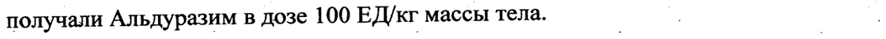
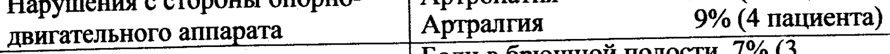

# Ларонидаза — парентерально

- Препарат: Альдуразим® (концентрат для приготовления раствора для инфузий;)
- АТХ: A16AB05
- Источник: ГРЛС, инструкция по медицинскому применению, РУ ЛСР-003818/08, файл от  (https://grls.rosminzdrav.ru/Grls_View_v2.aspx?routingGuid=22c8e33b-47cd-4184-b4f7-ba04bc003102)
- Распознано автоматически (OCR): 18 из 18 стр.
- Инструкция к другому РУ того же препарата: ЛСР-003818/08 (срок действия истёк, решение от 16.12.2019). Текст может быть старше действующего
- Сомнительных строк после OCR: 3 (см. раздел «Проверка распознавания»)

## Общие сведения

о | ЛСР-003818/08-190508 | | _ ИНСТРУКЦИЯ | |
| | по применению препарата АЛЬДУ РАЗИМ®
| 'Регистрационный номер | р | | Наименование лекарственного препарата
_ Альдуразим® | | | | | = Международное непатентованное наименование
Ларонидаза Химическое название | | _ Рекомбинантная человеческая альфа-Г.- идуронидаза (rhIDU)

## 3. Лекарственная форма

Концентрат для приготовления раствора для инфузий
Концентрат для приготовления раствора для инфузий
= — Состав о а a _ Каждый флакон 5 мл содержит:
_ Действующее вещество: ларонидаза — 500 ЕД (+ избыток наполнения 30
ЕД); вспомогательные вещества: натрия хлорид; натрия фосфат однозамещенный, моногидрат; натрия фосфат двузамещенный, гептагидрат; полисорбат-80; вода для инъекций. | |
В | мл раствора содержится 100 ЕД (приблизительно 0,58 мг) ларонидазы.
Единица активности (ЕД) определяется как гидролиз одного микромоля субстрата метилумбеллиферона (4-MUI - methylumbelliferone) за минуту. |
Ларонидаза является рекомбинантной формой человеческой альфа-Гидуронидазы и производится с помощью oma
ЛСР-003818/08-190508 | ДНК с использованием клеточной культуры яичника китайского хомячка |
(Chinese Hamster Ovary - CHO). | | | Описание о Прозрачная или слегка опалесцирующая, бесцветная или бледно-желтого цвета жидкость. |
Фармакотерапевтическая группа | Фармакотерапевтическая группа: Пищеварительный тракт и продукты | метаболизма - ферменты.
Код АТХ: А16АВО5.
Фармакологические свойства | Фармакодинамика
| Причиной болезней накопления мукополисахаридов является недостаточность специфических лизосомальных ферментов, необходимых для катаболизма гликозаминогликанов (ГАГ). МПС-1 (мукополисахаридоз
Г) является гетерогенным и поражающим различные органы и системы | г заболеванием, характеризующимся недостаточностью альфа-Г.- ( — идуронидазы, лизосомальной гидралазы, которая катализирует гидролиз
| терминальных остатков альфа-Г-идуроновой кислоты дерматан сульфата и гепаран сульфата. Снижение или отсутствие активности альфа-Т-- идуронидазы приводит к накоплению ГАГ (дерматан сульфата и гепаран сульфата) в разных типах клеток и тканей.
Ферменто- заместительная терапия предназначена для восстановления уровня энзиматической активности, достаточного для гидролиза накопленных субстратов и для предотвращения их дальнейшего
2 Jf P2zccny””
ЛСР-003818/08-190508 накопления. После внутривенного введения ларонидаза быстро покидает |
| системный кровоток и поглощается клетками, поступая в их лизосомы, повидимому, через маннозо-6-фостатные рецепторы.
Очищенная ларонидаза является гликопротеином с молекулярным весом, ..
| ‚составляющим приблизительно 83 килодальтона. После расщепления о
° ларонидазы по М-окончаниям в ее составе обнаруживается 628 . _ аминокислотных остатков. Ee молекула содержит 6 сайтов (участков), связывающихся через аминогруппу (М-группу) с разными по структуре
’ олигосахаридами. | Было произведено три клинических испытания с Альдуразимом для доказательства его эффективности и безопасности. Два клинических | исследования были сфокусированы в основном на оценке влияния | препарата Альдуразим на такие системные проявления МПС I, как гепатомегалия, ограничение подвижности суставов, рестриктивное 7 поражение легких, обструкция верхних дыхательных путей и глазная патология. Целью исследования на пациентах младше пяти лет было в основном изучить безопасность и фармакокинетику Альдуразима, но —
=> также были проведена оценка на безопасность. На настоящий момент (о клинические данные, демонстрирующие благоприятное воздействие препарата на неврологические проявления данного заболевания, отсутствуют. | | |
Безопасность и эффективность Альдуразима была оценена в | рандомизированном, двойном-слепом, плацебо контролируемом клиническом исследовании, фазы 3, проведенном у 45 пациентов в возрасте от 6 до 43 лет. Хотя в исследование были включены пациенты, представляющие полный спектр этого заболевания, большинство
_ вошедших в него пациентов имели промежуточный фенотип, и только у одного пациента имел место тяжелый фенотип. В, исследование
3 Yi Е 2 2 a
| ЛСР-003818/08-190508 включались пациенты сФЖЕЛ (форсированной жизненной емкостью легких) менее 80% от расчетного нормального значения ФЖЕЛ
(рассчитанной исходя из роста пациента), способные стоять в течение 6-ти минут и проходить 5 метров. | |
Пациенты еженедельно получали или Альдуразим в дозе 100 ЕД/кг массы —
: тела или плацебо в общей сложности в течение 26 недель. Главной конечной точкой (показателем) эффективности были изменения процента | |
ФЖЕЛ от расчетного нормального значения ФЖЕЛ и абсолютное значение
_ расстояния, преодолеваемого во время теста с шестиминутной ходьбой. По
| завершении программы этого. клинического исследования фазы 3 все
> пациенты последовательно включались в открытое продолжение данного клинического исследования, в время которого они все еженедельно получали Альдуразим в дозе 100 ЕД/кг массы тела. 7 -
_ После 26-ти недель лечения в группе пациентов, получавших Альдуразим,
: по сравнению с пациентами, получавшими плацебо, имелось улучшение | дыхательной функции в среднем на 5,6 процентов, оцениваемое по изменению процента ФЖЕЛ от расчетного нормального значения ФЖЕЛ. | |
В отношении способности к ходьбе, оцениваемой с помощью теста с
Ze шестиминутной ходьбой, было продемонстрировано увеличение В проходимого расстояния в среднем на 38,1 метра по сравнению с группой
_ пациентов, получавших плацебо. | | Последующие 50 недель лечения в рамках открытого продолжения этого исследования улучшение ФЖЕЛ сохранялось. Было продемонстрировано | дальнейшее увеличение способности к ходьбе: по сравнению с исходом проходимое за 6 минут расстояние увеличивалось в среднем на 42,9 метра.
ES eS 26 недель лечения исследования фазы 3, всего 50 недель лечения
В сравнении с плацебо В сравнении с плацебо
ОЕ „| РТ р ный интервал р ный интервал ‘ -7 А LO me
| | ЛСР-003818/08-190508 | О ЕС ee ee ию
(прощенты)_ [Медиана [3.0 [0,009 [09-86 [Menmana[3.4 [| о В О eee ee шестиминут 1 ea
_ Юиетры) | 5 У 80% пациентов, у которых имелось увеличение размеров печени в | исходе, наблюдалась нормализация ее размеров. Происходило быстрое (за | первые 4 недели) уменьшение выделения ГАГ с мочой, которое
| сохранялось на протяжении всего оставшегося времени исследования. К 50-ой неделе наблюдалось уменьшения содержания ГАГ в моче в среднем хо "648% | | | |
Во время исследования не было получено значимого улучшения в
| используемых показателях качества жизни. Эти показатели He были . |
| специально адаптированными для пациентов с МПС I. |
7 BITT (пуеп-ю-теа-популяции (в группе пациентов, распределенных для получения лечения и получивших хотя бы одну дозу изучаемого |
® препарата) He было продемонстрировано значимого улучшения индекса апноэ-гипопноэ и объема движений в суставах. Однако данное не было | о Достаточно мощным (по количеству пациентов) для выявления |
© достоверности различий по этим вторичным показателям эффективности,
| и ктому же многие пациенты в исходе имели нормальные значения этих
| показателей.
` Фаза 2 открытого одногодового исследования была проведена в основном для оценки безопасности и фармакокинетики Альдуразима на 20 пациентах в возрасте младше 5 лет на момент проведения (16 пациентов имели тяжелую форму заболевания, тогда как 4-ую форму со средней
| степенью тяжести). Все пациенты получали Альдуразим в дозировке 100
Единиц на | кг еженедельно посредством инфузий в течении 52 недель, кроме 4 пациентов, для которых доза была увеличена до 200 Единиц на кг
| ЛСР-003818/08-190508 начиная с 26 недели исследования. Исследование было проведено до конца |
| на 18 пациентах, 2 пациента скончались в результате сердечной недостаточности и остановки дыхания, соответственно, что не было связано с лечением.
| Был зафиксирован резкий спад уровня ГАГ в моче к 13 неделе исследования, после чего уровень был восстановлен. В среднем уровень |
° ‚спада составил 61,3%. Объем печени всех пациентов по оценке | клинического обследования был классифицирован как намного превышающий средний уровень. У 9 пациентов из 18, которые проходили |
- обследование, объем печени был снижен до нормального уровня к 52 |
© неделе, у остальных пациентов наблюдалось уменьшение объема печени.
Эхокардиография показала легкое снижение массы левого желудочка (у 10 пациентов со средней степенью левосторонней желудочковой гипертрофии, у 7 пациентов показатели пришли в норму к 52 неделе | лечения), но средний уровень фракционного выброса также снизился, оставаясь тем не менее в пределах нормы. Были зафиксированы некоторые 7 клапанные изменения. У более молодых пациентов с тяжелой формой
МПС 1 иу пациентов со средней формой тяжести наблюдалось увеличение показателей (рости вес), которые приблизились к нормам, | e также было зафиксировано улучшение в умственном развитии адаптивном поведении. В свою очередь у больных более старшего возраста с более тяжелой формой МПС 1 улучшений не наблюдалось. |
| Фармакокинетика Определение фармакокинетических показателей проводилось на 1-ой, 12ой и 26-ой неделе после внутривенного введения ларонидазы в дозе 100
ЕД/кг массы тела при продолжительности инфузии, составляющей 240 минут.
- ЛСР-003818/08-190508
Tlonasaress | Инфузия1 | Инфия — ГИнфузия 26 =
| Средняя + SD Средняя + SD Средняя + SD
(стандартное (стандартное (стандартное отклонение отклонение отклонение 0,197 + 0,052 0,210 + 0,079 0,302 + 0,089 0,930 + 0,214 0,913 + 0,445 1,191 + 0,451 час*ЕД/мл = 1,96 + 0,495 2,31 + 1,13 1,68 + 0,763 мл/имин/кг | |
` | Увбикр 10,604 + 0,172 0,307 + 0,143 0,239 + 0,128
| Узз (л/кг) | 0,440 + 0,125 0,252 + 0,079 0,217 + 0,081 3,61 = 0,894 [2.02 + 126 | 1,94 + 1,09 -
С течением времени наблюдалось увеличение Cmax (максимальной |
| плазменной концентрации). По мере продолжения лечения происходило
& уменьшение объема распределения, по-видимому, связанное с | образованием антител и/или уменьшением размеров печени.
Фармакокинетический профиль пациентов младше 5 лет соответствовал профилю пациентов старшего возраста с меньшей степенью тяжести | заболевания. | |
Ларонидаза является протеином, поэтому ожидается, что она будет метаболически разлагаться с путем пептидного гидролиза. В связи с этим не ожидается, что нарушении функции печени окажет влияние Ha |
_ фармакокинетику ларонидазы в клинически значимой степени. Выделение |
: ларонидазы почками рассматривается как малозначимый путь выведения.
_ Смотри раздел "Режим дозирования и способ применения".

## 4.1. Показания к применению

Альдуразим показан для проведения долгосрочной ферментозаместительной терапии у пациентов с подтвержденным диагнозом мукополисахаридоза 1 (МИС-Т, недостаточности альфа-Г.-идуронидазы)
Альдуразим показан для проведения долгосрочной ферментозаместительной терапии у пациентов с подтвержденным диагнозом мукополисахаридоза 1 (МИС-Т, недостаточности альфа-Г.-идуронидазы)
для лечения не-неврологических проявлений этого заболевания (см. раздел
"Фармакодинамика").
ЛСР-003818/08-190508 Противопоказания | | |
Тяжелые реакции гиперчувствительности (такие как анафилактические реакции) на активное вещество или любой дополнительный ингредиент препарата (см. разделы "Особые указания и меры предосторожности" и
| "Побочные эффекты").
° Беременность и лактация a — | Отсутствуют данные по использованию Альдуразима у беременных женщин. Исследования у животных не выявили прямых или косвенных неблагоприятных влияний на беременность, эмбриональное/фетальное |
>. развитие, роды и постнатальное развитие (смотри раздел "Доклинические данные"). Потенциальный риск для человека не известен.
Альдуразим не следует применять при беременности без очевидной необходимости. Ларонидаза может выделяться с материнским молоком.
Так как нет доступных данных касающихся новорожденных, получающих ларонидазу с молоком матери, рекомендуется во время лечения 7 ‘
Альдуразимом прекратить кормление грудью.

## 4.2. Способ применения и дозы

| | | = Лечение Альдуразимом должно проводиться под наблюдением врача, © имеющего опыт лечения пациентов с MIIC-I или с другими
| | | = Лечение Альдуразимом должно проводиться под наблюдением врача, © имеющего опыт лечения пациентов с MIIC-I или с другими
| наследственными метаболическими заболеваниями. Введение |
Альдуразима должно проводиться в соответствующей клинической обстановке, при наличии оснащения, необходимого для оказания экстренной медицинской помощи. | |
Рекомендованный режим дозирования Альдуразима: еженедельное введение в дозе 100 ЕД/кг массы тела в виде внутривенной инфузии.
Начальная скорость введения, составляющая 2 ЕД/кг/час, при хорошей переносимости может постепенно увеличиваться каждые пятнадцать минут, максимально до 43 ЕД/кг/час. Весь необходимый объем раствора или
| ЛСР-003818/08-190508 о должен быть введен приблизительно в течение 3-4 часов. Для получения.
информации о проведении премедикации смотри раздел "Особые указания = и меры предосторожности", а для получения дополнительных инструкций смотри раздел "Инструкции по использованию и обращению с препаратом". | | |
’ Безопасность и эффективность Альдуразима у пациентов старше 65 лет не определялись, в связи с чем для пациентов этих возрастных групп не могут быть даны рекомендации по режиму дозирования. |
«> Безопасность и эффективность Альдуразима у пациентов с почечной и печеночной недостаточностью не определялись, в связи с чем не могут быть даны рекомендации по режиму дозирования у.таких пациентов. .

## 4.8. Побочное действие

В представленной ниже таблице перечислены нежелательные реакции на 7 препарат (НРП) для Альдуразима, сгруппированные по системам органов, о которых сообщалось во время клинического исследования фазы 3, в которое было включено 45 пациентов в возрасте 5 лет и старше, | eS получавших лечение до 12-ти месяцев. НРП были представлены в виде о
В представленной ниже таблице перечислены нежелательные реакции на 7 препарат (НРП) для Альдуразима, сгруппированные по системам органов, о которых сообщалось во время клинического исследования фазы 3, в которое было включено 45 пациентов в возрасте 5 лет и старше, | eS получавших лечение до 12-ти месяцев. НРП были представлены в виде о

процента пациентов, у которых развилась данная НРП, с указанием в

скобках абсолютного количества пациентов. Почти все НРП были легкой |

или умеренной степени тяжести.

Нарушения с стороны опорно- Артропатия 11% (5 пациентов)
двигательного аппарата Артралгия 9% (4 пациента)
Нарушения со стороны Боли в брюшной полости 7% (3 желудочно-кишечного тракта пациента)

Боли в спине 7% (3 пациента Нарушения со стороны Головная боль 7% (3 пациента)
центральной и периферической нервной системы
Нарушения со стороны кожи и ее | Сыпь 9% (4 пациента)

| ридатков Сосудистые (внекардиальные) Гиперемия 13% (6 пациентов) | | расстройства
9 Ко
И к 2 ЛСР-003818/08-190508 В представленной ниже таблице перечислены нежелательные реакции на препарат (НРП) для Альдуразима, сгруппированные по системам _ органических классов, о которых сообщалось во время клинического исследования фазы 2, в которое было включено 20 пациентов в возрасте до
| 5 лет и в основном с тяжелой формой фенотипа, получавших лечение до
| _ 12-ти месяцев. НРИ были представлены в виде процента пациентов, у.
которых развилась данная HPI, с указанием в скобках абсолютного | о количества пациентов. Все НРП были умеренной или легкой степени —
| тяжести.
&- . . | _ (7 пациента)
| Озноб 20% (4 пациента | Снижение насыщенности кислородом
, 10% (2 пациента , Приблизительно у трети пациентов имели место связанные с инфузией
| реакции (СИР). С течением времени количество этих реакций | уменьшалось. Большинство СИР были легко выраженными. У 2 пациентов |
Se ° наиболее часто встречающимися реакциями во время 3 фазы исследования были гиперемия, головная боль, повышение температуры, СЫПЬ,

_ гипотензия, боль в брюшной полости и диарея. В течении 2 фазы | исследования наблюдались повышение температуры, озноб, тахикардия, увеличение давления и снижение насыщенности кислородом . У одного пациента, участвовавшего в 3 фазе исследования, и имеющего в исходе | патологию дыхательных путей через 3 часа после начала инфузии (на 62 неделе лечения) развилась тяжелая реакция в виде крапивницы и обструкции дыхательных путей, потребовавшая наложения трахеостомы.

У трех пациентов во время клинического исследования фазы 1/2
| наблюдалось развитие ангионевротического отека.
10 > ЛСР-003818/08-190508 Постмаркетинговый опыт связанных с инфузией реакций состоял в
‘регулярных сообщениях о развитии лихорадки, озноба, рвоты, главным | | образом легко или умеренно выраженных. Кроме того, у нескольких пациентов, имевших предшествующий анамнез тяжелого MIIC Ic
_ поражением дыхательных путей и легких, наблюдалось развитие тяжелых
_ реакций, включая бронхоспазм, остановку дыхания и отек лица (смотри раздел "Особые указания и меры предосторожности"). |
Практически у всех пациентов наблюдалось образование антител класса
IgG к ларонидазе. У большинства пациентов применялась сероконверсия в |
«® течении 3 месяцев после начала лечения. Также сероконверсия была проведена у пациентов младше 5 лет с более тяжелой формой заболевания в течении 1 месяца { в среднем 25,8 дней, у пациентов 5 лет и старше- в течении 52,6 дня). Все серопозитивные пациенты были протестированы на in vitro нейтрализующие эффекты. У двух пациентов, участвовавших в 3
| фазе исследования и 1 пациента, участвовавшего в фазе 2, у которых.
наблюдалось образование антител класса IgG к ларонидазе, после 12 недель лечения Альдуразимом отсутствовали антитела, поддающиеся выявлению. Все пациенты, у которых наблюдалась реакция (59 человек) | 2 были протестированы на ингибиторную нейтрализующую активность in vitro. Четверо пациентов (трое во время фазы 3 и один из фазы 2)
продемонстрировали незначительную ингибиторную нейтрализующую активность in vitro, которая, по-видимому, не оказывала влияния на |
_ клиническую эффективность и/или снижение ГАГ в моче. Наличие антител, по-видимому, не влияет на частоту возникновения связанных с инфузией реакций. Однако, в связи с редкостью данного состояния и ограниченностью опыта, накопленного к сегодняшний день, в настоящее время полностью не определено влияния образования антител на безопасность и эффективность лечения. Образование антител класса IgE B полной мере не исследовано.
и , yt (Reecesene, om, ЛСР-003818/08-190508

## 4.9. Передозировка

| —_ | | Не сообщалось ни об одном случае передозировки. | |
| —_ | | Не сообщалось ни об одном случае передозировки. | |

## 4.5. Взаимодействие с другими лекарственными средствами

С данным лекарственным препаратом исследований по взаимодействию не | проводилось. Исходя из метаболизма ларонидазы, она является .
_ маловероятным кандидатом для взаимодействий, опосредуемых через
Цитохром Р450. — | | | > Альдуразим не должен вводиться одновременно с хлорохином или прокаином, так как при этом имеется потенциальный риск нарушения внутриклеточного поглощения ларонидазы. |
Несовместимости | В связи с отсутствием исследований по совместимости, этот препарат не 7 должен смешиваться с другими лекарственными средствами, за исключением указанных в разделе "Инструкции по использованию и | обращению с препаратом". | | |

## 4.4. Особые указания

У пациентов, получающих лечение Альдуразимом, могут развиться связанные с инфузией реакции (СИР), определяемые как любое связанное |
У пациентов, получающих лечение Альдуразимом, могут развиться связанные с инфузией реакции (СИР), определяемые как любое связанное |
| с инфузией нежелательное событие, происходящее или во время инфузии или в течение дня проведения инфузии (см. раздел "Побочные эффекты").
Некоторые связанные с инфузией реакции могут быть тяжелыми (см.
далее).
Пациенты, получающие лечение Альдуразимом, должны быть под постоянным медицинским наблюдением и следует сообщать обо всех случаях возникновения связанных с инфузией реакций, отсроченных
| | | ЛСР-003818/08-190508 ‘реакций И возможных иммунологических реакций. Следует регулярно | определять наличие антител и сообщать о результатах этих исследований.
У пациентов с указаниями анамнеза на предшествующие тяжелые поражения верхних дыхательных путей наблюдались тяжелые связанные с
° _ инфузией реакции (СИР), в связи с чем следует особенно тщательно следить за состоянием этих пациентов, а введение Альдуразима таким
| ° пациентам должно проводиться в соответствующей клинической
° обстановке, при наличии оснащения, необходимого для оказания |
| экстренной медицинской помощи. | > По данным клинического исследования фазы 3 почти у всех пациентов происходило образование антител класса IgG к ларонидазе, в основном в |
_ течение первых трех месяцев от начала лечения. Пациенты, у которых |
‚произошло образование антител или появились симптомы связанных с инфузией реакций, лечение ларонидазой должно проводиться с a осторожностью (см. разделы "Противопоказания" и "Побочные эффекты").
B клиническом исследовании фазы 3 связанные с инфузией реакции обычно нивелировались с помощью уменьшения скорости инфузии и |
Se проведения пациентам премедикации антигистаминными и/или И антипиретиками (парацетамол или ибупрофен), что давало возможность
_ пациенту продолжать лечение. | | | В связи с малым опытом возобновления лечения после длительного перерыва в таких случаях следует соблюдать осторожность в связи с | повышенным риском развития реакций гиперчувствительности.
При начале лечения Альдуразимом или при возобновлении прерванного лечения рекомендуется проведение премедикации (антигистаминными
| средствами и /или антипиретиками) приблизительно за 60 минут до начала инфузии для сведения к минимуму возможности возникновения связанных
© Az acne?
ЛСР-003818/08-190508 с инфузией реакций. При наличии клинических показаний может быть | рассмотрен вопрос о проведении медикаментозной премедикации с | последующей инфузией Альдуразима.
_ В случае развития легких или умеренно выраженных связанных с инфузией реакций следует рассмотреть вопрос о проведении лечения | антигистаминными средствами и парацетамолом/ибупрофеном и/или = уменьшении скорости инфузии в два раза, по сравнению со скоростью инфузии, при которой возникла эта реакция. |
В случае развития однократной тяжелой связанной с инфузией реакции |
> инфузия должна быть прекращена до разрешения симптомов и должен быть рассмотрен вопрос о проведении лечения антигистаминными средствами и парацетамолом/ибупрофеном. Эта инфузия может быть возобновлена с уменьшением скорости введения до 1/2 — 1/4 от скорости введения, при которой эта реакция возникла.
| ` В случае развития повторной умеренно выраженной связанной с инфузией реакции или проведения провокационной пробы после однократной тяжелой связанной с инфузией реакции следует рассмотреть вопрос о проведении премедикации (антигистаминные и парацетамол/ибупрофен |
| < или кортикостероиды), а скорость инфузии должна быть уменьшена до 1/2
| — 1/4 от скорости инфузии, при которой возникла предшествующая реакция. |
Как и при внутривенном введении любого другого белкового препарата возможно развитие тяжелых реакций гиперчувствительности аллергического типа.
При появлении этих реакций рекомендуется немедленное прекращение введения Альдуразима и должно быть начато соответствующее лечение, при котором необходимо следовать современным стандартам оказания экстренной медицинской помощи.
14 7 a | ЛСР-003818/08-190508 Исследований у пациентов с почечной и печеночной недостаточностью не проводилось. | | |

## 6.5. Форма выпуска

Концентрат для приготовления раствора для инфузий, 100 ЕД/мл.
Концентрат для приготовления раствора для инфузий, 100 ЕД/мл.
По 5 мл концентрата для приготовления раствора Для инфузий во флаконах из стекла типа _ I, закрывающиеся пробкой из | силиконизированного хлорбутилкаучука, под алюминиевой обкаткой, на которую надет пластиковый колпачок марки «ЕЫР OFF» из.
- полипропилена. По 1, 10 или 25 флаконов помещают в картонную пачку
> вместе с инструкцией по применению.
| Хранение — о | Хранить при температуре от 2 до 8°С (в холодильнике)

## 6.3. Срок годности

- 7 Невскрытые флаконы: 3 года
- 7 Невскрытые флаконы: 3 года
Разведенные растворы: | < С точки зрения микробиологической безопасности препарат должен быть (о использован сразу же после приготовления. Если препарат не был использован сразу же после приготовления, то он может храниться не | более 24 часов при температуре 2°С - 8°С при условии, что разведение препарата было проведено в контролируемых и валидированных асептических условиях.
Условия отпуска из аптек Лекарственный препарат отпускается только по рецепту врача.
15 ° | ЛСР-003818/08-190508 _ Влияние на способность к управлению автомобилем и использованию | механизмов | | |
Не проводилось исследований по влиянию на способность к управлению автомобилем и использованию механизмов. |
_ Инструкции по использованию и обращению с препаратом | |
Каждый флакон Альдуразима предназначен только для однократного | | | использования. Для приготовления инфузионного раствора концентрат
| должен быть разведен с соблюдением правил асептики инфузионным
| раствором натрия хлорида 9 мг/мл (0.9%). Ведение разведенного раствора
< Альдуразима рекомендуется проводить через систему для внутривенных инфузий с вмонтированным в линию фильтром с диаметром пор 0,2 мкм.
_ Доклинические данные по безопасности | | |
_ Доклинические данные, полученные с помощью исследований по фармакологии безопасности, токсичности однократной дозы, токсичности | повторных доз и репродуктивной токсичности, не выявили особой опасности для человека. Не ожидается наличия у препарата | генотоксического или канцерогенного действия. |
< | | _ _ Инструкции по подготовке инфузии (соблюдайте правила асептики)
=» Определите необходимое для разведения количество флаконов, исходя из индивидуального веса пациента. Извлеките необходимое количество флаконов из холодильника приблизительно на 20 минут раньше для того, чтобы они могли нагреться до комнатной температуры.
» Перед разведением визуально проверьте каждый флакон на наличие твердых частиц или изменение окраски раствора. Прозрачный или
| слегка опалесцирующий, бесцветный или бледно-желтого цвета 16 > Е
| ЛСР-003818/08-190508 _ раствор не должен содержать видимых твердых частиц. Не |
° используйте флаконы, содержащие твердые частицы или имеющие измененную окраску раствора.
= Определите общий объем инфузии на основании индивидуального
| веса пациентов составляющий или 100 мл (если вес тела пациента
| меньше или равен 20 кг) или 250 мл (если вес тела пациента больше 20 кг) инфузионного раствора натрия хлорида 9 мг/мл (0,9%).
= Извлеките из флакона и вылейте в отходы объем натрия хлорида 9
> мг/мл (0,9%), равный общему объему Альдуразима, который должен быть добавлен.
| = Извлеките необходимые объемы из флаконов Альдуразима, объединяя извлеченные объемы.
= Добавьте объединенные объемы Альдуразима в инфузионный раствор натрия хлорида 9 мг/мл (0,9%). | р < « Осторожно перемешайте инфузионный раствор. о
| "= Перед использованием визуально проверьте раствор на присутствие твердых частиц. Должны использоваться только прозрачные и бесцветные растворы, не содержащие видимых твердых частиц.
Любое количеств неиспользованного препарата или расходные материалы должны уничтожаться в соответствии C требованиями, имеющимися в данной стране.
a“ я 17 i JICP-003818/08-190508 Фирма — производитель (выпускающий контроль качества):
«Джензайм Лтд.», адрес: 37 Холлэндс Роуд, Хаверхилл, Суффолк CB9 8PU, Великобритания
Претензии потребителей направлять по адресу Представительства.
Юридический адрес Представительства ООО «Джензайм СиИИ ГмбХ» в
РФ: 119334, г. Москва, ул. Косыгина, 15, офис 604-606 тел.: (495) 939-85-20, факс: (495) 939-80-56
= И.о.Главы представительства = | ВИ —— ; a
ООО «Джензайм СиИИ ГмбХ» вРФ ‚В. Беляюв 0) _
И.о.Директора ИДКЭЛ «Я SAECO. А.Н.Васильев
+ ны
## Проверка распознавания

Страницы-сканы распознаны автоматически. В 3 строках с дозировками цифры могли распознаться с ошибкой — сверьте с вырезкой из оригинала:

- стр. 4: «получали Альдуразим в дозе 100 ЕД/кг массы тела. 7 -» — низкая уверенность: «7» (35)  
  
- стр. 5: «хо "648% | | | |» — низкая уверенность: «"648%» (26); повторное чтение: «& " 64,8%. | | | |»  
  
- стр. 9: «двигательного аппарата Артралгия 9% (4 пациента)» — повторное чтение: «»  
  
