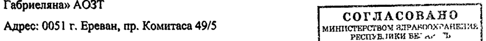
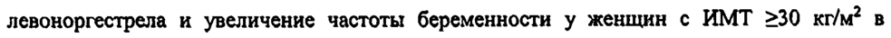

# Левоноргестрел — внутрь

- Препарат: Эскапел® (таблетки)
- АТХ: G03AD01
- Источник: ОХЛП, Единый реестр ЛС ЕАЭС, запись 6824758d30dcf80e3d93c0b0, документ от 2024-09-04
- Распознано автоматически (OCR): 12 из 12 стр.
- Сомнительных строк после OCR: 2 (см. раздел «Проверка распознавания»)

## Общие сведения

ЛП-№(001219)-(РГ-ВУ) от 29 12 2023 от 27.12.2023 № 27282
ОБЩАЯ ХАРАКТЕРИСТИКА ЛЕКАРСТВЕНИВРВАЕЕНАРАТИ 0004)
1, НАИМЕНОВАНИЕ ЛЕКАРСТВЕННОГО ПРЕПАРАТА 1П-Р001219-ГП-ВУ
Эскапел, 1,5 мг, таблетки.
мини Gear О ЕНИЯ 2, КАЧЕСТВЕННЫЙ И КОЛИЧЕСТВЕННЫЙ СОСТАВ — |приказ Manucreurroe anrcooeopanens |
Действующее вещество: левоноргестрел. Ё OPEL а
Каждая таблетка содержит 1,5 мг левоноргестрела.
Вспомогательные вещества, наличие которых надо учитывать в составе лекарственного препарата: лактозы моногидрат.
Полный перечень вспомогательных веществ приведен в разделе 6.1.

## 3. Лекарственная форма

Таблетки.
Плоские круглые таблетки белого или почти белого цвета, с фаской и с гравировкой "С00" на одной стороне.

## 4. Клинические данные

## 4.1. Показания к применению

Препарат Эскапел показан к применению у женщин в возрасте от 16 лет для экстренной
(посткоитальной) контрацепции в течение 72 часов после незащищенного полового акта или в случае ненадежности применяемого метода контрацепции.

## 4.2. Режим дозирования и способ применения

Режим дозирования Препарат может применяться в любой период менструального цикла. В случае нерегулярного менструального цикла необходимо предварительно исключить беременность.
Для достижения более надежного контрацептивного эффекта 1 таблетку препарата Эскапел необходимо принять как можно скорее, предпочтительно в первые 12 часов (но не позднее 72 часов после незащищенного полового акта). Если в течение 3-х часов после приема таблетки произошла рвота, то следует принять еще 1 таблетку препарата Эскапел. После приема препарата Эскапел до наступления следующей менструации следует применять негормональные методы контрацепции (презерватив, спермицид + шеечный колпачок, диафрагма или контрацептивная губка). Применение левоноргестрела не является противопоказанием для продолжения плановой гормональной контрацепции. Применение от 27.12.2023 № 27282 препарата при повторном незащищенном половом ЛЕЩЕВ ent Я ЧА ого цикла не рекомендуется из-за увеличения риска развития варушений цикла.

Особые группы пациенток

Пациентки с нарушением функции печени

Данные о применении левоноргестрела у пациенток с печеночной недостаточностью

отсутствуют. Применение препарата у пациенток с печеночной недостаточностью тяжелой

степени противопоказано,

Пациентки с нарушением функции почек

Данные о применении левоноргестрела у пациенток с нарушением функции почек

отсутствуют,

Дети

Дети и подростки до 16 лет

Применение препарата Эскапел в возрасте до 16 лет противопоказано (в связи с

ограниченным количеством данных по безопасности и эффективности левоноргестрела в

данной возрастной группе).

Способ применения

Внутрь. Таблетки следует запивать небольшим количеством воды.

## 4.3. Противопоказания

- Гиперчувствительность к левоноргестрелу или к любому из вспомогательных веществ, перечисленных в разделе 6.1.

- Возраст до 16 лет (в связи с ограниченным количеством данных по безопасности и эффективности левоноргестрела в данной возрастной группе).

- Печеночная недостаточность тяжелой степени.

- Известная или предполагаемая беременность.

- Грудное вскармливание в течение не менее 8 часов после приема препарата.

- Непереносимость лактозы, дефицит лактазы, синдром глюкозо-галактозной мальабсорбции.

## 4.4. Особые указания и меры предосторожности при применении

С осторожностью

Заболевания печени (легкой и средней степени тяжести) или желчевыводящих путей;

желтуха (в том числе, в анамнезе); тяжелые синдромы мальабсорбции, например, болезнь

Крона; наличие наследственной или приобретенной предрасположенности к тромбозам.

Экстренная контрацепция — метод, который можно использовать только эпизодически. Она

не должна заменять методы плановой контрацепции. an

МИНИСТЕРСТРОМ ЗДРАЗООХРАНЕНИЯ ФЕСПУСПИКЯ РЕЛА.` Cb
Е Прик. Мыязетев TB. arp crear , от 27.12.2023 № 27282

Экстренная контрацепция не во всех случаях по ЕЛЕНЫ С АБО ние беременности.
Бели имеются сомнения относительно времени незащищенного полового контакта, или если незащищенный контакт имел место более чем за 72 часа в течение этого же менструального цикла, то существует вероятность того, что зачатие уже произошло. В связи с этим применение препарата Эскапел при втором половом контакте может оказаться неэффективным в отношении предотвращения наступления беременности. При задержке менструального кровотечения более чем на 5 дней и изменении его характера (скудные или обильные кровяные выделения) необходимо исключить беременность.
Если беременность наступила после применения препарата Эскапел, необходимо учитывать возможность развития эктопической беременности. Появление болей внизу живота, обморочных состояний может свидетельствовать о внематочной (эктопической)
беременности. Абсолютный риск эктопической беременности, по всей видимости, низкий, поскольку левоноргестрел предотвращает овуляцию и оплодотворение. Эктопическая беременность может развиваться несмотря на появление маточного кровотечения. В связи с чем применение препарата Эскапел не рекомендуется у женщин с риском развития внематочной беременности (наличие в анамнезе сальтингита или внематочной беременности).
Применение препарата Эскапел не рекомендуется у пациентов с нарушением функции печени тяжелой степени.
Тяжелые синдромы мальабсорбции, например, болезнь Крона, могут снизить эффективность левоноргестрела.
После приема препарата Эскапел менструальный цикл, как правило, не изменяется и менструальное кровотечение наступает в срок. Иногда менструальное кровотечение может начинаться на несколько дней раньше или позже. Женщинам следует рекомендовать посетить врача, чтобы подобрать и начать использовать один из методов плановой контрацепции. Если препарат Эскапел был принят на фоне регулярной гормональной контрацепции, но ожидаемое кровотечение «отмены» в следующий 7-дневный период "без таблеток" не наступило, следует исключить беременность.
Повторное применение препарата в течение одного менструального цикла не рекомендуется в связи с возможностью нарушения цикла.
Имеются ограниченные данные, требующие дальнейшего подтверждения о том, что контрацептивная эффективность препарата Эскапел может снижаться с увеличением массы тела или индекса массы тела (ИМТ). У всех женщин, независимо от их массы тела и ИМТ,

Г СОГЛАСОБАНО

МИНИ ий 2CPRON ae PABCOX РАНБНИЯ

у рн paren Mit, рт anpenoospasrents ° _ 4219-ГП-ВУ СООТВЕТСТВУЕТ ЭКСПЕРТНОМУ ОТЧЕТУ 11-2001213 от27.12.2023 Ne 27282

средства экстренной контрацепции должны фыть п И eet or RORGdoro контакта как можно раньше.
Препарат Эскапел неэффективен в качестве постоянного метода контрацепции и может использоваться только в качестве экстренной меры. Левоноргестрел в дозе 1,5 мг следует применять исключительно для экстренной контрацепции!
Женщинам, которые обращаются по поводу повторных курсов экстренной контрацепции, следует порекомендовать использовать методы плановой контрацепции.
Применение экстренной контрацепции не заменяет необходимых мер предосторожности, связанных с защитой от заболеваний, передающихся половым путем.
Сообщалось о случаях тромбоэмболических осложнений после приема левоноргестрела в дозе 1,5 мг. В связи с чем, у женщин с существующими факторами риска (наследственной или приобретенной предрасположенностью к артериальным или венозным тромбозам, наличием тромбозов/тромбоэмболий в семейном анамнезе), следует учитывать возможность возникновения таких осложнений.
Дети Применение препарата у девочек-подростков до 16 лет возможно только в исключительных случаях (в том числе, при изнасиловании) и только после консультации гинеколога. После проведения экстренной контрацепции рекомендована консультация гинеколога.

## 4.5. Взаимодействие с другими лекарственными препаратами и другие виды взаимодействия

При одновременном применении с препаратами-индукторами микросомальных ферментов печени (главным образом, индукторов изофермента СУРЗА4) происходит ускорение метаболизма левоноргестрела.
Сопутствующее применение эфавиренза снижает концентрацию левоноргестрела в плазме крови примерно на 50%.
Следующие препараты-индукторы ферментов печени могут снижать эффективность левоноргестрела: барбитураты (включая примидон), фенитоин и карбамазепин, препараты, содержащие зверобой продырявленный (Hypericum perforatum), а также рифампицин, pumonacup, рифабутин и гризеофульвин.
Препараты, содержащие левоноргестрел, могут повышать риск токсичности циклоспорина, вследствие подавления его метаболизма.
Левоноргестрел может снижать эффективность улипристала ацетата путем конкурентного воздействия на рецептор прогестерона, в связи с чем их одновременное применение не рекомендуется. г COTMACOBAHO

## 4.6. Фертильность, беременность и лактация

AROOXPATTRUMS

| Прикае Maer JOpCTBS 9" итхрачогия 4

i. “ от 27.12.2023 № 27282 Беременность (ПОСЛЕДОВАТЕЛЬНОСТЬ 0004)
Прием препарата в период известной или предполагаемой беременности противопоказан.
На основании имеющихся данных, неблагоприятного’ влияния на плод в случае продолжения беременности на фоне применения препаратов, содержащих левоноргестрел, для экстренной контрацепции не выявлено,
Период грудного вскармливания Левоноргестрел проникает в грудное молоко. Потенциальное воздействие левоноргестрела на ребенка можно уменьшить, если женщина будет принимать препарат непосредственно после кормления. После приема препарата грудное вскармливание следует прекратить не менее чем на 8 часов.
Фертильность Левоноргестрел повышает риск развития нарушений менструального цикла, что в
| некоторых случаях может приводить к более ранней или поздней овуляции. Эти изменения могут влиять на фертильность, однако данные о влиянии левоноргестрела на фертильность при длительном применении отсутствуют.
4.7. Влияние на способность управлять транспортными средствами и работать с механизмами
Влияние применения препарата Эскапел на способность к управлению транспортными средствами и механизмами не изучалось. ее

## 4.8. Нежелательные реакции

Резюме профиля безопасности ть При применении левоноргестрела наиболее частой нежелательной | реакцией была тошнота.
Табличное резюме нежелательных реакций Нежелательные реакции представлены по системно-органным классам в соответствии с классификацией Мед ОКА и с частотой возникновения: очень часто (>1/10), часто (>1/100 и
<1/10), нечасто (>1/1000 и <1/100), редко (>1/10000 и <1/1000), очень редко (<1/10000, включая отдельные сообщения).

Класс системы органов Частота Нежелательные реакции
ИИ Желудочно-кишечные Очень часто Тошнота, боль в нижних отделах

о | | от 27.12.2023 № 27282 Нарушения со стороны | Очень часто |_| Кровотечение," Ене2! овазанное "с молочных желез Часто Задержка менструации более чем на 7 дней, нерегулярные менструальные кровотечения, нагрубание молочных желез
Общие нарушения и | Очень часто Повышенная утомляемость
И И Описание отдельных нежелательных реакций
Характер менструального кровотечения может несколько измениться, однако у большинства женщин следующая менструация начинается в течение 5 дней от предполагаемого срока.
Если наступление следующей менструации запаздывает больше чем на 5 дней, следует исключить беременность.
Следующие нежелательные реакции наблюдались в клинической практике в пострегистрационном периоде:
Класс системы органов Частота Нежелательные реакции
Е ИИ Желудочно-кишечные Очень редко Боль в животе
И ИИ Нарушения со стороны | Очень редко Кожная сыпь, крапивница, зуд
О И ИИ Нарушения со стороны | Очень редко Боль в области таза, дисменорея репродуктивной системы и молочных желез
Общие нарушения и | Очень редко Отек лица р"
Сообщение о подозреваемых нежелательных реакциях
Важно сообщать о подозреваемых нежелательных реакциях после регистрации лекарственного препарата с целью обеспечения непрерывного мониторинга соотношения
«польза — риск» лекарственного препарата. Медицинским работникам рекомендуется сообщать о любых подозреваемых нежелательных реакциях лекарственного препарата через национальные системы сообщения о нежелательных реакциях государств — членов
Евразийского экономического союза. СОГЛАССЯАНО !
Российская Федерация ВИ cla? bye Принле Мичеттео" тв. г parade. д ‘ 6 от27.12.2023 № 27282

Федеральная служба по надзору в сфере здравоох ран ЛЕДОВАТЕЛЬНОСТЬ 0004)
Адрес: 109012 г. Москва, Славянская площадь, д. 4, стр. |
Телефон: +7 800 550-99-03 1П-#001219-ГП-ВУ
Электронная почта: pharm@roszdravnadzor.gov.ru
Сайт в информационно-телекоммуникационной сети «Интернет»:
https://www.roszdravnadzor.gov.ru Республика Армения
«Научный центр экспертизы лекарств и медицинских технологий им. академика Э.
Габриеляна» АОЗТ ке Адрес: 0051 г. Ереван, пр. Комитаса 49/5 ин атством о
Отдел мониторинга безопасности лекарств pana, Мвиторстьй тины "=
Телефон: +374 10 20-05-05, +374 96 22-05-05 о
Электронная почта: vigilance@pharm.am Сайт в информационно-телекоммуникационной сети «Интернет»: http://www.pharm.am
Республика Беларусь Республиканское унитарное предприятие «Центр экспертиз и испытаний в здравоохранении»
Адрес: 220037 г. Минск, пер. Товарищеский, 2а
Отдел фармаконадзора Телефон: +375 17 242-00-29
Электронная почта: repl@rceth.by Сайт в информационно-телекоммуникационной сети «Интернет»: https://www.rceth.by
Республика Казахстан PITT на ПХВ «Национальный центр экспертизы лекарственных средств и медицинских изделий» Комитета медицинского и фармацевтического контроля Министерства здравоохранения Республики Казахстан
Адрес: 010000 г. Астана, ул. А. Иманова, 13 (4 этаж)
Департамент фармаконадзора и мониторинга безопасности, эффективности и качества медицинских изделий
Телефон: +7 7172 78-98-28 Электронная почта: pdic@dari.kz
Сайт в информационно-телекоммуникационной сети «Интернет»: https://www.ndda.kz
Кыргызская Республика Департамент лекарственных средств и медицинских изделий при Министерстве здравоохранения Кыргызской Республики

от 27.12.2023 № 27282 Адрес: 720044 г. Бишкек, ул. 3-я Линия, 25 (ПОСЛЕДОВАТЕЛЬНОСТЬ 0004)
Телефон: + 996 312 21-92-88 ПП-#001219-ГП-ВУ
Электронная почта: vigilance@pharm.kg Сайт в информационно-телекоммуникационной сети «Интернет»: http://www.pharm.kg

## 4.9. Передозировка

О серьезных нежелательных реакциях при острой передозировке большими дозами пероральных контрацептивов не сообщалось.
Симптомы; тошнота и кровотечение «отмены».
Лечение: лечение симптоматическое. Специфического антидота нет.
| ССГЛАСОВАНО инк ТВОМ ЗДРАВООХРАНЕНИЯ

## 5. Фармакологические свойства

| раны ства завосуринатя

## 5.1. Фармакодинамические свойства

==

Фармакотерапевтическая группа: средство для экстренной контрацепции.
Код ATX: GO3AD01.
Механизм действия, фармакодинамические эффекты
Левоноргестрел — это синтетический гестаген с контрацептивным действием, выраженными гестагенными и антиэстрогенными свойствами. Основным механизмом действия является ингибирование и/или задержка овуляции в результате подавления пика лютеинизирующего гормона. При рекомендуемом режиме дозирования левоноргестрел подавляет овуляцию и оплодотворение, если половой контакт произошел в предовуляторную фазу, когда возможность оплодотворения наибольшая. Левоноргестрел не эффективен, если имплантация оплодотворенной яйцеклетки уже произошла.
Клиническая эффективность и безопасность
Согласно результатам ранее проведенного клинического исследования, прием двух доз левоноргестрела по 0,75 мг с интервалом в 12 часов предотвращает наступление беременности в 85% случаев. Эффективность препарата снижается с течением времени после полового контакта (95% — при применении в течение 24 часов, 85% — в интервале от 24 до 48 часов, 58% — от 48 до 72 часов).
Результаты другого клинического исследования показали, что однократный прием левоноргестрела в дозе 1,5 мг (в течение 72 часов после незащищенного полового акта)
предотвращает наступление беременности в 84% случаев.
Имеются ограниченные данные, требующие дальнейшего подтверждения, о влиянии избыточной массы тела/высокого ИМТ на контрацептивную эффективность. В 2-х клинических исследованиях (КИ) было выявлено снижение эффективности левоноргестрела и увеличение частоты беременности у женщин с ИМТ 230 кг/м? в

от 27.12.2023 № 27282 сравнении с женщинами с нормальным ИМТ (5 194) POSER QB ET Ed p Oiiko в других КИ снижение контрацептивной эффективности левоноргестрела не было подтверждено (частота наступления беременности составила 1,17% у женщин с ожирением и 0,99% у женщин с нормальным ИМТ).
При рекомендуемом режиме дозирования левоноргестрел не оказывает существенного влияния на факторы свертываемости крови, липидный и углеводный обмен.
Tesi .
Девочки-подростки до 18 лет В проспективном наблюдательном исследовании было показано, что из 305 случаев применения левоноргестрела в качестве средства экстренной контрацепции, в семи случаях наступила беременность. Таким образом, общий коэффициент неудачи составил 2,3%.
Коэффициент неудачи у девочек-подростков моложе 18 лет (2,6% или 4/153) был сравним риалов с коэффициентом неудачи у женщин 18 лет и старше (2,0% ЛАСОВАНО ‘|

## 5.2. Фармакокинетические свойства

МИНИСТЕРСТВОМ ОИ

Абсорбция Прин Мите ит ее При пероральном приеме левоноргестрел быстро и практически полностью всасывается.
После приема левоноргестрела в дозе 1,5 мг максимальная концентрация (Cmax) в плазме крови составляет 18,5 нг/мл и достигается через 2 часа. После достижения максимальных значений концентрация левоноргестрела снижается. Абсолютная биодоступность составляет 100%.
Распределение Левоноргестрел связывается с альбумином плазмы крови и глобулином, связывающим половые гормоны (ГСПГ). Лишь 1,5% всей дозы находится в свободной форме, 65% связано с ГСПТ. Проникает в грудное молоко.
Биотрансформация Метаболизм левоноргестрела соответствует метаболизму половых гормонов.
Левоноргестрел гидроксилируется в печени и метаболиты выводятся в форме конъюгированных — глюкуронидов. — Фармакологически активные — метаболиты левоноргестрела неизвестны.
Элиминация Выводится исключительно в форме метаболитов, примерно в равной степени почками и через кишечник. Период полувыведения (Т\/2) составляет около 26 часов.
Особые группы пациенток Пациентки с почечной и ` печеночной недостаточностью: фармакокинетика левоноргестрела у пациенток с печеночной или почечной недостаточностью не изучалась.
от 27.12.2023 № 27282

Пациентки с ожирением (ПОСЛЕДОВАТЕЛЬНОСТЬ 0004)
Исследование фармакокинетики показало, что концентрации левоноргестрела значительно снижаются у женщин с ожирением (ИМТ >30 кг/м?) (наблюдалось приблизительно 50% уменьшение показателей Cmax и AUCo.24) по сравнению с аналогичными показателями у женщин с нормальным ИМТ (<25 кг/м?).

В другом исследовании также сообщалось о снижении Cmax левоноргестрела приблизительно на 50% у женщин с ожирением по сравнению с аналогичным показателем у женщин с нормальным ИМТ, в то время как удвоение дозы левоноргестрела до 3 мгу женщин с ожирением обеспечило плазменные концентрации, подобные тем, что наблюдались у женшин с нормальным ИМТ и которые получили 1,5 мг левоноргестрела.
Клиническая значимость этих данных неясна. a

Tem [COT TACOBAHS..,.
Дети и подростки до 18 лет рам si reper ати
Фармакокинетика левоноргестрела изучалась исключительно у взрослых женщин; данные о применении левоноргестрела у девочек-подростков в возрасте до 16 лет ограничены.

## 6. Фармацевтические свойства

6.1. Перечень вспомогательных веществ

Кремния диоксид коллоидный

Крахмал картофельный

Магния стеарат

Тальк у

Крахмал кукурузный ,

Лактозы моногидрат

## 6.2. Несовместимость

Не применимо.

## 6.3. Срок годности (срок хранения)

5 лет.

6.4. Особые меры предосторожности при хранении

Хранить при температуре не выше 30 °С.

6.5. Характер и содержание первичной упаковки

По 1 таблетке в блистере из АИПВХ. 1 блистер в картонной пачке с приложенным листкомвкладышем. В картонную пачку вложен картонный плоский футляр для хранения блистера,

от 27.12.2023 № 27282

6.6. Особые меры предосторожностй _ пр но ВЕКОВ breton ВЯ ого лекарственного препарата или отходов, полученных после применения лекарственного препарата, и другие манипуляции с препаратом
Нет особых требований к утилизации. an-#001219-F N-BY

## 7. Держатель регистрационного удостоверения

Венгрия ОАО «Гедеон Рихтер»
1103 Будапешт, ул. Дёмрёи, 19-21 "СОГЛАСОВАН О
Телефон: +36 1 431-4000 с Электронная почта: drugsafety@richter.hu tm i
7.1. Представитель держателя регистрационного удостоверения
Претензии потребителей направлять по адресу:
Российская Федерация Представительство ОАО «Гедеон Рихтер» (Венгрия) г. Москва
Адрес: 119049 г. Москва, 4-й Добрынинский пер., дом 8
Телефон: +7 495 987-15-55 Электронная почта: drugsafety@g-richter.ru
Республика Армения Представительство ОАО «Гедеон Рихтер» в Республике Армения
Адрес: 0010 г. Ереван, ул. Закяна, д. 2 .
Телефон: +374 10 53-00-71 Электронная почта: drugsafety@gedeonrichter.am
Республика Беларусь Представительство ОАО «Гедеон Рихтер» в Республике Беларусь
Адрес: 220004 г. Минск, пр. Победителей, дом 5, офис 505
Телефон, факс: +375 17 272-64-87 Телефон, факс: +375 17 215-25-21
Электронная почта: drugsafety.by@gedeonrichter.eu
Республика Казахстан Представительство ОАО «Гедеон Рихтер» в РК
Адрес: 050008 г. Алматы, ул. Толе Би 187
Телефон: +7 7272 58-26-23 (претензии по качеству), .
+7 7272 58-26-22 (фармаконадзор), +7 701 787-47-01 (фармаконадзор)

от 27.12.2023 № 27282 Электронная почта: info@richter.kz; pv@richtergedeoh OC EQOBATENLHOCTb 0004)
Кыргызская Республика Представительство ОАО «Гедеон Рихтер» в Кыргызской Республике |1-#001213- ГП-ВУ
Адрес: 720005 г, Бишкек, ул. Игембердиева, | "А", бизнес центр «Аврора», офис 703
Телефон: +996 312 98-81-16 —ы—ы—ы—- Электронная почта: drugsafety.ky@gedeonrichter.eu eae co ВАНО |
ГЕСПУБЛИКИ БЕЛАРУСЬ i Приказ Мипиетерства s7panonspanentts

## 8. Номер регистрационного удостоверения

ЛП-№(001219)-(РГ-ВО)

## 9. Дата первичной регистрации

(ПОДТВЕРЖДЕНИЯ РЕГИСТРАЦИИ,

ПЕРЕРЕГИСТРАЦИИ)
Дата первой регистрации:
16.09.2022
10. ДАТА ПЕРЕСМОТРА ТЕКСТА
Общая характеристика лекарственного препарата Эскапел доступна на информационном портале Евразийского экономического союза в информационно-коммуникационной сети
«Интернет» https://eec.eaeunion.org.
## Проверка распознавания

Страницы-сканы распознаны автоматически. В 2 строках с дозировками цифры могли распознаться с ошибкой — сверьте с вырезкой из оригинала:

- стр. 7: «Адрес: 0051 г. Ереван, пр. Комитаса 49/5 ин атством о» — повторное чтение: «Anges 0081 Epon, пр. Комитаса 49/5 [ботов»  
  
- стр. 8: «левоноргестрела и увеличение частоты беременности у женщин с ИМТ 230 кг/м? в» — повторное чтение: «левоноргестрела и увеличение частоты беременности у женщин с ИМТ >30 кг/м? в»  
  
