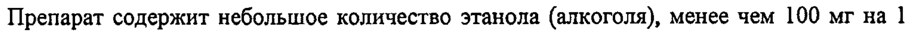
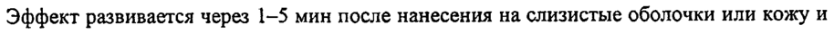
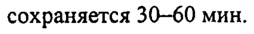
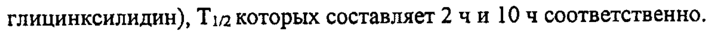

# Лидокаин — наружно

- Препарат: Лидокаин (спрей для местного и наружного применения дозированный)
- АТХ: D04AB01
- Источник: ОХЛП, Единый реестр ЛС ЕАЭС, запись 649bdb2cfb44f10d8906fc66, документ от 2024-06-18
- Распознано автоматически (OCR): 11 из 11 стр.
- Сомнительных строк после OCR: 4 (см. раздел «Проверка распознавания»)

## Общие сведения

. Г: :
ии бОТТАСОВАНО _ ОМ ЗДРАВОО ЛП-№002057-ГП-ВУ РЕСПУБЛИКИ ВЕ et
Приказ Министерства здравоохранения р суки Беларусь
OT * J _* ee At at №_ 29 ОБЩАЯ ХАРАКТЕРИСТИКА ЛЕКАРСТВЕННОГО ПРЕПАРАТА

## 1. Наименование лекарственного препарата

Лидокаин, 4,6 мг/доза, спрей для местного и наружного применения дозированный

## 2. Качественный и количественный состав

Действующее вещество: лидокаин Каждый флакон содержит 3,8 г лидокаина.
Каждая доза содержит 4,6 мг лидокаина.
Вспомогательные вещества, наличие которых надо учитывать в составе лекарственного препарата: пропиленгликоль - 6,82 г/флакон или 8,256 мг/дозу, этанол (96%) — 27,30 г/флакон или 33,047 мг/дозу (см. раздел 4.4).

## 3. Лекарственная форма

Спрей для местного и наружного применения дозированный.
Бесцветный или бледно-желтый спиртовой раствор с запахом перечной мяты.

## 4. Клинические данные

## 4.1. Показания к применению

Препарат Лидокаин спрей для местного и наружного применения дозированный показан взрослым и детям.
Препарат может быть использован для местного обезболивания в следующих случаях:
в стоматологии - для проведения терминальной (поверхностной) анестезии:
обезболивание области укола перед местной анестезией; вскрытие поверхностных абсцессов; перед наложением швов на слизистой оболочке; перед фиксацией коронок и мостов; при лечении воспаления десен, пародонтопатий; экстирпация молочных зубов;
удаление зубного камня; у детей при операции иссечения уздечки языка и вскрытии кист слюнных желез;
в оториноларингологии - операции на носовой перегородке и удаление полипов носа;
проведение электрокоагуляции при лечении носовых кровотечений; устранение глоточного рефлекса и обезболивание места введения инъекционной иглы перед удалением миндалин; вскрытие перитонзиллярных — абсцессов; пункция верхнечелюстной пазухи;
в акушерстве и гинекологии - эпизиотомия и обработка разреза; удаление швов;
небольшие операции на влагалище и шейке матки; прорыв плевы; обработка нитевого нагноения;
* ft заре Ry поль очи UENO ETRY.
+ i СОГЛАСОВАНО Л П- #0 0205 2- ГП -ВУ #} МИНИСТЕР. Л BOM ЗДРАВООХРАНЕНИЯ
РЕСПУСЛИКИ БЕЛАРУСЬ Приказ Министерства здравоохринения
[ Республики Беларусь нь при инструментальных и эндоскопических исследованиях - перед введением зонда через нос или рот (в т.ч. дуоденальное зондирование и дробное исследование желудочной секреции); при ректоскопии, интубации;
при рентгенографическом обследовании - устранение тошноты и глоточного рефлекса;
в качестве анальгезирующего (обезболивающего) лекарственного средства при ожогах (включая солнечные); укусах; контактном дерматите (в т.ч. вызванном раздражающими растениями); небольших ранах (в т.ч. царапинах);
поверхностная анестезия кожных покровов при небольших хирургических вмешательствах.

## 4.2. Режим дозирования и способ применения

Режим дозирования Дозировка может варьировать в зависимости от показаний и размера зоны, подлежащей анестезии.
Одна доза спрея, освобождаемая нажатием на дозирующий клапан, содержит 4,6 мг лидокаина.
Рекомендации по количеству нажатий в различных областях применения:
Область применения Количество нажатий Эндоскопические и инструменталь- 2-3 ные исследования
Акушерство 15-20 Дети В стоматологической практике у детей предпочтительнее применять в виде смазывания
(во избежание испуга ребенка при распылении) путем предварительной пропитки ватного тампона.
Способ применения Применяют местно, наружно.
Во избежание всасывания препарата в системный кровоток следует применять минимальную дозу, обеспечивающую эффект. Обычно достаточно 1-3 нажатий;
возможно применение 15-20 или более нажатий (максимальная доза - 40 нажатий на 70 кг массы тела).
a 4 СОГЛАСОВАНО МИНИСТЕРСТВОМ ЗАРАВООХРАНЕНИ
РЕСПУБЛИКИ БЕЛАРУСЬ ma Приказ ние инАрявоохранения
` 11

## 4.3. Противопоказания

_

— Гиперчувствительность к лидокаину или к любому из вспомогательных веществ, перечисленных в разделе 6.1;
— Применение лидокаина в виде спрея для тонзиллэктомии и аденотомии у детей до 8 лет (см. раздел 4.4).

## 4.4. Особые указания и меры предосторожности при применении

С осторожностью — Инструментальные исследования (ректоскопия) у пациентов с геморроидальным кровотечением,
— Местная инфекция в области применения,
— Травма слизистой оболочки или кожных покровов в области применения,
— Тяжелая соматическая патология, — Эпилепсия,
— Брадикардия, нарушение сердечной проводимости,
— Нарушения функции печени, — Тяжелый шок (см. раздел 4.4),
— Сопутствующие острые заболевания;
— Ослабленные больные;
— Беременность, период грудного вскармливания,
— Младший детский возраст, — Пожилой возраст.
Особые указания При использовании флакон следует держать в вертикальном положении.
Следует избегать попадания в глаза и дыхательные пути (риск аспирации). Требует особой осторожности нанесение препарата в область задней стенки глотки.
Нанесение на слизистую оболочку щёк сопровождается риском дисфагии и последующей аспирации, особенно у детей. При нарушении чувствительности языка и слизистой оболочки щёк повышается риск их прикусывания.
Лидокаин хорошо всасывается через слизистые оболочки (особенно в трахее) и поврежденную кожу. Это следует принимать во внимание, особенно при обработке больших участков ткани у детей.
В случае применения спрея при хирургических операциях в глотке или носоглотке следует учесть, что лидокаин, подавляя глоточный рефлекс, попадает в гортань и трахею и подавляет кашлевой рефлекс, что может привести к бронхопневмонии. Это особенно важно у детей, поскольку у них чаще вызывается глоточный рефлекс. В связи с этим спрей не рекомендуется для местной анестезии перед тонзиллэктомией и аденотомией у детей в возрасте до 8 лет.
Следует соблюдать осторожность при нанесении лидокаина на поврежденную слизистую оболочку и/или инфицированные зоны.
Препарат следует применять с осторожностью у пациентов с эпилепсией, а также при брадикардии, нарушении проведения в сердце, нарушении функции печени и тяжелом
ПП-#002057- ГП-ВУ оно СОВАНО ть тво. 3 РАВООХРАНЕНИЯ
’ Приказ Манн LEM "ГЛАРУСЬ э1риказ Минъете yr, да здраво
_ Г otyOaurar Benapyn ния ain nen шоке, особенно когда можно ожидать всасывания значительного количества препарата при обработке больших участков ткани высокими дозами.
Более низкие дозы следует применять у ослабленных и пожилых пациентов, при острых заболеваниях, а также у детей - в соответствии с возрастом и общим состоянием.
У детей в возрасте до 2 лет Лидокаин спрей рекомендуется наносить ватным тампоном, смоченным в препарате.
Регионарная и местная анестезия должна проводиться опытными специалистами в соответствующем образом оборудованном помещении при доступности готового к немедленному использованию оборудования и препаратов, необходимых для проведения мониторинга сердечной деятельности и реанимационных мероприятий.
Персонал, выполняющий анестезию, должен быть квалифицированным и обучен технике выполнения анестезии, должен быть знаком с диагностикой и лечением системных токсических реакций, нежелательных явлений и реакций, и других осложнений.
Вспомогательные вещества Пропиленгликолъ
Препарат содержит пропиленгликоль, который может вызывать раздражение кожи.
Спирт этиловый 96% (этанол)
Препарат содержит небольшое количество этанола (алкоголя), менее чем 100 мг на 1 дозу.

## 4.5. Взаимодействие с другими лекарственными препаратами и другие виды взаимодействия

Вазоконстрикторы (эпинефрин, фенилэфрин, метоксамин) удлиняют местноанестезирующее действие лидокаина.
Циметидин и пропранолол снижают печеночный клиренс лидокаина (снижение метаболизма вследствие ингибирования микросомального окисления и снижения печеночного кровотока) и повышают риск развития токсических эффектов (в т.ч.
состояние оглушенности, сонливость, брадикардия, парестезии и др.).
Барбитураты, фенитоин, рифампицин (индукторы микросомальных ферментов печени)
снижают эффективность лидокаина (может потребоваться увеличение дозы).
При назначении с аймалином, фенитоином, верапамилом, хинидином, амиодароном возможно усиление отрицательного инотропного эффекта.
Совместное назначение с бета-адреноблокаторами увеличивает риск развития брадикардии.
Сердечные гликозиды ослабляют кардиотонический эффект, курареподобные препараты усиливают мышечную релаксацию.
Прокаинамид повышает риск развития возбуждений центральной нервной системы
(ЦНС), галлюцинаций.
4 , an-#002 on mr “AATAIBAHO 052-ГП-ВУ г (ft) 2\МЮРАНЕНИЯ ts tr * ao LAP VOL a hh : Say . 4 эдрав”охранения
= cece vat Бела; yes При одновременном назначении лидокаина и снотворных и седативных препаратов возможно усиление их угнетающего действия на ЦНС.
При внутривенном введении гексобарбитала или тиопентала натрия на фоне действия лидокаина возможно угнетение дыхания.
Под влиянием ингибиторов моноаминоксидазы (МАО) (фуразолидон, прокарбазин, селегилин) возможно усиление местноанестезирующего действия лидокаина.
Пациентам, принимающим ингибиторы МАО, не следует назначать лидокаин парентерально.
При одновременном применении лидокаина и полимиксина возможно усиление угнетающего влияния на нервно-мышечную передачу, поэтому в таком случае необходимо следить за функцией дыхания пациента.

## 4.6. Фертильность, беременность и лактация

Беременность и лактация

Беременность Результаты контролируемых клинических исследований у беременных отсутствуют.
При необходимости использования местной анестезии и отсутствии более безопасного лечения, лидокаин спрей можно применять во время беременности.
Лактация Лидокаин выделяется в грудное молоко, однако после нанесения обычных терапевтических доз его количество, выделяющееся с молоком, слишком мало, чтобы нанести какой-либо вред грудному ребенку.
Фертильность ` Данные о влиянии лидокаина на фертильность человека отсутствуют.
4.7 Влияние на способность управлять транспортными средствами и работать с механизмами

В период лечения необходимо соблюдать осторожность при вождении автотранспорта и занятии другими потенциально опасными видами деятельности, требующими повышенной концентрации внимания и быстроты психомоторных реакций.

## 4.8. Нежелательные реакции

Резюме профиля безопасности Частота системных реакций после применения препарата Лидокаин спрей чрезвычайно мала, т.к. наносится очень небольшое количество активного препарата, который может попасть в кровоток. В очень редких случаях могут возникнуть симптомы возбуждения или угнетения ЦНС и нарушения со стороны сердечно-сосудистой системы.
Нарушения со стороны иммунной системы:
возможен аллергический контактный дерматит (гиперемия в месте нанесения, кожная сыпь, крапивница, кожный зуд), ангионевротический отёк, анафилактический шок, бронхоспазм.

1П-#002057- ГП-ВУ О ПАСОВАНО МИНИСТЕРСТЬОМ ЗАРАВООХРАНЕНИЯ
РЕСПУБЛИКА ЬСЛАРУСЬ Приказ Минитерсяна эдравъохринения
Республики Волерусь ATOR II te alt Применение препарата следует прекратить при возникновении любой аллергической реакции.
Нарушения со стороны нервной системы:
могут наблюдаться системные реакции: головная боль, головокружение, судороги, тремор, нарушение зрения, шум в ушах, возбуждение и/или депрессия, чувство страха, эйфория, беспокойство, жар, ощущение холода, угнетение дыхания.
Нарушения со стороны сердца:
угнетение функции миокарда, брадикардия, аритмия.
Нарушения со стороны сосудов:
повышение артериального давления (АД), снижение АД.
Общие нарушения и реакции в месте введения:
слабое жжение, которое прекращается после наступления анестезии (в течение 1 минуты), эритема, отёк, нарушение чувствительности; гиперчувствительность, идиосинкразия; уретрит; плохая переносимость.
Сообщение о подозреваемых нежелательных реакциях
Важно сообщать о подозреваемых нежелательных реакциях после регистрации лекарственного препарата с целью обеспечения непрерывного мониторинга соотношения «польза — риск» лекарственного препарата. Медицинским работникам рекомендуется сообщать о любых подозреваемых нежелательных реакциях лекарственного препарата через национальные системы сообщения о нежелательных реакциях государств — членов Евразийского экономического союза.
Российская Федерация Федеральная служба по надзору в сфере здравоохранения
Адрес: 109012, г. Москва, Славянская площадь, д. 4, стр. 1
Телефон: +7 (800) 550-99-03 Электронная почта: pharm@roszdravnadzor.gov.m
Сайт B информационно-телекоммуникационной сети «Интернет»:
https://www.roszdravnadzor.gov.ru Республика Казахстан
РГП на ПХВ «Национальный центр экспертизы лекарственных средств и медицинских изделий» Комитета медицинского и фармацевтического контроля Министерства здравоохранения Республики Казахстан
Адрес: 010000, г. Астана, ул. А. Иманова, 13
Телефон: 8 (7172) 78-98-28 Электронная почта: farm@dari.kz |
Сайт: http://www.ndda.kz а , ПП-№ Г сов;
-#002057- ГП- О
ВУ МИНИСТЕЬ `, Boxy ne ОВАНО PECTINT 1,5 ПРАВООХГАНЕН ия
Приказ Мена. т Mi БЕЛАРУСЬ P ` тер тва “йравовху
Ки Beale занения Республика Беларусь — Адрес: 220037, г. Минск, пер. Товарищеский, 2а
УП «Центр экспертиз и испытаний в здравоохранении»
Телефон: +375 (17) 242-00-29 Факс: +375 (17) 242-00-29
Электронная почта: rcpl@rceth.by Сайт: http://www.rceth.by
Республика Армения «Научный Центр экспертизы лекарств и медицинских технологий им. академика Э.
Габриеляна» АОЗТ Адрес: 0051, Ереван, пр. Комитаса 49/5
Телефон: (+374 60)83-00-73, (+374 10)23-08-96, (+374 10)23-16-82
Электронная почта: vigilance@pharm.am Сайт: http://www.pharm.am

## 4.9. Передозировка

Симптомы Повышенное потоотделение, бледность кожных покровов, тошнота, рвота, головокружение, головная боль, нечеткость зрительного восприятия, звон в ушах, диплопия, снижение АД, брадикардия, аритмия, сонливость, озноб, онемение, тремор, беспокойство, возбуждение, судороги, метгемоглобинемия, остановка сердца.
Лечение При появлении первых признаков интоксикации (головокружение, тошнота, рвота, эйфория) дальнейшее введение прекращают, переводят пациента в горизонтальное положение; назначают ингаляцию кислорода; при психомоторном возбуждении - внутривенно 10 мг диазепама; при судорогах — внутривенно 1% раствора гексобарбитала или тиопентала натрия; при брадикардии - внутривенно 0,5-! мг атропина, симпатомиметические средства (норэпинефрин, фенилэфрин).
Диализ неэффективен.

## 5. Фармакологические свойства

5.1. — Фармакодинамические свойства Фармакотерапевтическая группа: анестетики; местные анестетики; амиды.
Код ATX: №01ВВО02 Механизм действия и фармакодинамические эффекты
Лидокаин - местный анестетик амидного типа.
Местноанестезирующее действие обусловлено обратимым угнетением нервной проводимости за счет блокады натриевых каналов в нервных окончаниях, что
. . ООО ЛП-#№002052-ГП-ВУ но СОВАНО PEC LY Ini ger РА ЕНИЯ
Приказ Manner sn "Pa. трат юхранент Респулиьы Bey yen тя о ин .

препятствует генерации импульсов в окончаниях чувствительных нервов и проведению болевых импульсов по нервным волокнам.
Лидокаин обладает быстрым началом действия, высокой анестезирующей активностью
И НИЗКОЙ ТОКСИЧНОСТЬЮ.
При местном применении расширяет сосуды, не оказывает местнораздражающего действия. Обладает анальгезирующим эффектом.
Эффект развивается через 1-5 мин после нанесения на слизистые оболочки или кожу и сохраняется 30-60 мин.

## 5.2. Фармакокинетические свойства

Абсорбция Быстро всасывается со слизистых оболочек (особенно глотки и дыхательного тракта), степень всасывания препарата определяется степенью кровоснабжения слизистой оболочки, общей дозой препарата, локализацией участка и продолжительностью аппликации. После нанесения на слизистую оболочку верхних дыхательных путей частично проглатывается и инактивируется в желудочно-кишечном тракте (ЖКТ).
Время достижения максимальной концентрации (TCmax) при нанесении на слизистую оболочку полости рта и верхних дыхательных путей — 10-20 мин.
Распределение Связь с белками зависит от концентрации препарата и составляет 60-80% при | концентрации препарата 1-4 мкг/мл (4,3—17,2 мкмоль/л). Распределяется быстро (период полувыведения (T12) фазы распределения - 6-9 мин), сначала поступает в хорошо кровоснабжаемые ткани (сердце, легкие, мозг, печень, селезенка), затем в жировую и мышечную ткани. Проникает через гематоэнцефалический и плацентарный барьеры, секретируется с материнским молоком (40% от концентрации в плазме матери).
Биотрансформация Метаболизируется в печени (на 90-95%) с участием микросомальных ферментов путем дезалкилирования аминогруппы и разрыва амидной связи с образованием менее активных по сравнению с лидокаином метаболитов (моноэтилглицинксилидин и глицинксилидин), T1/2 которых составляет 2 чи 10 ч соответственно.
Элиминация Выводится с желчью и почками (до 10% в неизмененном виде).
Фармакокинетика у особых групп пациентов
Пациенты с почечной недостаточностью При хронической почечной недостаточности возможна кумуляция метаболитов.
Подкисление мочи способствует увеличению выделения лидокаина.
Пациенты с печеночной недостаточностью При заболеваниях печени интенсивность метаболизма снижается и составляет от 50% до 10% от нормальной величины.

s .
- _ | СОГЛАСОВАНО —
ЛП KO 02 0 5 2 ГП- oy МИНИСТЕРСГГОМ О Нч
РЕСПУБИЧИ tT cL Приказ Ал. инист + op, , :
Peary area ch - Veena

## 6. Фармацевтические свойства

6.1. — Перечень вспомогательных веществ Мяты перечной листьев масло
Пропиленгликоль Этанол (96%)

## 6.2. Несовместимость

Не применимо

## 6.3. Срок годности (срок хранения)

5 лет.
6.4 Особые меры предосторожности при хранении
Хранить при температуре от 15 до 25 °С.
6.5 Характер и содержание первичной упаковки
По 38 г (650 доз) во флаконе из коричневого стекла, вместимостью 50 мл, снабженного дозирующим насосом с распылительной головкой. Флакон вкладывается вместе с листком-вкладышем в картонную пачку.

у 6.6 Особые меры предосторожности при уничтожении использованного лекарственного препарата или отходов, полученных после применения лекарственного препарата и другие манипуляции с препаратом
Особые требования отсутствуют.

## 7. Держатель регистрационного удостоверения

Венгрия ЗАО «Фармацевтический завод ЭГИС»
1106 Будапешт, ул. Керестури 30-38, Телефон: (+36-1) 803-5555,
Электронная почта: mailbox@egis.hu 7.1. — Представитель держателя регистрационного удостоверения
Претензии потребителей направлять по адресу:
Российская Федерация ООО «ЭГИС-РУС»
121552, г. Москва, ул. Ярцевская, д.19, блок В, этаж 13
Телефон: +7 (495) 363-39-66 Электронная почта: pharmacovigilance@egis.ru a у
А.
_ СОГЛАСОВА Afl-#0020 52-Til-dy МИНИСТЕРСТВОМ В О re |
PECVSESLE SIAR, Приказ Миьиеа Pe Ba} Swen В
Песпурти и By ee
6. ФАРМАЦЕВТИЧЕСКИЕ СВОЙСТВА
6.1. — Перечень вспомогательных веществ Мяты перечной листьев масло
Пропиленгликоль Этанол (96%)
6.2. Несовместимость
Не применимо
6.3. Срок годности (срок хранения)
5 лет.
6.4 Особые меры предосторожности при хранении
Хранить при температуре от 15 до 25 °С.
6.5 Характер и содержание первичной упаковки
По 38 г (650 доз) во флаконе из коричневого стекла, вместимостью 50 мл, снабженного дозирующим насосом с распылительной головкой. Флакон вкладывается вместе с листком-вкладышем в картонную пачку.

’ 6.6 Особые меры предосторожности при уничтожении использованного лекарственного препарата или отходов, полученных после применения лекарственного препарата и другие манипуляции с препаратом
Особые требования отсутствуют.

7. ДЕРЖАТЕЛЬ РЕГИСТРАЦИОННОГО УДОСТОВЕРЕНИЯ
Венгрия ЗАО «Фармацевтический завод ЭГИС»
1106 Будапешт, ул. Керестури 30-38, Телефон: (+36-1) 803-5555,
Электронная почта: mailbox@egis.hu 7.1. — Представитель держателя регистрационного удостоверения
Претензии потребителей направлять по адресу:
Российская Федерация ООО «ЭГИС-РУС»
121552, г. Москва, ул. Ярцевская, д.19, блок В, этаж 13
Телефон: +7 (495) 363-39-66 Электронная почта: pharmacovigilance@egis.ru и чтить
ЛП-№002052- ГП-ВУ й „СОГЛАСОВАНО | МИНИСТЕРСТВОМ ЗТРАВООХРАНЕНИЯ
| РЕСНУАЛИКИ БГЛАРУСЬ °^ Приказ Магистр: тва здьанс схранени республики Вим русь я
Республика Казахстан об Представительство ЗАО «Фармацевтический завод ЭГИС» в Республике Казахстан 050060, г. Алматы, ул. Жарокова 286 Г.
Телефон: + 7 (727) 247 63 34, +7 (727) 247 63 33.
Электронная почта: egis@egis.kz Республика Беларусь
Представительство ЗАО «Фармацевтический завод ЭГИС» (Венгрия) в Республике
Беларусь .
220053, г. Минск, пер. Ермака, д. 6A.
Телефон: (017) 380-00-80, (017) 227-35-51, (017) 227-35-52.
Факс: (017) 227-35-53.
Электронная почта: info@egis.by Республика Армения
Представительство ЗАО «Фармацевтический завод ЭГИС» в Республике Армения 0010, г. Ереван, ул. Анрапетутян, дом 67, 4 этаж.
Телефон: +374-10-574686.
Электронная почта: info@egis.am

## 8. Номер регистрационного удостоверения

ЛП-№(002052)-(РГ-КИ)

## 9. Дата первичной регистрации

(ПОДТВЕРЖДЕНИЯ РЕГИСТРАЦИИ,

ПЕРЕРЕГИСТРАЦИИ)
Дата первой регистрации: 29.03.2023
10. ДАТА ПЕРЕСМОТРА ТЕКСТА
Общая характеристика лекарственного препарата Лидокаин спрей доступна на информационном портале Евразийского экономического союза в информационнокоммуникационной сети «Интернет» http://eec.eaeunion.org/.
\ 001
## Проверка распознавания

Страницы-сканы распознаны автоматически. В 4 строках с дозировками цифры могли распознаться с ошибкой — сверьте с вырезкой из оригинала:

- стр. 4: «Препарат содержит небольшое количество этанола (алкоголя), менее чем 100 мг на 1» — низкая уверенность: «1» (78)  
  
- стр. 8: «Эффект развивается через 1-5 мин после нанесения на слизистые оболочки или кожу и» — низкая уверенность: «1-5» (66)  
  
- стр. 8: «сохраняется 30-60 мин.» — низкая уверенность: «30-60» (70)  
  
- стр. 8: «глицинксилидин), T1/2 которых составляет 2 чи 10 ч соответственно.» — низкая уверенность: «T1/2» (47)  
  
