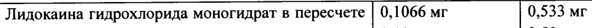
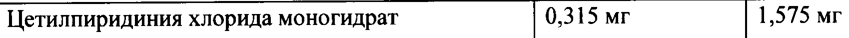
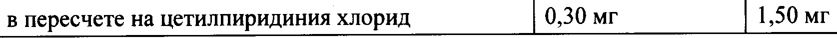
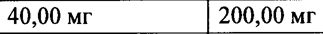
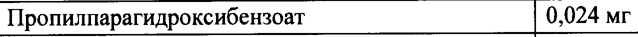

# Лидокаин + Лизоцим + Цетилпиридиния хлорид — наружно

- Препарат: Лизобакт КОМПЛИТ® (спрей для местного применения дозированный;)
- АТХ: R02AA20
- Источник: ГРЛС, инструкция по медицинскому применению, РУ ЛП-006147, файл от 2025-02-20 (https://grls.rosminzdrav.ru/Grls_View_v2.aspx?routingGuid=87e03930-e60d-4e6f-ad44-d56b0c653102)
- Распознано автоматически (OCR): 11 из 11 стр.
- Инструкция к другому РУ того же препарата: ЛП-006147 (национальное РУ, переоформленное по правилам ЕАЭС, решение от 29.01.2025). Текст может быть старше действующего
- Сомнительных строк после OCR: 5 (см. раздел «Проверка распознавания»)

## Общие сведения

МИНИСТЕРСТВО ЗДРАВООХРАНЕНИЯ РОССИЙСКОЙ ФЕДЕРАЦИИ
ИНСТРУКЦИЯ ПО МЕДИЦИНСКОМУ ПРИМЕНЕНИЮ ЛЕКАРСТВЕННОГО ПРЕПАРАТА
Лизобакт КОМПЛИТ® Регистрационный номер:
Торговое наименование: Лизобакт КОМПЛИТ®
Международное непатентованное или группировочное наименование: лидокаин + лизоцим + цетилпиридиния хлорид

## 3. Лекарственная форма

спрей для местного применения дозированный.
спрей для местного применения дозированный.

## 2. Состав

Pe Вещества на дозу на (на 0,2 мл) 1,0 мл
Лидокаина гидрохлорида моногидрат в пересчете | 0,1066 мг 0,533 мг на лидокаина гидрохлорид 0,10 мг 0,50 мг
Лизоцима гидрохлорид 4,00 мг 20,00 мг в пересчете на безводное вещество (160 000 FIP ЕД*) | (800 000 FIP ЕД*)
Цетилпиридиния хлорида моногидрат 0,315 мг 1,575 мг в пересчете на цетилпиридиния хлорид 0,30 мг 1,50 мг 40,00 200,00 мг 20,00 мг
Метилпарагидроксибензоат 0,096 мг Пропилпарагидроксибензоат 0,024 мг
© Ароматизатор мяты перечной ООО СО СО * - 1,0 мг лизоцима гидрохлорида соответствует 40 000 FIP ЕД.
Описание: прозрачный, от бесцветного до слегка желтоватого цвета раствор со слабым характерным запахом.
Фармакотерапевтическая группа: антисептическое средство.
Код ATX: RO2AA.
Фармакологические свойства Фармакодинамика
Комбинированный препарат, действие котфрого обусловлено входящими в) ето гсостав компонентами.
Лидокаина гидрохлорид Лидокаина гидрохлорид - местный анестетик амидного типа, оказывает поверхностный анальгезирующий эффект. Лидокаин блокирует генерацию и проведение нервных импульсов в чувствительных, двигательных и вегетативных нервных волокнах. На молекулярном уровне лидокаин воздействует преимущественно на клеточную мембрану:
специфически блокирует натриевые ионные каналы в неактивном состоянии, что препятствует генерированию потенциала действия, предотвращая проведение нервного импульса при местном применении лидокаина вблизи нерва. В целом, местные анестетики быстрее блокируют вегетативные нервы, мелкие немиелинизированные (ощущение боли)
и мелкие миелинизированные (ощущение боли, температуры), чем крупные
® миелинизированные волокна (ощущение прикосновения, давления).
Эффективен при всех видах местного обезболивания. Расширяет сосуды. Не оказывает раздражающего действия на ткани.
Лизоцима гидрохлорид Лизоцима гидрохлорид - мукополисахарид, который разрушает (лизирует) клеточные стенки бактерий путём гидролиза ее пептидогликанов (в частности, муреина). Активен в отношении грамположительных, некоторых грамотрицательных бактерий, вирусов и грибов.
Цетилпиридиния хлорид Цетилпиридиния хлорид — антисептик из группы четвертичных аммониевых оснований, обладает вариабельной противогрибковой активностью, бактерицидным действием в
| отношении грамположительных и грамотрицательных бактерий, эффективен в отношении
© некоторых вирусов. Цетилпиридиния хлорид оказывает дезинфицирующее действие на слизистую оболочку.

## 5.2. Фармакокинетика

Лизобакт КОМПЛИТ?® применяется местно и оказывает воздействие на область ротоглотки.
Лизобакт КОМПЛИТ?® применяется местно и оказывает воздействие на область ротоглотки.
При проглатывании небольшое количество препарата может поступать в пищеварительную систему.
Лидокаина гидрохлорид Лидокаин быстро всасывается через слизистую оболочку полости рта, пищеварительный тракт или через поврежденную кожу. Около 65% лидокаина связывается с белками плазмы крови. После всасывания лидокаин быстро распределяется во всех тканях организма, проникает через плацентарный и гематоэнцефалический барьеры, экскретируетсяв трудное молоко.
Лидокаин интенсивно метаболизируется в печени, его биодоступность после перорального приема составляет 35%. Около 90% введенной дозы дезалкилируется с образованием моноэтилглицинксилидида (МЕСХ) и глицинксилидида (СХ), которые обеспечивают терапевтический и токсический эффекты лидокаина. GX обладает более длинным, чем лидокаин, периодом полувыведения (около 10 4) и может кумулировать при многократном введении. Впоследствии происходит дополнительная биотрансформация, а метаболиты выделяются почками, в том числе, порядка 10% в форме неизмененного лидокаина.
Ингибирование изоферментов СУР1А2 и СУРЗА4 цитохрома Р450 может увеличивать | концентрацию лидокаина.

Период полувыведения лидокаина из плазмы составляет приблизительно 1,6 часа.

© Особые группы пациентов

Вследствие быстрого метаболизма на фармакокинетику лидокаина могут оказывать влияние состояния, нарушающие функцию печени. У пациентов с нарушением функции печени период полувыведения лидокаина может повышаться в 2 и более раз.

Нарушение функции почек не влияет на фармакокинетику лидокаина, но может приводить к кумуляции его метаболитов.

Лизоцима гидрохлорид

Лизоцима гидрохлорид практически не абсорбируются через слизистую оболочку полости рта.

Цетилпиридиния хлорид

Цетилпиридиния хлорид плохо всасывается через слизистую оболочку полости рта.

© Показания к применению

Симптоматическое лечение боли в горле при инфекционно-воспалительных заболеваниях глотки и гортани (острый и хронический фарингит, фаринголарингит, тонзиллит) у взрослых пациентов в составе комплексной терапии.

## 4.3. Противопоказания

Повышенная чувствительность к лидокаина гидрохлориду и другим местным анестетикам амидного типа, лизоцима гидрохлориду, цетилпиридиния хлориду, а также к любому из компонентов препарата.

Гиперчувствительность к белку куриного яйца.

Открытые раны полости рта.

Детский возраст до 18 лет (эффективность и безопасность не изучены).

## 4.6. Применение при беременности и в период грудного вскармливания

## 4.3. С осторожностью

Эпилепсия, нарушения проводимости сердца, одновременное применение лекарственных препаратов, содержащих аналоги лидокаина, порфирия, нарушение целостности слизистой оболочки полости рта, глотки и гортани, нарушение функции печени, аллергические реакции в анамнезе.
Эпилепсия, нарушения проводимости сердца, одновременное применение лекарственных препаратов, содержащих аналоги лидокаина, порфирия, нарушение целостности слизистой оболочки полости рта, глотки и гортани, нарушение функции печени, аллергические реакции в анамнезе.
Если у Вас есть одно из перечисленных выше заболеваний, перед применением препарата необходимо проконсультироваться с врачом.
Применение при беременности и в период грудного вскармливания
Применение при беременности и в период грудного вскармливания противопоказано.

## 4.2. Способ применения и дозы

Местно, путем распыления на слизистую оболочку ротоглотки. Применяется после еды.
Местно, путем распыления на слизистую оболочку ротоглотки. Применяется после еды.
По 5 впрысков на одно применение 3-6 раз в день с минимальным интервалом 2 часа.
Курс лечения 5 дней.
При однократном нажатии на дозатор выделяется 0,20 мл раствора, содержащего 4 мг лизоцима гидрохлорида, 0,3 мг цетилпиридиния хлорида и 0,1 мг лидокаина гидрохлорида.
Если после лечения улучшения не наступает, или симптомы усугубляются, или появляются новые симптомы, необходимо проконсультироваться с врачом.
Применяйте препарат только согласно тем показаниям, тому способу применения и в тех дозах, которые указаны в инструкции.
Пациенты с нарушением функции почек © Коррекция режима дозирования не требуется.

Пациенты с нарушением функции печени У пациентов с нарушением функции печени рекомендуется применять препарат Лизобакт
КОМПЛИТ® с осторожностью, в наименьших эффективных дозах.
Способ применения Рекомендуется, чтобы флакон препарата применялся только одним пациентом.
Перед первым применением препарата Лизобакт КОМПЛИТ® следует снять пластиковую крышку с дозатора.
После этого необходимо надеть распылитель на дозатор с легким давлением.
Распылитель можно смещать в сторону, благодаря чему обеспечивается адекватное распределение спрея по всей слизистой оболочке полости рта.
Распылитель необходимо повернуть вверх, под прямым углом по отношению к флакону.

Перед первым применением спрея необхддимо нажать „на дозатор- несколько Граз до получения равномерного распыления.
Широко раскройте рот, направьте распылитель в сторону пораженного участка и нажмите на дозатор несколько раз в соответствии с рекомендациями по дозированию препарата.
Задержите дыхание в момент распыления препарата. Не проглатывайте препарат.
После нанесения препарата распылитель следует повернуть вниз, что приводит к блокированию его распыления.

## 4.8. Побочное действие

Оценка частоты возникновения нежелательных побочных реакций основывается на классификации: очень часто (>1 / 10); часто (>1 / 100 до <1/10); нечасто (>1 / 1000 до <1/100);
Оценка частоты возникновения нежелательных побочных реакций основывается на классификации: очень часто (>1 / 10); часто (>1 / 100 до <1/10); нечасто (>1 / 1000 до <1/100);
редко (>1/10 000 до <1/1000); очень редко (<1/10 000), неизвестно (частота не может быть
© оценена по имеющимся данным).
Системно- Нежелательная Лизобакт Лидокаина Лизоцим | Цетилпиридиния органный реакция КОМПЛИТ® | гидрохлорид хлорид класс
Нарушения | Аллергические реакции Редко Неизвестно со стороны | !
иммунной (анафилактический системы шок, отек Квинке и местные реакции гиперчувствительности
Аллергические реакции, | Неизвестно Неизвестно Очень Очень редко включая аллергический редко отек, кожную — сыпь, крапивницу, бронхоспазм и сердечно-сосудистые осложнения.
Нарушения | Потеря Часто Редко Нечасто © со стороны | чувствительности нервной системы
Нарушения | Воспаление слизистой | Редко Редко со стороны | оболочки полости рта желудочно- | (при применении кишечного препарата в — дозах, тракта превышающих рекомендуемые}
Я И wr fT Дискомфорт в области | Часто Нечасто языка
Нарушения | Мультиформная Неизвестно Неизвестно | Неизвестно Неизвестно со стороны | эритема кожи и | Синдром Стивенса- | Неизвестно Неизвестно | Неизвестно Неизвестно подкожных Джонсона.
тканей Общие Астения | Нечасто [| Hevacrco | расстройства | Фарингеальная Нечасто и нарушения | парестезия ее Г введения гипестезия
| Першение в горле | Нечто | CT В крайне редких случаях применение местных анестетиков может сопровождаться аллергическими реакциями. Реакции гиперчувствительности на лидокаина гидрохлорид после местной инъекции проявлялись
. В форме локализованного отека, незначительных затруднений при дыхании или в форме генерализованной
СЫПИ.
Препарат Лизобакт КОМПЛИТ® может вызывать головные боли, проблемы с желудком и диарею в связи с наличием в составе глицерола.
Препарат Лизобакт КОМПЛИТ® может вызывать симптомы подобные алкоголю в связи с наличием в составе пропиленгликоля.
Препарат Лизобакт КОМПЛИТ® может вызывать аллергические реакции замедленного
. типа (например, контактный дерматит) или (реже) реакции немедленного типа
© (крапивница, бронхоспазм) в связи с наличием в составе метил- и пропилпарагидроксибензоата.
Если у Вас отмечаются побочные эффекты, указанные в инструкции или они усугубляются, или Вы заметили любые другие побочные эффекты не указанные в инструкции, сообщите об этом врачу.

## 4.9. Передозировка

Симптомы Нанесение местных анестетиков на слизистую оболочку полости рта может приводить к затруднениям при глотании, в результате чего увеличивается риск аспирации в дыхательных путях. Поэтому передозировка препарата Лизобакт КОМПЛИТ® может
Симптомы Нанесение местных анестетиков на слизистую оболочку полости рта может приводить к затруднениям при глотании, в результате чего увеличивается риск аспирации в дыхательных путях. Поэтому передозировка препарата Лизобакт КОМПЛИТ® может
© приводить к незначительному увеличению риска избыточного местно-обезболивающего эффекта в области голосовой щели, что впоследствии может привести к ослаблению контроля над глотательным рефлексом.
Лидокаина гидрохлорид Очень высокие концентрации лидокаина в крови могут провоцировать эффекты на центральную нервную систему (ЦНС) и/или на сердечно-сосудистую систему.
Первоначальные проявления со стороны ЦНС могут включать нервозность, головокружение, шум в ушах, нистагм, психомоторное возбуждение, возбужденное состояние, парестезии, нечеткое зрение, тошноту, рвоту и тремор, которые могут прогрессировать до угнетения спинного мозга, а также тонических и клонических судорог.
Реакции со стороны сердечно-сосудистой системы характеризуются ее угнетением и проявляются артериальной гипотензией, угнетением миокарда, брадикардией и потенциальным риском остановки сердца.
Несмотря на то, что биологическая доступность лидокаинадостаточноНизкаябна) может

оказаться достаточной для того, чтобы привести к значительной интоксикации при

проглатывании препарата. Зарегистрированы случаи токсического воздействия на ЦНС,

судорог и смерти после проглатывания препаратов, предназначенных для местного

применения. Тем не менее, в случае с препаратом Лизобакт КОМПЛИТ® требуется

проглотить свыше одного литра спрея, чтобы количество лидокаина (0,5 г или больше)

было достаточным для формирования клинически значимого токсического эффекта.

Лизоцима гидрохлорид

Случаи передозировки не наблюдались.

Цетилпиридиния хлорид

Признаки и симптомы интоксикации при приеме внутрь значительных количеств

цетилпиридиния хлорида: тошнота, рвота, отек, цианоз, асфиксия с последующим

< параличом дыхательных мышц, угнетение ЦНС, артериальная гипотензия и кома.

Лечение

Лечение передозировки лидокаином включает обеспечение адекватной вентиляции легких

и купирование эпилептических приступов. Искусственная вентиляция с подачей кислорода

посредством поддержания дыхания или контролируемого дыхания проводится по мере

необходимости. Для устранения эпилептических приступов могут применяться тиопентал

натрия, диазепам. В случае возникновения фибрилляции желудочков или остановки сердца

необходимо проведение адекватной сердечно-сосудистой реанимации. Как можно скорее

следует ввести несколько доз адреналина и бикарбонат натрия.

В случае передозировки необходимо прекратить применение препарата и обратиться к

врачу.

© Взаимодействие с другими лекарственными средствами

Лидокаина гидрохлорид

Несмотря на потенциально возможные многочисленные взаимодействия лидокаина с

другими препаратами, в данном случае, вероятнее всего, они не будут иметь клинического

значения ввиду того, что Лизобакт КОМПЛИТ® применяется местно.

Одновременное применение препарата Лизобакт КОМПЛИТ® с другими препаратами,

ограничивающими печеночный кровоток (например, с пропранололом, циметидином)

может приводить к уменьшению клиренса лидокаина. При длительном применении в

комбинации с другими препаратами, индуцирующими микросомальные ферменты

(например, фенитоином, барбитуратами), за счет чего происходит метаболизм препарата,

может потребоваться увеличение дозы лидокаина. Ингибирование изоферментов СУР1А2
(флувоксамин) и СУРЗА4 (итраконазол, эритромицин) цитохромаР450 может увеличивать концентрацию лидокаина.
Угнетающий эффект лидокаина на сердце является аддитивным по отношению к эффектам бета-адреноблокаторов и других противоаритмических препаратов. Сердечные гликозиды ослабляют кардиотонический эффект, курареподобные препараты усиливают мышечную релаксацию. Прокаинамид повышает риск развития возбуждения центральной нервной системы, галлюцинаций. При назначении с антиаритмическими препаратами (амиодарон)
возможно усиление отрицательного инотропного эффекта
Гипокалиемия, провоцируемая ацетазоламидом, «петлевыми» диуретиками и тиазидами, может противодействовать эффекту лидокаина.
При одновременном назначении лидокаина и снотворных и седативных препаратов возможно усиление их угнетающего действия на центральную нервную систему.

© При внутривенном введении тиопентала натрия на фоне действия лидокаина возможно угнетение дыхания. Под влиянием ингибиторов моноаминооксидазы (фуразолидон, прокарбазин, селегилин) возможно усиление местноанестезирующего действия лидокаина.
Пациентам, принимающим ингибиторы моноаминооксидазы, не следует назначать лидокаин парентерально.
При одновременном применении лидокаина и полимиксина возможно усиление угнетающего влияния на нервно-мышечную передачу, поэтому в таком случае необходимо следить за функцией дыхания пациента.
Лизоцима гидрохлорид Лизоцима гидрохлорид усиливает действие антибиотиков, в т.м. пенициллина, хлорамфеникола, нитрофурантоина, диуретиков, ослабляет активность леводопы.
Цетилпиридиния хлорид

© Препарат не следует принимать одновременно с молоком, поскольку он снижает противомикробную активность цетилпиридиния хлорида. В процессе применения препарата Лизобакт КОМПЛИТ® пациенты не должны одновременно применять другие местные антисептики для дезинфекции полости рта и/или глотки.
Если Вы применяете вышеперечисленные или другие лекарственные препараты (в том числе безрецептурные) перед применением препарата проконсультируйтесь с врачом.

## 4.4. Особые указания

Лидокаина гидрохлорид Лидокаин обладает порфирогенным потенциалом, и у пациентов с острой порфирией он может применяться только по экстренным показаниям, связанным с угрозой для жизни. У всех пациентов следует соблюдать меры предосторожности в отношении порфирии.
Лидокаина гидрохлорид Лидокаин обладает порфирогенным потенциалом, и у пациентов с острой порфирией он может применяться только по экстренным показаниям, связанным с угрозой для жизни. У всех пациентов следует соблюдать меры предосторожности в отношении порфирии.

, 8 При нанесении препарата на слизистую обдлочку в высоких дозах или\при( длительном лечении возрастает риск развития системного действия местных анестетиков (нарушения со стороны центральной нервной системы с развитием судорог, угнетение сердечнососудистой системы).
Препарат необходимо применять с осторожностью у пациентов с эпилепсией, нарушениями проводимости сердца, нарушением функции печени, аллергическими реакциями в анамнезе.
Применение препарата противопоказано пациентам с повышенной чувствительностью к другим местным анестетиками амидного типа (таким как бупивакаин, левобупивакаин, мепивакаин, прилокаин, ропивакаин);
Лизоцима гидрохлорид Лизобакт КОМПЛИТ® не следует применять пациентам с наличием в анамнезе

© аллергических реакций.
Сообщалось о случаях аллергических реакций (гиперчувствительности) в связи с применением лизоцима. Поэтому пациент должен прекратить применение этого лекарства и обратиться к врачу в случаях возникновения сыпи, зуда или покраснения кожи, припухлости лица, губ, языка или горла, затруднения дыхания и / или затруднений при глотании, поскольку это могут быть признаки аллергической реакции на препарат Лизобакт
КОМПЛИТ®.
Цетилпиридиния хлорид При длительном применении потенциально возможно появление местного раздражения за счет входящего в состав препарата цетилпиридиния хлорида.
Препарат Лизобакт КОМПЛИТ® не следует принимать с молоком, поскольку оно снижает

| противомикробную активность цетилпиридиния хлорида.

© Препарат не рекомендуется применять при наличии открытых ран в полости рта, т.к.
цетилпиридиния гидрохлорид замедляет заживление ран.
Длительное применение цетилпиридиния гидрохлорида может привести к нарушению нормальной микрофлоры полости рта с риском развития бактериальной или грибковой инфекции.
Препарат не предназначен для длительного, многократного и непрерывного применения.
Если симптомы сохраняются дольше 5 дней и/или в случае появления других симптомов
(выраженная боль в ротоглотке, тошнота, рвота), или сопутствующего подъема температуры, необходимо проконсультироваться с врачом.
Если у пациентов имеются затруднения при глотании, то им не следует применять данный препарат; они должны обратиться к врачу.

ee При применении местных анестетиков в полости рта и’воббласти“ротоглотки; местнообезболивающий эффект может привести к нарушению глотания, что потенциально увеличивает риск аспирации. В связи с этим пациентов следует предупредить о том, что не следует принимать пищу и/или пить в течение одного часа после нанесения препарата
Лизобакт КОМПЛИТ®. Кроме того, рекомендуется избегать чистки зубов и употребления жевательной резинки в течение периода, пока сохраняется эффект обезболивания в полости рта и/или в области ротоглотки.
Следует соблюдать осторожность, чтобы не допускать попадания раствора в глаза. Если это случайно произошло, то необходимо промыть глаза чистой водой или раствором для промывания глаз, а также следует держать глаза открытыми, как минимум, в течение 15 минут.
Лизобакт КОМПЛИТ® не содержит сахар и подходит для применения у лиц, страдающих
©, сахарным диабетом.

## 4.7. Влияние на способность управлять транспортными средствами, механизмами

Препарат Лизобакт КОМПЛИТ® не влияет на способность управлять транспортными средствами и работать с механизмами.

## 6.5. Форма выпуска

Спрей для местного применения дозированный 0,1 мг + 4,0 мг +0,3 мг / доза.
Спрей для местного применения дозированный 0,1 мг + 4,0 мг +0,3 мг / доза.
По 125 доз во флаконы темного стекла с дозатором и защитным колпачком. По одному флакону вместе с инструкцией по применению в пачку картонную.

## 6.4. Условия хранения

© При температуре не выше 25 °С. Не замораживать.
© При температуре не выше 25 °С. Не замораживать.
Хранить в недоступном для детей месте!

## 6.3. Срок годности

3 года. Не применять после истечения срока годности, указанного на упаковке.
3 года. Не применять после истечения срока годности, указанного на упаковке.
Условия отпуска Отпускают без рецепта.
Производитель/Юридическое лицо, на имя которого выдано регистрационное удостоверение:
Босналек АО, Босния и Герцеговина СООТВЕТСТВУЕТ ЭКСПЕРТНОМУ ОТЧЕТУ от 27.01.2025 № 1675
Ул. Юкичева 53, Сараево 71000. (Входящий МЗ №4302930)
Организация, принимающая претензии:
Представительство Босналек АО в Российской Федерации 119435, Российская Федерация, Москва, Саввинская набережная, 11.
Тел./факс: +7(495) 771-76-32, www.bosnalijek.eu
Руководитель отдела регуляторики в РФ и странах СНГ
Представительство АО «Босналек» с. Лукьянова
Ses 572 Ry О.Н. ST Ch “4 > © Ten. +7 925 514 55 32 $ = \№
$ =, я э Са Hk % (6 ‹“ * %. ения i ка Cn - oY
## Проверка распознавания

Страницы-сканы распознаны автоматически. В 5 строках с дозировками цифры могли распознаться с ошибкой — сверьте с вырезкой из оригинала:

- стр. 1: «Лидокаина гидрохлорида моногидрат в пересчете | 0,1066 мг 0,533 мг» — повторное чтение: «Лидокаина гидрохлорида моногидрат в пересчете | 0,1066 мг | 0,533 мг»  
  
- стр. 1: «Цетилпиридиния хлорида моногидрат 0,315 мг 1,575 мг» — повторное чтение: «Цетилпиридиния хлорида моногидрат | 0,315 мг | 1,575 мг»  
  
- стр. 1: «в пересчете на цетилпиридиния хлорид 0,30 мг 1,50 мг» — повторное чтение: «в пересчете на цетилпиридиния хлорид | 0,30 мг | 1,50 мг»  
  
- стр. 1: «40,00 200,00 мг» — низкая уверенность: «40,00» (56), «200,00» (58); повторное чтение: «40,00 мг | 200,00 мг»  
  
- стр. 1: «Пропилпарагидроксибензоат 0,024 мг» — повторное чтение: «Пропилпарагидроксибензоат | 0,024 мг»  
  
