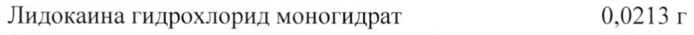
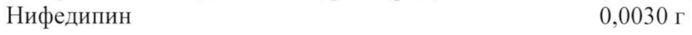
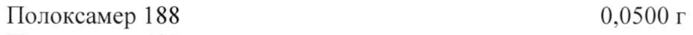
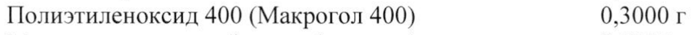
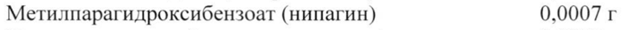
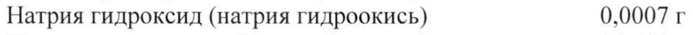

# Лидокаин + Нифедипин — ректально

- Препарат: Релифипин (гель для ректального и наружного применения;)
- АТХ: C05AX03
- Источник: ГРЛС, инструкция по медицинскому применению, РУ ЛП-004782, файл от 2024-09-09 (https://grls.rosminzdrav.ru/Grls_View_v2.aspx?routingGuid=eb783138-cd8e-4212-b85b-b1ba168b45e6)
- Распознано автоматически (OCR): 4 из 4 стр.
- Сомнительных строк после OCR: 6 (см. раздел «Проверка распознавания»)

## Общие сведения

| МИНИСТЕРСТВО ЗДРАВООХРАНЕНИЯ РОССИЙСКОЙ УНЛВРАЦИИС НИ
ЛП- 004782 - 030418 | | | | инстРУКЦИЯ (| СГА |
ПО МЕДИЦИНСКОМУ ПРИМЕНЕНИЮ ЛЕКАРСТВЕННОГО ПРЕПАРАТА
ФИССАРИО Регистрационный номер:
Торговое наименование препарата: ФИССАРИО
Группировочное наименование: Лидокаин + Нифедипин

## 3. Лекарственная форма

гель для ректального и наружного применения
гель для ректального и наружного применения

## 2. Состав

в | препарата содержится:
Наименование компонентов Количество Действующие вещества
Лидокаина гидрохлорид моногидрат 0,0213 г
(в пересчете на лидокаина гидрохлорид) (0,0200 г)
Нифедипин 0,0030 г Вспомогательные вещества
Полоксамер 188 0,0500 г Полоксамер 407 0,1750 г
Полиэтиленоксид 400 (Макрогол 400) 0,3000 г
Метилпарагидроксибензоат (нипагин) 0,0007 г
Натрия гидроксид (натрия гидроокись) 0.0007 г
Пропилпарагидроксибензоат (нипазол) 0,0003 г
Вода очищенная до г ОПИСАНИЕ Однородный гель от светло-желтого до желтого цвета. Допускается наличие пузырьков воздуха.
ФАРМАКОТЕРАПЕВТИЧЕСКАЯ ГРУППА Геморроя средство лечения
KOJI ATX: С05АХО3.
| We TH RI 4 —— . fe nn nen ; | | МИНЗЛРАВ POCCHH
} ЛП- 004782 - 030418 | ФАРМАКОЛОГИЧЕСКИЕ СВОЙСТВА | |
СОГЛАСОВАНО Фармакодинамика Иное ИИ Нифедипин
Нифедипин — селективный блокатор медленных кальциевых каналов, производное 1,4дигидропиридина. Механизм действия при ректальном применении связан с уменьшением
| тока внеклеточного кальция внутрь гладкомышечных клеток сфинктера заднего прохода. |
Нифедипин устраняет гипертонус сфинктера заднего прохода, что, в свою очередь, приводит к уменьшению выраженности боли у пациентов с геморроем и анальной трещиной. Снижение тонуса сфинктера заднего прохода способствует улучшению кровоснабжения ишемизированных зон слизистой оболочки анального канала и улучшению ее функционального состояния. Фармакологическая активность нифедипина обусловливает уменьшение интенсивности воспалительной реакции, оказывает модулирующий эффект на микроциркуляцию.
| Лидокаин | Лидокаин — местный анестетик. Механизм действия при ректальном применении обусловлен нарушением функциональной активности натриевых каналов, что препятствует генерации болевых импульсов в окончаниях чувствительных нервов и проведению болевых импульсов по нервным волокнам. Обезболивающий эффект развивается через | — 5 минут после нанесения препарата на кожу или слизистые оболочки и сохраняется 30 — 60 минут.

## 5.2. Фармакокинетика

Нифедипин при наружном применении практически не всасывается, определяясь в плазме крови в терапевтически незначимой концентрации, недостаточной для определения остальных фармакокинетических параметров.
Нифедипин при наружном применении практически не всасывается, определяясь в плазме крови в терапевтически незначимой концентрации, недостаточной для определения остальных фармакокинетических параметров.
Лидокаин при нанесении на слизистые оболочки всасывается и поступает в системный
| кровоток. Метаболизируется в печени (на 90 — 95%) путем окислительного М№- дезалкилирования, гидролиза амидной связи и гидроксилирования ароматического кольца с образованием 4-гидрокси-2,6-ксилидина, который является основным метаболитом.
Выводится преимущественно почками в виде этого метаболита.
| ПОКАЗАНИЯ К ПРИМЕНЕНИЮ | Лечение трещин заднего прохода на фоне хронического геморроя; симптоматическое лечение острого геморроя.
| ПРОТИВОПОКАЗАНИЯ | Повышенная чувствительность к компонентам препарата; возраст до 18 лет; беременность;
период грудного вскармливания; анальная трещина, осложненная наличием абсцесса, фистулы; онкологические заболевания толстого кишечника и прямой кишки; стеноз прямой кишки; выраженная артериальная гипотензия, хроническая сердечная недостаточность с нестабильными показателями гемодинамики, болезнь Крона, признаки инфекционного поражения прямой кишки.
| 105731.
МИНЗДРАВ РОССИИ | С ОСТОРОВНОСТЬЮ ЛП- 004782 - 030418 |
Хирургические вмешательства на прямой кишке в анамнезе. }
| СОГЛАСОВАНО | | ПРИМЕНЕНИЕ ПРИ БЕРЕМЕННОСТИ И В ПЕРИОД ГРУДНОГО |
ВСКАРМЛИВАНИЯ Комбинированный препарат лидокаина + нифедипина не исследован у беременных женщин и в период грудного вскармливания. Противопоказан к применению при беременности и в период грудного вскармливания.

## 4.2. Способ применения и дозы

Комбинированный препарат лидокаин + нифедипин следует применять после предварительной гигиенической процедуры перианальной области 2 раза в день: утром и вечером с интервалом около 12 ч в течение не более 28 дней. |
Комбинированный препарат лидокаин + нифедипин следует применять после предварительной гигиенической процедуры перианальной области 2 раза в день: утром и вечером с интервалом около 12 ч в течение не более 28 дней. |
Выдавить на палец небольшое количество геля (размером примерно с горошину), нанести его на кожу вокруг заднего прохода и в полость анального канала на глубину 1 см. Для преодоления сопротивления сфинктера наносить гель кончиком пальца.

## 4.8. Побочное действие

Аллергические реакции, анафилактический шок, очень редко — реакции в месте введения
Аллергические реакции, анафилактический шок, очень редко — реакции в месте введения
(боль, жжение, зуд, гиперемия), ректальные кровотечения.

## 4.9. Передозировка

При случайном приеме препарата внутрь (проглатывании нескольких грамм геля) или введении ректально избыточного количества препарата наиболее тяжелые реакции
При случайном приеме препарата внутрь (проглатывании нескольких грамм геля) или введении ректально избыточного количества препарата наиболее тяжелые реакции
| возможны со стороны сердечно-сосудистой системы (снижение артериального давления, брадикардия, брадиаритмия, угнетение функции синусового узла, остановка сердечной деятельности) и центральной нервной системы (судороги, угнетение дыхания, остановка дыхания). Лечение симптоматическое.

## 4.5. Взаимодействие с другими лекарственными средствами

Взаимодействие комбинированного препарата лидокаина + нифедипина с другими лекарственными средствами не изучено в экспериментальных исследованиях у животных.
При одновременном применении препарата с антиаритмическими средствами возможно удлинение интервала ОТ, в очень редких случаях возможно развитие фибрилляции желудочков. При одновременном применении препарата с нитратосодержащими средствами в очень редких случаях возможно развитие артериальной гипотензии.

## 4.4. Особые указания

Необходимо проконсультироваться с врачом относительно отсутствия показаний к хирургическому лечению анальной трещины.
Необходимо проконсультироваться с врачом относительно отсутствия показаний к хирургическому лечению анальной трещины.
| Необходимо избегать проглатывания геля или контакта с глазами. При случайном
| попадании геля в глаза необходимо промыть их достаточным количеством воды.
После применения геля необходимо тщательно вымыть руки.
В проведенном клиническом исследовании эффективность и безопасность лечения препаратом Фиссарио оценивалась у пациентов с трещиной заднего прохода на фоне 105231
МИНЗДРАВ РОССИИ хронического геморроя 1-2 стадии. Эффективность не оценивалась Япайёя$ вв-с Эрещиной заднего прохода на фоне хронического геморроя 3-4 стадии и при наличиу оо дем одной анальной трещины. При наличии в анамнезе хирургического-вменахельства-на-прямой кишке препарат Фиссарио необходимо применять с осторожностью, под наблюдением врача.

## 4.7. Влияние на способность управлять транспортными средствами, механизмами

СРЕДСТВАМИ, МЕХАНИЗМАМИ Не выявлено.

## 6.5. Форма выпуска

Гель для ректального и наружного применения 20 мг/г + 3 мг/г.
Гель для ректального и наружного применения 20 мг/г + 3 мг/г.
По 20 г в тубы алюминиевые с горловиной, закрытой мембраной для контроля первого вскрытия, с внутренним лаковым покрытием с навинчиваемыми бушонами из полимерных материалов.
Каждую тубу вместе с инструкцией по применению помещают в пачку из картона.
| СРОК ГОДНОСТИ 2 года.
Не применять после истечения срока годности, указанного на упаковке.

## 6.4. Условия хранения

При температуре не выше 25 °С. Хранить в недоступном для детей месте.
При температуре не выше 25 °С. Хранить в недоступном для детей месте.
УСЛОВИЯ ОТПУСКА | Отпускают по рецепту.
ПРОИЗВОДИТЕЛЬ ОАО «Фармацевтическая фабрика Санкт-Петербурга». 191144, г. Санкт-Петербург, ул.Моисеенко, д.24-а, лит. JI, лит. 3, Россия или
Ц.П.М. КонтрактФарма ГмбХ и Ко.КГ, Фрюлингштрассе 7, 83620 Фельдкирхен-Вестерхам,
Германия НАИМЕНОВАНИЕ И АДРЕС ЮРИДИЧЕСКОГО ЛИЦА, НА ИМЯ КОТОРОГО |
ВЫДАНО РЕГИСТРАЦИОННОЕ УДОСТОВЕРЕНИЕ ООО «НоваМедика»
125047, г. Москва, ул. 1-я Брестская, д. 29, Россия
В СЛУЧАЕ НЕОБХОДИМОСТИ ПРЕТЕНЗИИ ПОТРЕБИТЕЛЕЙ НАПРАВЛЯТЬ
ПО АДРЕСУ: a ee а, МЗ он, ООО «НоваМедика» So LON, | SKCOEPTHEIMOTURT ||| 125047, г. Москва, ул.1-я Брестска. о 29, Россия хо Xe Ё НВАСТВИТВлЛЕН ДЛЯДАННОЙ| О |
Тел/факс: +7 (495) 230-02-90 У ровзмедию Ny | ВЕРСИИ ДОКУМЕНТА | § |
I Момам а] SE eo oe ooo OKs 1 Директор по регуляторным BOTIPOCaM, vik 53 Э.М.Абдеева
Dy : aS amo 4 105251
## Проверка распознавания

Страницы-сканы распознаны автоматически. В 6 строках с дозировками цифры могли распознаться с ошибкой — сверьте с вырезкой из оригинала:

- стр. 1: «Лидокаина гидрохлорид моногидрат 0,0213 г» — низкая уверенность: «0,0213» (74)  
  
- стр. 1: «Нифедипин 0,0030 г» — низкая уверенность: «0,0030» (72)  
  
- стр. 1: «Полоксамер 188 0,0500 г» — низкая уверенность: «0,0500» (70)  
  
- стр. 1: «Полиэтиленоксид 400 (Макрогол 400) 0,3000 г» — низкая уверенность: «0,3000» (15)  
  
- стр. 1: «Метилпарагидроксибензоат (нипагин) 0,0007 г» — низкая уверенность: «0,0007» (64)  
  
- стр. 1: «Натрия гидроксид (натрия гидроокись) 0.0007 г» — низкая уверенность: «0.0007» (72)  
  
