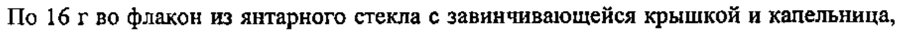

# Лидокаин + Феназон — уши

- Препарат: Отипакс® (капли ушные)
- АТХ: S02DA30
- Источник: ОХЛП, Единый реестр ЛС ЕАЭС, запись 63ac188efb44f154421a3117, документ от 2024-10-31
- Распознано автоматически (OCR): 7 из 7 стр.
- Сомнительных строк после OCR: 1 (см. раздел «Проверка распознавания»)

## Общие сведения

ЛП-№002524-ГП-ВУ nnse(002524}F-RU) or 18062023 or 07.06.2023 N= 10587
ОБЩАЯ ХАРАКТЕРИСТИКА [IEKAPCPBEHHOPO APM AP ATAOOS)

## 1. Наименование лекарственного препарата

Отипакс, 10 mr/r + 40 мг/г, капли ушные.

## 2. Качественный и количественный состав

Действующие вещества: лидокаин + феназон.
Каждый г раствора содержит 10 мг лидокаина гидрохлорида и 40 мг феназона.
Вспомогательные вещества, наличие которых надо учитывать в составе лекарственного препарата: этанол (см. раздел 4.4.).
Полный перечень вспомогательных веществ приведен в разделе 6.1.

## 3. Лекарственная форма

Капли ушные.
Прозрачный, бесцветный или желтоватый раствор с запахом спирта.

## 4. Клинические данные

|

## 4.1. Показания к применению

| 28 10_ Alpi» THF

Местное симптоматическое лечение и обезболивание у детей с рождения и взрослых при среднем отите с неповрежденной барабанной перепонкой, в том числе при:
® остром экссудативном среднем отите:
© отите, как осложнении после гриппа, экссудативном вирусном отите;
® баротравматическом отите.

## 4.2. Режим дозирования и способ применения

Режим дозирования Взрослые Отипакс применяется 2-3 раза в день по 4 капли. Продолжительность лечения препаратом Отипакс — не более 10 дней, после чего следует пересмотреть назначенное лечение.
Дети Отипакс применяется у детей с рождения 2-3 раза в день по 4 капли. Продолжительность лечения препаратом Отипакс — не более 10 дней, после чего следует пересмотреть назначенное лечение.
| ЛП-№002574-ГП-ВУ от 07.06.2023 № 10587
Способ применения (ПОСЛЕДОВАТЕЛЬНОСТЬ 0003)
Отипакс применяется местно, путем закапывания в наружный слуховой проход на стороне поражения. Чтобы избежать соприкосновения холодного раствора с ушной раковиной, флакон перед применением следует согреть в ладонях.
Уря \ | СОГЛАСОВАНО МИНИСТЕРСТВОМ АДРАВООХРАНЕНИЯ ipa | РЕСПУБЛИКИ БЕЛАРУСЬ
ГГ реал bese CRS YEO

## 4.3. Противопоказания

» Гиперчувствительность к лидокаину гидрохлориду, феназону или к любому из вспомогательных веществ, перечисленных в разделе 6.1.
® Перфорация барабанной перепонки, в том числе, инфекционного или травматического происхождения (см. раздел 4.4.).

## 4.4. Особые указания и меры предосторожности при применении

Особые указания Необходимо убедиться в целостности барабанной перепонки перед началом применения препарата. В случае применения препарата при перфорированной барабанной перепонке препарат может вступить в контакт с органами среднего уха и привести к возникновению осложнений.
Дополнительных или особых действий при пропуске одной или нескольких доз препарата, а также при его отмене не предусмотрено.
Спортсменам необходимо учитывать, что препарат Отипакс содержит действующее вещество, которое может дать положительный результат при допинг-контроле.
Меры предосторожности Продолжительность лечения препаратом Отипакс — не более 10 дней, после чего следует пересмотреть назначенное лечение.
ЛП-#002524-ГП-ВУ от 07.06.2023 № 10587

## 4.5. Взаимодействие с другими лекарственными препаратами и другие виды взаимодействия

НЗСДЕ проти TATE ЧС ВОО ды взаимодействия

Сведения о клинически значимом взаимодействии с другими лекарственными препаратами и (или} пищевыми продуктами отсутствуют.

## 4.6. Фертильность, беременность и лактация

При неповрежденной барабанной перепонке и правильном способе применения препарата вероятность поступления действующих веществ в системный кровоток крайне низка.
В связи с этим, в отсутствии противопоказаний, применение препарата Отипакс беременными женщинами и женщинами в период грудного вскармливания возможно.
4.7. Влияние ная способность управлять транспортными средствами и работать с механизмами
Отипакс не оказывает влияния на способность управлять транспортными средствами и работать с механизмами.
МИНИСТЕРСТВОМ ЗДРАВООХРАНЕНИЯ РЕСПУБЛИКИ БЕЛАРУСЬ

## 4.8. Нежелательные реакции

Приказ теста oe

Резюме нежелательных реакций Существует риск возникновения местных аллергических реакций, раздражения и гиперемии слухового прохода.
Сообщение о подозреваемых нежелательных реакциях
Важно сообщать о подозреваемых нежелательных реакциях после регистрации лекарственного препарата с целью обеспечения непрерывного мониторинга соотношения
«польза — риск» лекарственного препарата. Медицинским работникам рекомендуется сообщать о любых подозреваемых нежелательных реакциях лекарственного препарата через национальные системы сообщения о нежелательных реакциях государств — членов
Евразийского экономического союза.
Российская Федерация Федеральная служба по надзору в сфере здравоохранения (Росздравнадзор)
Адрес: 109012, Москва, Славянская площадь, д. 4, стр. 1
Телефон: +7 (495) 698-45-38, +7 (499) 578-02-30
Факс +7(495) 698-15-73 Электронная почта: pharm@roszdravnadzor.gov.ru
Сайт В информационно-телекоммуникационной сети «Интернет»:
| 3 1П-№002524-ГП-ВУ СООТВЕТСТВУЕТ ЭКСПЕРТНОМУ ОТЧЕТУ от 07.06.2023 № 10587 hitp://roszdravnadzor, gov.ru//people (ПОСЛЕДОВАТЕЛЬНОСТЬ 0003)
Республика Беларусь УП «Центр экспертиз и испытаний в здравоохранении» Министерства здравоохранения Республики Беларусь»
Адрес: 220037, Минск, Товарищеский пер. 2а СОГЛАСОВАНО
МИНИСТЕРСТВ Телефон: +375-17-299-55-14 РЕСПУБЛИКИ BENAPYCE
Приказ Министерства здравоохранения Факс: +375-17-299-53-58 Республики Беларусь
Электронная почта: rceth@rceth. by Сайт B информационно-телекоммуникационной сети «Интернет»:
http://www. гсеф.Бу Республика Армения «Научный центр экспертизы лекарств и медицинских технологий им. Академика Э.
Габриеляна» АОЗТ Адрес: 0051, Ереван, пр. Комитаса 49/5
Телефон: (+374 10) 20-05-05, (+374 96) 20-05-05
Электронная почта: admin@pharm.am Сайт B информационно-телекоммуникационной сети «Интернет»:
http://www.pharm.am

## 4.9. Передозировка

О случаях передозировки препарата не сообщалось.

## 5. Фармакологические свойства

## 5.1. Фармакодинамические свойства

Фармакотерапевтическая группа: средства для лечения заболеваний уха; другие средства для лечения заболеваний уха; анальгетики и анестетики.
ATX код: S02DA30.
Механизм действия Местный обезболивающий и противовоспалительный лекарственный препарат для применения в оториноларингологии.
ЛП-№002524-ГП-ВУ от 07.06.2023 № 10587 Фармакодинамические эффекты (ПОСЛЕДОВАТЕЛЬНОСТЬ 0003)

Феназон обладает противовоспалительным и анальгезирующим действием. Лидо-

каин обладает местноанестезирующим действием.

## 5.2. Фармакокинетические свойства

Отсутствие системной абсорбции, за исключением случаев повреждения барабанной

перепонки, СОГЛАСОВАНО МИНИСТЕРСТВОМ ЗДРАВООХРАНЕНИЯ

## 6. Фармацевтические свойства

6.1. Перечень вспомогательных веществ мы
Натрия тиосульфат, Этанол, | Глицерол, Вода.

## 6.2. Несовместимость

Не применимо.

## 6.3. Срок годности (срок хранения)

3 года.

После вскрытия флакона препарат следует использовать в течение 1 месяца.
6.4. Особые меры предосторожности при хранении

Хранить при температуре ниже 30 °С.
6.5. Характер и содержание первичной упаковки

Капли ушные, 10 mr/r + 40 мг/г.

По 16 г во флакон из янтарного стекла с завинчивающейся крышкой и капельница, упакованная в блистер ПВХ/бумага, помещенные в картонную коробку с вложенным листком-вкладышем.

Возможно напичие контроля первого вскрытия.

| ЛП-#007524-ГП-ВУ oT 07.06.2023 № 10587
6.6. Особые меры предосторожнаетн при ЛОВА FORT be AAA) лекарственного препарата или отходов, полученных поеле применения лекарственного препарата, ин другне манипуляции с препаратом
Особые требования отсутствуют.

## 7. Держатель регистрационного удостоверения

Франция СОГЛАСОВАНО ое мы 7, avenue Gallieni, 94250 Gentilly. Приказ И
7.1. Представитель держателя регистрационного удостоверения на территорни Союза
Претензии потребителей направлять по адресу:
Российская Федерация ООО «БИОКОДЕКС»
119049, г. Москва, Якиманский персулок, дом 6, строение 1
Тел: +7 (495) 783-26-80 Адрес электронной почты: phyv@biocodex-corp.ru
Республика Беларусь ООО «БИОКОДЕКС»
119049, г. Москва, Якиманский переулок, дом 6, строение 1
Тел: +7 (495) 783-26-80 Адрес электронной почты: phy@biocodex-corp,ru
Республика Армения ООО «Аверси-Фарма»
0112, пр. Агмашенебели 148/2, Тбилиси Тел: +995 (32) 2 506 506
Адрес электронной почты: |.mdivani@aversi.ge

## 8. Номер регистрационного удостоверения

## 9. Дата первичной регистрации

(ПОДТВЕРЖДЕНИЯ РЕГИСТРАЦИИ,

ПЕРЕРЕГИСТРАЦИИ)
ЛП-#002524-ГП-ВУ СООТВЕТСТВУЕТ ЭКСПЕРТНОМУ ОТЧЕТУ от07.06.2023 № 10587
10. ДАТА ПЕРЕСМОТРА ТЕКСТА (ПОСЛЕДОВАТЕЛЬНОСТЬ 0003)
Общая характеристика лекарственного препарата Отипакс доступна на информационном портале Евразийского экономического союза в информационно-коммуникационной сети «Ивтернет» http://eec.eaeunion.org/.
' СОГЛАСОВАНО МИНИСТЕРСТВОМ ЗДРАВООХРАНЕНИЯ
РЕСПУБЛИКИ БЕЛАРУСЬ Приказ Министерства здравоохранения
Распублики Беларусь
## Проверка распознавания

Страницы-сканы распознаны автоматически. В 1 строках с дозировками цифры могли распознаться с ошибкой — сверьте с вырезкой из оригинала:

- стр. 5: «По 16 г во флакон из янтарного стекла с завинчивающейся крышкой и капельница,» — повторное чтение: «По 16 гво флакон из янтарного стекла с завинчивающейся крышкой и капельница,»  
  
