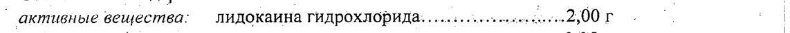
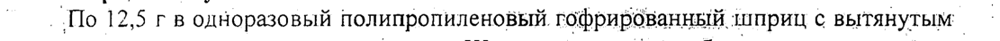
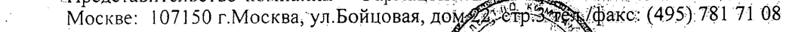

# Лидокаина гидрохлорида моногидрат — наружно

- Препарат: Катеджель с лидокаином (гель для местного применения;)
- АТХ: N01BB52
- Источник: ГРЛС, инструкция по медицинскому применению, РУ П N012477/01, файл от 2025-08-11 (https://grls.rosminzdrav.ru/Grls_View_v2.aspx?routingGuid=28ad99aa-94d2-4aa3-9fed-7cf06f3f1fb9)
- Распознано автоматически (OCR): 3 из 3 стр.
- Инструкция к другому РУ того же препарата: П N012477/01 (национальное РУ, переоформленное по правилам ЕАЭС, решение от 21.07.2025). Текст может быть старше действующего
- Сомнительных строк после OCR: 3 (см. раздел «Проверка распознавания»)

## Общие сведения

о о | | 1.№012477/01-180708 | | — . ИНСТРУКЦИЯ о
| о (информация для специалиста) | | | по медицинскому применению препарата . т _ |
И КАТЕДЖЕЛЬ С ЛИДОКАИНОМ _ Регистрационный номер о oo . п
—_ Toprosoe название: катеджель с лидокаином | о
’ _MHH или группировочное название: Лидокаин + Хлоргёксидин & _ 7
~~ Лекарственная форма: гель для MECTHOTO применения... 7 | и

## 2. Состав

100 г содержат: | | | | | | ‚активные вещества: лидокаина гидрохлорида...........- иен 2500г. | И
100 г содержат: | | | | | | ‚активные вещества: лидокаина гидрохлорида...........- иен 2500г. | И
| о ’ хлоргексидина дигидрохлорида...............0,05.г | |
„ вспомогательные вещества: - | 7: ` гиэтеллозы (гидроксиэтилиёлтюлозь)......1,50.г
Г о глицерола.......... и алленниинни и: 11.20,00 Р | о a me ° ВОДЫ ДЛЯ-ИНЪЕКЦИЙ. или еииннннн Дб 100,007 о
, ‚. Описание: прозрачный, бесцветный или почти, бесцветныйтелв — . 7
‚ . Фармакотерапевтическая группа: oo. | о
`. антисептическое средство + местноанестезирующеесредство. , |
Kon ATX: GO4A | | | И .. Фармакологическое действие : о | Е.
Комбинированный препарат, — оказывающий — антисептическое и :
‚’ _ местноанестезирующее действие. Хлоргексидин = противомикробный препарат, — действующий на грамположительные и грамотрицательные микроорганизмы, | дрожжи, дерматофиты. Эффективен’ в отношёний грамположительных и a
© грамотри цательных бактерий - Treponema spp., Neisséria gonorrhoeae, Trichomonas |
| | зрр., Chlamydia зрр., Ureaplasma spp. Сохраняет активность (хотя несколько
| сниженвую) в присутствии крови, гноя, различных секретов и органических .. !
веществ. | 7 | | И
7 Лидокаин - местный анестетик. о ”. | о —. a
_.._ Tpotusomnxpo6Hoe действие и адекватная анестезия развиваются через 5-10 мн ^^ после применения препарата. а |
‚ < Водорастворимый прозрачный. гель обеспечивает“ четкий ‘оптический обзор. и | обладает смазывающим эффектом при различных. эндоскопических процедурах. -°
^__^ Показания | | О | . — | Профилактика инфекции, анестезия при’ оперативных и ‘диарротических | oe эндоскопических вмешательствах у детей и BSPOCTBIX ‘в. урологии») И екб 76 т и проктологии, все формы эндоскопии, замена фистульных катетербв ЗН, убадуя. =
| 1 a _ eA PT, hg | 7 , . .. и ИЗ . CON <Я .
| о | co П NO12477/01-180708.
_ Применяется в комплексной терапии при купировании симптомов воспаления °\
- о (сопровождающихся болевым синдромбм) слизистой оболочки” .
_ Мочеиспускательного канала, влагалища, цервикального канала и прямой кишки. =
‚ Противопоказания. | (о os a Гиперчувствительность. о
| „ С осторожностью - Беременность (I триместр). | о _
‚” В’случае применения в период лактации следуёт воздерживаться от кормления И | a ребенка грудью в течение 12 ч после использования ‘препарата, И a
| Способ применения - | oe | | ра о "ДлЯ медленной инстилляции перед введением. инструментов (врачом или -^
| специально обученным персоналом) необходимо: . — —. |
- ® раскрыть блистер, удаляя бумагу с прозрачного корпуса (по возможности. | о ’ только до перетяжки); = - . 7
Ge отломать кончик без значительного усилия (по-возможности еще в упаковке).
``, {При этом необходимо проследить, чтобы Кончик был полностью ‘удален, в
| избежание повреждения слизистой. Для облегчения введения рекомендуется о В
| Предварительно выдавить каплю геля; | | | о о © инстилляция посредством легкого давления. натофрирбванный шприц. После `` | опорожнения шприца необходимо держать. его:в сжатом состоянии. до изъятия. a
`_ ® введение ‘инструментов рекомендуется проводить. через: 5-10 минут после’ — | р р ° инстилляции геля. ., . | .
| Побочные действия | о При повышенной чувствительности возможны аллергические реакции. ое
(аллергический дерматит, кожная сыпь, ангибнёвротический отек), жжение в.
‚ местеаппликации. .. | | о т Передозировка | о | В | | и .
`^” Симптомы (при системном действии. лидокаинё в случаях тяжелых повреждений _ |
| мочеиспускательного канала): брадикардия; судороги, коллапс, . i
|. _ Лечение: ‹при брадикардии - бета-адреностимуляторьь при судорогах. - |
| о барбитураты или миорелаксанты короткого действия, Tip Коллапсе - эпинефрин = ^
° или допамин вводится внутривенно. .. о о :. |
_. Взаимодействие | о = | ВИ | о ‚ Избегать совместного применения с препаратами` Йода. | | 7
_— Ингибиторы MAO усиливают местноанестезирующее действие лидокаина. | о
. Несовместим с мылом, а также детергентами; содержащими: анионную группу | го
< (сапонины, натрия лаурилсульфат, натрия карбоксиметилцеллюлоза). Совместим |
‚С лекарственными средствами, содержащими катионную` Трур (6 SH IANK OHMS о
. . и) . i Th . Е . .
`` 7 // a : RD > Я | - . aa | р И . < А и ig? И
, - . , . РЕЙ , р | oe _ — ENO12477/01:180708 —
_^ Особые указания a .
°’ Препарат стерилен и предназначен для одноразовоговведения. | И
° В случае применения в период лактации следуёт воздерживаться от кормления ребенка грудью в течение 12 4 после использования препарата. |
° Формы выпуска: | ° _. Ш 12,5 г в одноразовый полипропиленовый. гофрированный шприц с вытянутым -
| „И отламывающимся наконечником. Шприц помещают в-блистер, состоящий из.
7 двух ‘частей: верхняя — пропиленовая плёнка; выдерживающая ‘стерилизацию
. . Паром, нижняя — бумажная. | , | _ °- |, Блистер вместе с инструкцией по применению. помещают. в картонную о
° упаковку. | a " 7 . | ‚ 2. Упаковка для стационара: | о о
‚ ® |! шприц помещают в блистер. Мо 5 ‘или '25 блистёров-помещают:в картонную _
‘`` коробку. на боковой стороне‘ которой печатается. текст. инструкции: по 7 применению. т 7 | |
> Условия хранения: и | | a ’ Список Б.В защищённом от света месте при Temnepatype-oT + 15 до + 25 °С. о
‚ Хранить в местах недоступных для детей. ры |
; Срок годности: | | | | -5 лет. Использовать препарат, можно только с ‘учетом. срокё годности, указанного.
os. Ha упаковке. - _ я _. ^_ Отпуск из аптек: | о и И _
| По рецепту: | | | oe _ | a & Производитель: | | К a
‚ _ "Фармацойтише Фабрик Монтавит Гез.м:6.Х." 6060 AG3am/Tupons; Австрия:
| ° Организация, принимающая претензии потребителя: — ° | В
_ „Представительство компании "Фармацойтише»Фаввик 'Монтавит Гез.м:6.Х." в ^
- Москве: 107150 г.Москва’ул.Бойцовая, дом тре /факс: (495):781 71 08
, Lo П/Ф Дм".
oe : : . а в аа В.
Глава представительства компании А и. Я В.К. Миронова _ sO i ети. Wek, , we СУ $: . .^ .
7 ААА St нь |
| Ш Eo aS ee OM a i а “ РО Xp :
. a, fee у НИ s . р: «сл 8 К ION . . .
mo т GBM ; o> NY АА | .о. директора ИДКЭЛ Сены А LL van A.NeRacwiipes —. ;
/ р oo В рр ИРА ve aan sf oe MMe adie \ А у .
и . Be mend [OL igh 7 BS Mow A ee rus „В
. fo о | а та вы Е Vai , Re (Peli я №: п.
| о“ . &. К Mo ? poe, es - Be PropOT Москве a И И
| ем 2 Ne ay a ot Ts Ли" er Oe Lo ° = : | . < ReOCKRA +” |
„ : a | | . : у eErereryS . БИ
## Проверка распознавания

Страницы-сканы распознаны автоматически. В 3 строках с дозировками цифры могли распознаться с ошибкой — сверьте с вырезкой из оригинала:

- стр. 1: «| ‚активные вещества: лидокаина гидрохлорида...........- иен 2500г. | И» — низкая уверенность: «2500г.» (25); повторное чтение: «| активные вещества: лидокаина гидрохлорида...........- eee ers coven 2500 Poe .»  
  
- стр. 3: «° _. Ш 12,5 г в одноразовый полипропиленовый. гофрированный шприц с вытянутым -» — повторное чтение: «Шо 1 2,5 rB одноразовый полипропиленовый. гофрированный. шприц с вытянутым:»  
  
- стр. 3: «- Москве: 107150 г.Москва’ул.Бойцовая, дом тре /факс: (495):781 71 08» — низкая уверенность: «(495):781» (66)  
  
