# Лусеоглифлозин — внутрь

- Препарат: Лусефи® (таблетки, покрытые пленочной оболочкой)
- АТХ: A10BK07
- Источник: ОХЛП, Единый реестр ЛС ЕАЭС, запись 68835c1730dcf8d00942e234, документ от 2024-08-23
- Распознано автоматически (OCR): 26 из 26 стр.
- Сомнительных строк после OCR: 21 (см. раздел «Проверка распознавания»)

## Общие сведения

ПП-#003622-ГП-ВУ ОБЩАЯ ХАРАКТЕРИСТИКА ЛЕКАРСТВЕННОГО ПРЕПАРАТА
У’ Данный лекарственный препарат подлежит дополнительному мониторингу. Это позволит быстро выявить новую информацию по безопасности. Мы обращаемся к работникам системы здравоохранения с просьбой сообщать о любых подозреваемых нежелательных реакциях. Порядок сообщения о нежелательных реакциях представлен в разделе 4.8.
le НАИМЕНОВАНИЕ ЛЕКАРСТВЕННОГО ПРЕПАРАТА
Лусефи, 2,5 мг, таблетки, покрытые пленочной оболочкой СОГЛАСОВАНО
МИНИСТЕРСТВОМ ЗДРАВООХРАНЕНИЯ Лусефи, 5 мг, таблетки, покрытые пленочной оболочкой рака МУ СЬ нения

## 2. Качественный и количественный состав

СОС АВ, A,

Действующее вещество: лусеоглифлозин in

Лусефи, 2,5 мг, таблетки, покрытые пленочной оболочкой

Каждая таблетка содержит 2,5 мг лусеоглифлозина (в виде гидрата).

Вспомогательные вещества, наличие которых надо учитывать в составе лекарственного

препарата: лактозы моногидрат — 73,005 мг (см. раздел 4.4.).

Лусефи, 5 мг, таблетки, покрытые пленочной оболочкой

Каждая таблетка содержит 5 мг лусеоглифлозина (в виде гидрата).

Вспомогательные вещества, наличие которых надо учитывать в составе лекарственного

препарата: лактозы моногидрат — 146,01 мг (см. раздел 4.4.).

Полный перечень вспомогательных веществ приведен в разделе 6.1.

ae ЛЕКАРСТВЕННАЯ ФОРМА

Таблетки, покрытые пленочной оболочкой.

Лусефи, 2,5 мг, таблетки, покрытые пленочной оболочкой

Круглые, двояковыпуклые таблетки, покрытые пленочной оболочкой белого цвета.

Лусефи, 5 мг, таблетки, покрытые пленочной оболочкой

Круглые, двояковыпуклые таблетки, покрытые пленочной оболочкой белого цвета.

## 4. Клинические данные

## 4.1. Показания к применению

Препарат Лусефи показан к применению у взрослых пациентов с сахарным диабетом 2 типа

в дополнение к диете и физическим упражнениям для улучшения гликемического контроля:

e в качестве монотерапии;

° в составе комбинированной терапии с другими гипогликемическими препаратами:
метформином, — тиазолидиндионами, производными сульфонилмочевины, ингибиторами — дипептидилпептидазы-4, ингибиторами — альфа-глюкозидазы,

ПП-#003522-ГП-ВУ глинидами, аналогами глюкагоноподобного пептида-1! (ГПП-1), препаратами инсулина (см. разделы 4.4., 4.5. и 5.1.).

## 4.2. Режим дозирования и способ применения

Режим дозирования Рекомендуемая доза лусеоглифлозина составляет 2,5 мг 1 раз в сутки. При недостаточном эффекте суточная доза может быть увеличена до 5 мг 1 раз в сутки при условии тщательного наблюдения за динамикой клинической картины. |
Следует соблюдать осторожность при совместном применении с другими гипогликемическими препаратами (в частности, при совместном применении с производными сульфонилмочевины, препаратами инсулина или агонистами рецепторов
ГПП-1) в связи с риском развития гипогликемии. С целью снижения риска развития гипогликемии необходимо рассмотреть снижение дозы производного сульфонилмочевины, препарата инсулина или аналога ГИП-1 (см. разделы 4.5. и 4.8.). |
Особые группы пациентов Пациенты с нарушением функции почек |
Применение препарата Лусефи у пациентов с почечной недостаточностью средней тяжести
(30 мл/мин/1,73 м² < рСКФ (расчетная скорость клубочковой фильтрации) < 59 мл/мин/1,73 м²) возможно только после тщательной оценки соотношения ожидаемой пользы терапии к возможному риску, ввиду возможного снижения гипогликемического действия
| лусеоглифлозина у таких пациентов (см. раздел 4.4.).
Прием препарата Лусефи противопоказан у пациентов с почечной недостаточностью тяжелой степени (рСКФ < 30 мл/мин/1,73 м²), терминальной стадией хронической почечной недостаточности (ХПН) или находящихся на диапизе, в связи с прогнозируемым отсутствием эффекта от проводимой терапии в этих популяциях (см. раздел 4.3.).
Коррекция дозы лусеоглифлозина при почечной недостаточности легкой степени тяжести не требуется.
Пациенты с нарушением функции печени Клинические данные по эффективности и безопасности применения лусеоглифлозина у пациентов с печеночной недостаточностью тяжелой степени тяжести отсутствуют.
Безопасность у данной категории пациентов не установлена. Данные отсутствуют.
Коррекция дозы лусеоглифлозина при печеночной недостаточности легкой и средней степени тяжести не требуется.
Пациенты пожилого возраста Поскольку физиологические функции у лиц пожилого возраста обычно снижаются, препарат Лусефи следует применять с осторожностью и при условии тщательного
ЛП-#003622-ГП-ВУ наблюдения за состоянием пациента.

Поскольку выявление симптомов дегидратации (включая жажду) у пациентов пожилого

возраста может быть затруднено, следует проявлять особое внимание при лечении данной

категории пациентов (см. раздел 4.4.).

Дети

Безопасность и эффективность лусеоглифлозина у детей в возрасте до 18 лет не

установлены. Данные отсутствуют.

Способ применения

Внутрь, до или после завтрака, запивая водой.

## 4.3. Противопоказания

° Гиперчувствительность к лусеоглифлозину или к любому из вспомогательных веществ, перечисленных в разделе 6.1.

® Сахарный диабет | типа.

® Беременность и период грудного вскармливания (см. раздел 4.6.). |

e Почечная недостаточность тяжелой степени (pCKD < 30 мл/мин/1,73 м²), терминальная стадия ХПН или проведение диализа, в связи с прогнозируемым отсутствием эффекта от проводимой терапии в этих популяциях пациентов.

° Диабетический кетоацидоз, диабетическая кома и прекома (терапия не показана ввиду необходимости быстрой коррекции гипергликемии посредством инфузионной терапии и/или введением инсулина).

® Тяжелые инфекционные заболевания, пред- и постоперационный период, тяжелые травмы (терапия не показана, поскольку для контроля гликемии требуется инсулинотерапия).

## 4.4. Особые указания и меры предосторожности при применении

Общие

Возможность применения препарата Лусефи может быть рассмотрена только в случае

недостаточной эффективности диеты и физических упражнений, которые лежат в основе

терапии сахарного диабета. При применении препарата Лусефи необходимо регулярно

проверять концентрацию глюкозы, содержание гликированного гемоглобина в крови и

другие показатели. Если после 3 месяцев применения не удается достичь адекватного

гликемического контроля, следует рассмотреть переход на другой вид терапии. Препарат

Лусефи может быть назначен только пациентам, у которых подтверждён диагноз сахарного

диабета 2 типа.

Нарушение функции почек

У пациентов с почечной недостаточностью средней тяжести (30 мл/мин/1,73 м² < pCK®

| ЛП-#003622-ГП-ВУ < 59 мл/мин/1,73 м²) имеется вероятность недостаточной эффективности лусеоглифлозина, в связи с чем применение препарата возможно только после тщательной оценки соотношения ожидаемой пользы терапии к возможному риску. При применении препарата
Лусефи может отмечаться повышение концентрации креатинина в сыворотке или снижение
РСКФ. Необходимо регулярно контролировать функцию почек во время терапии препаратом Лусефи, особенно у пациентов с нарушением функции почек (см. разделы 4.2., 5.1.и 5.2.). i
Нарушение функции печени Г Клинические данные по эффективности и безопасности применения лусеоглифлозина у | пациентов с печеночной недостаточностью тяжелой степени отсутствуют. I
Повышенный риск снижения объема циркулирующей крови и развития дегидратации |
Препарат Лусефи следует применять с осторожностью у пациентов с повышенным риском 1 развития дегидратации: пожилого возраста, с выраженной декомпенсацией сахарного | диабета, получающих диуретики. |
Применение препарата Лусефи может приводить к полиурии или поллакиурии вследствие его диуретического эффекта. При обнаружении таких нарушений, как обезвоживание, снижение артериального давления, необходимо прекратить прием препарата, обеспечить восполнение объёма жидкости, а также принять другие соответствующие меры. При лечении пациентов с повышенным риском развития гиповолемии (пациентов пожилого | возраста или получающих диуретики) следует обращать особое внимание на появление симптомов обезвоживания, диабетического кетоацидоза, гипергликемического гиперосмолярного синдрома, тромбозмболин, в том числе ишемического инсульта и т.д.
(см. разделы 4.2., 4.5., 4.8.).
Инфекции мочевыводящих путей и генитальные инфекции |
Препарат Лусефи следует применять с осторожностью y пациентов с инфекциями мочевыводящих путей или генитальными инфекциями (возможно усугубление симптомов).
На фоне терапии препаратом Лусефи существует риск развития инфекций мочевыводящих путей, которые могут привести к пиелонефриту и сепсису. Существует также риск развития кандидозного вульвовагинита и других генитальных инфекций. Необходимо тщательное наблюдение для выявления признаков и симптомов инфекций мочевыводящих путей и генитальных инфекций. При подозрении на инфекцию мочевыводящих путей или генитальную инфекцию следует рассмотреть необходимость прекращения терапии лусеоглифлозином и немедленно начать соответствующее лечение (см. раздел 4.8.).
Пациентов следует предупредить о возможном риске развития бактериальных и грибковых инфекций мочевыводящих путей и половых органов.
| ЛП-#003622-ГП-ВУ

Некротизирующий фасциит промежности (гангрена Фурнье)
В пострегистрационном периоде применения ингибиторов натрийзависимых переносчиков глюкозы 2-го типа (ингибиторов НГЛТ-2) у пациентов женского и мужского пола сообщалось о случаях некротизирующего фасциита промежности (также известного как гангрена Фурнье), редкой, но серьезной и опасной для жизни некротизирующей инфекции, требующей неотложного хирургического вмешательства и применения антибиотиков.
Серьезные исходы некротизирующего фасциита промежности включали госпитализацию, множественные хирургические вмешательства и смерть. Пациенту, получающему терапию ингибитором НГЛТ-2, в случае появления таких симптомов как боль или болезненная чувствительность, гиперемия, отек в области половых органов или промежности, лихорадка, недомогание, следует немедленно обратиться к врачу. Известно, что некротизирующему фасцииту может предшествовать урогенитальная инфекция или абсцесс промежности. При подозрении на некротизирующий фасциит прием препарата
Лусефи следует немедленно прекратить, незамедлительно должна быть начата терапия антибиотиками широкого спектра действия с иссечением, в случае необходимости, некротических тканей.
Нарушения со стороны почек и мочевыводящих путей
При проявлении у пациентов таких симптомов, как затруднённое мочеиспускание, олигурия, задержка мочеиспускания или анурия, необходимо в первую очередь купировать эти симптомы и рассмотреть целесообразность терапии другими гипогликемическими препаратами.
Диабетический кетоацидоз Усиление экскреции глюкозы с мочой, обусловленное механизмом действия лусеоглифлозина, может приводить к повышению метаболизма жирных кислот и развитию кетоза, и в итоге — кетоацидоза, даже при надлежащем гликемическом контроле. Поскольку в таких ситуациях выраженного повышения концентрации глюкозы в крови может не наблюдаться, следует тщательно наблюдать за пациентами на предмет развития указанных ниже состояний (см. раздел 4.8.).
При развитии таких симптомов, как быстрая потеря массы тела, тошнота, рвота, снижение аппетита, общее недомогание, боль в животе, выраженное чувство жажды, одышка, нарушение сознания, дезориентация, немотивированная утомляемость или сонливость, запах ацетона в выдыхаемом воздухе пациенты должны немедленно обратиться за медицинской помощью. Необходимо незамедлительно провести соответствующие обследования, включая анализ на содержание кетоновых тел в крови или моче, независимо от концентрации глюкозы в крови. При выявлении отклонений применение

ИП-9003622-ГП-ВУ лусеоглифлозина должно быть немедленно прекращено или временно приостановлено.
Пациенту должна быть назначена соответствующая терапия.

В частности, в связи в повышенным риском развития кетоацидоза, пациенты в следующих ситуациях должны находиться под тщательным медицинским наблюдением: нарушение секреции инсулина, снижение дозы инсулина, прекращение инсулинотерапии, значительное ограничение поступления углеводов в организм, недостаточное питание, инфекция, дегидратация.
В случае обширного хирургического вмешательства или госпитализации в связи с острым серьезным заболеванием применение лусеоглифлозина должно быть временно приостановлено. Терапия лусеоглифлозином может быть возобновлена при стабилизации состояния пациента.
Гипогликемия Риск развития гипогликемии повышен при совместном применении с другими гипогликемическими препаратами. Перед началом комбинированной терапии с производными сульфонилмочевины, препаратами инсулина или агонистами рецепторов
ГИИ-1 необходимо рассмотреть снижение дозы данных препаратов для уменьшения риска развития гипогликемии.
При возникновении симптомов гипогликемии необходимо принять соответствующие меры
(съесть кусочек сахара; прием напитков или соков, содержащих сахар, пищи с быстроусваиваемыми углеводами). При развитии гипогликемии, обусловленной совместным применением препарата Лусефи с ингибиторами альфа-глюкозидазы, необходимо обеспечить приём пациентом глюкозы (см. разделы 4.5., 4.8. и 5.1.).
Влияние на лабораторные данные Вследствие механизма действия лусеоглифлозина результаты анализа мочи на глюкозу У пациентов, принимающих данный препарат, будут положительными. Следует учитывать, что при применении препарата Лусефи снижается концентрация 1,5-ангидроглюцитола
(1,5-АГ) в сыворотке крови. Результаты исследований глюкозы в моче и 1,5-АГ в сыворотке крови во время терапии лусеоглифлозином не отражают концентрацию глюкозы в крови и не могут использоваться для контроля гликемии.
Гипофизарная и надпочечниковая недостаточность
Препарат Лусефи следует применять с особой осторожностью у пациентов с гипофизарной и/или надпочечниковой недостаточностью.
Алкоголь Препарат Лусефи следует применять с осторожностью у пациентов, злоупотребляющих алкоголем ввиду риска развития у них гипогликемии или кетоацидоза.
| ЛП-#003622-ГП-ВУ Интенсивная физическая нагрузка
Препарат Лусефи следует применять с особой осторожностью при интенсивных физических нагрузках ввиду риска развития гипогликемии.
Нерегулярное и/или несбалансированное питание
Препарат Лусефи следует применять с особой осторожностью при неполноценном питании и голодании, нерегулярном приеме пищи, недостаточном усвоении пищи или при ослабленном состоянии ввиду риска развития гипогликемии.
Снижение массы тела Ввиду сообщений о снижении массы тела на фоне применения препарата Лусефи, .
необходимо контролировать и предотвращать избыточное снижение массы тела.
Ампутация нижних конечностей Увеличение частоты ампутации нижних конечностей (в первую очередь пальцев стопы)
наблюдалось в долгосрочных клинических исследованиях с применением другого | ингибитора НГЛТ-2. Неизвестно, является ли это нежелательным эффектом препаратов класса ингибиторов НГЛТ-2. В связи с чем пациентам с сахарным диабетом, в том числе , | получающим терапию ингибиторами НГЛТ-2, следует рекомендовать постоянный тщательный профилактический уход за стопами в обязательном порядке.
Вспомогательные вещества Препарат Лусефи содержит лактозу. Пациентам с редко встречающейся наследственной непереносимостью галактозы, дефицитом лактазы или глюкозо-галактозной мальабсорбцией не следует принимать этот препарат.
Дети Безопасность и эффективность лусеоглифлозина у детей в возрасте до 18 лет не установлены (опыт применения у данной категории пациентов отсутствует).

## 4.5. Взаимодействие с другими лекарственными препаратами и другие виды взаимодействия

Фармакодинамическое взаимодействие Гипогликемические препараты = (производные — сульфонилмочевины, бигуаниды, тиазолидиндионы, ингибиторы дипептидилпептидазы-4 (ДПП-4), ингибиторы альфаглюкозидазы, стимуляторы секреции инсулина (глиниды), агонисты рецепторов ГИП-, препараты инсулина и др.)
Поскольку применение данных препаратов может увеличить риск развития гипогликемии, их следует назначать при условии тщательного контроля концентрации глюкозы в плазме крови и мониторинга состояния пациента. При совместной терапии с производными сульфонилмочевины, препаратами инсулина или агонистами рецепторов ГИП
| | AN-#003622-r-By необходимо рассмотреть снижение дозы данных препаратов для уменыпения риска развития гипогликемии (см. разделы 4.4. и 4.8.).
Лекарственные препараты, усиливающие гипогликемический эффект (бета-блокаторы, производные салициловой кислоты, ингибиторы моноаминоксидазы, фибраты и др.)
Совместное применение с данными препаратами может увеличить риск развития гипогликемии, поэтому при их применении следует контролировать концентрацию | глюкозы в крови и другие параметры состояния пациента.
Лекарственные препараты, ослабляющие гипогликемический эффект (адреналин, гормоны коры надпочечников, гормоны щитовидной железы и др.)
Совместное применение с данными препаратами может снизить гипогликемический эффект препарата Лусефи, поэтому при их применении следует контролировать концентрацию глюкозы в плазме крови и другие параметры состояния пациента.
Диуретики («петлевые» диуретики, тиазидные диуретики и др.)
При совместном применении диуретиков с препаратом Лусефи мочегонный эффект может | усиливаться, поэтому следует соблюдать осторожность и при необходимости | корректировать дозу диуретиков (см. раздел 4.4.).
Фармакокинетическое взаимодействие В исследованиях было установлено, что метаболизм лусеоглифлозина осуществляется главным образом посредством изоферментов СУР (системы цитохрома P 450): СУРЗА4/5, 4А11, 4F2, 4ЕЗВ и фермента ОСТ1А1 (in vitro) (см. раздел 5.2.).
Влияние других лекарственных препаратов на лусеоглифлозин
| Исследования по изучению взаимодействия с участием здоровых добровольцев показали, что глимепирид, метформин, воглибоза, миглитол, пиоглитазон, ситаглиптин, фуросемид и гидрохлоротиазид не оказывают клинически значимого влияния на фармакокинетику лусеоглифлозина при их совместном применении (см. раздел 5.2.).
Влияние лусеоглифлозина на другие лекарственные препараты
Исследования по изучению взаимодействия с участием здоровых добровольцев показали, что лусеоглифлозин не оказывает клинически значимого влияния на фармакокинетику глимепирида, метформина, воглибозы, миглитола, пиоглитазона, ситаглиптина, фуросемида и гидрохлоротиазида при их совместном применении (см. раздел 5.2.).
Дети Исследования взаимодействия проведены только у взрослых.

## 4.6. Фертильность, беременность и лактация

Беременность Препарат Лусефи противопоказан во время беременности. Клинических данных по
| | AN-#003622-rN-By эффективности и безопасности применения лусеоглифлозина у беременных нет. При диагностировании или планировании беременности пациентка должна быть переведена на инсулинотерапию. В исследованиях на животных (крысах) было выявлено, что лусеоглифлозин проникает в организм плода (см. раздел 5.3.).

Лактация В исследованиях на животных (крысах) было показано, что лусеоглифлозин проникает в молоко лактирующих животных. Таким образом, применение препарата Лусефи в период грудного вскармливания противопоказано (см. раздел 4.3.). В случае необходимости терапии лусеоглифлозином грудное вскармливание следует прекратить.
Фертильность Данные о влиянии лусеоглифлозина на фертильность отсутствуют.
4.7. Влияние на способность управлять транспортными средствами и работать с механизмами |
Пациентам следует соблюдать осторожность при управлении транспортными средствами и работе с механизмами, а также при осуществлении высотных работ, так как при применении препарата Лусефи возможно возникновение симптомов гипогликемии.

## 4.8. Нежелательные реакции

Резюме профиля безопасности По результатам клинических исследований у пациентов с сахарным диабетом 2 типа в
Японии нежелательные реакции были зарегистрированы у 236 пациентов из 1262 (18,7 %).
Основными нежелательными реакциями были поллакиурия (35 случаев — 2,8 %);
гипогликемия (30 случаев - 2,4 %); увеличение бета-2-микроглобулина в моче (26 случаев
—2,1 %). | Табличное резюме нежелательных реакций
Частота нежелательных реакций, наблюдавшихся во время клинических исследований и при пострегистрационном наблюдении, приведена в виде следующей градации по системно-органным классам:
Очень часто (>1/10); часто (>1/100, но <1/10); нечасто (>1/1000, но <1/100); редко (>1/10000, но <1/1000); очень редко (<1/10000); частота неизвестна (на основании имеющихся данных оценить невозможно).

ПП-#003622-ГП-ВУ Таблица 1. Нежелательные реакции по результатам клинических исследований и при пострегистрационном наблюдении органный класс
Инфекции и инвазии | цистит кандидоз половых сепсис, органов, некротизирующий инфекции мочевыводящих | фасциит путей, пиелонефрит, промежности генитальные инфекции гангрена Фурнье
Нарушения со полицитемия eee | PS лимфатической системы
Нарушения гипогликемия дегидратация кетоацидоз метаболизма и (включая питания диабетический кетоацидоз
Нарушения со постуральное сонливость стороны нервной головокружение, системы головокружение, головная боль
Нарушения со вертиго стороны органа слуха и лабиринта
Нарушения со артериальная гипотензия стороны сосудов
Желудочно- диарея, тошнота, кишечные гастроэзофагеальная рвота, боль в животе, области живота вздутие живота
Е | ee стороны кожи и экзема крапивница подкожных тканей
Нарушения со мышечные спазмы стороны мышечной, скелетной и соединительной ткани
Нарушения со | поллакиурия полиурия стороны почек и мочевыводящих путей
=) | | стороны репродуктивной системы и молочных желез
Общие нарушения жажда, вялость, и реакции в месте общее недомогание чувство голода введения органный класс
Часто Нечасто Частота неизвестна Лабораторные и| увеличение кетоновых |увеличение концентрации | снижение = массы инструментальные |тел в крови, С-реактивного белка, тела, данные увеличение В2- повышение числа | увеличение микроглобулина в моче, |лейкоцитов в крови, концентрации положительный тест на увеличение гематокрита, креатинина в плазме лейкоциты в моче, увеличение концентрации | крови положительная реакция |гемоглобина, на альбумин в моче положительная реакция на кетоновые тела в моче, положительная реакция при бактериологическом исследовании мочи, положительная реакция на кровь в моче, положительная реакция на :
белок в моче, положительный тест на эритроциты в моче, увеличение концентрации
Nацетилглюкозаминидазы Описание отдельных нежелательных реакций
Серьезные нежелательные реакции Гипогликемия (1,0 %): при совместном применении с другими гипогликемическими препаратами (в частности, производными сульфонилмочевины, инсулином или аналогами рецепторов ГПП-1) имеется повышенный риск развития гипогликемии. Сообщалось также о случаях развития гипогликемии при монотерапии препаратом Лусефи (см. разделы 4.4., 4.5., 5.1.).
Пиелонефрит (0,1 %) и сепсис (частота возникновения неизвестна) (см. раздел 4.4.).
Некротизирующий фасциит_промежности (гангрена Фурнье) (частота возникновения неизвестна)
На фоне применения препаратов ингибиторов НГЛТ-2 сообщалось о случаях некротизирующего фасциита промежности (гангрены Фурнье) у пациентов женского и мужского пола (см. раздел 4.4.)
Дегидратация (0,1 %) (см. раздел 4.4.).
Кетоацидоз (частота возникновения неизвестна) (см. раздел 4.4.).
Дети Безопасность и эффективность лусеоглифлозина у детей в возрасте до 18 лет не установлена
(опыт применения у данной категории пациентов отсутствует).
Сообщение о подозреваемых нежелательных реакциях
Важно сообщать о подозреваемых нежелательных реакциях после регистрации препарата с
| ЙП-9003622-ГП-ВУ целью обеспечения непрерывного мониторинга соотношения «польза — риск»
лекарственного препарата. Медицинским работникам рекомендуется сообщать о любых подозреваемых нежелательных реакциях лекарственного препарата через национальные системы сообщения о нежелательных реакциях государств — членов Евразийского экономического союза.

Российская Федерация Республика Казахстан 109012, г. Москва, Славянская площадь, 010000, г. Астана, район Байконыр, ул.
д. 4, стр. 1. А.Иманова, 13 (БЦ «Нурсаулет 2»)
Федеральная служба по надзору в сфере РГП на ПХВ «Национальный центр здравоохранения экспертизы лекарственных средств и
Тел: +7 (800) 550-99-03 медицинских изделий» Комитета
Эл. почта: pharm@roszdravnadzor.gov.ru медицинского и фармацевтического http://roszdravnadzor.gov.m контроля Министерства здравоохранения
Республики Казахстан Ten.: +7 (717) 278-99-11
Эл. почта: farm@dari.kz http://www.ndda.kz
Кыргызская Республика Республика Армения 720044, г. Бишкек, ул. 3-я Линия, 25 0051, г. Ереван, пр. Комитаса, 49/5
Департамент лекарственных средств и АОЗТ «Научный центр экспертизы лекарств медицинских изделий при Министерстве и медицинских технологий им. академика
Здравоохранения Кыргызской Республики 9. Габриеляна»
Тел.: +996 (312) 21-92-78 Тел.: (+374 60) 83-00-73, (+374 10) 23-08-96,
’ Эл. почта: dismi@pharm.kg (+374 10) 23-16-82 http://pharm.kg Горячая линия отдела мониторинга безопасности лекарств: (+374 10) 20-05-05,
(+374 96) 22-05-05 Эл. почта: admin@pharm.am,
Республика Беларусь 220037, г. Минск, Товарищеский пер., д. 2а.
УП «Центр экспертиз и испытаний в здравоохранении»
Тел.: +375 (17) 231-85-14 Факс.: +375 (17) 252-53-58
Телефон отдела фармаконадзора:
+375 (17) 242-00-29 Эл. почта: repl@rceth.by, rceth@rceth.by http://www.rceth.by

## 4.9. Передозировка

Симптомы Однократный прием лусеоглифлозина в дозах до 25 мг (в 5 раз выше рекомендуемой
ЛП-#003622-ГП-ВУ

суточной дозы) у здоровых добровольцев в целом хорошо переносился.

Лечение В случае передозировки необходимо проводить поддерживающую терапию, учитывая состояние пациента. Выведение лусеоглифлозина с помощью гемодиализа не изучалось.

## 5. Фармакологические свойства

## 5.1. Фармакодинамические свойства

Фармакотерапевтическая группа: средства для лечения сахарного диабета;
гипогликемические средства, кроме инсулинов; ингибиторы натрийзависимого переносчика глюкозы 2-го типа.

Код ATX: A10BK07

Механизм действия

Лусеоглифлозин снижает концентрацию глюкозы в плазме крови посредством ингибирования натрийзависимого переносчика глюкозы 2-го типа (НГЛТ-2), участвующего в реабсорбции глюкозы в проксимальных почечных канальцах, а также обеспечивает экскрецию избыточной глюкозы крови с мочой.

Лусеоглифлозин селективно ингибирует захват глюкозы, опосредованной НГЛТ-2
(НГЛТ-2-гиперэкспрессирующие клетки) (константа ингибирования Ki = 1,] нмоль/л) (т vitro).

Фармакодинамические эффекты

Экскреция глюкозы с мочой

В моделях сахарного диабета 2 типа (СД?) на фоне ожирения (крысы линии Zucker Fatty и мыши линии db/db) однократное пероральное введение препарата увеличивало экскрецию глюкозы с мочой (через 8 или 24 часов после приема). В модели СД? без сопутствующего ожирения (крысы линии СК) добавление препарата к рациону животных на протяжении 20 недель увеличивало экскрецию глюкозы с мочой (в течение 24 часов после применения).
Лусеоглифлозин увеличивал экскрецию глюкозы с мочой в течение 24 часов после приема по сравнению с плацебо в исследовании с участием пациентов с СД2, получавших лусеоглифлозин в дозе 2,5 или 5 мг или плацебо перорально 1 раз в сутки до завтрака в течение 7 дней.

Гипогликемическое действие

В модели СД2 на фоне ожирения (крысы линии Zucker Fatty) однократный пероральный прием препарата подавлял повышение концентрации глюкозы в плазме в пробе с нагрузкой глюкозой. В другой модели СД2 на фоне ожирения (у мышей линии db/db) при многократном пероральном приеме препарата 1 раз в сутки на протяжении 4 недель снижалось изменение концентрации гликированного гемоглобина (НЫА1с) относительно

AN~#003622-rn-By исходного значения. В модели СД2 без сопутствующего ожирения (крысы линии СК)
добавление препарата к рациону животных на протяжении 20 недель снижало концентрацию HbA Ic.

Лусеоглифлозин уменьшал площадь под кривой «концентрация-время» (AUC) глюкозы в плазме через 4 часа после завтрака, обеда или ужина и концентрацию глюкозы в плазме натощак по сравнению с плацебо в исследовании с участием пациентов с СД2, получавших лусеоглифлозин в дозе 2,5 или 5 мг или плацебо перорально 1 раз в сутки до завтрака в течение 7 дней.
Другие эффекты Предусмотренное основным механизмом действия лусеоглифлозина дополнительное выведение глюкозы почками вызывает потерю калорий, что сопровождается уменьшением объема жировой ткани и снижением массы тела. Это подтверждено в исследованиях:
снижение массы тела в среднем на 1,97 кгза 24 недели терапии. Также отмечается снижение концентрации триглицеридов крови.
Глюкозурия, обусловленная механизмом действия лусеоглифлозина, сопровождается неболышим увеличением осмотического диуреза, что может привести к сокращению внутрисосудистого объема и, как следствие, может способствовать умеренному снижению артериального давления: систолического от -2,5 до -6,5 мм рт. ст., диастолического от
-1,9 до -3,5 мм рт. ст., в зависимости от исходного индекса массы тела пациента.
Клиническая эффективность и безопасность
Монотерапия Пациенты с СД2, концентрация глюкозы в плазме крови которых недостаточно эффективно контролировалась с помощью диеты и физических нагрузок (280 пациентов), получали лусеоглифлозин в дозе 1 мг, 2,5 мг, 5 мг, 10 мг или плацебо перорально 1 раз в сутки до завтрака в течение 12 недель. При сравнении изменений относительно значения до применения препарата, лусеоглифлозин значимо снижал концентрацию НЬА1с по сравнению с плацебо (НЬА1с определяли в соответствии с рекомендациями Национальной программы по стандартизации измерений концентрации гликированного гемоглобина
(NGSP)).

ПП-#003622-ГП-ВУ Таблица 2. Результаты двойного слепого плацебо-контролируемого исследования
(исследование по определению диапазона дозы)
ИИ Плацебо Лусеоглифлозин 2,5 мг Лусеоглифлозин 5 мг
No STS HbAIc (значение по NGSP) (%)
Исходное значение! 7,92 + 0,84 8,05 = 0,75 7,86 + 0,69
Изменение относительно 0,22 [0,10, 0,34] - 0,39 [-0,51, -0,27] - 0,46 [-0,58, -0,34] исходного значения?
„Отличие от плацебо? - - 0,61* [-0,78, -0,44] -0,68* [-0,85, -0,51]
Концентрация глюкозы в плазме натощак (мг/дл)
Изменение относительно 8,1 [2,6, 13,6] -16,8 [-22,3, -11,3] -21,0 [-26,7, -15,3] исходного значения?
Отличие от плацебо? - -24,9* [-32,7, -17,1] -29,1* [-37,0, -21,2]
Постпрандиальная концентрация глюкозы в плазме через 2 часа (мг/дл)
Изменение относительно 3,7 [-6,8, 14,3] -52,7 [-63,5, -41,9] -55,4 [-66,5, -44,3] исходного значения?
Отличие от плацебо? - -56,4* [-71,6, -41,3] -59,2* [-74,5, -43,8] 1 среднее значение + стандартное отклонение
? среднее значение, рассчитанное методом наименьших квадратов
# p< 0,001 (метод неограниченных пределов среднего с использованием исходного значения в качестве ковариаты), двухсторонний 95 % доверительный интервал представлен в квадратных скобках
Пациенты с СД2, концентрация глюкозы в плазме которых недостаточно эффективно контролировалась с помощью диеты и физических нагрузок (158 пациентов), получали лусеоглифлозин в дозе 2,5 мг или плацебо перорально 1 раз в сутки до завтрака в течение 24 недель. При сравнении изменений относительно значения до применения препарата, лусеоглифлозин значимо снижал концентрации НЬА1с по сравнению с плацебо (НЬА1с определяли в соответствии с рекомендациями Национальной программы по стандартизации измерений концентрации гликированного гемоглобина (NGSP)).
Таблица 3. Результаты двойного слепого плацебо-контролируемого исследования
(контрольное исследование)
ООВ ao Монте Плацебо Лусеоглифлозин 2,5 мг
N 79 79 HbAlc (значение по NGSP) (%)
Исходное значение! 8,17 + 0,80 8,14 + 0,91
Изменение — относительно 0,13 [-0,04, 0,29] -0,63 [-0,79, -0,46] исходного значения
Отличие от плацебо? - -0,75* [-0,99, -0,52]
Концентрация глюкозы в плазме крови натощак (мг/дл)
Изменение относительно -0,8 [-5,4, 3,7] 28,3 [-32,9, -23,8] исходного значения 1П-@003622-ГП-ВУ

д Ша = Лусеоглифлозин25 мг ия —@тличие от плацебо 27,5 [339-29
Постпрандиальная концентрация глюкозы в плазме крови через 2 часа (мг/дл)
OT ome 1,1 {-8,0, 10,1] -55,8 [-64,7, -46,8]
' среднее значение + стандартное отклонение 2 среднее значение, рассчитанное методом наименьших квадратов
# р< 0,001 (метод неограниченных пределов среднего с использованием исходного значения в качестве ковариаты), двухсторонний 95 % доверительный интервал представлен в квадратных скобках
Долгосрочные исследования Пациенты с СД2, концентрация глюкозы в плазме которых недостаточно эффективно контролировалась с помощью диеты и физических нагрузок (299 пациентов), получали лусеоглифлозин в дозе 2,5 мг или 5 мг перорально 1 раз в сутки до завтрака в течение 52 недель (концентрация НЬА1с [значение по NGSP] в начале применения: 7,67 % + 0,66 %). Лусеоглифлозин снижал концентрацию HbAlc (значение по NGSP) с начала применения препарата, а изменение концентрации НЬА1с (значение по NGSP) на 52-й неделе носле начала применения (среднее значение [2-сторонний 95 % доверительный интервал]) составило 0,50 (-0,6, -0,4) %. Достигался стабильный гликемический контроль на протяжении 52 недель. Частота гипогликемии составила 1,3 % (4/299 пациентов).
Комбинированная терапия Долгосрочное ___ исследование __ комбинированной _ терапии с пероральными гипогликемическими препаратами
Пациенты с СД2, концентрация глюкозы в плазме крови которых недостаточно эффективно контролировалась с помощью диеты, физических нагрузок и монотерапии пероральными типогликемическими препаратами (производные сульфонилмочевины [150 пациентов}, бигуаниды [117 пациентов], тиазолидиндионы [95 пациентов], ингибиторы альфаглюкозидазы [105 пациентов], ингибиторы ДПП-4 [111 пациентов], глиниды
[59 пациентов]), получали лусеоглифлозин в дозе 2,5 мг или 5 мг (при увеличении дозы препарата) перорально 1 раз в сутки до завтрака в течение 52 недель. Лусеоглифлозин снижал концентрацию HbAlc (значение по NGSP) с самого начала применения. При совместном применении лусеоглифлозина с любым изучаемым пероральным гипогликемическим препаратом достигался стабильный гликемический контроль на протяжении 52 недель.

ЛП-#003622-ГП-ВУ Таблица 4. Результаты исследований комбинированной терапии с пероральными гипогликемическими препаратами на 52-й неделе
Препараты, НЬА1с (значение по NGSP) (% применявшиеся B N Изменение относительно совместной терапии с Исходное значение! исходного значения к 52-Й сеоглифлозином неделе?
Производные 7,84 + 0,71 -0,61 [-0,7, -0,5
Ингибиторы альфаглюкозидазы 7,95 + 0,92 -0,60 [-0,8, -0,4 7,88 + 0,78 -0,52 [-0,6, -0,4 8,00 = 0,88 -0,59 [-0,8, -0,4
' среднее значение + стандартное отклонение
? среднее значение, двухсторонний 95 % доверительный интервал представлен в квадратных скобках
Частота гипогликемии составила 8,7 % (13/150 пациентов) при совместном применении с производными сульфонилмочевины, 2,6 % (3/117 пациентов) при совместном применении с бигуанидами, 2,1 % (2/95 пациентов) при совместном применении с тиазолидиндионами, 0,9 % (1/111 пациентов) при совместном применении с ингибиторами ДПП-4 и 1,7 %
(1/59 пациентов) при совместном применении с глинидами. Случаев гипогликемии при совместном применении с ингибитором альфа-глюкозидазы не отмечено.
Долгосрочное исследование комбинированной терапии с препаратами инсулина
Пациенты с СД2, концентрация глюкозы в плазме крови которых недостаточно эффективно контролировалась с помощью диеты, физических нагрузок и препаратов инсулина
(233 пациента), получали лусеоглифлозин в дозе 2,5 мг или плацебо перорально 1 раз в сутки до завтрака. Результаты исследования приведены в таблице ниже. Частота развития гипогликемии как нежелательной реакции составила 10,8 % в группе плацебо
(8/74 пациентов) и 18,9 % в группе лусеоглифлозина (30/159 пациентов).
Таблица 5. Результаты долгосрочного исследования комбинированной терапии с препаратами инсулина ee
Плацебо Лусеоглифлозин 2,5 мг М 74 159 НЬА1с (значение по NGSP) (%)
Исходное значение! 8,84 + 0,83 8,70 + 0,83
Изменение относительно 0,29 [0,1, 0,5] -0,77 [-0,9, -0,6] исходного значения
Отличие от плацебо? - -1,07* [-1,3, -0,9] 1 среднее значение + стандартное отклонение
? среднее значение, рассчитанное методом наименьших квадратов
# р< 0,001 (метод неограниченных пределов среднего с использованием исходного значения в качестве ковариаты), двусторонний 95 % доверительный интервал представлен в квадратных скобках олгосрочное исследование комбинированной терапии с агонистами рецепторов ГИП-1
Пациенты с СД2, концентрация глюкозы в плазме крови которых недостаточно эффективно контролировалась с помощью диеты, физических нагрузок и монотерапии агонистами рецепторов ГПП-1 (76 пациентов), получали лусеоглифлозин в дозе 2,5 мг или 5 мг (при увеличении дозы препарата) перорально 1 раз в сутки до завтрака в течение 52 недель.
Результаты исследования приведены в таблице ниже. Частота развития гипогликемии как нежелательной реакции составила 6,6 % (5/76 пациентов).
Таблица 6. Результаты долгосрочного исследования комбинированной терапии с агонистами рецепторов ГИП-1 |
Сопутствующие М НЬА1с (значение по NGSP) (%)
препараты | Исходное значение! Изменение относительно исходного значения на 52-Й неделе?
Агонисты рецепторов 76 8,52 + 1,08 -0,68 [-0,9, -0,5]
THI-1 1 среднее значение + стандартное отклонение 2 среднее значение, двусторонний 95 % доверительный интервал представлен в квадратных скобках
Пациенты с нарушением функции почек При применении лусеоглифлозина в дозе 2,5 мг или плацебо перорально 1 раз в день перед завтраком в течение 24 недель у пациентов с СД? и почечной недостаточностью средней степени тяжести (30 мл/мин/1,73 м² < рСКФ < 59 мл/мин/1,73 м²) (145 пациентов) изменение уровня НЬА1с составляло:
Таблица 7. Результаты двойного слепого плацебо-контролируемого исследования у пациентов с сочетанием диабета и почечной недостаточности средней степени тяжести на 24-й неделе
АОИ Эффективность у пациентов с нарушением функции почек
Плацебо Лусеоглифлозин 2,5 мг .
М 50. 95 НЬА1с (значение по NGSP) (%)
Исходное значение! 7,69 = 0,65 7,72 = 0,68
Изменение относительно 0,09 [-0,1, 0,3] -0,11 [-0,2, 0,0] исходного значения
Отличие от плацебо? - -0,19* [-0,4, 0,0]
' среднее значение + стандартное отклонение 2 среднее значение, рассчитанное методом наименьших квадратов
#р< 0,05 (метод неограниченных пределов среднего с использованием исходного значения в качестве ковариаты), двусторонний 95 % доверительный интервал представлен в
ЙП-4003622-ГП-ВУ квадратных скобках Когда в дополнение к терапии применяли лусеоглифлозин в дозе 2,5 мг или 5 мг (в случае повышения дозы) 1 раз в сутки в течение 28 недель (всего 52 недели) (у 95 пациентов)
(уровень HbAlc [значение по NGSP] в начале применения: 7,72 % + 0,68 %), изменение
НЫА1с (значение по NGSP) относительно значения в начале применения (среднее значение
[двусторонний 95 % доверительный интервал]) составило 0,30 (-0,4, -0,2) %.
Дети Фармакодинамика при применении у детей до 18 лет не изучалась.

## 5.2. Фармакокинетические свойства

Абсорбция При однократном приеме Динамика концентрации препарата в плазме крови во времени и фармакокинетические параметры лусеоглифлозина и его активного метаболита (М2) при однократном приеме внутрь натощак лусеоглифлозина в дозе 2,5 мгу здоровых взрослых мужчин представлены ниже:
_ 120 Е = 100 а —- Лусеоглифлозин Е 86 —- M2 a 60 Среднее значение + 5 40 стандартное отклонение
Е (n=9)
Q Е a oe, 0 ревью ae о 4 в 42 24 48 72 Время после приема (4)
вещество нг/мл Е q нг-ч/мл 2,5 мг 100=223 | 1,11+0,546 | 11,2+1,05 1000 + 163
(п=9) 3.98 0,538 | 5,44=4,21 | 13,441,11 122 + 15,9
Среднее значение + стандартное отклонение
При многократном приеме Фармакокинетические параметры лусеоглифлозина при 7-дневном многократном
| пероральном приеме в дозе 2,5 мг или 5 мг 1 раз в сутки у пациентов с СД? представлены ниже. Молярное отношение активного метаболита М2 к лусеоглифлозину, рассчитанное по
AUCo-24a на 7-й день применения составило 14,0 % и 14,8 % при использовании в дозах 2,5 и 5 мг соответственно.
ЛП-#003622-ГП-ВУ Jos Е ОР | || any 25m день ЗИ Жо oat OB n=8 n=8
Среднее значение + стандартное отклонение
* AUCo.. в 1-й день, АОСо-24чв 7-Й день Влияние приема пищи
При однократном пероральном приеме лусеоглифлозина натощак за 5 минут до завтрака
(до приема пищи) или через 30 минут после завтрака (после приема пищи) в разовой дозе 2,5 мг у здоровых взрослых мужчин (9 добровольцев) соотношение средних геометрических значений Cmax и АОСу-72ч и их 90 % доверительные интервалы составляли 0,790 [0,670, 0,933] и 0,986 [0,958, 1,01] при приеме препарата после еды/до еды, 0,922 [0,781, 1,09] и 0,980 [0,953, 1,01] при приеме натощак/до еды, 0,857 [0,726, 1,01] и 1,01 [0,977, 1,04] после еды/натощак и 1,08 [0,919, 1,28] и 1,02 [0,991, 1,05] до еды/натощак.
Распределение Связывание с белками плазмы крови человека составило 96,0-96,3 % для диапазона концентраций от 50 до 5000 нг/мл (при определении in vitro после ультрацентрифугирования).
Биотрансформация Основными метаболитами лусеоглифлозина в плазме крови и моче при приеме внутрь у здоровых взрослых мужчин являются О-деэтильная форма (M2), карбоксильная форма, образующаяся в результате окисления и гидроксилирования терминального атома углерода этиловой группы (М17), глюкуронид лусеоглифлозина (М8) и глюкуронид М2 (M12). М2 — активный метаболит, который ингибирует НГЛТ-2. Значение концентрации полумаксимального ингибирования (ICso) лусеоглифлозина и M2 в отношении захвата глюкозы, опосредованного НГЛТ-2 (НГЛТ-2-гиперэкспрессирующие клетки), составляла 2,26 и 4,01 нмоль/л, соответственно (in vitro).
Было продемонстрировано, что метаболизм лусеоглифлозина осуществляется главным образом посредством изоферментов CYP (системы цитохромаР 450): CYP3A4/5, 4А1 1, 4F2, 4F3B и фермента ОСТТА1 (in vitro).
Лусеоглифлозин показал слабое ингибирующее действие в отношении изофермента
СУР2С19 (значение ICso: 58,3 мкмоль/л), не проявляя при этом никакого ингибирующего действия в отношении изоферментов CYP1A2, 2A6, 286, 2C8, 2C9, 206, 2Е1 или 3A4
(ICso > 100 мкмоль/л) (in vitro). Лусеоглифлозин не демонстрировал индуцирующее
ПП-4003622-ГП-ВУ действие в отношении изоферментов СУР1А2 и 2B6, в то время как в отношении изофермента CYP3A4 он продемонстрировал слабое индуцирующее действие (in vitro). В исследовании у пациентов с СД2 с использованием концентрации 6В-гидроксикортизола в моче в качестве маркера лусеоглифлозин не индуцировал изофермент СУРЗА4 (данные у пациентов, не относящихся к японской этнической группе).

Элиминация При однократном приеме лусеоглифлозина внутрь натощак в дозе 2,5 мг у здоровых взрослых мужчин (9 участников) средняя экскреция препарата с мочой на протяжении до 72 часов после приема составила 4,47 %.
Было продемонстрировано, что лусеоглифлозин является субстратом гликопротеина Р
(P-gp), но не субстратом белка резистентности рака молочной железы (BCRP), полипептидов, транспортирующих органические анионы (ОАТР1В1, OATP1B3), переносчиков органических анионов (ОАТ1, ОАТЗ) или переносчика органических катионов (OCT2). Лусеоглифлозин продемонстрировал слабое ингибирующее действие в отношении ОАТР1ВЗ (значение ICs: 93,1 мкмоль/л), не демонстрируя при этом ингибирующего действия в отношении P-gp, BCRP, ОАТР1В1, OAT1, OAT3 или OCT2
(ICso > 100 мкмоль/л) (in vitro).
Особые группы пациентов Пациенты с нарушением функции почек
При однократном пероральном приеме лусеоглифлозина в дозе 5 мг у пациентов с СД2 с нарушением функции почек и у пациентов с СД2 с нормальной функцией почек отмечалась тенденция к снижению Cmax по мере снижения функции почек.
Степень тяжести Экскреция почечной Crax tmax tin AUC). глюкозы C недостаточности (нг/мл) {ч) (4) (нг-ч/мл) мочой?
рСКФ' ‘ r Нормальная функция [> 90] 272 + 86,4 | 0,545 =0,151 | 10,4+0,832 | 2010 +508 88,3 = 36,9 n=11
Легкая [60-89] 244+534 | 1,01+1,43 | 10,940,752 | 2070=395 | 69,7+19,1 п= 17 haley: 252+67,5 | 0,650+0,337| 11,242,68 | 21604878 | 57,3 14,9
Средняя 1730-44] 211 + 62,5 1,58 + 3,16 11,0 + 1,49 2060 + 414 35,3 + 10,8 mer [15-29] 195+631 | 2,00+1,64 | 13,143,62 | 24204657 | 21,8+7,10
Среднее значение + стандартное отклонение 1 расчетная скорость клубочковой фильтрации (мл/мин/1,73 м²)
? изменение совокупной экскреции глюкозы с мочой в течение 24 часов после приема относительно исходного уровня (за день до приема)
Пациенты с нарушением функции печени При однократном пероральном приеме лусеоглифлозина в дозе 5 мг у пациентов с печеночной недостаточностью средней степени тяжести и у пациентов с нормальной функцией печени значение Cmax у первых было на 23 % ниже, чем у вторых.
Степень тяжести печеночной С недостаточности Jha tmax tia AUCo-«
[по классификации Чайлд- (нг/мл) (4) (9) (нг-ч/мл)
Пью Нормальная ИЯ ne функц 228 + 80,6 1,17 + 1,40 11,0+1,17 | 1800+ 427
Легкая [класс A Средняя [класс В nae [ ] 170 + 28,4 0,500+0,00 | 12,9+1,85 | 1780 =260
Среднее значение + стандартное отклонение
Пациенты пожилого возраста При однократном пероральном приеме лусеоглифлозина в дозе 5 мг у пациентов пожилого возраста (24 мужчины и женщины в возрасте 65 лет и старше) значения Cmax и AUCo
(среднее значение + стандартное отклонение) составили 256 + 63,6 нг/мл и 2050 + 307 нг-ч/мл, соответственно. При однократном пероральном приеме лусеоглифлозина в дозе 5 мг у здоровых взрослых мужчин в возрасте 20-40 лет
(8 участников) в другом исследовании значения Cmax и АОСо-» составили 205 + 53,5 HT/MII и 1930 + 290 нг-ч/мл, соответственно.
Фармакокинетическое взаимодействие Влияние совместного применения лусеоглифлозина и различных лекарственных препаратов у здоровых взрослых мужчин на фармакокинетические параметры лекарственных препаратов представлено ниже:
Совместно | Доза совместно Доза Анализируемое | Соотношение средних геометрических применяемый | применяемого | лусеоглифлози вещество значений (соотношение с/без совместно препарат препарата на рименяемого препарата.
Соотношение Cmax Соотношение (90-процентный AUC oo доверительный (90-процентный интервал) доверительный интервал
Глимепирид 1 мг 5 мг Лусеоглифлозин 1,00 1,00
Однократно | Однократно (n=12) £0,898, 1,12] (0,977, 1,03]
Глимепирид 1,03 1,07 (n=12) (0,949, 1,12] [1,04, 1,10] у Метформин 250 мг 5 мг Лусеоглифлозин 0,925 0,985
Однократно | Однократно (n=12) (0,845, 1,01] [0,964, 1,01]
Метформин 0,999 1,04 (n=12) (0,897, 1,11] (0,953, 1,14] 1П-2003622-ГП-ВУ
Совместно . Доза совместно Доза Анализируемое | Соотношение средних геометрических применяемый | применяемого | лусеоглифлози вещество значений (соотношение с/без совместно препарат препарата на применяемого препарата
Соотношение Слах Соотношение (90-процентный АЧСь»
доверительный (90-процентный интервал) доверительный интервал
Воглибоза 0,2 мг 5 мг Лусеоглифлозин 1,09 0,999
Зрыввдень | Однократно (n=12) (0,984, 1,21] [0,957, 1,04] дней
Миглитол 50 мг 5$ мг Лусеоглифлозин 0,851 0,953
Однократно Однократно (n=12) (0,761, 0,952] (0,931, 0,975]
Миглитол 1,02 1,04 (n=12) (0,915, 1,14] (0,938, 1,16]
Пиоглитазон 30 мг 5 мг Лусеоглифлозин 1,16 0,939 1 и В день Однократно (n=12) [1,04, 1,30] [0,897, 0,982] дней
Циоглитазон 0,884 0,896* (n=12) (0,746, 1,05] [0,774, 1,04]
’ Метаболит 1,04 1,01* пиоглитазона [0,973, 1,11 0,945, 1,07
М-П! (n=12 1 Г ‚ 1,07] Метаболит 1,01 1,03* пиоглитазона (0,947, 1,07] [0,977, 1,09]
M-IV (n=12)
Ситаглиптин 50 мг 5 мг Лусеоглифлозин 0,967 0,986
Однократно Однократно {п=12) [0,914, 1,02] [0,948, 1,03]
Ситаглиптин 0,983 1,03 (n=12) [0,922, 1,05] (1,01, 1,05]
Фуросемид 40 мг 5 мг Лусеоглифлозин 1,07 1,13 1 раз в лень Однократно (n=12) [0,980, 1,17] [1,08, 1,18]
ДНЯ Фуросемид 1,36 1,14* (n=12) [1,19, 1,54] (1,07, 1,21]
Гидрохлоротиа 25 мг 5 мг Лусеоглифлозин 1,16 1,11
ЗиД 1 раз в день Однократно (n=12) (1,04, 1,31] (1,07, 1,16] дня Гидрохлоротиазид 1,09 1,11*
(n=12) (0,974, 1,23] [1,08, 1,15] * AUCo-244
. Дети Фармакокинетика при применении у детей не изучалась.
5.3. Данные доклинической безопасности
В доклинических данных, полученных по результатам стандартных исследований фармакологической безопасности, токсичности при многократном введении, генотоксичности, канцерогенного потенциала, репродуктивной и онтогенетической токсичности, особый вред для человека не выявлен.
В исследовании канцерогенности у мышей не наблюдалось никаких опухолевых изменений, связанных с введением лусеоглифлозина в максимальной дозе 100 мг/кг.
Значения AUCo.244 лусеоглифлозина в данной дозе были в 21-48 раз выше значения AUC,
ЛП-#003622-ГП-ВУ

(площадь под кривой «концентрация-время» в течение интервала дозирования) у человека.
С другой стороны, у самцов крыс было отмечено увеличение частоты возникновения феохромоцитомы надпочечников, опухолей (доброкачественных) из интерстициальных клеток в семенниках и гемангиомы/гемангиосаркомы в брыжеечных лимфатических узлах при введении дозы 100 мг/кг. При введении лусеоглифлозина в дозе 20 мг/кг у самцов и 100 мг/кг у самок значения АО Со-24- лусеоглифлозина, при которых не было выявлено никаких опухолевых изменений, были в 4,2 раза выше у самцов и в 40 раз выше у самок по сравнению с AUC, у человека.
Увеличение числа крыс с феохромоцитомой надпочечников, вероятно, объяснялось изменением гомеостаза кальция из-за стойкого ингибирования НГЛТ-1 (увеличение абсорбции кальция) и увеличения потребления пищи (увеличение потребления кальция).
Феохромоцитома надпочечников, вызванная данным механизмом, имеет тенденцию возникать Y крыс и плохо экстраполируется на людей. Кроме того, у людей не было обнаружено влияния лусеоглифлозина на обмен кальция. Таким образом, представляется маловероятным, что лусеоглифлозин будет вызывать феохромоцитому надпочечников у 2 человека. |
Опухоль из интерстициальных клеток в семенниках, вероятно, была вызвана увеличением | концентрации лютеинизирующего гормона из-за снижения концентрации тестостерона в результате длительного многократного введения лусеоглифлозина. Однако данный механизм развития опухоли является специфичным для крыс и плохо экстраполируется на человека. Таким образом, представляется крайне маловероятным, что лусеоглифлозин приведет к возникновению опухоли из интерстициальных клеток у человека.
Гемангиома / гемангиосаркома в брыжеечных лимфатических узлах, вероятно, была вызвана указанным далее механизмом. Предполагается, что развитие этих опухолей в брыжеечных лимфатических узлах при исследовании канцерогенности у крыс было связано с условиями эксперимента. Кроме того, предполагается, что опухоли были вызваны такими вторичными факторами, как местная ишемия, опосредованная неполноценным питанием и стрессом (снижение массы тела и повышенная экскреция глюкозы с мочой). Однако, представляется крайне маловероятным, что лусеоглифлозин вызывает гемангиому / гемангиосаркому у человека.
При введении лусеоглифлозина беременным животным (крысам) в дозе 150 мг/кг или 500 мг/кг у эмбрионов / плодов наблюдались изменения скелета, задержка оссификации, снижение массы тела и дефект межжелудочковой перегородки сердца вследствие нарушения питания и ухудшения общего состояния самок на фоне введения лусеоглифлозина. Значение AUCo.244 лусеоглифлозина для дозы 50 мг/кг, при которой не

ПП-#003622-ГП-ВУ

было выявлено тератогенного эффекта у животных, в 15 раз превышает значение AUC у человека.

## 6. Фармацевтические свойства

6.1. Перечень вспомогательных веществ
Целлюлоза микрокристаллическая Гидроксипропилцеллюлоза
Карбоксиметилкрахмал натрия тип А Магния стеарат
Лактозы моногидрат

Премикс белый (гипромеллоза 2910, титана диоксид (E171), макрогол 400)

Воск пчелиный белый синтетический

Кремния диоксид коллоидный безводный

## 6.2. Несовместимость

Не применимо.

## 6.3. Срок годности (срок хранения)

3 года.

6.4. Особые меры предосторожности при хранении

Хранить при температуре не выше 25 °С.

6.5. Характер и содержание первичной упаковки

По 15 таблеток в упаковке ячейковой контурной (фольга холодного формования из полиамид/алюминий/поливинилхлорид (ПА/Ал/ИВХ) и фольга алюминиевая с термолаковым покрытием).

По 2 или 4 упаковки ячейковой контурной с листком-вкладышем в пачку картонную.

Не все размеры упаковок могут быть доступны для реализации.

6.6. Особые меры предосторожности при уничтожении использованного лекарственного препарата или отходов, полученных после применения лекарственного препарата и другие манипуляции с препаратом

Особые требования отсутствуют.

## 7. Держатель регистрационного удостоверения

Российская Федерация

АО «Сервье»

125196, г. Москва, ул. Лесная, д. 7, этаж 7/8/9

'Тел.: +7 (495) 937-07-00

Факс: +7 (495) 937-07-01

Эл. почта: servier.russia@servier.com

NN-#003622-rn-py
7.1. Представитель держателя регистрационного удостоверения
Претензии потребителей направлять по адресу:
Российская Федерация Республика Казахстан и Кыргызская
АО «Сервье» Республика Адрес: 125196, г.Москва, ул. Лесная, ТОО «Сервье Казахстан»
дом 7, этаж 7/8/9 Адрес: 050020, Казахстан, г. Алматы, пр.
Тел.: +7 (495) 937-07-00 Достык, 310Г Факс: +7 (495) 937-07-01 Ten.: +7 (727) 386-76-62
Эл. почта: servier.russia@servier.com Эл. почта: kazadinfo@servier.com
Республика Беларусь Республика Армения Представительство YAO «Les Laboratoires Представительство «Лаборатории Сервье»
Serviem (Французская Республика) в Адрес: 0002, г. Ереван, Кентрон, улица
Республике Беларусь Амиряна, 15, магазин 100
Адрес: 220030, г. Минск. ул. Мясникова, Тел.: +374 (10) 50-50-74 70, оф. 303 Эл. почта: mariam.antonyan@servier.com
Тел.: +375 (17) 306-54-55/56 Эл. почта: officeB Y@servier.com

## 8. Номер регистрационного удостоверения

## 9. Дата первичной регистрации

(ПОДТВЕРЖДЕНИЯ

РЕГИСТРАЦИИ, ПЕРЕРЕГИСТРАЦИИ)
Дата первой регистрации:
10. ДАТА ПЕРЕСМОТРА ТЕКСТА
Общая характеристика лекарственного препарата Лусефи доступна на информационном портале Евразийского экономического союза в информационно-коммуникационной сети
«Интернет» http://eec.eaeunion.org.
|
## Проверка распознавания

Страницы-сканы распознаны автоматически. В 21 строках с дозировками цифры могли распознаться с ошибкой — сверьте с вырезкой из оригинала:

- стр. 9: «—2,1 %). |» — низкая уверенность: «—2,1» (79)  
  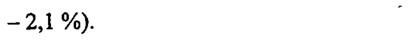
- стр. 17: «0,9 % (1/111 пациентов) при совместном применении с ингибиторами ДПП-4 и 1,7 %» — низкая уверенность: «ДПП-4» (63)  
  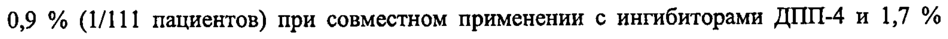
- стр. 18: «рецепторов ГПП-1 (76 пациентов), получали лусеоглифлозин в дозе 2,5 мг или 5 мг (при» — низкая уверенность: «ГПП-1» (74)  
  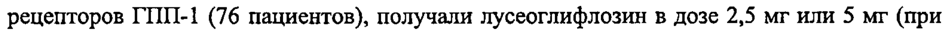
- стр. 18: «увеличении дозы препарата) перорально 1 раз в сутки до завтрака в течение 52 недель.» — низкая уверенность: «1» (67)  
  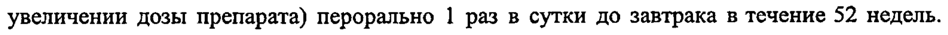
- стр. 18: «2 среднее значение, двусторонний 95 % доверительный интервал представлен в квадратных» — низкая уверенность: «2» (79)  
  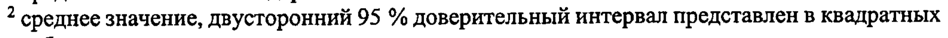
- стр. 19: «2,5 мг 100=223 | 1,11+0,546 | 11,2+1,05 1000 + 163» — низкая уверенность: «1,11+0,546» (74); повторное чтение: «м 100+223 | 11140546 | 122105 | 10002163»  
  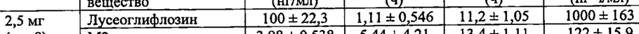
- стр. 19: «AUCo-24a на 7-й день применения составило 14,0 % и 14,8 % при использовании в дозах» — низкая уверенность: «AUCo-24a» (18)  
  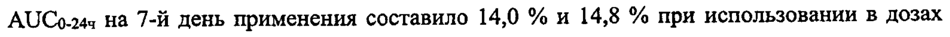
- стр. 20: «геометрических значений Cmax и АОСу-72ч и их 90 % доверительные интервалы составляли» — низкая уверенность: «АОСу-72ч» (74)  
  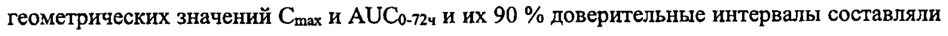
- стр. 22: «Глимепирид 1 мг 5 мг Лусеоглифлозин 1,00 1,00» — низкая уверенность: «1» (66); повторное чтение: «" Глимепирид | _ ivr SMP | Лусеоглифлозин | 7 _ 100 -_ | 7 1,00»  
  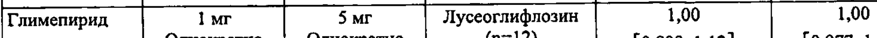
- стр. 22: «у Метформин 250 мг 5 мг Лусеоглифлозин 0,925 0,985» — низкая уверенность: «5» (58); повторное чтение: «| Метформин | 250мг | 5м | Лусвоглифловин | 095 | 0985»  
  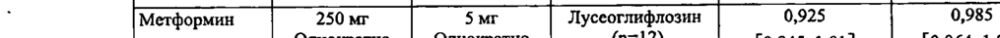
- стр. 23: «Миглитол 50 мг 5$ мг Лусеоглифлозин 0,851 0,953» — низкая уверенность: «5$» (35)  
  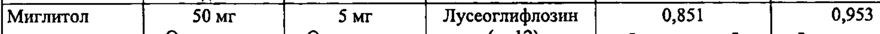
- стр. 23: «Пиоглитазон 30 мг 5 мг Лусеоглифлозин 1,16 0,939» — низкая уверенность: «5» (69); повторное чтение: «| Пноглитазон . —30мг — | _ our | Лусеоглифлозин | _ 1,16 . . 0,939»  
  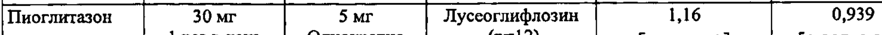
- стр. 23: «М-П! (n=12 1 Г ‚ 1,07]» — низкая уверенность: «1» (79), «1,07]» (45); повторное чтение: «WLI Geto) | (0,973, 1,11] (0,945, 1,07]»  
  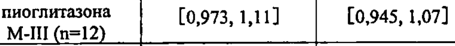
- стр. 23: «Ситаглиптин 50 мг 5 мг Лусеоглифлозин 0,967 0,986» — низкая уверенность: «5» (53); повторное чтение: «Ситаглиптин _ 50 мг 7 | ЭМГ _ Лусеоглифлозин | — 0,967 | 7 0,986»  
  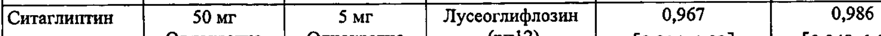
- стр. 23: «Фуросемид 40 мг 5 мг Лусеоглифлозин 1,07 1,13» — низкая уверенность: «5» (64); повторное чтение: «[Фуросемид ; 40 мг — _ OMT _ | Лусеоглифлозин 7 _1,07 —_ | _ LS»  
  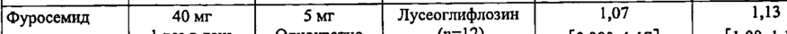
- стр. 23: «1 раз в лень Однократно (n=12) [0,980, 1,17] [1,08, 1,18]» — повторное чтение: «Гровдеь | Ошо | 9) | Cose1i7] | 008 ы8»  
  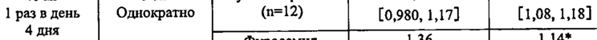
- стр. 23: «Гидрохлоротиа 25 мг 5 мг Лусеоглифлозин 1,16 1,11» — повторное чтение: «[Сидрохлоротиа | ; _25 мг _ | our | Луссоглифлозин | 7 16 _ В A»  
  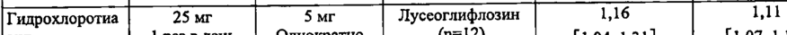
- стр. 23: «ЗиД 1 раз в день Однократно (n=12) (1,04, 1,31] (1,07, 1,16]» — низкая уверенность: «(1,07,» (27); повторное чтение: «зд | Тразвдень | Однокрао | (1) |  Поаазй | [107,116]»  
  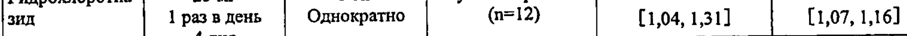
- стр. 23: «Значения AUCo.244 лусеоглифлозина в данной дозе были в 21-48 раз выше значения AUC,» — низкая уверенность: «AUCo.244» (65)  
  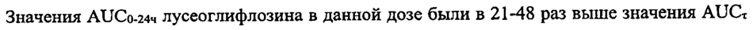
- стр. 24: «100 мг/кг у самок значения АО Со-24- лусеоглифлозина, при которых не было выявлено» — низкая уверенность: «Со-24-» (0)  
  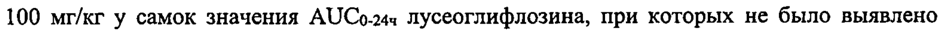
- стр. 24: «лусеоглифлозина. Значение AUCo.244 лусеоглифлозина для дозы 50 мг/кг, при которой не» — низкая уверенность: «AUCo.244» (31)  
  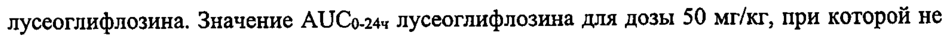
