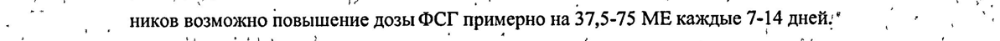
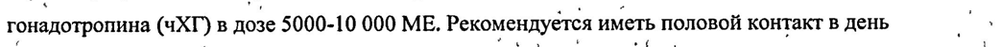
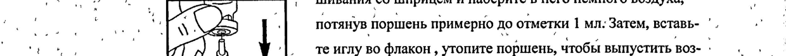

# Лутропин альфа — парентерально

- Препарат: Луверис® (лиофилизат для приготовления раствора для подкожного введения;)
- АТХ: G03GA07
- Источник: ГРЛС, инструкция по медицинскому применению, РУ П N015642/01, файл от 2025-11-01 (https://grls.rosminzdrav.ru/Grls_View_v2.aspx?routingGuid=254e513b-61f5-4ef7-86f6-6f4de3b1fad0)
- Распознано автоматически (OCR): 8 из 8 стр.
- Инструкция к другому РУ того же препарата: П N015642/01 (национальное РУ, переоформленное по правилам ЕАЭС, решение от 24.07.2020). Текст может быть старше действующего
- Сомнительных строк после OCR: 3 (см. раздел «Проверка распознавания»)

## Общие сведения

р | о) TI №015642/01-220911 — МИНИСТЕРСТВО ЗДРАВООХРАНЕНИЯ И СОЦИАЛЬНОГО РАЗВИТИЯ
РОССИЙСКОЙ ФЕДЕРАЦИИ ИНСТРУКЦИЯ | , по медицинскому применению лекарственного препарата .
JIYBEPHC® | у ( LUVERIS®) | Регистрационный номер: ‘
Торговое название препарата: Луверис® ь |
| ‹ Международное непатентованное название: Лутропин альфа i

## 3. Лекарственная форма

лиофилизат для приготовления раствора для подкожного введеHUA
лиофилизат для приготовления раствора для подкожного введеHUA

## 2. Состав

| Один флакон с лиофилизатом содержит:
| Один флакон с лиофилизатом содержит:
Действующее вещество: лутропин альфа 75 МЕ (3,4 мкг);
вспомогательные вещества: полисорбат 20 0,05 мг, метионин 0,1 мг, натрия гидрофосфата | дигидрат 0,825 мг, натрия дигидрофосфата моногидрат 0,052 мг, сахароза 47,75 мг, фосфорная кислота 4.5., натрия гидроксид 4.5. |
. Один флакон с растворителем содержит: | вода для инъекций - 1,0 мл.
Описание | Лиофилизат: лиофилизированный порошок или пористая масса белого цвета; |
` ‚ Растворитель: прозрачная бесцветная жидкость. , у Фармакотерапевтическая группа: Фолликулостимулирующее средство |
Код ATX: [G03GA07] :
1 | # ‘ $ р

И 2 ee ‚0 №015642/01-220911 :
| i. `Фармакологические свойства , а Ао и вый о
. i? Фармакодинамика Я | В и. о г. Г.“ 7 о Луверис” (лутропин альфа), рекомбинантный лютеинизирующий гормон (р-яЛГ), иден-’. 1” то | . ‹ ТИЧНЫЙ натуральному гормону человека, создан при помощи биотехнологических MeTO-. , - — | or . р ' дов. Он принадлежит к семейству гормонов, называемых гонадотропинами, которые уча... о ny й ствуют в физиологической регуляции репродуктивной функции. г’ '\е, _ ИИ р `` Луверис® компенсирует недостаток лютеинизирующего гормона в организме. Под BO3- ‘, 7 |
’ ’ :. действием Лувериса® происходит стимуляция образования эстрадиола фолликулами. Вве- ри

. ‘ ">" дение Лувериса® в середине цикла запускает процесс образования желтого тела и овуля- „`` р ’ цию.Введение Jlysepuca® B постовуляторный период поддерживает функционирование а. | ry, *% желтого тела." "я а ее : po : И 2 a Е
| ’ ‘ Фармакокинетика и.” ‘ ВИ | м .
ae - После подкожного введения препарат быстро распределяется по органам и тканям, абсо- А.
№ лютная биодоступность составляет примерно 60%; период полувыведения около 12 часов. Do oe Лутропин альфа обладает линейными фармакокинетическими свойствами. Препарат прак- 5“
° тически не накапливается в организме. В моче содержится менее 5% введенной дозы. ° ‘ *° о
, С Фармакокинетика лутропина альфа после однократного введения сравнима с таковой по- . ‘ |
.. | " сле многократного введения препарата Луверис®. ^^ п и,
. ' ао ‘ у ы yo ‘ ou ° ^ . . - . Показания к применению Е т a os Г р |
| - Лечение бесплодия, обусловленное гипоталамо-гипофизарными нарушениями, приводя- ‹` 7 |
* ‚ , Ao, . + ‹ 13 р te .
| ‚ щими к снижению уровня лютеинизирующего и фолликулостимулирующего гормонов в, . a | wo й организме. о . № о ня - : . И é | 7 у _ 2 ° | В | 4 | ' |
‚.* ° Противопоказания ‘ ^ po . | , о Повышенная чувствительность к лутропину альфа и к наполнителям, опухоли гипотала- |

: мо-гипофизарной области, гиперпролактинемия, заболевания надпочечников и щитовид- ~ - ной железы, персистирующее увеличение яичников, киста яичников ( не обусловленная | a
: . :
` наличием синдрома поликистозных яичников), поликистоз яичников, аномалии развития |
‘ ` половых органов’ (несовместимые с нормальным течением беременности), фибромиома — |
| матки, метроррагия (невыясненной этиологии), эстрогенозависимые опухоли ( рак яични- у |
| ков, рак матки, рак молочной железы), первичная недостаточность яичников, беремен- ‚ a
` ность, период лактации. | | : ИИ ое, ., в р 1‘ : в er вв, Га Г. TI №015642/01-220911 ..
о и Применение во время беременности и лактации . ' . took co = .. jf
‘ ' Нельзя принимать Луверис® при беременности или в период лактации. ‚, , 7 , | ee ‘.
a vo Способ применения и дозы О” , , | в ‚° a м | | oo
| ‘ Луверис® вводится подкожно. Раствор готовится непосредственно перед ‘инъекцией с uc . i 7 . ‘пользованием прилагаемого растворителя. Каждый флакон предназначен для однократно- - .
a ‚о го использования. о НЫ "ов ви юры |
| Обычно Луверис® вводят каждый день в течение 3 недель параллельно с инъекциями ›, т 1”
. i; фолликулостимулирующего гормона (ФСГ). Как правило начинают с дозы 75 МЕ препа- - | _
` ‚ ` ’ “ + . .
а ° рата Луверис® (1 флакон) вместе с 75 МЕ или 150 МЕФСГ ‚ В зависимости от ответа яич- , a ‚ _ ников возможно повышение дозы ФСГ примерно на 37,5-75 МЕ каждые 7-14 дней." a, №
'. В ряде случаев бывает необходимо продление лечения до 5 недель, ‘. о oo. =’ ;
| й ° При достижении желаемого результата через 24-48 часов после последней инъекции пре- о | A
Г ` парата Луверис® и ФСГ проводится однократная инъекция человеческого хорионического , | гонадотропина (чХГ) в дозе 5000-10 000 МЕ. Рекомендуется иметь половой контакт в день , _
| Ce введения человеческого хорионического гонадотропина и на следующий день. | |
| ° | В качестве альтернативы могут быть использованы вспомогательные репродуктивные |
ОИ технологии., °` ° ; vs . 7 | . ’При чрезмерном/избыточном ответе нужно прекратить лечение и отменить введение 4uXT 7
. | (см. «Побочные эффекты»). Лечение можно возобновить в течение следующего цикла с |
— использованием более низкой дозы ФСГ, чем во время предыдущего цикла. : |
| -. | :
’ Побочноедействие . ; | .. | , ; Г’ ео"
. ` Наиболее частыми среди описанных побочных эффектов являются головная боль, болив , | а животе, в молочных железах, тошнота, рвота, СОНЛИВОСТЬ И КИСТЫ яичников. . . | |
В ряде случаев наблюдались местные проявления в месте введения препарата (боль, по- | краснение, зуд, припухлость и кровоподтеки). st
Лечение препаратами ФСГ и лютеинизирующего гормонов (ЛГ) с последующим введени-° о `. емчеловеческого хорионического гонадотропина (чХГ) может привести к гиперстимуля- °)
ЦИИ ЯИЧНИКОВ. Симптомами гиперстимуляции являются боли в нижней части живота, возо Можно, в сочетании с тошнотой, рвотой и потерей веса. Если у Вас возникают сильные
| | „боли в животе в сочетании с перечисленными симптомами, не делайте больше инъекций- о т ` и, как можно скорее, поговорите со своим врачом. | | ; er
. 3 . »_" = & ' и ‚:

о’ а... __ А 0№15642/01-2200 1 — ds to , . “у Oo " a И ; .

ch _ В редких случаях при применении подобных препаратов наблюдался тромбоз вен, следо- , | ‚ |

Ь О. вательно, это возможно и при применении Лувериса®. : ee |

mt | . ‚ Не описано случаев перекрута кисты яичника и кровотечения в брюшную полость при ‘ г. '

я | применении препарата Лувериса*, однако, в редких случаях подобные нарушения возни- os

"hy _ | ` кали после лечения человеческим менопаузальным гонадотропином (+МГ), выделенным ве |

Le ; , из мочи и содержащим лютеинизирующий гормон. о, | | 7 oo , c /

‚ ` Может развиться внематочная ‘беременность, особенно у женщин с первичным поражени- — ``

'/.: с ем маточных труб в анамнезе. и’ о . р мы Г :

; г ` В случае обнаружения пациенткой каких-либо He упомянутых выше побочных эффектов, ° =

| . ей следует обратиться кврачу: ; 18 _ р о : ote a Gg | oe

’ . он a , о“ В ` ' 2 7 Fe q aT ? `

’ | Передозировка - ., a о В ва _ yes

noes Симптомы передозировки препаратом Луверис® неизвестны. Однократное введение до ` и |

| 40000 МЕ лютропина альфа хорошо переносилось и не сопровождалось тяжелыми побоч- = ‘

, ными эффектами. Тем He менее, при передозировке существует вероятность возникновения о |

| „’ 7 | синдрома гиперстимуляции яичников... › ae - 7 a . | а, |

_ Взаимодействие с другими лекарственными средствами. ah ‘ ‚ г . |

вм ° Пациентке необходимо информировать врача о всех лекарственных средствах (в том чис- -

г . ле безрецептурных), которые она принимает в настоящее время или недавно принимала. 8.

| Не следует смешивать Луверис® с другими лекарственными веществами в одном шприце, ,

и _ ‚ 3a исключением фоллитропина альфа. Исследования показали, что эти два препарата ;

в можно смешивать и ВВОДИТЬ одновременно, это не влияет на их терапевтическую актив- `` |

| | о‘ ность, : a Го | ы : 7 ste т, |

‘ t ? oo ’. | , | | ” 7 ‘ у |

о : J у , 1 7 | | , . Г 7 | "г , , у , 4 а 7 ey В в +4. ' Особыеуказания ‘_ к и. . | . a и < ^ © 2

| . Перед началом лечения необходимо проверить фертильность у пациентки и ее партнера. _ |

| Концентрация лютеинизирующего гормона в крови считается низкой, если уровень эндо- › ‘' _

, генного гормона в сыворотке крови ниже 1,2 ME/a. Препарат используется в комбинации a ;

as ‘с ФСГ, чтобы способствовать росту и развитию фолликулов, содержащих яйцеклетки. Tlo- + а |

сле этого лечение продолжается однократным введением чХГ, который приводит к вы- ` ; ..

свобождению яйцеклеток из фолликула (овуляции). у ‚о | oO

. | Лечение этим препаратом повышает риск возникновения состояния, называемого синдро- , “ .

MOM гиперстимуляции яичников (см. также раздел «Побочное действие»). Однако; при ‘

ка тщательном подборе дозы и схемы введения, синдром гиперстимуляции яичников возни- т |

, ‘ , 4 ,
7 So a , о 0. + 0№015642/01-220911 ›_
> iy г ° , ..! р '. о | | и __‹ кает редко. Лечение препаратом Луверис® редко вызывает серьезную форму гиперстиму- ', г’. & ЛЯЦИИ, если для окончательного созревания фолликулов не назначается препарат, содер- ` : | т | жащий чХГ. Таким образом, важно не принимать чХГ в случае возникновения синдрома `, a ..
ga и гиперстимуляции яичников И воздержаться от половых контактов или использовать про- ‘| .
с ® ча" : тивозачаточные средства барьерного типа в течение четырех дней как минимум: ° р о
, 7 ° Необходимо тщательное наблюдение за ответной реакцией со’стороны яичников при по- б.н 4 « ‘ ‘ £ : й } < a ‘ й р у
, : . 0 | мощи ультразвукового исследования и анализов крови перед началом курса лечения и во би
Z ys | время него. —` J и р О и,’ 7 т р Г и У больных, проходящих лечение, возрастает частота многоплодных беременностей ‘(глав- пе
‘ным образом двойни) и родов. Однако ее можно минимизировать, если придерживаться. у |
+, -_ рекомендованной дозы и схемы приема. ‚’.. . a af re И |
: + Benn у пациентки отмечаются аллергические реакции Ha аналогичные препараты, ей сле- ‚ у | дует проинформировать об этом своего лечащего врача. : | .. `` ?
В том случае, когда пациентка забыла ввести очередную дозу препарата Луверис®, нельзя |
_ ‘ (вводить двойную дозу, а следует обратиться к врачу. - ' _ | |
; Не использовать флакон при наличии признаков повреждения препарата, таких как изме- | 4 ы : р ь , ‘ .
` нение цвета порошка или повреждение флакона... - т
> ¢ ; ` , у у : и 4 , , , , 1 , и os В Препарат должен использоваться сразу после растворения. , | о . |

` Неследует вводить раствор, если он непрозрачен или содержит твердые частицы. р
| . oo | | у | - Если пациентка вводит Луверис® самостоятельно, ей следует внимательно прочи-, .
| р тать и строго следовать нижеприведенной инструкции по введению препарата: |
. ® Вымойте руки. Важно, чтобы Ваши руки и предметы, которые Вы используете, - И
° были настолько чистыми, насколько это возможно. о | , и Подготовьте чистую поверхность и разложите Boe Ha ней: ..^ _ :
| - тонкая игла для подкожного введения, ‘` | | |
. —, один флакон препарата Луверис”, , a | и
‚. = один флакон с растворителем, , т в ., т два тампона, смоченных спиртом 7 a р о

- , 18 один шприц, . pe | , rye a,
(my одна игла для растворения порошка в растворителе, „я т
, = @ ‘контейнер для острых предметов для безопасной утилизации стеклянных о a |, деталей и игл. . 7 | | о 7 ..
ООС ОЗИХ 'П №015642/01-220911 °’.
e . 'Удалите защитную крышку с флакона с растворителем. Соедините иглу для смеИ п = ! шивания со iene и наберите в него немного воздуха, ; у |
- oo, О Пе потянув поршень примерно до отметки 1 мл: Затем, вставь- '. yo:
Е 7 р | aC, у . теиглу во флакон , утопите поршень, чтобы выпустить воз- | И о к r 1 i дух, и плавно наберите весь растворитель. ^.'`' ВН -
, : a ‘ С - | : evan an Осторожно положите шприц на рабочую поверхность, ста-. | — | и а. т ——> ’ раясь не трогать иглу. r ue | =
| er Приготовьте раствор для инъекции: удалите защитную крышку флакона с прёпара- st .
| ut PR? ; "TOM, возьмите шприц, проткните иглой резиновую пробкуи , в 7 | м, | о’. "22 . медленно введите растворитель BO ibaaxen с препаратом. | в“ | ей fj": ‚ Плавно покачайте флакон, He вынимая иглы. Не трясите о мы , о (4 `` |. После того как порошок растворится (что обычно происхо- | -
. о ` дит сразу), убедитесь, что полученный раствор прозрачен и не содержит твердых частиц. * |
И | Переверните флакон и плавно наберите раствор обратно в шприц: — | ``.
- ‚ ‘ Moxktto также смешивать Луверис® и фоллитропин альфа в качестве альтернативы раз- °_ о о ° дельному введению каждого препарата. После растворения ‘препарата Луверис®, наберите ‘
` раствор обратно в шприц и повторно введите его в контейнер с препаратом фоллитропина ен + альфа. Как только препарат растворится, наберите раствор обратно в шприц. Осмотрите - |
' ‘ero на предмет наличия твердых частиц как и в предыдущем случае и не используйте рас- ° | |
| твор, если он не прозрачен. os

_ a, Bima PACTES PEI MUAH истор до 3 флаконов с препаратом. а р .,
' ‘ ‚ ® Замените иглу на тонкую и выпустите пузырьки воздуха: если в шприце видны пу: Hoa:
, т | Е» зырьки воздуха, направьте шприц иглой вверх и осторожно , oo a р =. постучите по нему, пока BEC воздух He скопится вверху. _ !
, Cook, aos = Плавно надавите Ha поршень, чтобы удалить воздух. у у
. Введите раствор сразу: Ваш лечащий врач или медсестра посоветуют, куда произ-. a. |
| ‚ водить инъекцию (например, предплечье, передняя поверх- . |
. о... ы В: ‚ НОСТЬ бедра). Протрите выбранную область тампоном, смо- ` В т : —_ | wa: ченным спиртом. Соберите кожу B складку ибыстрым дви с.
ь <<” I, жением введите иглу под углом 45-90°, Введите препарат о о ae под кожу, как Вас обучали. Не вводите содержимое непо- a

| =" 4 средственно в вену. Вводите раствор путем плавного Ha- , wo,
. «6 П №015642/01-220911° ‹ давливания на поршень. Используйте столько времени, сколько Вам потребуется, чтобы ввести весь раствор. Сразу после этого выньте иглу и круговыми движениями протрите о.
| | кожу тампоном, смоченным спиртом. $ ‚о ПИ
. Выбросите все использованные предметы: как только Вы закончили введение пре- | 7 |
| ` парата, немедленно поместите все иглы и пустые стеклянные емкости в контейнер | для острых предметов. Неиспользованный раствор должен быть выброшен. =
‘ : | ® | ‘ | Влияние на вождение автомобиля и управление другими механизмами. ,
| Не влияет. . О ы ; в:
| Форма выпуска ‚ и г my Лиофилизат для приготовления раствора для подкожного введения 75 МЕ.
По 75 МЕ лутропина альфа во флаконы бесцветного прозрачного стекла тип I (Евр. Ф.) | вместимостью 3 мл, укупоренные резиновой пробкой, уплотненной сверху алюминиевым af колпачком с отрывающейся пластмассовой крышечкой типа «Flip off». . |
| ’ TIo 1 Ma растворителя (вода для инъекций) во флаконы из бесцветного прозрачного стекла
‚ + тии Г (Esp. Ф.) вместимостью 2 мл, укупоренные резиновой пробкой, уплотненной сверху | алюминиевым колпачком с отрывающейся пластмассовой крышечкой типа «Flip off».
| По 1, 3 или 10 флаконов лиофилизата в комплекте с растворителем (1, 3 или 10 флаконов) в пластиковом контейнере вместе с инструкцией по применению в картонной пачке. у ; :

## 6.4. Условия хранения

| .
| .
‘ В оригинальной упаковке в защищенном от света месте при температуре не выше 25 °С.
Хранить в недоступном для детей месте. .

## 6.3. Срок годности

| , Лиофилизат — 3 года.
| , Лиофилизат — 3 года.
| Растворитель — 3 года, Не использовать после срока годности, указанного на упаковке. , |
Условия отпуска из аптек , По рецепту. у | 7 :
| П№015642/01-220911.

Наименование и адрес юридического лица, на имя которого выдано регистрацион- | ное удостоверение |
Мерк Сероно C.n.A., Италия Виа Касилина 125, 00176 Рим, Италия |
Выпускающий контроль качества:
Мерк Сероно С.п.А.
Виа делле Маниолие 15 | р | (район Индустриальной зоны)
70026 Модугно (БА), Италия Производитель готовой лекарственной формы, фасовка и упаковка: |
Мерк Сероно С.А., Филиал Обонн, Швейцария , .
Претензии потребителей и информацию о нежелательных явлениях следует на- | правлять по адресу:

"Представительство компании Арес Трейдинг С.А."
Российская Федерация, 125445 Москва, ул.Смольная 24Д, офис ООО "Мерк"

Тел.: (495) 9373304, | | Факс: (495) 9373305

E-mail: safety@merck.ru

|

ips:
Менеджер по регуляторным вопросам \= Моргунова Е.В.
А бани. | \ (Швейцария 7) fe if
## Проверка распознавания

Страницы-сканы распознаны автоматически. В 3 строках с дозировками цифры могли распознаться с ошибкой — сверьте с вырезкой из оригинала:

- стр. 3: «a ‚ _ ников возможно повышение дозы ФСГ примерно на 37,5-75 МЕ каждые 7-14 дней." a, №» — повторное чтение: «. a _ НИКОВ возможно повышение дозы ФСГ примерно на 37,5-75 ME каждые 7-14 дней" В . С.»  
  
- стр. 3: «гонадотропина (чХГ) в дозе 5000-10 000 МЕ. Рекомендуется иметь половой контакт в день , _» — повторное чтение: «гонадотропина (чХГ) B nose 5000-10 000 ME. Рекомендуется иметь половой контакт в день , | :»  
  
- стр. 6: «- oo, О Пе потянув поршень примерно до отметки 1 мл: Затем, вставь- '. yo:» — повторное чтение: «| ; | | | .. | Е N45 | | cm pit в от мот ети. : . ; | )»  
  
