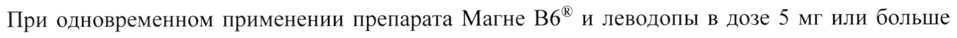

# Магния лактата дигидрат + Пиридоксина гидрохлорид — внутрь

- Препарат: Магне B6® (раствор для приема внутрь;)
- АТХ: A12CC06
- Источник: ГРЛС, инструкция по медицинскому применению, РУ П N013203/02, файл от 2023-05-22 (https://grls.rosminzdrav.ru/Grls_View_v2.aspx?routingGuid=ad291912-94f1-4e36-ab97-129d48bcb296)
- Распознано автоматически (OCR): 7 из 7 стр.
- Инструкция найдена по торговому наименованию: Магне B6®, РУ П N013203/02
- Сомнительных строк после OCR: 1 (см. раздел «Проверка распознавания»)

## Общие сведения

МИНЗДРАВ РОССИИ | № 780221 | 7 ее | cOrAMCOBAHO |
МИНИСТЕРСТВО ЗДРАВООХРАНЕНИЯ РОССИЙСКОЙ ФЕДЕРАЦИИ
ИНСТРУКЦИЯ ПО МЕДИЦИНСКОМУ ПРИМЕНЕНИЮ ЛЕКАРСТВЕННОГО ПРЕПАРАТА
Магне B6®

Регистрационный номер:

Торговое наименование: Магне В6*®

Международное непатентованное наименование: -

## 3. Лекарственная форма

раствор для приема внутрь
раствор для приема внутрь

© Состав

В 1 ампуле содержится:

действующие вещества: магния лактата дигидрат* - 186 мг, магния пидолат* - 936 мг,

пиридоксина гидрохлорид - 10 мг;

вспомогательные вещества: натрия дисульфит, натрия сахаринат, ароматизатор вишнево-

карамельный, вода очищенная.

* - эквивалентно суммарному содержанию магния (Mg++) 100 мг.

Описание

Прозрачная жидкость коричневого цвета с запахом карамели.

Фармакотерапевтическая группа: магния препарат.

w Код ATX: A11JB.

Фармакологические свойства

## 5.1. Фармакодинамика

Магний является жизненно важным элементом, который находится во всех тканях организма

и необходим для нормального функционирования клеток, участвует в большинстве реакций

обмена веществ. В частности, он участвует в регуляции передачи нервных импульсов и в

сокращении мышц. Организм получает магний вместе с пищей. Недостаток магния в

организме может наблюдаться при нарушении режима питания (диета) или при увеличении

потребности в магнии или при дисбалансе поступления магния в организм (в том числе

опосредованном снижении уровня магния в продуктах питания), метаболизма и выведении

магния (например, при повышенной физической и умственной нагрузке, стрессе, в период беременности, при применении диуретиков). Пиридоксин (витамин Во) участвует во многих метаболических процессах, в регуляции метаболизма нервной системы. Витамин Во улучшает всасывание магния из желудочно-кишечного тракта и его проникновение в клетки.
Магний и пиридоксин обладают синергичными эффектами.

## 5.2. Фармакокинетика

Всасывание магния в желудочно-кишечном тракте составляет не более 50% от принимаемой внутрь дозы. 99% магния в организме находится внутри клеток. Примерно 2/3 внутриклеточного магния распределяется в костной ткани, а другая 1/3 находится в гладкой и поперечно-полосатой мышечной ткани. Магний выводится преимущественно с мочой (по
Всасывание магния в желудочно-кишечном тракте составляет не более 50% от принимаемой внутрь дозы. 99% магния в организме находится внутри клеток. Примерно 2/3 внутриклеточного магния распределяется в костной ткани, а другая 1/3 находится в гладкой и поперечно-полосатой мышечной ткани. Магний выводится преимущественно с мочой (по
© меньшей мере, 1/3 от принятой дозы магния).

## 4.1. Показания к применению

Установленный дефицит магния, изолированный или связанный с другими дефицитными состояниями, сопровождающийся такими симптомами, как:
Установленный дефицит магния, изолированный или связанный с другими дефицитными состояниями, сопровождающийся такими симптомами, как:
- повышенная раздражительность, незначительные нарушения сна;
- желудочно-кишечные спазмы или учащенное сердцебиение;
- повышенная утомляемость, боли и спазмы мышц, ощущение покалывания в мышцах.

## 4.3. Противопоказания

— Повышенная чувствительность к действующим веществам и любым другим компонентам препарата.
— Повышенная чувствительность к действующим веществам и любым другим компонентам препарата.
w — Почечная недостаточность тяжелой степени (клиренс креатинина менее 30 мл/минуту).
— Детский возраст до 1 года.
— Одновременный прием леводопы (см. раздел «Взаимодействие с другими лекарственными средствами»).

## 4.3. С осторожностью

Почечная недостаточность средней степени тяжести (риск развития гипермагниемии).
Почечная недостаточность средней степени тяжести (риск развития гипермагниемии).

## 4.6. Применение при беременности и в период грудного вскармливания

Беременность

Клинический опыт применения препарата у достаточного количества беременных женщин не выявил какого-либо неблагоприятного влияния на возникновение пороков развития плода или фетотоксического действия.
Препарат Магне B6® может применяться в период беременности только при необходимости, по рекомендации врача.
Период грудного вскармливания Магний проникает в грудное молоко. Следует избегать применения препарата в период лактации и кормления грудью.

## 4.2. Способ применения и дозы

Перед приемом препарата необходимо проконсультироваться с врачом.
Перед приемом препарата необходимо проконсультироваться с врачом.
© ene | ems a 2 me Взрослые 3-4 ампулы разделить на 2-3 приема.
10-30 мг магния/кг массы тела | Принимать во время еды.
Дети старше 1 года (масса (0,4 — 1,2 ммоль магния/кг) Раствор из ампул перед тела более 10 кг) или прив я р 1-4 ампулы У> стакана воды.
Препарат может использоваться для детей от I года.
Лечение следует прекратить сразу же после нормализации концентрации магния в крови.
Инструкция по приготовлению питьевого раствора
© == Возьмите стакан и наполните его водой наполовину ra
>) Ампулы с Магне B6® He требуют использования пилочки. Чтобы открыть ампулу, возьмите ампулу за кончик, предварительно прикрыв ее куском ткани
ЗА as Резким движением отломите кончик сначала с одного заостренного конца.
Направьте открытый первый конец ампулы в стакан с водой под углом так, чтобы второй кончик ампулы не находился над стаканом.
A Отломите второй кончик ампулы, и ее содержимое выльется в стакан
| ре Самонадламывающиеся ампулы с Магне B6 не требуют использования
[© пилочки. , - Побочное действие По данным Всемирной организации здравоохранения (ВОЗ) нежелательные реакции классифицированы в соответствии с частотой их развития следующим образом: очень часто (> 1/10), часто (>1/100, <1/10), нечасто (>1/1000, <1/100), редко (>1/10000, <1/1000), очень редко
(<1/10000), частота неизвестна (по имеющимся данным нельзя определить частоту возникновения нежелательных реакций).
Нарушения со стороны иммунной системы: частота неизвестна - реакции повышенной чувствительности, тяжелые аллергические реакции, в том числе, бронхоспазм.
Нарушения со стороны кожи и подкожных тканей: частота неизвестна - кожные реакции
(крапивница, зуд).
Нарушения со стороны желудочно-кишечного тракта: частота неизвестна - диарея, боль в ww животе.

## 4.9. Передозировка

Симптомы При нормальной функции почек передозировка магния при его приеме внутрь обычно не приводит к возникновению токсических реакций. Однако в случае почечной недостаточности возможно развитие отравления магнием.
Симптомы При нормальной функции почек передозировка магния при его приеме внутрь обычно не приводит к возникновению токсических реакций. Однако в случае почечной недостаточности возможно развитие отравления магнием.
Симптомы передозировки, выраженность которых зависит от концентрации магния в крови:
снижение артериального давления; тошнота, рвота; угнетение центральной нервной системы, снижение рефлексов; изменения на электрокардиограмме; угнетение дыхания, кома, остановка сердца и паралич дыхания; анурический синдром.
Лечение Регидратация, форсированный диурез. При почечной недостаточности необходимы гемодиализ или перитонеальный диализ.

## 4.5. Взаимодействие с другими лекарственными средствами

С леводопой При одновременном применении препарата Магне B6® и леводопы в дозе 5 мг или больше уменьшаются эффекты леводопы. Поэтому у пациентов, принимающих леводопу, препарат
Магне B6® следует назначать одновременно с ингибиторами периферической допадекарбоксилазы.
© С препаратами, содержащими фосфаты, соли кальция или ионы железа

Одновременное применение препаратов, содержащих фосфаты, соли кальция или ионы железа не рекомендуется, поскольку такие препараты снижают всасывание магния в кишечнике.
С тетрациклинами (для приема внутрь)
Препарат Магне B6® следует назначать, по крайней мере, не ранее чем через 3 часа после приема тетрациклина внутрь (так как препараты магния уменьшают всасывание тетрациклинов).
С хинолонами Хинолоны следует назначать, по крайней мере, за 2 часа до или через 6 часов после приема препарата Магне В6® для того, чтобы избежать нарушения всасывания хинолонов.

## 4.4. Особые указания

| © В случае тяжелой степени дефицита магния или синдрома мальабсорбции, лечение начинают с внутривенного введения препаратов магния.
В случае сопутствующего дефицита кальция, рекомендуется устранить дефицит магния до начала приема препаратов кальция или пищевых добавок, содержащих кальций.
При частом употреблении слабительных средств, алкоголя, напряженных физических и психических нагрузках потребность в магнии возрастает, что может привести к развитию дефицита магния в организме.
Раствор для приема внутрь содержит сульфит, который может вызывать или усиливать проявления аллергических реакций, включая анафилактические реакции, особенно у пациентов группы риска.

При применении пиридоксина в высоких дозах (более 200 мг в сутки) в течение длительного времени (в течение нескольких месяцев или лет) может развиться сенсорная аксональная нейропатия (основной симптом хронического злоупотребления пиридоксином), которая сопровождается такими симптомами, как онемение и нарушения проприоцептивной чувствительности, тремор дистальных отделов конечностей и постепенно развивающаяся сенсорная атаксия (нарушения координации движений). Эти нарушения обычно являются обратимыми и проходят после прекращения приема пиридоксина.

## 4.7. Влияние на способность управлять транспортными средствами, механизмами

Не влияет. Особых рекомендаций нет.

## 6.5. Форма выпуска

Раствор для приема внутрь.
Раствор для приема внутрь.
По 10 мл препарата в ампулы темного стекла, запаянные с двух сторон. По 10 ампул в упаковочном вкладыше из картона вместе с инструкцией по применению помещают в картонную пачку.

## 6.3. Срок годности

3 года.
3 года.
Препарат нельзя применять после истечения срока годности.
~ Условия хранения

В защищенном от света месте при температуре не выше 25 °С.
Хранить в недоступном для детей месте.
Условия отпуска Отпускают без рецепта.
Юридическое лицо, на имя которого выдано регистрационное удостоверение
Санофи-Авентис Франс, Франция.
Sanofi-Aventis France, France.

Производитель Кооперасьон Фармасетик Франсэз, Франция.
Cooperation Pharmaceutique Francaise, France.
Place Lucien Auvert, 77020 MELUN, France.
Организация, принимающая претензии потребителей:
АО «Санофи Россия»
125009, г. Москва, ул. Тверская, 22.
Телефон: (495) 721-14-00.
Факс: (495) 721-14-11. М © V AOL ON / Ve IN aN
|| [«Canogu-asenuge 2 fy» \ С \ НЫ (Франц ea
Специалист по регистрации \\ 8 —— АЕ Симонова Е.В.
\\ co \ San fear | nee OLE 5 /]
## Проверка распознавания

Страницы-сканы распознаны автоматически. В 1 строках с дозировками цифры могли распознаться с ошибкой — сверьте с вырезкой из оригинала:

- стр. 5: «При одновременном применении препарата Магне B6® и леводопы в дозе 5 мг или больше» — низкая уверенность: «B6®» (67)  
  
