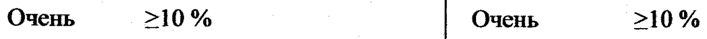
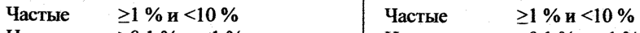
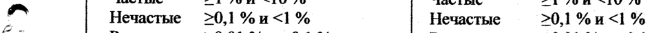
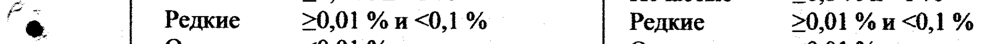

# Медроксипрогестерон — парентерально

- Препарат: Депо-Провера® (суспензия для внутримышечного введения;)
- АТХ: L02AB02
- Источник: ГРЛС, инструкция по медицинскому применению, РУ П N008862/01, файл от 2024-05-16 (https://grls.rosminzdrav.ru/Grls_View_v2.aspx?routingGuid=cdd5529b-780e-41d5-9fd9-90d4d13df77f)
- Распознано автоматически (OCR): 5 из 5 стр.
- Инструкция к другому РУ того же препарата: П N008862/01 (национальное РУ, переоформленное по правилам ЕАЭС, решение от 27.04.2024). Текст может быть старше действующего
- Сомнительных строк после OCR: 4 (см. раздел «Проверка распознавания»)

## Текст

- ’ П№008862/01-110913
МИНИСТЕРСТВО ЗДРАВООХРАНЕНИЯ РОССИЙСКОЙ ФЕДЕРАЦИИ
ИНСТРУКЦИЯ ы по применению лекарственного препарата для медицинского применения
| ДЕПО-ПРОВЕРА® ES Суспензия для внутримышечного введения 150 мг/мл
^^” «файзер МФГ. Бельгия H.B.», Бельгия ©. ы . 7 * ` - -- . .
их Изменение № 1 me и ® Дата внесения Изменения « » 110913 20 or.
Старая редакция Новая редакция ПОБОЧНОЕ ДЕЙСТВИЕ ПОБОЧНОЕ ДЕЙСТВИЕ
Частота нежелательных реакций Частота нежелательных реакций представлена по следующей представлена по следующей классификации: классификации:
Очень 210% Очень >20% частые частые Частые 21%и <10% Частые >1%и <10% г Нечастые >0,1%и<1% Нечастые >0,1 %Жи<1% f “e Редкие >0,01 %и <0,1% Редкие >0,01 %и <0,1 %
| Очень <0,01 % Очень <0,01 % :
редкие редкие Частота Невозможно определить Частота Невозможно неизвестн Ha основании неизвестна — определить на | а имеющихся данных основании имеющихся данных ТЕ
Со стороны половых органов и | | молочной железы aoe:
Очень Дисфункциональные Со стороны половых органов и ned частые | маточные кровотечения | | | молочной железы в 4
(нерегулярные, обильные, Очень дисфункциональные г; | скудные), аменорея. частые | маточные кровотечения ONES
Частые | Снижение либидо или (нерегулярные, обильные, И | e аноргазмия, — дисменорея, скудные), аменорея. | | лейкорея, § болезненность Частые | дисменорея, лейкорея, = | молочных желез, вагинит. болезненность молочных 7 cocks
| П N008862/01-110913 | Изменение №1 к инструкции П №008862/01-22012013 С. 2
‚© астения/усталость, | тракта Очень боли и дискомфорт в
| частые _| животе. метеоризм, вздутие — живота, тошнота. Со стороны:-кожи и подкожных
| Со стороны скелетно-мышечной и | | | соединительной ткани
№ Частые | боли в спине и суставах, | судороги икроножных MBI. а
| мыш.
| Очень | нервозность.
Очень Повышение массы тела на [очень | Hepnoatoens, частые | более 4,5 кг через 24 Частые | астения/усталость, | месяца, кровотечения. депрессия, бессонница,
Частые | Отеки/задержка жидкости в снижение либидо или жара.
: Побочные эффекты, выявленные в ходе || Очень повышение массы тела на постмаркетинговых исследований и частые | более 4,5 кг через 24 месяца, кровотечения.
^ частота которых не уточнена Частые | отеки/задержка жидкости e Со стороны | Обморок, тахикардия, в организме, «приливы» |
| сердечно- тромбоэмболические жара.
| сосудистой нарушения (в том | | системы числе, тромбоэмболия | | Побочные эффекты, выявленные в ходе легочной артерии, - тромбоз глубоких вен | ПОСТмаркетинговых исследований и нижних конечностей), | | частота которых не уточнена | _
| | тромбофлебит, oe варикозное Со — стороны | обморок, Е:
| расширение вен. сердечно- — тахикардия, :
Со стороны | Изменения аппетита. сосудистой тромбоэмболическ renee желудочно- | нарушение работы | | | СИСТЕМЫ ие ‘нарушения (6) | ты кишечного желудочно-кишечного том _ числе, || — *
— тракта Tpakta, § нарушение .. | TpomGosmGomns ЕЕ
® функции ечбви, легочной артерии, os желтуха, в том числе | | тромбоз глубоких т холестатическая, | Вен Ds НИЖНИХ росс:
| | ректальное - - конечностей. ||. PERE PS
Ты А 489 IT N008862/01-110913 Изменение №1 к инструкции П N008862/01-22012013 С. 3
| [кровотечение, жажда. | тромбофлебит, Со стороны | Анемия, варикозное |
| крови и | патологическое расптирение вен.
e лимфатическ | изменение клеток Со — стороны | изменения ой системы крови или элементов желудочно- аппетита, свертываемости кишечного расстройства
DOBH. тракта желудочно- | Со стороны | Остеопороз, в редких кишечного тракта, скелетно- случаях с нарушение мышечной и | остеопоретическими функции печени, соединительн | переломами, повышение | 7 ой ткани судороги. активности |.
Со стороны | Паралич, паралич _| «печеночных» г a нервной лицевого нерва, трансаминаз, of} системы парестезия, желтуха, в том
| | сонливость. числе _ Со стороны | Одышка и астма, холестатическая, ы дыхательной | охриплость голоса. кровотечение = из системы рямой кишки.
Со стороны | Гирсутизм, Со — стороны | анемия, кожи и | повышенная крови и | патологическое подкожных потливость, сухость лимфатическо | изменение клеток | тканей кожи, склеродермия, | | | Йсистемы крови или гиперпигментация на элементов р | лице и теле (мелазма, свертываемости хлоазма) рови. |
Со стороны | Рак шейки матки, рак | | | Co — стороны | остеопороз, в половых молочной железы, скелетно- редких случаях с | органов и | отсутствие мышечной — и | остеопоретическим молочной восстановления соединительно | и переломами.
” железы фертильности, й ткани | - $ незапланированная Со — стороны | паралич, паралич беременность, нервной лицевого нерва, снижение лактации, | | | системы парестезия, изменение — размера сонливость. | молочных желез, Со — стороны | одышка и ee уплотнения в дыхательной обострение молочных железах системы бронхиальной rae win кровянистые | | астмы. _ bees выделения из сосков, Со — стороны | гирсутизм, галакторея, кожи и | повышенная | a повышение — либидо, подкожных ПОТЛИВОСТЬ, г: - гиперплазия матки, тканей сухость . кожи, | | | т мочеполовые ‚ склеродермия, © fea beta | инфекции, кисты, гиперпигментация р:
5 бели, боли внизу на лице и теле ot | живота, выделения из | (меланодермия, Pane eh ay влагалища, эрозия хлоазма) _ ТН
— | [meat матки, о the _ | чродолжительная _ Pek epee : ¥ в ОИ
IT N008862/01-110913 Изменение №1 к инструкции IT N008862/01-22012013 С. 4 ановуляция, половых рак молочной мастодиния, органов и | железы, отсутствие повышенная молочной восстановления
@ чувствительность железы фертильности, | сосков молочных незапланированная желез, диспареуния. беременность, | из Прочие — Боль в области | снижение — . | _ грудной клетки, лактации, Pf е реакции нагрубание гиперчувствительност молочных — желез, и (например, уплотнения B
: анафилаксия и молочных железах анафилактоидные | или :: ‘кровянистые.
реакции, выделения из a ангионевротический | сосков, галакторея, отек), лихорадка, гиперплазия матки,
— реакции в месте мочеполовые ®. инъекции (боль, инфекции, кисты уплотнение в месте влагалища, боли инъекции, изменение внизу живота, окраски кожи в месте выделения из инъекции, влагалища, эрозия | |. |
«стерильный» шейки матки, | абсцесс), озноб, продолжительная припухлость B ановуляция, области мастодиния, подмышечных повышенная впадин, снижение чувствительность толерантности к сосков молочных глюкозе. желез, ев диспареуния.
e психики | Прочие реакции ::
гиперчувствительн ости (например, oe анафилаксия и | 4 анафилактоидные Phe реакции, В ангионевротически й отек), лихорадка, ne реакции в месте | инъекции = (боль, |
__ | уплотнение в месте инъекции, 4 $ изменение окраски ie
| кожи во месте 1 | «стерильный» | | | р. oe aOcuecc), __ озноб, ЕЕ |
НН. те П N008862/01-110913 Изменение №1 к инструкции IT N008862/01-22012013 С. 5
Старая редакция Новая редакция припухлость B области подмышечных e впадин, снижение толерантности к глюкозе, — жажда, охриплость голоса.
„Руководитель отдела регистрации . Noe AY
Пфайзер Эйч. Cu. Пи. Корпорэйшн aw В В А. В. Сергеев
Г ef РЕГИСТЕВИЙ ae } Е low ye Ех и ® ee и“
-з |
| | | > [ ЭКСПЕМВЬЙ ОТЧЕТ |= ОН ГРИ. oe want 2 } e | В pefictuenen АЛЯ ДАННОЙ © | |
| | бобов
## Проверка распознавания

Страницы-сканы распознаны автоматически. В 4 строках с дозировками цифры могли распознаться с ошибкой — сверьте с вырезкой из оригинала:

- стр. 1: «Очень 210% Очень >20%» — низкая уверенность: «210%» (54), «>20%» (78); повторное чтение: «Очень >10% | Очень >10%»  
  
- стр. 1: «Частые 21%и <10% Частые >1%и <10%» — низкая уверенность: «21%и» (72), «<10%» (76); повторное чтение: «Частые = 21%и<10% | Чалые = >1%n<10%»  
  
- стр. 1: «г Нечастые >0,1%и<1% Нечастые >0,1 %Жи<1%» — низкая уверенность: «>0,1%и<1%» (45), «%Жи<1%» (34); повторное чтение: «»  
  
- стр. 1: «f “e Редкие >0,01 %и <0,1% Редкие >0,01 %и <0,1 %» — низкая уверенность: «<0,1%» (62), «<0,1» (65); повторное чтение: «г e | Редкие >0,01 % и <0,1 % | Редкие — >0,01 % и <0,1 %»  
  
