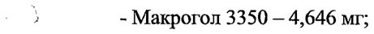
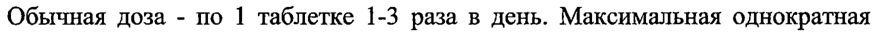

# Метамизола натрия моногидрат + Триацетонамин-4-толуолсульфонат — внутрь

- Препарат: Темпалгин® (таблетки, покрытые пленочной оболочкой;)
- АТХ: N02BB72
- Источник: ГРЛС, инструкция по медицинскому применению, РУ П N008775, файл от 2023-12-15 (https://grls.rosminzdrav.ru/Grls_View_v2.aspx?routingGuid=b8505527-d308-4846-891b-fd185adaf574)
- Распознано автоматически (OCR): 12 из 12 стр.
- Инструкция к другому РУ того же препарата: П N008775 (национальное РУ, переоформленное по правилам ЕАЭС, решение от 22.11.2023). Текст может быть старше действующего
- Сомнительных строк после OCR: 2 (см. раздел «Проверка распознавания»)

## Общие сведения

СООТВЕТСТВУЕТ ЭКСПЕРТНС МУ ОТЧЕТУ МИНИСТЕРСТВО ЗДРАВООХРАНЕНИЯ РОССИЙСКОЙ ФЕДЕРАЦИИ
_ ИНСТРУКЦИЯ ПО МЕДИЦИНСКОМУ ПРИМЕНЕНИЮ ЛЕКАРСТВЕННОГО
ПРЕПАРАТА ТЕМПАЛГИН® таблетки, покрытые пленочной оболочкой
Регистрационный номер: IT N008775 Торговое наименование препарата: ТЕМПАЛГИН®
Международное непатентованное или группировочное наименование:
po Метамизол натрия+Триацетонамин-4-толуолсульфонат
— Лекарственная форма: таблетки, покрытые пленочной оболочкой

## 2. Состав

1 таблетка содержит:
1 таблетка содержит:
действующие вещества: метамизол натрия моногидрат — 500,0 мг;
триацетонамин-4-толуолсульфонат — 20,0 мг.
вспомогательные вещества: крахмал пшеничный (95,0 мг), целлюлоза микрокристаллическая (75,0 мг), повидон К 25 (45,0 мг), тальк (15,0 мг), магния стеарат (10,0 мг).

‚ пленочное покрытие: Опадрай П зеленый 85F21526 (23,0 мг):
- Поливиниловый спирт частично гидролизованный — 9,2 мг;

- 3 - Макрогол 3350 — 4,646 мг;
- Титана диоксид (Е 171) — 4,37 мг;
- Тальк — 3,404 мг;
- Хинолиновый желтый (Е 104) алюминиевый лак — 1,035 мг;
- Бриллиантовый голубой (Е 133) ЕСЕ алюминиевый лак — 0,345 мг.
Описание Круглые двояковыпуклые таблетки, покрытые пленочной оболочкой, зеленого цвета, на поперечном разрезе почти белого цвета.
Фармакотерапевтическая группа от 08.06.2023 № 10691

Входящий МЗ №4236414 Анальгезирующее средство (анальгезирующее ненаркотическое средство + анксиолитическое средство).
Код ATX: NO2BB72 Фармакологические свойства

## 5.1. Фармакодинамика

Метамизол натрия в качестве анальгезирующего средства обладает сильным обезболивающим и противовоспалительным действием. Он тормозит синтез простагландинов, подавляя циклооксигеназу, обладает некоторым мембраностабилизирующим действием, подавляет образование эндогенных пирогенов.
Метамизол натрия в качестве анальгезирующего средства обладает сильным обезболивающим и противовоспалительным действием. Он тормозит синтез простагландинов, подавляя циклооксигеназу, обладает некоторым мембраностабилизирующим действием, подавляет образование эндогенных пирогенов.

И о Триацетонамин-4-толуолсульфонат обладает умеренной анксиолитической активностью и снимает состояние беспокойства, страха и напряжения.
Ослабляет двигательное возбуждение, оказывает центральное нхолиноблокирующее действие, усиливает и удлиняет анальгезирующее действие метамизола натрия, подавляя эмоциональный компонент боли.
Комбинация метамизола натрия и триацетонамин-4-толуолсулфоната усиливает обезболивающее действие метамизола натрия и увеличивает длительность его действия.

## 5.2. Фармакокинетика

После перорального применения метамизол натрия гидролизируется в
После перорального применения метамизол натрия гидролизируется в

| желудочно-кишечном тракте. Активными метаболитами являются 4-

2 метиламиноантипирин (МАА) и 4-аминоантипирин (АА). MAA характеризуется быстрым и полным всасыванием. Максимальная концентрация в плазме крови достигается в пределах 1-2 ч. Биодоступность
MAA составляет около 90%.

Пища не влияет на фармакокинетику метамизола натрия.
'Триацетонамин-4-толуолсульфонат всасывается в верхних отделах желудочно-кишечного тракта. Терапевтические плазменные концентрации устанавливаются через 30 мин после приема.

| 2 от 08.06.2023 № 10691 Входящий МЗ №4236414
Максимальная плазменная концентрация 0,8 мкг/мл достигается в пределах 60 мин.
Метамизол натрия частично связывается с белками плазмы.
Метамизол натрия подвергается интенсивному метаболизму в печени. Его основные метаболиты МАА, АА фармакологически активны.
Выводится с мочой в форме метаболитов, причем только 3% выделенного количества метамизола натрия находятся в неизмененном виде. Метаболиты метамизола натрия выделяются с грудным молоком.
'Триацетонамин-4-толуолсульфонат выводится с мочой в неизмененном виде, в количестве 2/з от примененной дозы.
. . ) Период полувыведения активного метаболита MAA у пациентов с нарушениями функции печени удлиняется приблизительно в 3 раза. Таким пациентам рекомендуется лечение более низкими дозами метамизола натрия.
У пациентов с нарушением функции почек наблюдается снижение степени выведения некоторых метаболитов. Этим пациентам рекомендуется лечение более низкими дозами метамизола натрия. —

## 4.1. Показания к применению

Для непродолжительного симптоматического лечения от спабо до умеренно выраженных болей при следующих состояниях: головная боль, зубная боль и
Для непродолжительного симптоматического лечения от спабо до умеренно выраженных болей при следующих состояниях: головная боль, зубная боль и
| стоматологические процедуры, миалгии, невралгии, боль в суставе
ВИ (артралгии).
`. Противопоказания - Повышенная чувствительность к метамизолу натрия, триацетонамин-4-толуолсульфонату или любому из вспомогательных веществ.
- Повышенная чувствительность к другим пиразолоновым препаратам.
- Нарушение обмена порфирина и билирубина(острая печеночная порфирия).
- Анемия вследствие недостаточности глюкозо-6-фосфатдегидрогеназы ‘
(угроза гемолиза).
- Тяжелые заболевания печени или почек.

- Нарушение функции костного мозга (например после лечения

цитостатиками) или заболевания гемопоэтической системы (апластическая

анемия, агранулоцитоз, лейкопения.

- Гипотензия со значениями артериального давления ниже 100 мм рт.ст.

- Беременность и период грудного вскармливания.

- Дети младше 15-летнего возраста.

## 4.3. С осторожностью

Заболевания почек (тубулоинтерстициональный нефрит (пиелонефрит),

гломерулонефрит — в том числе в анамнезе), умеренная почечная и/или
. — печеночная недостаточность, при полном или неполном сочетании

бронхиальной астмы, рецидивирующего полипоза носа и околоносовых пазух и непереносимости ацетилсалициловой кислоты или других нестероидных противовоспалительных препаратов (в том числе в анамнезе), предрасположенность к пониженному артериальному давлению, алкоголизм.

## 4.6. Применение при беременности и в период грудного вскармливания

Беременность

Имеются только ограниченные данные об использовании метамизола у

беременных женщин.

На основании опубликованных данных, у беременных женщин,
‚о подвергшихся воздействию метамизола на протяжении первого триместра (п
“= = 568), не идентифицированы доказательства тератогенного или

эмбриотоксического действия. Не рекомендуется применение метамизола в

течение первого и второго триместра. Применение метамизола в третьем

триместре связывают с фетотоксичностью (почечная недостаточность и

сужение артериального протока), поэтому использование метамизола

противопоказано в течение третьего триместра беременности. В случае непреднамеренного применения метамизола в течение третьего триместра,

следует контролировать амниотическую жидкость и артериальный проток с

помощью ультразвука и эхокардиографии. |

| СООТВЕТСТВУЕТ ЭКСПЕРТНОМУ ОТЧЕТУ | от 08.06.2023 № 10691

Входящий МЗ №4236414 Метамизол проникает через плацентарный барьер.
У животных метамизол индуцировал репродуктивную токсичность, но не обладал тератогенностью.
Данных об использовании триацетонамин-4-толуолсульфоната у беременных женщин нет, поэтому прием препарата противопоказан беременным женщинам в связи с наличием в составе препарата триацетонамин-4толуолсульфоната.
Грудное вскармливание Специальных исследований о возможности применения триацетонамин-4толуолсульфонат в период грудного вскармливания не проведено.

7 . Продукты распада метамизола попадают в значительных количествах в грудное молоко, и нельзя исключить риск для ребенка, находящегося на грудном вскармливании, поэтому следует избегать повторного приема метамизола на протяжении периода кормления грудью. В случае однократного применения метамизола, кормящим женщинам рекомендуется собирать и выбрасывать грудное молоко в течение 48 часов после приема
Дозы. | Способ применения и дозы Внутрь. Таблетки принимают после еды, запивая водой.

Дозировка |

_. Доза зависит от выраженности боли, и от индивидуальной чувствительности

`-/ к препарату. | Взрослые Обычная доза - по | таблетке 1-3 раза в день. Максимальная однократная доза не должна превышать | таблетку. Максимальная суточная доза составляет 4 таблетки.

При стоматологических процедурах: по 1 таблетке за 30 мин до вмешательства.
Дети старше 15-летнего возраста По 1 таблетке в день. Максимальная суточная доза - 2 таблетки.

Пожилые люди и ослабленные пациенты

Доза должна быть уменьшена у пожилых людей и у ослабленных пациентов,

поскольку выведение продуктов распада метамизола может быть замедлено.

Пациенты с нарушением функции почек

Поскольку скорость выведения снижается у пациентов с нарушениями

функции почек, следует избегать повторных высоких доз. Снижение дозы не

требуется только при кратковременном применении. Нет никакого опыта с

долгосрочным применением.

Пациенты с нарушением функции печени

Поскольку скорость выведения снижается у пациентов с нарушениями

wo! функции печени, следует избегать повторных высоких доз.

Продолжительность лечения

Лечение препаратом Темпалгин® не должно длиться более 3 - 5 дней. Его

применение на более длительный период времени или в более высоких дозах

возможно только после консультации с врачом.

## 4.8. Побочное действие

Возможные побочные действия при применении препарата Темпалгин® чаще

всего обусловлены метамизолом натрия:

Прекратите применение Темпалгин® и немедленно свяжитесь с

врачом, если у Вас наступит развитие некоторых из следующих

. симптомов:

nell — Тошнота или рвота, повышенная температура, чувство усталости, потеря аппетита, потемнение мочи, светлый кал, пожелтение кожи или белой части глаз, зуд, сыпь или боль в верхней части живота. Эти симптомы могут являться признаками поражения печени.

— Тяжелые кожные реакции, включая синдром Стивенса-Джонсона, токсический эпидермальный некролиз И индуцированную лекарственными средствами эозинофилию с системными симптомами
(ОКЕЗЗ-синдром), которые могут быть жизнеугрожающими или фатальными, регистрировались при лечении метамизолом. Пациентов

следует проинформировать о признаках и симптомах кожных реакций и следить за ними. Если появляются признаки и симптомы, указывающие на эти реакции, лечение метамизолом следует отменить и ни в коем случае не начинать его повторно.
Нарушения со стороны крови и лимфатической системы: лейкопения, агранулоцитоз, тромбоцитопения, гемолитическая анемия, апластическая анемия.
Нарушения со стороны иммунной системы: фиксированная лекарственная экзантема, макулопапуллезная сыпь, анафилактические ИЛИ анафилактоидные реакции, зуд, жжение, крапивница, — отеки oe _ (енерализованные или местные), бронхоспазм, астматический приступ (у пациентов с аспириновой астмой), кардиогенный шок.
Нарушения со стороны кожи и подкожной клетчатки: сообщалось о тяжелых кожных реакциях, включая синдром Стивенса-Джонсона, токсический эпидермальный некролиз и (с неизвестной частотой) индуцированную лекарственными средствами эозинофилию с системными симптомами
(DRESS) при применении метамизола.
Нарушения со стороны обмена веществ и питания: снижение аппетита.
Нарушения со стороны нервной системы: головная боль, головокружение.
Нарушения со стороны сердечно-сосудистой системы: нарушение сердечного ритма (тахикардия), цианоз, снижение артериального давления (иногда с
— предшествующим повышением), отдышка.
Нарушения со стороны желудочно-кишезного тракта (ЖКТ): тошнота, рвота, боли и дискомфорт в животе; изъязвление слизистой оболочки ЖКТ и кровотечение из ЖКТ.
Нарушения со стороны печени и желчевыводящих путей: медикаментозное поражение печени, в том числе острый гепатит, желтуха, повышение уровней печеночных ферментов (АСТ, АЛТ), холестаз, желтуха.
Нарушения со стороны почек и мочевыводящих путей: протеинурия, олигурия, анурия, полиурия, интерстициальный нефрит.
| 7 от 08.06.2023 № 10691 Входящий МЗ №4236414

## 4.9. Передозировка

Из-за повышенного риска агранулоцитоза при более длительном применении препарата необходимо контролировать картину крови, включая лейкоцитарную формулу.
Из-за повышенного риска агранулоцитоза при более длительном применении препарата необходимо контролировать картину крови, включая лейкоцитарную формулу.
Симптомы CO стороны желудочно-кишечного тракта - тошнота, рвота, рвота кровью, дегтеобразный стул;
со стороны ЦНС и периферической нервной системы — меньероподобный синдром, шум в ушах, сонливость, остановка дыхания, кома со снижением артериального давления, тонико-клонические судороги;
7 , со стороны системы кроветворения - агранулоцитоз, апластическая анемия, геморрагический диатез;
со стороны обмена веществ - метаболический алкалоз;
CO стороны мочевыделительной системы - олигурия до анурии;
токсико - аллергические реакции - буллёзно-уртикарная и петехиальная, иногда кореподобная или тифозная сыпь;
‘прочие - у некоторых пациентов может развиться токсико-аллергический шок.
Лечение Промывание желудка, солевые слабительные, активированный уголь,
. гемодиализ или форсированный диурез, симптоматическая терапия, при i р a развитии судорожного синдрома — в/в введение диазепама и быстродействующих барбитуратов.

## 4.5. Взаимодействие с другими лекарственными средствами

- Действие трициклических антидепрессантов (имипрамин, амитриитилин), пероральных контрацентивных средств, анальгетиков, аллопуринола. и алкоголя потенцируется при одновременном применении с метамизолом натрия. .
- Барбитураты и фенилбутазон уменьшают силу и сокращают

продолжительность фармакодинамических эффектов метамизола натрия из-

за индукции печеночных ферментов.

- Метамизол натрия понижает активность кумариновых антикоагулянтов

при одновременном применении в результате индукции ферментов печени.

- Метамизол натрия понижает плазменные уровни циклоспорина.

- Хлорамфеникол и другие подавляющие гемопоэз препараты усиливают
| миелотоксическое действие метамизола натрия.

- Ip одновременном применении метамизола натрия с хлорпромазином

может наступить гипотермия.

( - _ Триацетонамин-4-толуолсульфонат потенцирует седативное действие снотворных средств, средств для общей анестезии, наркотических и ненаркотических анальгетиков.
- При совместном применении с низкой дозой ацетилсалициловой кислоты, метамизол может уменьшить действие на агрегацию тромбоцитов.
Следовательно, эту комбинацию следует применять с осторожностью при низкой дозе ацетилсалициловой кислоты (напр. для кардиопротекции).

- Поскольку метамизол может снизить действие определенных препаратов, следует применять Темпалгин® с осторожностью со следующими лекарственными средствами:

| . бупропион, лекарственный препарат, который применяется для лечения

a депрессии или в качестве вспомогательного средства для прекращения табакокурения; |
. эфавиренц, лекарственный препарат, который применяется для лечения
ВИЧ/СПИД;

° метадон, лекарственный препарат, который применяется для лечения зависимости от запрещенных веществ (т. наз. опиоидов);
* вальпроат, лекарственный препарат, который применяется для лечения эпилепсии или биполярного расстройства;

5 | от 08.06.2023 № 10691 Входящий МЗ №4236414
° такролимус, лекарственный препарат, который применяется для предотвращения отторжения органов у пациентов с трансплантацией;
* сертралин, лекарственный препарат, который применяется для лечения
| депрессии.

## 4.4. Особые указания

Лечение препаратом Темпалгин® (из-за содержания метамизола натрия)
Лечение препаратом Темпалгин® (из-за содержания метамизола натрия)
проводится только в течение короткого периода времени, когда нет другого альтернативного метода лечения.
Темпалгин® необходимо назначать с осторожностью пациентам, страдающим аллергическими заболеваниями, пациентам с гиперчувствительностью к
. р анальгезирующим и противоревматическим лекарственным препаратам
(непереносимость анальгетиков), к другим лекарственным средствам или пищевым продуктам из-за повышенного риска аллергических реакций при полном или неполном сочетании бронхиальной астмы, рецидивирующего полипоза носа и околоносовых пазух и непереносимости ацетилсалициловой кислоты или других нестероидных противовоспалительных препаратов (в том числе в анамнезе).
- Метамизол натрия может спровоцировать гипотензивные реакции.
Лечение препаратом Темпалгин® следует проводить с особой осторожностью у пациентов со сниженным артериальным давлением, дефицитом жидкости в
| организме или дегидратацией, нестабильным кровообращением.
NO - При одновременном применении с алкоголем увеличивается риск побочных действий.
- Необходимо применять с осторожностью пациентам с поражениями печени или почек.
- Лекарственно-индуцированное поражение печени. Сообщают о случаях острого гепатита, преимущественно гепатоцеллюлярного типа, у пациентов, леченных метамизолом, с началом от нескольких дней до нескольких месяцев после начала лечения. Признаки и симптомы включают повышение уровня ферментов печени в сыворотке с или без желтухи, часто в контексте других реакций гиперчувствительности к лекарственному | препарату (например: кожная сыпь, дискразии крови, повышенная температура и оэозинофилия) или сопутствуются характеристиками аутоиммунного гепатита. У большинства пациентов — наступает восстановление после прекращения лечения метамизолом; несмотря на это, в отдельных случаях имеются сообщения о прогрессии до острой печеночной недостаточности, требующей трансплантации печени.
Механизм индуцированного метамизолом поражения печени не выяснен полностью, но данные показывают иммунно-аллергический механизм.
Пациентов следует инструктировать связаться со своим врачом в случае
\ _ появления симптомов, предполагающих поражение печени. У таких пациентов применение метамизола следует прекратить и оценить функцию печени.
Метамизол не следует вводить повторно пациентам с эпизодом поражения печени во время лечения метамизолом, у которых не установлена другая причина поражения печени.
- Шненичный крахмал, входящий в состав препарата, может содержать только следы глютена и считается безопасным для лиц с целиакией. Одна таблетка содержит не более 9,5 микрограмма глютена. Пациентам с аллергией на пшеницу (отличающейся от целиакии) не следует принимать 7 этот препарат.
rd - Этот лекарственный препарат содержит 32,7 мг натрия в таблетке, что эквивалентно 1,6% рекомендуемой максимальной суточной дозы - 2 г натрия | для взрослых.

## 4.7. Влияние на способность управлять транспортными средствами, механизмами

В связи с наличием в составе препарата анксиолитического средства
(триацетонамин-4-толуолсульфонат) в период лечения необходимо воздерживаться от выполнения потенциально опасных видов деятельности, требующих особого внимания и быстроты реакций (управление автомобилем и др. транспортными средствами, работа с движущимися механизмами, работа диспетчера и оператора и т.п.)

## 6.5. Форма выпуска

Таблетки, покрытые пленочной оболочкой, 500 мг/20 мг.
Таблетки, покрытые пленочной оболочкой, 500 мг/20 мг.
По 10 таблеток в блистер из ИВХ/алюминиевой фольги. По 2 или 10 блистеров вместе с инструкцией по применению в картонной пачке. По 30 блистеров в картонной коробке вместе с равным количеством инструкций по применению (для стационара).

## 6.3. Срок годности

4 года. Не применять по истечении срока годности, указанного на упаковке.
4 года. Не применять по истечении срока годности, указанного на упаковке.
УВ Условия хранения При температуре не выше 25 °С в оригинальной упаковке.
Хранить в недоступном для детей месте!
Условия отпуска Отпускают без рецепта.
Владелец регистрационного удостоверения Софарма АО, Болгария 1220 София, ул. Илиенское шоссе 16.
'Тел.: (+359 2) 81 34 200; факс: (+359 2) 936 02 86.
Производитель ра Все стадии производства:
и «Софарма» АО, ул. Илиенское шоссе № 16, г. София 1220, Болгария /
Sopharma AD, 1220, Sofia, 16 ШепзКо Shosse Str., Bulgaria.
Претензии потребителей и информацию о нежелательных явлениях следует направлять по адресу:
Представительство АО «Софарма» (Болгария) г. Москва, Российская
Федерация, 109429, г. Москва, МКАД, 14 км, д. 10, телефон: (495) 7862226 р“
Эксперт по координ о регуляторцёх проектов
Солтицкая А.В. pe ФАРМА" iy Re CB pus) = 12
Ss <
## Проверка распознавания

Страницы-сканы распознаны автоматически. В 2 строках с дозировками цифры могли распознаться с ошибкой — сверьте с вырезкой из оригинала:

- стр. 1: «- 3 - Макрогол 3350 — 4,646 мг;» — низкая уверенность: «3» (57)  
  
- стр. 5: «Обычная доза - по | таблетке 1-3 раза в день. Максимальная однократная» — повторное чтение: «Обычная доза - по 1 таблетке 1-3 раза в день. Максимальная однократная»  
  
