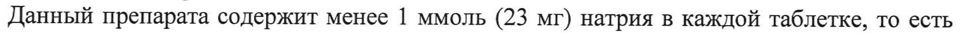

# Метилдопы сесквигидрат — внутрь

- Препарат: Допегит (таблетки)
- АТХ: C02AB01
- Источник: ОХЛП, Единый реестр ЛС ЕАЭС, запись 692846b630dcf88e1706e487, документ от 2026-08-06
- Распознано автоматически (OCR): 11 из 11 стр.
- Сомнительных строк после OCR: 1 (см. раздел «Проверка распознавания»)

## Общие сведения

СООТВЕТСТВУЕТ ЭКСПЕРТНОМУ ОТЧЕТ:
от 26.05.2026 № 10422 [ПОСЛЕДОВАТЕЛЬНОСТЬ 0025)
ОБЩАЯ ХАРАКТЕРИСТИКА ЛЕКАРСТВЕННОГО ПРЕПАРАТА

## 1. Наименование лекарственного препарата

Допегит таблетки 250 мг

## 2. Качественный и количественный состав

Действующее вещество: метилдопа.
Каждая таблетка содержит 250 мг метилдопы (282 мг в форме метилдопы сесквигидрата).
Полный перечень вспомогательных веществ приведен в разделе 6.1.

## 3. Лекарственная форма

Таблетки.
Белые или серовато-белые, круглые плоские таблетки с фаской, на одной стороне гладкие, на другой стороне с гравировкой DOPEGYT, без или почти без запаха.
| munncterctacm Зи онения| РС

## 4. Клинические данные

РЕСПУБЛИКИ БЕЛАРУСЬ Я

Приказ gee ey здравоохранения Сп КИ Л b =

## 4.1. Показания к применению

Я SOS 155

Артериальная гипертензия.

## 4.2. Режим дозирования и способ применения

Режим дозирования Дозировку следует подбирать для каждого пациента индивидуально.
Взрослые Первоначальная рекомендуемая доза — 250 мг 2-3 раза в сутки в течение первых двух дней. После этого суточная доза может быть повышена или снижена, в зависимости от степени снижения артериального давления, с двухдневными интервалами. Для минимизации седативной нежелательной реакции, возможной в течение 2-3 дней в начале курса лечения и при повышении дозы, рекомендуется сначала повышать вечернюю дозу.
Обычная поддерживающая доза составляет 500-2000 мг в сутки за 2-4 приема.
Максимальная суточная доза составляет 3 г. Если при дозе 2 г в сутки не наблюдается эффективное снижение артериального давления, рекомендуется применять комбинацию с другими гипотензивными препаратами.
После 2-3 месяцев лечения может развиться толерантность. Эффективный контроль артериального давления можно восстановить добавлением диуретика или повышением дозы метилдопы.
После отмены препарата Допегит артериальное давление возвращается на исходный уровень через 48 часов без явлений ребаунд-эффекта.
Допегит может применяться и у пациентов, которые уже принимают другие гипотензивные препараты, постепенно отменяя предыдущий препарат. В таких случаях рекомендуемая начальная доза не должна превышать 500 мг в сутки. Для достижения i
Cob nic |1 oi | Ero YL | Se И or 26 0S RUM TEBE РР-ВУ
[ПОСЛЕДОВАТЕЛЬНОСТЬ 0025)
желаемого терапевтического эффекта дозу можно повышать с интервалами как минимум в два дня.
Если Допегит используется как дополнение к начатой гипотензивной терапии, то возможно, будет необходимо изменить дозу гипотензивного препарата, чтобы переход к комбинированной терапии проходил без осложнений.
Дети и подростки в возрасте до 18 лет Рекомендуемая начальная доза метилдопы у детей составляет 10 мг/кг массы тела в сутки за 2-4 приема. При необходимости суточную дозу можно постепенно повышать (до 65 мг/кг массы тела) с интервалами не менее двух дней до достижения желаемого ответа на лечение. Суточная доза не должна превышать 3 г.
Пациенты пожилого возраста Пациентам пожилого возраста лекарственное средство назначается с минимально возможной дозы, а суточная доза не должна превышать 250 мг. При необходимости дозу можно постепенно повышать каждые 2 дня до максимальной суточной дозы 2 г, которую превышать нельзя.
Чаще наблюдаемые у пациентов пожилого возраста синкопе (потеря сознания), вероятно, связанные с повышенной чувствительностью лиц пожилого возраста к препарату и с выраженным сужением просвета кровеносных сосудов, можно избежать, используя более низкие дозы.
Пациенты с почечной недостаточностью Значительная часть метилдопы выводится из организма почками, поэтому пациентам с нарушением почечной функции следует принимать сниженные дозы. При легкой почечной недостаточности (СКФ > 60-89 мл/мин/1,73 м²) следует выдерживать интервал между приемами в 8 часов, при умеренной недостаточности (СКФ = 30-59 мл/мин/1,73 м²) интервал должен быть 8-12 часов, а при тяжелой почечной недостаточности (СКФ
<30 мл/мин/1,73 м²) 12-24 часов.
Поскольку метилдопа выводится при гемодиализе, после этой процедуры пациенту следует дать дополнительную дозу 250 мг во избежание повышения артериального давления (см. раздел 4.4).
Способ применения Таблетки для приема внутрь.
Таблетки можно принимать до или после еды.

## 4.3. Противопоказания

- Гиперчувствительность к действующему веществу (метилдопе (в том числе и изменения в печени, связанные с предыдущим применением метилдопы) или к любому из вспомогательных веществ, перечисленных в разделе 6.1.
- Активная стадия заболевания печени (например, активный гепатит или активный цирроз).
- Сопутствующая терапия ингибитором моноаминоксидазы (МАО).
- Депрессия.
- Феохромоцитома (см. раздел 4.4).

## 4.4. Особые указания и меры предосторожности при применении

Гемолитическая анемия В ходе лечения препаратами, содержащими метилдопу, в редких случаях может развиться гемолитическая анемия. При развитии ФимибмовР ›указывающих на
И PECTYGTVIKA БЕЛАРУСЬ СООТВЕТСТВУЕТ 6 МР CABIET:
от 26.05.2026 № 10422 [ПОСЛЕДОВАТЕЛЬНОСТЬ 0025)
гемолитическую анемию, необходимо определить гематокрит и уровень гемоглобина.
Если анемия подтверждается, следует провести дальнейшие исследования, подтверждающие гемолиз. Если подтверждается гемолитическая анемия, необходимо немедленно отменить прием метилдопы. После отмены метилдопы гемолитическая анемия быстро прекращается с помощью или без лечения кортикостероидами. Однако в редких случаях наблюдались смертельные исходы. Если гемолитическая анемия вызвана приемом метилдопы, пациент не должен в дальнейшем получать этот препарат.
Тест Кумбса У некоторых пациентов, принимающих метилдопу в течение длительного периода времени, может наблюдаться положительный тест Кумбса. По данным литературы, у пациентов, получающих этот препарат, частота положительного теста Кумбса может составлять 10-20 %. Положительный тест Кумбса редко наблюдается в течение первых 6 месяцев лечения. Если он не развивается на протяжении 12 месяцев, то его развитие маловероятно при дальнейшем применении этого препарата. Положительный тест
Кумбса дозозависим, его развитие маловероятно при дозах менее 1 г/сутки.
Положительный тест Кумбса на фоне лечения метилдопой, станет отрицательным лишь через несколько недель или месяцев после отмены препарата.
Перед началом курса лечения, а также на 6 и 12 месяце лечения метилдопой следует исследовать количество форменных элементов крови, и выполнить прямой тест Кумбса.
Само по себе наличие предыдущего положительного теста Кумбса или его появление у пациента на фоне лечения не является противопоказанием к терапии метилдопой. Если тест Кумбса становится положительным на фоне лечения метилдопой, следует проверить наличие гемолитической анемии и степень клинической значимости положительного теста Кумбса.
Информация о наличии положительного теста Кумбса помогает при оценке перекрестной пробы на совместимость крови. При необходимости переливания крови пациенту, получающему метилдопу, следует выполнять прямой и непрямой тесты
Кумбса. При отсутствии гемолитической анемии обычно бывает положительным только прямой тест Кумбса. Сам по себе прямой тест Кумбса не влияет на типирование или перекрестную совместимость крови. Если непрямой тест Кумбса также положителен, могут возникнуть трудности при оценке перекрестной совместимости. В таких случаях необходима консультация специалиста гематолога или трансфузиолога.
Нарушения показателей крови Во время лечения возможны редкие случаи лейкопении, гранулоцитопении и тромбоцитопении. Обычно количество гранулоцитов нормализуется после отмены метилдопы.
Также сообщалось о редких случаях обратимой тромбоцитопении.
Лихорадка У некоторых пациентов в течение первых трех недель терапии лекарственным средством наблюдалась лихорадка, которая иногда сопровождалась эозинофилией или повышением активности «печеночных» трансаминаз.
Кроме того, прием метилдопы может сопровождаться развитием желтухи. Желтуха обычно появляется в течение первых двух-трех месяцев терапии. В некоторых случаях на фоне желтухи подтверждался холестаз. В очень редких случаях у пациентов развивался некротический гепатит со смертельным исходом. Биопсия печени, произведенная у нескольких пациентов с нарушениями функции этого органа, показала no eo
МИНИСТЕРСТВОМ ЗДРАВООХРАНЕНИЯ | ОО —— _ |
В 3 СООТВЕТСТВУЕТ ЗАСУЕРАНОМУНТУЕЛ:
ГВ АВЕРС ВУ [ПОСЛЕДОВАТЕЛЬНОСТЬ 0025)
микроскопический фокальный некроз, характерный для реакции гиперчувствительности.
Перед началом лечения метилдопой и на протяжении первых 6-12 недель курса лечения, а также в любой момент времени при развитии лихорадки неизвестной этиологии, рекомендуется проведение тестов на определение функции печени, а также качественный и количественный общий анализ крови с лейкоформулой.
При возникновении лихорадки, изменении активности печеночных ферментов или появлении желтухи курс лечения метилдопой следует немедленно прекратить. Если это состояние вызвано реакцией гиперчувствительности, повышение температуры и изменения лабораторных параметров проходят после отмены препарата. Таким пациентам в дальнейшем нельзя назначать метилдопу.
Пациентам с заболеванием или нарушением функции печени в анамнезе данный препарат следует назначать с крайней осторожностью.
Гипотензия во время анестезии Пациентам, получающим метилдопу, может быть необходимо снижение доз анестетиков. Если во время анестезии возникает гипотензия, для ее коррекции можно вводить сосудосуживающие препараты. Адренергические рецепторы сохраняют чувствительность во время приема метилдопы (см. раздел 4.5).
Отеки | У некоторых пациентов во время приема метилдопы могут возникнуть отеки или увеличение массы тела. При этих состояниях следует назначить диуретики. Лечение метилдопой нельзя продолжать при нарастании отеков или развитии симптомов сердечной недостаточности.
Гемодиализ Метилдопа выводится при диализе. Поэтому после этой процедуры артериальное давление у пациентов, находящихся на гемодиализе, может повышаться (см. разделы 4.2.
и 5.2).
Пациенты с поражением мозговых сосудов У пациентов с тяжелым двусторонним поражением мозговых сосудов в редких случаях могут возникнуть непроизвольные хореоатетозные движения (см. раздел 4.8). В таком случае следует отменить лечение.
Пациенты с печеночной порфирией Чрезвычайная осторожность требуется при назначении метилдопы больным печеночной порфирией или их близким родственникам.
Влияние на результаты некоторых лабораторных анализов
Метилдопа может изменить результаты анализа на содержание мочевой кислоты в моче фосфовольфрамокислотным методом, результаты определения креатинина сыворотки щелочно-пикратным методом и колориметрическое определение фермента АСТ. До настоящего времени отсутствуют данные о том, что метилдопа изменяла результаты спектрофотометрического определения АСТ.
Поскольку метилдопа имеет флуоресценцию на той же длине волны, что и катехоламины, метилдопа может дать псевдопозитивные результаты, в моче могут обнаруживаться высокие концентрации катехоламинов, что препятствует диагностике
УТВЕРЖДЕНО МИНИСТЕРСТВОМ ЗДРАВООХРАНЕНИЯ
РЕСПУБЛИКИ БЕЛАРУСЬ } 4 Приказ Министерства здравоохранения }
Республик.: Беларусь | СООТВЕТСТВУЕТ З&СВЕРТНОМУ ОТЧЕТ:
и И [ПОСЛЕДОВАТЕЛЬНОСТЬ 0025)
феохромоцитомы. Однако метилдопа не влияет на результаты измерения ВМК
(ванилилминдальной кислоты) в моче.
В редких случаях при контакте с воздухом моча может потемнеть, что может быть связано с распадом метилдопы и ее метаболитов.
Во время приема метилдопы запрещается употребление алкогольных напитков (см.
раздел 4.5).
Содержание натрия Данный препарата содержит менее | ммоль (23 мг) натрия в каждой таблетке, то есть практически не содержит натрия.

## 4.5. Взаимодействие с другими лекарственными препаратами и другие виды взаимодействия

Допегит нельзя применять одновременно со следующими препаратами:
® ингибиторы МАО (см. раздел 4.3).
Одновременное применение со следующими _ препаратами _ требует _ особой осторожности:
Препараты, снижающие гипотензивный эффект препарата Допегит:
® симпатомиметики (повышенная прессорная реакция);
® трициклические антидепрессанты;
» фенотиазины (в то же время возможен и аддитивный гипотензивный эффект);
© пероральные препараты железа (сульфат и глюконат железа/П) (они могут снизить биодоступность метилдопы);
® нестероидные противовоспалительные препараты;
® эстрогенные препараты.
Препараты, усиливающие гипотензивный эффект препарата Допегит:
® другие гипотензивные препараты (возможна суммация гипотензивных эффектов);
® анестетики (см. раздел 4.4).
Метилдопа и следующие препараты могут изменить эффекты друг друга:
e литий (опасность усиления токсичности лития);
» леводопа (снижение антипаркинсонического эффекта и усиление нежелательного действия на ЦНС);
® алкоголь и другие препараты, угнетающие ЦНС (усиление угнетения ЦНС);
© антикоагулянты (усиление антикоагулянтного эффекта, опасность кровотечения);
® бромокриптин (возможно нежелательное влияние на концентрацию пролактина);
® галоперидол (возможно нарушение когнитивных функций — дезориентация и замедление процесса мышления).

## 4.6. Фертильность, беременность и лактация

Беременность При гипертензии у беременных метилдопу следует назначать при тщательном медицинском контроле пациенток. Имеющиеся данные не выявили признаков повреждения плода или новорожденного.
Г УТВЕРЖДЕНО | | МИНИСТЕРСТВОМ ЗДРАВООХРАНЕНИЯ {
РЕСПУБЛИКИ БЕЛАРУСЬ i Приказ Министерства здравоохрачения 1 5
Республики Беларусь _ i Coo ВЕТСТВ AK ЕР LY СЕ
Е 25.05 ЕЖИИЫ ВЯ PT-BY [ПОСЛЕДОВАТЕЛЬНОСТЬ 0025)
Метилдопа проходит через плаценту и определяется в крови пупочного канатика. На основании данных литературы о применении метилдопы во время всех триместров беременности вероятность повреждения плода кажется минимальной.
Несмотря на отсутствие однозначных данных о тератогенности, нельзя исключить возможности повреждений у плода. Таким образом, это лекарственное средство можно назначать беременным, женщинам, планирующим беременность и женщинам, у которых имеется возможность беременности, только в случаях, когда ожидаемая польза лечения превосходит возможный риск.
Лактация Метилдопа определяется в грудном молоке. Метилдопу можно назначать кормящим матерям только после тщательного сопоставления ожидаемой пользы лечения и возможного риска.
4.7. Влияние на способность управлять транспортными средствами и работать с механизмами
Метилдопа может обладать седативным эффектом, который, обычно, является преходящим и может наблюдаться либо в начале лечения, либо при повышении дозы.
Если у пациентов развиваются симптомы, указывающие на развитие седативного эффекта, то им запрещено вождение транспортных средств и выполнение работ, требующих концентрации внимания.

## 4.8. Нежелательные реакции

Резюме профиля безопасности В начале лечения или при повышении дозы метилдопы может развиться преходящий седативный эффект, проходящая головная боль, астения, слабость.
Резюме нежелательных реакций Нежелательные эффекты, наблюдавшиеся при применении препарата Допегит, классифицированы по системно-органным классам и перечислены ниже как встречающиеся очень часто (> 1/10), часто (> 1/100, но < 1/10); нечасто (> 1/1 000, но
< 1/100); редко (> 1/10 000, но <1/1 000); очень редко (< 1/10 000), частота неизвестна
(исходя из имеющихся данных, частоту возникновения определить невозможно).
В каждой из групп по частоте нежелательные реакции приводятся в порядке снижения степени тяжести.
Нарушения со стороны крови и лимфатической системы:
Очень часто: положительный тест Кумбса (см. раздел 4.4).
Редко: гемолитическая анемия, лейкопения, гранулоцитопения, тромбоцитопения.
Частота неизвестна: угнетение костного мозга, положительный тест на антиядерные антитела, клетки красной волчанки (ГЕ), положительная реакция на ревматоидный фактор.
Нарушения со стороны иммунной системы:
Частота неизвестна: васкулит, симптомы, характерные для системной красной волчанки, лихорадка, обусловленная приемом лекарственного средства, эозинофилия.
Эндокринные нарушения:
Частота неизвестна: гиперпролактинемия, гинекомастия, галакторея, аменорея.
Психические нарушения:
Частота неизвестна: ночные кошмары, обычно невыраженный, преходящий психоз или депрессия, понижение либидо. УТВЕРЖНЕНЫ
МИНИСТЕРСТВОМ ЗДРАВООХРАНЕНИЯ = неетизкенинени| 6 1 правоохранения |
Республики Genes: | СООТВЕТСТВУЕТ 3 КАТ-УНоОН Рив: 6 ОрНЕВУ от 26.05.2026 № 10422
[ПОСЛЕДОВАТЕЛЬНОСТЬ 0025)
Нарушения со стороны нервной системы;
Очень редко: паркинсонизм.
Частота неизвестна: периферический парез лицевого нерва, вялость, непроизвольные хореоатетозные движения, симптомы недостаточности мозгового кровообращения
(возможно, связанные с гипотензией), головная боль, седация (обычно преходящая), апатия, слабость, головокружение, парестезия.
Нарушения со стороны сердиа:
Очень редко: усиление стенокардии, миокардит, перикардит.
Частота неизвестна: застойная сердечная недостаточность, отеки, увеличение массы тела, синусовая брадикардия.
Нарушения со стороны сосудов:
Частота неизвестна: длительное повышение чувствительности каротидного синуса, ортостатическая гипотензия (при этом рекомендуется понижение дозы), отеки, увеличение массы тела.
Отеки и увеличение массы тела обычно хорошо поддаются лечению диуретиками. Если отеки становятся более выраженными, а также при появлении симптомов сердечной недостаточности лечение метилдопой следует отменить.
Желудочно-кишечные нарушения:
Очень редко: панкреатит.
Частота неизвестна: колит, рвота, диарея, воспаление слюнных желез, болезненность или почернение языка, тошнота, запор, вздутие живота, метеоризм, сухость во рту.
Нарушения со стороны печени и желчевыводящих путей:
Очень редко: гепатит, некроз печени.
Частота неизвестна: холестаз, желтуха, нарушения функциональных проб печени (см.
раздел 4.4).
Нарушения со стороны кожи и подкожных тканей:
Частота неизвестна: токсический эпидермальный некролиз, экзема, лихеноидные высыпания.
Нарушения со стороны мышечной, скелетной и соединительной ткани:
Частота неизвестна: незначительная артралгия с отеками суставов или без, мышечная боль.
Нарушения со стороны репродуктивной системы и молочных желез:
Частота неизвестна: импотенция, нарушения эякуляции.
Лабораторные и инструментальные данные:
Частота неизвестна: повышение остаточного азота крови.
Сообщение о подозреваемых нежелательных реакциях
Важно сообщать о подозреваемых нежелательных реакциях после регистрации лекарственного препарата с целью обеспечения непрерывного мониторинга соотношения «польза — риск» лекарственного препарата. Медицинским работникам рекомендуется сообщать о любых подозреваемых нежелательных реакциях лекарственного препарата через национальные системы сообщения о нежелательных реакциях государств — членов Евразийского экономического союза.
Российская Федерация 109012, г. Москва, Славянская площадь, д. 4, стр. 1
Федеральная служба no надзору в сфере здравоохранения
Телефон: +7 (499) 578-06-70, +7 (499) 578-02-20
Факс: +7 (495) 698 15 73 поту | МИНИСТЕРСТВОМ ЗДРАВООХРАНЕНИЯ {
РЕСПУБЛИКИ БЕЛАРУСЬ H 7 Приказ Министерства здравоохранения 1
| Республики Беларусь !
СООТВЕТСТВУЕТ ЗВ Pr aay [ПОСЛЕДОВАТЕЛЬНОСТЬ 0025)
Электронная почта: pharm@roszdravnadzor.gov.ru
Сайт: http://www.roszdravnadzor. gov.ru/
Республика Казахстан 010000, г. Астана, район Байконыр, ул. А. Иманова, 13 (БЦ «Нурсаулет 2»)
PITT на ПХВ «Национальный центр экспертизы лекарственных средств и медицинских изделий» Комитета медицинского и фармацевтического контроля
Министерства здравоохранения Республики Казахстан
Телефон. +7 (7172) 78-99-11 Электронная почта: farm@dari.kz
Сайт: http://www.ndda.kz Республика Беларусь 220037, Минск, Товарищеский nep., 2a
УП «Центр экспертиз и испытаний в здравоохранении»
Тел.: +375 (17) 231-85-14 Факс: +375 (17) 252-53-58
Телефон отдела фармаконадзора: +375 (17) 242-00-29;
Эл. почта: repl@rceth.by, гсей @rceth. by http://www.rceth.b
Республика Армения 0051, г. Ереван, пр. Комитаса, 49/5
АОЗТ «Научный Центр экспертизы лекарств и медицинских технологий им.
академика Э. Габриеляна»
Тел.: (+374 60) 83-00-73, (+374 10) 23-08-96, (+374 10) 23-16-82
Телефон горячей линии отдела мониторинга безопасности лекарственных средств:
(+374 10) 20-05-05, (+374 96) 22-05-05 Электронная почта: admin@pharm.am, vigilance@pharm.am
Сайт: http://www.pharm.am

## 4.9. Передозировка

Симптомы острой передозировки: выраженное резкое снижение артериального давления, выраженная сонливость, слабость, брадикардия, головокружение, запор, вздутие живота, метеоризм, диарея, тошнота, рвота.
Лечение: вскоре после передозировки — промывание желудка, стимуляция рвоты могут снизить количество всосавшегося препарата. Специфический антидот отсутствует.
Метилдопа выводится из организма с помощью гемодиализа. При передозировке следует проводить симптоматическое лечение. После того, как препарат всосется, можно стимулировать его выведение почками введением жидкостей в форме инфузии. Следует тщательно наблюдать за частотой сердечных сокращений, минутным объемом крови и общим объемом крови, электролитным балансом, функциями кишечника и почек, а также функцией головного мозга. При необходимости можно вводить симпатомиметики
(например, адреналин).
При подозрении на хроническую передозировку препарат Допегит следует отменить.

## 5. Фармакологические свойства

## 5.1. Фармакодинамические свойства

Фармакотерапевтическая группа: антигипертензивные препараты; антиадренергические средства центрального действия.
Код ATX: С02АВО1.
| УТВЕРЖДЕНО | МИНИСТЕРСТВОМ ЗДРАВООХРАНЕНИЯ |
РЕСПУБЛИКИ БЕЛАРУСЬ H Приказ gyi nin cre maa 8
СООТВЕТСТВУЕТ ЭКСПЕРТНОМУ ОТЧЕТ Е ть ЖАРОВА -РГ-ВУ
[ПОСЛЕДОВАТЕЛЬНОСТЬ 0025)
Механизм действия, фармакодинамические эффекты
Действующее вещество таблеток Допегит — метилдопа — является гипотензивным средством центрального действия. Механизм его действия в настоящее время полностью не изучен. При попадании в центральную нервную систему препарат оказывает гипотензивный эффект посредством своего метаболита (альфа-метилнорадреналина) с помощью нескольких предполагаемых механизмов:
- снижение симпатического тонуса путем стимуляции центральных тормозных пресинаптических альфа-2-рецеторов;
- замещение эндогенного дофамина в дофаминергических нервных окончаниях — в качестве ложного нейромедиатора;
- снижение активности ренина плазмы и сопротивления периферических сосудов;
- подавление фермента ДОФА-декарбоксилазы, что приводит к снижению синтеза норадреналина и снижению концентрации дофамина, серотонина, норадреналина и адреналина в тканях.
Метилдопа не оказывает непосредственного влияния на работу сердца, не снижает минутный объем крови, не вызывает рефлекторную тахикардию, а также не снижает скорость клубочковой фильтрации, почечный кровоток, фильтрационную фракцию. В некоторых случаях снижается частота сердечных сокращений. Препарат снижает артериальное давление при положении пациента как лежа, так и стоя и в редких случаях вызывает ортостатическую гипотензию.

## 5.2. Фармакокинетические свойства

Абсорбция Всасывание метилдопы из желудочно-кишечного тракта является непостоянным и неполным. После приема внутрь биодоступность составляет 25%. Максимальная концентрация в плазме достигается через 2-3 часа.
Распределение | Препарат незначительно (менее 20 %) связывается с белками плазмы крови.
Биотрансформация Место основного и интенсивного метаболизма метилдопы — печень. Активный метаболит препарата — альфа-метилнорадреналин — образуется в центральных адренергических нейронах. Кроме того, известны многие другие метаболиты, которые выводятся почками.
Элиминация Примерно 2/3 метилдопы выводится почками в виде метилдопы или сульфатного конъюгата, а остальное количество — через кишечник в неизменном виде. Выведение носит двухфазный характер. При нормальной функции почек период полувыведения равен 1,8 + 0,2 часов. Активный компонент препарата полностью выводится из организма в течение 36 часов.
Метилдопа выводится при гемодиализе. Шестичасовой гемодиализ может вывести из циркулирующей крови 60% всосавшейся дозы метилдопы, а при перитонеальном диализе в течение 20-30 часов выводится примерно 22-39 %.
Метилдопа проникает через плацентарный барьер и выделяется в грудное молоко.
Максимальное снижение артериального давления происходит через 4-6 часов после приема одной дозы внутрь и длится 12-24 часа.
Г УТВЕРЖДЕНО | РЕСПУБЛИКИ ЕЛЬНЯ | Приказ Mieneavoperaa пирераления 9
СООТВЕТСТВУЕТ 378 1068-@Г+ВУ от 26.05.2026 № 10422
[ПОСЛЕДОВАТЕЛЬНОСТЬ 0025)
После повторного приема максимальный гипотензивный эффект развивается в течение 2-3 дней. После отмены препарата АД возвращается к исходному уровню в течение 1-2 дней.
Особые группы пациентов:
Нарушение функции почек При нарушении функции почек выведение метилдопы замедляется в соответствии со степенью снижения функции почек. При тяжелом нарушении (без гемодиализа) период полувыведения метилдопы увеличивается в 10 раз (см. раздел 4.2).

## 6. Фармацевтические свойства

ДАННЫЕ

6.1. Перечень вспомогательных веществ
Крахмал кукурузный.
Этилцеллюлоза.
'Тальк.
Натрия крахмалгликолят (тип А).
Стеариновая кислота.
Магния стеарат.

## 6.2. Несовместимость

Не применимо

## 6.3. Срок годности (срок хранения)

5 лет.
6.4. Особые меры предосторожности при хранении
Хранить при температуре не выше 25 °С.
6.5. Характер и содержание первичной упаковки
По 50 таблеток во флаконах из коричневого стекла, укупоренных полиэтиленовыми крышками с контролем первого вскрытия, снабженными амортизатором-гармошкой.
Каждый флакон упакован в картонную пачку вместе с инструкцией по медицинскому применению препарата для пациентов (листком-вкладышем).
6.6. Особые меры предосторожности при уничтожении использованного лекарственного препарата или отходов, полученных после применения лекарственного препарата и другие манипуляции с препаратом
Особые требования отсутствуют.

## 7. Держатель регистрационного удостоверения

ЗАО «Фармацевтический завод ЭГИС», Венгрия 1106 Будапешт, ул. Керестури, 30-38
Телефон: (36-1) 803-5555 Факс: (36-1) 803-5529
Электронная почта: mailbox@egis.hu
7.1. Представитель держателя регистрационного удоётоверения >< дЕНО
МИНИСТЕРСТВОМ ЗДРАВООХРАНЕНИЯ РЕСПУБЛИКИ БЕЛАРУСЬ } j Приказ Министерства здравоохранения | 10
] Республики Беларусь _ СООТВЕТСТВУЕТ ЭКСПЕРТНОМУ ОТЧЕТУ от 26.05.2026 № 10422
(ПОСЛЕДОВАТЕЛЕН 04 7635) РГ-ВУ Претензии потребителей направлять по адресу:
Российская Федерация ООО «ЭГИС-РУС»
121552, г. Москва, ул. Ярцевская, д.19, блок В, этаж 13
Телефон: (495) 363-39-66 Факс: +7(495) 789-66-31
Электронная почта: pharmacovigilance@egis.ru
Республика Казахстан Представительство ЗАО «Фармацевтический завод ЭГИС» в Республике Казахстан 050060, г. Алматы, ул. Жарокова 286 Г
Телефон: + 7 (727) 247 63 34, + 7 (727) 247 63 33
Факс: + 7 (727) 247 61 41 Электронная почта: egis@egis.kz
Республика Беларусь Представительство ЗАО «Фармацевтический завод ЭГИС» (Венгрия) в Республике
Беларусь 220053, г. Минск, пер. Ермака, д. 6A
Телефон: (017) 380-00-80, (017) 227-35-51, (017) 227-35-52
Факс: (017) 227-35-53 Электронная почта: info@egis.by
Республика Армения Представительство ЗАО «Фармацевтический завод ЭГИС» в Республике Армения 0025, г. Ереван, ул. Анрапетутян, дом 67, 4 этаж
Телефон: +374-10-574509, +374-10-574686 Электронная почта: info@egis.am
8 HOMEP РЕГИСТРАЦИОННОГО УДОСТОВЕРЕНИЯ |

## 9. Дата первичной регистрации

(ПОДТВЕРЖДЕНИЯ

РЕГИСТРАЦИИ, ПЕРЕРЕГИСТРАЦИИ)
10. ДАТА ПЕРЕСМОТРА ТЕКСТА
Общая характеристика лекарственного препарата Допегит доступна на информационном портале Евразийского экономического союза в информационно-коммуникационной сети
«Интернет» http://www.eurasiancommission.org.
ЕЕ a МИНИСТЕРСТВОМ ЗдрАвоОхранения | РЕСПУБЛИКИ БЕЛАРУСЬ TH
Приказ Министерства здравоохранения | Республики Беларусь
## Проверка распознавания

Страницы-сканы распознаны автоматически. В 1 строках с дозировками цифры могли распознаться с ошибкой — сверьте с вырезкой из оригинала:

- стр. 5: «Данный препарата содержит менее | ммоль (23 мг) натрия в каждой таблетке, то есть» — повторное чтение: «Данный препарата содержит менее 1 ммоль (23 мг) натрия в каждой таблетке, то есть»  
  
