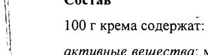
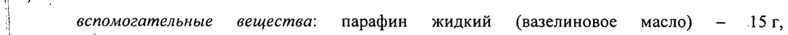
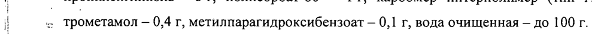
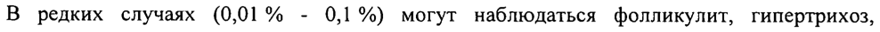
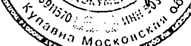

# Метилпреднизолона ацепонат + Мочевина — наружно

- Препарат: Комфодерм М2 (крем для наружного применения;)
- АТХ: D07XC
- Источник: ГРЛС, инструкция по медицинскому применению, РУ ЛП-002911, файл от 2024-01-11 (https://grls.rosminzdrav.ru/Grls_View_v2.aspx?routingGuid=8c0e19cc-541e-407f-842f-761bbbb2a9b9)
- Распознано автоматически (OCR): 6 из 6 стр.
- Инструкция к другому РУ того же препарата: ЛП-002911 (национальное РУ, переоформленное по правилам ЕАЭС, решение от 20.12.2023). Текст может быть старше действующего
- Сомнительных строк после OCR: 5 (см. раздел «Проверка распознавания»)

## Общие сведения

| МИНИСТЕРСТВО ЗДРАВООХРАНЕНИЯ PO CHUCK RHR PAR? AU, И
| ° ; ЛИ - 002911 - 130315 COTMACOBAHO | ИНСТРУКЦИЯ по применению лекарственного препарата для медицинского применения
| Комфодерм® M, ` Регистрационный номер: |
Торговое название препарата: Комфодерм® M2
| Международное непатентованное название или группировочное название:
| метилпреднизолона ацепонат + мочевина | 9 Лекарственная форма: крем для наружного применения
| | | | | Состав | 100 г крема содержат:
| | активные вещества: метилпреднизолона ацепонат в пересчете на 100 % вещество — 0,1 г,
G мочевина в пересчете Ha 100 % вещество — 2 г;
| вспомогательные вещества: парафин жидкий (вазелиновое масло) —- 15г, пропиленгликоль -— Sr, полисорбат-80 — lr, карбомер интерполимер (тип А) — Ir,
| =: трометамол — 0,4 г, метилпарагидроксибензоат — 0,1 г, вода очищенная — до 100 г.
5 Описание | а Крем белого или почти белого цвета. Допускается наличие слабого специфического запаха. у
Фармакотерапевтическая группа: глюкокортикостероид для местного применения + кератолитическое средство
Код ATX: 207ХС Фармакологические свойства

## 5.1. Фармакодинамика

Комфодерм® М› - комбинированный препарат, действие которого обусловлено входящими в его состав компонентами.
Комфодерм® М› - комбинированный препарат, действие которого обусловлено входящими в его состав компонентами.
Метилпреднизолона ацепонат - представляет собой — негалогенизированный синтетический стероид. При наружном применении метилпреднизолона ацепонат
| подавляет воспалительные и аллергические кожные реакции, также как и реакции, связанные с усиленной пролиферацией, что приводит к уменьшению объективных симптомов воспаления (эритема, отек, мокнутие) и субъективных ощущений (зуд, раздражение, боль и т.д.).
При применении метилпреднизолона ацепоната наружно в рекомендуемой дозе системное действие минимально как у человека, так и у животных. После многократного нанесения метилпреднизолона ацепоната на большие поверхности (40-60 % поверхности кожи), а
| также при применении под окклюзионную повязку не отмечается нарушений функций надпочечников: уровень кортизола в плазме и его циркадный ритм остаются в пределах нормы, снижения концентрации кортизола в суточной моче не происходит.
Метилпреднизолона ацепонат (особенно его основной метаболит — ба-метилпреднизолоне 17-пропионат) связывается с внутриклеточными глюкокортикоидными рецепторами.
| Стероид-рецепторный комплекс связывается с определенными участками ДНК клеток
| иммунного ответа, вызывая, таким образом, серию биологических эффектов.
| В частности, связывание стероид-рецепторного комплекса с ДНК клетками иммунного ответа приводит к индукции синтеза макрокортина. Макрокортин ингибирует
^ высвобождение арахидоновой кислоты и, тем самым, образование медиаторов воспаления типа простагландинов и лейкотриенов.
Ингибирование глюкокортикостероидами синтеза вазодилатирующих простагландинов и | потенцирование сосудосуживающего действия адреналина приводят к вазоконстрикторному эффекту.
| $ Мочевина — обладает кератолитическим и увлажняющим эффектами. Мочевина
| способствует связыванию воды и вследствие этого размягчению рогового слоя кожи. |
| | Помимо кератолитического действия, мочевина обладает протеолитической активностью. |
| | Фармакокинетика | | При местном применении метилпреднизолона ацепонат гидролизуется в эпидермисе и дерме. Главным и наиболее активным метаболитом является ба-метилпреднизолон-17пропионат, обладающий значительно более высоким сродством к глюкокортикостероидным рецепторам кожи, что указывает на наличие его
«биоактивации» в коже.
| Степень чрескожной абсорбции зависит от состояния кожи и способа применения (с использованием или без окклюзионной повязки).
Чрескожная абсорбция у пациентов с атопическим дерматитом (нейродермитом) и псориазом составляет не более 2,5 %, что лишь незначительно выше таковой у здоровых добровольцев (0,5-1,5 %).
После попадания в системный кровоток ба-метилпреднизолон-17-пропионат быстро конъюгирует с глюкуроновой кислотой и, таким образом, инактивируется.
Метаболиты метилпреднизолона ацепоната элиминируются, главным образом, почками с периодом полувыведения около 16 часов. Метилпреднизолона ацепонат и его метаболиты
| не кумулируют в организме. | В связи с низкой всасываемостью мочевины при местном применении вероятность ее системных эффектов невелика.

## 4.1. Показания к применению

Воспалительные заболевания кожи, чувствительные к терапии топическими глюкокортикостероидами и сопровождающиеся нарушением кератинизации:
Воспалительные заболевания кожи, чувствительные к терапии топическими глюкокортикостероидами и сопровождающиеся нарушением кератинизации:
6 — атопический дерматит, нейродермит;
— истинная экзема;
— микробная экзема;
— простой контактный дерматит;
— аллергический (контактный) дерматит;
¢ — дисгидротическая экзема.

## 4.3. Противопоказания

— гиперчувствительность к компонентам препарата;
— гиперчувствительность к компонентам препарата;
— туберкулезный или сифилитический процессы в области нанесения препарата;

| — вирусные заболевания (например, ветряная оспа, опоясывающий лишай);

— розацеа, периоральный дерматит в области нанесения препарата;

— Участки кожи с проявлениями реакции на вакцинацию;

| — детский возраст до 18 лет.

|

| |

## 4.6. Применение при беременности и в период грудного вскармливания

При необходимости применения препарата Комфодерм® М» во время беременности и | лактации следует тщательно взвешивать потенциальный риск для плода и ожидаемую

| пользу лечения для матери. В эти периоды не рекомендуется длительное применение

| препарата на обширных поверхностях кожи.
Кормящим матерям не следует наносить препарат на молочные железы.

| . !

## 4.2. Способ применения и дозы

Наружно.
Наружно.
Препарат наносят 1 раз в сутки тонким слоем на пораженные участки кожи.
Как правило, длительность непрерывного ежедневного лечения препаратом
Комфодерм® M2 не должна превьшшать 12 недель.
При лечении пациентов с поражением кожи лица курс лечения не должен превышать 5 дней.

## 4.8. Побочное действие

| Очень редко (менее чем в 0,01 % случаев) могут наблюдаться местные реакции, такие как зуд, жжение, эритема, образование везикулезной сыпи.
| Очень редко (менее чем в 0,01 % случаев) могут наблюдаться местные реакции, такие как зуд, жжение, эритема, образование везикулезной сыпи.
Если препарат применяют более 4-х недель и/или на площади 10 % и более поверхности 9 тела, могут возникнуть следующие реакции: атрофия кожи, телеангиэктазии, стрии, акнеформные изменения кожи, системные эффекты, обусловленные абсорбцией кортикостероида.
В редких случаях (0,01% - 0,1%) могут наблюдаться фолликулит, гипертрихоз, периоральный дерматит, депигментация кожи, аллергические реакции на один из 4 компонентов препарата.
. Передозировка | При изучении острой токсичности метилпреднизолона ацепоната не было выявлено
| какого-либо риска острой интоксикации при чрезмерном однократном кожном применении (нанесение препарата на большую площадь при условиях, благоприятных для абсорбции) или при непреднамеренном приеме внутрь.
При чрезмерно долгом и/или интенсивном местном применении глюкокортикостероидов могут развиться атрофия кожи (истончение кожи, телеангиэктазии, стрии).
| При появлении признаков атрофии кожи препарат необходимо отменить.
} При местном применении мочевины передозировка маловероятна.
i Взаимодействие с другими лекарственными средствами
| Взаимодействия препарата с другими лекарственными средствами не выявлено, однако
| следует учитывать, что одновременное применение препарата Комфодерм® М2 с другими
| мазями или кремами может привести к усилению резорбции входящих в их состав лекарственных веществ.

## 4.4. Особые указания

При наличии бактериальных осложнений и/или дерматомикозов в дополнение к терапии препаратом Комфодерм® М› необходимо проводить специфическое антибактериальное и/или антимикотическое лечение.
При наличии бактериальных осложнений и/или дерматомикозов в дополнение к терапии препаратом Комфодерм® М› необходимо проводить специфическое антибактериальное и/или антимикотическое лечение.
Препарат не предназначен для применения в офтальмологии. Следует избегать попадания в глаза и на слизистые оболочки. |
Как и при применении системных глюкокортикостероидов, после наружного применения глюкокортикостероидов может развиться глаукома (например, после использования больших доз, вследствие очень длительного применения окклюзионных повязок или после нанесения на кожу вокруг глаз).
На коже лица чаще, чем на других поверхностях тела, после длительного лечения глюкокортикостероидами местного действия могут появляться атрофические изменения.
| Влияние на способность управлять транспортными средствами, механизмами
| Не выявлено.

## 6.5. Форма выпуска

Крем для наружного применения 0,1 % +2 %.
Крем для наружного применения 0,1 % +2 %.
По 30 г в тубу алюминиевую. Каждую тубу вместе с инструкцией по применению помещают в пачку из картона.
| Условия хранения При температуре не выше 25 °С.
Хранить в недоступном для детей месте.
| | Срок годности г 2 года.
| | Не применять по истечении срока годности.
Условия отпуска Без рецепта.
' | .
Производитель/ Организация, принимающая претензии потребителей
Открытое акционерное общество «Химико-фармацевтический комбинат «АКРИХИН»
(ОАО «АКРИХИН»), 142450, Московская область, Ногинский район, г. Старая Купавна, ул. Кирова, 29.
Телефон/факс: (495) 702-95-03.
р $ д AMON Ty 2 Ws cy Cee № № ух о Директор по регистрации fies + A otk © a ~ и медицинским вопросам © Но = Зуакр Ц : * Ганкина Е.М.
“ее о 4 Rs 9 мора { aS гу 4 << 2%. a ee 4
< 2. а ag le [4 > / 6 | | ; 7
## Проверка распознавания

Страницы-сканы распознаны автоматически. В 5 строках с дозировками цифры могли распознаться с ошибкой — сверьте с вырезкой из оригинала:

- стр. 1: «| 100 г крема содержат:» — повторное чтение: «»  
  
- стр. 1: «| вспомогательные вещества: парафин жидкий (вазелиновое масло) —- 15г,» — низкая уверенность: «15г,» (74)  
  
- стр. 1: «| =: трометамол — 0,4 г, метилпарагидроксибензоат — 0,1 г, вода очищенная — до 100 г.» — повторное чтение: «| _ тромеммол 04, метилиарагидроксибензоат — 0,1 r, вода очищенная — до 100 г.»  
  
- стр. 4: «В редких случаях (0,01% - 0,1%) могут наблюдаться фолликулит, гипертрихоз,» — низкая уверенность: «0,1%)» (67)  
  
- стр. 6: «<< 2%. a ee 4» — низкая уверенность: «2%.» (46), «4» (72); повторное чтение: «»  
  
