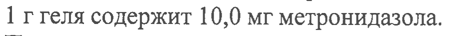
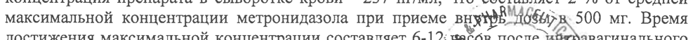
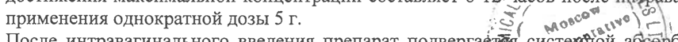
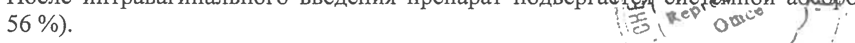
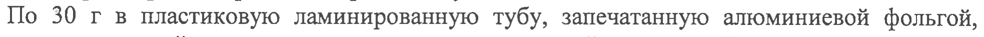

# Метронидазол — вагинально

- Препарат: Метрогил® (гель вагинальный)
- АТХ: G01AF01
- Источник: ОХЛП, Единый реестр ЛС ЕАЭС, запись 62443903fb44f15c3d77d30b, документ от 2023-07-03
- Распознано автоматически (OCR): 7 из 7 стр.
- Сомнительных строк после OCR: 6 (см. раздел «Проверка распознавания»)

## Общие сведения

СООТВЕТСТВУЕТ ЭКСПЕРТНОМУ ОТЧЕТУ от 10.08.2022 № 18779 ее аля
ОБЩАЯ ХАРАКТЕРИСТИКА JIEKAPCTBEHHOFO TIPFIIAPATA |!

## 1. Наименование лекарственного препарата

Метрогил, 1%, гель вагинальный

## 2. Качественный и количественный состав

Действующее вещество: метронидазол 1 г геля содержит 10,0 мг метронидазола.
Полный перечень вспомогательных веществ приведен в разделе 6.1.

## 3. Лекарственная форма

Гель вагинальный.
Однородный гель от бесцветного до светло-желтого цвета.

## 4. Клинические данные

## 4.1. Показания к применению

Бактериальные вагинозы различной этиологии, подтвержденные клиническими и микробиологическими данными; урогенитальный трихомониаз.

## 4.2. Режим дозирования и способ применения

Режим дозирования Рекомендуемая доза составляет 5 г (один полный аппликатор) 2 раза в день (утром и вечером).
Курс лечения - 5 дней.
Способ применения Интравагинально.

## 4.3. Противопоказания

Гиперчувствительность к метронидазолу в том числе к производным нитроимидазола или к любому из вспомогательных веществ, перечисленных в разделе 6.1;

e Лейкопения (в т.ч. в анамнезе);
® Нарушение координации движений;
e Органические поражения центральной нервной системы (в т.ч. эпилепсия);
e Печеночная недостаточность (в случае приема больших доз);
® Беременность;
® Период грудного вскармливания;
® Детский возраст до 18 лет.

## 4.4. Особые указания и меры предосторожности при применении

Особые указания Поскольку одновременное применение препарата с алкоголем (этанолом) может оказывать действие, аналогичное действию дисульфирама (гиперемия кожных покровов, приливы крови к кожным покровам, рвота, тахикардия), следует предупредить пациентов о том, что во время лечения и в течение хотя бы одного дня после окончания применения препарата
Метрогил не следует употреблять алкогольные напитки или лекарственные препараты, содержащие этанол. _
Следует тщательно взвешивать показания для длит дам рименения препарата
Метрогил и при отсутствии строгих показаний избегать "о Agel TQ применения.
Если при наличии строгих показаний препарат примейяетря боле длительно, чем это обычно рекомендуется, то лечение следует проводи? подзкёнрол гематологических
‚= = & о /е ope И ЕС:
СООТВЕТСТВУЕТ ЭКСПЕРТНОМУ ОТЧЕТУ

от 10.08.2022 № 18779 показателей (особенно лейкоцитов) и побонных редкий! таких Как мерифериче скан или центральная нейропатия, проявляющихся парестезиями, атаксией, головокружением, судорогами, при появлении которых лечение должно быть прекращено.
При лечении трихомонадного вагинита у женщин необходимо воздерживаться от половых контактов. Обязательно одновременное лечение половых партнеров. Не следует прекращать лечение во время менструаций. После терапии трихомониаза следует провести контрольные пробы в течение 3 очередных циклов до и после менструации.
Одновременное использование партнерами вагинального геля Метрогил и презерватива или диафрагмы может повысить риск разрыва латекса.
Следует с осторожностью применять метронидазол у пациентов с печеночной энцефалопатией, а также у пациентов с острыми или хроническими заболеваниями центральной или периферической нервной системы из-за возможного риска неврологического ухудшения.
Сообщалось о развитии тяжелой гепатотоксичности/острой печеночной недостаточности
(включая случаи с летальным исходом, которые очень быстро развивались после начала лечения) у пациентов с синдромом Коккейна при лечении метронидазолом для системного применения. Данной категории пациентов метронидазол следует назначать только после тщательной оценки отношения польза/риск и только в случае отсутствия альтернативного лечения. Исследования функций печени следует проводить перед началом лечения, во время терапии и после ее окончания до тех пор, пока показатели функций печени не достигнут нормальных значений, или до тех пор, пока не будут достигнуты исходные значения этих показателей. Если показатели функций печени будут значительно превышены во время лечения, то применение препарата должно быть прекращено.
Пациентам с синдромом Коккейна следует рекомендовать немедленно сообщать врачу о развитии любых симптомов потенциального поражения печени и прекращать применение метронидазола.
Сообщалось о случаях тяжелых буллезных кожных реакций, таких как синдром СтивенсаДжонсона, токсический эпидермальный некролиз или острый генерализованный экзантематозный пустулез, после применения метронидазола. При развитии симптомов или признаков данных заболеваний, лечение препаратом Метрогил должно быть немедленно прекращено.
Необходимо принимать во внимание, что метронидазол может иммобилизовать трепонемы, что приводит к ложноположительному тесту Нельсона.
Необходимо тщательно обосновывать длительное применение метронидазола из-за возможной мутагенности и канцерогенности.

## 4.5. Взаимодействие с другими лекарственными препаратами и другие виды взаимодействия

С дисульфирамом Сообщалось о развитии психотических реакций у пациентов, получавших одновременно метронидазол и дисульфирам (интервал между применением этих двух лекарственных препаратов должен быть не менее 2 недель).
С этанолом Возможно возникновение дисульфирамоподобных реакций (гиперемия кожных покровов, приливы крови к кожным покровам, рвота, тахикардия).
С непрямыми антикоагулянтами (варфарин) |
Усиление антикоагулянтного эффекта и повышение ричи разриутия кровотечения, связанного со снижением печеночного метаболизма непрях анти ГУЛянтов, что может приводить к удлинению протромбинового времени. В сле однёврем8ннбго применения метронидазола и непрямых антикоагулянтов требфатся $ 6en8e частый контроль протромбинового времени и при необходимости коррекции доф айтёкоау HTOB.

ON & } 2

| p= < -

а lad СООТВЕТСТВУЕТ ЭКСПЕРТНОМУ ОТЧЕТУ от 10.08.2022 № 18779

При одновременном применении метронидазола с препаратами лития может повышаться концентрация последнего в плазме крови. При одновременном применении следует контролировать концентрации лития, креатинина и электролитов в плазме крови.
С циклоспорином При одновременном применении метронидазола с циклоспорином может повышаться концентрация циклоспорина в сыворотке крови. В случае необходимости одновременного применения метронидазола и циклоспорина следует контролировать концентрации циклоспорина и креатинина в сыворотке крови.
С циметидином Циметидин подавляет метаболизм метронидазола, что может привести к повышению его концентрации в сыворотке крови и увеличению риска развития побочных явлений.
С лекарственными препаратами, индуцирующими изоферменты микросомального окисления в печени (фенобарбитал, фенитоин)
Одновременное применение метронидазола с лекарственными препаратами, индуцирующими изоферменты микросомального окисления в печени (фенобарбитал, фенитоин), может ускорять выведение метронидазола, в результате чего снижается его концентрация в плазме крови.
С фторурацилом Метронидазол уменьшает клиренс фторурацила, приводя к увеличению его токсичности.
С бусульфаном Метронидазол повышает концентрацию бусульфана в плазме крови, что может приводить к развитию тяжелого токсического действия бусульфана.
С недеполяризующими миорелаксантами (векурония бромид)
Не рекомендуется применять с недеполяризующими миорелаксантами (векурония бромид).

## 4.6. Фертильность, беременность и лактация

Беременность Не рекомендуется назначать препарат Метрогил во время беременности
Лактация При назначении препарата необходимо прекратить грудное вскармливание.
4.7. Влияние на способность управлять транспортными средствами и работать с механизмами
Учитывая профиль таких побочных эффектов как спутанность сознания, головокружение, галлюцинации, нарушение зрения, рекомендуется во время лечения воздерживаться от управления автомобилем, от занятий другими потенциально опасными видами деятельности, требующими повышенной концентрации внимания и быстроты психомоторных реакций.

## 4.8. Нежелательные реакции

Желудочно-кишечные нарушения:
- Боли в эпигастрии, тошнота, рвота, диарея.
- Воспаление слизистой оболочки полости рта (глоссит, стоматит), нарушения вкусовых ощущений («металлический» привкус во рту), снижение аппетита, анорексия, сухость слизистой оболочки полости рта, запор.
- Панкреатит (обратимые случаи).
- Изменение цвета языка/‹«обложенный» язык (из-за ARERR PRO роста грибковой микрофлоры). ха <
Нарушения со стороны иммунной системы = (obs
- Ангионевротический отек, анафилактический шок. “=, 8 = 8 \
Нарушения со стороны нервной системы рт 5 2 & )&

P,\ 8 J 3

ao

Ne TT СООТВЕТСТВУЕТ ЭКСПЕРТНОМУ ОТЧЕТУ от 10.08.2022 № 18779
- Периферическая сенсорная нейропатия. (ПОСЛЕДОВАТЕЛЬНОСТЬ 0001)
- Головная боль, судороги, головокружение.
- Сообщалось о развитии энцефалопатии (например, спутанность сознания) и подострого мозжечкового синдрома (нарушение координации и синергизма движений, атаксия, дизартрия, нарушения походки, нистагм и тремор), которые подвергаются обратному развитию после отмены метронидазола.
- Асептический менингит.
Психические нарушения - Психотические расстройства, включая спутанность сознания, галлюцинации.
- Депрессия, бессонница, раздражительность, повышенная возбудимость.
Нарушения со стороны органа зрения - Преходящие нарушения зрения, такие как диплопия, миопия, нечеткость зрения, снижение остроты зрения, нарушение цветового восприятия.
- Нейропатия/неврит зрительного нерва.
Нарушения со стороны органа слуха и лабиринта
- Нарушения слуха/потеря слуха (включая нейросенсорную глухоту).
- Шум в ушах.
Нарушения со стороны крови и лимфатической системы
- Агранулоцитоз, лейкопения, нейтропения и тромбоцитопения.
Нарушения со стороны печени и желчевыводящих путей
- Повышение активности «печеночных» ферментов (аспартатаминотрансферазы (АСТ) и аланинаминотрансферазы (AJIT), щелочной фосфатазы), развитие холестатического или смешанного гепатита и гепатоцеллюлярного поражения печени, иногда сопровождавшегося желтухой.
- У пациентов, получавших лечение метронидазолом в комбинации с другими антибиотиками, наблюдались случаи развития печеночной недостаточности, потребовавшей проведения трансплантации печени.
Нарушения со стороны кожи и подкожных тканей
- Сыпь, кожный зуд, приливы крови к кожным покровам, гиперемия кожи, крапивница.
- Пустулезная кожная сыпь.
- Острый генерализованный экзантематозный пустулез.
- Фиксированная лекарственная сыпь.
- Синдром Стивенса-Джонсона, токсический эпидермальный некролиз.
Нарушения со стороны почек и мочевыводящих путей
- Возможно окрашивание мочи в коричнево-красноватый цвет, обусловленное наличием в моче водорастворимого метаболита метронидазола.
- Дизурия, полиурия, цистит, недержание мочи, кандидоз.
Общие нарушения и реакции в месте введения
- Лихорадка, заложенность носа, артралгия, слабость.
- Ощущение жжения или раздражение полового члена у полового партнера, ощущение жжения или учащенное мочеиспускание, вульвит (зуд, жгучая боль или гиперемия слизистой оболочки в области наружных половых органов).
Инфекции - После отмены препарата возможно развитие кандидоза влагалища.
Лабораторные и инструментальные данные - Уплощение зубца Т на ЭКГ.
Сообщение о подозреваемых нежелательных реакциях
Важно сообщать о подозреваемых нежелательных реакциях посяе регистрации препарата с целью обеспечения непрерывного мониторинга соот Мения польза - риск»
лекарственного препарата. Медицинским работникам рекэмендуе$ся Сообщать о любых подозреваемых нежелательных реакциях лекаротвенногопрепаа, черз национальные
У Fis is \. 2, \. n у 4 Were СООТВЕТСТВУЕТ ЭКСПЕРТНОМУ ОТЧЕТУ от 10.08.2022 № 18779 системы сообщения о нежелательных рракциях(!Кобударетв?/ +1 взленов СВвраЗИЙского экономического союза:
Российская Федерация Федеральная служба по надзору в сфере здравоохранения (Росздравнадзор)
Адрес: 109074, г. Москва, Славянская площадь, д. 4, строение |
Тел.: +7 (495) 698-45-38, +7 (499) 578-02-30
Адрес электронной почты: pharm(@roszdravnadzor.gov.ru (для держателей регистрационных удостоверений и производителей лекарственных препаратов), npr@roszdravnadzor.gov.ru
(для медицинских организаций).
Интернет-сайт: www.roszdravnadzor.ru

## 4.9. Передозировка

При применении препарата в соответствии с инструкцией по применению передозировка маловероятна. При чрезмерном применении или случайном приеме внутрь возможно усиление побочных эффектов.
Лечение: специфического антидота при отравлении метронидазолом нет, показана симптоматическая поддерживающая терапия.

## 5. Фармакологические свойства

## 5.1. Фармакодинамические свойства

Фармакотерапевтическая группа: противомикробные средства и антисептики, применяемые в гинекологии; противомикробные средства и антисептики, кроме комбинаций с кортикостероидами; производные имидазола.
Код ATX: GO1AFO01 Механизм действия Метронидазол является производным 5-нитроимидазола. Механизм действия метронидазола заключается в биохимическом восстановлении 5-нитрогруппы метронидазола — внутриклеточными — транспортными протеинами анаэробных микроорганизмов и простейших. Восстановленная 5-нитрогруппа метронидазола взаимодействует с ДНК клетки микроорганизмов, ингибируя синтез их нуклеиновых кислот, что ведет к гибели микроорганизмов.
Активен в отношении Trichomonas vaginalis, Entamoeba histolytica а также грамотрицательных анаэробов Bacteroides spp. (в том числе В. fragilis, В. ovatus, В.
distasonis, В. thetaiotaomicron, В. vulgatus), Fusobacterium spp. и некоторых грамположительных анаэробов (чувствительные штаммы Eubacterium spp., Clostridium spp.,
Peptococcus niger, Peptostreptococcus spp.). Минимальная подавляющая концентрация
(МПК) для этих штаммов составляет 0,125- 6,25 мкг/мл. В сочетании с амоксициллином проявляет активность в отношении Helicobacter pylori (амоксициллин подавляет развитие резистентности к метронидазолу).
К метронидазолу не чувствительны аэробные микроорганизмы и факультативные анаэробы, но в присутствии смешанной флоры (аэробы и анаэробы) метронидазол действует синергидно с антибиотиками, эффективными против обычных аэробов.

## 5.2. Фармакокинетические свойства

Абсорбция После однократного интравагинального введения 5 г Метрогила средняя максимальная концентрация препарата в сыворотке крови - 237 нг/мл, что составляет 2 % от средней максимальной концентрации метронидазола при приеме вн" 166ey 500 мг. Время достижения максимальной концентрации составляет 6-12: часов noone о ровагинального применения однократной дозы 5 г. 2S ( orem wr? |;
После интравагинального введения препарат подвергает систем ой абсорбции (около 56 %). 15 EF о Л
‘oe С Y/Y 7 NO ene 5 Бе 2 СООТВЕТСТВУЕТ ЭКСПЕРТНОМУ ОТЧЕТУ

от 10.08.2022 № 18779 Проникает в грудное молоко и большинство тканей, проходит через гематоэнцефалический барьер и плаценту. Связь с белками плазмы - менее 20 %. Метаболизируется в печени путем гидроксилирования, окисления и глюкуронирования. Активность основного метаболита
(2-оксиметронидазол) - 30 % активности исходного соединения.
Биодоступность Относительная биодоступность вагинального геля в 2 раза выше биодоступности одноразовой дозы (500 мг) влагалищных таблеток метронидазола, что обусловлено высокой проникающей способностью препарата во влагалищную жидкость. Поэтому терапевтический эффект после интравагинального введения достигается уже при низких концентрациях метронидазола.
6. ФАРМАЦЕВТИЧЕКИЕ СВОЙСТВА
6.1. Перечень вспомогательных веществ
Пропилпарагидроксибензоат Пропиленгликоль
Карбомер-940 Динатрия эдетат Натрия гидроксид
Вода очищенная

## 6.2. Несовместимость

Не применимо.

## 6.3. Срок годности (срок хранения)

3 года.
6.4. Особые меры предосторожности при хранении
Хранить при температуре не выше 25 °С.
6.5. Характер и содержание первичной упаковки
По 30 г в пластиковую ламинированную тубу, запечатанную алюминиевой фольгой, ламинированной полиэтиленом и с навинчивающейся крышкой из полипропилена с выступом (или без выступа) для перфорации фольги. Одна туба в картонную пачку вместе с аппликатором и инструкцией по применению.
6.6. Особые меры предосторожности при уничтожении использованного лекарственного препарата или отходов, полученных после применения лекарственного препарата или другие манипуляции с препаратом
Особые требования отсутствуют.

## 7. Держатель регистрационного удостоверения

Индия «Юник Фармасьютикал Лабораториз» (Отделение фирмы «Дж. Б. Кемикалс энд
Фармасьютикалс Лтд.»)
Ворли, Мумбай - 400 030, Индия

АМА,

7.1. Представитель держателя регистрационного удостоверения" SLB \
Претензии потребителей направлять по адресу: <” «o* \e)
Российская Федерация | =! mor re} |.

LB wert uct J)

OX , 6

у СООТВЕТСТВУЕТ ЭКСПЕРТНОМУ ОТЧЕТУ от 10.08.2022 № 18779
Московское представительство фирмы «Дж. Б. Иёмикане ня: Фа р atbioraKxane Лтд»
(Индия)
г. Москва 121059, ул. Брянская, д. 5 Тел.: (495) 662 18 11
Факс: (495) 662 18 12 Адрес электронной почты: pharmacovigilance@jbepl.ru

## 8. Номер регистрационного удостоверения

## 9. Дата первичной регистрации

(ПОДТВЕРЖДЕНИЯ РЕГИСТРАЦИИ,

ПЕРЕРЕГИСТРАЦИИ)
Дата первой регистрации:
10. ДАТА ПЕРЕСМОТРА ТЕКСТА
Общая характеристика лекарственного препарата Метрогил доступна на информационном портале Евразийского экономического союза в информационно-коммуникационной сети
«Интернет» http://eec.eaeunion.org/.
МАПА yw RN > и S\ S/ gov = = ( wae enie® =
Vee | ae ace = vee of y, ] ON 7
## Проверка распознавания

Страницы-сканы распознаны автоматически. В 6 строках с дозировками цифры могли распознаться с ошибкой — сверьте с вырезкой из оригинала:

- стр. 1: «1 г геля содержит 10,0 мг метронидазола.» — повторное чтение: «ir геля содержит 10,0 мг метронидазола.»  
  
- стр. 5: «После однократного интравагинального введения 5 г Метрогила средняя максимальная» — повторное чтение: «После однократного интравагинального введения 5 r Метрогила средняя максимальная»  
  
- стр. 5: «максимальной концентрации метронидазола при приеме вн" 166ey 500 мг. Время» — низкая уверенность: «166ey» (0); повторное чтение: «максимальной концентрации метронидазола при приеме вн Ябизн 500 мт. Время»  
  
- стр. 5: «применения однократной дозы 5 г. 2S ( orem wr? |;» — низкая уверенность: «2S» (47); повторное чтение: «»  
  
- стр. 5: «56 %). 15 EF о Л» — низкая уверенность: «15» (62)  
  
- стр. 6: «По 30 г в пластиковую ламинированную тубу, запечатанную алюминиевой фольгой,» — повторное чтение: «По 30 гв пластиковую ламинированную тубу, запечатанную алюминиевой фольгой,»  
  
