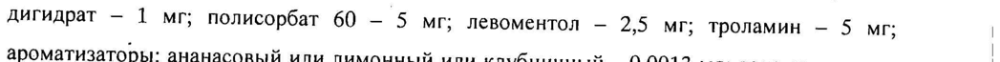
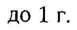

# Метронидазол + Хлоргексидина биглюконат — наружно

- Препарат: Метродент (гель стоматологический; гель стоматологический, ананасовый; гель стоматологический, клубничный; гель стоматологический, лимонный;)
- АТХ: A01AB11
- Источник: ГРЛС, инструкция по медицинскому применению, РУ ЛП-002599, файл от 2020-07-08 (https://grls.rosminzdrav.ru/Grls_View_v2.aspx?routingGuid=a5b827d0-2dfa-4202-95c5-bc15c3662ad7)
- Распознано автоматически (OCR): 5 из 5 стр.
- Инструкция к другому РУ того же препарата: ЛП-002599 (срок действия истёк, решение от 15.02.2016). Текст может быть старше действующего
- Сомнительных строк после OCR: 5 (см. раздел «Проверка распознавания»)

## Общие сведения

Lime | МИНИСТЕРСТВО ЗДРАВООХРАНЕНИЯ РОССИИСК®И В ВДЕВАЦИХА СИИ
ИНСТРУКЦИЯ | AN 002599 - 220814 по применению лекарственного препарата для м медицинского, применения
МЕТРОДЕНТ $$ Регистрационный номер:
Торговое название: Метродент МИН или группировочное название: метронидазол + хлоргексидин &

## 3. Лекарственная форма

гель стоматологический, гель стоматологический (ананасовый), гель стоматологический (клубничный), гель стоматологический (лимонный)
гель стоматологический, гель стоматологический (ананасовый), гель стоматологический (клубничный), гель стоматологический (лимонный)
| Состав на 1 г:
Активные вещества: метронидазола бензоат 16 мг (эквивалентно 10 мг метронидазола);
© хлоргексидина биглюконата раствор 20 % - 2,5 мг (эквивалентно 0,5 мг хлоргексидина
| биглюконата).
| Вспомогательные вещества: карбомер-934Р - 12 мг; метилпара-гидроксибензоат - 1 мг;
| пропилпарагидросибензоат — 0,1 мг; пропиленгликоль — 148,5 мг; натрия сахарината дигидрат — 1 мг; полисорбат 60 — 5 мг; левоментол — 2,5 мг; троламин — 5 мг; |
| ароматизаторы: ананасовый или лимонный или клубничный — 0,0013 мл; вода очищенная | до 1 г.
Описание Гель стоматологический:
однородный гель от бесцветного до бесцветного со слегка желтоватым оттенком цвета, со
| специфическим запахом ментола.
Гель стоматологический (ананасовый):
© однородный гель от бесцветного до бесцветного со слегка желтоватым оттенком цвета, со специфическим запахом ментола и слабым запахом ананаса.
Гель стоматологический (клубничный):
однородный гель от бесцветного до бесцветного со слегка желтоватым оттенком цвета, со специфическим запахом ментола и слабым запахом клубники.
Гель стоматологический (лимонный):
однородный гель от бесцветного до бесцветного со слегка желтоватым оттенком цвета, со специфическим запахом ментола и слабым запахом лимона.
Фармакдтерапевтическая группа: противомикробное средство.
` Код ATX: АО1АВ11 ФАРМАКОЛОГИЧЕСКИЕ СВОЙСТВА

## 5.1. Фармакодинамика

Комбинированный противомикробный препарат. Эффективность препарата обусловлена наличием в его составе двух антибактериальных компонентов: метронидазола и хлоргексидина. |
Комбинированный противомикробный препарат. Эффективность препарата обусловлена наличием в его составе двух антибактериальных компонентов: метронидазола и хлоргексидина. |
Метронидазол обладает антибактериальным действием против анаэробных бактерий, вызывающих заболевания парадонта: Porphyromonas gingivalis, Prevotella intermedia,
Prevotella denticola, Fusobacterium fusiformis, Wolinella recta, Eikenella corrodens, Borrelia vincenti, Bacteroides melaninogenicus, Selenomonas spp.
Хлоргексидин — антисептик широкого спектра, обладающий бактерицидным действием в отношении грамотрицательных и грамположительных микроорганизмов, а также о дрожжей, дерматофитов. Не нарушает функциональную активность лактобацилл.

## 5.2. Фармакокинетика

При местном применении препарата Метродент стоматологический гель практически не подвергается системной абсорбции и не оказывает системного действия, так как действующие вещества используются в минимальных терапевтических концентрациях, и их системное воздействие минимально.
При местном применении препарата Метродент стоматологический гель практически не подвергается системной абсорбции и не оказывает системного действия, так как действующие вещества используются в минимальных терапевтических концентрациях, и их системное воздействие минимально.

## 4.1. Показания к применению

Метродент гель стоматологический предназначен для местного применения при инфекционно-воспалительных заболеваниях пародонта и слизистой оболочки полости рта:
Метродент гель стоматологический предназначен для местного применения при инфекционно-воспалительных заболеваниях пародонта и слизистой оболочки полости рта:
- острый и хронический (отёчный, гиперпластический, десквамативный} гингивит a (воспаление десен);
- острый язвенно-некротический гингивит Венсана;
- острый и хронический пародонтит;
- юношеский пародонтит;
| - пародонтоз, осложненный гингивитом;
| - афтозный стоматит;
- хейлит;
- воспаление слизистой оболочки полости рта при ношении протезов;
- постэкстракционный альвеолит (воспаление лунки после удаления зуба);
- периодонтит, периодонтальный абсцесс (в составе комбинированной терапии).

## 4.3. Противопоказания

| | | | , | ОНИ:
| | | | , | ОНИ:
| Гиперчувствительность к компонентам препарата (в т.ч. к метронидазолу, хлоргексидину,
| производным нитроимидазола и парааминобензойной кислоты).
Детский возраст до 6 лет.

## 4.6. Применение при беременности и в период грудного вскармливания

ВСКАРМЛИВАНИЯ Информация о влиянии Метродента геля стоматологического во время беременности и грудного вскармливания отсутствует. Поэтому, не рекомендуется применять препарат в | триместре беременности. При беременности (П и Ш триместр) применяют только в случае, если предполагаемая польза для матери превышает потенциальный риск для
| плода. В период лактации, при необходимости назначения препарата, следует решить вопрос о прекращении грудного вскармливания.
Oo СПОСОБ ПРИМЕНЕНИЯ И ДОЗЫ | Местно, только для стоматологического применения.
После тщательной чистки зубов прополоскать полость рта содовым раствором и протереть десны сухим ватным шариком. Выдавить небольшое количество геля на зубную щетку и нанести гель зубной щеткой на десны и межзубные промежутки. После нанесения геля в течение 30 мин нельзя полоскать рот и принимать пищу.
Взрослым и детям старше б лет:
при остром и хроническом гингивите, остром язвенно-некротическом гингивите Венсана, периодонтите, пародонтозе, осложненном гингивитом, периодонтальном абсцессе (в составе комплексной терапии) Метродент гель стоматологический наносят на область десен 2 раза в день. Длительность курса терапии составляет в среднем 7-10 дней.
© При пародонтите после снятия зубных отложений, пародонтальные карманы обрабатывают препаратом и производят аппликацию геля на область десен Время экспозиции - 30 мин. Количество процедур зависит от тяжести заболевания. В дальнейшем аппликации геля пациент может проводить самостоятельно: препарат следует наносить на область десен 2 раза в день в течение 7-10 дней.
При афтозном стоматите, воспалении слизистой оболочки полости рта при ношении протезов гель наносят на пораженную область слизистой оболочки полости рта 2 раза в день в течение 7-10 дней.
При хейлите гель наносят на пораженную область 2 раза в день в течение 7-10 дней.
Для профилактики обострений хронического гингивита и пародонтита небольшое количество геля (размером с горошину) наносят на область десен 2 раза в день в течение 7-10 дней. Профилактические курсы проводят 2-3 раза в год.
Для профилактики постэкстракционного альвеолита препаратом обрабатывают лунку после удаления зуба, затем гель применяют амбулаторно 2-3 раза в день в течение 7-10 дней.

## 4.8. Побочное действие

При местном применении геля стоматологического Метродент риск развития системных побочных явлений невелик, однако могут наблюдаться: «металлический» привкус во рту
При местном применении геля стоматологического Метродент риск развития системных побочных явлений невелик, однако могут наблюдаться: «металлический» привкус во рту
(при применении геля без ароматизатора), головная боль, аллергические реакции (кожная сыпь, зуд, крапивница).
Если любые из указанных в инструкции побочных эффектов усугубляются, или Вы заметили любые другие побочные эффекты, не указанные в инструкции, сообщите об этом врачу.
Oo ПЕРЕДОЗИРОВКА Случаев передозировки геля стоматологического Метродент при местном применении не наблюдалось.
Случайное или преднамеренное проглатывание большого количества геля может стать причиной усиления побочных эффектов, обусловленных в основном, метронидазолом
(хлоргексидин практически не всасывается из желудочно-кишечного тракта).
Симптомы: тошнота, рвота, головокружение, в более тяжелых случаях — парестезии и судороги.
Лечение: промывание желудка, при необходимости симптоматическая терапия.

## 4.5. Взаимодействие с другими лекарственными средствами

© При местном применении в рекомендованных дозах стоматологического геля Метродент его взаимодействие с другими препаратами не выявлено.

## 4.4. Особые указания

Применение геля стоматологического Метродент не заменяет гигиенической чистки зубов, поэтому во время курса лечения препаратом чистка зубов должна быть продолжена. Однако, не следует сочетать наложение геля одновременно с зубной пастой.
Применение геля стоматологического Метродент не заменяет гигиенической чистки зубов, поэтому во время курса лечения препаратом чистка зубов должна быть продолжена. Однако, не следует сочетать наложение геля одновременно с зубной пастой.
Избегать попадания в глаза.
Безопасность и эффективность применения геля стоматологического Метродент детям до 6 лет не установлена.
ВЛИЯНИЕ НА СПОСОБНОСТЬ КОНЦЕНТРАЦИИ ВНИМАНИЯ ПРИ |
УПРАВЛЕНИИ АВТОТРАНСПОРТОМ / МЕХАНИЗМАМИ |
| Применение препарата не влияет на способность управлять транспортными средствами и заниматься другими потенциально опасными видами деятельности, требующими повышенной концентрации внимания и быстроты психомоторных реакций.

## 6.5. Форма выпуска

Гель стоматологический, гель стоматологический (ананасовый), гель стоматологический
Гель стоматологический, гель стоматологический (ананасовый), гель стоматологический
(клубничный), гель стоматологический (лимонный) 10 мг/г + 0,5 мг/г.
По 20 г геля в тубу из ламинированного алюминия, горлышко которой запечатано алюминиевой фольгой, с навинчивающейся крышкой из полипропилена.
1 тубу в картонную пачку с инструкцией по медицинскому применению.
УСЛОВИЯ ХРАНЕНИЯ о Хранить при температуре не выше 25 °C. Не замораживать.
Хранить в местах, недоступных для детей.

## 6.3. Срок годности

2,5 года.
2,5 года.
Не использовать по истечении срока годности.
УСЛОВИЯ ОТПУСКА ИЗ АПТЕК Без рецепта.
ПРОИЗВОДИТЕЛЬ Синмедик Лабораториз, Фаридабад - 121003, Индия.
© ВЛАДЕЛЕЦ РЕГИСТРАЦИОННОГО УДОСТОВЕРЕНИЯ/ ПРЕТЕНЗИИ
ПОТРЕБИТЕЛЕЙ НАПРАВЛЯТЬ В АДРЕС ООО «Метигринс», Латвия
Адрес: Латвия (LV 40003507946), LV-1067, Рига, улица Буллю, дом 74, офис 32.
А Rt 4% LN 5 Re: $ >.
Le Mi “er, 5 py We, EY > BS У:
Директор ООО «Метигринс» НЕ aoe H Р. В. Бугаев
® ЗС Sh | ize SI OS an fe Kye
## Проверка распознавания

Страницы-сканы распознаны автоматически. В 5 строках с дозировками цифры могли распознаться с ошибкой — сверьте с вырезкой из оригинала:

- стр. 1: «© хлоргексидина биглюконата раствор 20 % - 2,5 мг (эквивалентно 0,5 мг хлоргексидина» — низкая уверенность: «0,5» (61)  
  
- стр. 1: «дигидрат — 1 мг; полисорбат 60 — 5 мг; левоментол — 2,5 мг; троламин — 5 мг; |» — повторное чтение: «MINOT то М полиборбит 60 — $ му левоментол — 2,5 мг; троламин — 5 му |»  
  
- стр. 1: «| ароматизаторы: ананасовый или лимонный или клубничный — 0,0013 мл; вода очищенная |» — повторное чтение: «| тие ананасовы i или  имонн bl я и eee suns “one sun: pona om , en И >»  
  
- стр. 1: «до 1 г.» — низкая уверенность: «1» (53)  
  
- стр. 5: «4% LN 5 Re: $ >.» — низкая уверенность: «4%» (20); повторное чтение: «А,»  
  
