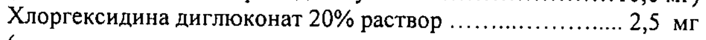
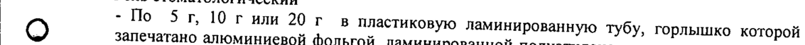
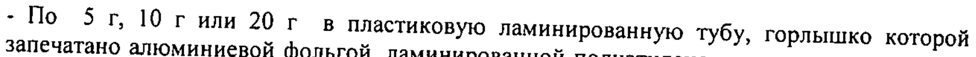
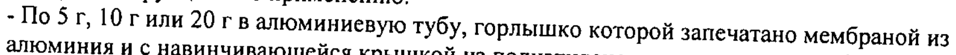

# Метронидазола бензоат + Хлоргексидина диглюконат 20 % раствор — наружно

- Препарат: Метрогил Дента® (гель стоматологический;)
- АТХ: A01AB11
- Источник: ГРЛС, инструкция по медицинскому применению, РУ П N015982/01, файл от 2024-04-23 (https://grls.rosminzdrav.ru/Grls_View_v2.aspx?routingGuid=fee31fca-a54b-40f4-a3f2-6fccba79e595)
- Распознано автоматически (OCR): 3 из 3 стр.
- Инструкция к другому РУ того же препарата: П N015982/01 (национальное РУ, переоформленное по правилам ЕАЭС, решение от 05.04.2024). Текст может быть старше действующего
- Сомнительных строк после OCR: 5 (см. раздел «Проверка распознавания»)

## Общие сведения

| a . IT NO15982/01-270110 7% > - ИНСТРУКЦИЯ по медицинскому применению препарата
| МЕТРОГИЛ ДЕНТА® Регистрационный номер:
_ Торговое название | | | Метрогил Дента®
. —_ МНН или-группировочное название | , Метронидазол + Хлоргексидин & . ,

## 3. Лекарственная форма

- Гель стоматологический
- Гель стоматологический

## 2. Состав

] г геля содержит:
] г геля содержит:
_ Активные вещества:
Метронидазола бензоат нии ини... 16,0 MP
(что эквивалентно метронидазолу..............................10,0 мг)
Хлоргексидина диглюконат 20% раствор ....................... 2,5 МГ
(что эквивалентно хлоргексидину диглюконату ...............0,5 мг)
и вспомогательные вещества: пропиленгликоль, карбомер-940, динатрия эдетат, натрия сахаринат, левоментол, натрия гидроксид, вода.
Описание Опалесцирующий мягкий гель белого или почти белого цвета |
Фармакотерапевтическая группа | | | Противомикробное средство
Код АТХ [А01АВ11] | _ Фармакологические свойства |
Эффективность препарата обусловлена наличием в его составе двух антибактериаль-ных | компонентов: | |
’ a) метронидазол обладает антибактериальным действием против анаэробных бактерий,
‚ вызывающих заболевания пародонта: Porphyromonas gingivalis, Prevotella intermedia,
.Fusobacterium fusiformis, Wolinella recta, Eikenella corrodens, Borrelia vincenti, Bacteroides
, ' -melaninogenicus, Selenomonas spp. co | ие: и
| 6) хлоргексидин -— антисептическое и противомикробное средство, эффективен в отношении грамположительных и грамотрицательных аэробных и анаэробных бактерий
(Treponema spp., Neisseria gonorrhoeae, Trichomonas spp., Chlamydia spp., Ureaplasma spp.,
Bacteroides fragilis). К препарату слабочувствительны некоторые штаммы Pseudomonas
| , spp., Proteus spp. а также устойчивы кислотоустойчивые формы бактерий, споры
| бактерий. Не нарушает функциональную активность лактобацилл.
| , , - При местном применении гель Метрогил Дента® практически не всасывается.
р 54697 ay О ——_ т TI №015982/01-270110 п a Показания к применению
Инфекционно-воспалительные заболевания пародонта и слизистой оболочки полости рта:
- острый и хронический гингивит;
- острый язвенно-некротический гингивит Венсана;
- острый и хронический пародонтит;
- юношеский пародонтит;
- пародонтоз, осложненный гингивитом;
- афтозный стоматит;
- хейлит; |
- воспаление слизистой оболочки полости рта при ношении протезов;
- постэкстракционный альвеолит (воспаление лунки после удаления зуба);
| - периодонтит, периодонтальный абсцесс (в составе комбинированный терапии)
| | Противопоказания | | | ! Индивидуальная непереносимость метронидазола, хлоргексидина, а также производных
| нитроимидазола. Непереносимость любых компонентов, входящих в состав препарата.
© Детский возраст до 6 лет.

Применение препарата при беременности и лактации
Не рекомендуется назначать препарат беременным женщинам в Г триместре беременности. В период лактации, при необходимости назначения препарата, следует решить вопрос о прекращении грудного вскармливания.

, Способ применения и дозы Местно, только для стоматологического применения.

Взрослым и детям старше 6 лет при воспалении десен (гингивит) Метрогил Дента® наносится на область десен тонким слоем пальцем или при помощи ватной палочки 2 раза в день. После нанесения геля следует воздержаться от питья и приема пищи в течение 30 мин. Смывать гель не рекомендуется. Длительность курса лечения составляет в среднем 7-10 дней.
При пародонтите после снятия зубных отложений, пародонтальные карманы
| обрабатываются` гелем Метрогил Дента® и производится ‘аппликация геля на область
О десен. Время экспозиции - 30 мин. Количество процедур зависит от тяжести заболевания.
В дальнейшем аппликации геля больной может проводить самостоятельно: Метрогил
Дента® наносится на область десен 2 раза в день в течение 7-10 дней. `°.
` При афтозном стоматите Метрогил Дента? наносится на пораженную область слизистой оболочки полости рта 2 раза в день в течение 7-10 дней. —
| Для профилактики обострений хронического гингивита и пародонтита гель Метрогил
| Дента® наносят на область десен 2 раза в день в течение 7-10 дней. Профилактические курсы лечения проводятся 2-3 раза в год.
, Для профилактики постэкстракционного альвеолита после удаления зуба лунка.
| _ обрабатывается гелем Метрогил Дента®, затем гель применяется 2-3 раза в день в течение | 7-10 дней.

## 4.8. Побочное действие

| При местном применении геля Метрогил Дента® могут наблюдаться аллергические

| реакции (кожная сыпь, зуд, крапивница), а также головная боль.

- Передозировка

| ° Случайное или преднамеренное проглатывание большого количества геля может стать 64697 ЧИ]
. | IT №015982/01-270110

“

7 причиной усиления побочных эффектов, обусловленных в основном, метронидазолом
(хлоргексидин практически не всасывается из желудочно-кишечного тракта). Могут наблюдаться: тошнота, рвота, головокружение, в более тяжелых случаях — парестезии и судороги. Лечение: промывание желудка, при необходимости симптоматическая терапия.

## 4.5. Взаимодействие с другими лекарственными средствами

При местном применении в рекомендованных дозах системного взаимодействия геля

| Метрогил Дента” с другими лекарственными средствами не выявлено.

## 4.4. Особые указания

Применение геля Метрогил Дента® не заменяет гигиенической чистки зубов, поэтому во
Применение геля Метрогил Дента® не заменяет гигиенической чистки зубов, поэтому во

| время курса лечения препаратом чистка зубов должна быть продолжена. .

## 6.5. Форма выпуска

- | |
- | |

| Гель стоматологический

| - По Sr, 10 гили 20г в пластиковую ламинированную тубу, горлышко которой

| @) запечатано алюминиевой фольгой, ламинированной полиэтиленом и с навинчивающейся

крышкой из полипропилена. Одна туба в картонную пачку с инструкцией по

применению.
- По Sr, 10 гили 20 г в пластиковую ламинированную тубу, горлышко которой запечатано алюминиевой фольгой, ламинированной полиэтиленом и с навинчивающейся

| крышкой из полипропилена с выступом для перфорации фольги. Одна туба в картонную

| пачку с инструкцией по применению.

- По 5 г, 10 гили 20 гв алюминиевую тубу, горлышко которой запечатано мембраной из алюминия и с навинчивающейся крышкой из полиэтилена с выступом для перфорации мембраны. Одна туба в картонную пачку с инструкцией по применению.

## 6.4. Условия хранения

Список B.
Список B.
‘При температуре не выше 25 °С.
Хранить в местах, недоступных для детей. |

®) Срок годности 3 года. Не использовать после истечения срока годности.

| Отпуск из аптек: без рецепта .

|

| Производитель | | |

| «Юник Фармасьютикал Лабораториз»

(Отделение фирмы «Дж.Б.Кемикалс энд

Фармасьютикалс Лтд.») . . ,

’ Ворли, Мумбай -400 030, Индия - о о

| Представительство в России

| г. Москва 121059, ул. Брянская, 5

| Тел: (495) 662-18-11, Факс: (495) 662-18-12 =

| АРУ: .

| GUN `

| Аа NEON

| . ka hes: |

| Представитель фирмы — О.В.Некрасова

| . о. . . oo . \2 ое . , , . 1 .

POCSRPAGWI SOFA — Wes | _ ВЕРСИИ ДОКУМЕНТА |2 _ ое TT TC TTS |
## Проверка распознавания

Страницы-сканы распознаны автоматически. В 5 строках с дозировками цифры могли распознаться с ошибкой — сверьте с вырезкой из оригинала:

- стр. 1: «7%» — низкая уверенность: «7%» (31); повторное чтение: «%»  
  
- стр. 1: «Хлоргексидина диглюконат 20% раствор ....................... 2,5 МГ» — низкая уверенность: «2,5» (66); повторное чтение: «Хлоргексидина диглюконат 20% раствор АНИ 2,5 Mr»  
  
- стр. 3: «| - По Sr, 10 гили 20г в пластиковую ламинированную тубу, горлышко которой» — низкая уверенность: «10» (65); повторное чтение: «@) jlo Sf 10 r nam 20 Fhe пластиковую ламинированную тубу, горлышко которой»  
  
- стр. 3: «- По Sr, 10 гили 20 г в пластиковую ламинированную тубу, горлышко которой» — низкая уверенность: «10» (72), «20» (27); повторное чтение: «Сати Г ИЛИ 20 гв пластиковую ламинированную тубу, горлышко которой»  
  
- стр. 3: «- По 5 г, 10 гили 20 гв алюминиевую тубу, горлышко которой запечатано мембраной из» — низкая уверенность: «5» (45); повторное чтение: «- По 5 г, 1Огили 20 г в алюминиевую тубу, горлышко которой запечатано мембраной из»  
  
