# Метформина гидрохлорид в смеси с 0,5 % магния стеарата + Саксаглиптин — внутрь

- Препарат: Комбоглиз Пролонг® (таблетки с модифицированным высвобождением, покрытые пленочной оболочкой;)
- АТХ: A10BD10
- Источник: ГРЛС, инструкция по медицинскому применению, РУ ЛП-002068, файл от 2022-10-14 (https://grls.rosminzdrav.ru/Grls_View_v2.aspx?routingGuid=25bc8e5c-b5bd-40a6-8ccf-a6d755b679b0)
- Распознано автоматически (OCR): 26 из 26 стр.
- Инструкция к другому РУ того же препарата: ЛП-002068 (национальное РУ, переоформленное по правилам ЕАЭС, решение от 20.09.2022). Текст может быть старше действующего
- Сомнительных строк после OCR: 12 (см. раздел «Проверка распознавания»)

## Общие сведения

МИНИСТЕРСТВО ЗДРАВООХРАНЕНИЯ РОССИЙСКОЙ ФЕДЕРАЦИИ
ИНСТРУКЦИЯ ПО МЕДИЦИНСКОМУ ПРИМЕНЕНИЮ ЛЕКАРСТВЕННОГО
ПРЕПАРАТА

Комбоглиз Пролонг® | — |

Регистрационный номер: ЛП-002068 | и : ы {= КОВАНИ |
Торговое наименование: Комбоглиз Пролонг®
Группировочное наименование: метформин + саксаглиптин

## 3. Лекарственная форма

таблетки с модифицированным высвобождением, покрытые плёночной оболочкой
таблетки с модифицированным высвобождением, покрытые плёночной оболочкой

~ Состав Одна таблетка с модифицированным высвобождением, покрытая плёночной оболочкой 1000 мг + 2,5 мг содержит:
Действующие вещества: метформина гидрохлорид 1000 мг + саксаглиптин 2,5 мг
Ядро таблетки: метформина гидрохлорид в смеси с 0,5 % магния стеарата 1005,0 мг
(1000,0 мг метформина гидрохлорида + 5,0 мг магния стеарата), кармеллоза натрия 50,0 мг, гипромеллоза 2208 393,0 мг, магния стеарат 2,0 мг; первый слой оболочечного покрытия (защитный): Опадрай П белый (% м/м) 130,5 мг [спирт поливиниловый частично гидролизованный 40,00 %, титана диоксид 25,00 %, макрогол 3350 20,20 %, тальк 14,80 %], 1 М раствор хлористоводородной кислоты до pH 2,0-0,3*; второй слой оболочечного покрытия (активный): саксаглиптин 2,5 мг, Опадрай П белый 20,0 мг, 1 М

~ раствор хлористоводородной кислоты до pH 2,0+0,3*; илёночная оболочка (третий слой оболочечного покрытия (цветной)): Опадрай П жёлтый (% м/м) 48,0 мг [спирт поливиниловый частично гидролизованный 40,00 %, титана диоксид 24,25 %, макрогол 3350 20,20 %, тальк 14,80 %, краситель оксид железа жёлтый 0,75 %], 1 М раствор хлористоводородной кислоты до рН 2,0-+0,3*, чернила для нанесения надписи: чернила
Опакод синий** (% м/м) 0,03 мг [индигокармина алюминиевый лак 16,00 %, шеллак ~45
% (20 % этерифицированный) в этаноле 55,40 %, бутанол 15,00 %, пропиленгликоль 10,50
%, изопропанол 3,00 %, 28 % раствор аммония гидроксида 0,10 %].
Одна таблетка с модифицированным высвобождением, покрытая плёночной оболочкой 500 мг + 5 мг содержит:
Действующие вещества: метформина гидрохлорид 500 мг + саксаглиптин 5 мг
Ядро таблетки: метформина гидрохлорид в смеси с 0,5 % магния стеарата 502,5 мг (500,0 мг метформина гидрохлорида + 2,5 мг магния стеарата), кармеллоза натрия 50,0 мг, гипромеллоза 2208 358,0 мг, гипромеллоза 2910 10,0 мг, целлюлоза микрокристаллическая 102;0 мг, магния стеарат 1,0 мг; первый слой оболочечного покрытия (защитный): Опадрай П белый (% м/м) 99,0 мг [спирт поливиниловый частично гидролизованный 40,00 %, титана диоксид 25,00 %, макрогол 3350 20,20 %, тальк 14,80 %], 1 М раствор хлористоводородной кислоты до рН 2,0-0,3*; второй слой оболочечного покрытия (активный): саксаглиптин 5,0 мг, Опадрай П белый 20,0 мг, 1 М раствор хлористоводородной кислоты до рН 2,0+0,3*; илёночная оболочка (третий слой оболочечного покрытия (цветной)): Опадрай П желтовато-коричневый (% м/м) 33,0 мг
[спирт поливиниловый частично гидролизованный 40,00 %, макрогол 3350 20,20 %, титана диоксид 19,58 %, тальк 14,80 %, краситель оксид железа жёлтый 5,00 % и краситель оксид железа красный 0,42 %], | М раствор хлористоводородной кислоты до рН
~ 2,0+0,3*; чернила для нанесения надписи: чернила Опакод синий** (% м/м) 0,03 мг
[индигокармина алюминиевый лак 16,00 %, шеллак ~45 % (20 % этерифицированный) в этаноле 55,40 %, бутанол 15,00 %, пропиленгликоль 10,50 %, изопропанол 3,00 %, 28 % раствор аммония гидроксида 0,10 %].
Одна таблетка с модифицированным высвобождением, покрытая плёночной оболочкой 1000 мг + 5 мг содержит:
Действующие вещества: метформина гидрохлорид 1000 мг + саксаглиптин 5 мг
Ядро таблетки: метформина гидрохлорид в смеси с 0,5 % магния стеарата 1005,0 мг
(1000,0 мг метформина гидрохлорида + 5,0 мг магния стеарата), кармеллоза натрия 50,0
мг, гипромеллоза 2208 393,0 мг, магния стеарат 2,0 мг; первый слой оболочечного покрытия (защитный): Опадрай П белый (% м/м) 130,5 мг [спирт поливиниловый
~ частично гидролизованный 40,00 %, титана диоксид 25,00 %, макрогол 3350 20,20 %, тальк 14,80 %], 1 М раствор хлористоводородной кислоты до pH 2,0-0,3*; второй слой оболочечного покрытия (активный): саксаглиптин 5,0 мг, Опадрай П белый 20,0 мг, 1 М раствор хлористоводородной кислоты до рН 2,0+0,3*; илёночная оболочка (третий слой оболочечного покрытия (цветной)): Опадрай П розовый (% м/м) 48,0 мг [спирт поливиниловый частично гидролизованный 40,00 %, титана диоксид 24,25 %, макрогол 3350 20,20 %, тальк 14,80 %, краситель оксид железа красный 0,75 %], 1 М раствор хлористоводородной кислоты до pH 2,0-0,3*; чернила для нанесения надписи: чернила
Опакод синий** (% м/м) 0,03 мг [индигокармина алюминиевый лак 16,00 %, шеллак ~45
% (20 % этерифицированный) в этаноле 55,40 %, бутанол 15,00 %, пропиленгликоль 10,50
%, изопропанол 3,00 %, 28 % раствор аммония гидроксида 0,10%].
*В случае необходимости для доведения pH может использоваться 1 М раствор натрия у.
гидроксида.

**При необходимости спирт изопропанол добавляют к чернилам во время процесса нанесения надписи. Следовые количества индигокармина алюминиевого лака и шеллака остаются на таблетках при нанесении надписи. Растворители, входящие в состав чернил, удаляются в процессе производства во время высушивания.

Описание

Таблетки 1000 мг + 2,5 мг:

Капсуловидные двояковыпуклые таблетки, покрытые плёночной оболочкой от бледножёлтого до светло-жёлтого цвета, с надписями «2.5/1000» на одной стороне и «4222» на другой стороне, нанесёнными синими чернилами.

Таблетки 500 мг + 5 мг:

- Капсуловидные двояковыпуклые таблетки, покрытые плёночной оболочкой от светлокоричневого до коричневого цвета, с надписями «5/500» на одной стороне и «4221» на другой стороне, нанесёнными синими чернилами.

Таблетки 1000 мг + 5 мг:

Капсуловидные двояковыпуклые таблетки, покрытые плёночной оболочкой розового цвета, с надписями «5/1000» на одной стороне и «4223» на другой стороне, нанесёнными синими чернилами.

Фармакотерапевтическая группа: гипогликемическое средство для перорального применения комбинированное (дипептидилпептидазы 4 ингибитор + бигуанид).

Код ATX: A10BD10

~ Фармакологические свойства Фармакодинамика
Механизм действия Комбоглиз Пролонг® объединяет два гипогликемических препарата с дополняющими механизмами действия для улучшения гликемического контроля у пациентов с сахарным диабетом 2 типа (СД2): саксаглиптин, ингибитор дипептидилпептидазы 4 (ДПП-4), и метформин, представитель класса бигуанидов.

Саксаглиитин

В ответ на прием пищи из тонкой кишки в кровоток высвобождаются гормоны-

инкретины, такие как глюкагоноподобный пептид-1 (ГПП-1) и глюкозозависимый

инсулинотропный полипептид (ГИП). Эти гормоны способствуют высвобождению инсулина из бета-клеток поджелудочной железы, зависящего от концентрации глюкозы в крови, но инактивируются ферментом ДПП-4 в течение нескольких минут. ГПП-1 также понижает секрецию глюкагона в альфа-клетках поджелудочной железы, уменьшая продукцию глюкозы в печени. У пациентов с СД2 концентрация ГПП-1 понижена, но сохраняется ответ инсулина на ГИП-1. Саксаглиптин, являясь конкурентным ингибитором
ДПП-4, уменьшает инактивацию гормонов-инкретинов, тем самым, повышая их концентрации в кровотоке и приводя к уменьшению концентрации глюкозы натощак и после еды.
Метформин Метформин является гипогликемическим препаратом, который улучшает толерантность к глюкозе у пациентов с СД2, понижая базальные и постпрандиальные концентрации глюкозы. Метформин уменьшает продукцию глюкозы печенью, понижает всасывание
~ глюкозы в кишечнике и повышает чувствительность к инсулину, увеличивая периферическое поглощение и утилизацию глюкозы. В отличие от препаратов сульфонилмочевины, метформин не вызывает гипогликемию у пациентов с СД? или здоровых людей (кроме особых ситуаций, см. разделы «С осторожностью» и «Особые указания»), и гиперинсулинемию. Во время терапии метформином секреция инсулина остается без изменений, хотя концентрации инсулина натощак и в ответ на прием пищи в течение дня могут понижаться.
Клиническая эффективность и безопасность
Саксаглиитин В двойных слепых рандомизированных контролируемых клинических исследованиях терапию саксаглиптином получали более 17000 пациентов с СД2.
~ Сердечно-сосудистые исходы В исследовании SAVOR (Оценка сердечно-сосудистых исходов у пациентов с сахарным диабетом, принимающих саксаглиптин) были изучены сердечно-сосудистые исходы у 16492 пациентов с СД2 (12959 пациентов с подтвержденными сердечно-сосудистыми заболеваниями (ССЗ), 3533 пациента с множественными факторами риска сердечнососудистых осложнений) и значениями 6,5% < НЬА1с < 12%. Пациенты были рандомизированы в две группы для приема саксаглиптина (8280 пациентов) или плацебо
(8212 пациентов) в дополнение к стандартной для каждого региона терапии, направленной на контроль гликированного гемоглобина и факторов сердечно-сосудистого риска.
Было показано, что саксаглиптин не увеличивает риск сердечно-сосудистых осложнений
(таких как смерть от ССЗ, нефатальный инфаркт миокарда, нефатальный ишемический инсульт) по сравнению с плацебо при добавлении к стандартной базовой терапии
(относительный риск (ОР) 1,00; 95% доверительный интервал (ДИ) 0,89, 1,12).
Также было показано, что добавление саксаглиптина к базовой терапии не увеличивает риск комбинированной конечной точки, включавшей в себя смерть от ССЗ, нефатальный инфаркт миокарда, нефатальный ишемический инсульт, госпитализацию по поводу хронической — сердечной — недостаточности, нестабильной стенокардии или реваскуляризации коронарных артерий по сравнению с плацебо (ОР 1,02; 95% ДИ 0,94, 1,11). Общая смертность была сопоставимой в группах саксаглиптина и плацебо (ОР 1,11;
95% ДИ 0,96, 1,27).
В исследовании было отмечено увеличение частоты госпитализации по поводу хронической сердечной недостаточности в группе саксаглиптина (3,5%, 289 пациентов) по сравнению с группой плацебо (2,8%, 228 пациентов) с номинальной статистической значимостью (то есть без выполнения поправки для множественных конечных точек) (ОР
- 1,27; 95% ДИ 1,07, 1,51; р = 0,007). У пациентов с хронической сердечной недостаточностью или почечной недостаточностью, получавших саксаглиптин, не было отмечено более высокой частоты первичной конечной точки, вторичной конечной точки и общей смертности по сравнению с группой плацебо.
В группе саксаглиптина динамика значения НЬА1с была достоверно более выраженной, а процент пациентов, достигших целевого значения HbAlc, был выше, чем в группе плацебо. При этом интенсификация гипогликемической терапии или добавление инсулина в группе саксаглиптина потребовались значительно меньшему количеству пациентов, чем в группе плацебо.

## 5.2. Фармакокинетика

Саксаглиитин © Фармакокинетика саксаглиптина и его активного метаболита, 5-гидрокси-саксаглиптина, аналогична у здоровых добровольцев и у пациентов с СД2. Значения максимальной концентрации (Cmax) и площадь под кривой «концентрация-время» (AUC) саксаглиптина и его активного метаболита в плазме пропорционально увеличивались в диапазоне доз от 2,5 мг до 400 мг. После однократного приема саксаглиптина внутрь в дозе 5 мг здоровыми добровольцами средние значения AUC саксаглиптина и его основного метаболита составили 78 нгхч/мл и 214 нгхч/мл, а значения Cmax в плазме — 24 нг/мл и 47 нг/Мл, соответственно. Средняя вариабельность AUC и Cmax саксаглиптина и его активного метаболита была менее 25%.
Саксаглиитин © Фармакокинетика саксаглиптина и его активного метаболита, 5-гидрокси-саксаглиптина, аналогична у здоровых добровольцев и у пациентов с СД2. Значения максимальной концентрации (Cmax) и площадь под кривой «концентрация-время» (AUC) саксаглиптина и его активного метаболита в плазме пропорционально увеличивались в диапазоне доз от 2,5 мг до 400 мг. После однократного приема саксаглиптина внутрь в дозе 5 мг здоровыми добровольцами средние значения AUC саксаглиптина и его основного метаболита составили 78 нгхч/мл и 214 нгхч/мл, а значения Cmax в плазме — 24 нг/мл и 47 нг/Мл, соответственно. Средняя вариабельность AUC и Cmax саксаглиптина и его активного метаболита была менее 25%.
При повторном применении препарата один раз в сутки в любой дозировке не наблюдается заметной кумуляции саксаглиптина или его активного метаболита. Не наблюдается зависимости клиренса саксаглиптина и его активного метаболита от дозы и времени при применении в течение 14 дней один раз в сутки в дозах от 2,5 мг до 400 мг саксаглиптина.
Метформин Cmax метформина модифицированного высвобождения достигается, в среднем, за 7 часов.
Степень абсорбции метформина из таблеток с модифицированным высвобождением увеличивается примерно на 50% при приеме во время еды. В равновесном состоянии AUC и Cmax метформина модифицированного высвобождения увеличивались непропорционально дозе в диапазоне доз от 500 до 2000 мг. После повторного приема метформина модифицированного высвобождения он не накапливался в плазме.
Метформин выделяется в неизмененном виде почками и не подвергается метаболизму в печени.
Всасывание ~ Саксаглиитин После приема внутрь всасывается не менее 75% принятой дозы саксаглиптина. Прием пищи не оказывал существенного влияния на фармакокинетику саксаглиптина у здоровых добровольцев. Прием пищи с высоким содержанием жиров не оказывал влияния на Cmax саксаглиптина, тогда как AUC увеличивалась на 27% по сравнению с приемом натощак.
Время достижения Cmax (Tmax) для саксаглиптина увеличивалось приблизительно на 0,5 часа при приеме препарата вместе с пищей по сравнению с приемом натощак. Однако, эти изменения не являются клинически значимыми.
Метформин После однократного приема внутрь метформина модифицированного высвобождения Cmax достигается, в среднем, через 7 часов, в диапазоне от 4 до 8 часов. AUC и Cmax
~ метформина модифицированного высвобождения увеличивались непропорционально дозе при его приеме один раз в сутки в диапазоне доз от 500 до 2000 мг. Максимальные концентрации препарата в плазме крови составляют 0,6, 1,1, 1,4 и 1,8 мкг/мл при приеме доз 500, 1000, 1500 и 2000 мг один раз в сутки, соответственно. Хотя степень абсорбции
(измеряемая по AUC) метформина из таблеток метформина модифицированного высвобождения увеличивается примерно на 50% при приеме во время еды, прием пищи не влиял на Cmax И Tmax метформина. Пища с низким и высоким содержанием жиров оказывала одинаковое влияние на параметры фармакокинетики метформина модифицированного высвобождения.
Распределение Саксаглиитин Связывание саксаглиптина и его основного метаболита с белками сыворотки крови незначительно, поэтому можно предположить, что распределение саксаглиптина при изменениях белкового состава сыворотки крови, отмечающихся при печеночной‘ или почечной недостаточности, не будет подвержено значительным изменениям. |
Метформин Не проводились исследования распределения метформина модифицированного высвобождения, однако кажущийся объем распределения метформина после однократного приема внутрь таблеток метформина немедленного высвобождения в дозе 850 мг, в среднем, составил 654=358 л. Метформин в незначительной степени связывается с белками плазмы крови.
Метаболизм Саксаглиптин | Саксаглиптин метаболизируется, главным образом, при участии изоферментов цитохрома
~ Р450 3А4/5 (СУРЗА4/5) с образованием активного основного метаболита, ингибирующее действие которого в отношении ДПП-4 выражено в 2 раза слабее, чем у саксаглиптина.
Метформин Исследования с однократным внутривенным введением препарата здоровым добровольцам показывают, что метформин выводится в неизмененном виде почками, не подвергается метаболизму в печени (у людей не выявлены метаболиты) и не выводится через кишечник.
Выведение Саксаглиитин Саксаглиптин выводится почками и через кишечник. После однократного приема 50 мг меченного С саксаглиптина 24% дозы выводились почками в виде неизмененного
© саксаглиптина и 36% — в виде основного метаболита саксаглиптина. Общая радиоактивность, обнаруженная в моче, соответствовала 75% принятой дозы препарата.
Средний почечный клиренс саксаглиптина составил около 230 мл/мин, среднее значение клубочковой фильтрации — примерно 120 мл/мин. Для основного метаболита почечный клиренс был сопоставим со средними значениями клубочковой фильтрации. Около 22% общей радиоактивности было обнаружено в фекалиях.
Метформин Почечный клиренс примерно в 3,5 раза выше клиренса креатинина (КК), что указывает на то, что канальцевая секреция является основным путем выведения метформина. После приема внутрь примерно 90% абсорбированного препарата выводится почками в течение первых 24 часов, при этом период полувыведения из плазмы равен примерно 6,2 часа. В крови период полувыведения составляет примерно 17,6 часов, следовательно, эритроцитарная масса может быть частью распределения.
Фармакокинетика в особых группах Нарушение функции почек
Саксаглиптин В исследовании фармакокинетических параметров саксаглиптина в дозе 10 мг у пациентов с хроническим нарушением функции почек различной степени тяжести и пациентов с нормальной функцией почек было показано, что степень тяжести нарушения функции почек не влияет Ha Cmax саксаглиптина и его основного метаболита.
У пациентов с нарушением функции почек легкой степени тяжести (расчетная скорость клубочковой фильтрации (pCK®) > 45 мл/мин/1,73 м²) значения AUC саксаглиптина и его основного метаболита были в 1,2 и 1,7 раза выше, чем аналогичные параметры у пациентов с нормальной функцией почек.
~ У пациентов с нарушением функции почек средней степени тяжести (pCK® 30-45 мл/мин/1,73 м²), тяжелым нарушением функции почек (pCK® 15-30 мл/мин/1,73 м²), терминальной стадией почечной недостаточности на гемодиализе значения AUC для саксаглиптина и его активных метаболитов были в 2 раза выше, чем значение AUC у пациентов с нормальной функцией почек.
Саксаглиптин выводится при гемодиализе.
Метформин У пациентов с нарушением функции почек (по результатам измерений КК) период полувыведения метформина из плазмы и крови удлиняется, и почечный клиренс снижается пропорционально уменьшению КК.
Нарушение функции печени ~ CaxkcaenunmuH
У пациентов с нарушением функции печени легкой, средней и тяжелой степени не было выявлено клинически значимых изменений параметров фармакокинетики саксаглиптина, поэтому коррекция дозы для таких пациентов не требуется.
Метформин Не проводились фармакокинетические исследования метформина у пациентов с нарушением функции печени.
Пожилые пациенты Саксаглиптин Не требуется коррекция дозы на основании только возрастных параметров. У пожилых
(65-80 лет) имеется повышение геометрического среднего значения Cmax саксаглиптина на 23% и AUC на 59% по сравнению с молодыми (18-40 лет). Выявляемые различия в фармакокинетике активных метаболитов саксаглиптина соответствуют различиям в фармакокинетике саксаглиптина в этих возрастных группах. На различие фармакокинетических параметров между пожилыми и молодыми влияют множественные факторы, которые включают в себя снижение почечной функции и метаболического потенциала с повышением возраста.
Метформин Ограниченные данные контролируемых исследований фармакокинетики метформина у здоровых пожилых добровольцев позволяют предположить, что общий плазменный клиренс метформина понижается, период полувыведения увеличивается, а Cmax повышается по сравнению со значениями этих параметров у здоровых молодых добровольцев. По этим данным, изменение в параметрах фармакокинетики метформина с р увеличением возраста, в основном, обусловлено изменением функции почек.
~ He следует назначать Комбоглиз Пролонг® пациентам старше 80 лет, кроме случаев, когда по результатам измерения КК подтверждена нормальная функция почек.
Дети Саксаглиптин Не проводились исследования фармакокинетики саксаглиптина у детей.
Метформин Не проводилось исследований фармакокинетики метформина модифицированного высвобождения у детей.
Показания к применению р Сахарный диабет 2 типа в сочетании с диетой и физическими упражнениями для
© улучшения гликемического контроля у взрослых пациентов:
› у пациентов с неадекватным гликемическим контролем на максимальной переносимой дозе метформина:
¢ в комбинированном применении с производными сульфонилмочевины, ингибиторами натрийзависимого переносчика глюкозы 2 типа, препаратами инсулина при отсутствии адекватного гликемического контроля на данной терапии;
» y пациентов, уже получающих комбинацию саксаглиптина и метформина в виде отдельных таблеток.

## 4.3. Противопоказания

¢ гиперчувствительность к метформину, саксаглиптину и другим компонентам препарата;
¢ гиперчувствительность к метформину, саксаглиптину и другим компонентам препарата;
® серьезные реакции гиперчувствительности в анамнезе, включающие анафилаксию, анафилактический шок и ангионевротический отек к любому ингибитору ДПП-4;

| ® сахарный диабет | типа (применение не изучено); |

е любой вид острого метаболического ацидоза (лактоацидоз, диабетический кетоацидоз);

e Диабетическая прекома;

® нарушение функции почек тяжелой степени (рСКФ < 30 мл/мин/1,73 м²);

© острые состояния, при которых имеется риск развития нарушения функции почек, такие как:

- обезвоживание,
- тяжелая инфекция,
© - шок;

® острое или хроническое заболевание, которое может вызвать гипоксию тканей, например:

- сердечная или дыхательная недостаточность,
- недавно перенесенный инфаркт миокарда,
- шок;

® печеночная недостаточность:

® — острая алкогольная интоксикация, алкоголизм;

e Дегидратация (при рвоте, диарее), лихорадка, тяжелые инфекционные заболевания, состояния гипоксии (шок, сепсис, инфекции мочевыделительной системы, бронхолегочные заболевания);

% ® серьезные хирургические операции и травмы (когда показано проведение инсулинотерапии):

› период менее 48 часов до и в течение 48 часов после проведения радиоизотопных или рентгенологических исследований с введением йодсодержащих контрастных средств;

® беременность, период грудного вскармливания;

® соблюдение гипокалорийной диеты (< 1000 ккал/сут.);

® врожденная непереносимость галактозы, лактазная недостаточность и глюкозогалактозная мальабсорбция;

® возраст до 18 лет (безопасность и эффективность не изучались).

## 4.3. С осторожностью

У лиц в возрасте старше 60 лет, выполняющих тяжелую физическую работу (повышенная

опасность развития лактоацидоза); у пациентов с панкреатитом в анамнезе (связь между приемом саксаглиптина и повышенным риском развития панкреатита не установлена); у пациентов с сердечной недостаточностью в анамнезе; у пациентов с нарушением функции почек средней и тяжелой степени в анамнезе (рСКФ < 45 мл/мин/1,73 м²).

## 4.6. Применение при беременности и в период грудного вскармливания

В связи с тем, что применение препарата Комбоглиз Пролонг® в период беременности не изучено, не следует назначать препарат в период беременности.
Неизвестно, проникает ли саксаглиптин или метформин в грудное молоко. Поскольку не исключена возможность проникновения препарата Комбоглиз Пролонг® в грудное молоко, применение препарата в период грудного вскармливания противопоказано.

- Способ применения и дозы
Внутрь, один раз в сутки во время ужина. Таблетки следует проглатывать целиком, не разжевывая, не измельчая и не разламывая.
Дозу следует подбирать индивидуально.
У пациентов, получающих метформин, дозировка препарата Комбоглиз Пролонг® должна содержать метформин в уже принимаемой дозе или в наиболее терапевтически соответствующей дозе. После перехода с метформина немедленного высвобождения на метформин модифицированного высвобождения следует тщательно контролировать концентрацию глюкозы в крови и соответствующим образом производить коррекцию дозы.
Пациенты, которым показан саксаглиптин в дозе 2,5 мг в комбинации с метформином

~ модифицированного высвобождения, могут получать препарат Комбоглиз Пролонг® 1000 мг + 2,5 мг. Пациентам, которым показан прием саксаглиптина в дозе 2,5 мг, и которые ранее не получали метформин, или которым требуется доза метформина более 1000 мг, следует принимать саксаглиптин и метформин в виде отдельных препаратов.
Максимальная суточная доза: саксаглиптина 5 мг и метформина модифицированного высвобождения 2000 мг.
Не проводилось специальных исследований безопасности и эффективности препарата
Комбоглиз Пролонг® у пациентов, ранее получавших другие гипогликемические средства и переведенных на препарат Комбоглиз Пролонг®. Вносить изменения в терапию СД2 следует с осторожностью и при соответствующем контроле концентрации глюкозы в крови.
Применение в особых группах пациентов

Пациенты с нарушением функции почек До начала терапии препаратом Комбоглиз Пролонг® и периодически — на фоне терапии пациентам следует оценивать функцию почек (см. подпункт «Нарушение функции почек»
подраздела «Фармакокинетика» и подраздел «Функция почек» раздела «Особые указания»).
Препарат Комбоглиз Пролонг® противопоказан пациентам с нарушением функции почек тяжелой степени (рСКФ < 30 мл/мин/1,73 м²).
Не следует начинать терапию препаратом Комбоглиз Пролонг® пациентам с рСКФ 30-45 мл/мин/1,73 м². Если на фоне терапии отмечено стойкое снижение РСКФ < 45 мл/мин/1,73 м², необходимо оценить пользу и риск продолжения терапии. При этом максимальная суточная доза препарата Комбоглиз Пролонг® должна быть ограничена 1000 мг + 2,5 мг
(см. подраздел «Функция почек» раздела «Особые указания»).

~ Необходимо прекратить прием препарата Комбоглиз Пролонг®, если на фоне лечения
РСКФ снижается < 30 мл/мин/1,73 м²).
Пациенты пожилого возраста Поскольку метформин и саксаглиптин выводятся почками, препарат Комбоглиз Пролонг® следует применять с осторожностью в пожилом возрасте. Контроль функции почек необходим для предотвращения метформин-ассоциированного лактоацидоза у пожилых пациентов.
Дети Безопасность и эффективность применения препарата у пациентов младше 18 лет не изучалась.

~ Побочное действие Терапевтические клинические исследования таблеток препарата Комбоглиз Пролонг® не проводились, однако была продемонстрирована биоэквивалентность препарата Комбоглиз
Пролонг® и одновременно принимаемых препаратов саксаглиптина и метформина.
Саксаглиптин Краткий обзор профиля безопасности
В шести двойных слепых контролируемых исследованиях клинической безопасности и эффективности, проведенных для оценки влияния саксаглиптина на гликемический контроль, принимали участие 4148 пациентов с СД2, из которых 3021 пациент получал саксаглиптин. В рандомизированных контролируемых двойных слепых клинических исследованиях (включая исследования по разработке препарата и в рамках пострегистрационного применения) более 17000 пациентов с СД? получали лечение

саксаглиптином.
В объединенном анализе данных 1681 пациента с СД2, включая 882 пациентов, получавших саксаглиптин в дозе 5 мг, рандомизированных в пяти двойных слепых плацебо-контролируемых исследованиях клинической безопасности и эффективности, проведенных для оценки влияния саксаглиптина на гликемический контроль, общая частота нежелательных явлений у пациентов, получавших саксаглиптин в дозе 5 мг, была сходной с таковой у пациентов, получавших плацебо. Процент прекращения терапии из-за нежелательных явлений был выше у пациентов, получавших саксаглиптин в дозе 5 мг, по сравнению с пациентами, получавшими плацебо (3,3% по сравнению с 1,8%).
Перечень нежелательных реакций в виде таблицы

## 4.8. Побочное действие

, зарегистрированные у > 5% пациентов, получавших
, зарегистрированные у > 5% пациентов, получавших
| саксаглиптин в дозе 5 мг, и чаще, чем у пациентов, получавших плацебо, или
- зарегистрированные у > 2% пациентов, получавших саксаглиптин в дозе 5 мг, и на > 1% чаще по сравнению с пациентами, получавшими плацебо, приведены в таблице 1.
Нежелательные реакции перечислены по классам систем органов и абсолютной частоте возникновения. Частоты определяются следующим образом: очень часто (> 1/10); часто
(от > 1/100 до < 1/10), нечасто (от > 1/1000 до < 1/100), редко (от > 1/10000 до < 1/1000), очень редко (< 1/10000); неизвестно (невозможно рассчитать на основании имеющихся данных).
Таблица 1. Частота нежелательных реакций с распределением по классам систем органов
Частота нежелательных реакций в - Класс систем органов зависимости от схемы лечения
Нежелательная реакция Саксаглиптин + метформин!
Инфекция верхних дыхательных путей Часто
' Включает саксаглиптин в дополнение к метформину и стартовую комбинированную.
терапию с метформином.
? Только при стартовой комбинированной терапии.
Опыт _пострегистрационного применения по _данным _ клинических _ исследований _и спонтанных сообщений
В таблице 2 приведены дополнительные нежелательные реакции, которые отмечались в ходе пострегистрационного применения саксаглиптина. Частоты основаны на данных клинических исследований.
~ Таблица 2. Частота дополнительных нежелательных реакций с распределением по классам систем органов
Класс систем органов Нежелательная реакция Частота нежелательных реакций!
Реакции гиперчувствительности? (см. разделы Нечасто
© «Противопоказания» и «Особые указания»)
Анафилактические реакции, включая анафилактический шок (см. разделы Редко
«Противопоказания» и «Особые указания»)
Ангионевротический отек (см. разделы «Противопоказания» и «Особые указания») Редко
' Оценки частоты основаны на объединенном анализе клинических исследований монотерапии саксаглиптином, саксаглиптина в дополнение к метформину, стартовой комбинированной терапии с метформином и саксаглиптина в дополнение к препаратам сульфонилмочевины и к тиазолидиндиону. fo
’ Эти реакции также были выявлены в ходе клинических исследований до регистрации, но не соответствуют критериям, указанным для таблицы 1.
Результаты исследования SAVOR В исследовании SAVOR принимали участие 8240 пациентов, получавших саксаглиптин в дозе 5 мг или 2,5 мг один раз в сутки, и 8173 пациента, получавших плацебо. Общая частота нежелательных явлений у пациентов, получавших саксаглиптин в этом исследовании, была аналогична таковой в группе плацебо (72,5% против 72,2%, соответственно).
~ Частота подтвержденных явлений панкреатита составила 0,3% как у пациентов, получавших саксаглиптин, так и у пациентов, получавших плацебо, в популяции всех рандомизированных пациентов.
Частота реакций гиперчувствительности составила 1,1% как у пациентов, получавших саксаглиптин, так и у пациентов, получавших плацебо.
Общая частота гипогликемии (зарегистрированной в дневниках пациентов) составляла 17,1% у пациентов, получавших саксаглиптин, и 14,8% у пациентов, получавших плацебо.
Процент пациентов с зарегистрированными во время лечения явлениями тяжелой гипогликемии (определяемой как явление, требующее помощи другого лица) был выше в группе саксаглиптина по сравнению с группой плацебо (2,1% и 1,6%, соответственно).
Повышенный риск любой гипогликемии и тяжелой гипогликемии, выявленный в группе
© саксаглиптина, наблюдался, в основном, у пациентов, получавших производные сульфонилмочевины при включении в исследование, но не у пациентов, получавших при включении в исследование монотерапию препаратами инсулина или метформином.
Повышенный риск любой и тяжелой гипогликемии, в основном, наблюдался у пациентов с исходным содержанием НЬА1с < 7%.
Снижение количества лимфоцитов в крови было зарегистрировано у 0,5% пациентов, получавших саксаглиптин, иу 0,4% пациентов, получавших плацебо.
Госпитализация по поводу сердечной недостаточности чаще отмечалась в группе саксаглиптина (3,5%) по сравнению с группой плацебо (2,8%) с номинальной статистической значимостью в пользу плацебо (отношение рисков = 1,27; 95% ДИ 1,07, 1,51); р = 0,007).
Описание отдельных нежелательных реакций

Нежелательные явления, связь которых с лекарственным препаратом, по мнению

исследователя, по меньшей мере, не исключалась, зарегистрированные, по крайней мере,

y 2 пациентов, получавших саксаглиптин в дозе 5 мг, по сравнению с контрольной

группой, перечислены ниже с распределением по схемам лечения.

В качестве монотерапии: головокружение (часто) и утомляемость (часто).

В качестве дополнения к метформину: диспепсия (часто) и миалгия (часто).

В качестве стартовой комбинированной терапии с метформином: гастрит (часто),

артралгия' (нечасто), миалгия (нечасто) и эректильная дисфункция (нечасто).

В качестве дополнения к метформину и производным сульфонилмочевины:

головокружение (часто), утомляемость (часто) и метеоризм (часто).

' Во время постмаркетингового наблюдения отмечались случаи артралгии (см. раздел
- «Особые указания»).

Гипогликемия

При оценке гипогликемии как нежелательного явления оценивались все сообщения о

гипогликемии; сопутствующее измерение глюкозы не требовалось. Частота

зарегистрированной гипогликемии при применении саксаглиптина в дозе 5 мг по

сравнению с плацебо в дополнение к метформину составила 5,8% по сравнению с 5%.

Частота зарегистрированной гипогликемии составила 3,4% у ранее не леченных

пациентов, получавших саксаглиптин в дозе 5 мг и метформин, и 4,0% у пациентов,

получавших только метформин. При назначении саксаглиптина в дополнение к инсулину
| (с метформином или без него) общая частота зарегистрированных случаев гипогликемии
- составила 18,4% для саксаглиптина в дозе 5 мги 19,9% для плацебо.

При применении саксаглиптина в дополнение к терапии метформином и производным

сульфонилмочевины общая частота зарегистрированных случаев гипогликемии составила

10,1% для саксаглиптина в дозе 5 мги 6,3% для плацебо.

Лабораторные и инструментальные данные

В клинических исследованиях частота нежелательных явлений, представленных

изменениями лабораторных параметров, была аналогичной у пациентов, получавших

саксаглиптин в дозе 5 мг, по сравнению с пациентами, получавшими плацебо.

Наблюдалось небольшое снижение абсолютного количества лимфоцитов. В

объединенном анализе плацебо-контролируемых исследований наблюдалось среднее

снижение исходного среднего абсолютного количества лимфоцитов (приблизительно 2200

клеток/мкл) приблизительно на 100 клеток/мкл по сравнению с группой плацебо. Среднее

абсолютное количество лимфоцитов оставалось стабильным при ежедневном приеме

препарата продолжительностью до 102 недель. Снижение количества лимфоцитов не - было сопряжено с клинически значимыми нежелательными реакциями. Клиническая значимость снижения количества лимфоцитов по сравнению с группой плацебо неизвестна.

Метформин

Данные клинических исследований и постмаркетинговые данные

В таблице 3 представлены нежелательные реакции с распределением по классам систем

органов и по категориям частоты. Категории частоты основаны на информации,

имеющейся в краткой характеристике лекарственного средства метформин в Европейском
- Союзе.

Таблица 3. Частота нежелательных реакций на метформин, выявленных в ходе

клинических исследований и пострегистрационного применения
Класс систем органов Нежелательная реакция Частота нежелательных реакций

| .

' Длительное лечение метформином было сопряжено со снижением всасывания витамина В12, что очень редко может приводить к клинически значимому дефициту витамина В12 (например, мегалобластной анемии).

? Желудочно-кишечные симптомы, такие как тошнота, рвота, диарея, боль в животе и потеря аппетита, чаще всего возникают в начале терапии и в большинстве случаев разрешаются спонтанно.

## 4.9. Передозировка

Саксаглиитин При длительном приеме препарата в дозах, до 80 раз превышающих рекомендованные, симптомов интоксикации не описано.
Саксаглиитин При длительном приеме препарата в дозах, до 80 раз превышающих рекомендованные, симптомов интоксикации не описано.
В случае передозировки следует применять симптоматическую терапию. Саксаглиптин и его основной метаболит выводятся из организма при помощи гемодиализа (скорость выведения — 23% дозы за 4 часа).
Метформин Зарегистрированы случаи передозировки метформина, в том числе прием более 50 г.
Примерно в 10% случаев развивалась гипогликемия, но ее причинная связь с метформином не установлена. В 32% случаев передозировки метформина у пациентов

~ наблюдался лактоацидоз. Метформин выводится при диализе, при этом клиренс достигает 170 мл/мин.

## 4.5. Взаимодействие с другими лекарственными средствами

Совместное применение многократных доз саксаглиптина (2,5 мг 2 раза в сутки) и метформина (1000 мг 2 раза в сутки) не влияло значимо на фармакокинетику саксаглиптина или метформина у пациентов с СД2.
Формальных исследований лекарственных взаимодействий препарата Комбоглиз
Пролонг® не проводилось. Приведенные далее сведения основаны на доступной информации о каждом из действующих веществ.

© Саксаглиптин Анализ данных клинических исследований позволяет предполагать, что риск клинически значимых взаимодействий саксаглиптина с другими лекарственными средствами при их совместном применении невелик.
Метаболизм саксаглиптина преимущественно опосредован системой изоферментов цитохрома Р450 3А4/5 (СУРЗА4/5). В исследованиях in vitro было показано, что саксаглиптин и его основной метаболит не ингибируют изоферменты CYP1A2, 2A6, 2B6, 2C8, 2C9, 2С19, 206, 2Е1 и ЗА4 и не индуцируют изоферменты CYP1A2, 2В6, 2C9 и 344.
В клинических исследованиях с участием здоровых добровольцев метформин, глибенкламид, пиоглитазон, дигоксин, симвастатин, омепразол, антациды и фамотидин не оказывали значимого влияния на фармакокинетику саксаглиптина и его основного метаболита. Кроме того, саксаглиптин не оказывал значимого влияния на

фармакокинетику метформина, глибенкламида, пиоглитазона, дигоксина, симвастатина, действующих веществ комбинированных оральных контрацептивов (этинилэстрадиол и норгестимат), дилтиазема или кетоконазола. - |
Одновременное применение саксаглиптина с дилтиаземом, умеренным ингибитором изофермента цитохрома CYP3A4/5, повышало Cmax и AUC саксаглиптина на 63% ив 2,1 раза, соответственно, а соответствующие значения для активного метаболита снизились на 44% и 34%.
Одновременное применение саксаглиптина с кетоконазолом, мощным ингибитором
СУРЗА4/5, повышало Cmax и AUC саксаглиптина на 62% и в 2,5 раза, соответственно, а соответствующие значения для активного метаболита снизились на 95% и 88%.
При совместном применении с мощными ингибиторами изоферментов CYP3A4/5
(например, кетоконазол, атазанавир, кларитромицин, индинавир, итраконазол, нефазодон,
_- нелфинавир, ритонавир, саквинавир и телитромицин) доза препарата Комбоглиз Пролонг® должна быть ограничена применением его в дозировке 1000 мг + 2,5 мг.
Одновременное применение саксаглиптина с рифампицином, мощным индуктором изоферментов цитохрома СУРЗА4/5, снижало Cmax и AUC саксаглиптина на 53% и 76%, соответственно. Рифампицин в изученном диапазоне доз не влиял на экспозицию активного метаболита и ингибирование активности ДПП-4 в плазме (см. раздел «Особые указания»).
Совместное применение саксаглиптина с индукторами изоферментов цитохрома
CYP3A4/5, помимо рифампицина (такими как карбамазепин, дексаметазон, фенобарбитал и фенитоин), не изучалось и может привести к снижению концентрации саксаглиптина в плазме и к увеличению концентрации его основного метаболита. Следует тщательно
© оценивать гликемический контроль при одновременном применении саксаглиптина с мощным индуктором изоферментов цитохрома СУРЗА4/5.
Влияние курения, диеты, растительных препаратов или алкоголя на фармакокинетику саксаглиптина специально не изучалось.
Метформин Сопутствующее применение не рекомендуется
Катионные препараты, которые элиминируются с помощью канальцевой секреции
(например, циметидин), могут взаимодействовать с метформином, конкурируя за общие транспортные системы почечных канальцев. Исследование, проведенное с участием 7 здоровых добровольцев, показало, что циметидин в дозе 400 мг 2 раза в сутки увеличивал системную экспозицию метформина (AUC) на 50% и Cmax на 81%. Таким образом, при одновременном применении катионных препаратов, которые выводятся с помощью

канальцевой секреции, следует рассмотреть необходимость тщательного мониторинга

гликемического контроля, коррекции дозы в пределах рекомендуемого режима

дозирования и изменений в лечении сахарного диабета.

Алкоголь

Алкогольная интоксикация сопряжена с повышенным риском лактоацидоза, особенно в

случае голодания, недостаточного питания или нарушения функции печени из-за

метформина в составе препарата Комбоглиз Пролонг® (см. раздел «Особые указания»).

Следует избегать употребления алкоголя и лекарственных препаратов, содержащих

алкоголь.

Йодсодержащие контрастные вещества

Внутрисосудистое введение йодсодержащих контрастных веществ может привести к
~ нефропатии, индуцированной контрастным веществом, что приводит к кумуляции

метформина и повышенному риску лактоацидоза. Применение препарата Комбоглиз

Пролонг® следует прекратить не менее чем за 48 часов до процедуры диагностической

визуализации и возобновить не ранее чем через 48 часов после нее, при условии, что

функция почек была повторно оценена и признана стабильной (см. разделы

«Противопоказания» и «Особые указания»).

Комбинации, требующие соблюдения мер предосторожности при использовании

Глюкокортикостероиды (системные и местные), бета?-адреномиметики и диуретики

обладают собственной гипергликемической активностью. Необходимо проинформировать

06 этом пациента и проводить более частый мониторинг концентрации глюкозы в крови,

особенно в начале лечения этими лекарственными препаратами. При необходимости дозу
~ гипогликемического лекарственного средства следует скорректировать при лечении

другим лекарственным препаратом и при прекращении терапии.

Некоторые лекарственные препараты могут негативно влиять на функцию почек,

повышая риск лактоацидоза, например нестероидные противовоспалительные препараты

(НПВП), включая селективные ингибиторы циклооксигеназы (ЦОГ) II, ингибиторы

ангиотензинпревращающего фермента, антагонисты рецепторов ангиотензина П и

диуретики, особенно петлевые диуретики. В начале применения этих препаратов или при

их применении в комбинации с метформином необходимо проводить тщательный

контроль функции почек.

## 4.4. Особые указания

Общее

Препарат Комбоглиз Пролонг® противопоказан пациентам с сахарным диабетом 1 типа или для лечения диабетического кетоацидоза.
Острый панкреатит Применение ингибиторов ДПП-4 было связано с развитием острого панкреатита.
Пациенты должны быть проинформированы о характерных симптомах острого панкреатита: продолжительная, интенсивная боль в области живота. При подозрении на развитие панкреатита необходимо прекратить прием препарата Комбоглиз Пролонг®; при подтверждении диагноза не следует возобновлять терапию. У пациентов с панкреатитом в анамнезе препарат следует применять с осторожностью.
Были получены спонтанные сообщения о случаях острого панкреатита на фоне приема саксаглиптина в постмаркетинговом периоде.
Лактоацидоз - Лактоацидоз — это очень редкое, но серьезное метаболическое осложнение, которое чаще всего возникает при резком ухудшении функции почек, сердечно-легочных заболеваниях или сепсисе. Кумуляция метформина происходит при резком ухудшении функции почек и увеличивает риск лактоацидоза.
В случае обезвоживания (сильная диарея или рвота, лихорадка, жар, снижение потребления жидкости) применение препарата Комбоглиз Пролонг® следует временно прекратить и рекомендуется обратиться к врачу.
Пациентам, принимающим метформин, следует с осторожностью назначать лекарственные препараты, которые могут вызвать острое нарушение функции почек
(например, гипотензивные препараты, диуретики и НПВП). Другими факторами риска развития лактоацидоза являются чрезмерное употребление алкоголя, печеночная
- недостаточность, недостаточно контролируемый диабет, кетоз, длительное голодание и любые состояния, связанные с гипоксией, а также одновременное применение лекарственных средств, которые могут вызвать лактоацидоз (см. разделы
«Противопоказания» и «Взаимодействие с другими лекарственными средствами»).
Пациенты и/или лица, осуществляющие за ними уход, должны быть проинформированы о риске лактоацидоза. Лактоацидоз характеризуется ацидотической одышкой, болью в животе, мышечными спазмами, астенией и гипотермией с последующей комой. При подозрении на эти симптомы пациенту следует прекратить применение препарата
Комбоглиз Пролонг® и немедленно обратиться за медицинской помощью. При лабораторных исследованиях обычно выявляется снижение рН крови (< 7,35), повышение концентрации лактата в плазме выше 5 MMOJIb/JI, а также увеличение анионного разрыва и соотношения лактат/пируват.
Функция почек

Поскольку метформин выводится почками, функцию почек следует оценивать:

® До начала лечения и регулярно во время терапии (см. подразделы
«Фармакодинамика», «Фармакокинетика», разделы «Способ применения и дозы» и
«Побочное действие»).

e У пациентов со значениями pCK®, приближающимися к соответствующим нарушению функции почек средней степени тяжести, и у пожилых пациентов — не менее 2-4 раз в год.

* У пациентов с нарушением функции почек средней степени тяжести, у которых
РСКФ > 30 мл/мин/1,73 м² и < 45 мл/мин/1,73 м², при отсутствии других состояний, которые могут увеличить риск лактоацидоза, доза препарата Комбоглиз Пролонг®

составляет 1000 мг + 2,5 мг один раз в сутки. Не рекомендуется начинать лечение

- препаратом Комбоглиз Пролонг® у таких пациентов. У надлежащим образом информированных пациентов лечение может быть продолжено под тщательным наблюдением.

° Препарат Комбоглиз Пролонг® противопоказан пациентам с рСКФ < 30 мл/мин/1,73 м², и его применение должно быть временно прекращено при наличии состояний, изменяющих функцию почек (см. раздел «Противопоказания»).

Снижение функции почек у пожилых пациентов встречается часто и протекает

бессимптомно. Особую осторожность следует проявлять в ситуациях, когда функция

почек может нарушиться, например, при начале терапии гипотензивными средствами, диуретиками или НПВП.

Хирургическое вмешательство

© Применение препарата Комбоглиз Пролонг® следует прекратить во время хирургического вмешательства под общей, спинальной или эпидуральной анестезией. Терапию можно возобновить не ранее чем через 48 часов после хирургического вмешательства или возобновления перорального питания при условии, что функция почек была повторно оценена и признана стабильной.

Введение йодсодержащих контрастных веществ

Внутрисосудистое введение Йодсодержащих контрастных веществ может привести к

нефропатии, индуцированной контрастным веществом, что приводит к кумуляции

метформина и повышенному риску лактоацидоза. Применение препарата Комбоглиз

Пролонг® следует прекратить не менее чем за 48 часов до процедуры диагностической

визуализации и возобновить не ранее чем через 48 часов после нее, при условии, что

функция почек была повторно оценена и признана стабильной (см. разделы
«Противопоказания» и «Взаимодействие с другими лекарственными средствами»).
Нарушения со стороны кожи В доклинических токсикологических исследованиях сообщалось о язвенных и некротических поражениях кожи на конечностях обезьян. В клинических исследованиях не отмечено повышения частоты возникновения поражений кожи. Для класса ингибиторов ДПП-4 описаны пострегистрационные случаи развития сыпи. Сыпь также отмечена как нежелательная реакция при применении саксаглиптина (см. раздел
«Побочное действие»). В связи с чем в рамках стандартного ведения пациентов с сахарным диабетом рекомендуется проводить наблюдение на предмет возможных нарушений со стороны кожи, таких как волдыри, язвы или сыпь.
Буллезный пемфигоид При пострегистрационном применении ингибиторов ДПП-4, в том числе саксаглиптина,
- были отмечены случаи буллезного пемфигоида, требовавшего госпитализации. В описанных случаях пациенты обычно отвечали на местную или системную иммуносупрессивную терапию и прекращение приема ингибитора ДПП-4. При развитии волдырей или изъявлений на фоне терапии препаратом Комбоглиз Пролонг® и подозрении на буллезный пемфигоид следует прекратить прием препарата Комбоглиз
Пролонг® и обратиться к дерматологу для установления диагноза и назначения соответствующего лечения (см. раздел «Побочное действие»).
Реакции гиперчувствительности Препарат Комбоглиз Пролонг® нельзя применять у пациентов, у которых была отмечена серьезная реакция гиперчувствительности к ингибитору ДПП-4 (см. раздел
«Противопоказания»).
~ При пострегистрационном применении саксаглиптина, в TOM числе в спонтанных сообщениях и клинических исследованиях, отмечались следующие нежелательные реакции: серьезные реакции гиперчувствительности, включая анафилактическую реакцию, анафилактический шок и ангионевротический отек. При подозрении на развитие серьезной реакции гиперчувствительности к саксаглиптину следует прекратить применение препарата Комбоглиз Пролонг”, оценить другие возможные причины развития явления и назначить альтернативную терапию сахарного диабета (см. разделы
«Противопоказания» и «Побочное действие»).
Изменение клинического состояния пациентов с ранее контролируемым СД2
Так как данный лекарственный препарат содержит метформин, при выявлении у пациента с СД2, который ранее хорошо контролировался на терапии препаратом Комбоглиз
Пролонг®, отклонений лабораторных показателей или заболевания (особенно в случае неясного диагноза), необходимо его незамедлительно обследовать на предмет наличия

кетоацидоза или лактоацидоза. Обследование должно включать определение

концентраций электролитов и кетонов в сыворотке крови, глюкозы в‘крови и, при наличии

показаний, рН крови, концентраций лактата, пирувата и метформина. При возникновении

любой формы ацидоза следует незамедлительно прекратить применение этого

лекарственного препарата и начать корректировать это состояние.

Сердечная недостаточность

В исследовании SAVOR было отмечено небольшое увеличение частоты госпитализации

по поводу сердечной недостаточности в группе саксаглиптина по сравнению с группой

плацебо, хотя причинно-следственная связь не была установлена (см. подраздел

«Фармакодинамика»). Следует соблюдать осторожность при применении препарата

Комбоглиз Пролонг® у пациентов с факторами риска госпитализации по поводу
- сердечной недостаточности, такими как сердечная недостаточность в анамнезе или

нарушение функции почек средней и тяжелой степени. Пациенты должны быть

проинформированы о характерных симптомах сердечной недостаточности и

необходимости немедленно сообщать о таких симптомах.

Артралгия

При пострегистрационном применении ингибиторов ДПП-4 отмечены случаи боли в

суставах, в том числе сильной (см. раздел «Побочное действие»). У пациентов

наблюдалось облегчение симптомов после прекращения приема препарата, а у отдельных

пациентов отмечался рецидив симптомов при возобновлении применения того же или

другого ингибитора ДПП-4. Возникновение симптомов после начала применения
; препарата может быть быстрым или отмечаться на фоне длительной терапии. При
~ развитии сильной боли в суставах следует оценить целесообразность продолжения

применения препарата в каждом отдельном случае.

Пациенты с ослабленным иммунитетом

Пациенты с ослабленным иммунитетом, например, пациенты, перенесшие

трансплантацию органа, или пациенты, у которых диагностирован синдром

иммунодефицита человека, не участвовали в клинических исследованиях саксаглиптина.

Таким образом, профиль эффективности и безопасности саксаглиптина у этих пациентов

не установлен.

Применение с мощными индукторами изофермента CYP3A4

Применение индукторов изофермента СУРЗА4, таких как карбамазепин, дексаметазон,

фенобарбитал, фенитоин и рифампицин, может снизить гипогликемическое действие

саксаглиптина (см. раздел «Взаимодействие с другими лекарственными средствами»).

Комбинированная терапия с препаратами, способными вызвать гипогликемию
Препараты инсулина и производные сульфонилмочевины могут вызывать гипогликемию.
С целью снижения риска гипогликемии при применении препарата Комбоглиз Пролонг® в комбинации с препаратами инсулина или препаратами, повышающими секрецию инсулина (производными сульфонилмочевины), может потребоваться снижение дозы препаратов инсулина или препаратов, повышающих секрецию инсулина.
Прочая информация Неактивные ингредиенты препарата Комбоглиз Пролонг® могут выводиться через кишечник в виде мягкой, влажной массы, которая может сохранять форму принятой таблетки.
| Влияние на способность управлять транспортными средствами, механизмами

- Исследований по изучению влияния саксаглиптина на способность к вождению автотранспорта и управлению механизмами не проводилось.
Следует учитывать, что саксаглиптин может вызывать головную боль.

## 6.5. Форма выпуска

Таблетки с модифицированным высвобождением, покрытые плёночной оболочкой 1000 мг + 2,5 мг
Таблетки с модифицированным высвобождением, покрытые плёночной оболочкой 1000 мг + 2,5 мг
По 7 таблеток в перфорированный блистер из фольги алюминиевой: по 4 или по 8 перфорированных блистеров с инструкцией по применению в картонную пачку с контролем первого вскрытия.
Таблетки с модифицированным высвобождением, покрытые плёночной оболочкой 500 мг

- + 5 мг
По 7 таблеток в перфорированный блистер из фольги алюминиевой; по 4 перфорированных блистера с инструкцией по применению в картонную пачку с контролем первого вскрытия.
Таблетки с модифицированным высвобождением, покрытые плёночной оболочкой 1000 мг + 5 мг
По 7 таблеток в перфорированный блистер из фольги алюминиевой: по 4 перфорированных блистера с инструкцией по применению в картонную пачку с контролем первого вскрытия.

## 6.4. Условия хранения

При температуре не выше 30 °С.
При температуре не выше 30 °С.

Хранить в местах недоступных для детей.

## 6.3. Срок годности

3 года.
3 года.
Не применять по истечении срока годности, указанного на упаковке.
Условия отпуска Отпускают по рецепту.
Владелец/держатель регистрационного удостоверения
АстраЗенека ЮК Лимитед, Великобритания
1 Френсис Крик Авеню, Кембридж Биомедикал Кампус, Кембридж, Великобритания СВ2
~ ОАА AstraZeneca UK Limited, United Kingdom
I Francis Crick Avenue, Cambridge Biomedical Campus, Cambridge, United Kingdom CB2
ОАА Производитель (все стадии производства)
АстраЗенека Фармасьютикалс ЛИ, США 4601 Хайуэй 62 Ист, Маунт Вернон, Индиана, 47620, США
AstraZeneca Pharmaceuticals LP, USA 4601 Highway 62 East, Mount Vernon, Indiana, 47620, USA
_ Организация, принимающая претензии потребителей:
Представительство АстраЗенека ЮК Лимитед, Великобритания, в г. Москве и ООО АстраЗенека Фармасьютикалз 123100, г. Москва, 1-й Красногвардейский проезд, д. 21, стр. 1, этаж 30, комнаты 13 и 14 тел. +7 (495) 799 56 99 факс: +7 (495) 799 56 98
© AstraZeneca 2019-2021 Руководитель группы по работе с инструкциями ИЖ pe | и клинической частью регуляторного досье Репина И.Б.
поднись ФИО
## Проверка распознавания

Страницы-сканы распознаны автоматически. В 12 строках с дозировками цифры могли распознаться с ошибкой — сверьте с вырезкой из оригинала:

- стр. 2: «тальк 14,80 %], 1 М раствор хлористоводородной кислоты до рН 2,0-0,3*; второй слой» — низкая уверенность: «2,0-0,3*;» (66)  
  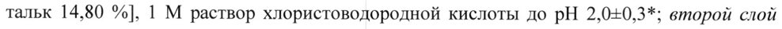
- стр. 2: «~ 2,0+0,3*; чернила для нанесения надписи: чернила Опакод синий** (% м/м) 0,03 мг» — низкая уверенность: «2,0+0,3*;» (40); повторное чтение: «~ ,040,3*: vepuuna для нанесения надписи: чернила  Опакод нее (% мм 0,03 ur»  
  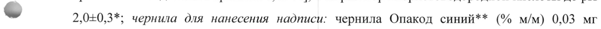
- стр. 2: «~ частично гидролизованный 40,00 %, титана диоксид 25,00 %, макрогол 3350 20,20 %,» — повторное чтение: «~ частично  адролизованный 40.00 %, аа оксид 25:00 %, же 3350 200%,»  
  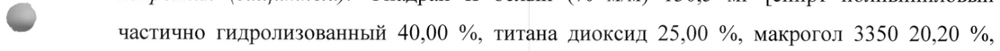
- стр. 2: «тальк 14,80 %], 1 М раствор хлористоводородной кислоты до pH 2,0-0,3*; второй слой» — низкая уверенность: «2,0-0,3*;» (79)  
  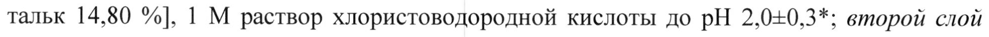
- стр. 2: «%, изопропанол 3,00 %, 28 % раствор аммония гидроксида 0,10%].» — низкая уверенность: «0,10%].» (55)  
  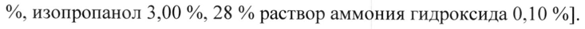
- стр. 7: «850 мг, в среднем, составил 654=358 л. Метформин в незначительной степени связывается» — низкая уверенность: «654=358» (79)  
  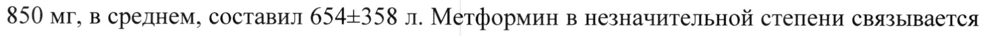
- стр. 8: «В исследовании фармакокинетических параметров саксаглиптина в дозе 10 мг у» — повторное чтение: «В исследовании фармакокинетических параметров саксаглиптина в дозе 10 м у»  
  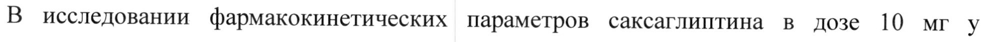
- стр. 15: «с исходным содержанием НЬА1с < 7%.» — низкая уверенность: «НЬА1с» (79)  
  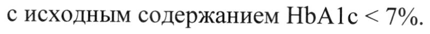
- стр. 16: «зарегистрированной гипогликемии при применении саксаглиптина в дозе 5 мг по» — повторное чтение: «зарегистрированной гипогликемии при применении саксаглиптина в дозе 5 мг по»  
  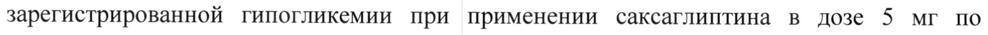
- стр. 16: «- составила 18,4% для саксаглиптина в дозе 5 мги 19,9% для плацебо.» — повторное чтение: «- оставила 18,4% для аксаглиитина в дозе 5 ит а литов»  
  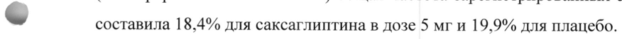
- стр. 25: «- + 5 мг» — низкая уверенность: «5» (52); повторное чтение: «wk sae»  
  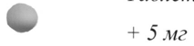
- стр. 25: «мг + 5 мг» — низкая уверенность: «5» (74); повторное чтение: «мг + 9 мг»  
  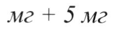
