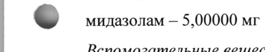
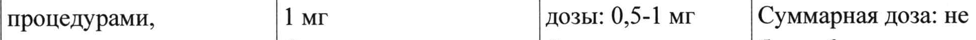
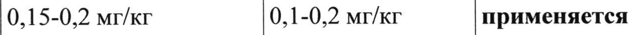
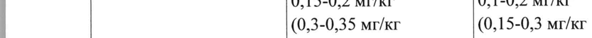
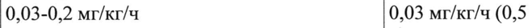
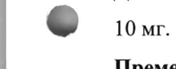
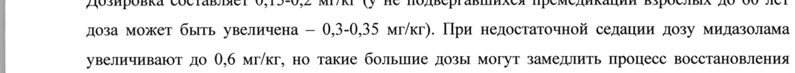
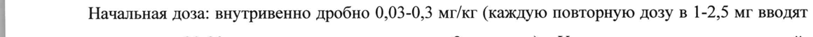
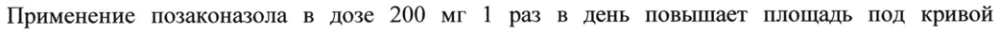
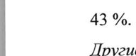

# Мидазолам — парентерально

- Препарат: Мидазолам (раствор для внутривенного и внутримышечного введения;)
- АТХ: N05CD08
- Источник: ГРЛС, инструкция по медицинскому применению, РУ ЛП-003720, файл от 2024-09-06 (https://grls.rosminzdrav.ru/Grls_View_v2.aspx?routingGuid=f861ead0-b70f-4f52-89ca-aebfbf3da783)
- Распознано автоматически (OCR): 23 из 23 стр.
- Инструкция к другому РУ того же препарата: ЛП-003720 (национальное РУ, переоформленное по правилам ЕАЭС, решение от 23.08.2024). Текст может быть старше действующего
- Сомнительных строк после OCR: 18 (см. раздел «Проверка распознавания»)

## Общие сведения

| от 21.08.2024 № 17460_

| МИНИСТЕРСТВО ЗДРАВООХРАНЕНИЯ РОССИЙСКОЙ ФЕДЕРАЦИИ! =)

|

| ИНСТРУКЦИЯ

| ПО МЕДИЦИНСКОМУ ПРИМЕНЕНИЮ ЛЕКАРСТВЕННОГО ПРЕПАРАТА
Мидазолам

| Регистрационный номер:

| Торговое наименование: Мидазолам

| Международное непатентованное наименование: мидазолам

| Лекарственная форма: раствор для внутривенного и внутримышечного введения

| Состав:

| 1 мл раствора содержит:

| Действующее вещество:

| © мидазолам — 5,00000 мг

| Вспомогательные вещества:

| натрия хлорид — 5,00000 мг, хлористоводородная кислота — 0,00234 мл, 1 М раствор натрия
| гидроксида — до pH 3,3, вода для инъекций — до | мл

| Описание: прозрачная бесцветная жидкость.

| Фармакотерапевтическая группа: снотворные средства.

| Психотропное вещество, внесенное в Список Ш «Перечня наркотических средств,
| психотропных веществ и их прекурсоров, подлежащих контролю в Российской Федерации».

| Код ATX: NOSCD08

| Фармакологические свойства

| Фармакодинамика

© Механизм действия

| Мидазолам является бензодиазепином короткого действия, относится к группе имидобензодиазепинов. Эти соединения стимулируют в мембранах нейронов центральной нервной системы (ЦНС) бензодиазепиновые рецепторы, которые аллостерически связаны с рецепторами гамма-аминомасляной кислоты (ГАМКл-рецепторами). При стимуляции
| бензодиазепиновых рецепторов повышается чувствительность ГАМКа-рецепторов к ГАМК
| (тормозной медиатор). При возбуждении ГАМКа-рецепторов открываются С1-каналы; ионы
| С1` входят в нервные клетки, это ведет к гиперполяризации клеточной мембраны. При
| действии бензодиазепинов увеличивается частота открытия С1-каналов. Таким образом, бензодиазепины усиливают процессы торможения в ЦНС.

Фармакологические эффекты бензодиазепинов: анксиолитический (устранение чувства
| тревоги, страха, напряжения), седативный, снотворный, миорелаксирующий,
| |

| | :
| СООТВЕТСТВУЕТ ЭКСПЕРТНОМУ ОТЧЕТУ | от 21.08.2024 № 17460_ противосудорожный, амнестический (в выфоких nosis” SeHsUnbasdintie” | БЫзывают антероградную амнезию примерно Ha 6 часов, что может быть использовано для премедикации
| перед хирургическими операциями).
Фармакологическое действие характеризуется короткой продолжительностью из-за быстрой
| деградации мидазолама. Быстро вызывает наступление сна (через 20 минут), мало влияет на
| структуру сна, практически не обладает эффектом последействия.
Начало действия: седативное — 15 минут (внутримышечное (в/м) введение), 1,5-5 минут
| (внутривенное (в/в) введение); вводная общая анестезия при в/в введении — 0,75-1,5 минуты (с
| премедикацией наркотическими лекарственными средствами), 1,5-3 минуты (без
| премедикации наркотическими лекарственными средствами). — Продолжительность
| амнестического действия находится в прямой зависимости от дозы. Время выхода из общей
| анестезии — в среднем 2 часа. После внутримышечного или внутривенного применения
| © наблюдается антероградная амнезия короткой продолжительности.
| Фармакокинетика | Абсорбция При внутримышечном введении абсорбция мидазолама из мышечной ткани проходит быстро и полностью. Максимальная концентрация в плазме достигается в течение 30 мин. Абсолютная биодоступность после в/м инъекции — более 90 %.
| Распределение Фармакокинетический профиль мидазолама линеен. При внутривенном введении
| распределение носит двухфазный характер. Равновесный объем распределения составляет 0,71,2 л/кг. Связь с белками плазмы — 96-98 %. Связываясь преимущественно с альбумином, мидазолам проникает через гистогематические барьеры, в т.ч. гематоэнцефалический и
& плацентарный барьеры, а также в грудное молоко. Небольшие концентрации обнаруживаются в спинномозговой жидкости.
Метаболизм Мидазолам почти полностью подвергается биотрансформации, выводится преимущественно в виде метаболитов. Гидроксилируется изоферментом СУРЗА4 до а-гидроксимидазолама
| (основной метаболит в плазме и моче). Плазменная концентрация а-гидроксимидазолама достигает 12 % от исходного вещества. Фармакологическая активность составляет 10 % от активности мидазолама.
| Выведение У здоровых добровольцев период полувыведения (Ti2) мидазолама составляет 1,5-2,5 часа.
| Плазменный клиренс — 300-500 мл/мин. Выводится преимущественно почками (60-80 % от
| | 2 | | | от 21.08.2024 № 1/460 введенной дозы) в основном в виде глюкуронида!а-гид рокси ЗОНАМ Мене 04 Выводится

в неизмененном виде с мочой. T1/2 а-гидроксимидазолама составляет <1 часа.

Фармакокинетика при внутривенном капельном введении: у некоторых пациентов
| интенсивной терапии, и у некоторых пожилых пациентов, получавших мидазолам капельно
| для продленной седации, период полувыведения был увеличен до шести раз. К особым
| факторам риска относят пожилой возраст, патологии органов брюшной полости, сепсис и сниженную функцию почек. У этих пациентов инфузия мидазолама при неизменной скорости

приводила к повышению концентрации препарата в плазме в равновесном состоянии.

Следовательно, скорость инфузии должна быть уменьшена, как только получен

удовлетворительный клинический эффект.
Фармакокинетика у особых групп пациентов

Пожилые пациенты | © У лиц старше 60 лет T12 может быть увеличен в четыре раза.

Дети

У новорожденных Ти? увеличен и составляет в среднем 6-12 часов, а клиренс препарата

замедлен.

После внутривенного введения детям 3-10 лет Т!/2 по сравнению со взрослыми короче (1-1,5 4),

что объясняется более интенсивным метаболизмом мидазолама.

Пациенты с избыточной массой тела | У лиц с избыточной массой тела клиренс замедлен, Т1/р составляет 8,4 часа.
Пациенты с печеночной недостаточностью

Период полувыведения мидазолама у пациентов с циррозом печени может удлиняться, а клиренс уменьшается, по сравнению с аналогичными показателями у здоровых добровольцев.
© Пациенты с почечной недостаточностью

У пациентов с хронической почечной недостаточностью Ti такой же, как и у здоровых
| добровольцев.

Тяжелобольные пациенты У пациентов, находящихся в крайне тяжелом состоянии, Т!/2 мидазолама увеличивается.

Пациенты с сердечной недостаточностью У пациентов с хронической сердечной недостаточностью по сравнению со здоровыми
| добровольцами T 1/2 увеличивается.

## 4.1. Показания к применению

| Взрослые старше 18 лет:

— седация с сохранением сознания перед диагностическими или лечебными процедурами, производимыми под местной анестезией или без нее, а также во время их проведения;

| 3

| от 21.08.2024 № 1/460 — премедикация перед вводным наркозом; (Входящий МЗ №4270112)
— вводный наркоз;
— седативный компонент при комбинированной анестезии;
— длительная седация в интенсивной терапии.
Дети в возрасте от 6 месяцев до 18 лет:
— седация с сохранением сознания перед диагностическими или лечебными процедурами,
| производимыми под местной анестезией или без нее, а также во время их проведения;
— премедикация перед вводным наркозом;
— длительная седация в интенсивной терапии.
Дети в возрасте от 0 до 6 месяцев:
— длительная седация в интенсивной терапии.

## 4.3. Противопоказания

© — Повышенная чувствительность к мидазоламу, другим бензодиазепинам или к другим компонентам препарата.
© — Повышенная чувствительность к мидазоламу, другим бензодиазепинам или к другим компонентам препарата.
— Острая дыхательная недостаточность, острый респираторный дистресс-синдром.
— Шок, кома, острая алкогольная интоксикация с угнетением жизненно важных функций.
— Закрытоугольная глаукома.
— Период родов (см. раздел «Применение при беременности и в период грудного вскармливания»).

## 4.6. Применение при беременности и в период грудного вскармливания

Беременность | Данных для оценки безопасности мидазолама при беременности недостаточно. Применение бензодиазепинов возможно только в случае отсутствия других альтернативных способов
| - лечения.
| Назначение препарата Мидазолам в последнем триместре беременности или в больших дозах в
| | ходе первого периода родов приводит к нарушениям сердечного ритма у плода, гипотонии, нарушению сосания, гипотермии и умеренному угнетению дыхания у новорожденного. Более того, у детей, матери которых на поздних сроках беременности длительно получали бензодиазепины, может сформироваться физическая зависимость с определенным риском
| синдрома «отмены» в постнатальном периоде.
Грудное вскармливание Поскольку мидазолам в малых количествах проникает в грудное молоко, кормящим матерям следует прерывать кормление грудью в течение 24-х часов после применения мидазолама.
| | 4 | | СООТВЕТСТВУЕТ ЭКСПЕРТНОМУ ОТЧЕТУ от 21.08.2024 № 1/460
| Способ применения и дозы (Входящий МЗ №4270112)
| Мидазолам должны применять только специалисты, обученные методикам его введения, а
| также способные оказать реанимационную помощь, необходимость которой может возникнуть
| в результате развития нежелательных реакций. При применении мидазолама были зарегистрированы тяжелые нежелательные реакции, в том числе угнетение дыхания, апноэ,
| остановка дыхания, остановка сердца. Вероятность таких угрожающих жизни состояний выше при высокой скорости введения или высокой дозе препарата. Особую осторожность следует
| соблюдать при применении у пациентов с нарушением функции дыхания.
При применении мидазолама для премедикации пациент должен находиться под постоянным контролем, так как возникает риск передозировки при применении других препаратов.
| Режим дозирования | Дозу подбирают индивидуально, до достижения нужной выраженности седативного действия,
© соответствующей клинической потребности, физическому состоянию и возрасту пациента, а также сопутствующей медикаментозной терапии.
Скорость наступления терапевтического эффекта зависит от вводимой дозы и способа
| введения препарата.
| При внутримышечном (в/м) введении седативный эффект у взрослых развивается через 15
| минут, время достижения максимального седативного эффекта — 30-60 минут.
| При внутривенном (в/в) введении действие препарата начинается примерно через 2 минуты,
| максимальный эффект достигается в течение 5-10 минут.
| При внутривенном введении для наркоза действие проявляется через 1,5-3 минуты, а на фоне премедикации наркотическими средствами через 0,75-1,5 минуты.
При внутривенном введении для достижения седативного эффекта перед диагностическими
| © или лечебными процедурами, производимыми под местным обезболиванием или без него, a
| также во время проведения диагностических или лечебных процедур, развитие седативного эффекта достигается между 2,8 и 4,8 минутами.
| При вводном наркозе эффект развивается примерно через 1,5 минуты (диапазон составляет от
| 0,3 до 8 минут). При использовании для премедикации комбинации с опиоидными
| препаратами, эффект развивается примерно через 0,75-1,5 минуты.
| Для полного восстановления пациента после применения мидазолама требуется приблизительно 2 часа; однако, продолжительность эффекта зависит от введенной дозы и
| использования дополнительных препаратов.
| Стандартный режим дозирования представлен в таблице:
| | 5 | | | от 21.08.2024 № 1/460 старше 60 лет /
| пациенты, | Показание Взрослые находящиеся в Дети
| до 60 лет крайне тяжелом | состоянии, а
| также с высокой | степенью риска Седация с сохранением |В/в медленно В/в медленно В/в детям от 6 месяцев
| сознания перед Начальная доза: Начальная доза: |до 5 лет
| диагностическими или |2-2,5 мг 0,5-1 мг Начальная доза: 0,05-0,1 лечебными Последующие дозы: Последующие мг/кг процедурами, 1 mr дозы: 0,5-1 мг Суммарная доза: не производимыми под Средняя Суммарная доза: |более 6 мг

| местной анестезией или | суммарная доза: <3,5 мг В/в детям от 6 до 12

© без нее, а также во 3,5-7,5 мг лет

время их проведения Начальная доза: 0,0250,05 мг/кг
| Общая доза: не более 10 | Mr В/в детям от 13 до 18 ner
Дозы как у взрослых | В/м детям от 1 до 18
| лет 0,05-0,15 мг/кг | Суммарная доза: не
| более 10 мг Премедикация перед В/в медленно В/м В/м детям от 6 месяцев
© вводным наркозом Доза: Доза: до 18 лет
| 1-2 мг, при 0,025-0,05 мг/кг |Доза:
| необходимости 0,08-0,2 мг/кг | введение повторяют; У детей младше 6 в/м месяцев, включая
Доза: новорожденных, | 0,07-0,1 мг/кг препарат по данному
| показанию He применяется Вводный наркоз В/в медленно В/в медленно У детей по данному
Доза: Доза: показанию не 0,15-0,2 мг/кг 0,1-0,2 мг/кг применяется
| (0,3-0,35 мг/кг (0,15-0,3 мг/кг | без премедикации) без премедикации, 0,15-0,25 мг/кг без от 21.08.2024 № 17460
Гпремедикаящей MS WAZTOTTZY | пациентов с
| тяжелыми системными | заболеваниями)
| Седативный компонент |В/в медленно дробно |В/в дробное У детей по данному
| при комбинированной |Доза: введение показанию не
| анестезии 0,03-0,1 мг/кг или или применяется
| непрерывная в/в непрерывная в/в инфузия инфузия
| Доза: в дозировках | 0,03-0,1 мг/кг/ч ниже, чем
| рекомендованы | для взрослых <60 net © Длительная седацияв |В/в медленно дробно В/в инфузияу интенсивной терапии Начальная доза: новорожденных <32 0,03-0,3 мг/кг, затем по 1-2,5 мг в течение |недель гестационного 20-30 секунд с интервалом в 2 минуты. возраста
| Поддерживающая доза: Начальная доза:
0,03-0,2 мг/кг/ч 0,03 мг/кг/ч (0,5 мкг/кг/мин)
| В/в инфузия у новорожденных >32 недель гестационного
| возраста и детей до 6 | месяцев | Начальная доза:
| 0,06 мг/кг/ч (1 | © мкг/кг/Мин)
| В/в медленно детям OT | 6 месяцев Начальная доза:
0,05-0,2 мг/кг или | В/в инфузия Доза:
| 0,06-0,12 мг/кг/ч (1-2 | мкг/кг/мин)
| | Седация с сохранением сознания перед диагностическими или лечебными процедурами, производимыми под местной анестезией или без нее, а также во время их проведения
| | 7 эзроелые от 21.08.2024 № 1/460

| Взрослые (Входящий МЗ №42 70112)

| Раствор препарата вводят внутривенно медленно, со скоростью приблизительно | мг в 30

| секунд. У взрослых до 60 лет начальная доза составляет 2-2,5 мг, введение осуществляется за

5-10 мин до начала процедуры. В дальнейшем мидазолам вводят в дозе 1 мг по мере

| необходимости. Средние суммарные дозы находятся в пределах 3,5-7,5 мг. Суммарная доза,

| больше чем 5 мг, обычно He требуется. У взрослых старше 60 лет/пациентов, находящихся в

| крайне тяжелом состоянии, а также с высокой степенью риска, введение начинают с дозы 0,5-1

|

| мг. В дальнейшем мидазолам вводят в дозе 0,5-1 мг по мере необходимости. Суммарная доза,

больше чем 3,5 мг, обычно не требуется.

| Дети

Внутривенное введение

| Начальную дозу мидазолама вводят медленно в течение 2-3 минут. Затем ждут 2-5 минут,

| © чтобы полностью оценить седативный эффект прежде, чем начать процедуру или повторить

| введение мидазолама. Грудным детям и детям младше 5 лет могут потребоваться значительно

| большие дозы, чем детям старшего возраста и подросткам.

Детям от 6 месяцев до 5 лет начальная доза составляет 0,05-0,1 мг/кг, для достижения
| ожидаемого результата иногда требуется общая доза до 0,6 мг/кг, но суммарная доза не должна превышать 6 мг.

Детям от 6 до 12 лет начальная доза составляет 0,025-0,05 мг/кг. Суммарная доза до 0,4 мг/кг,
| максимальная — 10 мг.

У детей от 13 до 18 лет режим дозирования как у взрослых.

| Внутримышечное введение

| Детям от 1 года до 18 лет диапазон доз составляет 0,05-0,15 мг/кг. Суммарная доза — не более
| © 10 мг.

| Премедикация перед вводным наркозом

| Взрослые

Премедикация перед проведением процедуры оказывает седативное действие (возникновение
| сонливости, устранение эмоционального напряжения), а также вызывает предоперационную
| амнезию. Для премедикации препарат вводят внутривенно или внутримышечно.

| Внутривенное введение

| Для предоперационной седации и устранения воспоминаний о предоперационных событиях мидазолам вводят внутривенно в дозе 1-2 мг, при необходимости введение повторяют.

| Внутримышечное введение

Препарат вводят за 20-60 минут до вводной анестезии: взрослым до 60 лет — 0,07-0,1 мг/кг,

взрослым старше 60 лет/пациентам, находящимся в крайне тяжелом состоянии, а также с
| 8 от 21.08.2024 № 1/460 высокой степенью риска, дозу подбирают индивидуально SOMUHULOHa'Codtabiier 0:025-0,05
| мг/кг). Суммарная доза составляет 2-3 мг.
| Дети от 6 месяцев до 18 лет Детям требуются относительно более высокие дозы мидазолама (из расчета на килограмм
| массы тела), чем взрослым. Дозы в пределах 0,08-0,2 мг/кг при внутримышечном введении являются эффективными и безопасными. Препарат вводят глубоко внутримышечно в крупную мыщцу за 30-60 минут до вводного наркоза.
Дети младше 6 месяцев, включая новорожденных
| Препарат по данному показанию не применяют.
Вводный наркоз Препарат вводят внутривенно, медленно, дробно, каждую повторную дозу (увеличение не более чем на 5 мг) вводят в течение 20-30 секунд, с интервалом в 2 минуты. Для завершения
& ввода в наркоз начальную дозу увеличивают примерно на 25 %, либо применяют
| ингаляционные анестетики. При применении в комбинации с другими препаратами для вводной анестезии, начальная доза каждого препарата должна быть значительно уменьшена.
| Желаемый уровень анестезии достигается посредством пошагового введения.
| Взрослые до 60 лет Дозировка составляет 0,15-0,2 мг/кг (у не подвергавшихся премедикации взрослых до 60 лет
| доза может быть увеличена — 0,3-0,35 мг/кг). При недостаточной седации дозу мидазолама увеличивают до 0,6 мг/кг, но такие большие дозы могут замедлить процесс восстановления сознания.
| Взрослые старше 60 лет/пациенты, находящиеся в крайне тяжелом состоянии, а также с
| высокой степенью риска ©. Дозировка составляет 0,1-0,2 мг/кг (не подвергавшимся премедикации пациентам старше 60 лет обычно требуется увеличенная доза препарата — 0,15-0,3 мг/кг, не подвергшимся премедикации пациентам с тяжелыми системными заболеваниями обычно требуется менышая
] доза — 0,15-0,25 мг/кг).
Дети младше 18 лет | Мидазолам не рекомендуется для вводного наркоза у детей, поскольку опыт его применения у данной возрастной группы ограничен.
Седативный компонент при комбинированной анестезии
| Взрослые до 60 лет При использовании в качестве седативного компонента в комбинированной анестезии, вводят
| внутривенно дробно малые дозы мидазолама (0,03-0,1 мг/кг), или проводят непрерывную
| | от 21.08.2024 № 1/460 внутривенную инфузию (0,03-0,1 мг/кг/ч), обычно в комб ean arena! Доза и
| интервалы между дозами варьируются согласно индивидуальной реакции пациента.
Взрослые старше 60 лет/пациенты, находящиеся в крайне тяжелом состоянии, а также с высокой степенью риска
| Используют более низкие поддерживающие дозы.
| Дети младше 18 лет | Мидазолам не рекомендуется применять в качестве седативного компонента при
| комбинированной анестезии у детей, поскольку опыт его применения у данной возрастной
| группы ограничен.
Длительная седация в интенсивной терапии
| Желаемый уровень седативного эффекта достигается посредством поэтапного введения
| мидазолама в соответствии с клинической потребностью, физическим состоянием, возрастом и
| © сопутствующей терапией.
| Взрослые | Начальная доза: внутривенно дробно 0,03-0,3 мг/кг (каждую повторную дозу в 1-2,5 мг вводят в течение 20-30 секунд, с интервалом в 2 минуты). У пациентов с гиповолемией, вазоконстрикцией, или гипотермией дозу снижают или пропускают введение.
При введении препарата совместно с сильными анальгетиками, анальгетик вводят в первую очередь, чтобы дозу мидазолама можно было безопасно титровать на фоне седативного
| эффекта анальгетика.
| Поддерживающая доза: внутривенно 0,03-0,2 мг/кг/ч. Пациентам с гиповолемией,
| вазоконстрикцией или гипотермией дозу уменьшают.
| Дети | ©. Новорожденным и детям до 6 месяцев — путем непрерывной внутривенной инфузии начиная с
| 0,03 мг/кг/ч (0,5 мкг/кг/мин) для новорожденных с гестационным возрастом менее 32 недель
| или 0,06 мг/кг/ч (1 мкг/кг/мин) для новорожденных с гестационным возрастом более 32 недель
| и детям до 6 месяцев. Введение повышенной начальной дозы не рекомендуется, можно
| увеличить скорость инфузии в течение нескольких первых часов для достижения
| терапевтической концентрации в плазме. Скорость инфузии необходимо периодически
| пересматривать, особенно в первые 24 часа, чтобы вводить наименыпую эффективную дозу и
| снизить риск кумуляции препарата. Необходим тщательный контроль за частотой дыханий и
| насыщением крови кислородом.
| Детям старше 6 месяцев, подвергающимся интубации и вентиляции легких начальную дозу
| 0,05-0,2 мг/кг вводят внутривенно медленно, по крайней мере, в течение 2-3 минут, до
| | от 21.08.2024 № 1/460 | установления желаемого клинического эффекта WIM путем деявнойвиутривенной-Инфузии
| в дозе 0,06-0,12 мг/кг/ч (1-2 мкг/кг/мин).
| При необходимости, для усиления или поддержания желаемого эффекта, скорость инфузии
| можно увеличить или уменьшить (обычно на 25 % от начальной или последующей скорости)
| или вводить дополнительные дозы мидазолама. Если инфузию мидазолама начинают
| пациентам с нарушениями гемодинамики, обычную нагрузочную дозу необходимо титровать
| мелкими «шагами», контролируя гемодинамические показатели (снижение артериального
| давления). Необходим тщательный контроль частоты дыханий и насыщения крови
| кислородом.
| Особые группы пациентов | Почечная недостаточность
У пациентов с почечной недостаточностью (клиренс креатинина <10 мл/мин),
© фармакокинетика мидазолама после однократного внутривенного введения сопоставима с таковой у здоровых добровольцев. После длительной инфузии в отделении интенсивной
| терапии средняя продолжительность седативного эффекта у пациентов с почечной недостаточностью, была значительно выше, вероятно, из-за накопления глюкуронида агидроксимидазолама.
Данные о применении мидазолама у пациентов с тяжелой почечной недостаточностью
(клиренс креатинина <30 мл/мин) отсутствуют.
Печеночная недостаточность | У пациентов с печеночной недостаточностью печеночный клиренс мидазолама снижается (с
| последующим увеличением его Т!/2), в связи с чем его клинический эффект может быть более
| выраженным и продолжительным. Поэтому требуется снижение дозы мидазолама и контроль
| © жизненно важных функций организма.
| Взрослые старше 60 лет/пациенты, находящиеся в крайне тяжелом состоянии, а также с высокой степенью риска обычно нуждаются в более низких дозах мидазолама. Необходим тщательный постоянный контроль жизненно важных показателей.
Способ применения | Внутривенно, внутримышечно.
| При применении в детской практике необходимо помнить, что внутримышечная инъекция болезненна.
| Доношенным и недоношенным новорожденным, детям младше 6 месяцев, а также детям с
| массой тела менее 15 кг не рекомендуется введение растворов мидазолама с концентрацией более 1 мг/мл. Растворы с более высокой концентрацией необходимо разводить до
| концентрации 1 мг/мл.

| от 21.08.2024 № 1/460 Раствор препарата Мидазолам в ампулах можно] разводить зоздуяравйворо М Хябвяда \натрия, 5% и 10 % раствором декстрозы (глюкозы), раствором Рингера и раствором Хартманна в соотношении 15 мг мидазолама на 100-1000 мл инфузионного раствора.
| Перед введением необходимо осмотреть раствор. Только прозрачный раствор без видимых
| посторонних частиц пригоден к использованию.
Не следует разводить препарат Мидазолам 6 % раствором декстрана со средней молекулярной массой 50000-70000 Da в декстрозе. Нельзя смешивать мидазолам со щелочными растворами, так как мидазолам образует осадок с бикарбонатом натрия. Применения других растворителей, помимо указанных выше, следует избегать.
| С микробиологической точки зрения приготовленный раствор должен быть использован
| немедленно. Если препарат не используется сразу, то время и условия хранения
| приготовленного раствора являются ответственностью пользователя. Время хранения не
| ‚© должно превышать 24-х часов при температуре от 2 до 8 °С и только в том случае, если приготовление раствора производилось в контролируемых и валидируемых асептических
| условиях.
Ампулы препарата Мидазолам предназначены только для однократного использования.
| Неиспользованный раствор следует уничтожить.

## 4.8. Побочное действие

| Частота возникновения побочных эффектов определялась в соответствии с классификацией
| Частота возникновения побочных эффектов определялась в соответствии с классификацией
| Всемирной организации здравоохранения: очень часто (> 1/10), часто (> 1/100, < 1/10), нечасто
(> 1/1000, < 1/100), редко (> 1/10000, < 1/1000), очень редко (< 1/10000), частота неизвестна (на
| основании имеющихся данных оценить невозможно).
| Нарушения со стороны иммунной системы: частота неизвестна — реакции генерализованной
©. гиперчувствительности (кожные, сердечно-сосудистые, бронхоспазм), ангионевротический отек, анафилактический шок.
| Психические нарушения: частота неизвестна — спутанность сознания, эйфория, галлюцинации, бред; парадоксальные реакции — ажитация, непроизвольные движения (включая тоникоклонические судороги, тремор), гиперактивность, враждебность, гнев и агрессивность, пароксизмы возбуждения (особенно у детей и пациентов старческого возраста); зависимость,
| синдром отмены (см. «Особые указания»).
| Нарушения со стороны нервной системы: частота неизвестна — послеоперационная сонливость и длительный седативный эффект, снижение концентрации внимания, головная боль, головокружение, атаксия, — антероградная амнезия продолжительность — которой
. непосредственно зависит от дозы. Антероградная амнезия может иметь место в конце
| процедуры, в отдельных случаях она продолжается дольше. Ретроградная амнезия,
| 12 |

| | от 21.08.2024 № 17460 тревожность, сонливость и бред при выходе из наркоза, are Toni Bie ей жения fia р) ШеНия сна,
| дисфония, нечеткая речь, парестезии. У недоношенных детей и новорожденных возможны
| судороги.

| Нарушения со стороны органа зрения: частота неизвестна — нарушение и ухудшение остроты зрения, двоение, нистагм, миоз, периодические подергивания век, нарушение рефракции.
Нарушения со стороны органа слуха и лабиринта: частота неизвестна — заложенность в ушах,
| потеря равновесия. Применение бензодиазепинов увеличивает риск падений и переломов. В
| зоне особого риска находятся пациенты, принимающие сопутствующие седативные препараты,
| употребляющие алкоголь, а также пациенты пожилого и старческого возраста.

| Нарушения со стороны сердца: частота неизвестна — остановка сердца, брадикардия,
| тахикардия, бигеминия, преждевременное сокращение желудочков, вазовагальный криз, ритм
| атриовентрикулярного соединения, риск развития синдрома Коуниса. Вероятность
© угрожающих жизни реакций выше у взрослых старше 60 лет и у пациентов с сопутствующей дыхательной недостаточностью или сердечной недостаточностью, особенно если препарат
| вводится слишком быстро или в большой дозе.

Нарушения со стороны сосудов: частота неизвестна — снижение артериального давления,
| вазодилатация.

| Нарушения со стороны дыхательной системы, органов грудной клетки и средостения: частота неизвестна — тяжелые респираторные нежелательные явления, заключающиеся в угнетении,
| остановке дыхания, развитии апноэ, диспноэ, ларингоспазма. Вероятность таких угрожающих
| жизни реакций выше у пациентов старше 60 лет и у лиц с сопутствующей дыхательной
|

| недостаточностью или сердечной недостаточностью, особенно если препарат вводится
| слишком быстро или в большой дозе. Икота, бронхоспазм, гипервентиляция, свистящее
| © дыхание, поверхностное дыхание, обструкция дыхательных путей, тахипноэ.

| Желудочно-кишечные нарушения: частота неизвестна — тошнота, рвота, запор, сухость во рту,
| кислый привкус BO рту, слюнотечение, отрыжка.

Нарушения со стороны кожи и подкожных тканей: частота неизвестна — кожная сыпь,
| крапивница, зуд.

|

| Общие нарушения и реакции в месте введения: частота неизвестна — эритема и боли в месте инъекции, тромбофлебит, тромбоз, повышенная чувствительность.

| Если любые из указанных в инструкции побочных эффектов усугубляются, или Вы заметили любые другие побочные эффекты, не указанные в инструкции, сообщите об этом врачу.

|

| 13 от 21.08.2024 № 1/460 Передозировка (Входящий МЗ №42 70112)
Симптомы Головокружение, атаксия, дизартрия, нистагм. Передозировка редко приводит к угрожающим
| жизни состояниям, HO могут возникать арефлексия, одышка, мышечная гипотония, угнетение сердечно-сосудистой и дыхательной деятельности, кома. Симптомы передозировки обычно
| длятся несколько часов, но могут быть и более продолжительны, особенно у пожилых, у которых они могут носить циклический характер. У пациентов с сопутствующими заболеваниями дыхательной системы респираторные нарушения протекают в более тяжелой
| форме.
Производные бензодиазепина могут усиливать действие других средств, угнетающих ЦНС, в том числе алкоголя.
| Лечение & Искусственная вентиляция легких, мероприятия, направленные Ha поддержание деятельности сердечно-сосудистой системы.
В случае тяжелой интоксикации, сопровождаемой комой или угнетением дыхания, назначают
| антагонист бензодиазепиновых рецепторов — флумазенил. Его следует применять с осторожностью в случае смешанной передозировки у пациентов с эпилепсией, которые уже принимали производные бензодиазепина; с особой осторожностью применять у пациентов, которые ранее получали терапию средствами, снижающими порог судорожной готовности
(например, трициклическими антидепрессантами) или у пациентов с отклонениями от нормы на электрокардиограмме (ЭКГ) (расширением комплекса QRS и удлинением интервала ОТ). За более подробными сведениями следует обратиться к инструкции по применению флумазенила.
| Взаимодействие с другими лекарственными средствами
© Фармакокинетические взаимодействия Метаболизм мидазолама опосредован, главным образом, изоферментом системы цитохрома
| P450 (СУРЗА4). Вещества, ингибиторы и индукторы изофермента СУРЗА4, имеют потенциальную возможность увеличивать и уменьшать плазменную концентрацию, а, следовательно, и фармакодинамические эффекты мидазолама. Помимо влияния на активность изофермента СУРЗА4 не обнаружено другого механизма, вызывающего клинически значимые изменения в результате лекарственного взаимодействия мидазолама с другими веществами.
| Однако существует теоретическая возможность вытеснения препарата из связи с белками
| плазмы (альбумином) при одновременном его применении с лекарственными веществами с
| достаточно высокими терапевтическими концентрациями в плазме крови.
| | Не выявлены случаи влияния мидазолама на фармакокинетику других препаратов.
| от 21.08.2024 № 1/460

Принимая во внимание тот факт, что возможна усиление увеличение ЗВодояжикельности

фармакологических эффектов мидазолама при его совместном использовании с веществами-

ингибиторами изофермента CYP3A4, рекомендуется тщательное наблюдение за клиническими эффектами, а также за показателями жизненно важных функций. В зависимости от степени
| ингибирующего влияния на изофермент СУРЗА4 доза мидазолама может быть значительно уменьшена. С другой стороны, совместное применение мидазолама с препаратамииндукторами изофермента СУРЗА4 может привести к необходимости в увеличении дозы мидазолама для достижения желаемого эффекта.

В случае индукции изофермента СУРЗА4 или его необратимого ингибирования (в этом случае

происходит необратимое взаимодействие с цитохромом Р450, в результате которого

образуются сложные инактивированные комплексы) влияние на фармакокинетику мидазолама может сохраняться в течение нескольких дней после введения ингибиторов изофермента
& CYP3A4.

Примером необратимого ингибирования изофермента СУРЗА4 служит применение антибактериальных (кларитромицин, эритромицин, изониазид), антигипертензивных
| препаратов (верапамил, дилтиазем), препаратов для лечения вируса иммунодефицита человека
| (ВИЧ) (ингибиторы протеазы ВИЧ, делавирдин), половых стероидных гормонов (гестоден) и
| модуляторов их рецепторов (ралоксифен), а также некоторых веществ растительного происхождения (бергамоттин, который в частности содержится в грейпфруте).
| В отличие от других необратимых ингибиторов этинилэстрадиол/норгестрел при его

использовании в качестве перорального контрацептива, и грейпфруктовый сок (200 мл) не

оказывают значительного влияния на величину плазменной концентрации мидазолама при его внутривенном введении. Интенсивность ингибирующего/индуцирующего действия препаратов
& варьирует в широких пределах.

Способ применения мидазолама также оказывает влияние на степень изменений
| фармакокинетических параметров вследствие модуляции активности изофермента CYP3A4.

При внутривенном введении можно ожидать меньшую степень изменения плазменной

концентрации по сравнению с пероральным способом применения, так как модуляция

активности изофермента СУРЗА4 оказывает влияние не только на общий клиренс, но также на
| биодоступность мидазолама при его пероральном приеме.
| Ниже приводятся примеры возможных случаев лекарственного взаимодействия мидазолама при внутривенном введении с другими лекарственными препаратами.

Ингибиторы и индукторы этого изофермента могут вступать в лекарственные взаимодействия с мидазоламом.
| Препараты-ингибиторы изофермента СУРЗА4
| 15 р р р гру. 106 от 21.08.2024 № 1/460
Противогрибковые средства из группы азолов (Входящий МЗ №4270112)
Кетоконазол в 5 раз увеличивает плазменную концентрацию внутривенно введенного мидазолама, примерно в 3 раза увеличивает конечный период полувыведения.
| Парентеральное введение мидазолама совместно с кетоконазолом должно осуществляться в отделении интенсивной терапии или отделении, где имеются возможности для тщательного клинического мониторирования и необходимого лечения в случае угнетения дыхания и/или развития продолжительной седации. Необходим индивидуальный подбор дозы препарата, а также поэтапное введение, особенно, в случаях более чем однократного введения мидазолама.
Итраконазол и флуконазол в 2-3 раза увеличивают плазменную концентрацию внутривенно
| введенного мидазолама. Увеличивают конечный период полувыведения мидазолама в 2,4 раза
(итраконазол) и в 1,5 раза (флуконазол). При болюсном введении мидазолама для кратковременной седации итраконазол и флуконазол не усиливают его эффекты в клинической
© значимой степени, поэтому коррекция дозы не требуется. Однако, при назначении мидазолама в больших дозах коррекция дозы может стать необходимой. Длительная инфузия мидазолама
| пациентам, получающим системные антимикотики (например, в интенсивной терапии) может
| удлинить снотворное действие препарата, если его доза не титруется в соответствии с эффектом.
Применение позаконазола в дозе 200 мг 1 раз в день повышает площадь под кривой
«концентрация-время» (AUC) мидазолама — субстрата CYP3A4 — на 83 % после его в/в введения. Следует соблюдать осторожность при совместном применении позаконазола и мидазолама, вводимого в/в, при этом может потребоваться снижение дозы мидазолама. Если позаконазол применяют совместно с мидазоламом, принимаемым внутрь, который при
| повышении концентрации в плазме может вызывать серьезные нежелательные явления, то
© следует тщательно контролировать концентрацию мидазолама в крови и отслеживать возможное развитие нежелательных явлений и при необходимости снижать его дозу.
Применение позаконазола в дозе 200 мг 2 раза в день в течение 7 дней повышает максимальную концентрацию (Cmax) и AUC мидазолама (0,4 мг в/в | раз в день) в среднем в 1,3
| и 4,6 раза, соответственно. Применение позаконазола в дозе 400 мг 2 раза в день в течение 7
| дней повышает Cmax и AUC мидазолама (при его в/в введении) в 1,6 и 6,2 раза, соответственно.
| Оба режима дозирования позаконазола увеличивают Cmax и AUC мидазолама, принимаемого
| внутрь в дозе 2 мг | раз в день, в 2,2 и 4,5 раза, соответственно. Кроме того, применение позаконазола в дозах 200 и 400 мг увеличивает Ti мидазолама примерно с 3-4 до 8-10 ч при совместном применении. Следует соблюдать осторожность при назначении мидазолама, который метаболизируется изоферментом CYP3A4, пациентам, получающим позаконазол.
от 21.08.2024 № 17460

| Вориконазол увеличивает концентрацию в плазме и пе риоИВЯУВИВЬДЕНиЯ ми ЯЗЬ лама в 3

раза.
| Макролиды | Эритромицин увеличивает в 1,6-2 раза плазменную концентрацию внутривенно введенного
| мидазолама, примерно в 1,5-1,8 раза увеличивает конечный период полувыведения. Хотя,
| отмечавшиеся при этом изменения фармакодинамики были относительно небольшими,
| рекомендуется корректировать дозу внутривенно вводимого мидазолама, особенно при
| назначении больших доз.
| Кларитромицин увеличивает в 2,5 раза плазменную концентрацию внутривенно введенного мидазолама, примерно в 1,5-2 раза увеличивает конечный период полувыведения.
| Ингибиторы протеазы ВИЧ При совместном применении мидазолама с лопинавиром и ритонавиром (бустерная
| & комбинация) плазменная концентрация внутривенно введенного мидазолама увеличивается в
| 5,4 раза, что сочетается с таким же увеличением конечного периода полувыведения.
| Саквинавир усиливал лишь субъективное ощущение эффекта мидазолама, поэтому пациентам,
| принимающим саквинавир, можно вводить внутривенные болюсные дозы мидазолама. При длительной инфузии мидазолама рекомендуется снизить начальную дозу на 50 %.
| Парентеральное введение мидазолама совместно с ингибиторами протеазы ВИЧ требует
| соблюдения условий госпитализации (см. Противогрибковые средства из группы азолов,
| кетоконазол).
Блокаторы Н2-гистаминовых рецепторов | Циметидин увеличивает равновесные концентрации мидазолама в плазме Ha 26 %, a ранитидин
| на них не влияет. Одновременное назначение мидазолама и циметидина или ранитидина не
| © оказывает клинически значимого эффекта на фармакокинетику и фармакодинамику
| мидазолама. Мидазолам можно вводить внутривенно в обычных дозах одновременно с
| циметидином и ранитидином.
| Блокаторы медленных кальциевых каналов
| Однократный прием дилтиазема увеличивает плазменную концентрацию мидазолама при его
| внутривенном введении примерно на 25 % и удлиняет конечный период полувыведения на
| 43 %.
| Другие лекарственные препараты | Аторвастатин в 1,4 раза увеличивает плазменную концентрацию внутривенно введенного
| мидазолама.
| Препараты-индукторы изофермента CYP3A4
| | 17 | |

| от 21.08.2024 № 17460

| После приема рифампицина в течение 7 дней в ддзе 600 мг в Cyr KOH rpantr иИДазолама в

| плазме крови при внутривенном введении уменьшается приблизительно на 60 %. Конечный

| период полувыведения уменьшается примерно на 5-60 %

Фитопрепараты и продукты питания

Экстракт корня эхинацеи пурпурной уменьшает плазменную концентрацию внутривенно

| введенного мидазолама на 20 %. Конечный период полувыведения уменьшается

| приблизительно на 42 %.

| Зверобой обыкновенный (продырявленный) уменьшает плазменную концентрацию внутривенно введенного мидазолама приблизительно на 20-40 %. Конечный период

полувыведения уменьшается приблизительно на 15-17 %.

| Прочие взаимодействия

| Фармакокинетического и фармакодинамического взаимодействия между циклоспорином и

| © мидазоламом нет; коррекция дозы мидазолама при одновременном применении с

циклоспорином не требуется.

Нитрендипин не влияет на фармакокинетику и фармакодинамику препарата мидазолам. Оба

препарата можно назначать одновременно; коррекция дозы мидазолама не требуется.

Оральные контрацептивы не влияют на фармакокинетику внутримышечно вводимого

| мидазолама; эти препараты можно применять одновременно без коррекции дозы мидазолама.

| Вследствие высокой терапевтической концентрации в сыворотке крови, вальпроевая кислота

| может вытеснять мидазолам из связи с белками плазмы крови (альбумином), что может

привести к усилению клинического эффекта мидазолама, вводимого в условиях экстренной

седации. На фоне применения вальпроевой кислоты усиливается угнетение ЦНС.

| Фармакодинамические взаимодействия

| © Совместное введение мидазолама с другими седативными и снотворными средствами, а также

| в сочетании с алкоголем, может привести к усилению седативного и снотворного эффектов.

| Подобное взаимодействие возможно при приеме опиатов и опиоидов (при их приеме в

качестве анальгетиков и противокашлевых средств, средств заместительной терапии),

антипсихотических средств (нейролептиков), различных бензодиазепинов, используемых в

| качестве анксиолитиков или снотворных средств, барбитуратов, пропофола, кетамина,

| этомидата, также при одновременном приеме мидазолама с антидепрессантами с седативным действием, антигистаминными средствами и гипотензивными средствами центрального действия. При совместном применении лекарственных препаратов необходимо адекватное мониторирование показателей жизненно важных функций. Следует избегать одновременного приема мидазолама и алкоголя.

от 21.08.2024 № 17460 Мидазолам уменьшает минимальную альвеолярную (Geert Palio инраляционных анестетиков.
| Проведение спинальной анестезии может усиливать седативный эффект мидазолама при его
| внутривенном введении. В таком случае необходимо уменьшение дозы мидазолама.
Также уменьшение дозы внутривенно вводимого мидазолама необходимо в случаях его одновременного применения с лидокаином или бупивакаином при их внутримышечном введении.
| Препараты, активирующие деятельность головного мозга, улучшающие память, внимание, такие как ингибитор ацетилхолинэстеразы — физостигмин, могут уменьшить снотворный эффект мидазолама. Подобным образом, 250 мг кофеина частично уменышают седативный
| эффект мидазолама.
В клинических исследованиях с гинкго двулопастного листьев экстрактом было выявлено как
| © ингибирование, так и индуцирование изоферментов цитохрома Р450. При совместном приеме гинкго двулопастного листьев экстракта с мидазоламом концентрация последнего изменялась
| предположительно из-за воздействия на СУРЗА4.
| Особые указания | Особую осторожность следует проявлять при назначении мидазолама следующим группам
| пациентов:
- пациенты старше 60 лет;
| - дети в возрасте до 6 месяцев (особенно новорожденные и недоношенные);
| - пациенты с тяжелым общим состоянием или хроническими заболеваниями (например, с
| хронической дыхательной недостаточностью, хронической почечной, печеночной или
| сердечной недостаточностью);
| | © - пациенты с ожирением;
| - пациенты с миастенией (в связи с миорелаксирующими свойствами мидазолама, как и у других средств, угнетающих ЦНС);
- пациенты с алкогольной и наркотической интоксикацией с угнетением жизненно важных функций, с алкоголизмом или наркоманией (в том числе в анамнезе);
- пациенты с органическими поражениями головного мозга, в состоянии шока, комы.
Применение мидазолама у детей Применение мидазолама требует особой осторожности у детей.
У детей с сопутствующими сердечно-сосудистыми заболеваниями доза должна быть снижена, необходим постоянный контроль жизненно важных функций.
У новорожденных период полувыведения мидазолама может удлиняться.
| 19 | от 21.08.2024 № 1/460 Особая осторожность нужна при проведении | седации УВивябнашенных новорожденных
| (рожденных на сроке беременности менее 36 недель) из-за опасности апноэ. Следует избегать
| быстрого введения препарата у этой группы пациентов.
Недоношенные и доношенные новорожденные | Из-за повышенного риска развития апноэ, рекомендуется проявлять особую осторожность при
| применении у неинтубированных недоношенных или доношенных новорожденных. В этих случаях, необходим тщательный мониторинг частоты дыхания и насыщения крови
| кислородом. Быстрое введение препарата не рекомендуется. Вследствие незрелости метаболических функций новорожденные подвержены угнетению дыхания. У детей с сердечно-сосудистыми заболеваниями с целью профилактики нарушений дыхания препарат
| следует вводить медленно.
| Дети в возрасте до 6 месяцев | & Не рекомендуется применение препарата для достижения седативного эффекта и
| премедикации у детей младше 6 месяцев.
Дети в возрасте до 6 месяцев особенно восприимчивы к обструкции дыхательных путей и гиповентиляции, поэтому увеличение дозы осуществляют малыми шагами. Кроме того, необходим тщательный мониторинг частоты дыхания и насыщения крови кислородом (см.
| также «Недоношенные и доношенные новорожденные»).
| Привыкание | Есть сообщения о некотором снижении эффективности при длительном введении мидазолама для седации в отделениях интенсивной терапии.

Зависимость Применение мидазолама даже в терапевтических дозах, особенно длительное (седация в
®, отделениях интенсивной терапии), может приводить к формированию физической
| зависимости. Риск возникновения зависимости увеличивается с увеличением дозы препарата и
| продолжительности его применения, а также у пациентов, страдающих алкоголизмом и/или имеющих в анамнезе наркотическую зависимость.
| Синдром «отмены»
Внезапная отмена препарата после длительного применения может сопровождаться синдромом
| «отмены», который может проявляться следующими симптомами: головная боль, мышечная боль, беспокойство, напряжение, ажитация, спутанность сознания, раздражительность,
«рикошетная» бессонница, перепады настроения, галлюцинации и судороги. Во избежание

синдрома «отмены» рекомендуется постепенное снижение дозы препарата вплоть до его отмены.
|

Амнезия

от 21.08.2024 № 17460

| АМНЕЗИЯ (Входящий МЗ №4270112)
| Мидазолам может вызывать антероградную амнезию (зачастую это желательный эффект,
| например, до и во время хирургических и диагностических процедур), длительность которой прямо пропорциональна введенной дозе. Для амбулаторных пациентов, выписывающихся
| сразу после операции, длительная амнезия может доставить неудобство, поэтому после
| парентерального введения мидазолама пациент должен быть выписан только в сопровождении медицинского персонала или близких ему лиц.
| Парадоксальные реакции

При применении мидазолама были зарегистрированы парадоксальные реакции: ажитация,
| непроизвольные движения (в том числе тонико-клонические судороги и мышечный тремор),
| гиперактивность, враждебность, вспышки гнева, агрессивность, пароксизмальная тревога и
| нападения. Эти реакции возникают при введении высоких доз и (или) при быстром введении
Gv препарата. Наибольшая частота этих реакций наблюдается у детей и пожилых людей.
| Изменение терапевтической эффективности мидазолама
| У пациентов, применяющих индукторы или ингибиторы изофермента CYP3A4,
| терапевтическая эффективность мидазолама может изменяться, поэтому может возникнуть
| необходимость в коррекции дозы мидазолама (см. раздел «Взаимодействие с другими
| лекарственными средствами»).
Метаболизм мидазолама может быть замедлен у пациентов с печеночной недостаточностью,
| низким сердечным выбросом и у новорожденных (см. раздел «Фармакокинетика»).
| Одновременное употребление алкоголя и (или) средств, угнетающих ЦНС
В период лечения нельзя принимать этанол, особенно в первые 6 часов после применения
| препарата. Следует избегать одновременного применения мидазолама с алкоголем или i]
| & средствами, угнетающими ЦНС. Такое применение может увеличить клинические эффекты мидазолама и привести к тяжелой седации или клинически значимому угнетению дыхания (см.
раздел «Взаимодействие с другими лекарственными средствами»).
| Алкоголизм или наркомания | У пациентов с алкоголизмом или наркоманией в анамнезе следует избегать применения мидазолама и других производных бензодиазепина.
Вспомогательные вещества

Препарат содержит менее 1 ммоль (23 мг) натрия в разовой дозе, то есть, по сути, не содержит

натрия.

## 4.7. Влияние на способность управлять транспортными средствами, механизмами

Мидазолам может вызывать седацию, амнезию, снижение концентрации внимания, нарушение

мышечных функций, что оказывает отрицательное влияние на способность к вождению
| 21 от 21.08.2024 № 1/460 автомобиля или работу с механизмами. Не следует правля В ВаЯВНОВ И виия < penthsamn ИЛИ работать с машинами и механизмами до полного прекращения эффекта препарата.
| Возобновление подобной деятельности должно происходить с разрешения лечащего врача.
| Форма выпуска | Раствор для внутривенного и внутримышечного введения, 5 мг/мл.
| По 1 мл или 3 мл в ампулы из бесцветного стекла первого гидролитического класса.

По 5 ампул в контурную ячейковую упаковку из пленки поливинилхлоридной и фольги
| алюминиевой печатной лакированной или гибкой упаковки на основе алюминиевой фольги.
| 1, 2 или 5 контурных ячейковых упаковок вместе с инструкцией по применению препарата,

ножом или скарификатором ампульным в пачку из картона.

20, 50 или 100 контурных ячейковых упаковок вместе с равным количеством инструкций по
| применению препарата, ножами или скарификаторами ампульными в коробку из картона или в
| & ящик из гофрированного картона (для стационара).
| При упаковке ампул с кольцами и точками надлома ножи или скарификаторы ампульные не вкладывают.

## 6.4. Условия хранения

| В соответствии с правилами хранения психотропных веществ, внесенных в Список Ш
| В соответствии с правилами хранения психотропных веществ, внесенных в Список Ш
«Перечня наркотических средств, психотропных веществ и их прекурсоров, подлежащих
| контролю в Российской Федерации».
| В защищенном от света месте при температуре не выше 25 °С.
Хранить в недоступном для детей месте.

## 6.3. Срок годности

| 3 года.
| 3 года.
© Не применять после истечения срока годности, указанного на упаковке.
| Условия отпуска | Отпускают по рецепту.
| Производитель:
Федеральное государственное унитарное предприятие «Московский эндокринный завод»
| Производство готовой лекарственной формы:
| г. Москва, ул. Новохохловская, д. 25, стр. 2
| Выпускающий контроль качества:
| г. Москва, ул. Новохохловская, д. 25, стр. 1
Владелец регистрационного — удостоверения/наименование, адрес организации,

принимающей претензии потребителя:

| 22 СООТВЕТСТВУЕТ ЭКСПЕРТНОМУ`ОТЧЕТУ от 21.08.2024 № 17460

Федеральное государственное унитарное предприятие «Москозаизидокринниай ЗАВбд»
Россия, 109052, г. Москва, ул. Новохохловская, д. 25
Тел./факс: (495) 678-00-50/911-42-10 http://www.endopharm.ru
Начальник Управления по внедрению aN Y и регистрации лекарственных препаратов Sj Mo, ; '
ФГУП «Московский эндокринный завод» (Рея Е О.В. Баклыкова

Е

ON 7 4 и > 67685
## Проверка распознавания

Страницы-сканы распознаны автоматически. В 18 строках с дозировками цифры могли распознаться с ошибкой — сверьте с вырезкой из оригинала:

- стр. 1: «| 1 мл раствора содержит:» — повторное чтение: «| мл  аствора содержит:»  
  
- стр. 1: «| © мидазолам — 5,00000 мг» — повторное чтение: «| Мило ewe»  
  
- стр. 6: «| диагностическими или |2-2,5 мг 0,5-1 мг Начальная доза: 0,05-0,1» — повторное чтение: «| | диагностическими или |2-2,5 Mr |0,5-1 Mr | Начальная доза: 0,05-0,1»  
  
- стр. 6: «процедурами, 1 mr дозы: 0,5-1 мг Суммарная доза: не» — повторное чтение: «процедурами, | 1 mr | дозы: 0,5-1 mr Суммарная доза: не»  
  
- стр. 6: «| необходимости 0,08-0,2 мг/кг» — повторное чтение: «| | "необходимости = [0.08-0,2 мгйкг»  
  
- стр. 6: «0,15-0,2 мг/кг 0,1-0,2 мг/кг применяется» — повторное чтение: «0,1 5-0,2 мг/кг |0,1-0,2 мг/кг | применяется»  
  
- стр. 6: «| (0,3-0,35 мг/кг (0,15-0,3 мг/кг» — повторное чтение: «| 1(0,3-0,35 миг | (0,15-0,3 миа»  
  
- стр. 7: «| 0,03-0,1 мг/кг/ч ниже, чем» — повторное чтение: «| | | 0,03-0,1 Mr/kr/4 | ниже, чем»  
  
- стр. 7: «0,03-0,2 мг/кг/ч 0,03 мг/кг/ч (0,5» — повторное чтение: «0,03-0,2 Mr/kr/4 | 0,03 мг/кг/ч (0,5»  
  
- стр. 7: «| 0,06 мг/кг/ч (1» — повторное чтение: «| | 0,06 aetna (»  
  
- стр. 7: «| 0,06-0,12 мг/кг/ч (1-2» — повторное чтение: «| | | | 0,06-0,12 мгуктуч (1-2»  
  
- стр. 8: «| © 10 мг.» — повторное чтение: «| ® ==.»  
  
- стр. 9: «| доза может быть увеличена — 0,3-0,35 мг/кг). При недостаточной седации дозу мидазолама» — повторное чтение: «| me vom ee os | 8h пы ae : a у.»  
  
- стр. 10: «| Начальная доза: внутривенно дробно 0,03-0,3 мг/кг (каждую повторную дозу в 1-2,5 мг вводят» — повторное чтение: «| Начальная поза: внутривенно дробно 0,03-0,3 мик (каждую повторную дозу в 1-2,5 мг аодят»  
  
- стр. 10: «| Поддерживающая доза: внутривенно 0,03-0,2 мг/кг/ч. Пациентам с гиповолемией,» — низкая уверенность: «0,03-0,2» (74)  
  
- стр. 10: «| или 0,06 мг/кг/ч (1 мкг/кг/мин) для новорожденных с гестационным возрастом более 32 недель» — повторное чтение: «ли 0,06 елка (1 sexr/xr/nama) для новорожденных e —— poapactom более 32 недель»  
  
- стр. 16: «Применение позаконазола в дозе 200 мг 1 раз в день повышает площадь под кривой» — повторное чтение: «Применение позаконазола в дозе 200 mr 1 раз в день повышает площадь под кривой»  
  
- стр. 17: «| 43 %.» — повторное чтение: «| 5%»  
  
