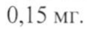
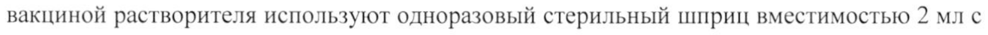
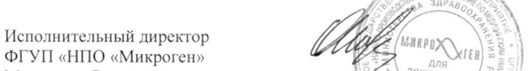

# Микобактерии вакцинного штамма Mycobacterium bovis, субштамм BCG-1 — парентерально

- Препарат: Вакцина туберкулезная для щадящей первичной иммунизации (БЦЖ-М) (лиофилизат для приготовления суспензии для внутрикожного введения;)
- АТХ: J07AN01
- Источник: ГРЛС, инструкция по медицинскому применению, РУ ЛС-001143, файл от 2023-01-20 (https://grls.rosminzdrav.ru/Grls_View_v2.aspx?routingGuid=84b15383-df1c-4cb1-a2bb-287483fe9800)
- Распознано автоматически (OCR): 6 из 6 стр.
- Инструкция к другому РУ того же препарата: ЛС-001143 (национальное РУ, переоформленное по правилам ЕАЭС, решение от 12.01.2023). Текст может быть старше действующего
- Сомнительных строк после OCR: 3 (см. раздел «Проверка распознавания»)

## Общие сведения

ЪД— МИНЗДРАВ РОССИИ <= 001173 260117 МИНИСТЕРСТВО ЗДРАВООХРАНЕНИЯ POC ИЙСКОЙ ФЕДЕРАЦИИ |
| СОГЛАСОВАНО ИНСТРУКЦИЯ по медицинскому применению лекарственного препарата
Вакцина туберкулезная для щадящей первичной иммунизации
(БЦЖ-М)
Регистрационный номер:
Торговое наименование: Вакцина туберкулезная для щадящей первичной иммунизации (БЦЖ-М).

| Группировочное наименование: Вакцина для профилактики туберкулеза.

## 3. Лекарственная форма

лиофилизат для приготовления суспензии для
лиофилизат для приготовления суспензии для

внутрикожного введения.

## 2. Состав

Одна доза препарата содержит:
Активный компонент: микробные клетки БЦЖ - 0,025 мг.
® Вспомогательное вещество: натрия глутамата моногидрат (стабилизатор) — не более 0,15 мг.
1 доза составляет 0,1 мл разведенной суспензии.

| Препарат He содержит консервантов и антибиотиков.

Выпускается в комплекте с растворителем — натрия хлорид растворитель для приготовления лекарственных форм для инъекций 0,9 %.

Описание. Пористая масса, порошкообразная или в виде тонкой ажурной таблетки белого или светло-желтого цвета, легко отделяющаяся при встряхивании от дна ампулы.
Гигроскопична.

Фармакотерапевтическая группа. МИБП-вакцина.

| Код ATX: JO7ANO1.

Иммунологические свойства. Живые микобактерии вакцинного штамма
Mycobacterium bovis, субштамма BCG-1, размножаясь в организме привитого, приводят к развитию длительного иммунитета к туберкулезу.

Показания для применения. Активная специфическая профилактика туберкулеза у детей (щадящая первичная иммунизация).

Противопоказания для применения.

1. Недоношенность, масса тела при рождении менее 2000 г.

2. Острые заболевания и обострение хронических заболеваний. Вакцинация

ЕС еее ажттт откладывается до исчезновения клинических проявлений острых заболеваний и обострений хронических заболеваний (внутриутробная инфекция, гнойно-септические заболевания, гемолитическая болезнь новорожденных среднетяжелой и тяжелой формы,

тяжелые поражения нервной системы с выраженной неврологической симптоматикой, генерализованные кожные поражения и т.п.).

3. Иммунодефицитное состояние (первичное), злокачественные новообразования.

При назначении иммунодепрессантов и лучевой терапии прививку проводят не ранее, чем через 6 месяцев после окончания лечения.

4. Генерализованная инфекция БЦЖ, выявленная у других детей в семье.

| 5. ВИЧ инфекция, обнаружение нуклеиновых кислот ВИЧ молекулярными методами.

6. Детям, рожденным матерями, необследованными на ВИЧ во время беременности и родов, а также детям, рожденным ВИЧ-инфицированными матерями, не получавшими трехэтапную химиопрофилактику передачи ВИЧ от матери ребенку, вакцинация не проводится до установления ВИЧ-статуса ребенка.

Лица, временно освобожденные от прививок, должны быть взяты под наблюдение и учет, и привиты после полного выздоровления или снятия противопоказаний. В случае необходимости проводят соответствующие клинико-

® лабораторные обследования.

Меры предосторожности.

Введение препарата под кожу недопустимо, так как при этом образуется
«холодный» абсцесс.

Для вакцинации применяют одноразовые стерильные туберкулиновые шприцы вместимостью 1 мл с тонкими иглами с коротким срезом. Для внесения в ампулу с вакциной растворителя используют одноразовый стерильный шприц вместимостью 2 мл с длинной иглой. Запрещается применять шприцы и иглы с истекшим сроком годности и инсулиновые шприцы, у которых отсутствует градуировка в мл. Запрещается проводить прививку безыгольным инъектором. После каждой инъекции шприц с иглой и ватные тампоны замачивают в дезинфицирующем растворе (5 % растворе Хлорамина Б или 3 % растворе перекиси водорода), а затем централизованно уничтожают. Запрещается применение для других целей инструментов, предназначенных для проведения прививок против туберкулеза. Вакцину хранят в холодильнике (под замком) в комнате для прививок. Лица, не имеющие отношения к вакцинации, в прививочную комнату не допускаются.

Ампулы с вакциной перед вскрытием тщательно просматривают.

Препарат не подлежит применению при:

Le в я |

- отсутствии маркировки на ампуле или маркировке, не позволяющей идентифицировать препарат;

- истекшем сроке годности;

- наличии трещин и насечек на ампуле;

- изменении физических свойств препарата (изменение цвета и т.д.).

Запрещается наложение повязки и обработка раствором йода и другими дезинфицирующими растворами места введения вакцины во время развития местной

| прививочной реакции: инфильтрата, папулы, пустулы, язвы, о чем следует обязательно предупредить родителей ребенка.

Вакцинопрофилактика туберкулеза проводится в соответствии с Приказом

Минздрава России № 109 «О совершенствовании противотуберкулезных мероприятий в
Российской Федерации» от 21 марта 2003 г.

## 4.6. Применение при беременности и в период грудного вскармливания

Не применимо. Препарат используется для вакцинации детей.

Режим дозирования и способ введения.

Вакцину БЦЖ-М применяют внутрикожно в дозе 0,025 мг в объеме 0,1 мл.

Вакциной БЦЖ-М прививают:

1. В родильных домах всех здоровых новорожденных на 3-7 день жизни накануне

® или в день выписки из роддома на территориях с показателем заболеваемости туберкулезом не выше 80 на 100 000 населения:

2. В родильных домах новорожденных с массой тела 2000 и более граммов, при восстановлении первоначальной массы тела (после ее физиологического снижения), накануне или в день выписки из роддома;

3. В отделениях выхаживания недоношенных новорожденных лечебных стационаров (2-ой этап выхаживания) - детей с массой тела 2300 г и более перед выпиской из стационара;

4. В детских поликлиниках детей, не получивших противотуберкулезную прививку в роддоме по медицинским противопоказаниям и подлежащих вакцинации в связи со снятием противопоказаний.

Детей, которым не была проведена вакцинация в первые дни жизни, вакцинируют в течение первых двух месяцев в детской поликлинике или другом лечебнопрофилактическом учреждении без предварительной туберкулинодиагностики.

Детям в возрасте 2 мес и старше перед вакцинацией необходима предварительная постановка пробы Манту с 2 туберкулиновыми единицами очищенного туберкулина в стандартном разведении. Вакцинируются дети с отрицательной реакцией на туберкулин.
Реакция считается отрицательной при полном отсутствии инфильтрата (гиперемии) или

наличии уколочной реакции (1,0 мм). Интервал между пробой Манту и вакцинацией должен быть не менее 3 дней и не более 2 недель.

Прививки должен проводить специально обученный медицинский персонал родильных домов (отделений), отделений выхаживания недоношенных, детских поликлиник или фельдшерско-акушерских пунктов. Вакцинацию новорожденных проводят в утренние часы в специально отведенной комнате после осмотра детей педиатром. В поликлиниках отбор детей на вакцинацию предварительно проводит врач |
(фельдшер) с обязательной термометрией в день прививки, учетом медицинских противопоказаний и данных анамнеза. При необходимости проводят консультацию с врачами-специалистами, исследование крови и мочи. Во избежание контаминации живыми микобактериями БЦЖ недопустимо совмещение в один день прививки против туберкулеза с другими парентеральными манипуляциями.

Факт выполнения вакцинации регистрируют в установленных учетных формах с указанием даты прививки, предприятия-производителя, номера серии и срока годности вакцины.

Непосредственно перед применением вакцину разводят натрия хлоридом растворителем для приготовления лекарственных форм для инъекций 0,9 %, приложенным к вакцине. Растворитель должен быть прозрачным, бесцветным и не иметь

® посторонних включений.
Шейку и головку ампулы протирают 95 % этиловым спиртом. Вакцина запаяна под
| вакуумом, поэтому сначала надпиливают и осторожно, с помощью пинцета, отламывают место запайки. Затем надпиливают и отламывают шейку ампулы, завернув надпиленный конец в стерильную марлевую салфетку.

В ампулу с вакциной переносят стерильным шприцем 2 мл натрия хлорида растворителя для приготовления лекарственных форм для инъекций 0,9 %. Вакцина должна раствориться в течение 1 мин. Допускается наличие хлопьев, которые должны разбиваться при 2-4-кратном перемешивании с помощью шприца. Растворенная вакцина имеет вид грубодисперсной суспензии белого с сероватым или желтоватым оттенком цвета, без посторонних включений. При наличии в разведенном препарате крупных хлопьев, которые не разбиваются при 4-кратном перемешивании шприцем, или осадка вакцину не используют, ампулу уничтожают.

Разведенную вакцину необходимо предохранять от действия естественного освещения (например, цилиндром из черной бумаги) и использовать сразу после разведения. Разведенная вакцина пригодна к применению не более 1 часа при хранении в | асептических условиях при температуре от 2 до 8 °С. Обязательно ведение протокола с указанием времени разведения препарата и уничтожения ампулы с вакциной.

Для одной прививки туберкулиновым шприцем набирают 0,2 мл (2 дозы)
разведенной вакцины, затем выпускают через иглу в стерильный ватный тампон 0,1 мл вакцины для того, чтобы вытеснить воздух и подвести поршень шприца под нужную градуировку - 0,1 мл. Перед каждым набором вакцину следует аккуратно перемешать 2-3 раза с помощью шприца. Одним шприцем вакцина может быть введена только одному ребенку.

Вакцину БЦЖ-М вводят строго внутрикожно на границе верхней и средней трети наружной поверхности левого плеча после предварительной обработки кожи 70 % этиловым спиртом. Иглу вводят срезом вверх в поверхностный слой натянутой кожи.
Сначала вводят незначительное количество вакцины, чтобы убедиться, что игла вошла точно внутрикожно, а затем всю дозу препарата (всего 0,1 мл). При правильной технике введения должна образоваться папула беловатого цвета диаметром 7-9 мм, исчезающая обычно через 15-20 мин.

## 4.8. Побочное действие

На месте внутрикожного введения вакцины БЦЖ-М последовательно развивается местная специфическая реакция в виде инфильтрата, папулы, пустулы, язвы размером 5-10 мм в диаметре. У первично вакцинированных нормальная прививочная реакция | появляется через 4-6 недель. Место реакции следует предохранять от механического

| ® раздражения, особенно во время водных процедур. Реакция подвергается обратному 1 развитию в течение 2-3 месяцев, иногда и в более длительные сроки. У 90-95 % вакцинированных на месте прививки формируется поверхностный рубчик до 10 мм в диаметре.
Осложнения после вакцинации встречаются редко и обычно носят местный
| характер (лимфадениты - регионарные, чаще подмышечные, иногда над- или | подключичные, язвы, холодные абсцессы, подкожные инфильтраты, келоидный рубец). |
Очень редко встречаются персистирующая и диссеминированная БЦЖ-инфекция без |

летального исхода (волчанка, оститы и др.), пост-БЦЖ синдром аллергического характера,

который возникает вскоре после прививки (узловатая эритема, кольцевидная гранулема,
| сыпи и др.), в отдельных случаях - генерализованное поражение БЦЖ при врожденном | иммунодефиците. Осложнения выявляются в различные сроки после прививки - от | нескольких недель до года и более.

## 4.9. Передозировка

Случаи передозировки не установлены.
Случаи передозировки не установлены.

## 4.5. Взаимодействие с другими лекарственными средствами

Сведения 0 возможном влиянии лекарственного препарата на способность управлять транспортными средствами, механизмами. Не применимо. Препарат используется для вакцинации детей.

## 4.4. Особые указания

Неиспользованную вакцину уничтожают кипячением в течение 30 мин, автоклавированием при температуре 126 °С в течение 30 мин или погружением вскрытых ампул в дезинфицирующий раствор (5 % раствор Хлорамина Б или 3 % раствор перекиси водорода) на 60 мин.
Неиспользованную вакцину уничтожают кипячением в течение 30 мин, автоклавированием при температуре 126 °С в течение 30 мин или погружением вскрытых ампул в дезинфицирующий раствор (5 % раствор Хлорамина Б или 3 % раствор перекиси водорода) на 60 мин.

## 6.5. Форма выпуска

Лиофилизат для приготовления суспензии для внутрикожного введения, 0,025 мг/доза — по 0,5 мг (20 доз) в ампуле. Выпускается в комплекте с растворителем - натрия хлорид растворитель для приготовления лекарственных форм для инъекций 0,9 %. Растворитель - по 2 мл в ампуле.
Лиофилизат для приготовления суспензии для внутрикожного введения, 0,025 мг/доза — по 0,5 мг (20 доз) в ампуле. Выпускается в комплекте с растворителем - натрия хлорид растворитель для приготовления лекарственных форм для инъекций 0,9 %. Растворитель - по 2 мл в ампуле.

| Комплект состоит из 1 ампулы вакцины и 1 ампулы растворителя. По 5 комплектов cad в пачке из картона. В пачку вкладывают инструкцию по применению и нож ампульный или скарификатор ампульный.

## 6.4. Условия хранения

В соответствии с СП 3.3.2.3332-16 при температуре от 2 до 8 °С в недоступном для детей месте.
В соответствии с СП 3.3.2.3332-16 при температуре от 2 до 8 °С в недоступном для детей месте.

| Условия транспортирования. В соответствии с СП 3.3.2.3332-16 при температуре
| от 2 до 8 °С.

## 6.3. Срок годности

1 год. Препарат с истекшим сроком годности применению не подлежит.
1 год. Препарат с истекшим сроком годности применению не подлежит.

Условия отпуска. Для лечебно-профилактических учреждений.

Производитель/организация, принимающая претензии:

| Предприятие-производитель:
® ФГУП «НПО «Микроген» Минздрава России.
Россия, 115088, г. Москва, ул. 1-ая Дубровская, д. 15, тел. (495) 710-37-87, факс (495)
783-88-04, e-mail: secretariat@microgen.ru.
Адрес производства:
Россия, 355019, Ставропольский край, г. Ставрополь, ул. Биологическая, д. 20, тел. (8652)
24-40-84.
у. у $ J y о, х К AN Исполнительный директор 7 0% Е \
ФГУП «НПО «Микроген» > png Xttll] ® Foi |
Минздрава России \= $5, ООКУМЕНТОВ /: О.В. Черничук |
|
## Проверка распознавания

Страницы-сканы распознаны автоматически. В 3 строках с дозировками цифры могли распознаться с ошибкой — сверьте с вырезкой из оригинала:

- стр. 1: «0,15 мг.» — повторное чтение: «0.15 mr.»  
  
- стр. 2: «вакциной растворителя используют одноразовый стерильный шприц вместимостью 2 мл с» — повторное чтение: «вакциной растворителя используют одноразовый стерильный шприц вместимостью 2 млс»  
  
- стр. 6: «Исполнительный директор 7 0% Е \» — низкая уверенность: «7» (47), «0%» (5); повторное чтение: «»  
  
