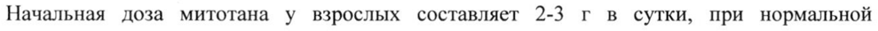
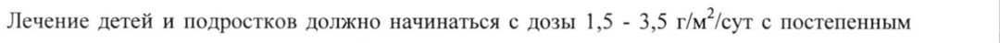
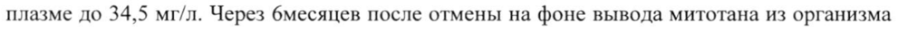

# Митотан — внутрь

- Препарат: Митотан (таблетки;)
- АТХ: L01XX23
- Источник: ГРЛС, инструкция по медицинскому применению, РУ ЛП-004684, файл от 2023-01-26 (https://grls.rosminzdrav.ru/Grls_View_v2.aspx?routingGuid=ba45ee7e-4fd3-49a9-8480-be4a3d042527)
- Распознано автоматически (OCR): 13 из 13 стр.
- Инструкция к другому РУ того же препарата: ЛП-004684 (национальное РУ, переоформленное по правилам ЕАЭС, решение от 09.01.2023). Текст может быть старше действующего
- Сомнительных строк после OCR: 3 (см. раздел «Проверка распознавания»)

## Общие сведения

ООО ЯВ ee ВЕ ОЕ ВВ бо в и Е:
МИНИСТЕРСТВО ЗДРАВООХРАНЕНИЯ РОССИЙСКОЙ ФЕДЕРАЦИИ! |
| ИНСТРУКЦИЯ | И- 004684 - 050218 | ПО МЕДИЦИНСКОМУ ПРИМЕНЕНИЮ ЛЕКАРСТВЕННОГО ПРЕПАРАТА |
Митотан | и _— наименование лекарственного препарата —
Регистрационный номер:
Торговое наименование: Митотан | Международное непатентованное наименование: Митотан

## 3. Лекарственная форма

таблетки Состав на одну таблетку:
таблетки Состав на одну таблетку:
| Действующие вещества: Митотан 500,0 мг
| Вспомогательные вещества:
Описание: Продолговатые двояковыпуклые таблетки белого или почти белого цвета с риской.
Фармакотерапевтическая группа: Противоопухолевое средство
Код ATX:L01XX23 Фармакологические свойства |

## 5.1. Фармакодинамика

Механизм действия Митотан оказывает цитотоксическое воздействие на клетки надпочечников, также он, повидимому, может угнетать функцию коры надпочечников без разрушения клеток. Точный биохимический механизм его действия неизвестен. Существующие данные позволяют предположить, что митотан изменяет периферический метаболизм стероидов, а также непосредственно подавляет функцию коры надпочечников. Прием митотана изменяет вненадпочечниковый метаболизм кортизола у человека, что приводит к снижению | концентрации 17-гидроксикортикостероидов даже на фоне отсутствия снижения уровня кортикостероидов в плазме крови. По всей видимости, митотан вызывает увеличение | образования 6-бета-гидрокси-холестерина.
Механизм действия Митотан оказывает цитотоксическое воздействие на клетки надпочечников, также он, повидимому, может угнетать функцию коры надпочечников без разрушения клеток. Точный биохимический механизм его действия неизвестен. Существующие данные позволяют предположить, что митотан изменяет периферический метаболизм стероидов, а также непосредственно подавляет функцию коры надпочечников. Прием митотана изменяет вненадпочечниковый метаболизм кортизола у человека, что приводит к снижению | концентрации 17-гидроксикортикостероидов даже на фоне отсутствия снижения уровня кортикостероидов в плазме крови. По всей видимости, митотан вызывает увеличение | образования 6-бета-гидрокси-холестерина.
| | | — \ | Эффективность митотана отмечалась у пациентов, у которых уровень митотана в плазме

превышал 14 мг/л.

Снижение функции надпочечников сопровождается снижением/исчезновением

выраженности проявлений синдрома Кушинга у пациентов с секретирующей карциномой

надпочечников и, в ряде случаев, вызывает необходимость проведения заместительной

гормональной терапии.

Дети

У детей и подростков (п = 24 пациента, в возрасте 5 месяцев — 16 лет) с неоперабельной

первичной опухолью, с рецидивом опухоли или метастазирующей опухолью. Назначение

митотана в монотерапии или в сочетании с другими препаратами приводило к ремиссии

сроком от 2 до 16 месяцев. Рецидив наблюдался у 40 % детей, доля выживших через 5 лет

составляла 49 %.

## 5.2. Фармакокинетика

Абсорбция

При назначении 2-3 г митотана в сутки была обнаружена высоко значимая корреляция

между дозой и его концентрацией в плазме. Целевая концентрация митотана в плазме

(14 мг/л) достигается у пациентов через 3-5 месяцев, суммарная доза митотана находится |

в диапазоне 283-387 г (среднее значение — 363 г). Пороговое значение 20 мг/л было

достигнуто после приема суммарной дозы митотана около 500 г.

В другом исследовании 3 пациента с раком коры надпочечников получали митотан в

соответствии с протоколом, допускающим быстрое увеличение принимаемых доз при

хорошей переносимости: 3 г (в 3 приема) в первый день, 4,5 г- во второй день, бг-в

третий день, 7,5 г — в четвертый день и 9 г - в пятый и последующие дни. Данная доза

митотана сохранялась или снижалась в зависимости от нежелательных реакций и его

концентрации в плазме. У 2 из 3 пациентов концентрация митотана в плазме,

превышающая 14 мг/л, была достигнута за 15 дней, при этом у одного из них

концентрация митотана выше 20 мг/л была достигнута примерно через месяц. У ряда

пациентов концентрация митотана в плазме может продолжать расти, несмотря на

сохранение или даже снижение суточной дозы митотана.

Распределение

Данные вскрытия пациентов показывают, что митотан обнаруживается в большинстве

тканей тела. Основным депо является жировая ткань.

Биотрансформация

Исследования метаболизма у человека обнаружили, что 1,1-(о,п-дихлордифенил) уксусная |

кислота (о,п’-ДДК) является основным циркулирующим метаболитом, а также

| присутствует небольшое количество 1,1-(о,п-дихлордифенил)-2,2 дихлорэтана (о,п-ДДЭ)
— аналога митотана. Неизмененный митотан не обнаруживался в слюне или моче, преобладает о,п-ДДК, а также некоторые ее гидроксилированные метаболиты.
Элиминация После внутривенного введения 25 % дозы выводится с метаболитами в течение 24 часов.
После прекращения приема митотан медленно выделяется из жировых депо, период полувыведения в конечной фазе колеблется от 18 до 159 дней. |

## 4.1. Показания к применению

Симптоматическое лечение прогрессирующей (неоперабельной, метастатической или рецидивирующей) формы рака коры надпочечников.
Симптоматическое лечение прогрессирующей (неоперабельной, метастатической или рецидивирующей) формы рака коры надпочечников.
Влияние митотана на гормононепродуцирующий рак коры надпочечников не

| установлено.

## 4.3. Противопоказания

e Гиперчувствительность к действующему веществу или какому-либо вспомогательному веществу, входящему в состав таблеток;

® Беременность;

® Детский возраст до 3 лет;

® Период грудного вскармливания;
| e Тяжелая почечная и/или печеночная недостаточность
| e Одновременный прием спиронолактона.

## 4.3. С осторожностью

e Ожирение;

e Гипофункция коры надпочечников;

® Почечная и/или печеночная недостаточность легкой и средней степени тяжести;

® Беременность.

» Одновременное применение с противосудорожными средствами, рифабутином, рифампицином, гризеофульвином, зверобоем продырявленным (Hypericum perforatum), сунитинибом, мидазоламом.

## 4.6. Применение при беременности и в период грудного вскармливания

Имеющиеся ограниченные данные по применению митотана во время беременности указывают на возможность возникновения аномалий надпочечников плода. Исследования на животных выявили репродуктивную токсичность. Применение препарата Митотан в период беременности противопоказано.
Женщины детородного возраста должны использовать эффективные методы контрацепции во время лечения, а также непосредственно после прекращения лечения, пока митотан определяется в плазме. Необходимо принимать во внимание медленное выведение митотана из организма после прекращения его приема. |
Из-за липофильной природы митотана существует высокая вероятность его выделения с | грудным молоком лактирующих женщин. Грудное вскармливание противопоказано при приеме митотана, а также после прекращения лечения, пока митотан определяется в плазме.

## 4.2. Способ применения и дозы

Лечение должно назначаться и проводиться под контролем специалиста с надлежащим опытом.
Лечение должно назначаться и проводиться под контролем специалиста с надлежащим опытом.
Режим дозирования Начальная доза митотана у взрослых составляет 2-3 г в сутки, при нормальной переносимости дозу постепенно увеличивают (например, с интервалом в 2 недели), пока концентрация митотана в плазме не будет находиться в терапевтическом диапазоне — 14-20 мг/л.
При необходимости установления срочного контроля синдрома Кушинга может потребоваться использование более высокой начальной суточной дозы - 4-6 г в сутки и более быстрый темп ее увеличения (например, каждую неделю). Начальная доза выше 6 г в сутки обычно не рекомендуется.
Коррекция дозы, контроль и прекращение приема
Коррекция дозы необходима для достижения и удержания концентрации митотана в терапевтическом диапазоне 14-20 мг/л, что обеспечивает наиболее оптимальное действие митотана с сохранением приемлемого уровня безопасности.
Необходимо контролировать уровень митотана в плазме крови как для подбора дозы митотана, так и для недопущения его подъема до токсического уровня.
| Доза должна подбираться индивидуально на основании контроля содержания митотана в плазме и клинической переносимости. Терапевтическая концентрация митотана в плазме крови (14-20 мг/л) обычно достигается через 3-5 месяцев.
| a | Неврологическая токсичность обычно проявляется при концентрациях свыше 20 мг/л, при таких концентрациях могут развиваться и другие серьезные нежелательные эффекты. с
| другой стороны столь высокие концентрации обычно не сопровождаются более высокой эффективностью. Содержание митотана в плазме должно оцениваться после каждой коррекции дозы и с регулярными интервалами (например, каждые 2 недели), пока не | будет найдена оптимальная поддерживающая доза. Контроль должен проводиться чаще |
(например, каждую неделю), если используются более высокая начальная доза.
Необходимо учитывать, что коррекция дозы не сопровождается немедленным изменением |
| | концентрации митотана в плазме. Из-за способности митотана к интенсивной кумуляции в | тканях (прежде всего в жировой) необходим регулярный контроль его концентрации в плазме (например, раз в месяц) даже после завершения подбора поддерживающей дозы.
При возникновении серьезных нежелательных реакций, например, нейротоксичности, лечение митотаном может быть на некоторое время прервано. Регулярный контроль
(например, каждые 2 месяца) уровня митотана в плазме также необходим после
| временной приостановки лечения. Лечение может быть возобновлено, если концентрация митотана в плазме вернется в терапевтический диапазон. Благодаря пролонгированному
| периоду полувыведения высокая концентрация в сыворотке может сохраняться в течение | нескольких недель после прекращения лечения. |
При умеренной токсичности дозу следует снизить до максимальной переносимой дозы.
Лечение митотаном продолжают до тех пор, пока наблюдается улучшение клинических показателей. Если никакого улучшения клинических показателей не наблюдается после 3 месяцев приема оптимальной дозы, лечение следует полностью прекратить.
Режим дозирования у особых групп пациентов
Дети Опыт применения препарата у детей ограничен. Возможно применение препарата у детей в дозировках, эквивалентным взрослым (после их пересчета на площадь поверхности тела).
Лечение детей и подростков должно начинаться с дозы 1,5 - 3,5 г/м?/сут с постепенным | увеличением дозы до 4 г / м’ / суг. Содержание митотана в плазме должно контролироваться так же, как и у взрослых пациентов, особую осторожность следует | проявлять по достижению концентрации в плазме крови 10 мг/л, поскольку в дальнейшем возможен быстрый рост его уровня в плазме крови. Доза может быть снижена через 2 или 3 месяца в зависимости от плазменной концентрации митотана или в случае развития выраженной токсичности.
Пациенты с печеночной недостаточностью Snr
Из-за отсутствия достаточного опыта применения митотана у больных с печеночной недостаточностью, его применение не рекомендовано (митотан в основном метаболизируется в печени и его концентрация в плазме крови будет повышаться при нарушении функции печени). Применение митотана у больных с тяжелой формой печеночной недостаточности не рекомендуется. У пациентов с легкой и средней степенью печеночной недостаточности следует регулярно проводить мониторинг функций печени.
Пациенты с почечной недостаточностью Из-за отсутствия достаточного опыта применения митотана у больных с почечной недостаточностью, его применение у больных с тяжелой формой почечной недостаточности не рекомендуется. У пациентов с легкой и средней степенью почечной недостаточности следует регулярно проводить мониторинг содержания митотана в плазме крови.

Пациенты старше 65 лет

Из-за отсутствия достаточного опыта применения митотана у пожилых пациентов не существует конкретных рекомендаций по дозированию препарата у данной категории пациентов. Следует проявлять осторожность при приеме митотана и регулярно проверять концентрацию вещества в плазме крови.

## 4.8. Побочное действие

В соответствии с классификацией Всемирной организации здравоохранения (ВОЗ)
нежелательные реакции представлены в соответствии с частотой их развития: очень часто

(>1/10); часто (>1/100, <1/10), нечасто (>1/1000, <1/100), редко (>1/10000, <1/1000) и очень редко (<1/10000), частота неизвестна — по имеющимся данным установить частоту

| возникновения не представлялось возможным.

Таблица 1: Частота нежелательных реакций, определенная по данным литературы
| Cy гемно органный ежел: ца. >a KU | * = т | ke Miche класс ee tate; QueHb часто | Часто |e : вес .
Нарушения со стороны величение активности нижение уровня андростендиона абораторных ‹печеночных» ферментов и тестостерона в крови (у оказателей женщин)
величение уровня полового | гормон-связывающего глобулина нижение уровня несвязанного естостерона в крови мужчин
Нарушения со стороны Лейкопения Анемия рови и лимфатической Удлинение времени ромбоцитопения истемы кровотечения |
Нарушения со стороны |Атаксия нижение арушение равновесия ервной системы арестезии умственной |
Вертиго деятельности | онливость Полиневропатия |
’ Сиестемно-ор! нный — el ce Нежел. льная реакция 1 ig2s лас! eid Очень часто | часто г |
Двигательные о оловокружение Головная боль
Нарушения со стороны Макулопатия органа зрения оксическое поражение сетчатки
Двоение Помутнение хрусталика Нечеткость зрения
Желудочно-кишечные Мукозит Гиперсаливация нарушения Рвота Дисгевзия
Диарея Диспепсия ошнота Боль в эпигастральной области арушения со стороны Геморрагический цистит
= ПОНИ И ей ротеинурия Нарушения со стороны ожная сыпь кожи и подкожных каней
Нарушения со стороны | мышечной, скелетной и оединительной ткани надпочечников железы арушения метаболизма Анорексия Гиперурикемия i
Гипертриглицеридемия оба ОИ lal патогенной флорой арушения со стороны Артериальная гипертензия осудов Ортостатическая гипотензия
Гиперемия кожных покровов реакции в месте Генерализованные болевые введения ощущения
Нарушения со стороны Аутоиммунный Поражение печени (печеночнопечени и гепатит клеточное/ желчевыводящих путей холестатическое/смешанное а И И ОИ репродуктивной системы и молочных желез
Психические нарушения Спутанность сознания || —CSCid
Описание отдельных нежелательных реакций
Наиболее часто отмечаются желудочно-кишечные расстройства (от 10 % до 100 % пациентов). Эти нарушения обратимы при снижении дозы. Некоторые из этих реакций
(анорексия) могут являться начальным проявлением нарушений со стороны центральной нервной системы.
Нежелательные реакции со стороны нервной системы возникают примерно у 40 % пациентов. Известны и другие нежелательные реакции со стороны центральной нервной системы, например, расстройства памяти, агрессивность, центральный вестибулярный синдром, расстройство артикуляции и синдром Паркинсона. Представляется, что серьезные нежелательные реакции связаны с кумулятивным действием митотана (прием высоких доз в течение длительного периода времени) и чаще всего возникают, когда концентрация митотана в плазме превышает 20 мг/л. Нежелательные реакции со стороны нервной системы являются обратимыми и обычно исчезают после прекращения приема митотана и снижения его концентрации в плазме.
Кожная сыпь, отмечаемая у 5 %-25 % пациентов, не связана с величиной принятой дозы.
Лейкопения отмечается у 8 %-12 % пациентов.
Удлинение времени кровотечения возникает часто (90 %): несмотря на то, что точный механизм такой реакции неизвестен и его связь с митотаном или первопричинным заболеванием неясна, это следует учитывать при рассмотрении необходимости проведения хирургических вмешательств у больных, получающих терапию митотаном.
Активность «печеночных» трансаминаз (ITT, аминотрансфераза, щелочная фосфатаза)
обычно увеличивается. Аутоиммунный гепатит отмечается у 7 % пациентов. При снижении дозы митотана активность «печеночных» трансаминаз нормализуется. Отмечен случай развития холестатического гепатита.
Женщины в пременопаузе. Описаны случаи развития доброкачественных макроцист яичников (с такими симптомами, как боль в малом тазу, кровотечение).
Дети. При приеме митотана может наблюдаться замедление нейропсихического развития.
В таких случаях следует провести исследование щитовидной железы, чтобы исключить возможность развития гипотиреоза, связанное с приемом митотана. Может также наблюдаться задержка роста. В одном случае у ребенка отмечалась энцефалопатия через 5 месяцев после начала лечения; этот случай был связан с увеличением уровня митотана в плазме до 34,5 мг/л. Через бмесяцев после отмены на фоне вывода митотана из организма пациент клинически выздоровел.
Информирование о подозреваемых нежелательных реакциях
Работников здравоохранения просят сообщать о любых подозреваемых нежелательных реакциях через государственную систему организации отчетности. Это позволит постоянно контролировать соотношение пользы и риска лекарственного средства.

## 4.9. Передозировка

Передозировка митотана может привести к нарушениям со стороны центральной нервной системы, в особенности, если уровень митотана в плазме крови превышает 20 мг/л.
Передозировка митотана может привести к нарушениям со стороны центральной нервной системы, в особенности, если уровень митотана в плазме крови превышает 20 мг/л.
Специфических антидотов, показанных при передозировке митотана, не существует.
Необходимо тщательное наблюдение за пациентом, учитывая продолжительный период полувыведения и липофильную природу митотана, могут потребоваться недели для возврата к норме. Другие реакции следует лечить симптоматически.

Из-за высокой липофильной митотана возможность его вывода с помощью диализа маловероятна.
Рекомендуется увеличить периодичность контроля уровня митотана в плазме (например, проводить мониторинг каждые 2 недели) у пациентов с повышенным риском развития передозировки (например, у пациентов с почечной или печеночной недостаточностью, у пациентов, страдающих ожирением, или пациентов, недавно сбросивших вес).

## 4.5. Взаимодействие с другими лекарственными средствами

| Спиронолактон: Митотан противопоказано принимать одновременно со спиронолактоном, поскольку он может блокировать действие митотана.
Варфарин и кумариноподобные антикоагулянты: Отмечалось, что митотан ускоряет
| метаболизм варфарина благодаря индукции микросомальных ферментов печени, что приводит к увеличению требуемой дозы варфарина. Таким образом, следует внимательно следить за пациентами для изменения необходимой дозы антикоагулянтов при приеме митотана пациентами, одновременно принимающими кумариноподобные антикоагулянты.
Вещества, метаболизируемые под действием цитохромов Рубо: Показано, что митотан оказывает индуцирующее воздействие на ферменты системы цитохрома P450(3A4), в связи с чем концентрация в плазме веществ, метаболизируемых под действием цитохрома P4509, может изменяться.
В отсутствие информации о специфических изоферментах Р4бо следует соблюдать
| осторожность при одновременном назначении лекарственных liperapaTos, метаболизируемых с участием этой ферментной системы, в том числе противосудорожных средств, рифабутина, рифампицина, гризеофульвина и зверобоя продырявленного (Hypericum perforatum), сунитиниба и мидазолама.
Лекарственные препараты, воздействующие на центральную нервную систему: Митотан в высоких концентрациях может оказывать нежелательное воздействие на центральную
| нервную систему. Несмотря Ha отсутствие информации о возможности специфического фармакодинамического взаимодействия с препаратами, действующими на центральную нервную систему, необходимо помнить о потенциальной возможности подобного взаимодействия при одновременном назначении митотана с лекарственными препаратами,
| угнетающими центральную нервную систему.
Пища, богатая жирами усиливает всасывание митотана.
Гормонсвязывающие белки: Доказано, что митотан увеличивает уровень гормонсвязывающих белков в плазме (например, глобулина, связывающего половые
| гормоны, и глобулина, связывающего глюкокортикостероиды), что необходимо принимать во внимание при интерпретации результатов анализа гормонов. Кроме того, это может привести к гинекомастии.

## 4.4. Особые указания

До начала лечения крупные метастазы необходимо удалить хирургическим путем как можно раньше до начала приема митотана, чтобы минимизировать риск развития некроза опухоли и кровотечений (из-за быстрого цитотоксического эффекта митотана).
До начала лечения крупные метастазы необходимо удалить хирургическим путем как можно раньше до начала приема митотана, чтобы минимизировать риск развития некроза опухоли и кровотечений (из-за быстрого цитотоксического эффекта митотана).
Накопление митотана в тканях: Жировая ткань, служащая своеобразным депорезервуаром для митотана, способствует удлинению периода полувыведения и накоплению митотана. В связи с этим даже на фоне приема неизменной дозы препарата его концентрация может расти. Настоятельно рекомендуется соблюдать осторожность и внимательно следить за уровнем митотана в плазме у пациентов с лишним весом.
Риск развития недостаточности коры надпочечников: У всех пациентов с гормононепродуцирующей опухолью и 75 % пациентов с гормонопродуцирующей опухолью развиваются признаки недостаточности коры надпочечников. Таким пациентам может потребоваться заместительная стероидная терапия. Поскольку митотан повышает уровень стероид-связывающих белков в плазме, необходимо измерять уровень свободного
| кортизола и кортикотропина для оптимального подбора режима стероидного замещения.
| Шок, серьезная травма или развитие сопутствующих инфекций: Прием митотана следует
| немедленно прекратить после возникновения шоковых состояний, тяжелой травмы или инфицирования, поскольку его первичное действие заключается в подавлении функции коры надпочечников. Более того, возможно появление необходимости назначения экзогенных стероидов, поскольку надпочечники с угнетенной функцией не смогут немедленно начать выработку стероидов. Из-за увеличенного риска развития острой адренокортикальной недостаточности пациентам следует немедленно связаться со своим врачом в случае травмы, развития различных инфекций или возникновения других сопутствующих заболеваний. Пациенты должны носить с собой «Карту пациента, принимающего митотан», в которой должно быть указано, что они предрасположены к развитию недостаточности надпочечников и могут потребоваться соответствующие меры предосторожности.
Контроль концентрации в плазме: Необходимо контролировать содержание митотана в плазме для оценки необходимости коррекции его режима дозирования, в особенности при необходимости назначения высокой начальной дозы. Коррекция дозы может быть необходима для достижения заданного терапевтического уровня в диапазоне 14-20 мг/л и предотвращения развития специфических нежелательных реакций.
Печеночная или почечная недостаточность: Недостаточно данных для безопасного использования митотана у пациентов с тяжелой печеночной или почечной недостаточностью. Пациентам с печеночной или почечной недостаточностью слабой или |
| средней степени рекомендуется соблюдать осторожность и более тщательно
| контролировать уровень митотана в плазме.
У пациентов, принимающих митотан, наблюдалась гепатотоксичность. Отмечались случаи повреждения печени (проявления печеночно-клеточного, холестатического и смешанного гепатита), а также аутоиммунный гепатит. Необходимо проводить
| периодический мониторинг функции печени (активность «печеночных» трансаминаз, уровень билирубина), особенно в течение первых месяцев лечения или в случае необходимости увеличения дозы.
Нарушения со стороны центральной нервной системы: Продолжительный непрерывный прием высоких доз митотана может привести к обратимым повреждениям мозга.
Необходимо с регулярными интервалами проводить мониторинг поведенческой и неврологической симптоматики, особенно если уровень митотана в плазме превышает 20 мг/л. |
| Нарушения со стороны кровеносной и лимфатической системы: Прием митотана может влиять на все клетки крови. Часто отмечаются случаи лейкопении (включая нейтропению), анемии и тромбоцитопении. При приеме митотана необходимо контролировать количество эритроцитов, лейкоцитов и тромбоцитов.
Свертываемость крови: Увеличенное время кровотечения отмечалось у пациентов, принимающих митотан. Этот факт необходимо учитывать при рассмотрении необходимости проведения хирургического вмешательства.
Варфарин и кумариноподобные антикоагулянты: При приеме митотана пациентами на фоне приема кумариноподобных антикоагулянтов необходимо тщательно следить за состоянием свертываемости крови для своевременного выявления признаков чрезмерной гипокоагуляции и соответствующего изменения режима дозирования антикоагулянтов.
Вещества, метаболизируемые под действием цитохромов P4509, в особенности цитохромов 3A4: Митотан является стимулятором ферментов печени и должен использоваться с осторожностью при сочетанном применении с лекарственными препаратами, влияющими на активность ферментов печени.
Женщины детородного возраста должны использовать эффективную контрацепцию во время приема митотана.
Женщины в пременопаузе: Развитие макроцист яичников часто наблюдается в данной группе. В отдельных случаях сообщалось об осложнениях (перекрут и геморрагический 1] разрыв цисты). Наблюдалось улучшение после прекращения приема митотана. Женщинам необходимо срочно обратиться к врачу при появлении гинекологических симптомов,
| например, кровотечения и/или болей в малом тазу.

Дети: У детей и подростков может наблюдаться нервно-психическая заторможенность при приеме митотана. В таких случаях необходимо оценить функцию щитовидной железы, чтобы выявить возможное повреждение щитовидной железы, связанное с приемом митотана.

## 4.7. Влияние на способность управлять транспортными средствами, механизмами

Митотан оказывает выраженное влияние на способность управлять транспортными средствами и работать с механизмами. Амбулаторных пациентов следует предостеречь от управления транспортными средствами и работы с механизмами.

## 6.5. Форма выпуска

Таблетки, 500 мг.
Таблетки, 500 мг.
По 10 таблеток в контурную ячейковую упаковку из пленки поливинилхлоридной и фольги алюминиевой печатной лакированной.
По 1, 2, 3, 4, 5 или 10 контурных ячейковых упаковок вместе с инструкцией по применению помещают в пачку из картона.
По 10, 20, 30, 40, 50 или 100таблетокв банку полимерную для лекарственных средств с контролем первого вскрытия, укупоренную крышкой. По 1 банке вместе с инструкцией по применению помещают в пачку из картона.

## 6.4. Условия хранения

В защищенном от света месте при температуре не выше 30 °С.
В защищенном от света месте при температуре не выше 30 °С.
Хранить в недоступном для детей месте.

## 6.3. Срок годности

3 года.
3 года.
Не использовать после окончания срока, указанного на упаковке.
Условия отпуска Отпускают по рецепту.

Юридическое лицо, на имя которого выдано регистрационное удостоверение/Организация, принимающая претензии потребителей |
ООО «Лайф Сайнсес ОХФК», Россия | 249033, Калужская обл., г. Обнинск, ул. Горького, д. 4
Тел/факс: (495) 984-28-40/41, (48439) 6-47-41
Производитель ООО «НАНОФАРМА ДЕВЕЛОПМЕНТ», Россия |
Юридический адрес: 420095, Республика Татарстан, г. Казань, ул. Восстания, д. 100, оф. | 38.
Адрес места производства: Республика Татарстан, г. Казань, ул. Восстания, д. 102.
| Кеперальный директор (_ 5 р са ых ООО «Лайф Сайнсес ОХФК» = < Ре Л.А.Фомин
| |
## Проверка распознавания

Страницы-сканы распознаны автоматически. В 3 строках с дозировками цифры могли распознаться с ошибкой — сверьте с вырезкой из оригинала:

- стр. 4: «Начальная доза митотана у взрослых составляет 2-3 г в сутки, при нормальной» — повторное чтение: «Начальная доза митотана у взрослых составляет 2-3 гв сутки, при нормальной»  
  
- стр. 5: «Лечение детей и подростков должно начинаться с дозы 1,5 - 3,5 г/м?/сут с постепенным |» — повторное чтение: «Лечение детей и подростков должно начинаться с дозы 1,5 - 3,5 r/M’/cyT с постепенным |»  
  
- стр. 8: «плазме до 34,5 мг/л. Через бмесяцев после отмены на фоне вывода митотана из организма» — повторное чтение: «плазме до 34,5 MI/JI. Через бмесяцев после отмены на фоне вывода митотана из организма»  
  
