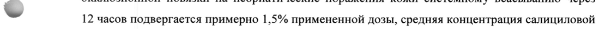

# Мометазона фуроат + Салициловая кислота — наружно

- Препарат: Момейд-С (мазь для наружного применения;)
- АТХ: D07XC03
- Источник: ГРЛС, инструкция по медицинскому применению, РУ ЛСР-003331/09, файл от  (https://grls.rosminzdrav.ru/Grls_View_v2.aspx?routingGuid=066148db-3bd1-476a-beb1-e52133b639ad)
- Распознано автоматически (OCR): 7 из 7 стр.
- Инструкция к другому РУ того же препарата: ЛСР-003331/09 (национальное РУ, переоформленное по правилам ЕАЭС, решение от 30.06.2021). Текст может быть старше действующего
- Сомнительных строк после OCR: 1 (см. раздел «Проверка распознавания»)

## Общие сведения

Г ——————— ny | | | МИНЗДРАВ РОССИИ | (0-209? pe вто
COT JACOBAHO ИНСТРУКЦИЯ Ы—Ш | ПО МЕДИЦИНСКОМУ ПРИМЕНЕНИЮ ЛЕКАРСТВЕННОГО ПРЕПАРАТА
МОМАТ-С Регистрационный номер:
Торговое наименование: Момат-С Международное непатентованое или группировочное наименование:
мометазон + салициловая кислота Лекарственная форма: мазь для наружного применения
© Состав В 100 гмази содержится:
Действующие вещества: мометазона фуроат — 0,10 г, салициловая кислота — 5,00 г;
Вспомогательные вещества: вазелин (белый вазелин), воск пчелиный белый, пропиленгликоля моностеарат, гексиленгликоль.
© Описание: однородная мазь белого цвета.
Фармакотерапевтическая группа:
Глюкокортикостероид для местного применения + кератолитическое средство.
Код ATX: 207ХС03.
-
Фармакологические свойства Фармакодинамика
Мометазон — — глюкокортикостероид для наружного применения. — Обладает противовоспалительным, противозудным и сосудосуживающим действием. В целом механизм противовоспалительного действия глюкокортикостероидов (ГКС) местного применения неясен. Полагают, что ГКС индуцируют выделение белков, ингибирующих фосфолипазу Az и известных под общим названием липокортины. Считают, что эти белки контролируют биосинтез таких сильнодействующих медиаторов воспаления, как простагландины и лейкотриены, путем торможения высвобождения их общего предшественника, арахидоновой кислоты. Арахидоновая кислота выделяется из мембранных фосфолипидов под действием фосфолипазы Az.
В опытах in vitro было показано, что мометазон — это мощный ингибитор синтеза трех цитокинов, участвующих в развитии воспалительного процесса и его поддержании:
интерлейкина-1 (ИЛ-1), интерлейкина-6 (ИЛ-6) и фактора некроза опухолей альфа (ФНО).
Салициловая кислота вызывает отшелушивание рогового слоя кожи и не приводит к количественным или качественным изменениям в структуре жизнеспособного эпидермиса.
Данный механизм действия обусловлен растворением межклеточного связующего вещества.

## 5.2. Фармакокинетика

Всасывание. После однократного наружного нанесения мази Момат-С без применения
Всасывание. После однократного наружного нанесения мази Момат-С без применения
: окклюзионной повязки на псориатические поражения кожи системному всасыванию через
~ 12 часов подвергается примерно 1,5% примененной дозы, средняя концентрация салициловой кислоты в плазме крови составила 0,0908 мг/дл. Системные токсические реакции на салициловую кислоту обычно связаны с более высокой ее концентрацией в плазме крови
(30-40 мг/дл).
В ходе исследований влияния однокомпонентного препарата в форме мази, содержащего
© мометазона фуроат B качестве действующего вещества на гипоталамо-гипофизарно-надпочечниковую систему (ГГНС), было показано отсутствие влияния при применении препарата до 15 г в день в течение 6 недель или при повторном коротком лечении после первого курса терапии. Также было показано, что совместное применение мометазона и салициловой кислоты в качестве кератолитического средства не влияет на профиль безопасности мометазона по отношению к ГГНС по сравнению с
©, однокомпонентным препаратом.
После применения мази Момат-С дважды в день в течение 3 недель без наложения окклюзионных повязок концентрация салицилатов в плазме крови составила <5 мг/дл, что ниже порога обнаружения и ниже лабораторной нормы концентрации салицилатов в крови
(15-30 мг/дл).
Распределение. По причине незначительного всасывания мометазона при наружном применении распределение препарата в организме человека изучалось при внутривенном введении раствора, содержащего мометазон в концентрации 1 мг/мл. Кажущийся объем распределения составил 917 л, что указывает на широкое распределение мометазона.
99% мометазона в плазме крови человека находится в связанном состоянии.
Метаболизм. После всасывания мометазон подвергается интенсивному метаболизму с образованием множества метаболитов, обладающих более сильными полярными свойствами, чем мометазон. Вследствие высокой полярности образовавшиеся метаболиты He рассматриваются как обладающие фармакологической активностью. При метаболизме мометазона не образуется какого-либо основного метаболита. После внутривенного введения общая скорость метаболического выведения из сыворотки крови составила 976 мл/мин, что также подтверждает интенсивный метаболизм мометазона.
Основные метаболиты салициловой кислоты, количественно определявшиеся в плазме крови после наружного применения мази Момат-С, были гентизиновая кислота (Cmax=0,00127 мг/дл через 24 4) и салицилуровая кислота (Cmax=0,0171 мг/дл через 3,3 4).
© Выведение. Мометазон и салициловая кислота, а также их метаболиты выводятся почками и через кишечник. Период полувыведения салициловой кислоты составляет 2,8 ч.

## 4.1. Показания к применению

Мазь Момат-С предназначена для снятия воспалительных проявлений и гиперкератоза при псориазе, атопическом дерматите, себорейном дерматите.
Мазь Момат-С предназначена для снятия воспалительных проявлений и гиперкератоза при псориазе, атопическом дерматите, себорейном дерматите.
-

## 4.3. Противопоказания

Детский возраст (до 12 лет).
Детский возраст (до 12 лет).
Повышенная чувствительность к мометазону, салициловой кислоте или к любому иному компоненту препарата.
Бактериальные, вирусные (простой герпес, ветряная оспа, опоясывающий лишай) или
& грибковые инфекции кожи, розовые угри или периоральный дерматит, поствакцинальные реакции, туберкулез, сифилис.

## 4.6. Применение при беременности и в период грудного вскармливания

(лечение обширных участков кожи или/и в течение длительного времени), поскольку не проводилось контролируемых исследований.
(лечение обширных участков кожи или/и в течение длительного времени), поскольку не проводилось контролируемых исследований.
Не наносить на лицо или в области паха и подмышечных впадин.

## 4.3. С осторожностью

Как для всех ГКС, мазь Момат-С необходимо применять с осторожностью при нанесении на обширные участки тела и/или при длительном использовании. Не рекомендуется использовать в естественных кожных складках. ГКС могут маскировать развитие кожной инфекции. При развитии сопутствующей кожной инфекции необходимо использовать противогрибковые, антибактериальные или противовирусные средства.
Как для всех ГКС, мазь Момат-С необходимо применять с осторожностью при нанесении на обширные участки тела и/или при длительном использовании. Не рекомендуется использовать в естественных кожных складках. ГКС могут маскировать развитие кожной инфекции. При развитии сопутствующей кожной инфекции необходимо использовать противогрибковые, антибактериальные или противовирусные средства.
Применение при беременности и в период грудного вскармливания
Сведений о том, что наружное применение ГКС или салициловой кислоты может привести к системному действию и обнаружению препарата в грудном молоке, не имеется. Поскольку многие ГКС проникают через плацентарный барьер, следует избегать длительного лечения и применения больших доз во время беременности в связи с угрозой негативного воздействия на развитие плода.
ГКС выделяются с грудным молоком, поэтому в случае, когда предполагается применение
ГКС в больших дозах и/или в течение длительного времени, следует прекратить грудное
© вскармливание.

## 4.2. Способ применения и дозы

Наружно. Тонкий слой мази Момат-С следует наносить на пораженные участки кожи дважды в день, утром и вечером; максимальная суточная доза составляет 15 г.
Наружно. Тонкий слой мази Момат-С следует наносить на пораженные участки кожи дважды в день, утром и вечером; максимальная суточная доза составляет 15 г.
Продолжительность курса лечения определяется лечащим врачом.
© Побочное действие Слабое или умеренное жжение на месте нанесения мази, зуд, атрофия кожи, шелушение, раздражение, мацерация кожи, сухость кожи, фолликулит, угревая сыпь, гипопигментация, периоральный дерматит, аллергический контактный дерматит, появление атрофических полос кожи, потница, вторичные инфекции, гипертрихоз. У детей, кроме этого, возможно
©, подавление функции гипоталамо-гипофизарно-надпочечниковой системы, в том числе с развитием синдрома Иценко-Кушинга.
При наружном применении ГКС могут возникнуть системные нежелательные реакции, например, нечеткое зрение.

## 4.9. Передозировка

Продолжительное лечение ГКС при их наружном применении в избыточных количествах может привести к подавлению гипоталамо-гипофизарно-надпочечниковой системы и вторичной недостаточности надпочечников. Если наблюдается подавление гипоталамогипофизарно-надпочечниковой системы, то следует прекратить применение мази или сократить частоту нанесений. Кратность нанесения определяется лечащим врачом.
Продолжительное лечение ГКС при их наружном применении в избыточных количествах может привести к подавлению гипоталамо-гипофизарно-надпочечниковой системы и вторичной недостаточности надпочечников. Если наблюдается подавление гипоталамогипофизарно-надпочечниковой системы, то следует прекратить применение мази или сократить частоту нанесений. Кратность нанесения определяется лечащим врачом.

В случае токсичности, вызванной салициловой кислотой, применение мази Момат-С следует

прекратить. Введение жидкости способствует выведению салицилатов из организма с мочой.

По мере необходимости можно назначить пероральное или внутривенное введение натрия

гидрокарбоната и солей калия.

## 4.5. Взаимодействие с другими лекарственными средствами

Какого-либо взаимодействия мази Момат-С с другими лекарственными средствами не

зарегистрировано. Теоретически существует вероятность вытеснения салициловой кислотой

из связи с белками толбутамида, метотрексата, гепарина, пиразинамида, лекарственных

средств, способствующих выведению мочевой кислоты, и непрямых антикоагулятнов. Хотя
© не сообщалось о взаимодействии мази Момат-С с данными веществами, указанную

информацию следует иметь в виду при ее назначении совместно с этими соединениями.

## 4.4. Особые указания

При нанесении на большие участки кожи в течение длительного времени возможно развитие

системного действия ГКС. Учитывая это, больные должны наблюдаться в отношении
© признаков подавления функции гипоталамо-гипофизарно-надпочечниковой системы и

развития синдрома Иценко-Кушинга. Это особенно важно в педиатрии.

Вследствие того, что соотношение поверхности кожи и массы тела у детей больше, чем у

взрослых, дети более, чем взрослые, предрасположены к подавлению гипоталамо-

гипофизарно-надпочечниковой системы и развитию синдрома Иценко-Кушинга в ответ на

терапию ГКС. Дети должны получать минимальное количество ГКС, необходимое для
& достижения эффекта. Длительная терапия с применением ГКС может оказать

нежелательное воздействие на рост и развитие детей.

Следует избегать попадания мази Момат-С в глаза. Мазь Момат-С не подлежит

использованию в офтальмологии.

ГКС могут вызвать изменение внешнего вида пораженных участков кожи, что

затрудняет постановку правильного диагноза.

В случае раздражения, в том числе излишней сухости кожи, следует прекратить применение

мази Момат-С и назначить соответствующее лечение.

При длительной терапии ГКС внезапное прекращение терапии может привести к развитию

синдрома рикошета, проявляющегося в форме дерматита с интенсивным покраснением кожи

и ощущением жжения. Поэтому после длительного курса лечения отмену препарата следует производить постепенно, например, переходя на интермиттирующую схему лечения перед тем, как его полностью прекратить.

При системном, наружном и местном (включая интраназальное, ингаляционное и внутриглазное) применении ГКС могут возникнуть нарушения зрения. Если у пациента присутствуют такие симптомы, как нечеткое зрение или другие нарушения зрения, необходимо рекомендовать пациенту обратиться к офтальмологу для выявления возможных причин нарушений зрения, включающих катаракту, глаукому или редкие заболевания, например, центральную серозную хориоретинопатию (ЦСХ), которые наблюдались в ряде случаев при системном и местном применении ГКС.
Любой из побочных эффектов, описанный при системном — применении глюкокортикостероидов, включая подавление функции надпочечников, может возникнуть и
© при местном применении, особенно у детей.
Если развивается сопутствующая кожная инфекция, следует применять необходимое противогрибковое, противовирусное или антибактериальное средство. Если положительный ответ на лечение не достигается быстро, применение мази Момат-С следует прервать до того момента, пока инфекция не будет должным образом устранена.
© Мазь Момат-С не рекомендуется использовать с окклюзионными повязками, включая подгузники и пластиковые трусы.
Влияние препарата на способность управлять транспортными средствами, механизмами
Влияния мази Момат-С на способность управлять автомобилем и работать с механизмами не
& отмечено.

## 6.5. Форма выпуска

Мазь для наружного применения.
Мазь для наружного применения.
По 10 ги 15 гв алюминиевые лакированные тубы, имеющие сопло с закрытым концом, с крышкой, имеющей острие для прокалывания. Одна туба вместе с инструкцией по применению помещается в картонную пачку.

## 6.4. Условия хранения

Хранить при температуре не выше 25°С.
Хранить при температуре не выше 25°С.
Не замораживать.
Хранить в недоступном для детей месте.

## 6.3. Срок годности

2 года.
2 года.
Не применять препарат по истечении срока годности.
Условия отпуска Отпускают по рецепту.
© Владелец регистрационного удостоверения
Гленмарк Фармасьютикалз Лтд., Индия Glenmark Pharmaceuticals Ltd., India
B/2 Mahalaxmi Chambers, 22 Bhulabhai Desai Road, Mahalaxmi, Mumbai - 400026, India.
Производитель Гленмарк Фармасьютикалз Лтд., Индия
Plot № Е 37, 39, MIDC Area, Satpur, Nasik-422007, Maharashtra, India.
Организация, принимающая претензии 115114, г. Москва, ул. Летниковская, дом 2, строение 3, 2 этаж; тел.: 8 (499) 951-00-00, сайт www.glenmark-pharma.ru. yy, Е ore SENN
© и ; “eS РКИ DING . \ \ 5” ОТДЕЛ *| = Специалист по регуляторным вопросам eal Wa -ТРАБИИ = } >| Шишова Е.Ю.
№, «У Хо YJ Sw Oe
## Проверка распознавания

Страницы-сканы распознаны автоматически. В 1 строках с дозировками цифры могли распознаться с ошибкой — сверьте с вырезкой из оригинала:

- стр. 2: «~ 12 часов подвергается примерно 1,5% примененной дозы, средняя концентрация салициловой» — повторное чтение: «= 2 eee canaramonai»  
  
