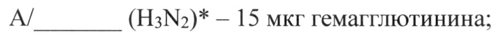

# Моновакцина вируса гриппа подтипа А + Моновакцины вируса гриппа типа В — парентерально

- Препарат: Флю-М Тетра Вакцина гриппозная четырехвалентная инактивированная расщепленная (раствор для внутримышечного введения;)
- АТХ: J07BB02
- Источник: ГРЛС, инструкция по медицинскому применению, РУ ЛП-007257, файл от 2024-05-08 (https://grls.rosminzdrav.ru/Grls_View_v2.aspx?routingGuid=917cfbd3-7c97-4096-ae7a-73075d7d8ff3)
- Распознано автоматически (OCR): 8 из 8 стр.
- Инструкция к другому РУ того же препарата: ЛП-007257 (национальное РУ, переоформленное по правилам ЕАЭС, решение от 25.04.2024). Текст может быть старше действующего
- Сомнительных строк после OCR: 1 (см. раздел «Проверка распознавания»)

## Общие сведения

| МИНЗДРАВРОССИ H | | М -007257-040821 |
МИНИСТЕРСТВО ЗДРАВООХРАНЕНИЯ российской ФЕДЕРАЦИИ 10 | жж
ИНСТРУКЦИЯ ПО МЕДИЦИНСКОМУ ПРИМЕНЕНИЮ ЛЕКАРСТВЕННОГО ПРЕПАРАТА
Флю-М Тетра | Вакцина гриппозная четырехвалентная инактивированная расщепленная
Регистрационный номер:
Торговое наименование: Флю-М Тетра Вакцина гриппозная четырехвалентная инактивированная расщепленная.
Международное непатентованное или группировочное наименование: Вакцина для профилактики гриппа [инактивированная].
~ Лекарственная форма: раствор для внутримышечного введения.

## 2. Состав

В 1 дозе (0,5 мл) содержатся:
Действующие вещества:
вирусы гриппа, культивированные на куриных эмбрионах, инактивированные,
© расщепленные, представленные штаммами, эквивалентными следующим: |
А/ (НИМ, * — 15 мкг гемагглютинина;
А/ (H3N2)* — 15 мкг гемагглютинина;
В/ (линия Yamagata)* — 15 мкг гемагглютинина;
B/ (линия Victoria)*— 15 мкг гемагглютинина.
© * - Штаммы вируса гриппа типов А и В для производства вакцин должны быть рекомендованы ВОЗ на текущий эпидемический сезон для Северного полушария.
Вспомогательные вещества:
стабилизатор — Тритон Х-100 не более 100 мкг, консервант — тиомерсал (мертиолят)
50 мкг или не содержит консерванта, фосфатно-солевой буферный раствор (натрия хлорид; динатрия фосфата додекагидрат; калия дигидрофосфат; вода для инъекций) до 0,5 мл.
Описание.
Бесцветная слабо опалесцирующая жидкость.
Характеристика.
Вакцина представляет собой смесь высокоочищенных — протективных поверхностных и внутренних антигенов вируса гриппа А подтипов A (Н! №), А (H3N2) и типа В линий Yamagata и Victoria, выделенных из вируссодержащей аллантоисной жидкости куриных эмбрионов в фосфатно-солевом буферном растворе. Штаммовый состав вакцины изменяется каждый год в соответствии с эпидемиологической ситуацией и рекомендациям Всемирной организации здравоохранения (ВОЗ) для Северного полушария.
Фармакотерапевтическая группа.
МИБП-вакцина.
Код ATX: JO7BBO02.
Фармакологические свойства.
Механизм действия Рекомендуется ежегодно проводить вакцинацию в связи с тем, что заболеваемость гриппом носит сезонный характер, циркулирующие штаммы вируса могут меняться
| ежегодно, а иммунитет в течение года после вакцинации снижается.
~ Выработанный иммунитет к определенному типу или подтипу вируса гриппа ограниченно защищает или не защищает от других типов вируса гриппа. Антитела, выработанные после вакцинации к определенному антигену вируса гриппа, могут не обеспечивать защитный эффект в отношении измененного антигена вируса того же типа или подтипа. Частое изменение антигенов приводит к ежегодной смене штаммового
© состава вакцины для профилактики гриппа. Таким образом, вакцины для профилактики гриппа нормированы в отношении состава гемагглютининов тех штаммов вируса гриппа, которые вероятно будут циркулировать в грядущем эпидемическом сезоне.
Иммуногенность Вакцина в течение трех недель стимулирует выработку гуморальных антител
© против гемагглютининов вирусов гриппа и формирует развитие специфического иммунитета к актуальным штаммам вируса гриппа типов А и В. Продолжительность поствакцинального иммунитета к гомологичным штаммам или близкородственным с ними может колебаться, однако, в большинстве случаев составляет 6-12 месяцев.
Показания для применения.
Активная ежегодная профилактическая иммунизация против сезонного гриппа у людей в возрасте от 18 до 60 лет.

## 4.3. Противопоказания

Аллергические реакции на куриный белок и компоненты вакцины.
Аллергические реакции на ранее вводимые гриппозные вакцины.
Сильная реакция (температура выше 40 °С, отек и гиперемия в месте введения свыше 8 см в диаметре) или осложнение на предыдущее введение препарата.
Острые инфекционные или неинфекционные заболевания, обострение хронических заболеваний (вакцинацию проводят через 2-4 недели после выздоровления или в период ремиссии).

При нетяжелых ОРВИ, острых кишечных заболеваниях вакцинацию проводят после нормализации температуры и исчезновения острых симптомов заболевания.

Возраст до 18 лет.

Вакцина, содержащая консервант противопоказана к применению у беременных женщин.

## 4.6. Применение при беременности и в период грудного вскармливания

Собственные исследования не проводились. Мировой опыт, полученный в ходе применения гриппозных инактивированных вакцин показывает, что вакцинация женщин

в период грудного вскармливания не оказывает токсического воздействия на ребенка.

~ Окончательное решение о вакцинации беременных и кормящих грудью женщин должно приниматься врачом индивидуально с учетом риска заражения гриппом и возможных осложнений, вызванных развитием заболевания. Наиболее безопасный период вакцинации беременных женщин - второй и третий триместры беременности.

## 4.2. Способ применения и дозы

& Вакцинация проводится ежегодно в осенне-зимний период. Возможна вакцинация в начале эпидемиологического подъема заболеваемости гриппом. Вакцина вводится однократно в дозе 0,5 мл внутримышечно в верхнюю треть наружной поверхности плеча
(в область дельтовидной мыпщы).

Перед применением вакцину следует выдержать до комнатной температуры и

© хорошо встряхнуть.

1. Ампулы:

Вскрытие ампул и процедуру вакцинации осуществляют при строгом соблюдении правил асептики и антисептики: перед вскрытием шейку ампулы и скарификатор (в случае необходимости его применения) протирают стерильной салфеткой, смоченной 70процентным этиловым спиртом, вскрывают ампулу, набирают вакцину в шприц одноразового применения и удаляют из шприца остаток воздуха. 70-процентным этиловым спиртом протирают кожу в месте инъекции.

Препарат во вскрытой ампуле хранению не подлежит!

2. Флаконы:

Вскрытие флаконов и процедуру вакцинации осуществляют при строгом соблюдении правил асептики и антисептики.

а) колпачок флакона обрабатывают 70-процентным этиловым спиртом;

6) флакон вскрывают, удалив с его колпачка пластиковую крышечку или алюминиевый диск. Резиновую пробку флакона не вскрывать!

в) пробку флакона обрабатывают 70-процентным этиловым спиртом;

г) упаковку стерильного шприца одноразового применения вскрывают, при необходимости на канюлю шприца надевают стерильную иглу;

д) иглу вводят в резиновую пробку флакона, набирают 1 дозу (0,5 мл) вакцины в шприц;

е) место инъекции протирают 70-процентным этиловым спиртом;

ж) подготовленную вакцину немедленно вводят пациенту.

Вскрытый флакон помещается в холодильник для хранения при температуре от 2 до 8°С. Вакцина, содержащаяся в открытых многодозовых флаконах, может быть использована в течение одного рабочего дня. Забор каждой дозы вакцины из флакона

~ осуществляется с соблюдением правил асептики. Для забора каждой дозы вакцины из многодозового флакона используются стерильный шприц со стерильной иглой.
Открытые флаконы с вакциной в конце рабочего дня уничтожают в соответствии с установленными требованиями.

## 4.8. Побочное действие

| Частота развития побочных реакций представлена в соответствии с классификацией ВОЗ НЛР на основании результатов проведенных клинических исследований.

Частота встречаемости определяется на основании следующих критериев: очень часто (21/10), часто (>1/100 и <1/10), нечасто (21/1000 и <1/100), редко (>1/10000 и

© <1/1000), очень редко (<1/10000, включая отдельные случаи).

Таблица 1. Нежелательные реакции, отмеченные в ходе клинических исследований у

лиц возрастной группы 18 — 60 лет.

'Нежелательные реакции в соответствии с классами систем Частота

органов медицинского словаря для нормативно-правовой |

деятельности Мед ОКА о | |

Общие нарушения и реакции в месте введения

Гиперемия в месте Ee _ Часто 7 |

|Боль в месте вакцинации о Часто _ a

'Уплотнение в месте вакцинации acto

'Зуд в месте вакцинации — Часто _ |

тек в месте вакцинации Г [м

| Поввинение температуры тела о Часто

Ощущение изменения температуры тела_ И __ Часто __

Os ter о "Усталость 'Часто | | Слабость Нечасто _
'Повышенная потливость Macro | Hngexyuu и инвазии ООО —
Pom Besar Простой герпес 'Нечасто | Острая инфекция дыхательных лу Мю
| Желудочно-кишечные нарушения боль в животе enero
Диарея |Нечасто | Hapywenua со стороны дыхательной системы, органов грудной клетки и
НЕ 'Кашель |Нечасто 'Воспаление глотки __ Часто. ОИ we Нарушения co стороны нервной системы |
Ir головная боль — | __ Часто о Бессонница 'Нечасто |
`Лабораторные и инструментальные данные Повышение уровня эозонофилов в крови |Нечасто |
'Высокий уровень иммуноглобулина Е (IgE) 'Нечасто |
© Повышение скорости оседания эритроцитов ЧА
Повышение уровня С-реактивного белка Часто
Повышение уровня лимфоцитов `Нечасто `Уменьшение процентного содержания сегментоядерных Нечасто | нейтрофилов | |
Снижение уровня лейкоцитов __ _ Нечасто й
Снижение уровня общего белка 'Нечасто | © Повышение уровня аланинаминотранферзы [ею |
Нарушения со стороны органа зрения | 'Глазная сухость —_ И __ Неаю —
Нарушения со стороны органа зрения и лабиринта |
"Боль B yxe Heuacto | Нарушения со стороны мышечной, скелетной и соединительной ткани |
Миалгия 'Нечасто Указанные нежелательные реакции развиваются в день вакцинации, обычно исчезают самостоятельно через 1-3 дня, дополнительного лечения не требуется.
Несмотря на отсутствие клинических данных, нельзя исключать возможность развития характерных для гриппозных вакцин неврологических расстройств и
| аллергических реакций (в том числе реакций немедленного типа на куриный белок и другие компоненты вакцины).

Пациент должен быть проинформирован о необходимости сообщать врачу о любых выраженных или не указанных в данной инструкции побочных реакциях.

## 4.9. Передозировка

Случаи передозировки не зарегистрированы.

## 4.5. Взаимодействие с другими лекарственными средствами

Флю-М Тетра вакцина гриппозная четырехвалентная инактивированная расщепленная может применяться одновременно с инактивированными и живыми вакцинами Национального календаря профилактических прививок (за исключением
БЦЖ и БЦЖ-М) и инактивированными вакцинами календаря профилактических

прививок по эпидемическим показаниям (за исключением антирабических). При этом,

- должны учитываться противопоказания к каждой из применяемой вакцин; препараты следует вводить в разные участки тела разными шприцами. Вакцинация пациентов, получающих иммуносупрессивную терапию (кортикостероиды, цитотоксические и радиоактивные препараты), может быть менее эффективной.

## 4.4. Особые указания

& 1. Вакцина предназначена только для внутримышечного введения!
Не пригоден к применению препарат в ампулах или флаконах с нарушенной целостностью или маркировкой, при изменении физических свойств (цвета, прозрачности), при наличии в растворе посторонних частиц, при истекшем сроке годности, нарушении требований к условиям хранения и/или транспортирования.
| 2. Перед прививкой вакцинируемые должны быть осмотрены врачом
® (фельдшером) с обязательным проведением термометрии. При температуре выше 37 °С вакцинацию не проводят.

3. В кабинетах, где проводится вакцинация, необходимо иметь средства противошоковой терапии. Вакцинированный должен находиться под наблюдением медработника в течение 30 минут после вакцинации.

4. Использованные ампулы, флаконы утилизируют в соответствии с требованиями действующего законодательства.

## 4.7. Влияние на способность управлять транспортными средствами, механизмами

Исследования по изучению влияния вакцины Флю-М Тетра Вакцина гриппозная четырехвалентная инактивированная расщепленная на способность управлять транспортными средствами, механизмами не проводились.

## 6.5. Форма выпуска

Раствор для внутримышечного введения

По 0,5 мл (1 доза) препарата с консервантом или без консерванта в ампулы из прозрачного стекла. По 5,0 мл (10 доз) препарата с консервантом во флаконы из прозрачного стекла.

По 10 ампул в коробке (пачке) из картона для потребительской тары вместе с инструкцией по применению. Коробки (пачки) оклеивают этикеткой-бандеролью.

По 10 ампул в контурной ячейковой упаковке из картона упаковочного.

По 1 контурной ячейковой упаковке в коробке (пачке) из картона для потребительской тары вместе с инструкцией по применению.

По 5 флаконов в контурной ячейковой упаковке из картона упаковочного.

По 1 или 2 контурных ячейковых упаковки с 5 флаконами в коробке (пачке) из
~ картона для потребительской тары вместе с инструкцией по применению.

По 10 флаконов в контурной ячейковой упаковке из пленки поливинилхлоридной.

По 1 контурной ячейковой упаковке с 10 флаконами в коробке (пачке) из картона для потребительской тары вместе с инструкцией по применению.

## 6.4. Условия хранения

& Хранить в защищенном ОТ света месте при температуре от 2 до 8 °С. He замораживать!

Хранить в недоступном для детей месте.

Условия транспортирования.

Транспортировать при температуре от 2 до 8 °С. Не замораживать.

© Срок годности.

1 год. Не применять по истечении срока годности.

Условия отпуска. |

Отпуск только для лечебно-профилактических учреждений.

Производитель.

Федеральное государственное унитарное предприятие «Санкт-Петербургский научно-исследовательский институт вакцин и сывороток и предприятие по производству бактерийных препаратов» Федерального медико-биологического агентства (ФГУП
СПОНИИВС ФМБА России). Россия, 198320, г. Санкт-Петербург, г. Красное Село, ул.
Свободы, д. 52, тел.: +7 (812) 660-06-14, факс +7 (812) 660-06-16.

Владелец регистрационного удостоверения/организация, принимающая претензии потребителя.

ФГУП СПбНИИВС ФМБА России. Россия, 198320, г. Санкт-Петербург, г. Красное
Село, ул. Свободы, д. 52, тел.: +7 (812) 660-06-10, +7 (812) 660-06-11, +7 (812) 741-19-00,
+7 (812) 741-19-78.

Рекламации на качество препарата, а также информацию о случаях повышенной реактогенности или развитии поствакцинальных осложнений следует направлять в адрес юридического лица, на имя которого выдано регистрационное удостоверение (Россия, 198320, г. Санкт-Петербург, г. Красное Село, ул. Свободы, д. 52, тел.: +7 (812) 660-06-10,
+7 (812) 660-06-11, +7 (812) 741-19-00, +7 (812) 741-19-78; http://spbniivs.ru;
vigilance@spbniivs.ru) с указанием номера серии и даты выпуска препарата, с

© последующим представлением медицинской документации.

Директор ФГУП СПбНИИВС ФМБА России CL; “) В.П. Трухин

ИД...
Иа А УЕ о Ь С
## Проверка распознавания

Страницы-сканы распознаны автоматически. В 1 строках с дозировками цифры могли распознаться с ошибкой — сверьте с вырезкой из оригинала:

- стр. 1: «А/ (H3N2)* — 15 мкг гемагглютинина;» — низкая уверенность: «(H3N2)*» (68)  
  
