# Налоксон + Оксикодон — внутрь

- Препарат: Налоксон+Оксикодон (таблетки с пролонгированным высвобождением, покрытые пленочной оболочкой;)
- АТХ: N02AA55
- Источник: ГРЛС, инструкция по медицинскому применению, РУ ЛП-008841, файл от 2024-11-22 (https://grls.rosminzdrav.ru/Grls_View_v2.aspx?routingGuid=605adebe-2b39-43ad-82d8-6ca3cabca99e)
- Распознано автоматически (OCR): 21 из 21 стр.
- Инструкция к другому РУ того же препарата: ЛП-008841 (национальное РУ, переоформленное по правилам ЕАЭС, решение от 28.10.2024). Текст может быть старше действующего
- Сомнительных строк после OCR: 16 (см. раздел «Проверка распознавания»)

## Общие сведения

от 22.10.2024 № 23161 (Входящий МЗ №4298222)
МИНИСТЕРСТВО ЗДРАВООХРАНЕНИЯ РОССИЙСКОЙ ФЕДЕРАЦИИ
ИНСТРУКЦИЯ ПО МЕДИЦИНСКОМУ ПРИМЕНЕНИЮ ЛЕКАРСТВЕННОГО ПРЕПАРАТА
НАЛОКСОН+ОКСИКОДОН Регистрационный номер:
Торговое наименование: Налоксон+Оксикодон
Группировочное наименование: Налоксон+Оксикодон

## 3. Лекарственная форма

таблетки с пролонгированным высвобождением, покрытые пленочной оболочкой
таблетки с пролонгированным высвобождением, покрытые пленочной оболочкой
© Состав Одна таблетка 2,5 мг+5 мг содержит:
Действующие вещества:
налоксона гидрохлорида дигидрат — 2,73 мг в пересчетена налоксона гидрохлорид - 2,5 мг, оксикодона гидрохлорид - 5,0 мг
© Вспомогательные вещества:
гипромеллоза (гидроксипропилметилцеллюлоза) — 45,5 мг, крахмал кукурузный прежелатинизированный - 44,5 мг, целлюлоза микрокристаллическая тип 102 - 20,57 мг, повидон тип К-25 — 6,5 мг, тальк — 2,6 мг, кремния диоксид коллоидный - 1,3 мг, магния стеарат — 1,3 мг
Масса таблетки без оболочки: 130,0 мг © Пленочная оболочка OPADRY® II BLUE 85Е30569:
поливиниловый спирт (Е 1203) — 1,840 мг, титана диоксид (Е 171) — 1,145 мг, полиэтиленгликоль 3350 (Е 1521) - 0,930 мг, тальк (Е 5535) — 0,680 мг, краситель бриллиантовый синий (Е 133) — 0,005 мг
Масса таблетки с оболочкой: 134,6 мг Одна таблетка 5 мг+10 мг содержит:
Действующие вещества:
налоксона гидрохлорида дигидрат - 5,45 мг в пересчете на налоксона гидрохлорид - 5,0 мг, оксикодона гидрохлорид - 10,0 мг |
Вспомогательные вещества:
гипромеллоза (гидроксипропилметилцеллюлоза) — 45,5 мг, крахмал кукурузный прежелатинизированный — 38,8 мг, целлюлоза микрокристаллическая тип 102 — 19,85 мг, повидон тип K-25 — 5,2 мг, тальк — 2,6 мг, кремния диоксид коллоидный — 1,3 мг, магния стеарат — 1,3 мг от 22.10.2024 № 23161
(Входящий МЗ №4298222)
Масса таблетки без оболочки: 130,0 мг Пленочная оболочка OPADRY® II WHITE 85Е18422:
поливиниловый спирт (Е 1203) — 1,840 мг, титана диоксид (Е 171) — 1,150 мг, полиэтиленгликоль 3350 (Е 1521) - 0,930 мг, тальк (Е 5535) — 0,680 мг
Масса таблетки с оболочкой: 134,6 мг Одна таблетка 10 мг+20 мг содержит:
Действующие вещества:
налоксона гидрохлорида дигидрат — 10,90 мг в пересчете на налоксона гидрохлорид — 10,0 мг, оксикодона гидрохлорид — 20,0 мг
Вспомогательные вещества:

& гипромеллоза (гидроксипропилметилцеллюлоза) — 45,5 мг, крахмал кукурузный прежелатинизированный — 33,7 мг, целлюлоза микрокристаллическая тип 102 - 9,5 мг, повидон тип K-25 — 5,2 мг, тальк — 2,6 мг, кремния диоксид коллоидный - 1,3 мг, магния стеарат — 1,3 мг
Масса таблетки без оболочки: 130,0 мг

© Пленочная оболочка OPADRY® II PINK 85Е24151:
поливиниловый спирт (Е 1203) — 1,840 мг, титана диоксид (Е 171) — 1,142 мг, полиэтиленгликоль 3350 (Е 1521) — 0,931 мг, тальк (Е 5535) - 0,680 мг, краситель железа оксид красный (Е 172) — 0,007 мг
Масса таблетки с оболочкой: 134,6 мг Одна таблетка 20 мг+40 мг содержит:

© Действующие вещества:
налоксона гидрохлорида дигидрат — 21,80 мг в пересчете на налоксона гидрохлорид — 20,0 мг, оксикодона гидрохлорид — 40,0 мг
Вспомогательные вещества:
гипромеллоза (гидроксипропилметилцеллюлоза) — 52,0 мг, крахмал кукурузный прежелатинизированный — 96,0 мг, целлюлоза микрокристаллическая тип 102 — 29,4 мг, повидон тип K-25 — 10,4 мг, тальк — 5,2 мг, кремния диоксид коллоидный - 2,6 мг, магния стеарат 2,6 мг
Масса таблетки без оболочки: 260,0 мг Пленочная оболочка OPADRY® II YELLOW 85Е32109:
поливиниловый спирт (Е 1203) — 3,600 мг, титана диоксид (Е 171) — 1,949 мг, полиэтиленгликоль 3350 (Е 1521) — 1,817 мг, тальк (Е 5535) - 1,332 мг, краситель железа оксид желтый (Е 172) — 0,302 мг
Масса таблетки с оболочкой: 269,0 мг

от 22.10.2024 № 23161 (Входящий МЗ №4298222)
Описание:
Таблетки 2,5 мг+5 мг Двояковыпуклые, капсуловидной формы таблетки, покрытые пленочной оболочкой голубого цвета.
Таблетки 5 мг+10 мг Двояковыпуклые, капсуловидной формы таблетки, покрытые пленочной оболочкой белого цвета.
Таблетки 10 мг+20 мг Двояковыпуклые, капсуловидной формы таблетки, покрытые пленочной оболочкой розового цвета.
& Таблетки 20 мг+40 мг Двояковыпуклые, капсуловидной формы таблетки, покрытые пленочной оболочкой желтого цвета.
Фармакотерапевтическая группа: Анальгетики; опиоиды; природные алкалоиды опия.
Наркотическое средство, внесенное в Список П «Перечня наркотических средств,
© психотропных веществ и их прекурсоров, подлежащих контролю в Российской
Федерации».
Код ATX: №02АА55 Фармакологические свойства

## 5.1. Фармакодинамика

Налоксон и оксикодон обладают сродством к к-, и-, 5- опиоидным рецепторам в головном
Налоксон и оксикодон обладают сродством к к-, и-, 5- опиоидным рецепторам в головном
© и спинном мозге, периферических органах (например, кишечнике). Оксикодон выполняет функцию агониста опиоидных рецепторов и действует как обезболивающее, путем связывания с эндогенными опиоидными рецепторами в центральной нервной системе
(ЦНС). Налоксон, напротив, полный антагонист, действующий на все типы опиоидных рецепторов.
Из-за выраженного пресистемного метаболизма (эффекта первого прохождения), биодоступность налоксона при приеме внутрь составляет менее 3 %, поэтому клинически значимое системное действие маловероятно. Благодаря локальному конкурентному антагонизму в отношении эффекта оксикодона на опиоидные рецепторы в кишечнике, налоксон уменьшает выраженность нарушений функций кишечника, типичных при лечении опиоидами.
В 12-недельном двойном слепом исследовании в параллельных группах с участием 322 пациентов с опиоид-индуцированным запором у пациентов, получавших комбинацию оксикодона гидрохлорид+налоксона гидрохлорид, в среднем возникало ОНО от 22.10.2024 № 23161
(Входящий МЗ №4298222)
дополнительное полное спонтанное (без слабительных) опорожнение кишечника на последней неделе терапии по сравнению с пациентами, которые продолжили применение аналогичных 03 оксикодона гидрохлорида в таблетках с пролонгированным высвобождением (р <0,0001).
Применение слабительных в первые четыре недели терапии было существенно ниже в группе оксикодон+налоксон по сравнению с группой монотерапии оксикодоном (31 и 55 % соответственно, р <0,0001). Аналогичные результаты получены в исследовании у 265 неонкологических пациентов, применявших оксикодона гидрохлорид/налоксона гидрохлорид в дозах от 60 мг/30 мг до 80 мг/40 мг в сравнении с аналогичным диапазоном доз оксикодона гидрохлорида.
© О влиянии опиоидов на эндокринную систему см. раздел «Особые указания».
Результаты доклинических исследований показали разнонаправленное воздействие природных опиоидов на компоненты иммунной системы. Клиническая значимость этих
. наблюдений не установлена. Неизвестно, оказывает ли оксикодон, полусинтетический опиоид, влияние на иммунную систему, аналогичное природным опиоидам.
© Опиоиды могут вызывать спазм сфинктера Одди.

## 5.2. Фармакокинетика

Оксикодона гидрохлорид Всасывание
Оксикодона гидрохлорид Всасывание
После приема внутрь оксикодон проявляет высокую абсолютную биодоступность, которая достигает 87 %.
© Распределение После всасывания оксикодон распределяется по всему организму. Около 45 % связывается с белками плазмы. Оксикодон проникает через плаценту и обнаруживается в грудном молоке.
Метаболизм Оксикодон метаболизируется в кишечнике и печени с образованием нороксикодона, оксиморфона и различных метаболитов в виде глюкуронидов. В образовании нороксикодона, оксиморфона и нороксиморфона участвуют изоферменты системы цитохрома Р450. Хинидин уменьшает образование оксиморфона у человека без существенного влияния на фармакодинамические эффекты оксикодона. Вклад метаболитов в общий фармакодинамический эффект незначителен.
Выведение Оксикодон и его метаболиты выводятся почками и кишечником.
Налоксона гидрохлорид от 22.10.2024 № 23161
(Входящий МЗ №4298222)

Всасывание При приеме внутрь налоксон имеет очень низкую системную биодоступность — менее 3 %.
Распределение Налоксон проникает через плацентарный барьер. Неизвестно, проникает ли налоксон в грудное молоко.
Метаболизм Метаболизируется в печени, основными метаболитами являются налоксона глюкуронид, 6В-налоксол и его глюкуронид.
Выведение Налоксон выводится почками.

& Комбинация налоксона гидрохлорид+оксикодона гидрохлорид
Фармакокинетические свойства оксикодона, входящего в состав препарата, соответствуют свойствам оксикодона в лекарственной форме таблетки пролонгированного высвобождения, принимаемого вместе с таблетками налоксона пролонгированного высвобождения.

© Все дозировки препарата Налоксон+Оксикодон взаимозаменяемы.
После приема препарата внутрь в максимальной дозе здоровыми добровольцами концентрация налоксона в плазме настолько низка, что провести фармакокинетический анализ не представляется возможным. Поэтому, в качестве суррогатного маркера используется налоксон-3-глюкуронид, поскольку его концентрация в плазме достаточна для измерений.

© При приеме пищи с высоким содержанием жира по сравнению с приемом натощак, биодоступность и максимальная концентрация оксикодона в плазме (Cmax) возрастают в среднем на 16 и 30 % соответственно. Тем не менее, препарат Налоксон+Оксикодон можно принимать вне зависимости от приема пищи.
Результаты in vitro исследований метаболизма показали, что развитие клинически значимых взаимодействий с компонентами препарата маловероятно.
Фармакокинетика у особых групп пациентов
Пожилые пациенты Оксикодон У пациентов пожилого возраста по сравнению с молодыми добровольцами наблюдалось увеличение значения площади под кривой «концентрация-время» (AUC;) оксикодона в среднем до 118 %. Cmax оксикодона возросла в среднем до 114 %. Минимальная концентрация (Cmin) оксикодона увеличилась в среднем до 128 %.
Налоксон

от 22.10.2024 № 23161 (Входящий МЗ №4298222)

У пациентов пожилого возраста по сравнению с молодыми добровольцами наблюдалось увеличение значения AUC; налоксона в среднем до 182 %. Cmax налоксона возросла в среднем до 173 %. Cmin налоксона увеличилась в среднем до 317 %.
Налоксон-3-глюкуронид У пациентов пожилого возраста по сравнению с молодыми добровольцами наблюдалось увеличение значения AUC, налоксон-3-глюкуронида в среднем до 128 %. Cmax налоксон-3глюкуронида возросла в среднем до 127 %. Cmin налоксон-3-глюкуронида увеличилась в среднем до 125 %.
Пациенты с нарушением функции печени Оксикодон

& У пациентов с легкой, средней и тяжелой печеночной недостаточностью по сравнению со здоровыми добровольцами наблюдалось увеличение значения AUC. оксикодона в среднем до 143, 319 и 310 % соответственно. Cmax Оксикодона возросла в среднем до 120, 20] и 191 %, а значения t 122 повысились в среднем до 108, 176 и 183 % соответственно.
Налоксон

© У пациентов с легкой, средней и тяжелой степенью тяжести печеночной недостаточностью по сравнению со здоровыми добровольцами наблюдалось увеличение значения AUC;
налоксона в среднем до 411, 11518 и 10666 % соответственно. Cmax налоксона возросла в среднем до 193, 5292 и 5252 % соответственно. В свои с недостаточным количеством данных, значения { 1/22 и соответствующие значения AUC. налоксона не рассчитывались.
Поэтому сравнивание биодоступности налоксона основывалось на значениях AUC.

© Налоксон-3-глюкуронид У пациентов с легкой, средней и тяжелой печеночной недостаточностью по сравнению со здоровыми добровольцами наблюдалось увеличение значения AUC. налоксон-3глюкуронида в среднем до 157, 128 и 125 % соответственно. Cmax налоксон-3-глюкуронида возросла в среднем до 141, 118 % и уменьшилась — до 98 %, а значения { 1/22 налоксон-3глюкуронида увеличились в среднем до 117 %, и уменьшились — до 77 и до 94 % соответственно.
Пациенты с нарушением функции почек Оксикодон
У пациентов с легкой, средней и тяжелой степенью тяжести почечной недостаточностью по сравнению со здоровыми добровольцами наблюдалось увеличение значения AUC»
оксикодона в среднем до 153, 166 и 224 % соответственно. Cmax оксикодона возросла в среднем до 110, 135 и 167 %, а значения t 1/22 оксикодона увеличились в среднем до 149, 123 и 142 % соответственно.

от 22.10.2024 № 23161 (Входящий МЗ №4298222)
Налоксон У пациентов с легкой, средней и тяжелой почечной недостаточностью по сравнению со здоровыми добровольцами наблюдалось увеличение значения AUC; налоксона в среднем до 2850, 3910 и 7612 % соответственно. Cmax налоксона возросла в среднем до 1076, 858 и 1675 % соответственно. В связи с недостаточным количеством данных, значения { 1/22 И соответствующие значения AUC. налоксона не рассчитывались. Поэтому сравнивание биодоступности налоксона основывалось на значениях AUC;. На вычисленные значения соотношения могло повлиять отсутствие возможности полностью охарактеризовать профили налоксона в плазме крови у здоровых добровольцев.
Налоксон-3-глюкуронид & У пациентов с легкой, средней и тяжелой почечной недостаточностью по сравнению со здоровыми добровольцами наблюдалось увеличение значения AUC» — налоксон-3глюкуронида в среднем до 220, 370 и 525 % соответственно. Cmax налоксон-3-глюкуронида возросла в среднем до 148, 202 и 239 % соответственно. Существенных различий в значении t 12, налоксон-3-глюкуронида у пациентов с почечной недостаточностью по сравнению со
© здоровыми добровольцами, в среднем, не наблюдалось.
Неправильное применение Чтобы не нарушать свойства препарата с пролонгированным высвобождением, таблетки следует проглатывать целиком, не разламывая, не разжевывая и не измельчая. При разламывании, разжевывании или измельчении таблетки с пролонгированным высвобождением активные вещества выделяются быстрее, что может привести к абсорбции
© потенциально смертельной дозы оксикодона (см. раздел «Передозировка»), а также к выраженному повышению системной экспозиции налоксона. После интраназального применения эффективная (антагонистическая) концентрация налоксона в плазме крови будет сохраняться в течение нескольких часов. Оба свойства действуют как защитные в отношении злоупотребления таблетками с пролонгированным высвобождением налоксона/оксикодона. Умышленное парентеральное введение лекарственных препаратов, предназначенных для приема внутрь, может приводить к развитию серьезных нежелательных лекарственных реакций, в том числе, со смертельным исходом. У оксикодон-зависимых крыс внутривенное введение оксикодона гидрохлорида/налоксона гидрохлорида в соотношении 2:1 приводило к развитию синдрома «отмены».

## 4.1. Показания к применению

Тяжелый болевой синдром у взрослых, требующий применения опиоидных анальгетиков.
Тяжелый болевой синдром у взрослых, требующий применения опиоидных анальгетиков.
В состав препарата входит налоксон, который может уменьшить проявления опиоидиндуцированного запора посредством блокирования действия оксикодона на опиоидные от 22.10.2024 № 23161
{Входящий МЗ №4298222)
рецепторы кишечника.

## 4.3. Противопоказания

— гиперчувствительность к налоксону и/или оксикодону или другим компонентам препарата;
— гиперчувствительность к налоксону и/или оксикодону или другим компонентам препарата;
— любое клиническое состояние пациента, при котором применение опиоидов противопоказано;
— угнетение дыхания с гипоксией и/или гиперкапнией;
— тяжелая хроническая обструктивная болезнь легких (ХОБЛ);
— «легочное» сердце;
— тяжелая бронхиальная астма;
- — неопиоидная паралитическая кишечная непроходимость;
— печеночная недостаточность средней и тяжелой степени тяжести;
— детский возраст до 18 лет.

## 4.6. Применение при беременности и в период грудного вскармливания

Беременность & Данные о применении препарата Налоксон+Оксикодон при беременности и в период грудного вскармливания отсутствуют. Ограниченное применение оксикодона у беременных не выявило повышенного риска развития врожденных аномалий. Данных о применении налоксона в период беременности недостаточно. Тем не менее, системная экспозиция налоксона у женщин после приема препарата относительно невысока (см.
раздел «Фармакокинетика»). Как оксикодон, так и налоксон проникают через плаценту.
& Исследования комбинации оксикодона и налоксона у животных не проводились.
Раздельное изучение токсичности оксикодона и налоксона у животных не обнаружило тератогенного или эмбриотоксического действия.
При длительном применении оксикодона во время беременности у новорожденного может развиться синдром «отмены». При применении оксикодона во время родов у новорожденного может наблюдаться угнетение дыхания. Применение препарата
Налоксон+Оксикодон во время беременности возможно, если польза для матери превышает возможные риски для плода и новорожденного.
Грудное вскармливание Оксикодон проникает в грудное молоко. Соотношение его концентрации в молоке и плазме составляет 3,4:1, поэтому весьма вероятно, что оксикодон проявит свое действие у ребенка, находящегося на грудном вскармливании. Данные о проникновении налоксона в грудное молоко отсутствуют. Отмечено, что системная концентрация налоксона после приема препарата очень мала (см. раздел «Фармакокинетика»). Не исключен риск для ребенка, от 22.10.2024 № 23161
(Входящий МЗ №4298222)

находящегося на грудном вскармливании, особенно при многократном применении

препарата Налоксон+Оксикодон кормящей матерью. На время применения препарата

грудное вскармливание следует прекратить.

Фертильность

Данные о влиянии оксикодона и налоксона на фертильность у людей отсутствуют.

Применение препарата Налоксон+Оксикодон у крыс не оказывало влияния на спаривание

или фертильность.

## 4.2. Способ применения и дозы

Для приема внутрь.

Доза препарата подбирается с учетом интенсивности болевого синдрома и
& чувствительности пациента. Если не предписано иначе, препарат назначается следующим

образом:

Взрослые пациенты

Стандартная начальная доза для пациентов, ранее не принимавших опиоиды, составляет

5 мг+10 мг налоксона гидрохлорида/оксикодона гидрохлорида соответственно, каждые 12
© часов. Пациентам, которые принимали опиоиды ранее, могут потребоваться более высокие

дозы в зависимости от длительности предыдущей терапии.

Препарат в дозировке 2,5 мг+5 мг предназначен для подбора дозы в начале лечения с учетом

индивидуальной чувствительности пациента.

Максимальная суточная доза препарата составляет 80 мг налоксона гидрохлорида и 160 мг

оксикодона гидрохлорида. Максимальную суточную дозу следует назначать только тем
© пациентам, которые уже получали стабильную суточную дозу препарата

Налоксон+Оксикодон, и которым потребовалось ее повышение. При принятии решения об

увеличении дозы препарата особое внимание нужно уделять пациентам с нарушенной

функцией почек и печеночной недостаточностью легкой степени тяжести.

После окончания лечения препаратом Налоксон+Оксикодон и последующего назначения

пациенту другого опиоида возможно нарушение функции ЖКТ.

Для купирования острой боли некоторым пациентам, регулярно принимающим препарат

Налоксон+Оксикодон, требуется дополнительный быстро действующий анальгетик.

Поскольку препарат Налоксон+Оксикодон представлен в лекарственной форме с

пролонгированным высвобождением, он не предназначен для лечения острого болевого

синдрома. Для купирования острой боли следует назначать быстро действующие

анальгетики. Быстродействующий анальгетик (морфин) должен быть назначен в дозе

примерно 1/6 от суточной дозы, эквивалентной морфину. Это соответствует 1/3 от

суточной дозы оксикодона. При необходимости более двух дополнительных приемов

от 22.10.2024 № 23161 {Входящий МЗ №4298222)
быстродействующего анальгетика, рекомендуется рассмотреть возможность повышения дозы препарата Налоксон+Оксикодон. Повышение дозы препарата должно быть постепенным — каждые 1-2 дня при двукратном приеме доза препарата может быть увеличена на 2,5 мг+5 мг, а при необходимости, и на 5 мг+10 мг налоксона гидрохлорида/оксикодона гидрохлорида, соответственно, до тех пор, пока не будет достигнута стабильная терапевтическая доза. Цель пошагового увеличения дозы — достижение необходимой для каждого пациента дозы препарата при приеме 2 раза в день, которая обеспечит достаточное обезболивание при минимальной потребности в дополнительном быстродействующем анальгетике.
Препарат Налоксон+Оксикодон в индивидуально подобранной дозе предназначен для
® фиксированного двукратного приема в день. В то время как для большинства пациентов фиксированный утренний и вечерний прием препарата (каждые 12 часов) обеспечивает достаточный — анальгезирующий эффект, для части пациентов необходим индивидуальный, неравномерный, график приема препарата, построенный с учетом
| остаточных болевых ощущений. Необходимо подобрать минимальную эффективную
© дозу препарата.
При лечении неонкологических пациентов терапевтическая доза препарата
Налоксон+Оксикодон, как правило, не превышает 20 мг+40 мг налоксона гидрохлорида/оксикодона гидрохлорида, однако может потребоваться и более высокая доза.
Дети и подростки © Безопасность и эффективность препарата Налоксон+Оксикодон у детей в возрасте до 18 лет не изучена.
Пожилые пациенты Так же, как и у более молодых взрослых пациентов, доза препарата подбирается с учетом интенсивности боли и индивидуальной чувствительности к препарату.
Пациенты с нарушением функции печени Результаты клинического исследования показали, что плазменная концентрация налоксона и оксикодона у пациентов с печеночной недостаточностью повышается, причем в этот эффект выражен в большей степени в отношении налоксона (см. раздел
«Фармакокинетика»). Клиническая значимость относительно более высокой экспозиции налоксона у пациентов с печеночной недостаточностью не известна. Налоксон+Оксикодон следует применять с осторожностью у пациентов с печеночной недостаточностью легкой степени. Препарат противопоказан пациентам с печеночной недостаточностью средней и тяжелой степени (см. раздел «Противопоказания»).
от 22.10.2024 № 23161

(Входящий МЗ №4298222)
Пациенты с нарушением функции почек Результаты клинического исследования показали, что плазменная концентрация налоксона и оксикодона у пациентов с почечной недостаточностью повышается, причем в этот эффект выражен в большей степени в отношении налоксона (см. раздел «Фармакокинетика»).
Клиническая значимость относительно более высокой экспозиции налоксона у пациентов с почечной недостаточностью не известна. Следует с осторожностью применять препарат у пациентов с почечной недостаточностью (см. раздел «Особые указания»).
Способ применения Налоксон+Оксикодон следует принимать утром и вечером, в одно и то же время, в индивидуально подобранной дозе.

& Таблетки с пролонгированным высвобождением можно принимать как с пищей, так и без нее с достаточным количеством жидкости. Таблетку следует проглатывать целиком, не разламывая, не разжевывая и не измельчая.

Длительность терапии Применение препарата не должно быть дольше, чем это абсолютно необходимо. Если
© пациенту требуется длительный курс обезболивающей терапии с учетом вида и тяжести заболевания, необходимо тщательное и регулярное наблюдение для решения вопроса о необходимости и интенсивности дальнейшего лечения. Если лечение опиоидами более не показано, дозу препарата следует снижать постепенно (см. раздел «Особые указания»).

## 4.8. Побочное действие

Частота возникновения нежелательных реакций определялась в соответствии с
Частота возникновения нежелательных реакций определялась в соответствии с
© классификацией Всемирной организации здравоохранения: очень часто (> 1/10); часто (> 1/100, < 1/10); нечасто (> 1/1000, < 1/100); редко (> 1/10000, < 1/1000); очень редко (< 1/10000); частота неизвестна (невозможно оценить на основании имеющихся данных).
Нарушения со стороны иммунной системы: нечасто — реакция гиперчувствительности.
Нарушения со стороны обмена веществ и питания: часто — снижение аппетита вплоть до его потери.
Нарушения психики: часто — бессонница; нечасто — беспокойство, необычные мысли, тревога, замешательство, депрессия, нервозность, снижение либидо; редко — лекарственная зависимость; частота неизвестна — эйфория, галлюцинации, кошмарные сновидения, агрессия.
Нарушения со стороны нервной системы: часто — головокружение, головная боль, сонливость; нечасто — судорожные припадки', снижение внимания, нарушение речи, потеря сознания, тремор, сонливость, дисгевзия; частота неизвестна — парестезии, заторможенность, синдром апноэ сна.
от 22.10.2024 № 23161 {Входящий МЗ №4298222)
Нарушения со стороны органа зрения: нечасто — расстройство зрительного восприятия.
Нарушения со стороны слуха и лабиринтные нарушения: часто — вертиго.
Нарушения со стороны сердца: нечасто — стенокардия”, ощущение сердцебиения?; редко — тахикардия.
Нарушения со стороны сосудов: часто — «приливы» крови; нечасто — снижение артериального давления (АД), повышение АД.
Нарушения со стороны дыхательной системы, органов грудной клетки и средостения:
нечасто — одышка, насморк, кашель; редко — зевота; частота неизвестна — угнетение дыхания.
Нарушения со стороны желудочно-кишечного тракта: часто — боль в животе, запор,
& диарея, сухость слизистой оболочки полости рта, диспепсия, рвота, тошнота, метеоризм;
нечасто — вздутие живота; редко — заболевание зубов; частота неизвестна — отрыжка.
Нарушения со стороны печени и желчевыводящих путей: нечасто — повышение активности печеночных ферментов, желчная колика.
Нарушения со стороны половых органов и молочной железы: частота неизвестна —
© нарушение эрекции.
Нарушения со стороны кожи и подкожных тканей: часто — зуд, сыпь, гипергидроз.
Нарушения со стороны скелетно-мышечной и соединительной тканей: нечасто — спазмы мыщц, подергивания мышц, миалгия.
Нарушения со стороны почек и мочевыводящих путей: нечасто — императивные позывы на мочеиспускание; частота неизвестна — задержка мочи.
© Общие расстройства и нарушения в месте введения: часто — астения, повышенная утомляемость; нечасто — синдром «отмены», боль в груди, озноб, недомогание, боль, периферические отеки, снижение массы тела, жажда; редко — повышение массы тела.
Травмы, интоксикации и осложнения манипуляций: нечасто — травма вследствие несчастных случаев.
' — характерно для пациентов с эпилепсией или с повышенной судорожной активностью
? — характерно для пациентов с ишемической болезнью сердца в анамнезе 3 — характерно для синдрома «отмены»
Для активного вещества оксикодона гидрохлорида известно о следующих дополнительных нежелательных лекарственных реакциях:
Благодаря своему фармакологическому действию, оксикодона гидрохлорид может вызывать угнетение дыхания, миоз, бронхиальный спазм и спазм гладкой мускулатуры, а также подавлять кашлевой рефлекс.
Инфекционные и паразитарные заболевания: редко — простой герпес.
от 22.10.2024 № 23161 (Входящий МЗ №4298222)
Нарушения со стороны иммунной системы: частота неизвестна — анафилактические реакции.
Нарушения со стороны обмена веществ и питания: нечасто — дегидратация; редко — повышение аппетита.
Нарушения психики: часто — нарушения настроения и изменения личности, снижение активности, повышение психомоторной активности; нечасто — ажитация, нарушение восприятия окружающей действительности (например, потеря чувства реальности происходящего).
Нарушения со стороны нервной системы: нечасто — снижение внимания, мигрень, повышение АД, непроизвольные подергивания мышц, гипестезия, нарушение w координации; частота неизвестна — гипералгезия.
Нарушения со стороны органа зрения: нечасто — миоз.
Нарушения со стороны слуха и лабиринтные нарушения: нечасто — снижение слуха. |
Нарушения со стороны сосудов: часто — вазодилатация.
Нарушения со стороны дыхательной системы, органов грудной клетки и средостения:
© нечасто — дисфония.
Нарушения со стороны желудочно-кишечного тракта: часто — икота; нечасто — дисфагия, кишечная непроходимость, язва слизистой оболочки полости рта, стоматит;
редко — мелена, кровоточивость десен; частота неизвестна — кариес зубов.
Нарушения со стороны печени и желчевыводящих путей: частота неизвестна — холестаз, дисфункция сфинктера Одди.
© Нарушения со стороны кожи и подкожных тканей: нечасто — сухость кожных покровов;
редко — высыпания.
Нарушения со стороны почек и мочевыводящих путей: часто — дизурия.
Нарушения со стороны половых органов и молочной железы: нечасто — гипогонадизм;
частота неизвестна — аменорея.
Общие расстройства и нарушения в месте введения: нечасто — отеки, лекарственная толерантность; частота неизвестна — синдром «отмены» у новорожденных.
Травмы, интоксикации и осложнения манипуляций: нечасто — травма вследствие несчастных случаев.
Если любые из указанных в инструкции побочных эффектов усугубляются, или Вы заметили любые другие побочные эффекты, не указанные в инструкции, сообщите об этом врачу.

## 4.9. Передозировка

Симптомы: в зависимости от особенностей заболевания пациента, передозировка от 22.10.2024 № 23161
Симптомы: в зависимости от особенностей заболевания пациента, передозировка от 22.10.2024 № 23161
(Входящий МЗ №4298222)
препарата может проявляться симптомами, характерными для передозировки оксикодона
(агонист опиоидных рецепторов) или налоксона (антагонист опиоидных рецепторов).
Наиболее серьезным последствием передозировки опиоидами является угнетение дыхания.
Симптомы острой передозировки оксикодона включают миоз, угнетение дыхания, сонливость, переходящую в ступор, вялость скелетных мышц, брадикардию и артериальную гипотензию. Тяжелые случаи передозировки могут проявляться комой, некардиогенным отеком легких и циркуляторным шоком с вероятностью летального исхода.
Развитие симптомов передозировки только налоксоном маловероятно.
Лечение: лечение синдрома «отмены» как следствие передозировки налоксоном должно
& быть симптоматическим в условиях постоянного медицинского наблюдения.
Клинические симптомы, предполагающие передозировку оксикодоном, могут быть купированы введением антагонистов опиоидных рецепторов (например, внутривенным введением 0,4-2 мг налоксона гидрохлорида). При необходимости, введение можно повторять с 2-3 минутным интервалом. Возможно введение препарата в виде внутривенной
© инфузии: 2 мг налоксона гидрохлорида добавляют к 500 мл 0,9 % раствора натрия хлорида или 5 % раствора декстрозы (концентрация налоксона 0,004 мг/мл) и вводят со скоростью, соответствующей дозированию препарата при инъекционном введении и клиническому ответу со стороны пациента.
| Необходимо учитывать возможность промывания желудка.
Поддерживающая терапия в виде искусственной вентиляции легких, назначения кислорода,
© сосудосуживающих препаратов и внутривенной инфузии растворов применяется по показаниям, включая циркуляторный шок как следствие передозировки. Остановка сердца или аритмия может потребовать применения массажа сердца и дефибрилляции. Также следует поддерживать водно-электролитный баланс.

## 4.5. Взаимодействие с другими лекарственными средствами

Совместное применение опиоидов с седативными препаратами, такими как бензодиазепины, или сходными лекарственными препаратами повышает риск возникновения седации, развития дыхательной недостаточности, комы и смерти из-за угнетающего действия на ЦНС. Доза препарата и продолжительность одновременного применения должны быть ограничены (см. раздел «Особые указания»).
Лекарственными средствами, угнетающими центральную нервную систему, являются, но не ограничиваются: другие опиоидные лекарственные средства, габапентиноиды, такие как прегабалин и габапентин, анксиолитики, снотворные, седативные (включая бензодиазепины), нейролептики, антидепрессанты, обезболивающие — средства, от 22.10.2024 № 23161
(Входящий МЗ №4298222)
фенотиазины и алкоголь.
Совместное применение с ингибиторами моноаминоксидазы (МАО) или в течение 2-х недель после прекращения неуместно.
Лекарственные препараты, угнетающие ЦНС (например, алкоголь, другие опиоиды, седативные и снотворные препараты, антидепрессанты, фенотиазины, нейролептики, антигистаминные и противорвотные препараты), могут усиливать депрессивное действие препарата Налоксон+Оксикодон на ЦНС.
Совместное применение оксикодона с серотониновыми агентами, такими как селективные ингибиторы обратного захвата серотонина (SSRI) или ингибиторы обратного захвата серотонина норэпинефрина (SNRI), может вызывать токсичность серотонина. Симптомы
& токсичности серотонина могут включать изменения психического статуса (например, возбуждение, галлюцинации, кому), вегетативную нестабильность (например, тахикардию, лабильное артериальное давление, гипертермию), нервно-мышечные нарушения
(например, гиперрефлексию, нарушение координации, ригидность) и/или желудочнокишечные симптомы (например, тошноту, рвоту, диарею). Оксикодон следует
© использовать с осторожностью, и дозировка может потребовать корректировки в сторону уменьшения у пациентов, использующих эти препараты.
Одновременное применение оксикодона с антихолинергическими препаратами или препаратами, обладающими — антихолинергической — активностью — (например, трициклическими антидепрессантами, антигистаминными препаратами, антипсихотиками, миорелаксантами, противопаркинсоническими препаратами) может сопровождаться
© усилением антихолинергических нежелательных реакций.
Алкоголь может усиливать фармакодинамические эффекты препарата
Налоксон+Оксикодон, поэтому следует избегать применения препарата одновременно с алкоголем.
У пациентов, одновременно принимающих оксикодон и кумариновые антикоагулянты, отмечались клинически значимые изменения значений международного нормализованного отношения (МНО) в обоих направлениях.
Метаболизм оксикодона происходит преимущественно с вовлечением изофермента системы цитохрома P450 СУРЗА4 и, частично, CYP2D6 (см. раздел «Фармакокинетика»).
Активность этих метаболических путей может снижаться или повышаться за счет влияния одновременно других применяемых лекарственных препаратов или продуктов питания.
Таким образом, доза препарата Налоксон+Оксикодон подлежит соответствующей коррекции.
Ингибиторы изофермента СУРЗА4, такие как макролидные антибиотики (кларитромицин, от 22.10.2024 № 23161
(Входящий МЗ №4298222)

эритромицин, телитромицин), противогрибковые препараты из группы азолов
(кетоконазол, вориконазол, итраконазол, позаконазол), ингибиторы протеазы ВИЧ
(ритонавир, индинавир, нелфинавир, саквинавир), циметидин и грейпфрутовый сок могут снижать клиренс оксикодона и приводить к повышению его плазменной концентрации. В этом случае может понадобиться снижение дозы препарата Налоксон+Оксикодон и повторный ее подбор.
Индукторы изофермента СУРЗА4, такие как рифампицин, карбамазепин, фенитоин и зверобой продырявленный, могут активировать метаболизм и повышать клиренс препарата, следствием чего является снижение концентрации оксикодона в плазме. Следует соблюдать осторожность и, кроме того, в целях надлежащего контроля болевого синдрома

& может понадобиться дополнительный подбор дозы.
Теоретически, медицинские препараты, ингибиторы изофермента CYP2D6, такие как пароксетин, флуоксетин и хинидин, могут снижать клиренс оксикодона и, соответственно, повышать концентрацию оксикодона в плазме. Совместное применение с ингибиторами изофермента СУР206 оказывало незначительное влияние на элиминацию оксикодона и его

© фармакодинамические эффекты.
Результаты исследований метаболизма in vitro свидетельствуют, что между оксикодоном и налоксоном не следует ожидать клинически значимых взаимодействий.
Вероятность клинически значимых взаимодействий между — парацетамолом, ацетилсалициловой кислотой или налтрексоном и комбинацией оксикодона и налоксона в терапевтических концентрациях минимальна.

© Особые указания | Опиоиды не следует использовать в течение длительного периода времени, за исключением тех случаев, когда другие лекарственные препараты не купируют боль или имеются абсолютные противопоказания к использованию неопиоидных препаратов.
Длительное применение опиоидов возможно для онкологических пациентов с умеренной и сильной болью при постоянном контроле их эффективности и переносимости.
Следует соблюдать осторожность при назначении препарата Налоксон+Оксикодон пожилым или ослабленным пациентам, пациентам с паралитической кишечной непроходимостью, вызванной опиоидами, при тяжелых нарушениях дыхания, при синдроме ночного апноэ, микседеме, гипотиреозе, болезни Аддисона (надпочечниковой недостаточности), токсическом психозе, алкоголизме и алкогольном делирии, желчнокаменной болезни, гиперплазии предстательной железы, панкреатите, повышении или снижении артериального давления, при наличии в анамнезе ишемической болезни сердца, травме головы (риск повышения внутричерепного давления), эпилепсии или

от 22.10.2024 № 23161 {Входящий МЗ №4298222)
предрасположенности к судорогам, или пациентам, одновременно принимающим ингибиторы моноаминоксидазы (МАО), препараты угнетающие ЦНС. Оксикодон может оказывать воздействие на сфинктер Одди, вызывая его спазм и повышение внутрибилиарного давления; при приеме оксикодона следует установить медицинское наблюдение за пациентами с нарушением желчевыводящих путей.
Угнетение дыхания Наиболее серьезным последствием передозировки опиоидами является угнетение дыхания.
Опиоиды могут вызывать связанные со сном нарушения дыхания, включая центральное апноэ сна (ЦСА) и связанную со сном гипоксемию. Употребление опиоидов может
~ увеличить риск развития ЦСА в зависимости ОТ дозы у некоторых пациентов. Опиоиды также могут вызывать ухудшение уже существующего апноэ сна (см. раздел «Побочное действие»). У пациентов с ЦСА следует рассмотреть возможность снижения общей дозы опиоидов.
Совместное применение с препаратами, угнетающими ЦНС
© Совместное применение препарата Налоксон+Оксикодон с седативными лекарственными средствами, такими как бензодиазепины или сходными лекарственными средствами может привести к седации, развитию дыхательной недостаточности, комы и смерти. Изза этих рисков одновременное назначение этих седативных препаратов возможно только в случае крайней необходимости у пациентов, для которых альтернативные варианты лечения невозможны. Если принято решение о назначении препарата
© Налоксон+Оксикодон одновременно с седативными препаратами, следует использовать самую низкую эффективную дозу, а продолжительность лечения должна быть как можно меньше.
Эти пациенты должны внимательно наблюдаться на наличие признаков и симптомов угнетения дыхания и седации. В этой связи настоятельно рекомендуется информировать пациентов и лиц, осуществляющих уход о наличии этих симптомов (см. раздел
«Взаимодействие с другими лекарственными средствами»).
Ингибиторы моноаминоксидазы Препарат Налоксон+Оксикодон необходимо с осторожностью назначать пациентам, принимающим ингибиторы моноаминоксидазы (МАО) или принимавшим ингибиторы
МАО в течение предыдущих двух недель.
Толерантность, физическая зависимость и отмена препарата
Препарат Налоксон+Оксикодон не предназначен для лечения симптомов синдрома
«отмены».
от 22.10.2024 № 23161 (Входящий МЗ №4298222)
За время длительного приема препарата у пациента может развиться резистентность, в связи с чем, для поддержания анальгезирующего эффекта потребуются более высокие дозы препарата Налоксон+Оксикодон. Продолжительное применение препарата может вызывать физическую зависимость. При внезапном прекращении терапии может развиваться абстинентный синдром. Если необходимость терапии препаратом закончилась, во избежание развития абстинентного синдрома дозу рекомендуется снижать постепенно.
Психологическая зависимость, злоупотребление препаратами и/или алкоголем
Существует потенциальная опасность развития психологической зависимости (аддикция к опиоидным анальгетикам, включая оксикодон). Профиль развития лекарственной
& зависимости к оксикодону аналогичен другим мощным агонистам опиоидных рецепторов.
Оксикодон может быть объектом поиска и злоупотребления у лиц со скрытой или выраженной зависимостью.
Налоксон+Оксикодон должен применяться крайне осторожно у пациентов с алкогольной
© или лекарственной зависимостью в анамнезе или психическими расстройствами.
У пациентов с зависимостью от опиоидов, таких как героин, морфин или метадон, препарат Налоксон+Оксикодон будет вызывать синдром «отмены», обусловленный антагонистом опиоидных рецепторов — налоксоном, или усиливать уже существующие симптомы абстиненции (см. раздел «Передозировка»).
Парентеральное введение пациентами с наркотической зависимостью компонентов
© препарата (особенно талька) может приводить к развитию локального некроза ткани и гранулематоза легких или других серьезных, смертельных нежелательных реакций.
Таблетки с пролонгированным высвобождением следует проглатывать целиком, не разламывая, не разжевывая и не измельчая. Применение разломанной, разжеванной или измельченной таблетки с пролонгированным высвобождением приводит к быстрому высвобождению и абсорбции потенциально смертельной дозы оксикодона (см. раздел
«Передозировка»).
Препарат Налоксон+Оксикодон не рекомендуется применять перед операцией и в течение первых 12-24 часов после операции. Последующее применение препарата возможно после тщательной оценки отношения пользы и риска для каждого пациента с учетом вида и объема проведенного оперативного вмешательства, вида анестезии, других одновременно принимаемых препаратов и общего состояния пациента.
Опиоиды могут оказывать влияние на гипоталамо-гипофизарно-надпочечниковую систему и половые железы. Отмечается увеличение сывороточной концентрации от 22.10.2024 № 23161

(Входящий МЗ №4298222)
пролактина и снижение концентрации кортизола и тестостерона в плазме. Клинические симптомы могут объясняться этими гормональными изменениями.
Диарея может рассматриваться как ожидаемая нежелательная реакция на налоксон.
Перевод пациентов, длительно принимавших опиоиды, на препарат Налоксон+Оксикодон может вызвать абстинентный синдром или диарею в начале лечения. Таким пациентам следует уделить особое внимание.
При применении препарата, особенно в высоких дозах, может наблюдаться гипералгезия, не купируемая дальнейшим увеличением дозы оксикодона (опиоид-индуцированная гипералгезия). В этом случае может потребоваться снижение дозы оксикодона или замена терапии другими опиоидами.

& Пациенты, которые На фоне приема препарата отмечают сонливость и/или эпизоды неожиданных приступов сна должны воздержаться от управления транспортными средствами и другими механизмами. Помимо этого, необходимо рассмотреть возможность снижения дозы препарата или прекращения терапии.

Учитывая возможность аддитивного эффекта препарат Налоксон+Оксикодон должен с
© осторожностью применяться у пациентов, принимающих другие седативные препараты

(см. разделы «Взаимодействие с другими лекарственными средствами» и «Влияние на

способность управлять транспортными средствами, механизмами»).

Необходимо избегать одновременного употребления алкоголя, так как возможно усиление

нежелательных реакций препарата Налоксон+Оксикодон.

Препарат с осторожностью назначают пациентам с почечной недостаточностью и
© печеночной недостаточностью легкой степени тяжести. За пациентами с тяжелой

почечной недостаточностью следует установить тщательное медицинское наблюдение.

Клинический опыт применения препарата Налоксон+Оксикодон у пациентов с

осложнениями злокачественных опухолей в виде перитонеального карциноматоза или с

синдромом частичной окклюзии при распространенных опухолях желудочно-кишечного

тракта или области малого таза отсутствует, поэтому этим пациентам назначать препарат

не рекомендуется.

Любое злоупотребление препаратом Налоксон+Оксикодон пациентами с лекарственной

зависимостью крайне нежелательно.

Препарат Налоксон+Оксикодон представляет собой двойную полимерную матрицу,

предназначенную исключительно для приема внутрь. Пустая матрица, обеспечивающая

длительное высвобождение активного вещества из таблетки, может быть обнаружена в

стуле пациента.

На фоне применения препарата Налоксон+Оксикодон результаты допинг-контроля могут

от 22.10.2024 № 23161 (Входящий МЗ №4298222)
быть положительными. Прием препарата Налоксон+Оксикодон в качестве допинга может быть вредным для здоровья.

## 4.7. Влияние на способность управлять транспортными средствами, механизмами

Налоксон+Оксикодон может повлиять на способность управлять транспортными средствами и работу с механизмами. В особенности, это вероятно в начале терапии препаратом, после увеличения дозы или после перехода на прием других препаратов, а также при одновременном применении с другими препаратами, угнетающими активность
ЦНС. Необходима обязательная предварительная консультация с лечащим врачом перед управлением транспортными средствами или работой с другими механизмами.

## 6.5. Форма выпуска

& Таблетки с пролонгированным высвобождением, покрытые пленочной оболочкой 2,5 мг+5 мг, 5 мг+10 мг, 10 мг+20 мг, 20 мг+40 мг.
& Таблетки с пролонгированным высвобождением, покрытые пленочной оболочкой 2,5 мг+5 мг, 5 мг+10 мг, 10 мг+20 мг, 20 мг+40 мг.
По 10 таблеток в контурную ячейковую упаковку из пленки поливинилхлоридной и гибкой упаковки на основе фольги алюминиевой.
2 контурные ячейковые упаковки вместе с инструкцией по применению помещают в пачку
© из картона.

## 6.4. Условия хранения

Препарат подлежит предметно-количественному учету.
Препарат подлежит предметно-количественному учету.
Список П «Перечня наркотических средств, психотропных веществ и их прекурсоров, подлежащих контролю в Российской Федерации».
При температуре не выше 25 °С.
© Хранить в недоступном для детей месте.

## 6.3. Срок годности

3 года. Не применять препарат после истечения срока годности, указанного на упаковке.
3 года. Не применять препарат после истечения срока годности, указанного на упаковке.
Условия отпуска Отпускают по рецепту.
Препарат подлежит предметно-количественному учету (Список П «Перечня наркотических средств, психотропных веществ и их прекурсоров, подлежащих контролю в Российской
Федерации»).
Производитель:
Федеральное государственное унитарное предприятие «Московский эндокринный завод»
Юридический адрес: 109052, г. Москва, вн.тер.г. муниципальный округ Нижегородский, ул. Новохохловская, д. 25, стр. 1
Производство готовой лекарственной формы:
г. Москва, вн.тер.г. муниципальный округ Нижегородский, ул. Новохохловская, д. 25,
СООТВЕТСТВУЕТ ЭКСПЕРТНОМУ ОТЧЕТУ от 22.10.2024 № 23161
(Входящий МЗ №4298222)
Выпускающий контроль качества:
г. Москва, вн.тер.г. муниципальный округ Нижегородский, ул. Новохохловская, д. 25,
Владелец регистрационного удостоверения/наименование, адрес организации, принимающей претензии потребителя:
Федеральное государственное унитарное предприятие «Московский эндокринный завод»
Россия, 109052, г. Москва, внлерг. муниципальный округ Нижегородский, ул.
Новохохловская, д. 25, стр. 1 Тел./факс: (495) 678-00-50/911-42-10
& http://www.endopharm.ru Н У ачальник Управления по внедрению Ape \
© и регистрации лекарственных препаратов АВА
ФГУП «Московский эндокринный завод» \-/! Q “A О.В. Баклыкова 2 | м ae `
\ is ant з \ Ис 5
## Проверка распознавания

Страницы-сканы распознаны автоматически. В 16 строках с дозировками цифры могли распознаться с ошибкой — сверьте с вырезкой из оригинала:

- стр. 1: «прежелатинизированный - 44,5 мг, целлюлоза микрокристаллическая тип 102 - 20,57 мг,» — повторное чтение: «прежелатинизированный - 44,5 мг, целлюлоза микрокристаллическая тип 102 — 20,57 мг,»  
  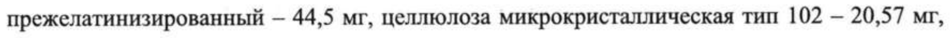
- стр. 1: «полиэтиленгликоль 3350 (Е 1521) - 0,930 мг, тальк (Е 5535) — 0,680 мг, краситель» — низкая уверенность: «5535)» (76)  
  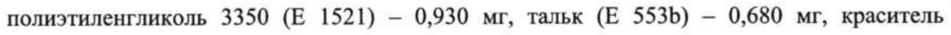
- стр. 1: «повидон тип K-25 — 5,2 мг, тальк — 2,6 мг, кремния диоксид коллоидный — 1,3 мг, магния» — повторное чтение: «повидон тип K-25 — 5,2 мг, тальк — 2,6 мг, кремния диоксид коллоидный — 1,3 мг, магния»  
  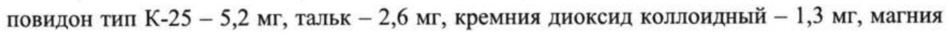
- стр. 2: «полиэтиленгликоль 3350 (Е 1521) - 0,930 мг, тальк (Е 5535) — 0,680 мг» — низкая уверенность: «5535)» (73)  
  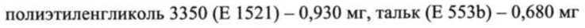
- стр. 2: «прежелатинизированный — 33,7 мг, целлюлоза микрокристаллическая тип 102 - 9,5 мг,» — повторное чтение: «прежелатинизированный — 33,7 мг, целлюлоза микрокристаллическая тип 102 - 9,5 мг,»  
  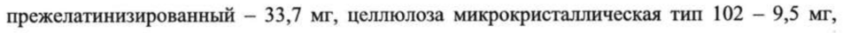
- стр. 2: «полиэтиленгликоль 3350 (Е 1521) — 0,931 мг, тальк (Е 5535) - 0,680 мг, краситель железа» — низкая уверенность: «5535)» (14)  
  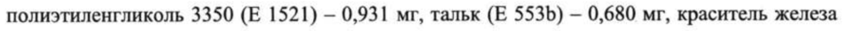
- стр. 2: «полиэтиленгликоль 3350 (Е 1521) — 1,817 мг, тальк (Е 5535) - 1,332 мг, краситель железа» — низкая уверенность: «5535)» (13)  
  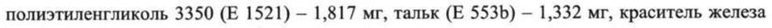
- стр. 6: «глюкуронида возросла в среднем до 127 %. Cmin налоксон-3-глюкуронида увеличилась в» — низкая уверенность: «налоксон-3-глюкуронида» (67)  
  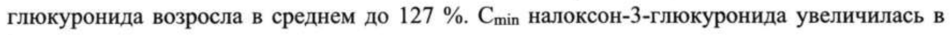
- стр. 6: «до 143, 319 и 310 % соответственно. Cmax Оксикодона возросла в среднем до 120, 20] и» — низкая уверенность: «319» (74)  
  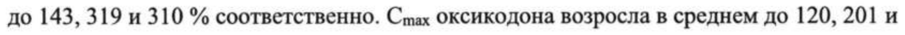
- стр. 6: «191 %, а значения t 122 повысились в среднем до 108, 176 и 183 % соответственно.» — низкая уверенность: «122» (80)  
  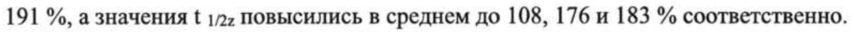
- стр. 6: «среднем до 110, 135 и 167 %, а значения t 1/22 оксикодона увеличились в среднем до 149, 123» — низкая уверенность: «1/22» (79)  
  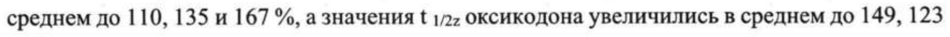
- стр. 7: «1675 % соответственно. В связи с недостаточным количеством данных, значения { 1/22 И» — низкая уверенность: «1/22» (61)  
  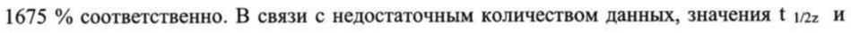
- стр. 7: «глюкуронида в среднем до 220, 370 и 525 % соответственно. Cmax налоксон-3-глюкуронида» — низкая уверенность: «налоксон-3-глюкуронида» (50)  
  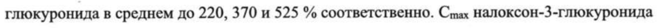
- стр. 10: «увеличена на 2,5 мг+5 мг, а при необходимости, и на 5 мг+10 мг налоксона» — низкая уверенность: «мг+10» (59)  
  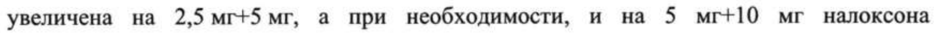
- стр. 14: «© инфузии: 2 мг налоксона гидрохлорида добавляют к 500 мл 0,9 % раствора натрия хлорида» — повторное чтение: «© и 2 мг налоксона a добавляют к - ыы % раствора натрия хлорида»  
  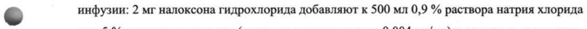
- стр. 20: «2,5 мг+5 мг, 5 мг+10 мг, 10 мг+20 мг, 20 мг+40 мг.» — низкая уверенность: «mr+10» (79); повторное чтение: «2,5 мг+5 мг, 5 мг+10 мг, 10 мг+20 мг, 20 мг+40 мг.»  
  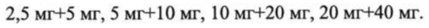
