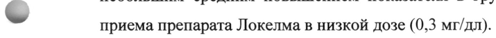
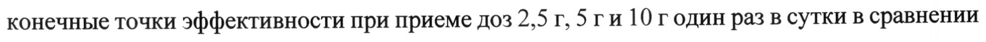
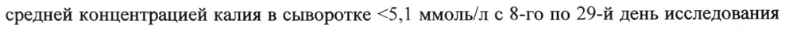
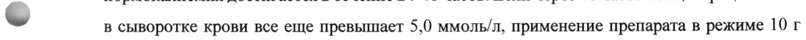

# Натрия циркония циклосиликат — внутрь

- Препарат: Локелма (порошок для приготовления суспензии для приема внутрь;)
- АТХ: V03AE
- Источник: ГРЛС, инструкция по медицинскому применению, РУ ЛП-006086, файл от 2023-10-31 (https://grls.rosminzdrav.ru/Grls_View_v2.aspx?routingGuid=be6ac098-7efb-4e87-8c0b-88c6f12c79ef)
- Распознано автоматически (OCR): 13 из 13 стр.
- Инструкция к другому РУ того же препарата: ЛП-006086 (национальное РУ, переоформленное по правилам ЕАЭС, решение от 24.10.2023). Текст может быть старше действующего
- Сомнительных строк после OCR: 4 (см. раздел «Проверка распознавания»)

## Общие сведения

| МИН vy ae МИНИСТЕРСТВО РвоОХАНЕНИ ОЙ ФЕДЕРАЦИИ бою —
ИНСТРУКЦИЯ ПО МЕДИЦИНСКОМУ ПРИМЕНЕНИЮ ЛЕКАРСТВЕННОГО ПРЕПАРАТА
Локелма

Регистрационный номер: ЛП-006086

Торговое наименование: Локелма

Международное непатентованное или группировочное наименование: натрия циркония циклосиликат

## 3. Лекарственная форма

порошок для приготовления суспензии для приёма внутрь
порошок для приготовления суспензии для приёма внутрь

©,

Состав на 1 пакетик

Один пакетик содержит:
Действующее вещество: натрия циркония циклосиликат 5 г или 10 г.

Описание

Порошок от белого до серого цвета.

Фармакотерапевтическая группа: гиперкалиемии средство лечения

Код ATX: УОЗАЕ

& Фармакологические свойства

Механизм действия

Препарат Локелма — неабсорбирующийся, неполимерный неорганический порошок с однородной микропористой структурой, преимущественно захватывает калий в обмен на катионы водорода и натрия. Препарат Локелма in vitro высокоселективен в отношении ионов калия, даже в присутствии других катионов, таких как катионы кальция и магния.
Препарат Локелма захватывает калий на протяжении всего желудочно-кишечного тракта и уменьшает концентрацию свободного калия в просвете желудочно-кишечного тракта, таким образом снижая концентрацию калия в сыворотке крови и увеличивая экскрецию калия с фекалиями, что приводит к разрешению гиперкалиемии.

## 5.1. Фармакодинамика

Препарат Локелма снижает концентрацию калия в сыворотке крови уже через 1 час после приема внутрь, и концентрация калия в сыворотке крови продолжает снижаться в течение 48-часового периода лечения. Натрия циркония циклосиликат не оказывает влияния на концентрации кальция, магния и натрия в сыворотке крови. У пациентов, не продолжающих лечение, концентрация калия повышается. Существует тесная взаимосвязь между исходной концентрацией калия в сыворотке и величиной эффекта; у пациентов с , более высокой исходной концентрацией калия в сыворотке крови отмечается более значительное снижение концентрации калия в сыворотке крови.

В исследовании у здоровых добровольцев, получавших препарат Локелма 5 г или 10 годин раз в сутки в течение четырех дней, дозозависимое снижение концентрации калия в сыворотке крови и общей экскреции калия с мочой сопровождалось средним увеличением экскреции калия с фекалиями. Статистически значимых изменений экскреции натрия с мочой не наблюдалось.
р Также было показано, что препарат Локелма связывает аммоний in уйго и in Vivo, таким
- образом выводя аммоний и повышая уровень бикарбоната в сыворотке крови. У пациентов, получавших препарат Локелма, наблюдалось увеличение уровня бикарбоната на 1,1 ммоль/л при приеме 5 г один раз в сутки, на 2,3 ммоль/л при приеме 10 г один раз в сутки и на 2,6 ммоль/л при приеме 15 г один раз в сутки по сравнению со средним увеличением на 0,6 ммоль/л у пациентов, принимавших плацебо. При применении препарата Локелма наблюдалось изменение концентрации альдостерона в сыворотке крови (диапазон: -30% до
-31%) по сравнению с группой плацебо (+14%). Влияния на систолическое и диастолическое артериальное давление не отмечено.
Кроме того, отмечено среднее снижение азота мочевины крови в группах, принимавших препарат в дозе 5 г (-1,1 мг/дл) и 10 г (-2,0 мг/дл) три раза в сутки, по сравнению с
| небольшим средним повышением показателя в группе плацебо (0,8 мг/дл) и в группе
® приема препарата Локелма в низкой дозе (0,3 мг/дл).
Клиническая эффективность Калийснижающее действие препарата Локелма было продемонстрировано в трех рандомизированных, двойных слепых, плацебо-контролируемых исследованиях у пациентов с гиперкалиемией. Эффективность и безопасность препарата Локелма также были изучены в двойном слепом, плацебо-контролируемом исследовании у 196 пациентов с гиперкалиемией, находившихся на хроническом гемодиализе, которые получали терапию препаратом Локелма в течение 8 недель. Препарат Локелма снижал концентрацию калия в сыворотке и поддерживал нормальную концентрацию калия в сыворотке независимо от причины гиперкалиемии, возраста, пола, расы, сопутствующих заболеваний или сопутствующего применения ингибиторов ренин-ангиотензин-альдостероновой системы
(РААС).
Двухфазное, рандомизированное, двойное слепое плацебо-контролируемое исследование
В этом исследовании у 753 пациентов с гиперкалиемией (исходная средняя концентрация 5,3 ммоль/л) препарат Локелма показал дозозависимое снижение концентрации калия в сыворотке крови при применении в дозах 2,5 г, 5 ги 10 гв течение нескольких часов после приема первой дозы. Статистически значимое снижение концентрации калия наблюдалось спустя 1 час после первого приема препарата Локелма в дозе 10 г. Среднее снижение концентрации калия в сыворотке составило 0,7 ммоль/л, и 86% пациентов достигали нормальных значений концентрации калия в течение 48 часов при приеме препарата в дозе 10 гтри раза в сутки.
В поддерживающей фазе исследования были достигнуты предварительно определенные конечные точки эффективности при приеме доз 2,5 г, 5 ги 10 годин раз в сутки в сравнении с соответствующей им группой плацебо. Эффективность была сопоставимой в
~ предварительно определенных подгруппах пациентов с сердечной недостаточностью, хронической болезнью почек (ХБП) и сахарным диабетом или у пациентов, получавших ингибиторы РААС. В конце периода лечения, когда препарат Локелма больше не принимали, концентрация калия повышалась почти до исходного значения.
Многофазное, плацебо-контролируемое исследование поддерживающей терапии с продленной фазой
В фазе коррекции исследования у 258 пациентов с гиперкалиемией (исходная средняя концентрация 5,6 ммоль/л) снижение концентрации калия было отмечено через 1 час после первого приема препарата Локелма в дозе 10 г. Медиана времени до нормокалиемии составила 2,2 часа, у 84% пациентов нормальная концентрация калия была достигнута в
, течение 24 часов иу 98% пациентов - в течение 48 часов. Концентрация калия в сыворотке
© снизилась Ha 0,8 ммолыл, 1,2 ммолыл и 1,5 MMOJIb/JI y пациентов с исходным значением
<5,5 ммолыл, 5,5-5,9 ммолыл и >6,0 ммоль/л соответственно.
В поддерживающей фазе у пациентов, достигших нормокалиемии, доля пациентов со средней концентрацией калия в сыворотке <5,1 ммоль/л с 8-го по 29-й день исследования была больше при приеме препарата Локелма в дозе 5 г, 10 ги 15 годин раз в сутки (80%, 90% и 94% соответственно) по сравнению с плацебо (46%). Среднее снижение концентрации калия в сыворотке составило 0,77 ммолы/, 1,10 ммоль/л, 1,19 ммольл и 0,44 ммоль/л в группах препарата Локелма в дозе 5 г, 10 г, 15 г один раз в сутки и плацебо соответственно. Результаты продленной 11-месячной фазы поддерживающей терапии
(открытой): средняя концентрация калия в сыворотке составила 4,66 ммоль/л. Лечение было прекращено по завершению участия в исследовании (на 365 день).
Двухфазное, многоцентровое, многодозовое, открытое исследование эффективности и безопасности
Долгосрочные (до 12 месяцев) эффекты препарата Локелма оценивались у 751 пациента с гиперкалиемией (исходная средняя концентрация 5,59 ммоль/Л).
Среднее снижение концентрации калия в сыворотке составило 0,81 ммолыл, 1,02 ммоль/л и 1,10 ммоль/л через 24 часа (n=748), 48 часов (n=104) и 72 часа (n=28) соответственно. У пациентов с исходной концентрацией калия в сыворотке >6,0 ммоль/л (126 пациентов)
отмечено среднее снижение на 1,37 ммоль/л в конце острой фазы.
Доля пациентов со средней концентрацией калия в сыворотке <5,1 ммоль/л в период с 85 по 365 день поддерживающей фазы составила 88%, а с концентрацией <5,5 ммоль/л — 99%.
Нормокалиемия поддерживалась у принимавших препарат пациентов, а после отмены препарата средняя концентрация калия в сыворотке повышалась. Среди пациентов, исходно
| принимавших ингибиторы РААС, 89% пациентов не прекратили данную терапию, 74%
- пациентов продолжили терапию в той же дозе во время фазы поддерживающей терапии, а среди пациентов, не принимавших ингибиторы РААС на момент включения в исследование, 14% пациентов смогли начать данную терапию.
Исследование у пациентов с хронической болезнью почек и гиперкалиемией
В исследовании у 90 пациентов с исходной расчетной скоростью клубочковой фильтрации
(pCK®) в диапазоне 30-60 мл/мин/1,73 м² и гиперкалиемией (исходная концентрация калия в сыворотке 5,2 ммоль/л) препарат Локелма в дозе 10 ги 3 гтри раза в сутки приводил к среднему максимальному снижению концентрации калия в сыворотке на 0,92 ммоль/л и 0,43 ммоль/л соответственно. При исследовании мочи, собранной в течение суток, было показано, что препарат Локелма снижал выведение калия с мочой относительно исходного уровня на 15,8 ммоль/24 часа по сравнению с повышением на 8,9 ммоль/24 часа в группе
~ плацебо (p<0,001). Выведение натрия оставалось без изменений по сравнению с плацебо.
Рандомизированное, двойное слепое, плацебо-контролируемое исследование у пациентов, находящихся на хроническом гемодиализе
В этом исследовании 196 пациентов (средний возраст 58 лет, диапазон: 20-86 лет) с терминальной стадией почечной недостаточности, находившихся на стабильном диализе в течение не менее 3 месяцев, и со стойкой преддиализной гиперкалиемией были рандомизированы для приема препарата Локелма 5 г или плацебо один раз в сутки в дни без диализа. При рандомизации средняя концентрация калия в сыворотке крови в группе препарата Локелма составила 5,8 ммоль/л (диапазон: 4,2-7,3 ммоль/л), а в группе плацебо — 5,9 ммолы/л (диапазон: 4,2-7,3 ммоль/л). Для достижения преддиализной концентрации калия в сыворотке крови в диапазоне от 4,0 до 5,0 ммоль/л в течение периода коррекции дозы (первых 4 недель) дозу можно было корректировать один раз в неделю с шагом 5 г до достижения дозы 15 г один раз в сутки в зависимости от преддиализной концентрации калия в сыворотке крови после длинного междиализного интервала (ГТО). Достигнутая к концу периода коррекции доза оставалась без изменений в течение последующего 4недельного периода оценки. Доля ответивших на терапию пациентов (пациентов, у которых преддиализная концентрация калия в сыворотке крови была в диапазоне от 4,0 до 5,0 ммоль/л по крайней мере при 3 из 4 процедур диализа после LIDI, и которые не получали экстренную терапию в течение периода оценки) составила 41% в группе препарата Локелма и 1% в группе плацебо (р <0,001) (см. рис. 1).

В ретроспективных анализах в группе препарата Локелма отмечено большее число эпизодов, когда в течение периода оценки концентрация калия в сыворотке крови пациентов была в диапазоне от 4,0 до 5,0 ммоль/л после LIDI. Такая концентрация калия во время всех 4 визитов отмечалась у 24% пациентов в группе препарата Локелма и ни у
= одного пациента в группе плацебо. Количество пациентов с концентрацией калия в сыворотке крови в диапазоне от 3,5 до 5,5 ммоль/л после LIDI в течение периода оценки было больше в группе препарата Локелма. Во время всех 4 визитов концентрация калия в сыворотке крови была в пределах данного диапазона у 52% пациентов в группе препарата
Локелма и у 5% пациентов в группе плацебо, а во время не менее 3 визитов — у 70% пациентов в группе препарата Локелма иу 21% пациентов в группе плацебо.
В конце терапии средняя постдиализная концентрация калия в сыворотке крови составила 3,6 ммоль/л (диапазон: 2,6-5,7 ммоль/л) в группе препарата Локелма и 3,9 ммоль/л
(диапазон: 2,2-7,3 ммоль/л) в группе плацебо. Между группами препарата Локелма и плацебо не отмечено различий в междиализной прибавке веса, маркере задержки натрия и
, жидкости. Согласно определению междиализная прибавка веса отражала вес до диализа
- минус вес после предшествовавшей процедуры диализа, и ее оценку проводили после LIDI.
Рис. 1. Средняя преддиализная концентрация калия в сыворотке крови с течением времени у пациентов, находящихся на хроническом диализе 5.4 | | g | | |
Е_ 62 _ a 60 * = | ~ | ВЕ 58 = тт ет т т 88 св т М А HU et / + га 56] $ WONA OY NE МИ УЗ .
и 54 с = oo | a = 5.2 | < г — | — + ze 50 | NH aA н 1 во | | |
Ps 416 | a Локелма 3 я AA —+— Плацебо 8 7 1 5 8 12 15 22 29 36 43 50 57 и
Скрининг (лень) Коррекция дозы (день) Оценка (день) Период наблюдения (день)
Субъекты (п)
Локелма 95 81 90 89 92 90 33 92 88 90 90 82 87
Плацебо 93 86 89 85 94 87 89 88 86 88 90 90 91
Представленные планки погрешностей соответствуют 95% доверительным интервалам (ДИ).
п = количество пациентов, у которых проведено измерение концентрации калия на соответствующем визите.

## 5.2. Фармакокинетика

Абсорбция Препарат Локелма является неорганическим нерастворимым соединением, которое не подвержено ферментативному метаболизму. Кроме того, результаты клинических исследований показали отсутствие системной абсорбции. Исследование баланса массы in vivo у крыс показало, что натрия циркония циклосиликат выводится с фекалиями без признаков системной абсорбции. Принимая во внимание данные факторы и нерастворимость соединения, исследования in vivo или т vitro для изучения его воздействия
Абсорбция Препарат Локелма является неорганическим нерастворимым соединением, которое не подвержено ферментативному метаболизму. Кроме того, результаты клинических исследований показали отсутствие системной абсорбции. Исследование баланса массы in vivo у крыс показало, что натрия циркония циклосиликат выводится с фекалиями без признаков системной абсорбции. Принимая во внимание данные факторы и нерастворимость соединения, исследования in vivo или т vitro для изучения его воздействия
© на изоферменты цитохрома Р450 (CYP450) или активность транспортеров не проводили.
Выведение Препарат Локелма выводится с фекалиями.

## 4.1. Показания к применению

Лечение гиперкалиемии у взрослых пациентов.
Лечение гиперкалиемии у взрослых пациентов.

## 4.3. Противопоказания

Повышенная чувствительность к действующему веществу.
Повышенная чувствительность к действующему веществу.
Возраст до 18 лет (эффективность и безопасность не установлены).
© Применение при беременности и в период грудного вскармливания
Беременность Данные о применении натрия циркония циклосиликата у беременных женщин отсутствуют.
Исследования на животных не показали прямого или непрямого неблагоприятного воздействия на репродуктивную функцию. В качестве меры предосторожности предпочтительно избегать применения препарата Локелма при беременности.
Грудное вскармливание В постнатальном исследовании на крысах воздействие натрия циркония циклосиликата на материнский организм не оказывало влияния на постнатальное развитие. Вследствие физико-химических свойств натрия циркония циклосиликат системно не абсорбируется и его выделения в грудное молоко не ожидается. Воздействие на новорожденного/младенца, находящегося на грудном вскармливании, не предполагается, поскольку системная экспозиция натрия циркония циклосиликата у кормящих женщин незначительна. Препарат
Локелма можно применять в период грудного вскармливания.

Фертильность

Неблагоприятное воздействие на эмбриофетальное развитие у леченных крыс или кроликов

отмечено не было.

## 4.2. Способ применения и дозы

Для приема внутрь.

Все содержимое пакетика необходимо высыпать в питьевой стакан, содержащий примерно

45 мл воды. Тщательно перемешать и выпить, пока порошок (он не растворится) все еще

суспендирован. Суспензия не имеет вкуса и будет выглядеть как мутная жидкость. Если

порошок осядет, его следует снова размешать. Необходимо убедиться, что принято все
(ewe содержимое стакана.

Препарат Локелма можно принимать независимо от приема пищи.

Пропуск приема дозы

В случае пропуска приема дозы пациенту необходимо принять следующую обычную дозу

в обычное время.

Дозирование

Лечение гиперкалиемии: фаза коррекции

Для достижения нормокалиемии (концентрация калия от 3,5 до 5,0 ммоль/л) пациентам с

концентрацией калия в сыворотке крови >5,0 ммоль/л рекомендуется начальная доза

препарата Локелма 10 г три раза в сутки внутрь в виде суспензии в воде. Обычно нормокалиемия достигается в течение 24-48 часов. Если через 48 часов концентрация калия
~ в сыворотке крови все еще превышает 5,0 ммоль/л, применение препарата в режиме 10 г

три раза в сутки может быть продолжено еще в течение одного дня (24 часов) до начала

поддерживающей терапии. В случае, если нормокалиемия не достигнута к концу 3-го дня,

следует рассмотреть возможность применения других вариантов лечения.

Лечение гиперкалиемии: поддерживающая фаза

Для поддерживающего лечения следует установить минимальную эффективную дозу

препарата, необходимую для профилактики рецидива гиперкалиемии. Рекомендуемая доза

составляет 5 г один раз в сутки, с возможностью титрования до 10 г один раз в сутки, или

до 5 г один раз в два дня, при необходимости, для поддержания концентрации калия в

пределах нормы. Не следует применять более 10 г один раз в сутки для поддерживающей

терапии.

В случае тяжелой гипокалиемии следует прекратить прием препарата и провести повторное обследование пациента.
Пациенты, находящиеся на хроническом гемодиализе
У пациентов, находящихся на диализе, препарат Локелма следует применять только в дни, когда процедура диализа не проводится. Рекомендуемая начальная доза составляет > годин раз в сутки. Для достижения нормокалиемии (4,0-5,0 ммоль/л) дозу можно увеличивать или уменьшать один раз в неделю в зависимости от преддиализной концентрации калия в сыворотке крови после длинного междиализного интервала (LIDI). С интервалом в одну неделю дозу можно корректировать на 5 г до достижения дозы 15 г один раз в сутки с применением в дни без процедуры диализа. Для поддержания нормокалиемии рекомендуется регулярно (например, раз в месяц) контролировать концентрацию калия в сыворотке крови.

= Особые группы пациентов Пациенты с нарушением функции почек или печени
Не требуется корректировать дозу препарата у пациентов с нарушением функции почек или печени.
Пожилые пациенты Не требуется корректировать дозу препарата у пожилых пациентов.
Пациенты детского возраста Безопасность и эффективность препарата Локелма у пациентов детского возраста не установлены.

## 4.8. Побочное действие

~ Безопасность препарата Локелма оценивали в клинических исследованиях с участием 1760 пациентов, при этом 507 пациентов принимали препарат один год.
Нежелательные реакции, которые отмечались наиболее часто: гипокалиемия (4,1%) и явления, связанные с отеками (5,7%).
Список нежелательных реакций в виде таблицы
Нежелательные реакции, выявленные в контролируемых клинических исследованиях, представлены в таблице. Частота возникновения нежелательных реакций указана с использованием следующей градации: очень часто (21/10), часто (21/100, <1/10), нечасто
(21/1000, <1/100), редко (>1/10000, <1/1000), очень редко (<1/10000) и неуточненной частоты (частота не может быть определена на основании имеющихся данных).
Гипокалиемия В клинических исследованиях у 4,1% пациентов в группе препарата Локелма развилась гипокалиемия с концентрацией калия в сыворотке крови менее 3,5 ммоль/л, которая разрешалась при коррекции дозы или прекращении применения препарата.
Явления, связанные с отеками Явления, связанные с отеками, включая избыток жидкости, задержку жидкости, генерализованный отек, гиперволемию, локализованный отек, отек, периферический отек и периферическую пастозность, были зарегистрированы у 5,7% пациентов, принимавших препарат Локелма. Данные явления отмечались только в поддерживающей фазе терапии и чаше наблюдались у пациентов, получавших препарат в дозе 15 г. До 53% случаев
© разрешались с началом применения диуретика или коррекцией дозы диуретика; остальные случаи не потребовали терапии.
Долгосрочное воздействие В 2 клинических исследованиях с открытым применением препарата Локелма длительностью до 1 года у 874 пациентов, сообщалось о следующих явлениях, по мнению исследователей связанных с проводимой терапией: явления со стороны желудочнокишечного тракта (запор (2,9%), диарея (0,9%), боль в области живота/вздутие живота
(0,5%), тошнота (1,6%) и рвота (0,5%)) и реакции гиперчувствительности (сыпь (0,3%) и зуд
(0,1%)). Данные явления были слабыми или умеренными, ни одно не было серьезным, и в основном явления разрешались на фоне продолжающейся терапии. В связи с тем, что исследования имели открытый дизайн, причинно-следственную связь между данными
© явлениями и препаратом Локелма достоверно установить невозможно.

## 4.9. Передозировка

Передозировка препарата Локелма может привести к гипокалиемии. Необходимо контролировать концентрацию калия в сыворотке крови и повышать её при необходимости.
Передозировка препарата Локелма может привести к гипокалиемии. Необходимо контролировать концентрацию калия в сыворотке крови и повышать её при необходимости.

## 4.5. Взаимодействие с другими лекарственными средствами

Влияние других лекарственных средств на препарат Локелма
Поскольку препарат Локелма не всасывается и не метаболизируется в организме, не ожидается влияния других лекарственных средств на его фармакологическое действие.
Влияние препарата Локелма на другие лекарственные средства
Поскольку препарат Локелма не всасывается и не метаболизируется в организме, и с другими лекарственными средствами в значительной степени не связывается, влияние на другие лекарственные средства ограничено. В клиническом исследовании лекарственных взаимодействий с участием здоровых добровольцев сопутствующее применение препарата
Локелма с амлодипином, дабигатраном, клопидогрелом, аторвастатином, фуросемидом, глипизидом, варфарином, лозартаном или левотироксином не приводило к клинически значимым лекарственным взаимодействиям. Коррекции дозы или времени приема этих препаратов не требуется.

Абсорбируя ионы водорода, препарат Локелма может транзиторно увеличивать РН желудка, что может привести к изменению растворимости и кинетики всасывания сопутствующих препаратов с рН-зависимой биодоступностью. В связи с чем препарат
Локелма следует принимать не менее чем за 2 часа до или через 2 часа после приема внутрь препаратов с клинически значимой зависящей от рН желудка биодоступностью.
Ниже приведены примеры препаратов, которые следует принимать за 2 часа до или после
- приема препарата Локелма с целью избежать возможного взаимодействия ввиду повышения рН желудочного сока:
Противогрибковые средства Кетоконазол, итраконазол, позаконазол азолового ряда
Противовирусные [ВИЧ]|средства | Атазанавир, нелфинавир, индинавир, ритонавир, саквинавир, ралтегравир, ледипасвир, рилпивирин
Препарат Локелма можно принимать совместно с лекарственными средствами для приема
© внутрь, не проявляющими рН-зависимую биодоступность, без разнесения по времени приема препаратов.

## 4.4. Особые указания

Концентрация калия в сыворотке крови
Концентрация калия в сыворотке крови
Следует контролировать концентрацию калия в сыворотке крови при наличии показаний, например, при изменении режима приема препаратов, которые влияют на концентрацию калия в сыворотке крови (например, ингибиторов РААС или диуретиков), и при необходимости титровать дозу препарата Локелма.
Гипокалиемия Может наблюдаться гипокалиемия (см. раздел «Побочное действие»). В таких случаях может потребоваться титрование дозы согласно режиму дозирования при поддерживающей терапии с целью предотвращения умеренной и тяжелой гипокалиемии. У пациентов с
И концентрацией калия в сыворотке крови <3,0 ммоль/л прием препарата Локелма следует прекратить и провести повторное обследование пациента.

Удлинение интервала ОТ На фоне коррекции гиперкалиемии может наблюдаться удлинение интервала ОТ, как физиологическое следствие снижения концентрации калия в сыворотке крови.
Риск взаимодействия с рентгеновским излучением
Натрия циркония циклосиликат может быть рентгеноконтрастным. Рентгенологам следует принимать это во внимание при проведении рентгенологического исследования брюшной полости.
Перфорация кишечника Риск перфорации кишечника при приеме препарата Локелма в настоящее время неизвестен.
Случаи перфорации кишечника на фоне приема препарата Локелма не зарегистрированы.

= Поскольку о перфорации кишечника сообщалось при применении полимеров, которые действуют в желудочно-кишечном тракте, особое внимание следует уделять признакам и симптомам, связанным с перфорацией кишечника.
Содержание натрия Данный препарат содержит приблизительно 400 мг натрия в одной дозе 5 г, что соответствует 20% рекомендованного ВОЗ максимального суточного потребления натрия
(2 г)у взрослых пациентов.
В препарате Локелма высокое содержание натрия. Это особенно важно учитывать пациентам, которые придерживаются низкосолевой диеты.
Ограничения клинических данных

Тяжелая гиперкалиемия

- Опыт применения у пациентов с концентрацией калия в сыворотке крови выше 6,5 ммоль/л ограничен.
Долгосрочное воздействие В клинических исследованиях препарата Локелма применение длительностью более одного года не изучали.

## 4.7. Влияние на способность управлять транспортными средствами, механизмами

Исследования влияния препарата на способность управлять транспортными средствами и работать с механизмами не проводились.

## 6.5. Форма выпуска

Порошок для приготовления суспензии для приёма внутрь, 5 г, 10 г.
Порошок для приготовления суспензии для приёма внутрь, 5 г, 10 г.
По 5 или 10 г порошка в пакетик из ламинированной трехслойной алюминиевой фольги
(полиэтилентерефталат/алюминиевая фольга/линейный полиэтилен низкой плотности).
По 30 пакетиков с инструкцией по применению в картонную пачку с контролем первого вскрытия.

## 6.4. Условия хранения

При температуре не выше 30 °С.
При температуре не выше 30 °С.
Хранить в местах, недоступных для детей.

## 6.3. Срок годности

3 года.
3 года.
Не применять по истечении срока годности.
Условия отпуска Отпускают по рецепту.
Владелец регистрационного удостоверения АстраЗенека АБ, SE-151 85 Содерталье, Швеция
AstraZeneca АВ, SE-151 85 Sodertalje, Sweden
Производитель АстраЗенека Фармасьютикалс ЛП, США 508 Ранглер Драйв, Свит 100, Коппелл, Техас, 75019, США
- AstraZeneca Pharmaceuticals LP, USA 508 Wrangler Drive, Suite 100, Coppell, TX 75019, USA
Фасовщик (первичная упаковка), упаковщик (вторичная (потребительская)
упаковка)
АндерсонБрекон Инк., США 4545 Эссембли Драйв, Рокфорд, Иллинойс, 61109, США
AndersonBrecon Inc., USA 4545 Assembly Drive, Rockford, Illinois 61109, USA
Выпускающий контроль качества АстраЗенека Фармасьютикалс ЛП, США 508 Ранглер Драйв, Свит 100, Коппелл, Техас, 75019, США
AstraZeneca Pharmaceuticals LP, USA 508 Wrangler Drive, Suite 100, Coppell, TX 75019, USA
Организация, принимающая претензии потребителей:
Представительство АстраЗенека ЮК Лимитед, Великобритания, в г. Москве и ООО АстраЗенека Фармасьютикалз 123100, г. Москва, 1-й Красногвардейский проезд, д. 21, стр. 1, этаж 30, комнаты 13 и 14 тел. +7495 7995699 факс +7495 7995698
© © AstraZeneca 2018-2021 LEN Старший специалист по регистрации препаратов А
| (tem fos 5: \ Редико Е.
Kea Tomine," / ] ФИО w
## Проверка распознавания

Страницы-сканы распознаны автоматически. В 4 строках с дозировками цифры могли распознаться с ошибкой — сверьте с вырезкой из оригинала:

- стр. 2: «® приема препарата Локелма в низкой дозе (0,3 мг/дл).» — повторное чтение: «er»  
  
- стр. 3: «конечные точки эффективности при приеме доз 2,5 г, 5 ги 10 годин раз в сутки в сравнении» — низкая уверенность: «5» (67)  
  
- стр. 3: «средней концентрацией калия в сыворотке <5,1 ммоль/л с 8-го по 29-й день исследования» — низкая уверенность: «<5,1» (79)  
  
- стр. 7: «~ в сыворотке крови все еще превышает 5,0 ммоль/л, применение препарата в режиме 10 г» — повторное чтение: «® „вине тонн вов ene правышное 50 anon зпримевениьнтрепаритаорежиые 0»  
  
