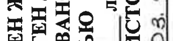

# Неомицин + Нистатин + Полимиксин В — вагинально

- Препарат: Полижинакс (капсулы вагинальные)
- АТХ: G01AA51
- Источник: ОХЛП, Единый реестр ЛС ЕАЭС, запись 662cc10d30dcf85ad5e55c6f, документ от 2026-08-06
- Распознано автоматически (OCR): 2 из 20 стр.
- Сомнительных строк после OCR: 2 (см. раздел «Проверка распознавания»)

## Общие сведения

ДӘРІЛІК ПРЕПАРАТТЫҢ ЖАЛПЫ СИПАТТАМАСЫ
1. ДӘРІЛІК ПРЕПАРАТТЫҢ АТАУЫ
Полижинакс, қынаптық капсулалар.
2. САПАЛЫҚ ЖӘНЕ САНДЫҚ ҚҰРАМЫ
Әсер етуші заттар: неомицин + нистатин + полимиксин В
Әрбір қынаптық капсуланың құрамында 35 000 ХБ неомицин, 100 000 ХБ нистатин, 35 000 ХБ полимиксин В бар.
Дәрілік препарат құрамында бар екені ескерілу керек қосымша заттар: соя майы (4.4 бөлімін қараңыз).
Қосымша заттардың толық тізбесі 6.1 бөлімінде берілген.
3. ДӘРІЛІК ТҮРІ
Қынаптық капсулалар.
Сопақша пішінді, ішінде жартылай сұйық біртекті масса бар, ашық-сарыдан сарғыш түске дейінгі жұмсақ капсулалар. Капсулалардың ішіндегісі сарыдан қоңыр түске дейін болуы мүмкін.
4. КЛИНИКАЛЫҚ ДЕРЕКТЕРІ
4.1. Қолданылуы Емдеу Сезімтал микроорганизмдерден туындаған, төмендегілер сияқты қынаптық инфекцияларды жергілікті емдеу үшін:
 бактериялық вагинитте;
 кандидоздық вульвовагинитте;
 аралас вагинитте;
 бактериялық вагинозда.
Бактерияға қарсы дәрілерді қолдану жөніндегі ресми клиникалық ұсынымдарды ескеру керек.
4.2. Дозалау режимі және қолдану тәсілі
Дозалау режимі Тек ересек пациент әйелдерге арналған.
Кешкілік ұйықтар алдында бір қынаптық капсула.
Емдеу курсы: 12 күн. Профилактикалық курсы: 6 күн.
Қолдану тәсілі Қынапқа қолдануға арналған.
Капсуланы шалқадан жатқан қалыпта, қынапқа терең енгізу керек.

4.3. Қолдануға болмайтын жағдайлар  Неомицинге, нистатинге, полимиксин немесе 6.1 бөлімінде тізбеленген қосымша заттардың кез келгеніне аса жоғары сезімталдық.
 Препаратты полиуретан мүшеқаптармен (ерлер мен әйелдерге арналған) немесе диафрагмалармен бір мезгілде пайдалану (4.5 бөлімін қараңыз).
 Арахиске немесе сояға аллергиялық реакциялар (құрамында соя майы болғандықтан).
 Спермицидтермен біріктіріп пайдалану ұсынылмайды.
4.4. Айрықша нұсқаулар және қолдану кезіндегі сақтандыру шаралары
Жергілікті жақпаушылық немесе аллергиялық реакция жағдайында, емдеуді тоқтату керек.
Жергілікті қолданған кезде антибиотикке байқалған сенсибилизация келесіде тура осындай антибиотикті немесе аталған топтың басқа антибиотиктерін жүйелі қолдану кезінде теріс әсер етуі мүмкін.
Резистентті штаммдар мен суперинфекцияның пайда болу қаупіне байланысты, нұсқаулықта ұсынылған емдеу ұзақтығын арттырмаған дұрыс.
Неомицин мен полимиксин В шырышты қабық беткейінен сіңірілуі туралы деректер жоқ болғандықтан, әсіресе, бүйрек жеткіліксіздігі кезінде, жүйелі әсер етуі қаупін жоққа шығаруға болмайды.
Препараттың құрамында соя майы бар және аса жоғары сезімталдық реакцияларын
(есекжем, анафилаксиялық шок) тудыруы мүмкін.
Практикалық ұсынымдар Емделу кезінде гигиеналық ұсынымдарды (мақта-матадан тігілген іш киім кию, су бүркіп жуынбау және қынаптық тампондарды пайдаланбау) сақтау және, мүмкіндігінше, аурудың дамуына ықпал ететін факторларды жою керек.
Жыныстық серіктесінің емделуі әр нақты жағдайда талқыланады.
Етеккір кезінде емделуді тоқтатпау керек.
Емдеу ерлерге арналған, латекстен және полиизопреннен жасалған мүшеқаптарды пайдаланумен үйлесімді.
Бір немесе бірнеше капсуланы өткізіп алған жағдайда, препаратты қолдануды әдеттегі дозада жалғастыру керек.
4.5. Басқа дәрілік препараттармен өзара әрекеттесуі және өзара әрекеттесудің басқа түрлері
Қолдануға болмайтын біріктірілімдер Жыртылып қалу қаупіне байланысты, полиуретан мүшеқаптармен (ерлер мен әйелдерге арналған) немесе диафрагмалармен бірге пайдаланбау керек.
Ұсынылмайтын біріктірілімдер

Спермицидтермен біріктіріп пайдалану ұсынылмайды, өйткені контрацептивтік әсері төмендеуі мүмкін.
4.6. Фертильділік, жүктілік және лактация
Жүктілік Отоуытты әсер беруі мүмкін неомицин аминогликозидінің болуына, және оның жүйелі сіңірілуі ықтималдығына байланысты, бұл дәрілік затты жүктілік кезінде пайдалану ұсынылмайды.
Бала емізу Жаңа туған нәрестелерде АІЖ жетілмегендігіне және осы дәрілік заттың фармакокинетикалық қасиеттеріне байланысты, оны бала емізу кезінде пайдалану ұсынылмайды.
4.7. Көлік құралдарын басқару және механизмдермен жұмыс істеу қабілетіне әсері
Көлік құралдарын және басқа механизмдерді басқару қабілетіне препараттың теріс әсер ететіні туралы деректер жоқ.
4.8. Жағымсыз реакциялар
Жағымсыз реакциялар жүйе-ағза кластарының атауы мен кездесу жиілігіне сәйкес тізбеленген: өте жиі (≥1/10), жиі (≥1/100, бірақ <1/10), жиі емес (≥1/1000, бірақ <1/100), сирек (≥1/10000, бірақ <1/1000), өте сирек (<1/10000), жиілігі белгісіз (қолда бар деректер бойынша бағалау мүмкін емес).
Полижинакс препаратын қолданғанда келесі жағымсыз реакциялар болуы мүмкін:
Жүйе-ағза класы Жағымсыз реакция Жиілігі
Иммундық жүйе тарапынан бұзылулар Аса жоғары сезімталдық
(бөртпе, қышыну, есекжем, анафилаксиялық реакциялар).
Жиілігі белгісіз Ұрпақ өрбіту жүйесі мен сүт бездері тарапынан бұзылулар
Жергілікті реакциялар (ашыту, қышыну, тітіркену, қызару және ісіну).
Жиілігі белгісіз Күмәнді жағымсыз реакциялар туралы хабарлама
Дәрілік препараттың «пайда - қауіп» арақатынасының үздіксіз мониторингін қамтамасыз ету мақсатында препаратты тіркегеннен кейін күдікті жағымсыз реакциялар туралы хабарлау маңызды. Медицина қызметкерлеріне дәрілік препараттың кез келген күдікті жағымсыз реакциялары туралы Еуразиялық экономикалық одаққа мүше-мемлекеттердің жағымсыз реакциялар туралы хабарлаудың ұлттық жүйелері арқылы хабарлау ұсынылады.
Ресей Федерациясы Денсаулық сақтау саласындағы қадағалау жөніндегі федералдық қызмет (Росздравнадзор)
109012 Мәскеу қ., Славянская алаңы, 4 үй, 1 құрылыс
Тел.:
+7 800 550 99 03

Электрондық пошта: pharm@roszdravnadzor.gov.ru https://www.roszdravnadzor.gov.ru
Беларусь Республикасы «Денсаулық сақтау саласындағы сараптамалар мен сынақтар орталығы» УК 220037 Минск қ., Товарищеский тұйық көш., 2-а
Тел./факс: +375 (17) 242 00 29 Электрондық пошта: rcpl@rceth.by, rceth@rceth.by https://www.rceth.by
Армения Республикасы «Академик Э. Габриелян атындағы дәрілер мен медициналық технологияларды сараптау ғылыми орталығы» ЖТАҚ 0051 Ереван, Комитас даңғылы 49/5
Тел.:
+374 (10) 20 05 05, +374 (96) 22 05 05 – тікелей байланыс желісі
Факс: +374 (10) 23 21 18 Электрондық пошта: vigilance@pharm.am http://www.pharm.am
Қазақстан Республикасы Қазақстан Республикасы
Денсаулық сақтау министрлігі Медициналық және фармацевтикалық бақылау комитеті «Дәрілік заттар мен медициналық бұйымдарды сараптау ұлттық орталығы» ШЖҚ РМК 010000 Астана қ., Байқоңыр ауданы, Амангелді Иманов көш., 13 үй
Тел.: +7 (7172) 235 135 Электрондық пошта: farm@dari.kz http://www.ndda.kz
Қырғыз Республикасы Қырғыз Республикасы Денсаулық сақтау министрлігі жанындағы дәрілік заттар мен медициналық бұйымдар департаменті 720044 Бішкек қ., 3-я линия көш., 25
Тел.: 0800 800 26 26 – тікелей байланыс желісі
Электрондық пошта: dlsmi@pharm.kg http://www.pharm.kg
4.9. Артық дозалану
Препаратты қолдану жөніндегі нұсқаулыққа (қосымша параққа) сәйкес қолданғанда артық дозалану ықтималдығы аз. Препаратты шамадан тыс және ұзақ қолдану, әсіресе, бүйрек жеткіліксіздігі бар пациенттерде жүйелі (есту мүшесі мен бүйрек тарапынан) әсерлерді тудыруы мүмкін. Препаратты ұзақ пайдалану аллергиялық экземаның даму қаупінің жоғарылауына да әкеп соқтырады.
Симптомдары

Естудің бұзылуы, бүйрек функциясының бұзылуы, бөртпе, қышыну, ісіну, тері гиперемиясы.
Емі Препаратты қолдануды тоқтату, симптоматикалық ем.
5. ФАРМАКОЛОГИЯЛЫҚ ҚАСИЕТТЕРІ
Гинекологияда қолданылатын, микробқа қарсы дәрілер және антисептиктер; микробқа қарсы дәрілер және антисептиктер, кортикостероидтармен біріктірілімінен басқа;
антибиотиктер.
АТХ коды: G01AА51
5.1. Фармакодинамикалық қасиеттері
Әсер ету механизмі Біріктірілген препарат, әсеріне құрамына кіретін компоненттер түрткі болады.
Неомицин – аминогликозидтер тобына жататын антибиотик. Бірқатар грамоң және грамтеріс микроорганизмдерге қатысты белсенді.
Неомицин спецификалық ақуызрецепторлармен рибосомалардың 30S суббірлігінде қайтымды байланысады. Ол жасуша жарғақшасына еніп, оның өткізгіштігін өзгертетін және өмірлік маңызы бар басқа үдерістерді бұзатын толық емес ақуыздарды түзе отырып, бактерия жасушасындағы ақуыздар синтезін бұзады, бұл бактерицидтік әсеріне алып келеді.
Полимиксин В – полипептидтік антибиотик. Полимиксин В грамтеріс бактериялардың жарғақшалары липополисахаридтерімен өзара әрекеттеседі, ол жарғақша өткізгіштігінің бұзылуына, ары қарай бактерия жасушасының бұзылуына алып келеді.
Нистатин – Candida spp-ға әсер ететін полиендік антимикотик. Нистатин зеңдердің жасуша жарғақшасы стеролдарымен байланыса отырып, жасушаның өткізгіштігін өзгертеді және жасушаішілік материалдың ағып шығуын тудырады, зең жасушасының бұл қырылуына алып келеді.
Бактерияға қарсы белсенділік спектрі Қынап ортасын қайта қалпына келтіретін жағдайларда жүргізілген in vitro зерттеулер
Полижинакс препаратының бактерицидтік белсенділігін, сондай ақ оның, сұйылту/бейтараптандыру әдісін пайдаланғанда әсер ету уақыты 1 және 4 сағат болған жағдайда бактериялық вагиноз (анаэробты бактериялар) бен аэробтық вагинит (аэробты бактериялар) тудыратын негізгі бактерияларға әсер ететінін көрсетті. Түрлі штаммдардың сезімталдығы әр штамм үшін анықталатын бактериялық жүктеменің он еселік логарифмінің азаюына сәйкес анықталды.

Сезімтал штаммдарды аралық сезімталдыққа ие штаммдар мен резистентті штаммдардан өзгешелеп тұратын шекті мәндер: сезімтал –бактериялық жүктеме логарифмінің азаюы ≥3, резистентті <2.
Түрлі штаммдардың Полижинакс препаратына сезімталдығы келесі кестеде берілген:
Сезімтал штаммдар Аралық сезімталдыққа ие штаммдар
Резистентті штаммдар Микроаэрофильді бактериялар
Gardnerella vaginalis Анаэробты бактериялар
Atopobium vaginae Mobiluncus curtisii Prevotella bivia
Аэробты бактериялар (грамоң)
Corynebacterium amycolatum Staphylococcus aureus (метициллинсезімтал)
Streptococcus agalactiae (B тобы)
Streptococcus pyogenes (А тобы)
Enterococcus faecalis Enterococcus hirae
Аэробты бактериялар (грамтеріс)
Branhamella catarrhalis Escherichia coli
Haemophilus influenzae Klebsiella aerogenes (Enterobacter aerogenes)
Klebsiella pneumoniae Neisseria meningitidis
Proteus hauseri (Proteus vulgaris)
Pseudomonas aeruginosa Salmonella enteritidis
Shigella flexneri Yersinia enterocolitica
Proteus mirabilis Ескертпе:
Бұл кестеде бактериялық вагиноз / вагинит кезінде жиі кездесетін бактериялардың тізімі келтірілге. Бұл тізім Полижинакс препаратының құрамына кіретін әсер етуші заттардың басқа бактериялар штаммдарына қатысты дербес белсенділігіне күмән тудырмайды.
Полимиксин В мен неомициннің синергиясы Іn vitro зерттеу, Полижинакс препаратының құрамындағы полимиксин В мен неомициннің әсер ету спектрлері бір-бірін өзара толықтыратынын, ол бактериялық вагинит / вагиноз тудыратын негізгі төрт бактерия штаммына (Staphylococcus aureus, Escherichia coli,
Streptococcus agalactiae, Gardnerella vaginalis) қатысты аддитивтік әсеріне алып келетінін көрсетті.
Полижинакс препаратының зеңге қарсы белсенділік спектрі

Нистатиннің ең төменгі тежегіштік концентрациясын (ЕТТК) анықтау жолымен Candida штаммдарының сезімталдығын бағалау жөніндегі in vitro зерттеу, Candida albicans және
Candida non-albicans штаммдарының нистатинге сезімталдығы салыстырымды екенін растап отыр.
Штаммдар ЕТТК50 (мг/л)
ЕТТК90 (мг/л)
ЕТТК мәні (мг/л)
Ең аз- ең көп Candida albicans (n=113)
1 - 4 Candida glabrata (n=54)
Candida krusei (n=11)
Candida tropicalis (n=11)
2 - 4 Candida parapsilosis (n=11)
2 - 4 ЕТТК50: 50% изолятты тежейтін ЕТТК; ЕТТК90: 90% изолятты тежейтін ЕТТК.
Лактобактерияларға қатысты белсенділігі Физиологиялық жағдайларда қынап флорасында болатын негізгі лактобактерияларға
(Lactobacillus crispatus, Lactobacillus gasseri және Lactobacillus jensenii) әсерін зерттеу жөніндегі in vitro зерттеу, Полижинакс препаратының әсер етуші заттары препаратты ұсынылған дозасында енгізгеннен кейін қынап ортасында анықталатын концентрацияларында лактобактериялардың көрсетілген түрлерінің көбеюіне әсер етпейтінін көрсетіп отыр.
5.2 Фармакокинетикалық қасиеттері
Зерттелмеді.
6. ФАРМАЦЕВТИКАЛЫҚ ҚАСИЕТТЕРІ
6.1. Қосымша заттар тізбесі Тефоз®63, гидрогенделген соя майы, диметикон 1000.
Капсула қабығы:
желатин, глицерол, диметикон 1000.
6.2. Үйлесімсіздік Қатысты емес.
6.3. Жарамдылық мерзімі (сақтау мерзімі)
2 жыл.

6.4. Сақтау кезіндегі айрықша сақтандыру шаралары
25 °С-ден аспайтын температурада сақтау керек.
6.5. Бірінші қаптамасының сипаты және ішіндегісі
ПВХ/ПВДХ алюминий блистерлерде 6 капсуладан.
1 немесе 2 блистерден медициналық қолдану жөніндегі нұсқаулықпен (қосымша парақпен)
бірге картон қорапшада.
6.6. Пайдаланылған дәрілік препаратты немесе дәрілік препарат қолданылғаннан кейін алынған қалдықтарды жою кезіндегі айрықша сақтандыру шаралары, және препаратпен жасалатын басқа манипуляциялар
Ерекше талаптар жоқ.
7. ТІРКЕУ КУӘЛІГІНІҢ ҰСТАУШЫСЫ
Лаборатория Иннотек Интернасиональ 22, авеню Аристид Бриан, 94110 Аркей, Франция
7.1. Тіркеу куәлігін ұстаушысының Одақ аумағындағы өкілі
Ресей Федерациясы «ИННОТЕК» ЖШҚ 115035 Мәскеу қ., Садовническая набережная, 71 үй тел.: +7 800 250 17 38
Электрондық пошта: innotech@innotech.ru Беларусь Республикасы
«Laboratoire Innotech International» ЖТАҚ (Француз Республикасы) Беларусь
Республикасындағы өкілдігі 220007 Минск қ., Левков көш., 43, 313 кеңсе
Тел./факс: +375 17 336 05 99 Электрондық пошта: innotech.belarus@innothera.com
Армения Республикасы Карен Арутюнян ЖК 0019 Ереван қ., Прошян көш. 2/1, 14 кеңсе
Тел.: +374 10 32 15 13 (ішкі тел 114)
Электрондық пошта: innotech.armenia@innothera.com
Қазақстан Республикасы «Иннотек Интернасиональ C.А.С.» Лабораториясының Қазақстан Республикасындағы өкілдігі 050000 Алматы қ., Бостандық ауданы, Нұр Алатау ықшам ауданы, Әсемтау көшесі, 53А үй
Телефон: +7 727 339 58 46 Электрондық пошта: innotech.kazakhstan@innothera.com

Қырғыз Республикасы «Промо сервис» ЖШҚ 720001 Бішкек қ., Исанов көш., 79, 802 кеңсе
Тел.: +996 555 979 039 Электрондық пошта: innotech.kyrgyzstan@innothera.com
8. ТІРКЕУ КУӘЛІГІНІҢ НӨМІРІ
9. БАСТАПҚЫ ТІРКЕЛГЕН (ТІРКЕУ, ҚАЙТА ТІРКЕУ РАСТАЛҒАН) КҮН
Алғашқы тіркеу күні:
10. МӘТІН ҚАЙТА ҚАРАЛҒАН КҮН
Дәрілік препараттың жалпы сипаттамасын «Интернет» ақпараттық-коммуникациялық желісінде
Еуразиялық экономикалық одақтың ресми сайтынан қарауға болады https://eec.eaeunion.org.

| | | | | | ay a manent PAS < co Anac ^^;
о FE SLE ELEN AO Ba м Е И у bs Ta г ВЕ ”/
Ne; 43 ем

i P95, Bid io ae rs

(a>) St

= =. |

go O ® Ww

Е

Ф 21-58

ие ЕО

ниче 10%

Bo, Oo Q

РЕВ АЕ

eas || ЕЕ Нач

Sag SS

59 (ee

a я |

= a —

Е OE

=

cg OC

= & | | | ОБЩАЯ ХАРАКТЕРИСТИКА ЛЕКАРСТВЕННОГО ПРЕПАРАТА

## 1. Наименование лекарственного препарата

Полижинакс, капсулы вагинальные.

## 2. Качественный и количественный состав

Действующие вещества: неомицин + нистатин + полимиксин В
Каждая капсула вагинальная содержит 35 000 МЕ неомицина, 100 000 МЕ нистатина, 35 000 МЕ полимиксина В.
Вспомогательные вещества, наличие которых надо учитывать в составе лекарственного препарата: соевое масло (см. раздел 4.4.).
Полный перечень вспомогательных веществ приведен в разделе 6.1.

## 3. Лекарственная форма

Капсулы вагинальные.
Мягкие капсулы от светло-желтого до бежевого цвета, овальной формы, содержащие полужидкую однородную массу. Содержимое капсул может иметь цвет от желтого до коричневого.

## 4. Клинические данные

## 4.1. Показания к применению

Лечение Местное лечение вагинальных инфекций, вызванных чувствительными микроорганизмами:
 бактериальный вагинит;
 кандидозный вульвовагинит;
 смешанный вагинит;
 бактериальный вагиноз.
Следует учитывать официальные клинические рекомендации по применению антибактериальных средств.

## 4.2. Режим дозирования и способ применения

Режим дозирования Только для взрослых пациенток.
Одна вагинальная капсула вечером перед сном.
Курс лечения: 12 дней. Профилактический курс: 6 дней.
Способ применения Для вагинального применения.
Капсулу следует вводить глубоко во влагалище, в положении лежа на спине.

## 4.3. Противопоказания

 Гиперчувствительность к неомицину, нистатину, полимиксину В или к любому из вспомогательных веществ, перечисленных в разделе 6.1.
 Одновременное использование препарата с полиуретановыми презервативами
(мужскими и женскими) или диафрагмами (см. раздел 4.5.).
 Аллергические реакции на арахис или сою (из-за наличия в составе соевого масла).
 Не рекомендуется использовать в сочетании со спермицидами.

## 4.4. Особые указания и меры предосторожности при применении

В случае местной непереносимости или аллергической реакции лечение следует прекратить.
Сенсибилизация к антибиотику при местном применении может негативно сказаться при последующем системном применении того же антибиотика или других антибиотиков этой группы.
Не следует превышать рекомендованную в инструкции длительность лечения из-за риска появления резистентных штаммов и суперинфекции.
В отсутствие данных о степени всасывания неомицина и полимиксина В с поверхности слизистой оболочки, нельзя исключать риск системного действия, особенно при почечной недостаточности.
Препарат содержит соевое масло и может вызывать реакции гиперчувствительности
(крапивница, анафилактический шок).
Практические рекомендации При лечении следует соблюдать гигиенические рекомендации (носить хлопчатобумажное нижнее белье, избегать спринцевания и использования вагинальных тампонов) и, насколько это возможно, устранить факторы, способствующие развитию заболевания.
Лечение партнера обсуждается в каждом конкретном случае.
Не следует прекращать лечение во время менструации.
Лечение совместимо с использованием мужских презервативов из латекса и полиизопрена.
В случае пропуска одной или нескольких капсул следует продолжить применение препарата в обычной дозировке.

## 4.5. Взаимодействие с другими лекарственными препаратами и другие виды взаимодействия

Противопоказанные комбинации Не использовать совместно с полиуретановыми презервативами (мужскими и женскими) и диафрагмами из-за риска их разрыва.
Не рекомендованные комбинации

Не рекомендуется использовать в сочетании со спермицидами, так как возможно снижение контрацептивного эффекта.

## 4.6. Фертильность, беременность и лактация

Беременность В связи с наличием аминогликозида неомицина, который может оказывать ототоксическое действие, и его вероятным системным всасыванием не рекомендуется использовать данное лекарственное средство во время беременности.
Кормление грудью В связи с незрелостью ЖКТ у новорожденных и фармакокинетическими свойствами этого лекарственного средства не рекомендуется использовать его во время кормления грудью.
4.7. Влияние на способность управлять транспортными средствами и работать с механизмами
Нет данных об отрицательном влиянии препарата на способность управлять транспортными средствами и механизмами.

## 4.8. Нежелательные реакции

Нежелательные реакции перечислены в соответствии с названием системно-органных классов и частотой встречаемости: очень часто (≥1/10), часто (≥1/100, но <1/10), нечасто
(≥1/1000, но <1/100), редко (≥1/10000, но <1/1000), очень редко (<1/10000), частота неизвестна (не может быть оценена по имеющимся данным).
При применении препарата Полижинакс возможны следующие нежелательные реакции:
Системно-органный класс Нежелательная реакция
Частота Нарушения со стороны иммунной системы
Гиперчувствительность (сыпь, зуд, крапивница, анафилактические реакции).
Частота неизвестна Нарушения со стороны репродуктивной системы и молочных желёз
Местные реакции (жжение, зуд, раздражение, покраснение и отек).
Частота неизвестна Сообщение о подозреваемых нежелательных реакциях
Важно сообщать о подозреваемых нежелательных реакциях после регистрации препарата с целью обеспечения непрерывного мониторинга соотношения
«польза - риск»
лекарственного препарата. Медицинским работникам рекомендуется сообщать о любых подозреваемых нежелательных реакциях лекарственного препарата через национальные системы сообщения о нежелательных реакциях государств - членов Евразийского экономического союза.
Российская Федерация

Федеральная служба по надзору в сфере здравоохранения (Росздравнадзор)
109012 г. Москва, Славянская площадь, д. 4, стр.1
Тел.:
+7 800 550 99 03 Электронная почта: pharm@roszdravnadzor.gov.ru https://www.roszdravnadzor.gov.ru
Республика Беларусь УП «Центр экспертиз и испытаний в здравоохранении»
220037 г. Минск, Товарищеский пер., 2-а Тел./факс: +375 (17) 242 00 29
Электронная почта: rcpl@rceth.by, rceth@rceth.by https://www.rceth.by
Республика Армения "Научный центр экспертизы лекарств и медицинских технологий имени академика
Э. Габриеляна" АОЗТ 0051 г. Ереван, пр. Комитаса 49/5
Тел.:
+374 (10) 20 05 05, +374 (96) 22 05 05 – горячая линия
Факс: +374 (10) 23 21 18 Электронная почта: vigilance@pharm.am http://www.pharm.am
Республика Казахстан Республиканское государственное предприятие на праве хозяйственного ведения
"Национальный центр экспертизы лекарственных средств и медицинских изделий"
Комитета медицинского и фармацевтического контроля Министерства здравоохранения
Республики Казахстан 010000 г. Астана, район Байконыр, ул. Амангельды Иманова, д.13
Тел.: +7 (7172) 235 135 Электронная почта: farm@dari.kz http://www.ndda.kz
Кыргызская Республика Департамент лекарственных средств и медицинских изделий при
Министерстве здравоохранения Кыргызской Республики 720044 г. Бишкек, ул. 3-я линия, 25
Тел.: 0800 800 26 26 – горячая линия Электронная почта: dlsmi@pharm.kg http://www.pharm.kg

## 4.9. Передозировка

При применении препарата в соответствии с инструкцией по применению (листкомвкладышем) передозировка маловероятна. Чрезмерное и длительное применение препарата может вызвать системные эффекты (со стороны органа слуха и почек), особенно у пациентов с почечной недостаточностью. Продолжительное использование препарата также влечет за собой повышенный риск развития аллергической экземы.

Симптомы Нарушение слуха, нарушение функции почек, сыпь, зуд, отёк, гиперемия кожи.
Лечение Прекращение применения препарата, симптоматическая терапия.

## 5. Фармакологические свойства

Противомикробные средства и антисептики, применяемые в гинекологии;
противомикробные средства и антисептики, кроме комбинаций с кортикостероидами;
антибиотики.
Код АТХ: G01AА51

## 5.1. Фармакодинамические свойства

Механизм действия Комбинированный препарат, действие которого обусловлено входящими в его состав компонентами.
Неомицин – антибиотик из группы аминогликозидов. Активен в отношении ряда грамположительных и грамотрицательных микроорганизмов. Неомицин необратимо связывается со специфическими белками-рецепторами на 30S субъединице рибосом. Это нарушает синтез белков в бактериальной клетке с образованием неполноценных белков, которые проникают в клеточную мембрану, изменяют ее проницаемость и нарушают другие жизненно важные процессы, что приводит к бактерицидному действию.
Полимиксин В – полипептидный антибиотик.
Полимиксин В взаимодействует с липополисахаридами мембран грамотрицательных бактерий, что приводит к нарушению проницаемости мембраны с последующим разрушением бактериальной клетки.
Нистатин – полиеновый антимикотик, действующий на Candida spp. Нистатин связывается со стеролами клеточной мембраны грибов, изменяя проницаемость клетки и вызывая утечку внутриклеточного материала, что приводит к гибели грибковой клетки.
Спектр антибактериальной активности Исследования in vitro, проведенные в условиях, воссоздающих среду влагалища, продемонстрировали бактерицидную активность препарата Полижинакс, а также его действие на основных бактерий, вызывающих бактериальный вагиноз (анаэробные бактерии) и аэробный вагинит (аэробные бактерии) при времени воздействия 1 и 4 часа с использованием метода разведения/нейтрализации. Чувствительность различных штаммов определялась в соответствии с уменьшением десятичного логарифма бактериальной нагрузки, определяемого для каждого штамма.

Пограничные значения, которые отличают чувствительные штаммы от штаммов с промежуточной чувствительностью и резистентных штаммов:
чувствительные –уменьшение логарифма бактериальной нагрузки ≥3, резистентные <2.
Чувствительность различных штаммов к препарату Полижинакс представлена в следующей таблице:
Чувствительные штаммы Штаммы с промежуточной чувствительностью
Резистентные штаммы Микроаэрофильные бактерии
Gardnerella vaginalis Анаэробные бактерии
Atopobium vaginae Mobiluncus curtisii Prevotella bivia
Аэробные бактерии (грамположительные)
Corynebacterium amycolatum Staphylococcus aureus (метициллинчувствительный)
Streptococcus agalactiae (группа B)
Streptococcus pyogenes (группа А)
Enterococcus faecalis Enterococcus hirae
Аэробные бактерии (грамотрицательные)
Branhamella catarrhalis Escherichia coli
Haemophilus influenzae Klebsiella aerogenes (Enterobacter aerogenes)
Klebsiella pneumoniae Neisseria meningitidis
Proteus hauseri (Proteus vulgaris)
Pseudomonas aeruginosa Salmonella enteritidis
Shigella flexneri Yersinia enterocolitica
Proteus mirabilis Примечание: В данной таблице представлен неполный список бактерий, которые часто встречаются при бактериальном вагинозе / вагините. Этот список не ставит под сомнение индивидуальную активность действующих веществ, входящих в состав препарата
Полижинакс, в отношении других штаммов бактерий.
Синергия полимиксина В и неомицина Исследование in vitro показало, что полимиксин В и неомицин в составе препарата
Полижинакс имеют взаимодополняющие спектры действия, что приводит к аддитивному эффекту в отношении четырех основных штаммов бактерий, вызывающих бактериальный вагинит / вагиноз (Staphylococcus aureus, Escherichia coli, Streptococcus agalactiae,
Gardnerella vaginalis).

Спектр противогрибковой активности препарата Полижинакс
Исследование in vitro по оценке чувствительности штаммов Candida путем определения минимальной ингибирующей концентрации (МИК) нистатина, подтверждает, что штаммы
Candida albicans и Candida non-albicans обладают сопоставимой чувствительностью к нистатину.
Штаммы МИК50 (мг/л)
МИК90 (мг/л)
Значение МИК (мг/л)
Минимум-максимум Candida albicans (n=113)
1 - 4 Candida glabrata (n=54)
Candida krusei (n=11)
Candida tropicalis (n=11)
2 - 4 Candida parapsilosis (n=11)
2 - 4 МИК50: МИК, ингибирующая 50% изолятов; МИК90: МИК, ингибирующая 90% изолятов.
Активность в отношении лактобактерий Исследование in vitro для оценки влияния на основные лактобактерии, присутствующие во влагалищной флоре в физиологических условиях (Lactobacillus crispatus, Lactobacillus gasseri и Lactobacillus jensenii), показывает, что действующие вещества препарата
Полижинакс в концентрациях, которые обнаруживаются во влагалищной среде после введения препарата в рекомендуемой дозировке, не влияют на рост указанных видов лактобактерий.

## 5.2. Фармакокинетические свойства

Не изучались.

## 6. Фармацевтические свойства

6.1. Перечень вспомогательных веществ
Тефоз®63, соевое масло гидрогенизированное, диметикон 1000.
Оболочка капсулы:
желатин, глицерол, диметикон 1000.

## 6.2. Несовместимость

Не применимо.

## 6.3. Срок годности (срок хранения)

2 года.
6.4. Особые меры предосторожности при хранении
Хранить при температуре не выше 25 °С.
6.5. Характер и содержание первичной упаковки
По 6 капсул в ПВХ/ПВДХ алюминиевые блистеры.
По 1 или 2 блистера с инструкцией по медицинскому применению (листком-вкладышем)
в картонной пачке.
6.6.

## 6.4. Особые меры предосторожности при хранении

Особые требования отсутствуют.

## 7. Держатель регистрационного удостоверения

Лаборатория Иннотек Интернасиональ 22, авеню Аристид Бриан, 94110 Аркей, Франция
7.1. Представитель держателя регистрационного удостоверения на территории Союза
Российская Федерация ООО «ИННОТЕК»
115035 г. Москва, Садовническая набережная, д. 71 тел.: +7 800 250 17 38
Электронная почта: innotech@innotech.ru Республика Беларусь
Представительство АОУТ «Laboratoire Innotech International» (Французская Республика) в
Республике Беларусь 220007 г. Минск, ул. Левкова, 43, офис 313
Тел./факс: +375 17 336 05 99 Электронная почта: innotech.belarus@innothera.com
Республика Армения ИП Карен Арутюнян 0019 г. Ереван, ул. Прошяна 2/1, офис 14
Тел.: +374 10 32 15 13 (внутренний 114)
Электронная почта: innotech.armenia@innothera.com
Республика Казахстан Представительство Лаборатории
«Иннотек Интернасиональ C.А.С.»
в Республике Казахстан 050000 г. Алматы, Бостандыкский район, Микрорайон Нур Алатау, улица Әсемтау, дом 53А

Телефон: +7 727 339 58 46 Электронная почта: innotech.kazakhstan@innothera.com
Кыргызская Республика ОсОО «Промо сервис»
720001, г. Бишкек, ул. Исанова, 79, офис 802
Тел.: +996 555 979 039 Электронная почта: innotech.kyrgyzstan@innothera.com

## 8. Номер регистрационного удостоверения

9.
ДАТА ПЕРВОЙ РЕГИСТРАЦИИ (ПОДТВЕРЖДЕНИЯ РЕГИСТРАЦИИ,
ПЕРЕРЕГИСТРАЦИИ)
Дата первой регистрации:
10. ДАТА ПЕРЕСМОТРА ТЕКСТА
Общая характеристика лекарственного препарата доступна на официальном сайте
Евразийского экономического союза в информационно-коммуникационной сети
"Интернет" https://eec.eaeunion.org.

| | | | | | ay a manent PAS < co Anac ^^;
о FE SLE ELEN AO Ba м Е И у bs Ta г ВЕ ”/
Ne; 43 ем

i P95, Bid io ae rs

(a>) St

= =. |

go O ® Ww

Е

Ф 21-58

ие ЕО

ниче 10%

Bo, Oo Q

РЕВ АЕ

eas || ЕЕ Нач

Sag SS

59 (ee

a я |

= a —

Е OE

=

cg OC

= & | | |
## Проверка распознавания

Страницы-сканы распознаны автоматически. В 2 строках с дозировками цифры могли распознаться с ошибкой — сверьте с вырезкой из оригинала:

- стр. 10: «ниче 10%» — низкая уверенность: «10%» (47); повторное чтение: «mE Ze бя»  
  
- стр. 20: «ниче 10%» — низкая уверенность: «10%» (47); повторное чтение: «mE Ze бя»  
  
