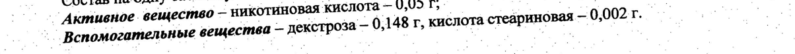
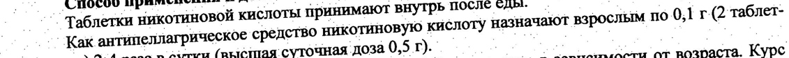
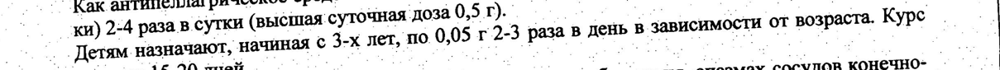
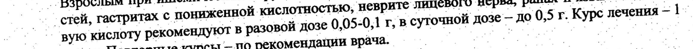
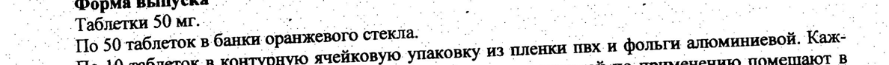
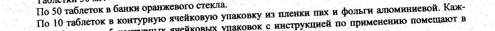

# Никотиновая кислота — внутрь

- Препарат: Никотиновая кислота (таблетки;)
- АТХ: C10AД02
- Источник: ГРЛС, инструкция по медицинскому применению, РУ ЛСР-006554/09, файл от 2025-02-07 (https://grls.rosminzdrav.ru/Grls_View_v2.aspx?routingGuid=c9ec2e06-371c-4e19-9fd4-876f4aef7cf4)
- Распознано автоматически (OCR): 3 из 3 стр.
- Инструкция к другому РУ того же препарата: ЛСР-006554/09 (срок действия истёк, решение от 15.01.2025). Текст может быть старше действующего
- Сомнительных строк после OCR: 6 (см. раздел «Проверка распознавания»)

## Текст

ma tet Jee” | м | ЛСР-006554/09-170809 |
И. ОВ и. по медицинскому применению препарата со А
ВЫ и ite НИКОТИНОВАЯ КИСЛОТА аа. те о _ Регистрационный номер а ем ее te С.
ВИ Торговое название Никотиновая кислота и, ms _ о Международное непатентованное название Никотиновая кислота. ee le epee PT wet И, ae Лекарственная форма Таблетки — р” ei eg НН Ты мня г,"
_ Coctas наодну таблетку: . ^^ _ OM tag Dog eT a po ‘Активное вещество — никотиновая кислота 0.05 Re © то А т 77,4 Вспомогательные вещества — декстроза — 0,148 г, кислота стеариновая — 0,002 Poot. te о.
A. Описание. И НУ о и 7 | © таблетки белого цвета плоскоцилиндрические с фаской. о. ие. т an `Фармакотерапевтическая группа: витамин. Ct _ eo ee oo
. ~~ Код ATX С10АБО2. А Шо ee oe on а. Фармакологическое действие И. И Я
И `Никотиновая. кислота ‘является специфическим противопеллагрическим ‘средством (витамин = _
~~ PP). Улучшает углеводный обмен, оказывает сосудорасширяющее действие, в том. числе Ha со- —
Cy ipl мозга, обладает гиполипидемической активностью. В больших дозах. никотиновая кислота о | т.о ‘понижает содержание триглицеридов и В-липопротеидов в крови, уменышает отношение холегит стерин/фосфолипиды в липопротеидах низкой плотности. 'Обладает ‘дезинтоксикационными о
_ Показания к применению. а | Ne res ee fae
.. - Кислоту никотиновую назначают для профилактики и лечения пеллагры (авитаминоза PP), B oo комплексной терапии `ишемических нарушений мозгового кровообращения, заболеваний сосу- a
| о дов Нижних конечностей (облитерирующий эндартериит» болезнь 'Рейно) спазме сосудов ко- a
^^ нечностей, желче- и. мочевыводящих путей, осложнений сахарного диабета (диабетическая по-_ | м. `линейропатия, микроангиопатия), заболеваниях печени (острые и хронические гепатиты), при .
‚ —_ тастритах с нониженной кислотностью, а также при невритах лицевого нерва, при длительно ^ ки: `иезаживающих ранах и трофических язвах. не Е ИЕ _ -
. __ Противопоказания wre т. де а м о ‚Повышенная индивидуальная чувствительность к препарату. _ бы о. a |
.". `Беременность и период кормления. | р И. 3"
_ Язвенная болезнь желудка и 12-перотной кишки (2 стадии обострения), выраженные нарушения о функции печени, подагра и гиперурикёмия, тяжелые формы гипертонической болезни и атеро- 7 о склероза, детский возраст (до 3-х лет). __ и КОИ 7 .C осторожн юстью a м “ о р И Е и о кн.“ о _`Геморрагии, глаукома, печеночная недостаточность, ‘артериальная гипотензия, гиперацидный — о - ‘гастрит, язвенная болезнь желудка и 12-перствой кишки (вне обострения) ты? Е пы, р ee о 20300.
д Щ Ce cee ее. — И re - JICP-006554/09- 170809 a a, (Способ применения и дозы а м. | т ae a __ Таблетки никотиновой кислоты принимают внутрь после еды. _^ О т ос. Как антипеллагрическое средство никотиновую кислоту назначают взрослым по 0,1 г.(2`таблетa ки) 2-4 pasa в сутки (высшая суточная доза 0,5 т). и аа и mF
Say ‚ Детям назначают, начиная с 3-х лет, по 0,05 г 2-3 раза в день в зависимости от возраста. Kype ..
- ^ лечения 15-20 mel. | ое eae of .. ть, т a г. ‚т.
__^_ _ Взрослым при ишемических нарушений мозгового кровообращения, спазмах сосудов конечно- т.
стей, гастритах с пониженной кислотностью, неврите лицевого нерва» ранах и язвах никотино- о
. - вую кислоту рекомендуют в разовой дозе 0,05-0,1 г, в суточной дозе — до 0,5 г. Курс лечения-1°
| _ месяц. Повторные курсы — по рекомендации врача. er ee ПИ 8 wt ° Побочное действие ^_ | м а ям он, Пя ot Ss Saye ee”
. -.. Возможны: аллергические реакции. При приеме высоких доз’ внутрь: гиперемия кожи лица и Ги
__^ верхней ‘половины туловища, ‘парестезии, толовокружение, «приливы» крови к коже ‘лица, >
- __. ритмия, ортостатическая гипотензия, диарся, сухость кожи и слизистой оболочки глаз, гипергA ликемия, гиперурикемия, миалгия, тошнота, рвота, пептическая язва; изнуряющий кожный зуд. — 7 © При длительном ‘применении - жировая дистрофия печени, гиперурикемия, снижение толерант-. wee
> ности к глюкозе, повышение концеятрации в крови аспартатаминотрансферазы, лактатдегидро- a oo геназы, щелочной фосфатазы, отушение жара, гиперемия кожи (особенно лица и шеи), голов-
"gait боль, головокружение, астения. ВВ ее
_ Взаимодействие с другими лекарственными препаратами НИ 7 и. Необходима консультация с врачом, ‘если никотиновая кислота будет применяться одновремен- о _
_-_. но с другими им лекарственными и средствами. = ие" ре мы. "ит
_ = Необходимо соблюдать ‘осторожность при ‚ комбинировании с гипотензивными_ ‘лекарствен- Oe
| ными средетвами, антикоагулянтами и ацетилсаляциловой кислотой. peg ВИО ne ` Особые указания. _ a ee Ce м а 9
_ Для предупреждения осложнений co стороны печени (ар длительном применении в больших | дозах) рекомендуется включать в диету продукты, богатые метионином (творог) или принимать —
___ оонив, липоввую кислоту, и другие липотропные средства м ан. | С
В процессе лечения никотиновой. кислотой (особенно большими `Дозами) следует тщательно —
| (© следить за функцией печени. a a gt se ee eee ts, ts
^^ Форма выпуска И gk Eee OF Pew a ee eS
Таблетки SOME SO I | 7’ По 50 таблеток в банки оранжевого стекла: п а,
~~ Мо 10 таблеток в контурную ячейковую упаковку из пленки пвх и фольги алюминиевой. Каж- -
_. -. ‘дую банку или 5 контурных ячейковых упаковок с инструкцией по применению помещают BO
_ < Условия хранения — _ м и rr er Be a So
^_^ Список B. В сухом, защищенном от света месте, при температуре от 15 до 25°C. I о, _Хранить в местах недоступных для детей. _ ert, aor ae и“. 5 о -
I eer Serre a re _ ЛСР-006554/09-170809 7 ранее =. | И. ; 7 oo | — a aon кода. а р. аи ав,
.. _. По истечении срока годности препарат не применять. — _ а we т м
Условия отпуска из аптек. - р И ми. г. Ее.
7 ` Отпускается без рецепта врача. _ Е М И ee oe, ‚ Производитель: - | = ee 1 ee ий 2 “oe oor ae ан ae oe
ОАО «Ирбитский химико-фармапевтический завот, и ee wee le Ире gel ee 623856, Свердловская обл.; г. Ирбит, ул. Кирова; 172 - ea en Е a gen: (34355) 3-61-01, факс: (34355) 3-60-73 ae tae wo By
— Гоерльын дек о ЛА. Солодка — ОАО «Ирбитский химико-фармацевтический © вод». а г ви ИИ Зе Ра"
Е в, о. oP, и . a WA Ne Se eng в а И Мей ве КИ НН (SSS gay ing NOON = в
| АУ. : 2. а . ‘=e ® 7 . | .. _ sa к : а. 2 . hapmaueaty- a ol |. ae о г , а: ое о ли И = ‚ ческий /O FIP ен rr a rare es, et te ES Ye" > 320 Ae ff ие. Ne tor 4 о | 2. вх, он в а т 0,187 com® LF re ре ot see et aw See ты ВИДЯ ДАНЫ ПЕ о ыы aos "м i. rn > ДЕЯСТВИТЕЛЕН ДЛЯ ДАННОЙ [© ира” О нь па И “Jel ВЕРСИИ ДОКУМЕНТА {8 -
Пр ро кВ о о = м
## Проверка распознавания

Страницы-сканы распознаны автоматически. В 6 строках с дозировками цифры могли распознаться с ошибкой — сверьте с вырезкой из оригинала:

- стр. 1: «77,4 Вспомогательные вещества — декстроза — 0,148 г, кислота стеариновая — 0,002 Poot. te о.» — низкая уверенность: «77,4» (28); повторное чтение: «| | | : Armuenoe от а 0.148 ыы per рино ко г. =. | aor | р |»  
  
- стр. 2: «ос. Как антипеллагрическое средство никотиновую кислоту назначают взрослым по 0,1 г.(2`таблет-» — низкая уверенность: «0,1» (30), «г.(2`таблет-» (0); повторное чтение: «| | | | | pe set psran merino HET Hea MA eee ae»  
  
- стр. 2: «Say ‚ Детям назначают, начиная с 3-х лет, по 0,05 г 2-3 раза в день в зависимости от возраста. Kype ..» — повторное чтение: «а 00823 ros ° ee nae г | -- |»  
  
- стр. 2: «. -  вую кислоту рекомендуют в разовой дозе 0,05-0,1 г, в суточной дозе — до 0,5 г. Курс лечения-1°» — низкая уверенность: «лечения-1°» (29); повторное чтение: «»  
  
- стр. 2: «7’ По 50 таблеток в банки оранжевого стекла: п а,» — низкая уверенность: «7’» (6); повторное чтение: «тт ac gonna KOR —»  
  
- стр. 2: «~~ Мо 10 таблеток в контурную ячейковую упаковку из пленки пвх и фольги алюминиевой. Каж-  -» — низкая уверенность: «10» (79); повторное чтение: «»  
  
