# Номегэстрол + Эстрадиол — внутрь

- Препарат: Зоэли® (таблетки, покрытые пленочной оболочкой;)
- АТХ: G03AA14
- Источник: ГРЛС, инструкция по медицинскому применению, РУ ЛП-001621, файл от 2023-05-11 (https://grls.rosminzdrav.ru/Grls_View_v2.aspx?routingGuid=c9bd328f-dfb5-454c-bd7f-5c9e7d20a0e1)
- Распознано автоматически (OCR): 29 из 29 стр.
- Инструкция к другому РУ того же препарата: ЛП-001621 (национальное РУ, переоформленное по правилам ЕАЭС, решение от 02.05.2023). Текст может быть старше действующего
- Сомнительных строк после OCR: 13 (см. раздел «Проверка распознавания»)

## Общие сведения

—— ИИС ЛА ИИА ОКО ИИ нии . | о | СООТВЕТСТВУЕТ ЭКСПЕРТНОМУ ОТЧЕТУ |.
| | от 13.12.2022 № 28720 | Входящий МЗ №4221393
МИНИСТЕРСТВО ЗДРАВООХРАНЕНИЯ РОССИЙСКОЙ ФЕДЕРАЦИИ
ИНСТРУКЦИЯ .
ПО МЕДИЦИНСКОМУ ПРИМЕНЕНИЮ ЛЕКАРСТВЕННОГО ПРЕПАРАТА
_ 309° | | Регистрационный номер: ЛП-001621.
Торговое наименование: Зоэли® - | | Международное непатентованное или группировочное наименование:
| ‚ номегэстрол + эстрадиол | Лекарственная форма: таблетки, покрытые пленочной оболочкой |

## 2. Состав

— | | Для таблеток, содержащих действующие вещества.
— | | Для таблеток, содержащих действующие вещества.
> - 1 белая таблетка, покрытая пленочной оболочкой, содержит:
действующие вещества: номегэстрола ацетат 2,50 мг, эстрадиола гемигидрат 1,55 мг
| (эквивалентно 1,50 мг эстрадиола); . ;
~~ вспомогательные ‘вещества: лактозы моногидрат 57,71 МГ, целлюлоза микрокристаллическая 14,00 мг, кросповидон 2,40 мг, тальк 0,70 мг, магния стеарат 0,70 мг, кремния диоксид коллоидный 0,44 мг; |
. | пленочная оболочка: Опадрай П белый 1,6 мг, содержит поливиниловый спирт 0,64 мг, титана диоксид 0,40 мг, макрогол-3350 0,32 мг, тальк 0,24 мг. |
| Для таблеток, не содержащих действующие вещества (плацебо)
| 1 желтая таблетка, покрытая пленочной оболочкой, содержит: | вспомогательные — вещества: лактозы моногидрат 61,76 МГ, | целлюлоза
& микрокристаллическая 14,00 мг, кросповидон 2,40 мг, тальк 0,70 мг, магния стеарат 0,70 мг, | кремния диоксид коллоидный 0,44 мг; | пленочная оболочка: Опадрай Il желтый 2,4 мг, содержит поливиниловый спирт 0,96 мг, .. |
. титана диоксид 0,58 mr, макрогол-3350 0,48 мг, тальк 0,36 мг, краситель железа оксид
| желтый 0,016 мг, краситель железа оксид черный 0,00024 мг.
Описание | | Для таблеток, содержащих действующие вещества .
‚ Круглые двояковыпуклые таблетки, покрытые пленочной оболочкой от белого до почти .
белого цвета, с гравировкой «пе» с двух сторон, цвет ядра на разрезе от белого до почти белого.
и не | СООТВЕТСТВУЕТ ЭКСПЕРТНОМУ ОТЧЕТУ | | от 13.12.2022 № 28720
Входящий МЗ №4221393 _ Для таблеток, не содержащих действующие вещества (плацебо) |
Круглые двояковыпуклые таблетки, покрытые пленочной оболочкой желтого цвета, с гравировкой «р» с двух сторон, цвет ядра на разрезе от белого до почти белого.
Фармакотерапевтическая группа . | Контрацептивное средство комбинированное (эстроген + гестаген).
Код ATX: 603АА14 | о Фармакологические свойства. |

## 5.1. Фармакодинамика

| | Номегэстрола ацетат — это высокоселективный гестаген, являющийся производным
| | Номегэстрола ацетат — это высокоселективный гестаген, являющийся производным
| естественного стероидного гормона прогестерона. Номегэстрола ацетат имеет выраженное | сродство к человеческому рецептору прогестерона, обладает антигонадотропной `
© активностью, антиэстрогенной активностью, опосредованной рецепторами прогестерона, умеренной антиандрогенной активностью и не обладает эстрогенной, андрогенной, глюкокортикоидной и минералокортикоидной активностью. |
| В состав препарата Зоэли® входит 17В-эстрадиол — эстроген, идентичный эндогенному
| человеческому 17В-эстрадиолу (E2). В отличие от этинилэстрадиола, который входит в | состав других комбинированных оральных контрацептивов (КОК), Е? не имеет этинильной группы в 17% положении. При применении препарата Зоэли® средние концентрации E2 сопоставимы с таковыми в начальной фолликулярной фазе и поздней фазе желтого тела менструального цикла (см. подраздел «Фармакокинетика»).
Контрацептивный эффект препарата Зоэли® обусловлен комбинацией различных факторов, ` наиболее важными из которых являются подавление овуляции и изменение вязкости.
_ секрета шейки матки. | | > В. двух рандомизированных открытых сравнительных исследованиях эффективности и | безопасности более чем 3200 женщин в возрасте 18-50 лет принимали препарат Зоэли® в течение 13 последовательных циклов и более чем 1000 женщин принимали комбинацию = дроспиренон (3 мг) / этинилэстрадиол (30 мкг) по схеме приема 21/7.
| В группе, принимавшей препарат Зоэли®, об увеличении массы тела сообщалось у 8,6% женщин (в группе сравнения — 5,7%), о нерегулярных кровотечениях «отмены»
о (преимущественно 06 отсутствии кровотечения «отмены») сообщалось у 10,5% женщин (в группе сравнения — 0,5%), об акне—у 15,4% женщин (в группе сравнения - 7,9%) (см. раздел
, «Побочное действие»). Оценка развития акне при приеме препарата Зоэли® в другом исследовании показала, что у большинства женщин (73,1%) не наблюдалось изменений
| состояния по сравнению с состоянием до начала лечения, у 16,8% женщин наблюдалось
ИИ МОИ ИИ ИКИ ОАО | яр | СООТВЕТСТВУЕТ ЭКСПЕРТНОМУ ОТЧЕТУ
` от 13.12.2022 № 28720 Входящий МЗ №4221393 — | улучшение состояния иу 10,1% женщин было отмечено появление или ухудшение течения акне. о
| В клиническом исследовании препарата Зоэли®, проведенном в Европейском Союзе, Азии
| и Австралии, были рассчитаны следующие показатели индекса Перля для возрастной группы 18-35 лет: о |
Неэффективность метода — 0,40 (верхняя граница 95% доверительного интервала 1,03);
Неэффективность метода и ошибка пациента — 0,38 (верхняя граница 95% доверительного интервала 0,97). |
В клиническом исследовании препарата Зоэли®, проведенном в Соединенных Штатах
Америки, Канаде и Латинской Америке, были рассчитаны следующие показатели индекса ~
Перля для возрастной группы 18-35 лет: | |
© Неэффективность метода — 1,22 (верхняя граница 95% доверительного интервала 2,18);
Неэффективность метода и ошибка пациента — 1,16 (верхняя граница 95% доверительного .
интервала 2,08). | В рандомизированном открытом исследовании 32 женщины получали препарат Зоэли® на протяжении 6 циклов. После прекращения приема препарата Зоэли® восстановление
‚ овуляции в первые 28 дней после приема последней таблетки наблюдалось у 79%`женщин.
Фолиевая кислота является важным витамином на ранних сроках беременности. Во время |
| приема препарата Зоэли® концентрация фолиевой кислоты в плазме крови не изменяется и остается на базовом уровне в течение 6 последовательных месяцев приема препарата.
В рандомизированном открытом сравнительном исследовании продолжительностью 2 года,
| при приеме препарата Зоэли® женщинами в возрасте 21-35 лет наблюдалось отсутствие
| клинически значимого эффекта препарата Зоэли® на минеральную плотность костной
© | ткани. | : Было’ проведено рандомизированное открытое сравнительное многоцентровое
| исследование для оценки влияния препарата Зоэли® на параметры свертываемости крови, липидный профиль, метаболизм углеводов, функциональное состояние надпочечников и щитовидной железы, а также на концентрацию андрогенов. = | ,
| 60 женщин в возрасте 18-50 лет принимали препарат Зоэли® в течение 6 последовательных
| | циклов. В клинических исследованиях было установлено, что при приеме препарата Зоэли® инсулинорезистентность и толерантность к глюкозе не изменялись, а также не было
| | выявлено клинически значимых эффектов на метаболизм липидов и гемостаз. Прием | препарата Зоэли® увеличивал концентрации белков-переносчиков тироксин-связывающего
| глобулина (TCI) и кортикостероид-связывающего глобулина (КСГ). При приеме препарата
| Зоэли® незначительно увеличивалась концентрация глобулина, связывающего половые
| и 3 TE . | ПЕ СООТВЕТСТВУЕТ ЭКСПЕРТНОМУ ОТЧЕТУ
| от 13.12.2022 № 28720 | | Входящий МЗ №4221393
, гормоны (ГСПГ), и значительно уменьшались концентрации андростендиона, | дегидроэпиандростерона, общего и свободного тестостерона. В клиническом исследовании у группы женщин (n=32) после 13 циклов приема препарата Зоэли® не наблюдалось
| патологических изменений при гистологическом исследовании эндометрия. .
Данные об эффективности и безопасности у подростков в возрасте до 18 лет отсутствуют.
Доступные фармакокинетические данные описаны в подразделе «Фармакокинетика». |

## 5.2. Фармакокинетика

| Номегэстрола ацетат | ` Абсорбция
| Номегэстрола ацетат | ` Абсорбция
Номегэстрола ацетат быстро всасывается после приема внутрь. После однократного приема
© | максимальная концентрация в плазме составляет около 7 нг/мл и достигается через 2 4.
Абсолютная биодоступность после однократного приема составляет 63%. Прием пищи не
| оказывает клинически значимого влияния на биодоступность номегэстрола ацетата.
Распределение | | . Номегэстрола ацетат активно связывается с альбумином (97-98%), но не связывается с
ГСПГ или КСГ. Кажущийся объем распределения номегэстрола ацетата в равновесном состоянии составляет 1645 + 576 л. |
Биотрансформация | Номегэстрола ацетат метаболизируется до нескольких неактивных гидроксилированных метаболитов под действием изоферментов цитохрома Р450 печени, в основном СУРЗА4 и
‘CYP3A5; также возможно участие в метаболизме изоферментов CYP2C8 и CYP2C19.
- Номегэстрола ацетат и его гидроксилированные производные подвергаются выраженному
& метаболизму второй фазы с образованием глюкуронидных и сульфатных конъюгатов.
Клиренс в равновесном состоянии составляет 26 л/ч. |
Элиминация Период полувыведения (T12) в равновесном состоянии составляет 46 4 (от 28 до 83 ч).
T12 метаболитов не установлен.
| `Номегэстрола ацетат выводится почками и через кишечник. Примерно 80% дозы выводится почками и через кишечник в течение 4 дней. Номегэстрола ацетат практически полностью выводится в течение 10 дней. Выведение через кишечник превышает выведение почками.
‚ Линейность | Линейность фармакокинетики в зависимости от дозы отмечалась в диапазоне 0,625-5 мг
В (оценивалась у женщин репродуктивного и постменопаузального возраста). о
| 4 м | и ре СООТВЕТСТВУЕТ ЭКСПЕРТНОМУ ОТЧЕТУ
= от 13.12.2022 № 28720 Входящий МЗ №4221393
Равновесная концентрация | ГСПГ не оказывает влияния на фармакокинетику номегэстрола ацетата. Равновесная концентрация достигается через 5 дней. Средняя концентрация в равновесном состоянии |
, составляет 4 нг/мл. Максимальная концентрация номегэстрола ацетата в плазме составляет около 12 нг/мл и достигается через 1,5 ч после приема препарата.
- Взаимодействия |
In vitro номегэстрола ацетат не оказывает существенного индуцирующего или
| | ингибирующего действия на изоферменты цитохрома Р450 и не взаимодействует с белком-
— транспортером гликопротеина Р. | Эстрадиол (Е?) |
7 Абсорбция
© ‚ Эстрадиол подвергается выраженному метаболизму при «первом прохождении» через :
- печень после приема внутрь. Абсолютная биодоступность составляет около 1%. Прием
| пищи не оказывает клинически значимого влияния на биодоступность эстрадиола. .
Распределение , . | | : Распределение экзогенного и эндогенного эстрадиола сходное. Эстрогены активно
‚ распределяются по всему организму. Их концентрации обычно выше в органах-мишенях половых гормонов. В крови эстрадиол связывается с PCI (37%) и альбумином (61%), и
, только 1-2% эстрадиола циркулирует в несвязанном виде.
Биотрансформация | , Экзогенный эстрадиол активно метаболизируется после приема внутрь. Метаболизм экзогенного и эндогенного эстрадиола сходный. Эстрадиол быстро превращается в
“. | несколько метаболитов в кишечнике и печени (в основном в эстрон), которые в
& последующем конъюгируются и подвергаются кишечно-печеночной рециркуляции.
Имеется динамическое равновесие между эстрадиолом, эстроном и эстрон-сульфатом за.
счет активности различных ферментов, включая — эстрадиолдегидрогеназы, сульфотрансферазы и арилсульфатазы. Окисление эстрона и эстрадиола происходит под действием изоферментов цитохрома Р450, в основном СУР1А2, СУР1А2 (вне печени), |
| CYP3A4, CYP3A5, СУР1В1 и CYP2C9.
Элиминация . | Эстрадиол быстро выводится из крови. За счет метаболизма и кишечно-печеночной рециркуляции имеется большой пул циркулирующих сульфатов и глюкуронидов эстрогенов. В результате. Tin эстрадиола, скорректированный с учетом исходного показателя, варьируется в широких пределах и составляет 3,6 + 1,5 ч после внутривенного введения.
FEE ES ° | ny СООТВЕТСТВУЕТ ЭКСПЕРТНОМУ ОТЧЕТУ
. от 13.12.2022 № 28720 | Входящий МЗ №4221393) ,
`Равновесная концентрация | Максимальная концентрация эстрадиола в плазме крови составляет около 90 пг/мл и 8 достигается через 6 4 после приема. Средние концентрации в плазме крови — 50 пг/мл.
. Данные концентрации эстрадиола соответствуют таковым в начальной и поздней фазах менструального цикла.
Особые группы пациентов . Дети | | Фармакокинетика номегэстрола ацетата (первичная цель) после однократного приема
| внутрь препарата Зоэли® была сопоставима у здоровых девочек-подростков после наступления менархе и у взрослых женщин. Однако после однократного перорального приема экспозиция эстрадиола (вторичная цель) была на 36% ниже у подростков по
© | сравнению со взрослыми. Клиническая значимость данного результата неизвестна.
. Нарушение функции почек Влияние заболеваний почек на фармакокинетику препарата Зоэли® не изучалось.
Нарушение функции печени | Влияние заболеваний печени на фармакокинетику препарата Зоэли® не изучалось. Однако
| | у пациенток с нарушением функции печени возможно ухудшение метаболизма половых | гормонов. |
Этнические группы Фармакокинетика препарата Зоэли® у представителей этнических групп специально не | изучалась.

## 4.1. Показания к применению

. . о _ Контрацепция. .
. . о _ Контрацепция. .
| & Решение о назначении препарата Зоэли® должно быть принято с учетом существующих факторов риска в индивидуальном порядке, особенно с учетом рисков, связанных с
| , венозной тромбоэмболией (ВТЭ), и сопоставления риска ВТЭ при приеме препарата Зоэли®
"© другими комбинированными гормональными контрацептивами (КГК) (см. разделы
«Противопоказания», «Особые указания»). —

## 4.3. Противопоказания

| Комбинированные гормональные контрацептивы не следует применять при наличии
| Комбинированные гормональные контрацептивы не следует применять при наличии
° любого из перечисленных ниже состояний/заболеваний. В случае возникновения любого из этих состояний/заболеваний в период применения препарата Зоэли® следует немедленно
| прекратить прием препарата. wee es ‚ Гиперчувствительность к любому действующему или вспомогательному
° веществу препарата Зоэли®.
EE ee | СООТВЕТСТВУЕТ ЭКСПЕРТНОМУ ОТЧЕТУ от 13.12.2022 № 28720
| Входящий МЗ №4221393) — . Наличие или риск возникновения ВТЭ |
— Венозная тромбоэмболия — текущая ВТЭ (на антикоагулянтах) или ВТЭв = анамнезе (например, тромбоз глубоких вен или легочная эмболия);
— Выявленная наследственная или приобретенная предрасположенность к венозной тромбоэмболии, например, резистентность к активированному протеину С (АРС) (включая ‘мутацию фактора V Лейдена), дефицит антитромбина Ш, дефицит протеина С, дефицит протеина $5; .
— Серьезные хирургические вмешательства с длительной иммобилизацией
| (см. раздел «Особые указания»); | | — Высокий риск венозной тромбоэмболии из-за наличия множества
| факторов риска (см. раздел «Особые указания»).
© | . Наличие или риск возникновения артериальной тромбоэмболии (АТЭ)
— Артериальная ‘тромбоэмболия — текущая АТЭ, АТЭ в анамнезе
. | (например, инфаркт миокарда) или продромальное состояние (например, стенокардия);
— Нарушение мозгового кровообращения — текущий инсульт, инсульт в анамнезе или продромальное состояние (например, транзиторная
‚ ишемическая атака); | , — Выявленная наследственная или приобретенная предрасположенность к
АТЭ, например, гипергомоцистеинемия или наличие антифосфолипидных 7 антител (антитела к кардиолипину, волчаночный антикоагулянт);
- Мигрень с очаговыми неврологическими симптомами в анамнезе;
Ир — Высокий риск возникновения АТЭ из-за наличия множества факторов
_ > риска (см. раздел «Особые указания») или одного серьезного фактора риска, например: | |
, » сахарный диабет с сосудистыми симптомами; |
. тяжелая форма гипертонической болезни;
р | | | » _ тяжелая дислипопротеинемия.
‚ _ Панкреатит с тяжелой гипертриглицеридемией, в том числе в анамнезе.
‚ Тяжелые заболевания печени, в том числе в анамнезе, до нормализации
| показателей функции печени. о | | . © Опухоли печени (злокачественные или доброкачественные), в том числе в
1. анамнезе.
| ® * Известные или предполагаемые гормонозависимые злокачественные опухоли
(например, половых органов или молочной железы).
, 7 Te a . } . a СООТВЕТСТВУЕТ ЭКСПЕРТНОМУ ОТЧЕТУ
| от 13.12.2022 № 28720 ; Входящий МЗ №4221393
. — Менингиома в настоящее время или в анамнезе. 7
‚ Установленная или предполагаемая беременность, | период грудного вскармливания.
‚ Дефицит лактазы, непереносимость лактозы, глюкозо-галактозная
| мальабсорбция.
a . Вагинальные кровотечения неясной этиологии. |
Отсутствуют данные об эффективности и безопасности применения препарата Зоэли® у девочек-подростков в возрасте до 18 лет.
| | С осторожностью При наличии любых из перечисленных ниже состояний, заболеваний, факторов риска следует оценить пользу от применения препарата Зоэли® и возможные риски для каждой
© отдельной женщины. Это следует обсудить с женщиной еще до того, как она начнет прием препарата Зоэли®. Дополнительная информация содержится в разделе «Особые указания».
В случаях ухудшения, обострения или возникновения впервые любого из этих состояний,
| заболеваний, факторов риска женщине следует обратиться к врачу для решения вопроса о о возможности дальнейшего применения препарата Зоэли®. -.
¢ Сахарный диабет без поражения сосудов. | |
® Тяжелая депрессия или наличие этого заболевания в анамнезе. _ х Системная красная волчанка.
Болезнь Крона.
. Язвенный колит. , _ a . Нарушения функции печени. |
. Гипертриглицеридемия, в том числе в семейном анамнезе.
& ¢ Факторы риска ишемической болезни сердца (ожирение, артериальная гипертензия).
Наличие в семейном анамнезе ВТЭ, АТЭ у братьев, сестер или у родителей в возрасте <50 лет (см. раздел «Особые указания»).
| | _ * Послеродовой период. . | | » Мигрень без очаговой неврологической симптоматики. —.
. Не осложненные заболевания клапанов сердца. 7
. Серповидно-клеточная анемия.
¢ Наследственный ангионевротический отек.
. Порфирия.
* Отосклероз с нарушением слуха. | . Герпес во время беременности. |
| .— 7 zi = 2 . : 8 af ———]W—_$§ $$ СООТВЕТСТВУЕТ ЭКСПЕРТНОМУ OT4Y ЕТУ от 13.12.2022 № 28720
| Входящий МЗ №4221393) .
| | | . Хорея Сиденгама.
. Возраст старше 35 лет. , О Желтуха и или зуд, связанные с холестазом.
| | * Холелитиаз. | о `» Хлоазма. . a | Препарат Зоэли® должен применяться с осторожностью при совместном применении с комбинацией лекарственных препаратов для лечения вирусного гепатита С омбитасвир/паритапревир/ритонавир с дасабувиром или без Hero (см. разделы
«Взаимодействие с другими лекарственными средствами» и «Особые указания»).
| Применение при беременности и в период грудного вскармливания
| Беременность © Применение препарата Зоэли® противопоказано в период беременности. В случае
‚ возникновения беременности при применении препарата Зоэли® следует прекратить прием =.
препарата.
| В большинстве эпидемиологических исследований не было выявлено увеличения риска развития врожденных пороков у детей, чьи матери до беременности принимали KOK, содержащие этинилэстрадиол. При случайном приеме в начале беременности КОК, содержащих этинилэстрадиол, не было отмечено тератогенных эффектов.
Имеются ограниченные клинические данные относительно приема препарата Зоэли® беременными женщинами, Которые свидетельствует об отсутствии нежелательного - влияния препарата на состояние плода или новорожденного.
В исследованиях комбинации номегэстрола ацетат / эстрадиол на лабораторных животных
‚ была зафиксирована репродуктивная токсичность. | |
& При повторном начале приема препарата Зоэли® следует учитывать повышенный риск ВТЭ в послеродовом периоде (см. раздел «Особые указания»).
| Препарат Зоэли® предназначен для предупреждения нежелательной беременности. Если
‚женщина хочет прекратить прием препарата Зоэли®, чтобы забеременеть, следует принять во внимание, что овуляция восстанавливается в среднем через 28 дней после последнего приема таблетки препарата Зоэли® (см. раздел «Фармакологические свойства», подраздел
«Фармакодинамика»). | | Период грудного вскармливания.
КОК могут оказывать влияние на лактацию, так как они вызывают изменение количества и состава грудного молока. Таким образом, использование КОК противопоказано до тех пор, пока кормящая мать полностью не отлучит своего ребенка от груди, а женщинам, желающим кормить грудью, следует предложить альтернативный метод контрацепции.
| 9 EE & DE СООТВЕТСТВУЕТ ЭКСПЕРТНОМУ ОТЧЕТУ от 13.12.2022 № 28720
| Входящий МЗ №4221393 Небольшие количества контрацептивных половых гормонов и/или их метаболитов могут проникать в грудное молоко, однако данных об их нежелательном влиянии на здоровье | новорожденного нет.

## 4.2. Способ применения и дозы

—_ Препарат предназначен для приема внутрь. |
—_ Препарат предназначен для приема внутрь. |
Как следует принимать препарат Зоэли® Таблетки принимают ежедневно в одно и то же время дня независимо от приема пищи в
| порядке, указанном на ‘упаковке, при необходимости запивая небольшим количеством
| | воды. Следует принимать по.одной таблетке в день в течение 28 дней подряд. Прием следует начинать с белых таблеток, содержащих действующие вещества. Белые таблетки, содержащие действующие вещества, принимают в течение первых 24 дней. В течение
© последующих 4 дней принимают желтые таблетки, не содержащие действующих веществ
. ° (плацебо). Прием таблеток из каждой последующей упаковки следует начинать на следующий ‘день после приема последней таблетки из предыдущей упаковки, независимо в от наличия или отсутствия кровотечения «отмены». Кровотечение «отмены» обычно начинается через 2-3 дня после приема последней белой таблетки и может не прекратиться к началу приема таблеток из следующей упаковки. Дополнительная информация представлена в разделе «Особые указания», | подраздел «Изменения характера
| | менструаций».
_ Особые группы пациентов | | Нарушение функции почек | |
Данные о применении препарата Зоэли® у пациенток с почечной недостаточностью
. отсутствуют, однако влияние почечной недостаточности на выведение номегэстрола
| & ацетата и эстрадиола маловероятно. |
| Нарушение функции печени | Влияние заболеваний печени на фармакокинетику препарата Зоэли® не изучалось. Однако
| поскольку у пациенток с нарушением функции печени возможно ухудшение метаболизма —
| половых гормонов, применение препарата Зоэли® у данной группы пациенток не рекомендуется до нормализации показателей функции печени | (см. раздел
«Противопоказания»).
Дети | Безопасность и эффективность у подростков в возрасте до 18 лет не установлены. Препарат oes mes ^^ `Зоэли® не предназначен для детей и подростков до начала менструации. |
| | 10 мы г м ` | о СООТВЕТСТВУЕТ ЭКСПЕРТНОМУ ОТЧЕТУ от 13.12.2022 № 28720 |
| (В кодящий МЗ №4221393 Как следует начинать прием препарата Зоэли® |
В предыдущем цикле гормональные контрацептивы не применялись
Прием таблеток следует начать в первый день менструального цикла женщины (в первый 1 день менструального кровотечения). В этом случае применение дополнительных контрацептивных средств не требуется. Можно начать прием таблеток и со 2-5-го дня цикла. В таком случае в течение первых 7 дней приема таблеток рекомендуется дополнительно использовать барьерный метод контрацепции.
° Переход с комбинированного гормонального контрацептива (КОК, завинальноей кольца или трансдермального пластыря) |
| Женщине желательно начать прием препарата Зоэли® на следующий день после приема | последней таблетки, содержащей действующие вещества, но не позднее чем на следующий |
© день после завершения обычного интервала между циклами или приема таблеток плацебо.
| Если женщина пользовалась вагинальным кольцом или трансдермальным пластырем, то начинать прием препарата Зоэли® желательно в день их удаления, но не позднее, чем в день, | когда следовало бы ввести новое кольцо или наклеить очередной пластырь.
Переход с препаратов, содержащих только _гестаген__(таблетки, имплантаты, инъекционные формы или гормоно-содержащие внутриматочные системы (ВМС. ))
Женщина может в любой день прекратить прием таблеток, содержащих только гестаген, и .
на следующий день начать прием препарата Зоэли®. Имплантат или ВМС можно удалить в
| любой день. В таком случае прием. препарата Зоэли® следует начать в день их удаления.
| Если женщина получала инъекции, то прием препарата Зоэли® начинают в день, когда следовало произвести очередную инъекцию. Во всех этих случаях женщине следует | рекомендовать дополнительно пользоваться барьерным методом контрацепции в течение ^
“> первых 7 дней приема таблеток, содержащих действующие вещества.
После аборта в первом триместре беременности
Женщина может начать прием препарата сразу же. В этом случае нет необходимости в дополнительном методе контрацепции. =
После родов или аборта во втором триместре беременности |
„Для кормящих грудью женщин см. раздел «Применение при беременности и в период грудного вскармливания». |
При отсутствии грудного вскармливания прием препарата можно начать между 21-м и 28-м днем после родов или аборта во втором триместре беременности. При более позднем 7” : начале приема препарата женщине следует рекомендовать’ применять ‘дополнительный = барьерный ‘метод контрацепции в течение первых 7 дней приема таблеток. Однако если
. On 2 г } и ре | - СООТВЕТСТВУЕТ ЭКСПЕРТНОМУ ОТЧЕТУ от 13.12.2022 № 28720
Входящий МЗ №4221393 после родов или аборта уже были половые контакты, перед началом приема препарата
Зоэли® необходимо исключить беременность или дождаться первой менструации.
При возобновлении приема препарата Зоэли® необходимо принимать BO внимание повышение риска развития ВТЭ в послеродовом периоде (см. раздел «Особые указания»).
- Что делать в случае пропуска таблеток '
Приведенные ниже рекомендации касаются только пропуска приема белых таблеток, содержащих действующие вещества.
| Если женщина принимает очередную таблетку с опозданием менее 24 4, TO
| | контрацептивный эффект не снижается. Женщине следует принять таблетку как можно скорее после того, как она об этом вспомнит. Последующие таблетки необходимо принимать в обычное время. "о
© Если женщина принимает таблетку, содержащую- действующие вещества, с опозданием на 24 чи более, то контрацептивный эффект может снизиться. При пропуске приема таблеток | целесообразно выполнять два правила: |
1. Чтобы добиться адекватного подавления гипоталамо-гипофизарно-яичниковой
| ° системы, белые таблетки, содержащие действующие вещества, необходимо принимать
, в течение по крайней мере 7 дней подряд; - |
| 2. Чем больше пропущено белых таблеток, содержащих действующие вещества, и ближе
| ‚время приема 4 желтых таблеток плацебо, тем выше риск наступления беременности.
Дни 1-7 о Женщина должна принять последнюю пропущенную белую таблетку, как только она об этом вспомнит, даже если ей придется принять одновременно две таблетки. Затем таблетки
| следует принимать как обычно. Кроме того, в течение первой недели непрерывного приема
“ белых таблеток необходимо пользоваться барьерным методом контрацепции, таким как презерватив. Если в течение предыдущих 7 дней имел место половой акт, то следует учитывать возможность наступления беременности.

Дни 8-17 Женщина должна принять последнюю пропущенную белую таблетку, как только она об этом вспомнит, даже если ей придется принять одновременно две таблетки. Затем таблетки

. следует принимать как обычно. При условии, что женщина правильно принимала таблетки в течение 7 дней, предшествующих дню пропуска первой таблетки, нет необходимости применять дополнительные контрацептивные меры. Тем не менее, если женщина т - пропустила прием более 1`таблетки, ей следует рекомендовать применять дополнительные ‘ контрацептивные меры до тех пор, пока она не завершит 7-дневный период непрерывного
| приема белых таблеток.
. SUNT 2 ‘ ^ 1 | СООТВЕТСТВУЕТ ЭКСПЕРТНОМУ ОТЧЕТУ от 13.12.2022 № 28720 7
‚ (Входящий МЗ №4221393 Дни 18-24 | | Риск снижения контрацептивного эффекта крайне велик из-за приближения начала фазы
| приема желтых таблеток плацебо. Однако изменение схемы приема таблеток позволяет избежать снижения контрацептивного действия. Если следовать одному из двух указанных
| ниже вариантов, необходимость в применении дополнительных контрацептивных мер | отсутствует, при условии, что в течение 7 дней, предшествующих дню пропуска первой таблетки, женщина принимала все таблетки правильно. В ином случае ей необходимо
| следовать первому из этих двух вариантов, а также применять дополнительные
| | ‚ _ контрацептивные меры в течение следующих 7 дней. | |
1. Женщина должна принять последнюю пропущенную таблетку, как только она об этом ^
| вспомнит, даже если ей придется принять одновременно: две таблетки. Затем таблетки
© | следует принимать как обычно до тех пор, пока не закончатся таблетки, содержащие действующие вещества. 4 таблетки плацебо из ‘последнего ряда блистера следует |
| выбросить. Следует сразу начать прием таблеток из другого блистера. Наступление у |
`. женщины кровотечения «отмены» до окончания приема таблеток с действующими
| веществами из второго блистера маловероятно, но в дни приема таблеток у нее могут
| ‚ наблюдаться «прорывные» кровотечения или «мажущие» выделения.
| 2. Женщине можно также рекомендовать прекратить прием таблеток, содержащих действующие вещества, из текущего блистера. Затем она должна принимать таблетки
| плацебо из последнего ряда в течение максимум 3 дней так, чтобы общее количество
1 таблеток плацебо и пропущенных белых таблеток, содержащих действующие вещества, было не более 4, а затем продолжить прием таблеток из следующей
| блистерной упаковки.
© Если женщина пропустила прием таблеток и в дальнейшем у нее отсутствует кровотечение
| «отменых в период приема таблеток плацебо, то следует учитывать возможность наступления беременности. | ,
Если женщина не уверена в числе пропущенных таблеток или их цвете и, соответственно, не знает, какие рекомендации ей следует выполнять, то необходимо пользоваться о барьерным методом контрацепции до того момента, как женщина примет в течение 7 последовательных дней белые таблетки. о
. Если пропущен прием желтых таблеток плацебо |
- Контрацептивный эффект не снижен. Женщина может не принимать желтые таблетки из
| последнего (четвертого) ряда блистера. Однако пропущенные таблетки следует выбросить, чтобы избежать непреднамеренного увеличения длительности фазы плацебо. |
Г. | _ 13 от 13.12.2022 № 28720 | Входящий МЗ №4221393 |
| Рекомендации в случае желудочно-кишечных расстройств
В случае желудочно-кишечных расстройств (например, рвоты или диареи) всасывание препарата может быть неполным, поэтому следует прибегнуть к дополнительным мерам
| контрацепции.
Если рвота возникает в течение 3-4 ч после приема таблетки, то ее прием следует считать
| пропущенным, и необходимо как можно скорее принять новую таблетку. Если это возможно, новую таблетку следует принять в течение 24 ч от обычного времени приема
, таблетки. Следующую таблетку следует принять в обычное время. Если с момента приема
| последней таблетки прошло 24 ч или более, то необходимо выполнять рекомендации при
| ’ пропуске приема таблеток (см. «Что делать в случае пропуска таблеток»). Если женщина не хочет менять обычную схему приема таблеток, то она должна принять дополнительно
© _ белую таблетку (или таблетки) из другой упаковки. |
| Как сдвинуть или отсрочить наступление менструальноподобного кровотечения
Чтобы отсрочить наступление менструальноподобного кровотечения, женщине следует продолжать прием белых таблеток из другой упаковки без приема желтых таблеток. Белые таблетки из второй упаковки можно продолжать принимать до тех пор, пока они не закончатся. После завершения приема желтых таблеток из второй упаковки необходимо‘ возобновить прием препарата Зоэли® по обычной схеме. При удлиненной схеме приема
| препарата могут наблюдаться «прорывные» кровотечения или «мажущие» выделения.
Для того, чтобы сместить день начала менструальноподобного кровотечения на другой день, можно сократить фазу приема желтых таблеток плацебо (максимальная длительность приема желтых таблеток плацебо — 4 дня). Чем короче перерыв, тем выше риск отсутствия менструальноподобного кровотечения «отмены» и возникновения «прорывных»
& кровотечений или «мажущих» кровянистых выделений во время приема таблеток из второй упаковки (как и в случае отсроченного наступления менструальноподобного
| | кровотечения). | Побочное действие - |
Безопасность применения препарата Зоэли® оценивалась в ходе семи многоцентровых | клинических исследований продолжительностью до 2-х лет. В данные исследования были включены 3490 женщин в возрасте 18-50 лет (суммарно 35028 циклов). .
Наиболее частыми нежелательными реакциями в этих клинических исследованиях были
| акне (15,4%) и нерегулярное кровотечение отмены (9,8%). |
При применении КГК наблюдался повышенный риск венозной и артериальной
| тромбоэмболии, являющейся причиной серьезных нежелательных реакций (см. раздел
| | ‘ «Особые указания»). | _ 14 ; ‚| ии
СООТВЕТСТВУЕТ ЭКСПЕРТНОМУ ОТЧЕТУ от 13.12.2022 № 28720
| Входящий МЗ №=4221393 Переносимость препарата Зоэли® хорошая, профиль безопасности сходен с таковым у других КОК. В таблице перечислены возможные нежелательные реакции, которые были зарегистрированы при применении препарата. |
| Возможные нежелательные реакции при применении препарата Зоэли®, указанные в
| Таблице 1, распределены по системно-органным классам в соответствии с классификацией
| MedDRA с указанием частоты их возникновения: очень часто (>1/10), часто (21/100 и
, <1/10), нечасто (>1/1000 и <1/100) и редко (>1/10000 и <1/1000). .
Таблица 1. Возможные нежелательные реакции при применении препарата Зоэли®
- Классе Очень часто Часто Нечасто — Редко система/орган
Нарушения усиление снижение метаболизма и. аппетита, аппетита
© питания задержка | | жидкости Психические снижение повышение
, расстройства либидо, . либидо , депрессия/сни | жение — a” настроения, - . ,
| измененное , настроение Нарушения со мигрень, транзиторная .
стороны нервной головная боль ишемическая системы | атака, острое нарушение р мозгового
| | кровообращения, & нарушение внимания
Нарушения со непереносимость |.
стороны органа контактных линз, | зрения ощущение сухости в глазах.
. Нарушения со приливы жара | венозная стороны сосудов | тромбоэмболия
Желудочно- тошнота вздутие сухость во рту
| кишечные ‘| живота нарушения Нарушения со холецистит, стороны печени и _ холелитиаз желчевыводящих
| путей ОВ:
| 15.
и — | СООТВЕТСТВУЕТ ЭКСПЕРТНОМУ ОТЧЕТУ |
| от 13.12.2022 № 28720 - {Входящий МЗ №4221393 |
| Нарушения со акне! гипергидроз, | хлоазма, стороны кожи и алопеция, зуд, | гипертрихоз подкожной сухая кожа, клетчатки себорея |
Нарущения со ощущение | стороны тяжести = мышечной, | скелетной и соединительной ткани
Нарушения со аномальное метроррагия, | гипоменорея, . | вагинальный
. стороны кровотечение | меноррагия, припухлость | запах, репродуктивной «отмены» боль в молочных вульвовагинальны системы и 7 области желез, й дискомфорт ‘ | молочных желез | молочных галакторея, | а желез, тазовая | спазм матки,
| боль предменструа В ЛЬНЫЙ | 7 синдром, | объемное
| | | | образование в молочной ‚железе, диспареуния, |
. сухость в , вульвовагина | | льной области ||
Общие нарушения раздражитель | голод и реакции в месте ность, отек введения |
Г Лабораторные и увеличение повышение инструментальные веса’ уровня | данные печеночных | ферментов
'Акне представляет собой не спонтанно сообщаемое, а запрашиваёмое явление, поскольку
| оценка проводилась при каждом визите в ходе исследования.
Кроме указанных выше нежелательных реакций при применении препарата Зоэли®
‚ сообщалось о реакциях гиперчувствительности (частота возникновения не установлена).
Описание отдельных нежелательных реакций
У женщин, принимающих КОК, наблюдается повышенный риск возникновения артериальных и венозных тромботических и тромбоэмболических осложнений, включая а инфаркт миокарда, инсульт, преходящие ишемические атаки, венозный тромбоз и легочную эмболию; более подробное описание приведено в разделе «Особые указания». .
о 16 | АОИ ИИА | NE - СООТВЕТСТВУЕТ ЭКСПЕРТНОМУ ОТЧЕТУ
| от 13.12.2022 № 28720 | Входящий МЗ №4221393
- Передозировка : | о Повторное применение препарата Зоэли® в дозах, которые в 5 раз превышали рекомендуемые, и однократный прием номегэстрола ацетата в дозах, которые в 40 раз превышали рекомендуемые, не сопровождались нежелательными явлениями.
| Симптомы, которые могут возникнуть при передозировке: тошнота, рвота, кровянистые.
выделения из влагалища. Специфическая терапия отсутствует. Дальнейшее лечение должно быть симптоматическим.

## 4.5. Взаимодействие с другими лекарственными средствами

Для определения возможного взаимодействия необходимо ознакомиться с инструкцией по.
применению сопутствующих препаратов. | | Влияние других лекарственных препаратов на препарат Зоэли® .
| © Взаимодействие ‘пероральных контрацептивов с другими лекарственными средствами, индуцирующими ферменты, может привести к «прорывным» кровотечениям ‚и/или снижению эффективности контрацепции. | |
Возможно взаимодействие с лекарственными или растительными препаратами - индукторами микросомальных ферментов, прежде всего ферментов цитохрома Р450 (СУР),
| что’ может привести к увеличенному клиренсу и уменьшению концентрации половых гормонов в плазме крови и к снижению эффективности КОК, в том числе и лекарственного препарата Зоэли®. К таким лекарственным препаратам относятся противосудорожные о средства (например, карбамазепин, топирамат, фенитоин, фенобарбитал, примидон,
> * окскарбазепин, фелбамат); противоинфекционные средства (например, рифампицин, рифабутин, гризеофульвин); лекарственные препараты или препараты растительного | происхождения, содержащие зверобой продырявленный (Hypericum perforatum); бозентан 7 ® и ингибиторы протеазы ВИЧ или вируса гепатита: С (ВГС) (например, ритонавир, боцепревир, телапревир) и ненуклеозидные ингибиторы ‘обратной транскриптазы
(например, невирапин, эфавиренз).
Индуцирование ферментов может происходить после нескольких дней применения препарата. Максимальное индуцирование ферментов обычно наблюдается в течение нескольких недель. После прекращения терапии препаратом Зоэли® индуцирование ферментов может продолжаться приблизительно 28 дней.
Женщинам, получающим лечение одним из вышеуказанных лекарственных или растительных препаратов, индуцирующих микросомальные печеночные ферменты,
; следует сообщить, что эффективность препарата Зоэли® может быть снижена. Во время сопутствующего приема препаратов, индуцирующих микросомальные печеночные |
| | | 17 ЕЕ ЖЖ ЖЖ ЖЖ ЖЖЖЖЖЖЖиппииииишшшиния
СООТВЕТСТВУЕТ ЭКСПЕРТНОМУ ОТЧЕТУ от 13.12.2022 № 28720
| | Входящий МЗ №24221393 ферменты, и в течение 28 дней после их отмены следует также пользоваться барьерным ,
. ° методом контрацепции. | Если прием сопутствующего препарата продолжается и после окончания в упаковке 1 таблеток, содержащих активные вещества, то необходимо пропустить интервал приема 1 таблеток плацебо и начать прием таблеток из следующей упаковки препарата.
) При необходимости длительного лечения индукторами микросомальных ферментов печени следует рассмотреть другой метод контрацепции, не подверженный влиянию | лекарственных препаратов, индуцирующих ферменты. ; -
Совместное применение сильных (например, кетоконазола, — итраконазола,
| | кларитромицина) или средних (например, флуконазола, дилтиазема, эритромицина)
| ингибиторов СУРЗА может увеличить концентрацию эстрогенов и гестагенов в сыворотке
© крови.
| Для препарата Зоэли® не проводилось исследований лекарственных взаимодействий,
| однако были проведены два исследования применения комбинации номегэстрола ацетата и
‚ эстрадиола в более высоких дозах (номегэстрола ацетат 3,75 мг + эстрадиол 1,5 мг) в сочетании с рифампицином и с кетоконазолом в популяции женщин постменопаузального возраста. Сопутствующий прием рифампицина снижает АОСо-» номегэстрола ацетата на 95% и увеличивает АОСо-иазю эстрадиола на 25%. Сопутствующий прием кетоконазола
| (однократная доза 200 мг) не оказывает влияния на метаболизм эстрадиола, но увеличивает
| максимальную концентрацию (85%) и АО Со- (115%) номегэстрола ацетата, однако данные изменения не являются клинически значимыми. Предполагается, что схожие изменения могут иметь место в случае применения данных препаратов у женщин репродуктивного a возраста.
& Влияние препарата Зоэли® на другие лекарственные препараты
|. | Противозачаточные средства, содержащие этинилэстрадиол, могут снизить концентрацию ламотриджина примерно на 50%. Следует проявлять осторожность, особенно’ при назначении комбинированного контрацептива, даже с эстрадиолом, у женщин, принимающих ламотриджин.
| Другие взаимодействия : | _ В ходе ‘клинических исследований комбинации лекарственных препаратов для лечения | вирусного гепатита С омбитасвир/паритапревир/ритонавир с дасабувиром или без него, .
- увеличение активности АЛТ более чемв 5 раз от верхней границы нормы значительно чаще наблюдалось у женщин, применяющих лекарственные препараты, содержащие
; _ этинилэстрадиол, например, КГК. | | | и 18 oe | |
СООТВЕТСТВУЕТ ЭКСПЕРТНОМУ ОТЧЕТУ.
| от 13.12.2022 № 28720 | ° (Входящий МЗ №4221393 .`
У женщин, применяющих лекарственные препараты, содержащие эстрогены, отличные OT © этинилэстрадиола, например, ‘такие как эстрадиол, скорость увеличения активности АЛТ
| была сходна с таковой у женщин, не применяющих каких-либо эстрогенов. Тем не менее, в | связи с ограниченным числом женщин, | принимающих эстрогены, отличные от этинилэстрадиола, необходимо соблюдать осторожность при совместном применении препарата с комбинацией препаратов омбитасвир/паритапревир/ритонавир с дасабувиром
| или без него. ' | Особые указания | | При наличии любых из перечисленных. ниже состояний, заболеваний, факторов риска следует оценить пользу от применения препарата Зоэли® и возможные риски для каждой отдельной женщины. Это следует обсудить с женщиной еще до того, как она начнет прием р
© препарата Зоэли®. В случаях ухудшения, обострения или возникновения впервые любого из этих состояний, заболеваний, факторов риска женщине следует обратиться к врачу для
’` _ решения вопроса о возможности дальнейшего применения препарата Зоэли®. Приведенные ниже данные были получены в ходе эпидемиологических исследований при применении
КГК, содержащих этинилэстрадиол. Препарат Зоэли® содержит 17В-эстрадиол, тем не менее особые указания, касающиеся приема комбинированных контрацептивов, содержащих этинилэстрадиол, считаются применимыми и для препарата Зоэли®. - |
Венозная тромбоэмболия (ВТЭ) | . Использование любого КГК увеличивает риск возникновения ВТЭ. Препараты, содержащие левоноргестрел, норгестимат или норэтистерон, связаны с наименьшим риском возникновения ВТЭ. Препарат Зоэли® связан с таким же риском ВТЭ, что и КГК,
| содержащие левоноргестрел. Решение о применении любого препарата, кроме препарата, с .
| ® связанного с наименышим риском 1 развития ВТЭ, должно приниматься только после обсуждения с женщиной, чтобы убедиться, что она понимает риск ВТЭ при приеме КГК, | влияние имеющихся факторов риска и тот факт, что максимальный риск ВТЭ наблюдается в первый год применения. Также имеются свидетельства того, что риск увеличивается при повторном приеме КГК после перерыва в приеме в течение 4-х недель и более.
. Примерно у 2 из 10000 женщин, которые не принимают КГК и не беременны, в течение 1 (одного) года развивается ВТЭ. Однако у отдельной женщины риск может быть
, намного выше, в зависимости от других имеющихся факторов риска (см. ниже).
| . Эпидемиологические исследования у женщин, принимающих низкие дозы КГК
, (<50 мкг этинилэстрадиола), показали, что у 6-12 женщин из 10000 в течение 1 (одного)
года развивается ВТЭ. | .
ООО oe | СООТВЕТСТВУЕТ ЭКСПЕРТНОМУ ОТЧЕТУ
| от 13.12.2022 № 28720 | Входящий МЗ №4221393)'
« Предполагается, что из 10000 женщин, принимающих КГК, содержащих ~ левоноргестрел, приблизительно у 6 (шести) в течение | (одного) года разовьется ВТЭ. |
‚ * ‹Количество случаев ВТЭ в год при приеме КГК с низкой дозой меныше ожидаемого |
| количества у женщин во время беременности или в послеродовом периоде. |
. BTS может привести к смертельному исходу в 1-2% случаев.
_ в Очень редко при приеме КГК сообщается о случаях тромбоза других кровеносных
| _ сосудов, например, печеночных, брыжеечных, почечных или ретинальных вен и артерий.
Факторы риска возникновения ВТЭ , | , Риск венозных тромбоэмболических осложнений у женщин, принимающих КГК, может существенно возрасти при наличии дополнительных факторов риска, особенно при
| наличии множества факторов риска (см. таблицу 2). |
© Препарат Зоэли® противопоказан, если у женщины есть несколько факторов риска, которые связаны с высоким риском тромбоза вен. Если у женщины имеется >1.фактора риска,
. _ возможно, что общее увеличение риска будет превышать сумму отдельных факторов риска
— в этом случае необходимо ориентироваться именно на общее увеличение риска возникновения ВТЭ. Если соотношение пользы и риска считается отрицательным, назначать КГК не следует (см. раздел «Противопоказания»). | |
| Таблица 2. Факторы риска возникновения ВТЭ
| | . 1. — Ожирение (индекс массы тела | Риск существенно увеличивается с
| (ИМТ) >30 кг/м?) увеличением ИМТ. | Особенно важно это учитывать при наличии других факторов риска.
‘wr 2. Длительная иммобилизация, | В этих ситуациях рекомендуется | серьезная операция, любая операция на | прекратить прием таблеток (в случае
| ногах или области таза, плановой операции не позднее чем за
| нейрохирургические вмешательства или | 4 недели) и не возобновлять его в течение 2 |
| | обширная травма. (двух) недель после полного
Примечание: Временная иммобилизация, | восстановления ° подвижности. Для | включая | авиаперелеты | предотвращения нежелательной продолжительностью >4 4, также может | беременности следует использовать другой || быть фактором риска возникновения ВТЭ, | метод контрацепции.
особенно у женщин с другими факторами | Следует рассмотреть ВОЗМОЖНОСТЬ | риска. | антитромботической терапии, если прием
| | | 2 = ЕТ Е: . < : | СООТВЕТСТВУЕТ ЭКСПЕРТНОМУ ОТЧЕТУ
`. ot 13.12.2022 № 28720 - (Входящий МЗ №4221393
| препарата. Зоэли® не был прекращен заранее.
| | 3. Положительный семейный анамнез | В случае подозрения на наследственную
| | (ВТЭ в анамнезе у братьев, сестер или | предрасположенность женщину следует родителей, особенно в относительно | направить к специалисту для консультации
| раннем возрасте, например, до 50 лет) перед принятием решения о применении |
| 4. Другие медицинские состояния, | Рак, системная красная — волчанка, | связанные с ВТЭ гемолитико-уремический синдром,
| хроническое воспалительное заболевание | кишечника (болезнь Крона или язвенный |
© | колит) и серповидноклеточная анемия.
| Нет единого мнения о возможной роли варикозного расширения вен и поверхностного
- тромбофлебита в возникновении или прогрессировании венозного тромбоза. a |
’ Необходимо учитывать повышенный риск тромбоэмболии во время беременности, | a особенно в первые 6 недель после родов (подробную информацию см. в разделе
«Применение при беременности и в период грудного вскармливания»). |
Симитомы ВТЭ (тромбоза глубоких вен и легочной эмболии)
В случае появления симптомов женщинам следует рекомендовать срочно обратиться за медицинской помощью и сообщить медицинскому работнику о приеме КГК. о
| Симптомы тромбоза глубоких вен могут включать: |
& ° — одностороннюю отечность ноги и/или стопы или вдоль вены на ноге;
— боль или болезненную чувствительность в ноге, которая может ощущаться только при стоянии или ходьбе;
| _ —_ местное повышение температуры в ноге, красную или бледную кожу ноги.
Симптомы легочной эмболии могут включать: | ; ,
— внезапное появление необъяснимой одышки или учащенного дыхания;
— внезапный кашель, который может сопровождаться кровохарканьем;
| — острую боль в груди;
— предобморочное состояние или головокружение;
7 — учащенное или нерегулярное сердцебиение. '. | о | |
-. И | 21
| СООТВЕТСТВУЕТ ЭКСПЕРТНОМУ ОТЧЕТУ . | от 13.12.2022 № 28720 о Входящий МЗ 422139:
| Некоторые из этих симптомов (например, «одышка», «кашель») не являются
| специфическими и могут быть неправильно истолкованы как признаки более частых или
| менее серьезных осложнений (например, инфекций дыхательных путей). ,
Другими признаками окклюзии сосудов могут быть: внезапная боль, отек и небольшое посинение конечности. |
При развитии окклюзии глаза симптомы могут варьировать от снижения остроты зрения до потери зрения. В некоторых случаях потеря зрения может произойти практически сразу. |
Артериальная тромбоэмболия (АТЭ)
Эпидемиологические исследования показали связь между применением КГК и’ повышенным риском возникновения АТЭ (инфаркта миокарда) или острого нарушения мозгового кровообращения (например, транзиторной ишемической атаки, инсульта).
© ‚ .Артериальные тромбоэмболические осложнения могут привести к смертельному исходу. —
| Факторы риска возникновения АТЭ | | !
Риск развития артериальных тромбоэмболических осложнений или острого нарушения _ мозгового кровообращения у пациенток, принимающих КГК, повышается при наличии факторов риска (см. таблицу 3).
Препарат Зоэли® противопоказан, если у женщины есть несколько факторов риска, которые связаны с высоким риском тромбоза вен. Если у женщины имеется >1 фактора риска, возможно, что общее увеличение риска будет превышать сумму отдельных факторов риска
— в этом’ случае необходимо ориентироваться именно на общее увеличение риска возникновения АТЭ. Если соотношение пользы и риска считается отрицательным, назначать КГК не следует (см. раздел «Противопоказания»).
| | Таблица 3. Факторы риска возникновения АТЭ
©
2. Курение | _ | Женщинам должно быть рекомендовано
, воздержаться от курения, если они хотят
, принимать КГК. Женщинам старше 35 лет, 1 которые продолжают курить, следует настоятельно рекомендовать использовать sO другой метод контрацепции.
ООО В м в ы | м СООТВЕТСТВУЕТ ЭКСПЕРТНОМУ ОТЧЕТУ
| от 13.12.2022 № 28720 Входящий МЗ №4221333
, 4. Ожирение (ИМТ >30 кг/м?) Риск существенно увеличивается с увеличением ИМТ.
~ Особенно важно для женщин с | дополнительными факторами риска. о
5. Положительный семейный анамнез | В случае подозрения на наследственную
(АТЭ в анамнезе у братьев, сестер или | предрасположенность женщину следует родителей, особенно в относительно | направить к специалисту для консультации раннем возрасте, например, до 50 лет) перед принятием решения о применении
КГК.
6. Мигрень Увеличение частоты или тяжести приступов мигрени при применении КГК
, © | (что может быть признаком, предшествующим нарушению мозгового
| кровообращения) может стать причиной’ для немедленного прекращения приема
| | КГК. |
7. Другие медицинские состояния, | Сахарный диабет, гипергомоцистеинемия, связанные с нежелательными сосудистыми | поражение — сердечного клапана и явлениями | фибрилляция предсердий,
| дислипопротеинемия и системная ‘красная.
| : волчанка. | ; Симптомы ATI | oo _ B случае появления симптомов женщинам следует рекомендовать срочно обратиться за
> медицинской помощью и сообщить медицинскому работнику о приеме КГК.
Симптомы нарушения мозгового кровообращения могут включать: |
— внезапное онемение или слабость мышц лица, руки или ноги, особенно с одной стороны тела;
— внезапное появление трудностей при ходьбе, головокружение, потерю равновесия или координации; .
= внезапную спутанность сознания, затрудненную речь или непонимание чужой речи;
| — внезапное нарушение зрения одного или двух глаз; | ,
| — внезапную сильную или продолжительную головную боль без понятной причины;
р — потерю сознания или обморок с судорогами или без них. |
7 Преходящие симптомы указывают на то, что это транзиторная ишемическая атака.
| , ` 23 Te | ИВ _ 1 СООТВЕТСТВУЕТ ЭКСПЕРТНОМУ ОТЧЕТУ
| от 13.12.2022 № 28720.
| Входящий МЗ №4221393 Симптомы инфаркта миокарда могут включать:
| — боль, дискомфорт, давление, тяжесть, ощущение сдавливания или распирания в груди, ниже грудины или в руке; |
— чувство дискомфорта, отдающее в спину, чёлюсть, горло, руку, живот;
| — чувство переполненности, несварения желудка или удушья;
— потливость, тошноту, рвоту или головокружение; (
— сильную слабость, чувство тревоги или одышку; | |
| _ — учащенное или нерегулярное сердцебиение.
Опухоли о _ ° В некоторых эпидемиологических исследованиях сообщалось о повышенном риске |
| ` развития рака шейки матки у пациенток, длительно принимающих KOK (>5 лет), однако
> остается неясным, в какой степени данный эффект связан с другими факторами риска,
| включая вирус папилломы человека (ВПЧ) и особенности сексуального поведения.
Эпидемиологические данные о риске развития рака шейки матки у женщин, принимающих
_ препарат Зоэли®, отсутствуют.
. При применении КОК в более высоких дозах (50 мкг этинилэстрадиола) риск
. развития рака эндометрия и яичников снижается. Остается неясным, распространяется ли‘ это на КОК, содержащие 17f-acmpaouon.
| . При мета-анализе 54 эпидемиологических исследований у женщин, получавших
КОК, содержащие этинилэстрадиол, было выявлено небольшое увеличение
| относительного риска (ОР) развития рака молочной железы (ОР = 1,24). Повышенный риск постепенно исчезает в течение 10 лет после прекращения приема КОК. Рак молочной а железы редко развивается у женщин в возрасте до 40 лет, поэтому дополнительное число
> случаев рака молочной железы у женщин, которые принимают или принимали КОК, ^ неболыцое по сравнению с общим риском развития рака молочной железы. У женщин, применяющих КОК, выявляются более ранние стадии рака молочной железы, чем у женщин, никогда их не применявших. Наблюдаемая тенденция повышенного риска может быть обусловлена более ранней диагностикой рака молочной железы у пациенток,
| принимавших КОК, биологическим действием КОК или сочетанием обоих факторов.
| ° В другом эпидемиологическом исследовании, проведенном в Дании с участием 1,8 миллионов женщин, с последующим наболением в среднем 10,9 лет, было выявлено
| увеличение ОР развития рака молочной железы у женщин, длительно принимавших КОК,
‘по сравнению с женщинами, которые никогда не применяли КОК (общий ОР = 1,19; OP варьировался от 1,17 [при применении от 1 года и до менее 5 лет] до 1,46 [при применении более 10 лет]). Выявленная разница в абсолютном риске (количество случаев рака
О Я ОИ ООН ИЕ ИИА | и ее | СООТВЕТСТВУЕТ ЭКСПЕРТНОМУ ОТЧЕТУ
| от 13.12.2022 № 28720 Входящий МЗ: №4221393).
молочной железы среди женщин, которые никогда не принимали KOK, по сравнению с © женщинами, которые принимают или недавно принимали КОК) была небольшой:
13 случаев на 100 000 пациенто-лет. й | -
.` В редких случаях у женщин, принимавших КОК, наблюдалось развитие доброкачественных опухолей печени и еще реже — злокачественных. В отдельных случаях эти опухоли приводили к угрожающим жизни внутрибрюшным кровотечениям. При. , появлении интенсивной ‘боли в верхней части живота, увеличения печени или симптомов
| | внутрибрюшного кровотечения у женщин, принимающих. КОК, необходимо исключить опухоль печени. | |
Менингиома | Сообщалось о возникновении \менингиомы (одиночной и множественной) при длительной
© (несколько лет) монотерапии номегэстролом в дозах 3,75 мг или 5 мг/сутки и выше. Если у:
пациентки, получавшей препарат Зоэли®, диагностирована менингиома, лечение следует
| прекратить (см. раздел «Противопоказания»).
Гепатит С о В ходе клинических исследований комбинации лекарственных препаратов для лечения вирусного гепатита С омбитасвир/паритапревир/ритонавир с дасабувиром или без него, увеличение активности АЛТ более чем в 5 раз от верхней границы нормы значительно чаще
- наблюдалось у женщин, применяющих лекарственные препараты, содержащие этинилэстрадиол, например, такие как КОК. У женщин, применяющих лекарственные препараты, содержащие эстрогены, отличные OT этинилэстрадиола, такие как эстрадиол,
, скорость увеличения активности АЛТ была сходна с таковой у женщин, не применяющих каких-либо эстрогенов. Тем не менее, в связи с ограниченным числом женщин,
& принимающих другие эстрогены, отличные OT этинилэстрадиола, необходимо соблюдать
| осторожность при совместном применении препарата с комбинацией препаратов |
; омбитасвир/паритапревир/ритонавир с дасабувиром или без. него (см. раздел
_ | ’ «Взаимодействие с другими лекарственными средствами»).
| Другие состояния | | - ve _У женщин с гипертриглицеридемией или соответствующим семейным анамнезом
| | повышен риск развития панкреатита при приеме КОК. 7
° У многих женщин, получающих KOK, отмечалось небольшое повышение артериального давления, однако клинически значимое повышение артериального давления наблюдалось редко. Связь между приемом КОК и артериальной гипертензией не.
| __ установлена. Однако если на фоне приема КОК развивается стойкая артериальная |
|----- -- -- + гипертензия, то. целесообразно: приостановить прием KOK и назначить гипотензивную
| 25 О О в . g 1 DE ини | СООТВЕТСТВУЕТ ЭКСПЕРТНОМУ ОТЧЕТУ от 13.12.2022 № 28720
Входящий МЗ №4221393 терапию. При адекватном контроле артериального давления с помощью гипотензивных препаратов возможно возобновление приема КОК.
| . На фоне беременности и во время применения КОК было отмечено развитие или ухудшение следующих состояний, хотя их связь с приемом контрацептивов окончательно не установлена: желтуха и/или зуд, связанные с холестазом, образование камней в желчном | пузыре, порфирия, системная красная волчанка, гемолитико-уремический синдром, хорея
| Сиденгама (малая хорея), герпес во время беременности, потеря слуха, связанная с отосклерозом. = И: , 3
. У женщин с наследственными формами ангионевротического отека экзогенные эстрогены могут вызывать или ухудшать симптомы ангионевротического отека.
. При острых и хронических нарушениях функции печени может потребоваться
© отмена KOK до тех пор, пока He нормализуются показатели функции печени. При рецидиве холестатической желтухи, впервые наблюдавшейся во время беременности или при предыдущем применении половых гормонов, необходимо прекратить прием КОК.
. ` Несмотря на то, что КОК могут оказывать влияние на инсулинорезистентность и ‘ толерантность ‘к глюкозе, необходимость в изменении режима дозирования
| | гипогликемических препаратов у пациенток с сахарным диабетом, принимающих КОК, содержащие менее 0,05 мг этинилэстрадиола, отсутствует. Однако необходимо тщательно проводить периодические осмотры женщин с сахарным диабетом, принимающих КОК, особенно в течение первых месяцев. `
. . Болезнь Крона, язвенный колит и ухудшение течения депрессии ассоциировались с.
| | приемом КОК. | .. Иногда развивалась хлоазма, особенно у женщин с данным заболеванием в анамнезе.
& Женщинам, предрасположенным к развитию хлоазмы, следует избегать солнечного облучения или воздействия ультрафиолетового света во время приема КОК. |
. Подавленное настроение и депрессия являются хорошо известными нежелательными эффектами применения гормональных контрацептивов (см. раздел
. «Ююбочное действие»). Депрессия может быть тяжелой и является общеизвестным
| фактором риска суицидального поведения и совершения суицида. Женщинам следует рекомендовать обратиться к своему лечащему врачу при появлении изменений настроения ‹ и симптомов депрессии, в том числе вскоре после начала терапии. |
| Медицинские обследования/консультации ,
Перед назначением или возобновлением приема препарата Зоэли® следует тщательно
| ознакомиться с медицинским анамнезом (включая семейный) женщины и исключить
-- — ——__ беременность-Необходимо-измерить артериальное давление-и-при-наличии- показаний-
| 26 ООО АОИ АОИ ООО ОАО ООО ИАА | ooo =
| _ СООТВЕТСТВУЕТ ЭКСПЕРТНОМУ ОТЧЕТУ 7 от 13.12.2022 № 28720
| Входящий МЗ №4221393 | провести физикальное обследование с учетом противопоказаний и предостережений.
Интервал между контрольными медицинскими осмотрами определяется в каждом.
_ отдельном случае, но не реже чем 1 раз в 6 месяцев.
Важно обратить внимание пациентки на информацию о венозных и артериальных тромбозах, в том числе о риске при применении препарата Зоэли® по сравнению с другими
| КОК, симптомах ВТЭ и АТЭ, известных факторах риска и действиях при подозрении на тромбоз.
Женщина должна быть информирована о том, что КОК не защищают от ВИЧ-инфекции
Г (СПИДа) и других заболеваний, передающихся половым путем.
Снижение эффективности | р Эффективность КОК может снизиться в случае пропуска таблеток (см. раздел «Способ
© применения и дозы»), желудочно-кишечных расстройств BO время приема таблеток,
| содержащих действующие вещества, (см. раздел «Способ применения и дозы») или в случае сопутствующей терапии, которая снижает концентрацию номегэстрола ацетата в плазме крови (см. раздел «Взаимодействие с другими лекарственными средствами»). . _.
` Изменения характера менструаций , о При приеме любых КОК могут наблюдаться «прорывные» кровотечения или «мажущие»
| выделения, особенно в первые несколько месяцев. Следовательно, проведение обследования при нерегулярных кровотечениях обоснованно только после периода адаптации (примерно 3 цикла). У 15-20% женщин при применении препарата Зоэли® наблюдались ациклические кровянистые выделения после данного периода адаптации. `
° Если нерегулярные кровотечения сохраняются или возникают после предыдущих
| a регулярных циклов, необходимо предположить негормональные причины и провести
& диагностические исследования для исключения злокачественной опухоли или — беременности. Может потребоваться диагностическое выскабливание.
У женщин, принимавших препарат Зоэли®, продолжительность кровотечений «отмены»
| составила в среднем 3-4 дня. о | Некоторые женщины, принимавшие препарат Зоэли®, отмечали отсутствие кровотечения
«отмены» во время приема желтых таблеток плацебо, хотя они не были беременны. При проведении клинических исследований`отсутствие кровотечения «отмены» отмечалось в
| 18-32% случаев (на протяжении циклов с 1 no 12). В подобных случаях отсутствие
| кровотечения «отмены» не было связано с более высокой частотой «прорывных»
кровотечений/«мажущих» выделений в последующих циклах. У 4,6% женщин наблюдалось |
| отсутствие кровотечения «отмены» в каждом из первых трех циклов применения препарата. |
-- ----- ----- В данной подгруппе-был высокий процент женщин с отсутствием кровотечения «отмены» ,
| и В СООТВЕТСТВУЕТ ЭКСПЕРТНОМУ ОТЧЕТУ | от 13.12.2022 № 28720
| Входящий МЗ 24221393 в последующих циклах (16-87%). Из 28% женщин, у которых кровотечение «отмены»
‘ отсутствовало по крайней мере в одном цикле (на протяжении циклов 2, 3 или 4), у 51-62% ;
| пациенток также наблюдалось отсутствие кровотечения «отмены» в последующих циклах.
Если при приеме препарата Зоэли® в соответствии с рекомендациями, описанными в разделе «Способ применения и дозы», отсутствует кровотечение «отмены», то вероятность | беременности низкая. Однако если женщина не принимала препарат в соответствии с рекомендациями или если отсутствуют два кровотечения «отмены» подряд, то необходимо |
ИСКЛЮЧИТЬ беременность. | ‚ у 7 1 Дети | и | 2 |
Неизвестно, является ли количество эстрадиола в препарате.Зоэли® достаточным для поддержания адекватного уровня эстрадиола у подростков, особенно для прироста костной |
© массы. | | Лабораторные анализы | :
Применение противозачаточных стероидов может повлиять на результаты некоторых лабораторных анализов, включая биохимические показатели функции печени, щитовидной
| железы, надпочечников и почек, концентрацию белков (носителей) в плазме крови,
| например, кортикостероид-связывающего глобулина и фракций липидов/липопротеинов,
: ’ параметры углеводного обмена и параметры свертываемости крови и фибринолиза.
Изменения обычно остаются в пределах нормального диапазона.
| Вспомогательные вещества | 7
7 Пациенткам с редко встречающимися наследственными заболеваниями, включая непереносимость галактозы, дефицит лактазы или синдром глюкозо-галактозной
_ | мальабсорбции, не следует принимать данный лекарственный препарат.
& Влияние на способность управлять транспортными средствами и механизмами
Препарат Зоэли® не оказывает влияния на способность управлять транспортными
‚ бредетвами и работать с механизмами. |

## 6.5. Форма выпуска

` Таблетки, покрытые пленочной оболочкой, 2,5 мг + 1,5 мг.
` Таблетки, покрытые пленочной оболочкой, 2,5 мг + 1,5 мг.
По 28 таблеток (24 белые таблетки, содержащие действующие вещества, и 4 желтые таблетки плацебо) в блистере из ПВХ/алюминиевой фольги. По 1 или 3 блистера вместе с '
`конвертом для блистера (или без него), стикером с днями недели и инструкцией по применению в картонной пачке, на которую дополнительно могут быть нанесены защитные этикетки контроля первого вскрытия упаковки. |
| Условия хранения | | + ee econo = = - При температуре от 2 до 30 °С. Хранить в недоступном для детей месте. * af Bim | в = , 28 от 13.12.2022 № 28720 -
Входящий МЗ №4221393 Срок годности 3 года. Не применять по истечении срока годности.
‚ Условия отпуска | Отпуск по рецепту. . |
Владелец регистрационного удостоверения - |
Зентива к.с., Чешская Республик. | | У кабеловны 130, 102 37, Прага 10, Долни Мехолупы, Чешская Республика.
Производитель | | Все стадии производственного процесса
Дельфарм Лилль С.А.С., Франция.
Индустриальная зона Рубэ-Восток, рю де Туффле 22, CS 50070, 59452 ЛИС ЛЕ ЛАННУА,

© Седекс, Франция. | Организация, принимающая претензии от потребителей
ООО «Зентива Фарма», Россия.
127030, г. Москва, вн.тер.г. м.о. Тверской, | ул. Новослободская, д. 31, стр. 4, помещ. УТ. | |

Тел.: +7 (499) 350-13-48.
Менеджер по регистрации ak | ООО «Зентива Фарма» | © И. | Сизова Д. А. | ss й 7. a
© NS : LAG , | ; < MOCKS | | 29
## Проверка распознавания

Страницы-сканы распознаны автоматически. В 13 строках с дозировками цифры могли распознаться с ошибкой — сверьте с вырезкой из оригинала:

- стр. 1: «~~ вспомогательные ‘вещества: лактозы моногидрат 57,71 МГ, целлюлоза» — повторное чтение: «``” ` вспомогательные ‘вещества: лактозы моногидрат 5 7,7 1 МГ, целлюлоза»  
  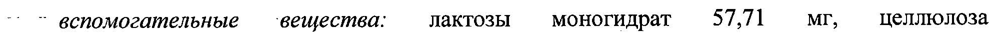
- стр. 1: «вспомогательные — вещества: лактозы моногидрат 61,76 МГ, | целлюлоза» — повторное чтение: «вспомогательные вещества: лактозы моногидрат 61,76 MI, | целлюлоза»  
  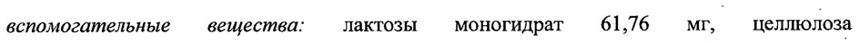
- стр. 2: «группы в 17% положении. При применении препарата Зоэли® средние концентрации E2» — низкая уверенность: «17%» (73)  
  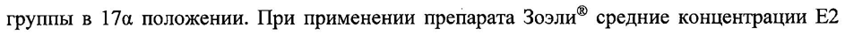
- стр. 3: «© Неэффективность метода — 1,22 (верхняя граница 95% доверительного интервала 2,18);» — повторное чтение: «»  
  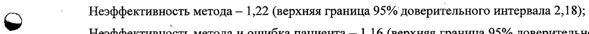
- стр. 4: «© | максимальная концентрация в плазме составляет около 7 нг/мл и достигается через 2 4.» — повторное чтение: «»  
  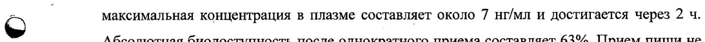
- стр. 4: «Период полувыведения (T12) в равновесном состоянии составляет 46 4 (от 28 до 83 ч).» — повторное чтение: «Период полувыведения (T12) в равновесном состоянии составляет 46 ч (от 28 до 83 ч).»  
  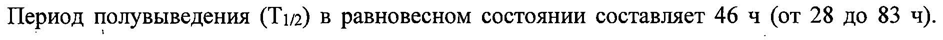
- стр. 12: «. On 2 г }» — низкая уверенность: «2» (38); повторное чтение: «- _ > г р»  
  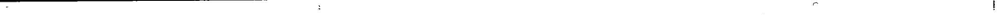
- стр. 14: «| акне (15,4%) и нерегулярное кровотечение отмены (9,8%). |» — низкая уверенность: «(9,8%).» (31)  
  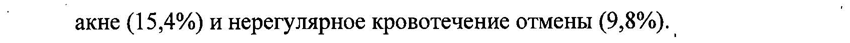
- стр. 18: «95% и увеличивает АОСо-иазю эстрадиола на 25%. Сопутствующий прием кетоконазола» — низкая уверенность: «95%» (48)  
  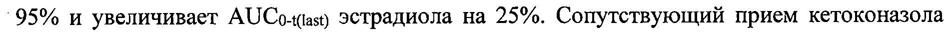
- стр. 18: «| (однократная доза 200 мг) не оказывает влияния на метаболизм эстрадиола, но увеличивает» — повторное чтение: «| (однократная доза 200 Mr) He оказывает влияния Ha метаболизм эстрадиола, но увеличивает»  
  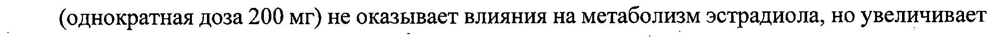
- стр. 25: «© (несколько лет) монотерапии номегэстролом в дозах 3,75 мг или 5 мг/сутки и выше. Если у:» — повторное чтение: «fay (несколько лет) монотерапии номегэотролом в дозах 479 мг wait мути тие Hea y |»  
  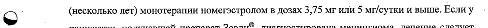
- стр. 27: «| 18-32% случаев (на протяжении циклов с 1 no 12). В подобных случаях отсутствие» — низкая уверенность: «18-32%» (46)  
  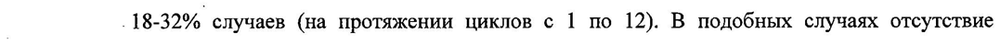
- стр. 27: «кровотечений/«мажущих» выделений в последующих циклах. У 4,6% женщин наблюдалось |» — повторное чтение: «»  
  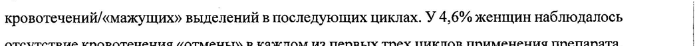
