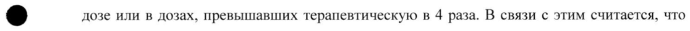
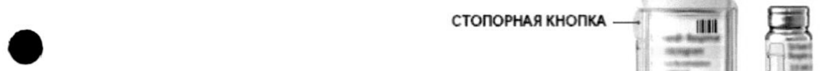
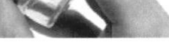

# Олодатерол — ингаляц

- Препарат: Стриверди® Респимат® (раствор для ингаляций дозированный;)
- АТХ: 
- Источник: ГРЛС, инструкция по медицинскому применению, РУ ЛП-002035, файл от  (https://grls.rosminzdrav.ru/Grls_View_v2.aspx?routingGuid=18c53105-9afe-4dc4-ad25-0862595caaac)
- Распознано автоматически (OCR): 14 из 14 стр.
- Инструкция к другому РУ того же препарата: ЛП-002035 (срок действия истёк, решение от 13.08.2019). Текст может быть старше действующего
- Сомнительных строк после OCR: 3 (см. раздел «Проверка распознавания»)

## Общие сведения

ры О ж———— — МИНЗДРАВ РОССИИ | AM GAGS - 130618 |
МИНИСТЕРСТВО ЗДРАВООХРАНЕНИЯ ОССИЙСКОЙ о РИ |
СОТЛАСОВАНО ИНСТРУКЦИЯ О по медицинскому применению лекарственного препарата
Стриверди® Респимат® | Регистрационный номер: JITI-002035
Торговое наименование: СТРИВЕРДИ® РЕСПИМАТ®
Международное непатентованное наименование: олодатерол

## 3. Лекарственная форма

раствор для ингаляций дозированный
раствор для ингаляций дозированный

## 2. Состав

| Одна ингаляционная доза содержит Активное вещество: олодатерол — 0,0025 мг (соответственно олодатерола гидрохлорида 0,0027 мг)
Вспомогательные вещества: бензалкония хлорид - 0,0011 мг, динатрия эдетат — 0,0011 мг, лимонная кислота безводная — 0,0003 мг, вода очищенная — до 11,05 мг.
® Описание: Прозрачный, бесцветный или почти бесцветный раствор в картридже вместимостью 4,5 мл, помещенном в алюминиевый цилиндр.
Фармакотерапевтическая группа: В›-адреномиметик длительного действия
Код ATX: RO3AC19 Фармакологические свойства

## 5.1. Фармакодинамика

Олодатерол обладает высоким сродством и селективностью к }В›-адренорецепторам.
Олодатерол обладает высоким сродством и селективностью к }В›-адренорецепторам.
Активация В>-адренорецепторов в дыхательных путях приводит к стимуляции
| внутриклеточной аденилатциклазы, которая участвует в синтезе циклического 3,5аденозинмонофосфата (цАМФ).
Повышение уровня цАМФ вызывает бронходилатацию, расслабляя гладкомышечные клетки в дыхательных путях. Олодатерол является селективным агонистом }В>- адренорецепторов длительного действия, характеризуется быстрым началом действия и длительным сохранением эффекта в течение не менее 24 ч. В»›-адренорецепторы присутствуют не только в гладких мышцах дыхательных путей, но и на поверхности многих других клеток, в том числе в эпителии и эндотелии легких и сердца. Точная функция бета›-рецепторов в сердце не известна, но их присутствие указывает на возможность влияний на сердце даже высокоселективных бета›-адренергических агонистов. Установлено, что однократное применение олодатерола в дозах 10, 20, 30 и 50 мкг приводило через 20 мин — 2 ч к увеличению (по сравнению с плацебо) интервала
ОТ (по сравнению с исходным значением), который по мере повышения дозы в среднем возрастал с 1,6 мс (олодатерол в дозе 10 мкг) до 6,5 мс (олодатерол в дозе 50 мкг). Не было обнаружено каких-либо тенденций к изменению средних величин частоты ритма сердца или частоты экстрасистол и их типа в зависимости от величины дозы препарата или от времени.
Исследования показали: применение СТРИВЕРДИ РЕСПИМАТ в дозе 5 мкг один раз в день, утром, приводило к значительному улучшению (р<0,0001) функции легких в течение 5 мин после первой дозы (среднее увеличение OMB, составляло 0,130 л по сравнению с | исходным значением до лечения 1,18 л). Существенное улучшение функции легких | сохранялось в течение 244, среднее увеличение AUCp.3 ОФВ! составляло 0,162 1 по сравнению с плацебо, р<0,0001; среднее увеличение базального (через 24 4) ОФВ!
составляло 0,071 л по сравнению с плацебо, р<0,0001.
©® В двух исследованиях переносимости физической нагрузки было установлено, что
СТРИВЕРДИ РЕСПИМАТ по сравнению с плацебо увеличивает время до наступления
| усталости (соответственно Ha 14% p=0,0002 и на 11,8% p=0,0018). СТРИВЕРДИ
| РЕСПИМАТ по сравнению с плацебо так же уменьшает гиперинфляцию легких
(функциональную остаточную емкость легких), что приводит к увеличению емкости вдоха в покое и во время осуществления физической нагрузки.

## 5.2. Фармакокинетика

Олодатеролу свойственна линейная фармакокинетика. При однократном ингаляционном применении доз, составлявших от 5 до 70 микрограмм, а также после многократного применения препарата один раз в день в дозах, составлявших от 2 до 20 микрограмм, системное воздействие увеличивалось пропорционально повышению дозы.
Олодатеролу свойственна линейная фармакокинетика. При однократном ингаляционном применении доз, составлявших от 5 до 70 микрограмм, а также после многократного применения препарата один раз в день в дозах, составлявших от 2 до 20 микрограмм, системное воздействие увеличивалось пропорционально повышению дозы.
| После повторного применения препарата один раз в день устойчивое состояние фармакокинетики олодатерола достигалось через 8 дней, а степень воздействия
| увеличивалась по сравнению с применением однократной дозы в 1,8 раза.
Всасывание Олодатерол быстро всасывается, после ингаляции препарата максимальные концентрации в плазме обычно достигаются в течение 10-20 минут. У здоровых добровольцев после ингаляции препарата абсолютная биодоступность олодатерола составляла около 30 %, тогда как абсолютная биодоступность олодатерола после приема препарата внутрь в виде раствора была ниже 1%. Таким образом, системное воздействие олодатерола после ингаляционного применения в основном реализуется путем всасывания в легких, а вклад проглатываемой части дозы в системное воздействие незначителен.
Распределение Олодатеролу после ингаляционного применения и внутривенного введения свойственна мультикомпартментная кинетика распределения. Объем распределения был высоким — 1110 л, что указывает на обширное распределение препарата в тканях. Связывание олодатерола с белками плазмы человека in vitro не зависит от концентрации и составляет примерно 60 %.
Биотрансформация Олодатерол в значительной степени метаболизируется путем непосредственной глюкуронизации и О-деметилирования метоксилированной части молекулы с последующей конъюгацией. Из шести идентифицированных метаболитов с }В>- рецепторами связывается только одно неконъюгированное деметилированное | производное (ЗОМ 1522), однако, этот метаболит не обнаруживался в плазме после длительного ингаляционного применения препарата в рекомендуемой терапевтической
©® дозе или в дозах, превышавших терапевтическую в 4 раза. В связи с этим считается, что фармакологическое действие обусловлено исключительно самим олодатеролом.
В О-деметилировании олодатерола участвуют цитохром Р450 изоэнзимы СУР2С9 и
| СУР2С8, и (в незначительной степени) СУРЗА4. В образовании глюкуронидов олодатерола участвуют изоформы уридиндифосфатгликозил трансферазы, UGT2B7,
UGTIAI1, 1A7 и 1А9.
Выведение Общий клиренс олодатерола у здоровых добровольцев составляет 872 мл/мин., а почечный клиренс 173 мл/мин. Конечный период полувыведения после внутривенного применения препарата составляет 22 4, тогда как конечный период полувыведения после ингаляционного применения препарата составляет примерно 45 ч. Из этого следует, что в последнем случае выведение в большей степени зависит от всасывания.
Общая меченная изотопом доза, выделявшаяся через почки (включая исходное соединение и все метаболиты) составляла после внутривенного введения 38 %, после приема внутрь 9%. Общая меченная изотопом доза, выделявшаяся через почки неизмененного олодатерола составляла, после внутривенного введения 19%. Общая меченная изотопом доза, выделявшаяся через кишечник, составляла после внутривенного введения 53 % и 84 % после приема внутрь.
Более 90 % дозы препарата выводилось после внутривенного введения в течение 5 дней и после приема внутрь в течение 6 дней. После ингаляционного применения препарата экскреция неизмененного олодатерола с мочой на протяжении интервала дозирования составляла у здоровых добровольцев в период устойчивого состояния фармакокинетики 57 % от величины дозы
Изменение дозы СТРИВЕРДИ РЕСПИМАТ в зависимости от массы тела, пола и возраста не требуется.
Пациенты с нарушениями функции почек | У пациентов с выраженным поражением почек (клиренс креатинина <30 мл/мин)
системное воздействие олодатерола увеличивалось в среднем в 1,4 раза. Такое повышение | воздействия не вызывает опасений в отношении безопасности, учитывая опыт, полученный в ходе применения СТРИВЕРДИ РЕСПИМАТ в клинических исследованиях.
Пациенты с нарушениями функции печени У пациентов с небольшим и умеренным поражением печени системное воздействие олодатерола не изменялось. Системное воздействие олодатерола у пациентов со значительным поражением печени не изучалось.
©

Раса Сравнение фармакокинетических данных, полученных в клинических исследованиях, выявило тенденцию к более высокому системному воздействию олодатерола у пациентов из Японии и других пациентов азиатской расы по сравнению с пациентами европеоидной расы.
В клинических исследованиях препарата СТРИВЕРДИ РЕСПИМАТ, применявшегося в дозах, которые превышали рекомендуемую терапевтическую дозу в два раза, у пациентов европеоидной и азиатской расы каких-либо опасений в отношении безопасности установлено не было.

## 4.1. Показания к применению

Препарат СТРИВЕРДИ РЕСПИМАТ, принимаемый один раз в сутки, показан для длительной поддерживающей терапии пациентам с хронической обструктивной болезнью
Препарат СТРИВЕРДИ РЕСПИМАТ, принимаемый один раз в сутки, показан для длительной поддерживающей терапии пациентам с хронической обструктивной болезнью

| легких (ХОБЛ), включая хронический бронхит и эмфизему легких, для уменьшения

| обструкции дыхательных путей; улучшения качества жизни и переносимости физических нагрузок.

## 4.3. Противопоказания

Препарат СТРИВЕРДИ РЕСПИМАТ противопоказан пациентам, у которых ранее отмечалась гиперчувствительность к олодатеролу или к любому компоненту препарата.
Препарат СТРИВЕРДИ РЕСПИМАТ противопоказан пациентам, у которых ранее отмечалась гиперчувствительность к олодатеролу или к любому компоненту препарата.
Препарат СТРИВЕРДИ РЕСПИМАТ не рекомендуется к применению у детей до 18 лет
(ввиду отсутствия данных по эффективности и безопасности).

## 4.3. С осторожностью

Сердечно-сосудистые заболевания, в т.ч. нестабильная ИБС, нарушения сердечного ритма, удлинение интервала ОТ, гипертрофическая обструктивная миокардиопатия, артериальная гипертензия, тиреотоксикоз, судороги.
Сердечно-сосудистые заболевания, в т.ч. нестабильная ИБС, нарушения сердечного ритма, удлинение интервала ОТ, гипертрофическая обструктивная миокардиопатия, артериальная гипертензия, тиреотоксикоз, судороги.
У пациентов, в анамнезе которых отмечались такие заболевания как: инфаркт миокарда или госпитализация по поводу сердечной недостаточности (в течение предшествующего
| года), жизнеугрожающая аритмия, пароксизмальная тахикардия с ЧСС> 100.
| Применение при беременности и в период грудного вскармливания
Клинических данных о влиянии препарата СТРИВЕРДИ РЕСПИМАТ на беременность
| нет. В доклинических исследованиях при применении высоких доз олодатерола, в
® несколько раз превышавших терапевтические дозы, установлены влияния типичные для
В>-адреномиметиков. Препарат не должен применяться у беременных женщин, если только потенциальная польза для матери превышает потенциальный риск для плода.
Следует учитывать ингибирующее влияние олодатерола на сократительную способность матки. |
| Клинических данных о влияния олодатерола у женщин, кормящих грудью, нет.
| Действующее вещество и/или его метаболиты обнаруживаются в молоке лактирующих крыс, однако неизвестно, проникает ли олодатерол в грудное молоко у человека.
Препарат не должен применяться у кормящих грудью женщин, если только потенциальная польза для матери превышает потенциальный риск для ребенка.

## 4.2. Способ применения и дозы

Рекомендуемая терапевтическая доза составляет две ингаляции спрея из ингалятора
Рекомендуемая терапевтическая доза составляет две ингаляции спрея из ингалятора
РЕСПИМАТ (5 мкг/терапевтическая доза) один раз в день, в одно и то же время суток (см.
Инструкцию по применению).
У пожилых пациентов, пациентов с легкими и умеренными нарушениями функции печени и пациентов с нарушениями функции почек можно использовать препарат СТРИВЕРДИ
| РЕСПИМАТ в рекомендуемой дозе. Данных о применении СТРИВЕРДИ РЕСПИМАТ у пациентов со значительными нарушениями функции печени не имеется.
Не следует превышать рекомендованную дозу препарата.

ХОБЛ обычно не развивается у детей. Безопасность и эффективность олодатерола у детей не изучены.
Инструкция по применению Введение Прочитайте эти Инструкции по применению перед началом использования препарата
СТРИВЕРДИ РЕСПИМАТ.
Вам нужно будет использовать этот ингалятор только ОДИН РАЗ В ДЕНЬ. Каждый раз при применении его делайте ДВЕ ИНГАЛЯЦИИ.
КОЛПАЧОК ВОЗДУХОЗАБОРНИК —— af КНОПКА ПОДАЧИ ДОЗЫ we i.
Е.
ae СТОПОРНАЯ КНОПКА — “И © Г =] 2% = = |=. vs
ПРОЗРАЧНАЯ ГИЛЬЗА Е A ПРОКАЛЫВАЮЩИЙ ЭЛЕМЕНТ — Г. =
КАРТРИДЖ Как ухаживать за ингалятором СТРИВЕРДИ РЕСПИМАТ
Очищайте мундштук, включая металлическую часть мундштука, влажной тряпочкой или тканью, по меньшей мере, один раз в неделю.
Любое незначительное изменение цвета мундштука не влияет на работу Вашего ингалятора СТРИВЕРДИ РЕСПИМАТ.
Как определить, когда нужен новый ингалятор СТРИВЕРДИ РЕСПИМАТ
$ ик ne ПИЯ кий ® Ваш ингалятор СТРИВЕРДИ РЕСПИМАТ содержит 203 «=
[ — 60 ингаляционных доз (т.е. 30 терапевтических доз) при
„—— { полный = " условии применения в соответствии с указаниями (две
\ ] ингаляционные дозы один раз в день).
-—-
> » Индикатор доз показывает, сколько примерно доз еще
| осталось.
» Когда индикатор доз покажет на красную область шкалы, это означает, что лекарства осталось примерно на 7 дней
| (14 ингаляционных доз).
e Когда индикатор доз ингалятора достигнет конца красной | шкалы, это означает, что ингалятор СТРИВЕРДИ
РЕСПИМАТ пуст, и он автоматически заблокируется
(поворот прозрачной гильзы будет невозможен).
» Через три месяца после первого использования
СТРИВЕРДИ РЕСПИМАТ следует выбросить, даже если он полностью не использован.
Подготовка для первого использования rz "\ СТОПОРНАЯ КНОПКА 1. Снимите прозрачную гильзу |
ПРОЗРАЧНАЯ ГИЛЬЗА | < ® Держите колпачок закрытым. |
‘“«, sige ° Нажмите стопорную кнопку и сильно
“че < 4 >, (2 <“ ‘ ve, =. потяните при этом другой рукой за прозрачную
~ 8% ® гильзу.
м — 2. Вставьте картридж = — e Вставьте картридж узким концом в ингалятор.
— 1 чей e Поставьте ингалятор дном картриджа на
| = : 2 “ЩЕЛЧОК” твердую поверхность и сильно нажмите на
Е * | a=. ь него, пока картридж не встанет на место со щелчком.
ane \ 3. Установите на место прозрачную гильзу e Установите прозрачную гильзу на место до и) щелчка.
р, СТРЕЛКИ 4. Поверните гильзу г ' e Держите колпачок закрытым.
> e Поверните прозрачную гильзу в направлении,
“2 + указанном стрелками на этикетке, пока не
&X г < раздастся щелчок (пол-оборота).
5. Откройте колпачок a КОЛПАЧОК
| e Откройте колпачок до упора.
7’ Ш 24 6. Нажмите на кнопку KHONKA = a ПОДАЧИ KS WA e Направьте ингалятор вниз.
дозы | \ e Нажмите кнопку подачи дозы.
№ ’ за ( › © e Закройте колпачок.
i ШАГИ 4-6 | e Повторите шаги 4-6 до появления облачка
| аэрозоля.
| | ® ® Затем повторите шаги 4-6 еще три раза.
| Ежедневное применение ‘ Поверните | й e Держите колпачок закрытым.
ь а » Поверните прозрачную гильзу в направлении,
(2 указанном стрелками на этикетке, до щелчка (пол-
| & оборота).
`- 7 | Откройте колпачок КОЛПАЧОК | » Откройте колпачок до упора.
~~ | : ea.
| Нажмите на кнопку ь В } — e Сделайте медленный полный выдох.
q a Zz > © Обхватите мундштук губами, не перекрывая
= pie воздухозаборники.
Е A д ; e Делая медленный, глубокий вдох через рот,
| — EE | нажмите кнопку подачи дозы и продолжайте
® _ ОДИНРАЗ
4 В ДЕНЬ y делать вдох.
ВОЗДУХОЗАБОРНИК e Задержите дыхание примерно на 10 секунд.
Для получения второй ингаляционной дозы повторите операции: Поверните, Откройте, Нажмите.

## 4.8. Побочное действие

Побочные реакции были выявлены на основании данных, полученных при проведении клинических исследований препарата СТРИВЕРДИ РЕСПИМАТ.
Побочные реакции были выявлены на основании данных, полученных при проведении клинических исследований препарата СТРИВЕРДИ РЕСПИМАТ.
| Олодатерол относится к группе В›-адреномиметиков длительного действия. Поэтому следует принимать во внимание возможность возникновения нежелательных эффектов, характерных для всего класса В-адреномиметиков, таких как: тахикардия, аритмия, e сердцебиение, ишемия миокарда, стенокардия, гипертензия или гипотензия, тремор, головная боль, нервозность, бессонница, головокружение, сухость во рту, тошнота, мышечный спазм, усталость, недомогание, гипокалиемия, гипергликемия и метаболический ацидоз.
Инфекции и инвазии назофарингит Нарушения со стороны нервной системы головокружение
Нарушения со стороны сердечно-сосудистой системы повышение артериального давления
Нарушения со стороны кожных покровов кожная сыпь
Костно-мышечная система и связанные с ней заболевания соединительной ткани артралгия
Возникновение сыпи может рассматриваться как реакция гиперчувствительности на
СТРИВЕРДИ РЕСПИМАТ. Возможны и другие реакции гиперчувствительности (как и в случае местного применения любых всасывающихся препаратов).

## 4.9. Передозировка

Симптомы Передозировка олодатерола может привести к выраженным эффектам, типичным для В>- адреномиметиков, например, к ишемии миокарда, повышению или снижению артериального давления, тахикардии, аритмиям, ошущению — сердцебиения, головокружению, нервозности, бессоннице, беспокойству, головной боли, тремору, сухости во рту, спазму мышц, тошноте, усталости, недомоганию, гипокалиемии, гипергликемии и метаболическому ацидозу.
Симптомы Передозировка олодатерола может привести к выраженным эффектам, типичным для В>- адреномиметиков, например, к ишемии миокарда, повышению или снижению артериального давления, тахикардии, аритмиям, ошущению — сердцебиения, головокружению, нервозности, бессоннице, беспокойству, головной боли, тремору, сухости во рту, спазму мышц, тошноте, усталости, недомоганию, гипокалиемии, гипергликемии и метаболическому ацидозу.
Лечение передозировки Прием СТРИВЕРДИ РЕСПИМАТ должен быть прекращен. Показано поддерживающее и симптоматическое лечение. В серьезных случаях необходима госпитализация. Может рекомендоваться применение бета1-адреноблокаторов, но только при соблюдении особой осторожности, так как применение этих препаратов может вызвать бронхоспазм.

## 4.5. Взаимодействие с другими лекарственными средствами

Одновременное применение других адренергических препаратов может усиливать нежелательные эффекты СТРИВЕРДИ РЕСПИМАТ.
©® Ксантиновые производные, стероиды, диуретики

Одновременное применение ксантиновых производных, стероидов или калийнесберегающих диуретиков может усиливать гипокалиемический эффект

адреномиметиков (см. раздел «Особые указания»). Следует соблюдать осторожность при применении препарата с калийнесберегающими диуретиками (в связи с возможностью потенцирования гипокалиемии и увеличением риска сердечно-сосудистых осложнений).
В -блокаторы В-адреноблокаторы могут ослаблять эффект СТРИВЕРДИ РЕСПИМАТ или противодействовать этому эффекту. Поэтому СТРИВЕРДИ РЕСПИМАТ должен применяться вместе с бета-адреноблокаторами (включая глазные капли) только в вынужденных ситуациях. В этом случае предпочтительно применение бета1-

| адреноблокаторов, хотя и они должны применяться с осторожностью.
Ингибиторы МАО, трициклические антидепрессанты, лекарственные препараты, удлиняющие интервал ОТс
Ингибиторы моноаминооксидазы, трициклические антидепрессанты или другие препараты, способные удлинять интервал ОТс, могут усиливать действие СТРИВЕРДИ
РЕСПИМАТ на сердечно-сосудистую систему. Совместное применение СТРИВЕРДИ

| РЕСПИМАТ с кетоконазолом приводило к увеличению системного воздействия олодатерола в 1,7 раза, однако это не влияло на безопасность. Изменений дозирования не требуется.
Фармакокинетические лекарственные взаимодействия
В исследовании лекарственного взаимодействия при применении кетоконазола — сильного двойного ингибитора CYP и P-gp — наблюдалось увеличение системного воздействия олодатерола в 1,7 раза. Одновременное применение кетоконазола в дозе 400 мг один раз в день в течение 14 дней увеличивало значение Са» олодатерола на 66%, а значение АДС.
на 68%. В клинических исследованиях, продолжавшихся до | года, при применении
СТРИВЕРДИ РЕСПИМАТ в дозах, превышавших рекомендуемую терапевтическую дозу до двух раз, каких-либо проблем безопасности не наблюдалось. Коррекция дозы препарата не требуется.
Флуконазол Одновременное применение флуконазола в дозе 400 мг один раз в день в течение 14 дней не оказывало значимого влияния на системное воздействие олодатерола.
Тиотропий Одновременное применение тиотропия бромида в дозе 5 мкг (доставляется в виде

® фиксированной комбинации доз с 10 мкг олодатерола через Респимат) в течение 21 дня не

оказывало значимого влияния на системное воздействие олодатерола и наоборот.

## 4.4. Особые указания

| Препарат СТРИВЕРДИ РЕСПИМАТ предназначен для поддерживающего лечения

пациентов ХОБЛ. В связи с тем обстоятельством, что в общей популяции ХОБЛ существенно преобладают пациенты в возрасте старше 40 лет, при назначении препарата пациентам до 40 лет требуется спирометрическое подтверждение диагноза ХОБЛ.
Бронхиальная астма СТРИВЕРДИ РЕСПИМАТ не должен использоваться при бронхиальной астме.
Долговременная эффективность и безопасность олодатерола при бронхиальной астме не изучались.
Острый бронхоспазм СТРИВЕРДИ РЕСПИМАТ не показан для лечения острых эпизодов бронхоспазма, то есть в качестве средства скорой помощи.

|

|

| Гиперчувствительность

После применення СТРИВЕРДИ PECIIMMAT возможно развитие реакций гиперчувствительности немедленного типа (как и при применении любых лекарственных средств).
Парадоксальный бронхоспазм Применение СТРИВЕРДИ РЕСПИМАТ, как и других ингаляционных лекарственных средств, может привести к парадоксальному бронхоспазму, иногда угрожающему жизни.
В случае развития парадоксального бронхоспазма применение СТРИВЕРДИ РЕСПИМАТ должно быть немедленно прекращено и назначена альтернативная терапия.
Системные эффекты В>-адреномиметики длительного действия следует применять с осторожностью у пациентов с необычными реакциями на симпатомиметические амины.
Сердечно-сосудистые эффекты Олодатерол, как и другие В›-адреномиметики, может оказывать клинически существенные влияния на сердечно-сосудистую систему у некоторых пациентов (учащение пульса, повышение артериального давления и/или появление соответствующих жалоб). В случае возникновения таких влияний может потребоваться прекращение лечения. Кроме того,

® сообщалось, что В>-адреномиметики приводили к таким изменениям электрокардиограммы (ЭКГ), как уплощение зубца Т и депрессия сегмента ST, хотя клиническое значение этих изменений неизвестно.
Гипокалиемия В>-адреномиметики у некоторых пациентов могут вызывать существенную гипокалиемию, создающую предпосылки для возникновения нежелательных влияний на сердечнососудистую систему. Снижение концентрации калия в сыворотке обычно кратковременно и не требует его восполнения. У пациентов с тяжелой ХОБЛ гипокалиемия может усиливаться гипоксией и сопутствующим лечением (см. раздел «Взаимодействие с другими лекарственными средствами») и увеличивать риск развития аритмий.
Гипергликемия Ингаляционное применение больших доз [›-адреномиметиков может привести к увеличению концентрации глюкозы в плазме.
СТРИВЕРДИ РЕСПИМАТ не следует применять в комбинации с каким-либо другим лекарственным препаратом, содержащим В›-адреномиметики длительного действия.
Пациентов, часто применяющих ингаляционные В›-адреномиметики короткого действия
(например, четыре раза в день), необходимо проинструктировать о том, что эти препараты

используются только для облегчения острых симптомов бронхоспазма.
| Анестезия Следует соблюдать осторожность в случае запланированной операции с галогенированными углеводородными анестетиками из-за повышенного влияния бетаагонистов на неблагоприятные сердечные эффекты. |
Влияние препарата на способность управлять транспортными средствами и | механизмами
Исследования по изучению влияния на способность управлять транспортными средствами | и механизмами не проводились. Следует соблюдать осторожность при выполнении данных видов деятельности, так как возможно развитие головокружения.

## 6.5. Форма выпуска

Раствор для ингаляций 2,5 мкг/доза
Раствор для ингаляций 2,5 мкг/доза
Ингалятор Респимат® в комплекте с картриджем вместимостью 4,5 мл, помещенным в алюминиевый цилиндр. Ингалятор и цилиндр с картриджем с инструкцией по

| применению в картонной пачке. | Условия хранения

® При температуре не выше 25 °С, в защищенном от света месте.
Использовать в течение 3 месяцев после первой ингаляции.
Хранить в недоступном для детей месте!

## 6.3. Срок годности

3 года.
3 года.
Не применять после истечения срока годности, указанного на упаковке.
Условия отпуска из аптек По рецепту врача.
Владелец Регистрационного удостоверения:
Берингер Ингельхайм Интернешнл ГмбХ Бингер штрассе 173, 55216 Ингельхайм-на-Рейне, Германия
Производитель: | Берингер Ингельхайм Фарма ГмбХ и Ко.КГ
Бингер штрассе 173, 55216 Ингельхайм-на-Рейне, Германия
Получить дополнительную информацию о препарате, а также направить свои претензии и информацию о нежелательных явлениях можно по следующему адресу в
России ООО «Берингер Ингельхайм»
125171, Москва, Ленинградское шоссе, 16А, стр.3
Тел: +7 (495) 544 50 44 Факс: +7 (495) 544 56 20
Менеджер по регистрации Сы NEN Тихонов Л.Л.
( (@ meee CN 4 | |
## Проверка распознавания

Страницы-сканы распознаны автоматически. В 3 строках с дозировками цифры могли распознаться с ошибкой — сверьте с вырезкой из оригинала:

- стр. 3: «©® дозе или в дозах, превышавших терапевтическую в 4 раза. В связи с этим считается, что» — повторное чтение: «©® дозе или в дозах, превышавших терапевтическую в 4 pa3a. В связи с этим считается, что»  
  
- стр. 6: «© Г =] 2%» — низкая уверенность: «2%» (55); повторное чтение: «* В “4 = | =»  
  
- стр. 7: «~ 8%» — низкая уверенность: «8%» (0); повторное чтение: «~~ № _»  
  
