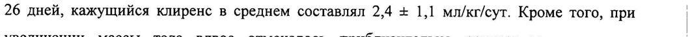

# Омализумаб — парентерально

- Препарат: Ксолар® (лиофилизат для приготовления раствора для подкожного введения;)
- АТХ: R03DX05
- Источник: ГРЛС, инструкция по медицинскому применению, РУ ЛСР-000082, файл от 2023-11-30 (https://grls.rosminzdrav.ru/Grls_View_v2.aspx?routingGuid=d09dce42-ed01-4ff7-9c75-37757e0ff595)
- Распознано автоматически (OCR): 18 из 18 стр.
- Сомнительных строк после OCR: 1 (см. раздел «Проверка распознавания»)

## Общие сведения

МИНИСТЕРСТВО ЗДРАВООХРАНЕНИЯ РОССИЙСКОЙ ФЕДЕРАЦИИ
ИНСТРУКЦИЯ по применению лекарственного препарата для м ере-нрименения== -==—-
МИНЗДРАВ РОССИИ КСОЛАР [6Р- 000A - 100316
COT AACOBAHO Внимательно прочитайте эту инструкцию перед тем, как начать применение этого лекарственного средства.
* Сохраните инструкцию, она может потребоваться вновь.
. Еслиу Вас возникли вопросы, обратитесь к врачу.
* Это лекарственное средство назначено лично Вам, и его не следует передавать другим лицам, поскольку оно может причинить им вред даже при
— наличии тех же симптомов, что иу Вас.
РЕГИСТРАЦИОННЫЙ НОМЕР: ЛСР-000082 ТОРГОВОЕ НАЗВАНИЕ: Ксолар |
МЕЖДУНАРОДНОЕ НЕПАТЕНТОВАННОЕ НАЗВАНИЕ (МНН): омализумаб ,

## 3. Лекарственная форма

лиофилизат для приготовления раствора для подкожного введения.
лиофилизат для приготовления раствора для подкожного введения.
Препарат представляет собой гуманизированные моноклональные антитела, полученные | на основе рекомбинантной ДНК.

## 2. Состав

1 флакон содержит: активное вещество — омализумаб - 150 мг, а также вспомогательные | вещества: сахароза - 108,0 mr, Г.-гистидин - 1,3 мг, Г.-гистидина гидрохлорида моногидрат |
- 2,1 мг, полисорбат 20 - 0,4 мг.
Растворитель: вода для инъекций - 2,0 мл.
ОПИСАНИЕ: | Лиофилизат: белого или почти белого цвета. |
Растворитель: прозрачная бесцветная жидкость.
ФАРМАКОТЕРАПЕВТИЧЕСКАЯ ГРУППА: другие средства для системного применения при | обструктивных заболеваниях дыхательных путей. |
Код ATX: RO3DX05 | ФАРМАКОЛОГИЧЕСКИЕ (ИММУНОЛОГИЧЕСКИЕ) СВОЙСТВА

## 5.1. Фармакодинамика

Омализумаб является гуманизированным моноклональным антителом, полученным на
Омализумаб является гуманизированным моноклональным антителом, полученным на
; 1/18 основе рекомбинантной ДНК, селективно связывающимся с иммуноглобулином (IgE).
Омализумаб представляет собой IgG, каппа антитело, содержащее человеческую структурную основу с определяющими комплементарность участками мышиного антитела, связывающими IgE. |
Пациенты с атопической бронхиальной астмой
Омализумаб связывается с IgE и предотвращает его взаимодействие с высокоаффинным
FceRI-penentopom. Таким образом, происходит снижение количества свободного IgE, который является пусковым фактором для каскада аллергических реакций.
При применении препарата у пациентов с атопической бронхиальной астмой (БА)
отмечается заметное уменьшение количества Ес=ВГ-рецепторов на поверхности базофилов.
В клинических исследованиях у пациентов с БА концентрация свободного IgE в сыворотке крови дозозависимо уменьшалась в течение 1 часа после введения первой дозы препарата Ксолар и сохранялась на достигнутом уровне в период между введением последующих доз. При применении в рекомендуемых дозах среднее уменьшение концентрации свободного 12Е в сыворотке крови составляло более 96%. Общая концентрация IgE (связанного и несвязанного) в сыворотке крови увеличивалась после применения первой дозы вследствие образования комплекса омализумаб-эЕ, характеризующегося более медленной скоростью выведения по сравнению со свободным
IgE. На 16 неделе после введения первой дозы препарата средняя концентрация общего
IgE в сыворотке крови была в 5 раз выше по сравнению с таковым до лечения. После отмены лечения препаратом обусловленное его действием увеличение концентрации общего IgE и уменьшение концентрации свободного IgE были обратимыми. После полного выведения омализумаба из организма не наблюдалось увеличения концентрации
IgE в сыворотке крови. Концентрация общего IgE оставалась повышенной в течение 1 года после отмены препарата Ксолар.
При применении препарата Ксолар у пациентов со среднетяжелой и тяжелой атопической
БА отмечалось достоверное уменьшение частоты обострений БА (определяемых как ухудшение течения БА, требующее применения системных глюкокортикостероидов
(ГКС) или удвоения исходной дозы ингаляционных ГКС) и снижение потребности в ингаляционных ГКС по сравнению с плацебо.
При применении препарата Ксолар в течение 16 недель на фоне постепенного уменьшения дозы ингаляционных или пероральных ГКС также наблюдалось достоверное уменьшение частоты обострений БА и снижение потребности в ингаляционных ГКС по сравнению с плацебо.
У пациентов с БА и круглогодичным аллергическим ринитом, получавших терапию ГКС, 2/18 при применении омализумаба в течение 28 недель отмечалось снижение выраженности симптомов БА и круглогодичного аллергического ринита, а также улучшение параметров легочной функции. Уменьшение частоты обострений БА и улучшение качества жизни пациентов (по сертифицированному опроснику качества жизни) на фоне терапии препаратом Ксолар сохранялось в течение длительного времени по сравнению с плацебо.
При применении препарата Ксолар у детей от 6 до 12 лет в течение 52 недель было отмечено снижение частоты обострений БА по сравнению с группой пациентов, получавших плацебо. В другом исследовании на фоне применения препарата Ксолар в течение 28 недель у детей в возрасте 6-12 лет было отмечено уменьшение частоты и выраженности обострений БА, а также снижение дозы применяемых ингаляционных ГКС к концу 28 недели терапии по сравнению с группой применения плацебо.
Пациенты с хронической идиопатической крапивницей
У некоторых пациентов с хронической идиопатической крапивницей (ХИК) из сыворотки крови были выделены аутоиммунные антитела к IgE и Ес=В1-рецептору. Данные антитела способны к активации базофилов или тучных клеток, что приводит к высвобождению гистамина.
Одна из гипотез механизма действия омализумаба у пациентов с ХИК заключается в снижении концентрации свободного IgE в крови, а затем и в коже. В результате уменьшается передача сигнала посредством Ес=К-рецепторов и, следовательно, подавляется активация клеток, участвующих в воспалительной реакции. Таким образом, частота возникновения и выраженность симптомов ХИК снижается.
Кроме того, считается, что снижение концентрации циркулирующего IgE приводит к быстрой неспецифической десенсибилизации тучных клеток в коже, a Ес=В]-рецепторы посредством обратной отрицательной связи поддерживают данную реакцию.
В клинических исследованиях у пациентов с ХИК, так же как и у пациентов с атопической
БА, применение омализумаба приводило к дозозависимому снижению концентрации свободного IgE и повышению концентрации общего IgE. Максимальное снижение концентрации свободного IgE наблюдалось через 3 дня после подкожного (п/к) введения первой дозы препарата Ксолар.

| После повторного введения препарата 1 раз каждые 4 недели, концентрация свободного
IgE в сыворотке крови перед введением очередной дозы сохранялась на достигнутом уровне в период между 12 и 24 неделями лечения. Концентрация общего IgE в сыворотке крови повышалась после введения первой дозы вследствие образования комплекса омализумаб-2Е, характеризующегося более медленной скоростью выведения по сравнению со свободным IgE. После повторного введения препарата 1 раз каждые 4 недели в дозе от 75 мг до 300 мг, концентрация общего IgE в сыворотке крови на 12

3/18 неделе от начала лечения была в 2-3 раза выше по сравнению с таковым до лечения и

сохранялась на достигнутом уровне в период между 12 и 24 неделями лечения. После

отмены препарата Ксолар в течение 16 недель последующего наблюдения концентрация

общего IgE уменьшалась, а концентрация свободного IgE увеличивалась, приближаясь к

исходным значениям.

При применении препарата Ксолар в дозах 150 и 300 мг каждые 4 недели у пациентов с

ХИК наблюдались воспроизводимые и статистически значимые терапевтические эффекты

в отношении уменьшения тяжести зуда. Эффект достигал максимума к 12 неделе лечения

и сохранялся на протяжении всего периода наблюдения.

Кроме того, препарат Ксолар в дозе 300 мг, оказывал воспроизводимый и статистически

значимый эффект в отношении индекса активности крапивницы (UAS), доли дней без

ангионевротического отека, недельного индекса нарушений сна и качества жизни пациентов, оцениваемого по опроснику Cu-Q2oL (опросник для изучения качества жизни

у пациентов с ХИК), а также индексом DLQI (Дерматологический индекс качества

жизни).

## 5.2. Фармакокинетика

Всасывание

После п/к введения у пациентов с БА абсолютная биодоступность омализумаба составляет

в среднем 62%. При применении в дозах более 0,5 мг/кг фармакокинетика омализумаба

имеет линейный характер.

Пациенты с атопической БА

После однократного п/к введения у взрослых и подростков с БА всасывание омализумаба

происходит медленно, пик концентрации в сыворотке крови достигается в среднем через

7-8 дней.

После многократного введения омализумаба площадь под кривой «концентрация-время»

(AUC) в течение периода от 0 до 14 сут в равновесном состоянии была в 6 раз выше, чем

после введения однократной дозы.

Пациенты с ХИК

После однократного п/к введения у взрослых и подростков с ХИК всасывание

омализумаба происходит медленно, пик концентрации в сыворотке крови достигается в

среднем через 6-8 дней. При применении омализумаба у пациентов с ХИК в диапазоне доз

от 75 мг до 600 мг в виде однократной п/к инъекции фармакокинетика имеет линейный |

характер. Минимальная концентрация омализумаба в сыворотке крови увеличивается

пропорционально повышению дозы при введении 75 мг, 150 мг или 300 мг каждые 4

недели.

Распределение

4/18 | In vitro омализумаб с IgE образует комплекс определенного размера. Jn vitro или т vivo не наблюдалось образования преципитирующих комплексов и комплексов, молекулярный вес которых превышал 1 млн. дальтон.
В клинических исследованиях не выявлено специфического накопления омализумаба в каких-либо органах и тканях.
Пациенты с атопической БА У пациентов с атопической БА после п/к введения кажущийся объем распределения омализумаба составлял 78432 мл/кг.
Пациенты с ХИК На основании популяционной фармакокинетической модели было показано, что распределение омализумаба у пациентов с ХИК было сходно с таковым у пациентов с атопической БА.
| Выведение

Клиренс омализумаба включает как собственно клиренс IgG, так и клиренс путем специфического связывания и образования комплексов с лигандом-мишенью - свободным |
IgE сыворотки крови.
Печеночная элиминация IgG включает деградацию в ретикулоэндотелиальной системе печени и эндотелиальных клетках печени. Интактный IgG также выводится с желчью.
Пациенты с атопической БА У пациентов с БА период полувыведения омализумаба из сыворотки составлял в среднем 26 дней, кажущийся клиренс в среднем составлял 2,4 + 1,1 мл/кг/сут. Кроме того, при | увеличении массы тела вдвое отмечалось приблизительно двукратное увеличение | кажущегося клиренса. i
Пациенты с ХИК На основании популяционной фармакокинетической модели у пациентов с ХИК период полувыведения омализумаба из сыворотки крови при равновесной концентрации составлял в среднем 24 дня, кажущийся клиренс при равновесной концентрации в среднем составлял 240 мл/сут (что соответствует 3,0 мл/кг/сут для пациента с массой тела 80 кг).
Фармакокинетика в особых клинических случаях |
Возраст, расовая/этническая принадлежность, пол, масса тела, индекс массы тела, исходная концентрация IgE, аутоиммунные антитела к ЕсёВ]-рецептору, одновременное применение лекарственных средств
Пациенты с атопической БА У пациентов с БА не требуется коррекции дозы омализумаба в зависимости от возраста
(6-76 лет), расовой или этнической принадлежности, пола и индекса массы тела. |
Пациенты с ХИК

5/18 У пациентов с ХИК не требуется коррекции дозы омализумаба в зависимости от возраста

(12-75 лет), расовой или этнической принадлежности, пола пациента, массы тела, индекса

массы тела, исходной концентрации IgE, аутоиммунных антител к ЕсёВ-рецептору или

одновременного применения блокаторов Н2-гистаминовых рецепторов и антагонистов

лейкотриеновых рецепторов.

Нарушения функции почек и печени

Фармакокинетические и фармакодинамические параметры омализумаба у пациентов с

атопической БА или ХИК и нарушениями функции почек или печени не изучались.

Так как метаболизм препарата осуществляется преимущественно

ретикулоэндотелиальной системой, нарушение функции печени и почек не оказывают на

него влияния. Несмотря на то, что коррекция дозы омализумаба не требуется, препарат

следует применять с осторожностью у пациентов данной категории.

## 4.1. Показания к применению

e Лечение персистирующей атопической бронхиальной астмы среднетяжелого и тяжелого течения, симптомы которой недостаточно контролируются применением ингаляционных глюкокортикостероидов у пациентов 6 лет и старше. Препарат Ксолар следует применять у пациентов с исходной концентрацией IgE и массой тела, соответствующих приведенным в таблице по подбору режима дозирования (см. раздел
«Способ применения и дозы»).

e Лечение хронической идиопатической крапивницы, резистентной к терапии блокаторами Н!-гистаминовых рецепторов, у пациентов 12 лет и старше.

## 4.3. Противопоказания

Повышенная чувствительность омализумабу или к другому компоненту препарата.

Детский возраст до 6 лет у пациентов с атопической БА и до 12 лет у пациентов с ХИК в

связи с отсутствием соответствующих данных по эффективности и безопасности.

| С ОСТОРОЖНОСТЬЮ

Следует с осторожностью применять препарат у пациентов с нарушениями функции.

печени и/или почек, с аутоиммунными заболеваниями или заболеваниями, связанными с

накоплением иммунных комплексов.

При применении препарата Ксолар, как и при применении любых других

протеинсодержащих препаратов, могут возникать местные или системные аллергические |

реакции, включая анафилактические реакции. Перед введением препарата Ксолар

необходимо заранее приготовить соответствующее реанимационное оборудование и |

6/18 лекарственные средства, необходимые для купирования реакций гиперчувствительности.
Необходимо с осторожностью применять препарат у пациентов с повышенным риском развития гельминтных инвазий (особенно в эндемичных районах). |

## 4.6. Применение при беременности и в период грудного вскармливания

Специальных исследований по применению омализумаба у беременных женщин не проводилось. В экспериментальных исследованиях не было выявлено прямого или непрямого отрицательного влияния препарата на течение беременности, развитие эмбриона и плода, течение родов и развитие новорожденных. Известно, что молекулы IgG проникают через гемато-плацентарный барьер. Применение препарата во время беременности возможно только в случае, если польза для матери превышает потенциальный риск для плода.

| Человеческий IgG выделяется с грудным молоком. Неизвестно, выделяется ли омализумаб с грудным молоком у человека. Нельзя исключить риск для новорожденных/младенцев, находящихся на грудном вскармливании, поэтому омализумаб не следует применять в период грудного вскармливания. В случае необходимости применения препарата грудное вскармливание следует прекратить.
Влияние на фертильность Отсутствуют данные о влиянии омализумаба на фертильность у человека. Исследования продемонстрировали отсутствие нарушения мужской и женской фертильности у животных при применении многократных доз, превышающих 75 мг/кг.

## 4.2. Способ применения и дозы

| Только для подкожного введения! Препарат нельзя вводить внутривенно или внутримышечно.
Атопическая БА Дозу препарата Ксолар и периодичность введения определяют на основании исходной концентрации IgE (МЕ/мл), измеренной до начала лечения, а также массы тела (кг).
В зависимости от исходной концентрации IgE (МЕ/мл) и массы тела (кг), рекомендуемая доза препарата составляет от 75 до 600 мг 1 разв 2 или 4 недели (см. табл. 3 и 4).
Препарат Ксолар не следует применять у пациентов с исходной концентрацией IgE и массой тела, не соответствующих приведенным в таблице по подбору режима дозирования.
Определение количества флаконов, инъекций и общий объем раствора препарата Ксолар в зависимости от дозы см. в таблице 1.

7/18 Таблица 1. Количество флаконов, количество инъекций и общий объем раствора препарата в зависимости от дозы флаконов
ПОС ОЕ ОИ ПО ОИ ПОС ЗОО ПОС О ЗИ ПОР ОИ ПОР ЗОО
Расчет объема препарата для каждой дозы При разведении одного флакона препарата Ксолар получается 1,2 мл раствора для подкожного введения. Алгоритм расчета дозы на одну инъекцию представлен ниже в таблице 2.
Таблица 2. Алгоритм расчета объема раствора на одну п/к инъекцию в зависимости от дозы
7 Объем pS trae TC
= Г отораяиньекщия |G Рае.
| праяиньещия | п [четвертая инъекция |G
| Продолжительность лечения, мониторинг и коррекция дозы
Дозы препарата Ксолар следует корректировать при значительных изменениях массы тела
(см. Таблицы 3, 4).
Схемы определения дозы см. в таблицах 3 и 4.
8/18 | Таблица 3. Расчет дозы препарата Ксолар (мг) для п/к введения каждые 4 недели
Мате | Исходная >20- | >25- | >30- | >40- | >50- | >60- | >70- | >80- | >90- | >125концентрация | 25 30 40 50 60 70 80 90 125 150
IgE (МЕ/мл >30-100 >100-200 | 150_| 150 | 150 | 300 | 300 | 300 | 300 | 300 | 450 | 600 |
>200-300 | 150 | 150 | 225 | 300 | 300 | 450 | 450 | 450 | 600 |
>300-400 _| 225 | 225 | 300 | 450 | 450 | 450 | 600 | 600 |
>400-500 225 300 450 | 450 Применяется 1 разв 2 недели
>500-600 _| 300 | 300 | 450 | 600 | 600 | См. таблицу 4
>600-700 | 300 | | 450 | 600 | Таблица 4 . Расчет дозы препарата Ксолар (мг) для п/к введения каждые 2 недели
Мате | Исходная >20- | >25- | >30- | >40- | >50- | >60- | >70- | >80- | >90- | >125- | >150концентрация | 25 30 40 50 60 70 80 90 125 150 200
_ IgE (МЕ/мл >30-100 Применяется 1 раз в 4 недели | 225 |
>100-200 См. таблицу 3 >200-300 | >300-400
>400-500 | 375 | 375 | 525 | 600 | >500-600 | 375 | 450 | 450 | 600 |
>600-700 >700-800 _| 225 | 225 | 300 | 375 | 450 | 450 | 525 | 600 |
>800-900 | 225 | 225 | 300 | 375 | 450 | 525 | 600 _|
>900-1000 | 225 | 300 | 375 | 450 | 525 | 600 |
>1000-1100 | 225 | 300 | 375 | 450 | 600 |
>1100-1200 | 300 | 300 | 450 | 525 | 600 | Не применяется |
>1200-1300 >1300-1500 | 300 | 375 | 525 | 600 |
При применении препарата Ксолар в течение первых 16 недель в ходе клинических исследований наблюдалось уменьшение частоты развития обострений БА, снижение числа случаев применения неотложной терапии, а также улучшение симптомов заболевания. Оценку эффективности терапии препаратом Ксолар следует проводить по прошествии минимум 12 недель лечения препаратом.
Препарат Ксолар предназначен для длительной терапии. Отмена препарата, как правило, приводит к восстановлению повышенной концентрации свободного IgE и развитию соответствующих симптомов.
Концентрация общего IgE возрастает в ходе лечения и остается повышенной в течение одного года после прекращения терапии. Таким образом, концентрация IgE при повторном определении на фоне терапии препаратом Ксолар не может служить ориентиром для подбора дозы препарата. Для подбора дозы препарата после приостановления лечения на период менее 1 года следует ориентироваться на 9/18 концентрацию IgE в сыворотке крови, установленную до введения начальной дозы

препарата.

Если лечение препаратом Ксолар было приостановлено на 1 год или более для подбора

дозы препарата Ксолар следует повторно определить концентрацию IgE в сыворотке

крови.

Хроническая идиопатическая крапивница

Рекомендуемая доза препарата Ксолар составляет 300 мг каждые 4 недели в виде п/к

инъекции. Лечащему врачу следует периодически повторно оценивать необходимость

продолжения терапии препаратом.

Опыт длительного применения омализумаба в клинических исследованиях у пациентов с

ХИК ограничен.

Применение у детей и подростков

Препарат Ксолар не рекомендован к применению у пациентов с атопической БА в

возрасте до 6 лет и у пациентов с ХИК в возрасте до 12 лет в связи с отсутствием данных

по эффективности и безопасности.

Применение у пациентов пожилого возраста

Имеется ограниченный опыт применения препарата Ксолар у пациентов старше 65 лет.

Однако данных, свидетельствующих о необходимости коррекции дозы препарата у

пациентов этого возраста, нет.

Правила приготовления и введения раствора

При приготовлении раствора для подкожного введения препарата Ксолар следуйте

приведенным ниже инструкциям.

1. С помощью шприца с иглой 18-го калибра из ампулы набирают 1,4 мл воды для

инъекций для приготовления раствора.

2. Установив флакон с препаратом вертикально, его прокалывают иглой в соответствии с

правилами асептики и вводят воду для инъекций непосредственно в сухое вещество

препарата.

3. Сохраняя флакон в вертикальном положении, для равномерного пропитывания сухого

вещества водой для инъекций флакон осторожно вращают (не встряхивая) в течение 1

минуты.

4. Для облегчения растворения флакон вращают в течение 5-10 секунд приблизительно

каждые 5 минут, до полного растворения всех твердых частиц. В некоторых случаях для

полного растворения сухого вещества может потребоваться более 20 минут. В таком

случае повторяют вышеуказанные действия до растворения видимых гелеподобных

частиц.

После полного растворения сухого вещества в растворе не должно быть видимых 10/18 гелеподобных частиц. Допустимо наличие небольших пузырьков или пены по стенкам флакона. Полученный раствор должен быть прозрачным или слегка опалесцирующим, бесцветным или светло-желтоватого цвета. Нельзя использовать раствор при обнаружении в нем инородных частиц.
5. После извлечения иглы переверните флакон на 15 секунд для того чтобы дать возможность раствору перетечь по направлению к пробке. Используя новый шприц объемом 3 смз, оснащенный иглой 18 калибра с широким просветом, введите иглу в перевернутый флакон. Поместите конец иглы в самую низкую точку раствора, скопившегося в пробке флакона, и наберите раствор в шприц. Перед удалением иглы, вытяните поршень полностью назад до конца цилиндра шприца, чтобы удалить весь раствор из перевернутого флакона.
6. Замените иглу 18 калибра на иглу 25 калибра для подкожного введения.
7. Выпустите лишний воздух, крупные пузырьки и избыток раствора, чтобы получить требуемую дозу (объемом 1,2 мл). Тонкий слой небольших пузырьков может оставаться сверху раствора в шприце.
Так как раствор обладает определенной вязкостью, продолжительность инъекции может составить 5-10 секунд. |
8. Раствор препарата вводят подкожно в область дельтовидной мышцы или в | переднелатеральную область бедра, избегая области высыпаний при крапивнице.
Препарат Ксолар не следует смешивать с какими-либо другими лекарственными препаратами или растворами кроме воды для инъекций. |
Раствор следует использовать сразу после приготовления, поскольку препарат He | содержит антибактериальных консервантов.

| В случае необходимости допускается хранение раствора в течение 8 часов при | температуре от 2 до 8 °С и в течение 4 часов при 30 °С.
Неиспользованные остатки препарата и отходы упаковки утилизируют в соответствии с местными требованиями.

## 4.8. Побочное действие

Атопическая БА Наиболее частыми нежелательными явлениями (НЯ) при применении препарата Ксолар являются головная боль, реакции в месте инъекции, включая боль, отек, эритему и зуд в месте введения препарата. Большинство НЯ были легкой или умеренной степени тяжести.
Атопическая БА Наиболее частыми нежелательными явлениями (НЯ) при применении препарата Ксолар являются головная боль, реакции в месте инъекции, включая боль, отек, эритему и зуд в месте введения препарата. Большинство НЯ были легкой или умеренной степени тяжести.
Для определения частоты развития нежелательных реакций, выявленных в ходе клинических исследований, были использованы следующие критерии: очень часто
(>1/10), часто (>1/100, <1/10), нечасто (>1/1000, <1/100), редко (<1/1000).

| 11/18 Инфекционные и паразитарные заболевания: нечасто - фарингит; редко — паразитарные инвазии.
Нарушения со стороны иммунной системы: редко - анафилактические реакции и другие аллергические состояния, включая ангионевротический отек, возникновение антител к омализумабу.
Нарушения со стороны нервной системы: часто — головная боль; нечасто - головокружение, сонливость, парестезии, синкопальные состояния.
Нарушения со стороны сосудов: нечасто - постуральная гипотензия, «приливы».
Нарушения со стороны дыхательной системы, органов грудной клетки и средостения:
нечасто — кашель, аллергический бронхоспазм; редко — отек гортани.
Нарушения со стороны желудочно-кишечного тракта: нечасто - тошнота, диарея, диспепсические явления.

. Нарушения со стороны кожи и подкожных тканей: нечасто - крапивница, сыпь, зуд, фотосенсибилизация; редко — ангионевротический отек.
Общие расстройства и нарушения в месте введения: часто - реакции в месте инъекции, такие как боль, эритема, зуд, отечность; нечасто - увеличение массы тела, чувство усталости, отечность рук, гриппоподобное состояние.
На фоне терапии препаратом Ксолар в пострегистрационном периоде в клинической практике отмечались следующие НЯ, частота которых неизвестна, в связи с тем, что спонтанные сообщения о НЯ поступают в добровольном порядке из популяции неопределенного размера.
Нарушения со стороны иммунной системы: анафилаксия и анафилактоидные реакции
(отмечались как при первом, так и при повторном применениях препарата в большинстве случаев в течение 2-х часов после п/к инъекции, у некоторых пациентов спустя более 2 часов после введения препарата Ксолар), сывороточная болезнь, может включать повышение температуры тела, лимфаденопатию.
Нарушения со стороны кожи и подкожных тканей: алопеция.
Нарушения со стороны крови и лимфатической системы: тяжелая идиопатическая тромбоцитопения.
Нарушения со стороны дыхательной системы, органов грудной клетки и средостения:
аллергический гранулематозный васкулит (синдром Чарга-Стросс).
Нарушения со стороны скелетно-мышечной и соединительной ткани: артралгия, миалгия, припухлость суставов.
В клинических исследованиях у детей 6-12 лет были отмечены следующие НЯ:
Нарушения со стороны нервной системы: очень часто — головная боль.
Нарушения со стороны желудочно-кишечного тракта: часто - боль в верхнем отделе

12/18 живота.
Общие расстройства и нарушения в месте введения: очень часто — повышение температуры тела.
ХИК Наиболее частыми НЯ при применении препарата Ксолар у пациентов 12 лет и старше являются головная боль и назофарингит.
Представленные ниже НЯ отмечались у >1% пациентов во всех группах лечения и не менее чем на 2% чаще у пациентов, получавших препарат Ксолар в рекомендованных дозах (150 мги 300 мг), по сравнению с группой применения плацебо.
НЯ сгруппированы в соответствии с классификацией органов и систем органов MedDRA, в пределах каждой группы перечислены в порядке уменьшения частоты встречаемости.
Для определения частоты встречаемости использованы следующие критерии: очень часто
(>1/10), часто (>1/100, <1/10), нечасто (>1/1000, <1/100), редко (<1/1000), очень редко
(<1/10000).
Инфекционные и паразитарные заболевания: часто — назофарингит, синусит, инфекции верхних дыхательных путей, включая вирусной этиологии, инфекции мочевыводящих | путей. |
Нарушения со стороны нервной системы: очень часто — головная боль; часто — головная боль в области придаточных пазух носа. |
Нарушения со стороны скелетно-мышечной и соединительной ткани: часто — артралгия, миалгия, боль в конечностях, костно-мышечная боль.
Общие расстройства и нарушения в месте введения: часто — повышение температуры тела, реакции в месте инъекции, такие как отечность, эритема, боль, гематома, зуд,
| кровотечение, крапивница.

Анафилаксия В пострегистрационном периоде частота встречаемости анафилактических реакций при применении препарата Ксолар составила приблизительно 0,2% (из всех случаев анафилактических реакций на 500000 пациенто-лет).
Анафилактические реакции в анамнезе, не связанные с применением омализумаба, могут являться фактором риска развития анафилактической реакции на введение препарата
Ксолар.
Малигнизация Общая частота развития новообразований при применении препарата Ксолар в клинических исследованиях была сходной с таковой в общей популяции. Частота развития злокачественных новообразований в группе пациентов, получавших препарат
Ксолар, и в контрольной группе оценивалась <1/100. В наблюдательном исследовании при

13/18 |

сравнении пациентов, получавших лечение препаратом Ксолар, и пациентов, получавших

иное лечение продолжительностью до 5 лет, не было выявлено увеличения риска развития

злокачественных новообразований.

У детей 6-12 лет случаев развития злокачественных новообразований в группе пациентов,

получавших Ксолар, зарегистрировано не было.

Тромбоэмболические осложнения

В контролируемых клинических исследованиях у пациентов, получавших лечение

препаратом Ксолар, отмечалось развитие тромбоэмболических осложнений, включая

инсульт, транзиторные ишемические атаки, инфаркт миокарда, нестабильную

стенокардию, смерть от сердечно-сосудистых причин (в том числе, летальный исход по

неустановленным причинам).

При анализе основных факторов сердечно-сосудистого риска, соотношение рисков

составило 1,32.

Гельминтные инвазии

Возможно участие IgE в иммунном ответе при развитии гельминтных инвазий. В плацебо-

контролируемых исследованиях у пациентов с аллергическими заболеваниями и риском

развития гельминтных инвазий при применении препарата Ксолар отмечалась небольшое

повышение частоты возникновения гельминтозов (однако течение, тяжесть заболевания и

ответ на терапию не изменялись). Общая частота развития гельминтных инвазий во всех

клинических исследованиях была менее | из 1000 (дизайн исследований не включал

специальное изучение частоты развития гельминтных заболеваний).

Изменение количества тромбоцитов крови

При применении препарата Ксолар в ходе клинических исследований у нескольких
| пациентов наблюдалось снижение количества тромбоцитов ниже нормы, что не

сопровождалось кровотечением или уменьшением концентрации гемоглобина.

В ходе клинических исследований не было выявлено постоянного уменьшения количества

тромбоцитов.

Данные других лабораторных исследований

Значимых изменений лабораторных показателей в ходе клинических исследований не

выявлено.

## 4.9. Передозировка

О случаях передозировки омализумабом до настоящего времени не сообщалось.

Максимальная переносимая доза препарата Ксолар до настоящего времени не определена.

При однократном внутривенном введении в дозе до 4000 мг не отмечено признаков

дозолимитирующей токсичности. При введении наивысшей кумулятивной дозы препарата

14/18 |

- 44 000 мг в течение 20 недель не отмечалось развития каких-либо тяжелых острых НЯ.

## 4.5. Взаимодействие с другими лекарственными средствами

ВЗАИМОДЕЙСТВИЯ Поскольку [2Е может участвовать в формировании иммунного ответа на некоторые гельминтные инвазии, препарат Ксолар может косвенно снижать эффективность лекарственных средств для лечения гельминтных и других паразитарных инвазий.
Поскольку ферменты цитохрома Р450, механизмы системы энергетического выброса
(эффлюксные насосы) и связывания с белками не играют роли в клиренсе омализумаба, вероятность возникновения лекарственного взаимодействия с другими препаратами мала.
Специальных исследований по взаимодействию препарата Ксолар с лекарственными препаратами, включая вакцины, не проводилось. Взаимодействие омализумаба с лекарственными препаратами, используемыми для лечения БА или ХИК, маловероятно.
Атопическая БА В клинических исследованиях препарат Ксолар широко применяли в комбинации с ингаляционными и пероральными ГКС, ингаляционными бета2-адреномиметиками короткого и длительного действия, антагонистами лейкотриенов, теофиллином и пероральными антигистаминными средствами. Вышеуказанные препараты не влияют на безопасность препарата Ксолар.
В настоящее время данные по применению препарата Ксолар в комбинации со специфической иммунотерапией (гипосенсибилизирующей терапией) ограничены.
В клинических исследованиях препарат Ксолар применяли в комбинации с | антигистаминными средствами (блокаторами HI1- и Н?-гистаминовых рецепторов), | антагонистами лейкотриеновых рецепторов. Не выявлено влияния вышеуказанных препаратов на профиль безопасности препарата Ксолар. В результате популяционного | фармакокинетического анализа также не выявлено влияния блокаторов Н2-гистаминовых рецепторов и антагонистов лейкотриеновых рецепторов на фармакокинетику омализумаба. Применение препарата Ксолар в комбинации с иммунодепрессивными средствами не изучалось.
Препарат Ксолар не следует смешивать с какими-либо другими лекарственными препаратами или растворами кроме воды для инъекций.

## 4.4. Особые указания

Аллергические реакции При применении препарата Ксолар, как и при применении любых других
Аллергические реакции При применении препарата Ксолар, как и при применении любых других

15 / 18 протеинсодержащих препаратов, могут возникать местные или системные аллергические реакции, включая анафилактические реакции. Перед введением препарата Ксолар необходимо заранее приготовить соответствующее реанимационное оборудование и лекарственные средства, необходимые для купирования реакций гиперчувствительности.
Следует проинформировать пациентов о возможности развития анафилактических реакций и обеспечить соответствующее медицинское наблюдение. В клинических исследованиях развитие анафилаксии и анафилактоидных реакций отмечалось при применении как первой, так и повторных доз препарата Ксолар. В большинстве случаев возникновение таких реакций отмечалось в течение 2 часов после введения препарата.
Так же как при применении иных гуманизированных моноклональных антител - производных рекомбинантной ДНК, в редких случаях возможно образование антител к омализумабу.
| Сывороточная болезнь

У пациентов, получавших терапию гуманизированными моноклональными антителами, в том числе омализумабом, в редких случаях наблюдалось развитие сывороточной болезни и подобных ей состояний, являющихся проявлением отсроченных аллергических реакций 3 типа. Начало развития таких состояний обычно отмечалось на 1-5 день после первой или последующих инъекций, а также при длительной терапии. Симптомы, позволяющие заподозрить развитие сывороточной болезни, включают в себя: артрит/артралгию, сыпь
(крапивница или другие формы), лихорадку и лимфаденопатию. В качестве профилактики и лечения данной патологии возможно применение антигистаминных препаратов и | глюкокортикостероидов. Следует проинформировать пациента о возможности развития данного состояния и предупредить о необходимости обращения к врачу при появлении возможных симптомов.
Синдром Чарга-Стросс и гиперэозинофильный синдром
У пациентов с БА тяжелой степени в редких случаях может развиваться системный гиперэозинофильный синдром или аллергический эозинофильный гранулематозный васкулит (синдром Чарга-Стросс), для лечения которых обычно применяют терапию системными глюкокортикостероидами (ГКС).
В редких случаях у пациентов, получающих противоастматические лекарственные препараты, в том числе омализумаб, может проявиться или развиться системная эозинофилия или васкулит. Эти случаи, как правило, связаны со снижением дозы пероральных ГКС.
Врачу следует проявлять настороженность к развитию выраженной эозинофилии, васкулитной сыпи, ухудшения течения легочных симптомов, патологии придаточных пазух носа, осложнений со стороны сердца и/или нефропатии у таких пациентов.

16/18 В случае развития вышеуказанных нарушений тяжелой степени со стороны иммунной

системы следует рассмотреть возможность отмены омализумаба.

Общие указания

Препарат не следует применять для лечения острых приступов БА, острого бронхоспазма

или астматического статуса.

Не изучалось применение препарата Ксолар у пациентов с синдромом повышенной

концентрации IgE, с аллергическим бронхолегочным аспергиллезом, для профилактики

анафилактических реакций, при атопическом дерматите, аллергическом рините или при

пищевой аллергии.

Не изучалось применение препарата Ксолар у пациентов с нарушениями функции печени

и/или почек, аутоиммунными заболеваниями или заболеваниями, связанными с

накоплением иммунных комплексов. Следует соблюдать осторожность при применении

_ 3 препарата у таких пациентов.

Не следует резко отменять терапию системными или — ингаляционными

глюкокортикостероидами после начала лечения препаратом Ксолар. Дозу указанных

препаратов, применяемых одновременно с препаратом Ксолар, снижают постепенно под

наблюдением врача.

Содержание сахарозы в препарате не оказывает клинически значимого влияния на

концентрацию глюкозы в сыворотке крови у пациентов с сахарным диабетом, поэтому

коррекция дозы препарата Ксолар и гипогликемических препаратов не требуется.

## 4.7. Влияние на способность управлять транспортными средствами, механизмами

Пациентам, у которых на фоне применения препарата Ксолар возникает головокружение,

повышенная утомляемость, синкопальные состоя

ния или сонливость следует воздержаться от управления транспортными средствами и

механизмами.

@OPMA ВЫПУСКА

Лиофилизат для приготовления раствора для подкожного введения, 150 мг, в комплекте с

растворителем — вода для инъекций.

Лиофилизат для приготовления раствора для подкожного введения, 150 мг, во флаконе

вместимостью 6 мл из бесцветного стекла, укупоренном резиновой пробкой и

алюминиевой крышкой с пластиковым «отщелкивающимся» верхом.

Растворитель - вода для инъекций 2 мл в ампуле бесцветного стекла гидролитического

класса [.

Один флакон с лиофилизатом в комплекте с одной ампулой с растворителем и с 17/18 инструкцией по применению в картонной пачке.

## 6.4. Условия хранения

Хранить при температуре 2-8 °С. Не замораживать.
Хранить при температуре 2-8 °С. Не замораживать.
Препарат следует хранить в недоступном для детей месте.

## 6.3. Срок годности

Лиофилизат — 4 года;
Лиофилизат — 4 года;
Растворитель - 5 лет.
Дата истечения срока годности комплекта определяется по более ранней дате истечения срока годности компонента, входящего в комплект.
Препарат не следует применять по истечении срока годности.
УСЛОВИЯ ОТПУСКА По рецепту ПРОИЗВОДИТЕЛЬ
Новартис Фарма АГ, Швейцария, произведено Новартис Фарма Штейн АГ, Швейцария/
Novartis Pharma AG, Switzerland, manufactured by Novartis Pharma Stein AG, Switzerland.
AJIPEC:
Лихтштрассе 35, 4056 Базель, Швейцария / Lichtstrasse 35, 4056 Basel, Switzerland
ДОПОЛНИТЕЛЬНУЮ ИНФОРМАЦИЮ О ПРЕПАРАТЕ МОЖНО ПОЛУЧИТЬ ПО АДРЕСУ:
| 125315, Москва, Ленинградский проспект, дом 72, корпус 3 тел. (495) 967 12 70 факс (495) 967 12 68
@)
Стародубова М.В. i, <.
Менеджер отдела регулирования = Ls. Е обращения лекарственных средств Е Ke 57 2 s
OOO «Новартис Фарма» Ра NES 18/18
## Проверка распознавания

Страницы-сканы распознаны автоматически. В 1 строках с дозировками цифры могли распознаться с ошибкой — сверьте с вырезкой из оригинала:

- стр. 5: «26 дней, кажущийся клиренс в среднем составлял 2,4 + 1,1 мл/кг/сут. Кроме того, при |» — повторное чтение: «20 дней, кажущийся клиренс в среднем составлял 2,4 # 1 wavxrieyr. Кроме того, при»  
  
