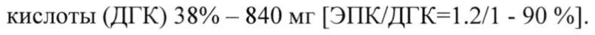

# Омега-3 кислот этиловые эфиры 90 — внутрь

- Препарат: Омакор (капсулы;)
- АТХ: C10AX06
- Источник: ГРЛС, инструкция по медицинскому применению, РУ ЛС-000559, файл от 2020-11-25 (https://grls.rosminzdrav.ru/Grls_View_v2.aspx?routingGuid=05219f4b-7729-4d15-90a7-dfef0cd76d67)
- Распознано автоматически (OCR): 8 из 8 стр.
- Инструкция к другому РУ того же препарата: ЛС-000559 (национальное РУ, переоформленное по правилам ЕАЭС, решение от 17.11.2020). Текст может быть старше действующего
- Сомнительных строк после OCR: 1 (см. раздел «Проверка распознавания»)

## Общие сведения

МИНЗДРАВ РОССИИ | <@-0005593 00113 | МИНИСТЕРСТВО ЗДРАВООХРАНЕНИЯ Р ССИИСКОИ ФЕДЕАЦИИ |
Ш: и ИНСТРУКЦИЯ ПО МЕДИЦИНСКОМУ ПРИМЕНЕНИЮ ЛЕКАРСТВЕННОГО ПРЕПАРАТА
Омакор Регистрационный номер:
Торговое наименование: Омакор Международное непатентованное или группировочное наименование: Омега-3 кислот этиловые эфиры 90
© Лекарственная форма: капсулы Состав 1 капсула содержит:
Действующее вещество:
Сумма Омега-3-полиненасыщенных жирных кислот этиловых эфиров — 1000 мг, в том числе:
wo этиловый эфир эйкозапентаеновой кислоты (ЭПК) 46% и этиловый эфир докозагексаеновой кислоты (ДГК) 38% — 840 мг [ЭПК/ДГК=1.2/1 - 90%].
Вспомогательные вещества:
а-Токоферол - 4 мг.
Оболочка капсулы: желатин — 293 мг, глицерол — 135 мг, вода очищенная - 4.5.
© Описание Прозрачная мягкая желатиновая капсула размером 20. Содержимое капсулы — маслянистая жидкость светло-желтого цвета.
Фармакотерапевтическая группа: гиполипидемическое средство
Код ATX: C10AX06 Фармакологические свойства

## 5.1. Фармакодинамика

Полиненасыщенные жирные кислоты класса омега-3 — эйкозапентаеновая кислота (ЭПК) и докозагексаеновая кислота (ДГК) — относятся к незаменимым (эссенциальным) жирным кислотам (НЭЖК). Омакор активен в отношении липидов плазмы крови, снижая концентрацию триглицеридов в результате уменьшения концентрации липопротеинов очень низкой плотности (ЛПОНП). Кроме того, он влияет на артериальное давление и гемостаз.
Полиненасыщенные жирные кислоты класса омега-3 — эйкозапентаеновая кислота (ЭПК) и докозагексаеновая кислота (ДГК) — относятся к незаменимым (эссенциальным) жирным кислотам (НЭЖК). Омакор активен в отношении липидов плазмы крови, снижая концентрацию триглицеридов в результате уменьшения концентрации липопротеинов очень низкой плотности (ЛПОНП). Кроме того, он влияет на артериальное давление и гемостаз.
Омакор снижает синтез триглицеридов в печени, так как ЭПК и ДГК являются менее активными субстратами для ферментов, ответственных за синтез триглицеридов, и они ингибируют этерификацию других жирных кислот.

© Снижению концентрации триглицеридов также способствует усиление В-окисления жирных кислот в пероксисомах печени, за счет чего снижается количество свободных жирных кислот, доступных для синтеза триглицеридов. Ингибирование этого синтеза снижает уровень
ЛПОНП.
Омакор повышает уровень холестерина липопротеинов низкой плотности (ЛИНП) у некоторых пациентов с гипертриглицеридемией. Повышение концентрации холестерина

w липопротеинов высокой плотности (JITIBIT) минимально, значительно ниже, чем после приема фибратов, и непостоянно.
Длительность гиполипидемического действия при приеме препарата Омакор более 1 года не изучалась. В остальном нет никаких убедительных доказательств, что снижение уровня триглицеридов снижает риск развития ишемической болезни сердца.

© В процессе терапии препаратом Омакор наблюдалось снижение синтеза тромбоксана A2 и незначительное увеличение времени свертывания крови. Существенного влияния на другие факторы свертывания крови не наблюдалось.
Результаты клинического исследования GISSI-Prevenzione, полученные за 3,5 года наблюдений, показали существенное снижение относительного риска смертности от всех причин, нефатального инфаркта миокарда и нефатального инсульта на 15 % ([2-26] p=0,0226)
у пациентов после недавно перенесенного инфаркта миокарда, принимавших препарат Омакор по 1 гв сутки. Дополнительно, относительный риск смерти по причине сердечно-сосудистой патологии, нефатального инфаркта миокарда и нефатального инсульта снижался на 20 %
([5-32] р=0,0082).
Результаты другого клинического исследования GISSI-Heart Failure, в котором пациенты с хронической сердечной недостаточностью получали препарат Омакор по 1 гв сутки в среднем

в течение 3,9 лет, показали снижение относительного риска смертности от всех причин на 9 %
(р=0,041), снижение относительного риска смертности от всех причин и госпитализации по причине сердечно-сосудистых патологий на 8 % (р=0,009), снижение относительного риска первичной госпитализации по причине желудочковых аритмий на 28 % (р=0,013).

## 5.2. Фармакокинетика

Во время и после всасывания в тонком кишечнике жирных кислот класса омега-3 имеются 3 главных пути их метаболизма:
Во время и после всасывания в тонком кишечнике жирных кислот класса омега-3 имеются 3 главных пути их метаболизма:
— жирные кислоты (ЖК) сначала доставляются в печень, где включаются в состав различных категорий липопротеинов и направляются к периферическим запасам липидов;
— фосфолипиды клеточных мембран заменяются фосфолипидами липопротеинов, после чего
© жирные кислоты могут выступать в качестве предшественников различных эйкозаноидов;
— большая часть жирных кислот окисляется с целью обеспечения энергетических потребностей.
Концентрация жирных кислот класса омега-3, ЭПК и ДГК в фосфолипидах плазмы крови соответствует концентрации ЭПК и ДГК, включаемых в состав клеточных мембран.
Фармакокинетические исследования на животных показали, что этиловые эфиры омега-3 w кислот подвергаются полному гидролизу, после чего ЭПК и ДГК в достаточном количестве всасываются и включаются в состав фосфолипидов и эфиров холестерина плазмы крови.

## 4.1. Показания к применению

Гипертриглицеридемия:
Гипертриглицеридемия:
© — эндогенная гипертриглицеридемия [У типа по классификации Фредериксона (в монотерапии) в качестве дополнения к гиполипидемической диете при ее недостаточной эффективности;
— эндогенная гипертриглицеридемия ПЬ или Ш типа по классификации Фредериксона в комбинации с ингибиторами ГМГ-КоА редуктазы (статинами), когда концентрация триглицеридов недостаточно контролируется приемом статинов.
Вторичная профилактика после инфаркта миокарда (в составе комбинированной терапии): в сочетании со статинами, антиагрегантными средствами, бета-адреноблокаторами, ингибиторами ангиотензинпревращающего фермента (АПФ).

## 4.3. Противопоказания

Повышенная чувствительность к действующему веществу, сое, арахису или любому из вспомогательных веществ, входящих в состав препарата.
Повышенная чувствительность к действующему веществу, сое, арахису или любому из вспомогательных веществ, входящих в состав препарата.
Возраст до 18 лет (эффективность и безопасность не установлены).

## 4.6. Применение при беременности и в период грудного вскармливания

Омакор не следует применять у пациентов с экзогенной гипертриглицеридемией
(гиперхиломикронемией [ типа).

## 4.3. С осторожностью

Установленная гиперчувствительность или аллергия на рыбу; возраст старше 70 лет;
Установленная гиперчувствительность или аллергия на рыбу; возраст старше 70 лет;
нарушения функции печени; одновременный прием с пероральными антикоагулянтами;
геморрагический диатез; пациенты с высоким риском кровотечений (вследствие тяжелой
© травмы, хирургической операции); вторичная эндогенная гипертриглицеридемия (особенно при неконтролируемом сахарном диабете).
Применение при беременности и в период грудного вскармливания
Беременность | Отсутствуют достоверные данные по применению препарата Омакор во время беременности.
- Исследования на животных не выявили токсического действия на репродуктивную функцию.
Потенциальный риск для человека неизвестен.
Назначать Омакор беременным следует с осторожностью, только после тщательной оценки соотношения риска и пользы, когда польза для матери превышает потенциальный риск для плода.
© Период грудного вскармливания Данные о выделении препарата Омакор с грудным молоком отсутствуют. Поэтому препарат не должен применяться в период грудного вскармливания.
Фертильность Достоверные данные о влиянии препарата Омакор на фертильность отсутствуют.

## 4.2. Способ применения и дозы

Внутрь, независимо от приема пищи. Во избежание развития возможных нежелательных явлений со стороны желудочно-кишечного тракта (ЖКТ) препарат Омакор может приниматься во время приема пищи.
Внутрь, независимо от приема пищи. Во избежание развития возможных нежелательных явлений со стороны желудочно-кишечного тракта (ЖКТ) препарат Омакор может приниматься во время приема пищи.
Гипертриглицеридемия Начальная доза составляет 2 капсулы в сутки. В случае отсутствия терапевтического эффекта возможно увеличение дозы до максимальной суточной дозы — 4 капсулы.
Вторичная профилактика инфаркта миокарда
Рекомендуется принимать по 1 капсуле в сутки.
Данные по применению препарата Омакор у детей и подростков, у пожилых пациентов старше 70 лет и у пациентов с печеночной недостаточностью (см. раздел «Особые указания»)
отсутствуют. Имеются ограниченные данные по применению препарата у пациентов с почечной недостаточностью.

## 4.8. Побочное действие

Частота побочных реакций, приведенных ниже, определялась соответственно следующему:
Частота побочных реакций, приведенных ниже, определялась соответственно следующему:
© очень часто (>1/10); часто (>1/100, <1/10); нечасто (>1/1000, <1/100); редко (>1/10000, <1/1000);
очень редко (<1/10000); частота неизвестна.
Нарушения со стороны иммунной системы: редко — повышенная чувствительность.
Нарушения со стороны обмена веществ и питания: нечасто — гипергликемия, подагра.
Нарушения со стороны нервной системы: нечасто — головокружение, дисгевзия (извращение вкуса), головная боль.
w Нарушения со стороны сосудов: нечасто — артериальная гипотензия.
Нарушения со стороны дыхательной системы, органов грудной клетки и средостения: нечасто
— эпистаксис (носовое кровотечение).
Нарушения со стороны желудочно-кишечного тракта: часто — желудочно-кишечные расстройства (в том числе вздутие живота, боль в животе, запор, диарея, диспепсия, метеоризм,
© отрыжка, гастроэзофагеальная рефлюксная болезнь, тошнота или рвота); нечасто — желудочнокишечное кровотечение.
Нарушения со стороны печени и желчевыводящих путей: нечасто — нарушения функции печени, в том числе увеличение активности трансаминаз (аланинаминотрансферазы (АЛТ) и аспартатаминотрансферазы (АСТ)).
Нарушения со стороны кожи и подкожных тканей: нечасто — кожная сыпь; редко — крапивница;
частота неизвестна — кожный зуд.

## 4.9. Передозировка

Особые указания отсутствуют. Должна быть проведена симптоматическая терапия.
Особые указания отсутствуют. Должна быть проведена симптоматическая терапия.

## 4.5. Взаимодействие с другими лекарственными средствами

При одновременном применении препарата Омакор с пероральными антикоагулянтами или другими препаратами, влияющими на систему гемостаза (например, ацетилсалициловая кислота или нестероидные противовоспалительные препараты (НПВП)), наблюдалось увеличение времени свертывания крови, что может являться следствием возможного аддитивного влияния на время свертывания крови. При этом геморрагических осложнений не наблюдалось (см. раздел «Особые указания»).
Ацетилсалициловая кислота: пациенты должны быть проинформированы о возможном увеличении времени свертывания крови.
Совместное применение препарата Омакор с варфарином не приводило к каким-либо
© геморрагическим осложнениям. Однако необходим контроль соотношения протромбинового времени/международного нормализованного отношения (ПТВ/МНО) при совместном применении препарата Омакор с другими препаратами, влияющими на соотношение
IITB/MHO, или после прекращения терапии препаратом Омакор.

## 4.4. Особые указания

Омакор должен применяться с осторожностью у пациентов с установленной гиперчувствительностью или аллергией на рыбу.
Омакор должен применяться с осторожностью у пациентов с установленной гиперчувствительностью или аллергией на рыбу.
В связи с умеренным увеличением времени свертывания крови (при приеме в высокой дозе, т.е. 4 капсулы в сутки) требуется наблюдение за пациентами, имеющими нарушения со - стороны свертывающей системы крови или получающими антикоагулянтную терапию или
© другие препараты, влияющие на систему гемостаза (например, ацетилсалициловую кислоту или НИВИ); при необходимости, доза антикоагулянта должна быть скорректирована (см.
раздел «Взаимодействие с другими лекарственными средствами»).
Необходимо учитывать увеличение времени свертывания крови у пациентов с высоким риском развития кровотечения (вследствие тяжелой травмы, хирургического вмешательства и т.п.).
При терапии препаратом Омакор снижается уровень образования тромбоксана А2.
Существенного влияния на уровень других факторов свертывания крови не наблюдалось. В клинических исследованиях не отмечалось повышения частоты эпизодов кровотечения.
У некоторых пациентов наблюдалось небольшое, но достоверное повышение активности АСТ и АЛТ (в пределах нормы), при этом отсутствуют данные, указывающие на повышенный риск приема препарата Омакор пациентами с нарушением функции печени. Необходим контроль активности АСТ и АЛТ у пациентов с любыми признаками нарушения функции печени (в частности, при приеме в высокой дозе, т.е. 4 капсулы в сутки).

Опыт применения препарата Омакор для лечения экзогенной гипертриглицеридемии

(гиперхиломикронемии типа 1) отсутствует. Опыт применения препарата Омакор при

вторичной эндогенной гипертриглицеридемии ограничен (особенно при неконтролируемом

сахарном диабете).

## 4.7. Влияние на способность управлять транспортными средствами, механизмами

Исследований по влиянию препарата Омакор на способность управлять транспортными

средствами и работать с механизмами не проводилось. Тем не менее ожидается, что препарат

не оказывает или оказывает несущественное влияние на способность управлять
© транспортными средствами и работать с механизмами.

## 6.5. Форма выпуска

Капсулы, 1000 мг.

По 28 или 100 желатиновых капсул упакованы во флаконы из полиэтилена высокой плотности

белого цвета, укупоренные пробкой с отрывным кольцом (с контролем первого вскрытия) и
& навинчиваемой крышкой. На флакон наклеена самоклеющаяся этикетка.

По 1 флакону вместе с инструкцией по применению в картонную коробку.

## 6.4. Условия хранения

Хранить при температуре не выше 25 °С.
© Не замораживать.

Хранить в недоступном для детей месте!

## 6.3. Срок годности

3 года.

Не применять по истечении срока годности, указанного на упаковке.

Условия отпуска

Отпускают по рецепту.

Производитель Патеон Софтджелс Б.В.
Де Постоорнстраат 7, Тилбург, 5048 АЗ, Нидерланды
Фасовщик и упаковщик ГМПэк AnC Плаственгет 9 DK-9560 Хадсунд, Дания
Выпускающий контроль качества Эбботт Лэбораториз ГмбХ
& Юстус-фон-Либиг-Штрассе 33, 31535 Нойштадт, Германия
Организация, уполномоченная владельцем регистрационного удостоверения лекарственного препарата для медицинского применения на принятие претензий от потребителей
ООО «Эбботт Лэбораториз»
- 125171, г. Москва, Ленинградское шоссе, дом 16А, стр. 1
Тел.: +7 (495) 258 42 80 Факс: +7 (495) 258 42 81 abbott-russia@abbott.com
)
© Старший менеджер департамента регистрации _-—__ п

ООО «Эбботт Лэбораториз» ря —& x Щуклин M.A.
CCDS SOLID 1000323687 v3.0 | т 3) $< ——
## Проверка распознавания

Страницы-сканы распознаны автоматически. В 1 строках с дозировками цифры могли распознаться с ошибкой — сверьте с вырезкой из оригинала:

- стр. 1: «кислоты (ДГК) 38% — 840 мг [ЭПК/ДГК=1.2/1 - 90%].» — низкая уверенность: «90%].» (79)  
  
