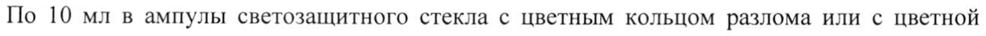

# Орнитина аспартат — парентерально

- Препарат: ОРНИЛАТЕКС® (концентрат для приготовления раствора для инфузий;)
- АТХ: A05BA
- Источник: ГРЛС, инструкция по медицинскому применению, РУ ЛП-002691, файл от 2021-09-20 (https://grls.rosminzdrav.ru/Grls_View_v2.aspx?routingGuid=44a2a803-e137-4588-9efe-2e9fb68a263f)
- Распознано автоматически (OCR): 4 из 4 стр.
- Инструкция к другому РУ того же препарата: ЛП-002691 (прежняя редакция, решение от 01.09.2021). Текст может быть старше действующего
- Сомнительных строк после OCR: 1 (см. раздел «Проверка распознавания»)

## Общие сведения

МИНИСТЕРСТВО ЗДРАВООХРАНЕНИЯ РОССИЙСКОЙ ФЕДЕРАЦИИ
ИНСТРУКЦИЯ ПО МЕДИЦИНСКОМУ ПРИМЕНЕНИЮ ЛЕКАРСТВЕННОГО ПРЕПАРАТА
ОРНИЛАТЕКС*

УД | | | МИНЗДРАВ РОССИИ

Регистрационный номер: ЛП-002691 . ; | АО 00kG9/- 111119

Торговое наименование: ОРНИЛАТЕКС® _ _ COTMACOBAHO _ 4

Международное непатентованное наименование: орнитин

## 3. Лекарственная форма

концентрат для приготовления раствора для инфузий
концентрат для приготовления раствора для инфузий

Состав на 1 ампулу:

Действующее вещество: орнитина аспартат (в пересчете на сухое вещество) - 5,0 г

& Вспомогательное вещество: вода для инъекций до 10 мл.

Описание

Бесцветная или светло-желтого цвета прозрачная жидкость.

Фармакотерапевтическая группа: гипоазотемическое средство.

Код ATX: AOSBA

Фармакологические свойства

## 5.1. Фармакодинамика

Снижает повышенную концентрацию аммиака в организме, в частности, при

заболеваниях печени. Действие препарата связано с его участием в орнитиновом цикле

мочевинообразования Кребса (образование мочевины из аммиака). Орнитин выступает в

качестве катализатора для ферментов карбамоилфосфатсинтетазы и орнитина

карбамоилтрансферазы, а также является основой для синтеза мочевины. Кроме того,

препарат активирует орнитиновый цикл образования мочевины, что также способствует снижению уровня аммиака. Способствует выработке инсулина и соматотропного гормона.
Улучшает белковый обмен при заболеваниях, требующих парентерального питания.

## 5.2. Фармакокинетика

In vivo образует два активных метаболита: аспартат и орнитин, имеющие короткий период полувыведения 0,3-0,4 часа, выводятся почками через цикл мочевинообразования.
In vivo образует два активных метаболита: аспартат и орнитин, имеющие короткий период полувыведения 0,3-0,4 часа, выводятся почками через цикл мочевинообразования.
Незначительная часть аспартата выводится почками в неизмененном виде.

## 4.1. Показания к применению

— острые и хронические заболевания печени, сопровождающиеся гипераммониемией;
— острые и хронические заболевания печени, сопровождающиеся гипераммониемией;
— печеночная энцефалопатия, в т.ч. в составе комплексной терапии нарушения сознания (прекома и кома);
w — в качестве корригирующей добавки к препаратам для парентерального питания у пациентов с белковой недостаточностью.

## 4.3. Противопоказания

— тяжелая почечная недостаточность (сывороточный креатинин > 3 мг/1 дл);
— тяжелая почечная недостаточность (сывороточный креатинин > 3 мг/1 дл);
& — повышенная чувствительность к компонентам препарата;
— период грудного вскармливания;
— детский возраст до 18 лет.

## 4.6. Применение при беременности и в период грудного вскармливания

© В период беременности применение препарата ОРНИЛАТЕКС® возможно только под строгим наблюдением врача с учетом соотношения польза/риск для матери и плода.
На время лечения препаратом следует прекратить грудное вскармливание.

## 4.2. Способ применения и дозы

Внутривенно (в/в) капельно. Содержимое ампул смешивают с 500 мл инфузионного раствора (0,9 % раствор натрия хлорида, 5 % раствор декстрозы (глюкозы) или раствор
Внутривенно (в/в) капельно. Содержимое ампул смешивают с 500 мл инфузионного раствора (0,9 % раствор натрия хлорида, 5 % раствор декстрозы (глюкозы) или раствор
Рингера).
Взрослые Средняя терапевтическая дозировка 20 г орнитина в сутки.
При печеночной энцефалопатии (в зависимости от степени тяжести состояния) в/в вводят до 40 г орнитина в сутки.
Рекомендуется растворять не более 30 г орнитина в 500 мл инфузионного раствора.
Максимальная скорость инфузии — 5 г орнитина в час.
Продолжительность терапии. препаратом определяется в каждом случае индивидуально, исходя из патологии и тяжести состояния пациента. При тяжелых нарушениях функции печени необходим строгий мониторинг за состоянием пациента и коррекция скорости введения препарата для предупреждения развития тошноты и рвоты.
Дети Нет данных о применении препарата в педиатрической практике.

## 4.8. Побочное действие

Очень редко (менее 0,01 %):
Очень редко (менее 0,01 %):
— тошнота, рвота;
- — аллергические реакции.

## 4.9. Передозировка

Симптомы: усиление выраженности дозозависимых побочных эффектов.
Симптомы: усиление выраженности дозозависимых побочных эффектов.
Лечение: прием препарата следует прекратить и проводить симптоматическое лечение.
-

## 4.5. Взаимодействие с другими лекарственными средствами

Не выявлено.
ОРНИЛАТЕКС® не следует смешивать с другими лекарственными препаратами. Для разведения использовать только растворы, указанные в инструкции.
© Особые указания При введении препарата в высоких дозах следует контролировать концентрацию мочевины в плазме крови и моче. При тяжелом нарушении функции печени в соответствии с состоянием больного необходимо уменьшить скорость введения инфузионного раствора с целью предупреждения тошноты или рвоты.

## 4.7. Влияние на способность управлять транспортными средствами, механизмами

ОРНИЛАТЕКС® не оказывает влияния на способность управлять транспортным средством и потенциально опасными механизмами.

## 6.5. Форма выпуска

Концентрат для приготовления раствора для инфузий, 500 мг/мл.
Концентрат для приготовления раствора для инфузий, 500 мг/мл.
По 10 мл в ампулы светозащитного стекла с цветным кольцом разлома или с цветной точкой и насечкой. На ампулы дополнительно наносят одно, два или три цветных кольца и/или двухмерный штрих-код, и/или буквенно-цифровую кодировку или без дополнительных цветных колец, двухмерного штрих-кода, буквенно-цифровой кодировки.

По 5 ампул в контурной ячейковой упаковке из пленки поливинилхлоридной и фольги алюминиевой или пленки полимерной или без фольги и без пленки.

1 или 2 контурные ячейковые упаковки вместе с инструкцией по применению в пачке из картона.

## 6.4. Условия хранения

В защищенном от света месте при температуре не выше 25 °С.

& Хранить в недоступном для детей месте.

## 6.3. Срок годности

2 года. Не применять по истечении срока годности.

Условия отпуска

Отпускают по рецепту.

Производитель

ЗАО «ФармФирма «Сотекс», Россия,

141345, Московская область, Сергиево-Посадский муниципальный район, сельское

© поселение Березняковское, пос. Беликово, д. 10, д. 11, д. 12

Юридическое лицо, на имя которого выдано регистрационное удостоверение, и организация, принимающая претензии потребителей

ЗАО «ФармФирма «Сотекс», Россия

141345, Московская область, Сергиево-Посадский муниципальный район, сельское поселение Березняковское, пос. Беликово, д. 11

Т./ф.: (495) 956-29-30

Начальник медицинского отдела и о Тихонова И.В.

i ^ foie Bra ЗАО «ФармФирма «Сотекс» < АИ:
## Проверка распознавания

Страницы-сканы распознаны автоматически. В 1 строках с дозировками цифры могли распознаться с ошибкой — сверьте с вырезкой из оригинала:

- стр. 4: «По 10 мл в ампулы светозащитного стекла с цветным кольцом разлома или с цветной» — повторное чтение: «По 10 млв ампулы светозащитного стекла с цветным кольцом разлома или с цветной»  
  
