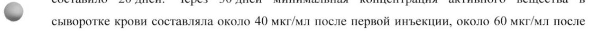
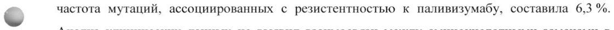
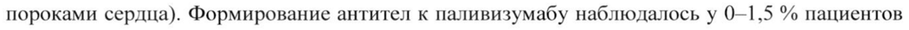
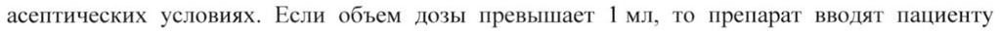
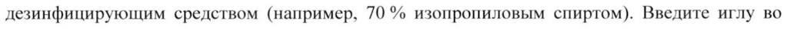

# Паливизумаб — парентерально

- Препарат: Синагис® (раствор для внутримышечного введения;)
- АТХ: J06BD01
- Источник: ГРЛС, инструкция по медицинскому применению, РУ ЛП-005242, файл от 2024-06-03 (https://grls.rosminzdrav.ru/Grls_View_v2.aspx?routingGuid=21497e0e-46bf-49e8-b233-1d04f93b88d1)
- Распознано автоматически (OCR): 10 из 10 стр.
- Инструкция к другому РУ того же препарата: ЛП-005242 (национальное РУ, переоформленное по правилам ЕАЭС, решение от 07.08.2023). Текст может быть старше действующего
- Сомнительных строк после OCR: 5 (см. раздел «Проверка распознавания»)

## Общие сведения

МИНИСТЕРСТВО ЗДРАВООХРАНЕНИЯ РОССИЙСКОЙ ФЕДЕРАЦИИ
МИНЗДРАВ РОССИИ | ЛН- 005242 - 1019 ИНСТРУКЦИЯ 05242 - 101218
_ Car | гл ПО МЕДИЦИНСКОМУ ПРИМЕНЕНИЮ ЛЕКАРСТВЕННОГО ИРЕНАВАТА. —
Синагис” Регистрационный номер Торговое наименование препарата
Синагис® - Международное непатентованное наименование
Паливизумаб Лекарственная форма Раствор для внутримышечного введения

## 2. Состав

| Компонент Содержание на 1 мл Действующее вещество |
| Компонент Содержание на 1 мл Действующее вещество |
-
* Флакон содержит избыток препарата для того, чтобы гарантировать набор в шприц дозы 50 мг или 100 мг, соответственно. Объем готового продукта составляет около 0,70 мл + 0,10 мл (номинальный объем 0,5 мл) или 1,20 мл + 0,10 мл (номинальный объем | мл) раствора с концентрацией 100 мг/мл.
Описание Прозрачный или слегка опалесцирующий, бесцветный или слегка желтоватый раствор.
Допустимо наличие небольших полупрозрачных частиц.
Фармакотерапевтическая группа Антитела моноклональные
Код АТХ | JO6BB16 Иммунобиологические свойства
Паливизумаб представляет собой гуманизированное моноклональное антитело [gGi,, взаимодействующее с эпитопом А антигена белка слияния (белок Е) респираторного синцитиального вируса (PCB). Молекула паливизумаба состоит из человеческих (95 %) и мышиных (5 %) аминокислотных последовательностей.
©, Паливизумаб оказывает выраженное нейтрализующее и ингибирующее действие на белки слияния штаммов РСВ подтипов А и В.
Паливизумаб, при концентрации в плазме крови хлопковых крыс около 30 мкг/мл, показывал снижение репликации РСВ в среднем на 99 %.

## 5.2. Фармакокинетика

В исследованиях у взрослых добровольцев паливизумаб имел фармакокинетический профиль, сходный с профилем человеческого антитела IgG; с учетом отношения объема распределения (среднее значение 57 мл/кг) и периода полувыведения (среднее значение 18 дней). В клинических исследованиях, проводимых у детей, среднее значение периода полувыведения после однократного внутримышечного введения препарата в дозе 15 мг/кг составило 20 дней. Через 30 дней минимальная концентрация активного вещества в
В исследованиях у взрослых добровольцев паливизумаб имел фармакокинетический профиль, сходный с профилем человеческого антитела IgG; с учетом отношения объема распределения (среднее значение 57 мл/кг) и периода полувыведения (среднее значение 18 дней). В клинических исследованиях, проводимых у детей, среднее значение периода полувыведения после однократного внутримышечного введения препарата в дозе 15 мг/кг составило 20 дней. Через 30 дней минимальная концентрация активного вещества в
- сыворотке крови составляла около 40 мкг/мл после первой инъекции, около 60 мкг/мл после второй инъекции и около 70 мкг/мл после третьей и четвертой инъекций. Препарат вводили внутримышечно | раз в месяц.
Фармакокинетику и безопасность препарата Синагис° в форме раствора для внутримышечного введения и в лиофилизированной форме при внутримышечном введении в дозе 15 мг/кг оценивали в перекрестном исследовании у 153 преждевременно рожденных детей в возрасте не более 6 месяцев. Результаты исследования свидетельствуют о том, что минимальная концентрация паливизумаба в сыворотке крови была одинаковой при применении препарата Синагис” в виде раствора для внутримышечного введения и в лиофилизированной форме, которая использовалась в клинических исследованиях.
Резистентность Паливизумаб связывается с высококонсервативным участком внеклеточного домена зрелого белка Е РСВ (антигенный участок П или антигенный участок А), охватывающим аминокислоты с 262 по 275. Все мутации PCB, приводившие к резистентности к паливизумабу, характеризовались аминокислотными заменами в данном участке белка Е. Не было отмечено возникновения резистентности РСВ к связыванию паливизумабом в случае полиморфных или неполиморфных аминокислотных замен в белке Е, кроме антигенного участка А. У 8 из 126 клинических изолятов PCB, полученных от пациентов, не отвечающих на иммунопрофилактику, была выявлена как минимум одна из аминокислотных замен, ассоциированных с резистентностью к паливизумабу (№262), K272E/Q или $275Е/.); общая
© частота мутаций, ассоциированных с резистентностью к паливизумабу, составила 6,3 %.
Анализ клинических данных не выявил взаимосвязи между аминокислотными заменами в антигенном участке А и тяжестью РСВ-инфекции у детей, которым вводился паливизумаб в профилактических целях и у которых развилась РСВ-инфекция нижних дыхательных путей.
Анализ 254 клинических изолятов PCB, полученных у пациентов, ранее не получавших иммунопрофилактику паливизумабом, выявил 2 случая мутаций, ассоциированных с резистентностью к паливизумабу (с аминокислотными заменами №2620 и S8275F, соответственно); таким образом, частота мутаций, ассоциированных с резистентностью к паливизумабу, составила 0,79 %.
Иммуногенность | В клиническом исследовании установлено, что при проведении первого курса терапии w препаратом Синагис® в 1 % случаев формируются антитела, специфичные к паливизумабу, характеризующиеся низким титром. При проведении второго курса терапии у 55 из 56 детей антитела не выявлялись, включая два случая обнаружения антител в течение первого курса. В исследованиях у детей с врожденным пороком сердца антигенная активность препарата не изучалась.
Формирование антител к паливизумабу также изучалось в четырех дополнительных исследованиях у 4337 пациентов, получавших лечение паливизумабом (дети, рожденные на 35 неделе беременности и ранее, в возрасте 6 месяцев и менее или в возрасте менее 24 месяцев с бронхолегочной дисплазией или гемодинамически значимыми врожденными пороками сердца). Формирование антител к паливизумабу наблюдалось у 0-1,5 % пациентов в различные моменты наблюдения. Не было выявлено взаимосвязи между присутствием антител к паливизумабу и возникновением побочных реакций. Таким образом, формирование антител к паливизумабу носит временный характер и не имеет клинического значения.

## 4.1. Показания к применению

Профилактика тяжелой инфекции нижних дыхательных путей, вызванной респираторным синцитиальным вирусом (PCB), у детей с высоким риском заражения PCB, к которым относятся:
Профилактика тяжелой инфекции нижних дыхательных путей, вызванной респираторным синцитиальным вирусом (PCB), у детей с высоким риском заражения PCB, к которым относятся:
® Дети в возрасте до 6 месяцев, рожденные Ha 35 неделе беременности или ранее;
e Дети в возрасте до 2 лет, которым требовалось лечение по поводу бронхолегочной дисплазии в течение последних 6 месяцев;
® Дети в возрасте до 2 лет с гемодинамически значимыми врожденными пороками
> сердца.

## 4.3. Противопоказания

Повышенная чувствительность к паливизумабу или к одному из вспомогательных веществ препарата или к другим человеческим моноклональным антителам.
Повышенная чувствительность к паливизумабу или к одному из вспомогательных веществ препарата или к другим человеческим моноклональным антителам.

## 4.2. Способ применения и дозы

Препарат Синагис® вводят внутримышечно, предпочтительно в наружную боковую область бедра. Ягодичную мышцу не следует часто использовать для проведения инъекций из-за риска повреждения седалищного нерва. Инъекцию следует проводить в стандартных асептических условиях. Если объем дозы превышает 1 мл, то препарат вводят пациенту
Препарат Синагис® вводят внутримышечно, предпочтительно в наружную боковую область бедра. Ягодичную мышцу не следует часто использовать для проведения инъекций из-за риска повреждения седалищного нерва. Инъекцию следует проводить в стандартных асептических условиях. Если объем дозы превышает 1 мл, то препарат вводят пациенту
© дробно.
Рекомендованная разовая доза препарата составляет 15 мг/кг массы тела. Схема применения состоит из 5 инъекций препарата, проводимых с интервалом | мес в течение сезонного подъема заболеваемости, вызываемой респираторным синцитиальным вирусом.
Предпочтительно, чтобы первая инъекция была произведена до начала подъема заболеваемости. Преимущества более длительного применения препарата не установлены.
Месячная доза (мл) препарата Синагис® рассчитывается по формуле:
Вес пациента (кг) х 15 мг/кг 100 мг/мл Эффективность препарата Синагис® при введении в дозах менее 15 мг/кг или при введении реже, чем раз в месяц в течение периода подъема заболеваемости РСВ, не установлена.
Детям, перенесшим операции на сердце с применением аппарата искусственного кровообращения, рекомендуется вводить дозу препарата Синагис® (15 мг/кг массы тела)
сразу же по достижении стабильного состояния после операции для поддержания необходимой концентрации препарата в сыворотке крови.
Детям, которые были инфицированы РСВ во время применения препарата Синагис”, рекомендуется продолжить его применение ежемесячно в течение всего подъема заболеваемости, чтобы снизить риск реинфекции.
Препарат Синагис® не требует разведения. Не смешивайте препарат Синагис” в лекарственных формах «раствор для внутримышечного введения» и «лиофилизат для приготовления раствора для внутримышечного введения».

& Не следует встряхивать флакон и сильно перемешивать его содержимое.
Перед применением препарата Синагис® необходимо провести его визуальную оценку для исключения изменения цвета или наличия частиц. Не используйте препарат, если в нем содержатся видимые частицы или его цвет изменился.
Соблюдая правила асептики, наденьте стерильную иглу на стерильный шприц. Удалите пластиковый съемный колпачок с флакона и обработайте резиновую пробку дезинфицирующим средством (например, 70 % изопропиловым спиртом). Введите иглу во флакон и наберите в шприц необходимый объем раствора, после чего сразу же сделайте инъекцию.
Препарат Синагис” выпускается во флаконах, содержащих одну дозу, и не содержит консервантов. После того, как препарат набран в шприц, вводить его обратно во флакон

© нельзя; неиспользованный раствор следует утилизировать. Один флакон предназначен только для однократного введения препарата.
Используйте стерильные шприцы и иглы одноразового применения. Для предотвращения передачи вирусов гепатита и других инфекционных агентов HE используйте шприцы и иглы повторно.

## 4.8. Побочное действие

Наиболее тяжелыми побочными реакциями при применении препарата Синагис” являются анафилаксия и другие реакции гиперчувствительности немедленного типа. Наиболее частые побочные реакции, наблюдавшиеся при применении паливизумаба — лихорадка, сыпь и реакции в месте введения.
Наиболее тяжелыми побочными реакциями при применении препарата Синагис” являются анафилаксия и другие реакции гиперчувствительности немедленного типа. Наиболее частые побочные реакции, наблюдавшиеся при применении паливизумаба — лихорадка, сыпь и реакции в месте введения.

В исследованиях по применению препарата в профилактических целях побочные реакции у детей в контрольной группе и в группе детей, получавших препарат, были сходными.
Побочные реакции были преходящими, степень их тяжести варьировала от легкой до умеренной.
Побочные реакции, наблюдавшиеся в клинических исследованиях и в период пострегистрационного применения по профилактике инфекций, вызванных PCB, у недоношенных детей, детей с бронхолегочной дисплазией и детей с врожденными заболеваниями сердца, возможно причинно-связанные с применением препарата, перечислены в зависимости от систем органов и частоты встречаемости (очень частые > 1/10;
частые > 1/100, < 1/10; нечастые > 1/1000, < 1/100; редкие > 1/10000, < 1/1000).
© О нежелательных реакциях, выявленных в ходе пострегистрационного наблюдения, добровольно сообщались пациентами из различных групп с неустановленным количеством больных, поэтому не всегда возможно достоверно оценить частоту таких реакций или установить причинно-следственную связь с воздействием паливизумаба. Частота возникновения этих побочных реакций, приведенная в таблице ниже, оценивалась с использованием данных о безопасности, полученных в ходе проведения двух регистрационных клинических исследований. По результатам данных исследований было выявлено, что эти реакции с одинаковой частотой возникали в группах пациентов, принимавших паливизумаб и плацебо и что реакции не были связаны с применяемым препаратом.
© Побочные реакции, наблюдавшиеся в клинических исследованиях и в период пострегистрационного применения
Нарушения со стороны крови | Нечасто Тромбоцитопения .
и лимфатической системы Нарушения со — стороны | Неизвестно Анафилаксия, иммунной системы анафилактический шок (в том числе были зарегистрированы случаи летальных исходов).
СООО ОО ОО Нарушения со — стороны | Часто Апноэ’.
дыхательной системы, органов грудной клетки и средостения
Общие расстройства — u | Очень часто Повышение температуры нарушения в месте введения тела.

© — побочные реакции зафиксированные в период пострегистрационного применения.
Описание отдельных нежелательных реакций
Пострегистрационные исследования В пострегистрационных исследованиях зафиксировано незначительное увеличение частоты возникновения астмы у недоношенных новорожденных, однако причинно-следственная связь не установлена.

## 4.9. Передозировка

В трех имевших место случаях передозировки препаратом Синагис” (препарат вводился в дозах 20,25 мг/кг массы тела, 21,1 мг/кг массы тела и 22,27 мг/кг массы тела) какие-либо неблагоприятные проявления отсутствовали.
В трех имевших место случаях передозировки препаратом Синагис” (препарат вводился в дозах 20,25 мг/кг массы тела, 21,1 мг/кг массы тела и 22,27 мг/кг массы тела) какие-либо неблагоприятные проявления отсутствовали.

©, В постмаркетинговых исследованиях были зарегистрированы случаи передозировки препаратом Синагис” до 85 мг/кг и в некоторых случаях возникающие побочные реакции не отличались от таковых при применении препарата Синагис” в дозе 15 мг/кг. При передозировке рекомендуется наблюдение за пациентом для своевременного выявления симптомов и признаков побочных реакций и для назначения соответствующего симптоматического лечения.

## 4.5. Взаимодействие с другими лекарственными средствами

Исследования по изучению взаимодействия паливизумаба с другими лекарственными средствами не проводились, в связи с чем до настоящего времени отсутствуют данные о подобном взаимодействии. В ходе клинического исследования Ш фазы недоношенные дети и дети с бронхолегочной дисплазией получали паливизумаб одновременно с вакцинами для

профилактики детских инфекций, гриппозной вакциной, бронхорасширяющими средствами и

глюкокортикостероидами. Повышения частоты побочных реакций среди детей, получавших

эти препараты, не отмечалось.

Так как моноклональные антитела являются специфичными только в отношении РСВ,

предполагается, что паливизумаб не должен препятствовать развитию иммунитета при

вакцинации.

Влияние на результаты иммунохимических тестов

Применение паливизумаба может оказывать влияние на результаты иммунохимических

диагностических тестов Ha PCB, например, некоторых тестов, основанных на обнаружении

антител. Кроме того, паливизумаб ингибирует репликацию вирусов в культуре клеток, что
© может оказывать влияние на результаты тестов, основанных на выращивании вирусов в

культуре клеток. Подобное взаимодействие может приводить к ложноотрицательным

результатам диагностических тестов на РСВ. При применении паливизумаба результаты

диагностических тестов должны использоваться в сочетании с клиническими данными для

достоверной постановки диагноза.

Применение паливизумаба не оказывает влияния на результаты диагностических тестов,

основанных на полимеразной цепной реакции (ПЦР) с использованием обратной

транскриптазы.

## 4.4. Особые указания

Применение препарата Синагис” может сопровождаться аллергическими реакциями

немедленного типа, включая анафилактические (очень редкие случаи анафилаксии и
- анафилактического шока, некоторые со смертельным исходом), в связи с этим, помещение, в

котором осуществляется введение препарата, должно быть обеспечено средствами

противошоковой терапии.

Среднетяжелое или тяжелое острое инфекционное заболевание или лихорадочное состояние

может служить основанием для задержки начала применения препарата Синагис®, за

исключением случаев, когда, по мнению врача, отказ от препарата представляет болыший

риск. Легкое лихорадочное состояние, например, легкая инфекция верхних дыхательных

путей, не может служить причиной задержки применения препарата Синагис”.

Препарат Синагис® следует назначать с осторожностью пациентам с тромбоцитопенией или

нарушениями системы свертывания крови.

Официальных исследований по изучению эффективности паливизумаба при назначении пациентам в качестве второго курса лечения в течение следующего эпидемического сезона
РСВ не проводилось. Возможный риск усиления инфекции РСВ в сезон, следующий за сезоном, в котором пациенты проходили лечение паливизумабом, не был окончательно исключен в рамках исследований, проведенных с этой целью.

## 6.5. Форма выпуска

Раствор для внутримышечного введения, 100 мг/мл.
Раствор для внутримышечного введения, 100 мг/мл.
По 0,5 мл или 1 мл (номинальный объем) препарата во флаконе 2R с кольцевой канавкой / кольцевым выступом на внутренней поверхности горлышка («блоу-бэк») из прозрачного, бесцветного стекла типа | (Евр. Фарм.), укупоренном хлорбутиловой пробкой с тефлоновым
& покрытием и обжатом лакированным алюминиевым колпачком с полипропиленовой крышечкой. По одному флакону в пластиковом контейнере, по одному пластиковому контейнеру вместе с инструкцией по применению в пачке картонной.

## 6.4. Условия хранения

При температуре от 2 до 8 °С. Хранить в недоступном для детей месте.
При температуре от 2 до 8 °С. Хранить в недоступном для детей месте.

## 6.3. Срок годности

3 года. Не применять по истечении срока годности, указанного на упаковке.
3 года. Не применять по истечении срока годности, указанного на упаковке.
Условия отпуска Отпускают по рецепту.
> Владелец регистрационного удостоверения
OOO «ЭббВи», Россия 125047, г. Москва, ул. Лесная, д. 7, этаж 4, помещение |
Производитель Берингер Ингельхайм Фарма ГмбХ и Ko.KT,
Биркендорфер штрассе 65, 02-88397 Биберах-на-Риссе, Германия.
Boehringer Ingelheim Pharma GmbH & Co.KG,
Birkendorfer Strasse 65, D-88397 Biberach an der Riss, Germany
Упаковщик (вторичная (потребительская) упаковка) и выпускающий контроль качества
ЭббВи С.Р.Л., С.Р. 148 Понтина Км 52 cnx, 04011 Камповерде ди Априлиа (JIT), Италия
AbbVie S.R.L.
S.R. 148 Pontina Km 52 s.n.c., 04011 Campoverde di Aprilia (LT), Italy
При осуществлении упаковки препарата ОАО «Фармстандарт-УфаВИТА» указывают:
Упаковщик (вторичная (потребительская) упаковка) и выпускающий контроль качества
ОАО «Фармстандарт-УфаВИТА», 450077, Республика Башкортостан, г. Уфа, ул. Худайбердина, д. 28,
© тел./факс (347) 272 92 85, www.pharmstd.ru
Наименование и адрес организации, уполномоченной принимать претензии на лекарственный препарат:
OOO «Э6бВи»
125047, г. Москва, ул. Лесная, д.7, БЦ «Белые Сады», здание «А»
тел. (495) 258 42 77 факс (495) 258 42 87
При осуществлении упаковки препарата ОАО «Фармстандарт-УфаВИТА» указывают:
© ОАО «Фармстандарт-УфаВИТА», 450077, Республика Башкортостан, г. Уфа, ул. Худайбердина, д. 28, тел./факс (347) 272 92 85, www.pharmstd.ru ASIEN и о, и - ““\
Менеджер по регуляторным вопросам! | | у \
ООО «ЭббВи», Россия \ а Г. Синев Д.Е.
Же § iy, SmPC 11/09/2017 —7
## Проверка распознавания

Страницы-сканы распознаны автоматически. В 5 строках с дозировками цифры могли распознаться с ошибкой — сверьте с вырезкой из оригинала:

- стр. 2: «- сыворотке крови составляла около 40 мкг/мл после первой инъекции, около 60 мкг/мл после» — повторное чтение: «- сыворотке posit составляла ко aa ee рай, енг ии после»  
  
- стр. 3: «© частота мутаций, ассоциированных с резистентностью к паливизумабу, составила 6,3 %.» — повторное чтение: «© о “7” "тан, ассоциированных с резистентностью к паливизумабу, составила 6,3 7»  
  
- стр. 3: «пороками сердца). Формирование антител к паливизумабу наблюдалось у 0-1,5 % пациентов» — низкая уверенность: «0-1,5» (58)  
  
- стр. 4: «асептических условиях. Если объем дозы превышает 1 мл, то препарат вводят пациенту» — низкая уверенность: «1» (60); повторное чтение: «асептических условиях. Если объем дозы превышает | мл, то препарат вводят пациенту»  
  
- стр. 5: «дезинфицирующим средством (например, 70 % изопропиловым спиртом). Введите иглу во» — низкая уверенность: «70» (80)  
  
